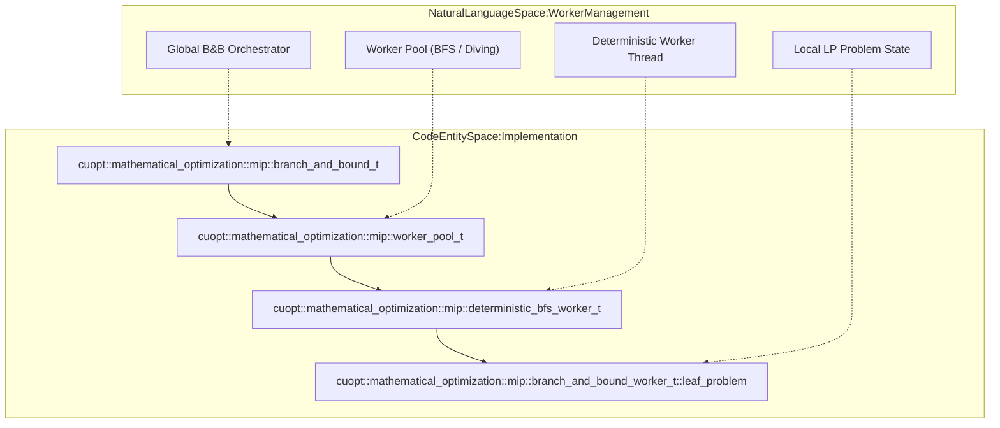
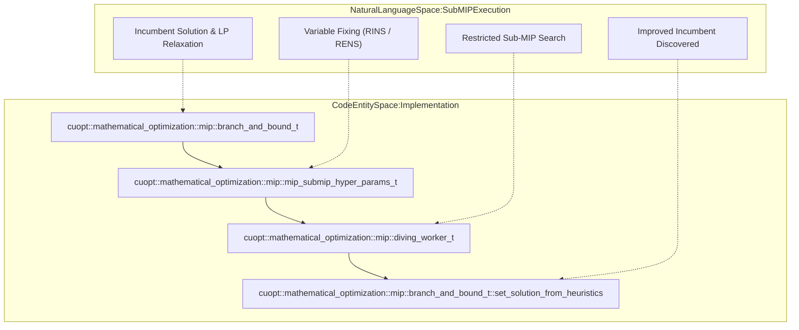

<!-- source: DeepWiki mcp.deepwiki.com · repo NVIDIA/cuopt · extra page Branch and Bound · fetched 2026-10-26 -->

# Branch and Bound

Relevant source files

The following files were used as context for generating this wiki page:

- [cpp/include/cuopt/mathematical_optimization/mip/submip_hyper_params.hpp](cpp/include/cuopt/mathematical_optimization/mip/submip_hyper_params.hpp)
- [cpp/src/branch_and_bound/CMakeLists.txt](cpp/src/branch_and_bound/CMakeLists.txt)
- [cpp/src/branch_and_bound/branch_and_bound.cpp](cpp/src/branch_and_bound/branch_and_bound.cpp)
- [cpp/src/branch_and_bound/branch_and_bound.hpp](cpp/src/branch_and_bound/branch_and_bound.hpp)
- [cpp/src/branch_and_bound/constants.hpp](cpp/src/branch_and_bound/constants.hpp)
- [cpp/src/branch_and_bound/degenerate_pivots.cpp](cpp/src/branch_and_bound/degenerate_pivots.cpp)
- [cpp/src/branch_and_bound/degenerate_pivots.hpp](cpp/src/branch_and_bound/degenerate_pivots.hpp)
- [cpp/src/branch_and_bound/deterministic_workers.hpp](cpp/src/branch_and_bound/deterministic_workers.hpp)
- [cpp/src/branch_and_bound/diving_heuristics.cpp](cpp/src/branch_and_bound/diving_heuristics.cpp)
- [cpp/src/branch_and_bound/diving_heuristics.hpp](cpp/src/branch_and_bound/diving_heuristics.hpp)
- [cpp/src/branch_and_bound/fractional.hpp](cpp/src/branch_and_bound/fractional.hpp)
- [cpp/src/branch_and_bound/pseudo_costs.cpp](cpp/src/branch_and_bound/pseudo_costs.cpp)
- [cpp/src/branch_and_bound/pseudo_costs.hpp](cpp/src/branch_and_bound/pseudo_costs.hpp)
- [cpp/src/branch_and_bound/reduced_cost_bounds.hpp](cpp/src/branch_and_bound/reduced_cost_bounds.hpp)
- [cpp/src/branch_and_bound/worker.hpp](cpp/src/branch_and_bound/worker.hpp)
- [cpp/src/branch_and_bound/worker_pool.hpp](cpp/src/branch_and_bound/worker_pool.hpp)
- [cpp/src/mip_heuristics/root_heuristics.hpp](cpp/src/mip_heuristics/root_heuristics.hpp)

This page details the CPU-based branch-and-bound (B&B) engine in NVIDIA cuOpt (`branch_and_bound_t`), which systematically explores the mixed-integer linear programming (MILP) solution space. The engine integrates dual simplex LP relaxations, advanced variable selection (pseudo-costs and reliability branching), deterministic parallel best-first search (BSP) workers, thread-safe worker pools, diving heuristics, and recursive sub-MIP heuristics such as RINS and RENS.

---

## Core Architecture and Data Structures

The branch-and-bound solver is coordinated by the `branch_and_bound_t` class template [cpp/src/branch_and_bound/branch_and_bound.hpp:98]() and operates on search nodes represented by `mip_node_t` [cpp/src/branch_and_bound/mip_node.hpp](). Parallel exploration relies on worker abstractions and pools.

### Key Classes and Data Structures

| Component | Code Entity & Location | Role / Responsibility |
|-----------|------------------------|------------------------|
| **B&B Orchestrator** | `branch_and_bound_t<i_t, f_t>` [cpp/src/branch_and_bound/branch_and_bound.hpp:98]() | Manages global bounds, incumbent solutions, node queues, and worker orchestration. |
| **Search Tree Node** | `mip_node_t<i_t, f_t>` [cpp/src/branch_and_bound/mip_node.hpp]() | Represents a single node in the B&B tree, storing variable bounds, LP lower bounds, and branching history. |
| **Pseudo-Costs** | `pseudo_costs_t<i_t, f_t>` [cpp/src/branch_and_bound/pseudo_costs.hpp:109]() | Tracks objective degradation per unit change for variables to guide branching decisions. |
| **B&B Worker Base** | `branch_and_bound_worker_t<i_t, f_t>` [cpp/src/branch_and_bound/worker.hpp:53]() | Base worker holding local LP problem state, basis factors, node presolvers, and random number generators. |
| **Deterministic BFS Worker** | `deterministic_bfs_worker_t<i_t, f_t>` [cpp/src/branch_and_bound/deterministic_workers.hpp:117]() | Implements deterministic best-first search, plunge stacks, backlogs, and event logging. |
| **Worker Pool** | `worker_pool_t<WorkerType>` [cpp/src/branch_and_bound/worker_pool.hpp:16]() | Manages thread-safe acquisition and return of idle workers (`bfs_worker_pool_t`, `diving_worker_pool_t`). |
| **Sub-MIP Hyperparameters** | `mip_submip_hyper_params_t<i_t, f_t>` [cpp/include/cuopt/mathematical_optimization/mip/submip_hyper_params.hpp:14]() | Tuning knobs for RINS, RENS, fix-rates, recursion levels, and node/iteration limits. |

Sources: [cpp/src/branch_and_bound/branch_and_bound.hpp:98](), [cpp/src/branch_and_bound/pseudo_costs.hpp:109](), [cpp/src/branch_and_bound/worker.hpp:53](), [cpp/src/branch_and_bound/deterministic_workers.hpp:117](), [cpp/src/branch_and_bound/worker_pool.hpp:16](), [cpp/include/cuopt/mathematical_optimization/mip/submip_hyper_params.hpp:14]()

### Bridge: Natural Language Space to Code Entity Space (Worker & Pool Architecture)

Sources: [cpp/src/branch_and_bound/branch_and_bound.hpp:98](), [cpp/src/branch_and_bound/worker_pool.hpp:16](), [cpp/src/branch_and_bound/deterministic_workers.hpp:117](), [cpp/src/branch_and_bound/worker.hpp:53]()

---

## Node Selection and LP Relaxations

At each node of the search tree, the solver extracts variable bounds (`set_lp_variable_bounds` [cpp/src/branch_and_bound/worker.hpp:152]()), updates node-local presolvers (`bounds_strengthening_t` [cpp/src/branch_and_bound/worker.hpp:72]()), and solves the continuous LP relaxation using the dual simplex method.

### LP Relaxation Workflow
1. **Bound Propagation**: The node's branched bounds are applied to `leaf_problem`, followed by bound tightening (`node_presolver.bounds_strengthening` [cpp/src/branch_and_bound/worker.hpp:169]()).
2. **Simplex Solve**: The dual simplex algorithm solves the relaxed linear program. If optimal, the objective value serves as the node's lower bound.
3. **Primal Check**: The solution is checked for integer feasibility (`check_guess` [cpp/src/branch_and_bound/branch_and_bound.cpp:100]()). If all integer variables are integral within tolerance, an incumbent solution update is attempted.
4. **Pruning**: If the LP relaxation is infeasible, unbounded, or its objective exceeds the global upper bound (`upper_bound_`), the node is pruned. Otherwise, branching occurs.

Sources: [cpp/src/branch_and_bound/branch_and_bound.cpp:100-142](), [cpp/src/branch_and_bound/worker.hpp:152-171]()

---

## Variable Selection and Pseudo-Costs

When a node's LP solution is fractional, the solver must select a branching variable. This is governed by pseudo-costs and reliability branching (`reliability_branching_settings_t` [cpp/src/branch_and_bound/pseudo_costs.hpp:40]()).

### Pseudo-Costs Mechanics
`pseudo_costs_t` [cpp/src/branch_and_bound/pseudo_costs.hpp:109]() tracks the historical objective change per unit fractional change when branching downward or upward on variables:
* **Initialization**: Estimates objective changes via single dual simplex pivots (`single_pivot_objective_change_estimate` [cpp/src/branch_and_bound/pseudo_costs.cpp:79]()).
* **Updates**: `update_pseudo_costs` [cpp/src/branch_and_bound/pseudo_costs.hpp:143]() refines pseudo-cost averages as nodes are explored and actual objective deltas are observed.
* **Concurrency**: Thread-safe merging of updates across workers is handled via `merge_updates` [cpp/src/branch_and_bound/pseudo_costs.hpp:145]().

Sources: [cpp/src/branch_and_bound/pseudo_costs.hpp:40-145](), [cpp/src/branch_and_bound/pseudo_costs.cpp:79-142]()

---

## Deterministic BSP Workers and Worker Pools

To guarantee reproducibility across parallel executions, cuOpt implements deterministic best-first search (BSP) workers (`deterministic_bfs_worker_t` [cpp/src/branch_and_bound/deterministic_workers.hpp:117]()).

### Worker Pool and Work Distribution
* **`worker_pool_t`**: Manages a fixed collection of worker instances (`bfs_worker_pool_t`, `diving_worker_pool_t` [cpp/src/branch_and_bound/worker_pool.hpp:118]()). Idle workers are tracked using a thread-safe `circular_deque_t` and acquired via `pop_idle_worker()` [cpp/src/branch_and_bound/worker_pool.hpp:59]().
* **Deterministic Event Queues**: Workers record deterministic event batches (`bb_event_batch_t` [cpp/src/branch_and_bound/deterministic_workers.hpp:129]()) and sequence IDs (`creation_seq` [cpp/src/branch_and_bound/deterministic_workers.hpp:187]()), ensuring identical execution paths regardless of OS thread scheduling.

Sources: [cpp/src/branch_and_bound/deterministic_workers.hpp:117-193](), [cpp/src/branch_and_bound/worker_pool.hpp:16-117]()

---

## Diving Heuristics and Sub-MIPs (RINS / RENS)

To rapidly discover high-quality integer solutions, the solver employs diving heuristics (`search_strategy_t` [cpp/src/branch_and_bound/constants.hpp:30]()) and recursive sub-MIP methods.

### Diving Heuristics
Diving workers perform focused DFS-like descents (`diving_worker_t`) without backtracking (or with strict backtracking limits). Supported strategies include:
* `PSEUDOCOST_DIVING` [cpp/src/branch_and_bound/constants.hpp:32]()
* `GUIDED_DIVING` [cpp/src/branch_and_bound/constants.hpp:34]()
* `COEFFICIENT_DIVING` [cpp/src/branch_and_bound/constants.hpp:35]()
* `VECTOR_LENGTH_DIVING` [cpp/src/branch_and_bound/constants.hpp:37]()

### Sub-MIP Methods: RINS and RENS
Relaxation Induced Neighborhood Search (RINS) and Relaxation Enforced Neighborhood Search (RENS) restrict the search space around the current LP relaxation or incumbent solution:
* **RINS (`search_strategy_t::RINS` [cpp/src/branch_and_bound/constants.hpp:38]())**: Fixes integer variables that share identical values in both the current LP relaxation and the best incumbent solution, solving a restricted sub-MIP.
* **RENS (`search_strategy_t::RENS` [cpp/src/branch_and_bound/constants.hpp:39]())**: Fixes all integer variables whose LP relaxation values are integer, rounding fractional variables based on relaxation values.
* **Hyperparameters**: Controlled by `mip_submip_hyper_params_t` [cpp/include/cuopt/mathematical_optimization/mip/submip_hyper_params.hpp:14](), which defines target fix-rates (`base_target_fixrate`), recursion level limits (`max_level = 10`), and sub-MIP iteration/node budgets.

Sources: [cpp/src/branch_and_bound/constants.hpp:30-41](), [cpp/include/cuopt/mathematical_optimization/mip/submip_hyper_params.hpp:14-60]()

### Bridge: Natural Language Space to Code Entity Space (Sub-MIP / RINS Flow)

Sources: [cpp/src/branch_and_bound/branch_and_bound.hpp:98](), [cpp/include/cuopt/mathematical_optimization/mip/submip_hyper_params.hpp:14](), [cpp/src/mip_heuristics/root_heuristics.hpp:37](), [cpp/src/branch_and_bound/branch_and_bound.hpp:138]()

---

Sources: [cpp/src/branch_and_bound/branch_and_bound.hpp](), [cpp/src/branch_and_bound/branch_and_bound.cpp](), [cpp/src/branch_and_bound/pseudo_costs.cpp](), [cpp/src/branch_and_bound/pseudo_costs.hpp](), [cpp/src/branch_and_bound/worker.hpp](), [cpp/src/mip_heuristics/root_heuristics.hpp](), [cpp/src/branch_and_bound/deterministic_workers.hpp](), [cpp/src/branch_and_bound/worker_pool.hpp](), [cpp/src/branch_and_bound/constants.hpp](), [cpp/include/cuopt/mathematical_optimization/mip/submip_hyper_params.hpp]()

---

