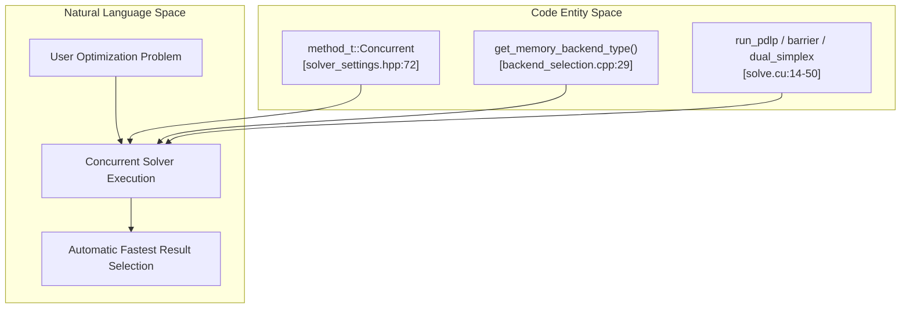
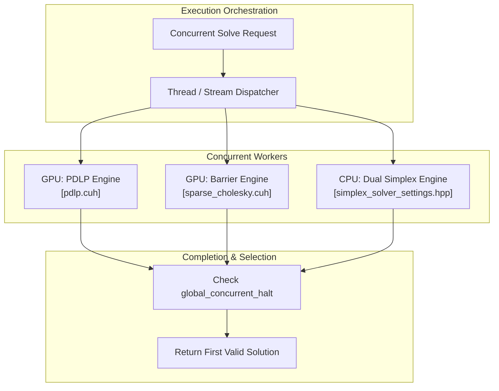
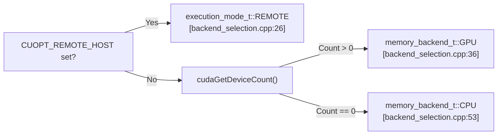

<!-- source: DeepWiki mcp.deepwiki.com · repo NVIDIA/cuopt · extra page Concurrent Solver Execution · fetched 2026-10-26 -->

# Concurrent Solver Execution

Relevant source files

The following files were used as context for generating this wiki page:

- [cpp/include/cuopt/mathematical_optimization/backend_selection.hpp](cpp/include/cuopt/mathematical_optimization/backend_selection.hpp)
- [cpp/include/cuopt/mathematical_optimization/constants.h](cpp/include/cuopt/mathematical_optimization/constants.h)
- [cpp/include/cuopt/mathematical_optimization/mip/solver_settings.hpp](cpp/include/cuopt/mathematical_optimization/mip/solver_settings.hpp)
- [cpp/include/cuopt/mathematical_optimization/pdlp/solver_settings.hpp](cpp/include/cuopt/mathematical_optimization/pdlp/solver_settings.hpp)
- [cpp/src/dual_simplex/simplex_solver_settings.hpp](cpp/src/dual_simplex/simplex_solver_settings.hpp)
- [cpp/src/math_optimization/logger_entry.cpp](cpp/src/math_optimization/logger_entry.cpp)
- [cpp/src/math_optimization/solver_settings.cu](cpp/src/math_optimization/solver_settings.cu)
- [cpp/src/pdlp/backend_selection.cpp](cpp/src/pdlp/backend_selection.cpp)
- [cpp/src/pdlp/solve.cu](cpp/src/pdlp/solve.cu)
- [cpp/src/routing/solve.cu](cpp/src/routing/solve.cu)
- [cpp/src/utilities/logger.hpp](cpp/src/utilities/logger.hpp)
- [cpp/tests/utilities/CMakeLists.txt](cpp/tests/utilities/CMakeLists.txt)
- [cpp/tests/utilities/test_console_log_callback.cpp](cpp/tests/utilities/test_console_log_callback.cpp)
- [java/cuopt/src/main/java/com/nvidia/cuopt/mathematicaloptimization/NativeLogSink.java](java/cuopt/src/main/java/com/nvidia/cuopt/mathematicaloptimization/NativeLogSink.java)
- [java/cuopt/src/main/native/cuopt_jni.cpp](java/cuopt/src/main/native/cuopt_jni.cpp)
- [java/cuopt/src/test/java/com/nvidia/cuopt/mathematicaloptimization/NativeLogSinkTest.java](java/cuopt/src/test/java/com/nvidia/cuopt/mathematicaloptimization/NativeLogSinkTest.java)

## Purpose and Scope

This page explains how cuOpt executes Linear Programming (LP) solver methods concurrently across GPU and CPU resources. The concurrent solver execution feature runs multiple complementary algorithms—specifically PDLP and Barrier on the GPU, and Dual Simplex on the CPU—simultaneously. It monitors their progress and automatically selects and returns the solution from whichever backend completes first. This design addresses the variability in LP problem structures, ensuring robust performance across diverse problem classes without requiring manual algorithm selection.

Sources: [cpp/include/cuopt/mathematical_optimization/pdlp/solver_settings.hpp:71-78](), [cpp/include/cuopt/mathematical_optimization/constants.h:38]()

---

## Concurrent Mode Overview and Configuration

By default, cuOpt is configured to use `method_t::Concurrent` for linear programming and mixed-integer programming relaxations. The solver settings allow users to specify or inspect the solving method via `method_t` enum values (`Concurrent`, `PDLP`, `DualSimplex`, `Barrier`, `PrimalSimplex`) [cpp/include/cuopt/mathematical_optimization/pdlp/solver_settings.hpp:71-78]().

When remote execution is enabled or fallback logic determines that no usable CUDA device is present, execution mode handling shifts via `get_execution_mode()` and `get_memory_backend_type()` [cpp/src/pdlp/backend_selection.cpp:17-54]().

*Figure 1: Bridging natural language concepts of concurrent execution to code entities.*

Sources: [cpp/include/cuopt/mathematical_optimization/pdlp/solver_settings.hpp:71-78](), [cpp/src/pdlp/backend_selection.cpp:17-54](), [cpp/src/pdlp/solve.cu:14-50]()

---

## Concurrent Solver Backends

Concurrent execution dispatches three distinct solver implementations to run in parallel threads or device streams, leveraging specialized hardware for each algorithm class.

| Method | Target Hardware | Core Algorithm | Primary File / Class References |
|--------|----------------|----------------|---------------------------------|
| **PDLP** | GPU | First-Order Primal-Dual Hybrid Gradient | `pdlp::solve` [cpp/src/pdlp/solve.cu:14]() |
| **Barrier** | GPU | Interior-Point Method with cuDSS sparse factorization | `barrier::sparse_cholesky` [cpp/src/pdlp/solve.cu:30-47]() |
| **Dual Simplex** | CPU | Revised Dual Simplex with LU basis updates | `simplex::simplex_solver_settings_t` [cpp/src/dual_simplex/simplex_solver_settings.hpp:32]() |

*Figure 2: Data flow and thread dispatching across concurrent solver backends.*

Sources: [cpp/src/pdlp/solve.cu:14-50](), [cpp/src/dual_simplex/simplex_solver_settings.hpp:32-134]()

---

## Backend Selection and Execution Modes

The solver infrastructure inspects environment variables and hardware availability to decide whether local GPU acceleration, CPU fallback, or remote gRPC dispatch should be used.

Sources: [cpp/src/pdlp/backend_selection.cpp:17-54]()

---

## Synchronization and Early Termination

To avoid wasting computational resources once one solver successfully finds an optimal, infeasible, or unbounded status, concurrent execution relies on shared atomic flags and thread coordination. 

- **Thread-safe logging and callbacks**: The logging subsystem uses thread-local structures (`detail::t_log_callback`) to ensure concurrent solver threads do not interleave or corrupt callback execution [cpp/src/utilities/logger.hpp:82]().
- **Settings Propagation**: Hyperparameters, tolerances (such as `absolute_dual_tolerance`, `relative_dual_tolerance`, `absolute_primal_tolerance`, `relative_primal_tolerance`), and iteration limits are broadcast to all concurrent solver configurations upon initialization [cpp/src/math_optimization/solver_settings.cu:125-137]().

Sources: [cpp/src/math_optimization/solver_settings.cu:125-137](), [cpp/src/utilities/logger.hpp:82]()

---

