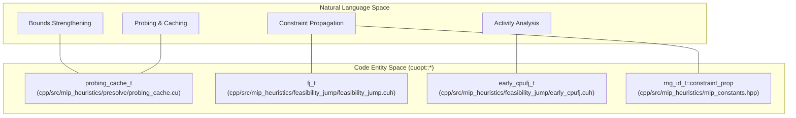
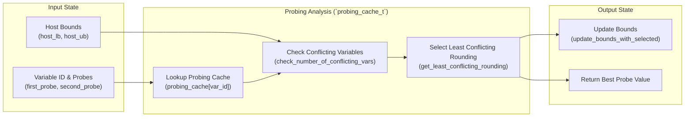
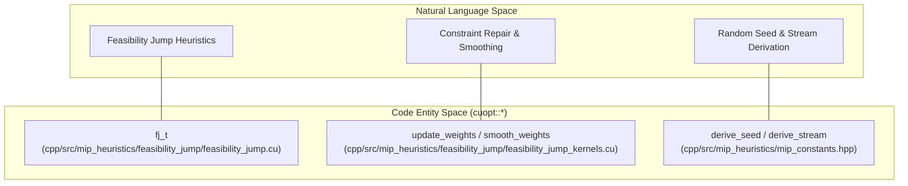

<!-- source: DeepWiki mcp.deepwiki.com · repo NVIDIA/cuopt · extra page Constraint Propagation and Bounds Strengthening · fetched 2026-10-26 -->

# Constraint Propagation and Bounds Strengthening

Relevant source files

The following files were used as context for generating this wiki page:

- [cpp/src/mip_heuristics/feasibility_jump/cpu/audit.cpp](cpp/src/mip_heuristics/feasibility_jump/cpu/audit.cpp)
- [cpp/src/mip_heuristics/feasibility_jump/cpu/audit.hpp](cpp/src/mip_heuristics/feasibility_jump/cpu/audit.hpp)
- [cpp/src/mip_heuristics/feasibility_jump/cpu/setup/structure.hpp](cpp/src/mip_heuristics/feasibility_jump/cpu/setup/structure.hpp)
- [cpp/src/mip_heuristics/feasibility_jump/early_cpufj.cu](cpp/src/mip_heuristics/feasibility_jump/early_cpufj.cu)
- [cpp/src/mip_heuristics/feasibility_jump/early_cpufj.cuh](cpp/src/mip_heuristics/feasibility_jump/early_cpufj.cuh)
- [cpp/src/mip_heuristics/feasibility_jump/feasibility_jump.cu](cpp/src/mip_heuristics/feasibility_jump/feasibility_jump.cu)
- [cpp/src/mip_heuristics/feasibility_jump/feasibility_jump.cuh](cpp/src/mip_heuristics/feasibility_jump/feasibility_jump.cuh)
- [cpp/src/mip_heuristics/feasibility_jump/feasibility_jump_kernels.cu](cpp/src/mip_heuristics/feasibility_jump/feasibility_jump_kernels.cu)
- [cpp/src/mip_heuristics/feasibility_jump/fj_cpu_bridge.cu](cpp/src/mip_heuristics/feasibility_jump/fj_cpu_bridge.cu)
- [cpp/src/mip_heuristics/local_search/local_search.cu](cpp/src/mip_heuristics/local_search/local_search.cu)
- [cpp/src/mip_heuristics/mip_constants.hpp](cpp/src/mip_heuristics/mip_constants.hpp)
- [cpp/src/mip_heuristics/presolve/probing_cache.cu](cpp/src/mip_heuristics/presolve/probing_cache.cu)
- [cpp/src/mip_heuristics/solver_context.cuh](cpp/src/mip_heuristics/solver_context.cuh)
- [cpp/src/mip_heuristics/utils.cuh](cpp/src/mip_heuristics/utils.cuh)
- [cpp/src/mip_heuristics/utils.hpp](cpp/src/mip_heuristics/utils.hpp)
- [cpp/src/routing/util_kernels/runtime_checks.cu](cpp/src/routing/util_kernels/runtime_checks.cu)
- [cpp/src/utilities/macros.cuh](cpp/src/utilities/macros.cuh)

## Purpose and Overview

This section details the constraint propagation, bounds tightening, domain reduction mechanisms, and their critical role within both MIP presolving and local search repair strategies in NVIDIA cuOpt. These techniques analyze constraint matrix structures, infer tight variable bounds, test tentative assignments via probing caches, and repair infeasibilities during heuristic execution. 

Bounds strengthening reduces the effective search space for branch-and-bound trees and enables primal heuristics (such as Feasibility Jump and Local Search) to discover and restore feasible integer solutions efficiently.

**Sources:** [cpp/src/mip_heuristics/mip_constants.hpp:60-76](), [cpp/src/mip_heuristics/presolve/probing_cache.cu:33-74]()

---

## Core Components and Architecture

The constraint propagation and bounds strengthening subsystem spans CPU-side presolving structures and GPU-accelerated local search repair pipelines. 

### Natural Language to Code Entity Mapping

The following diagram bridges high-level constraint propagation concepts to specific C++ and CUDA classes within the codebase.

**Sources:** [cpp/src/mip_heuristics/mip_constants.hpp:60-76](), [cpp/src/mip_heuristics/presolve/probing_cache.cu:33-157](), [cpp/src/mip_heuristics/feasibility_jump/feasibility_jump.cuh:98-120]()

---

## Probing Cache and Domain Reduction

During local search repair and probing phases, cuOpt maintains implied bounds and cached domain restrictions to evaluate rounding decisions. The `probing_cache_t` class manages cached bound intervals and evaluates conflicts when rounding fractional solution values.

### Probing Cache Data Flow

**Sources:** [cpp/src/mip_heuristics/presolve/probing_cache.cu:33-151]()

The key functions implemented in `probing_cache_t` include:
* `check_number_of_conflicting_vars`: Evaluates how many cached implied bounds violate the current host bounds given an integrality tolerance [cpp/src/mip_heuristics/presolve/probing_cache.cu:33-51]().
* `update_bounds_with_selected`: Applies cached bounds to host vectors when a valid non-conflicting probe region is identified [cpp/src/mip_heuristics/presolve/probing_cache.cu:54-74]().
* `get_least_conflicting_rounding`: Compares candidate probe intervals and returns the assignment that minimizes constraint violations and bound conflicts [cpp/src/mip_heuristics/presolve/probing_cache.cu:77-151]().

**Sources:** [cpp/src/mip_heuristics/presolve/probing_cache.cu:33-151]()

---

## Role in Local Search Repair and Feasibility Jump

Constraint propagation and bounds strengthening directly feed into heuristics like Feasibility Jump (`fj_t`) and early CPU feasibility workers (`early_cpufj_t`). 

### Natural Language to Code Entity Mapping: Heuristics & Propagation

**Sources:** [cpp/src/mip_heuristics/mip_constants.hpp:78-94](), [cpp/src/mip_heuristics/feasibility_jump/feasibility_jump.cu:48-114](), [cpp/src/mip_heuristics/feasibility_jump/feasibility_jump_kernels.cu:59-144]()

### Mechanics of Feasibility Jump Propagation Integration
1. **Constraint Weights and Smoothing**: When constraints are violated during local search, their weights are dynamically adjusted using `update_weights` [cpp/src/mip_heuristics/feasibility_jump/feasibility_jump_kernels.cu:83-144](). Satisfied constraints undergo weight smoothing via `smooth_weights` to prevent stagnation [cpp/src/mip_heuristics/feasibility_jump/feasibility_jump_kernels.cu:59-79]().
2. **Deterministic Seed Derivation**: Random number generators and streams for propagation and probing are deterministically derived using `derive_seed` and `derive_stream` based on `rng_id_t` enumerations [cpp/src/mip_heuristics/mip_constants.hpp:78-94]().

**Sources:** [cpp/src/mip_heuristics/mip_constants.hpp:78-94](), [cpp/src/mip_heuristics/feasibility_jump/feasibility_jump_kernels.cu:59-144]()

---

