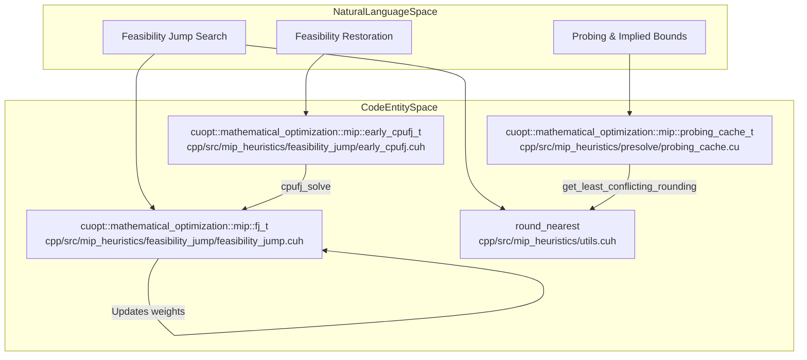
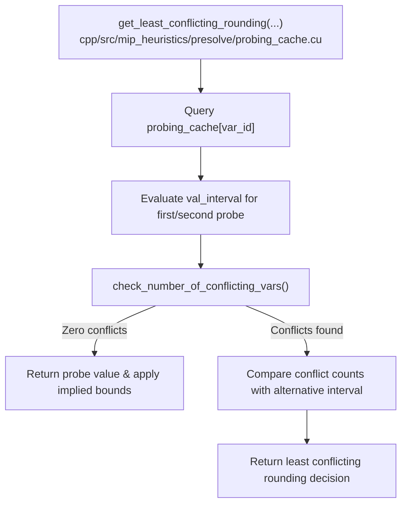

<!-- source: DeepWiki mcp.deepwiki.com · repo NVIDIA/cuopt · extra page Constraint Propagation and Repair · fetched 2026-10-26 -->

# Constraint Propagation and Repair

<details>
<summary>Relevant source files</summary>

The following files were used as context for generating this wiki page:

- [cpp/src/mip_heuristics/feasibility_jump/cpu/audit.cpp](cpp/src/mip_heuristics/feasibility_jump/cpu/audit.cpp)
- [cpp/src/mip_heuristics/feasibility_jump/cpu/audit.hpp](cpp/src/mip_heuristics/feasibility_jump/cpu/audit.hpp)
- [cpp/src/mip_heuristics/feasibility_jump/cpu/setup/structure.hpp](cpp/src/mip_heuristics/feasibility_jump/cpu/setup/structure.hpp)
- [cpp/src/mip_heuristics/feasibility_jump/early_cpufj.cu](cpp/src/mip_heuristics/feasibility_jump/early_cpufj.cu)
- [cpp/src/mip_heuristics/feasibility_jump/early_cpufj.cuh](cpp/src/mip_heuristics/feasibility_jump/early_cpufj.cuh)
- [cpp/src/mip_heuristics/feasibility_jump/feasibility_jump.cu](cpp/src/mip_heuristics/feasibility_jump/feasibility_jump.cu)
- [cpp/src/mip_heuristics/feasibility_jump/feasibility_jump.cuh](cpp/src/mip_heuristics/feasibility_jump/feasibility_jump.cuh)
- [cpp/src/mip_heuristics/feasibility_jump/feasibility_jump_kernels.cu](cpp/src/mip_heuristics/feasibility_jump/feasibility_jump_kernels.cu)
- [cpp/src/mip_heuristics/feasibility_jump/fj_cpu_bridge.cu](cpp/src/mip_heuristics/feasibility_jump/fj_cpu_bridge.cu)
- [cpp/src/mip_heuristics/local_search/local_search.cu](cpp/src/mip_heuristics/local_search/local_search.cu)
- [cpp/src/mip_heuristics/mip_constants.hpp](cpp/src/mip_heuristics/mip_constants.hpp)
- [cpp/src/mip_heuristics/presolve/probing_cache.cu](cpp/src/mip_heuristics/presolve/probing_cache.cu)
- [cpp/src/mip_heuristics/solver_context.cuh](cpp/src/mip_heuristics/solver_context.cuh)
- [cpp/src/mip_heuristics/utils.cuh](cpp/src/mip_heuristics/utils.cuh)
- [cpp/src/mip_heuristics/utils.hpp](cpp/src/mip_heuristics/utils.hpp)
- [cpp/src/routing/util_kernels/runtime_checks.cu](cpp/src/routing/util_kernels/runtime_checks.cu)
- [cpp/src/utilities/macros.cuh](cpp/src/utilities/macros.cuh)

</details>


This page details constraint propagation and repair mechanisms within cuOpt's Mixed-Integer Programming (MIP) local search and heuristics subsystems, specifically focusing on feasibility jump, bounds repair, rounding strategies, feasibility restoration, and probing caches (`probing_cache_t`).

For broader context on local search metaheuristics, see [Local Search and Metaheuristics](#7.1), and for specific GPU/CPU feasibility jump execution details, see [Feasibility Jump Implementation](#7.1.1).

---

## 1. Purpose and Scope

Constraint propagation and repair are vital for guiding metaheuristics like Feasibility Jump (FJ) and Large Neighborhood Search (LNS) through heavily constrained discrete spaces. The subsystem achieves three core objectives:
1. **Dynamic Bounds Repair & Weight Adaptation**: Dynamically adjusting constraint penalties (`cstr_weights`, `cstr_left_weights`, `cstr_right_weights`) in `fj_t` to escape local infeasibility traps [cpp/src/mip_heuristics/feasibility_jump/feasibility_jump.cu:129-140]().
2. **Rounding Strategies**: Converting fractional heuristic or LP relaxation solutions into valid integral assignments using interval-bounded rounding and probing cache lookups [cpp/src/mip_heuristics/utils.cuh:85-101](), [cpp/src/mip_heuristics/presolve/probing_cache.cu:77-151]().
3. **Probing Caches**: Reusing precomputed implied variable bounds stored in `probing_cache_t` to evaluate rounding choices and minimize constraint conflicts during search initialization [cpp/src/mip_heuristics/presolve/probing_cache.cu:33-51]().

---

## 2. Architecture and Data Flow

The following diagram bridges the natural language concepts of feasibility repair and propagation to the concrete C++ classes and methods handling them across the codebase.


*Diagram 1: Bridging Constraint Propagation and Repair Concepts to Code Entities*

**Sources:** [cpp/src/mip_heuristics/feasibility_jump/feasibility_jump.cuh:98-139](), [cpp/src/mip_heuristics/presolve/probing_cache.cu:77-151](), [cpp/src/mip_heuristics/feasibility_jump/early_cpufj.cuh:21-36](), [cpp/src/mip_heuristics/utils.cuh:85-101]()

---

## 3. Constraint Weight Updates and Bounds Repair in Feasibility Jump

When the Feasibility Jump algorithm (`fj_t`) encounters local minima where constraints remain violated, it avoids stagnation by increasing the penalty weights of violated constraints [cpp/src/mip_heuristics/feasibility_jump/feasibility_jump_kernels.cu:83-144]().

### Weight Adjustment Mechanism
The kernel `update_weights` inspects each violated constraint, measures its excess score relative to lower and upper bounds, and increments the respective directional weight (`cstr_left_weights` or `cstr_right_weights`) [cpp/src/mip_heuristics/feasibility_jump/feasibility_jump_kernels.cu:90-120]():


*Diagram 2: Constraint Weight Update Flow in Feasibility Jump Kernels*

**Sources:** [cpp/src/mip_heuristics/feasibility_jump/feasibility_jump_kernels.cu:83-144](), [cpp/src/mip_heuristics/feasibility_jump/feasibility_jump.cuh:152-156]()

### Weight Smoothing
To prevent unbounded weight inflation during long stagnation phases, `smooth_weights` periodically decays satisfied constraint weights and reduces objective penalty weighting when incumbent stagnation is detected [cpp/src/mip_heuristics/feasibility_jump/feasibility_jump_kernels.cu:59-79]():

```cpp
template <typename i_t, typename f_t>
DI void smooth_weights(typename fj_t<i_t, f_t>::climber_data_t::view_t& fj)
{
  for (i_t cstr_idx = TH_ID_X; cstr_idx < fj.pb.n_constraints; cstr_idx += GRID_STRIDE) {
    if (fj.violated_constraints.contains(cstr_idx)) continue;
    f_t weight_l = max((f_t)0, fj.cstr_left_weights[cstr_idx] - 1);
    f_t weight_r = max((f_t)0, fj.cstr_right_weights[cstr_idx] - 1);
    fj.cstr_left_weights[cstr_idx]  = weight_l;
    fj.cstr_right_weights[cstr_idx] = weight_r;
    fj.cstr_weights[cstr_idx]       = max(weight_l, weight_r);
  }
}
```
**Sources:** [cpp/src/mip_heuristics/feasibility_jump/feasibility_jump_kernels.cu:59-79]()

---

## 4. Rounding Strategies and Fractional Elimination

Local search and rounding heuristics often produce fractional assignments for integer variables. cuOpt handles this via bounded randomized rounding functions and specialized post-processing passes (`round_remaining_fractionals`) [cpp/src/mip_heuristics/feasibility_jump/feasibility_jump.cuh:137-138](), [cpp/src/mip_heuristics/utils.cuh:85-101]().

### Bounded Nearest Rounding
The helper `round_nearest` ensures that fractional values are rounded to the nearest integer while strictly respecting variable bounds (`lb`, `ub`) and integrality tolerances (`int_tol`) [cpp/src/mip_heuristics/utils.cuh:85-101]():

| Parameter | Type | Description |
|-----------|------|-------------|
| `val` | `f_t` | Raw fractional assignment value |
| `lb` | `f_t` | Lower bound of the variable |
| `ub` | `f_t` | Upper bound of the variable |
| `int_tol` | `f_t` | Integrality tolerance threshold |
| `rng` | `PCGenerator&` | Pseudorandom number generator for tie-breaking |

```cpp
template <typename f_t>
HDI f_t round_nearest(f_t val, f_t lb, f_t ub, f_t int_tol, raft::random::PCGenerator& rng)
{
  f_t int_lb = ceil(lb - int_tol);
  f_t int_ub = floor(ub + int_tol);

  if (val > ub) {
    return int_ub;
  } else if (val < lb) {
    return int_lb;
  } else {
    f_t w = rng.next_float();
    f_t t = 2 * w * (1 - w);
    if (w > 0.5) { t = 1 - t; }
    f_t result = floor(val + t);
    return raft::max(int_lb, raft::min(result, int_ub));
  }
}
```
**Sources:** [cpp/src/mip_heuristics/utils.cuh:85-101]()

---

## 5. Probing Caches and Implied Bounds (`probing_cache_t`)

During presolve and local search initialization, probing cache structures (`probing_cache_t`) store implied variable bounds derived from probing bound evaluations [cpp/src/mip_heuristics/presolve/probing_cache.cu:33-151]().

### Least-Conflicting Rounding Lookups
When deciding how to round variables while avoiding constraint conflicts, `get_least_conflicting_rounding` queries the probing cache to find caching intervals that match alternative probe values and conflict counts [cpp/src/mip_heuristics/presolve/probing_cache.cu:77-151]():


*Diagram 3: Probing Cache Evaluation and Least-Conflicting Rounding Workflow*

**Sources:** [cpp/src/mip_heuristics/presolve/probing_cache.cu:77-151]()

---

## 6. Feasibility Restoration and Heuristic Portfolios (`early_cpufj_t`)

Early heuristic solvers such as `early_cpufj_t` run concurrent CPU feasibility jump lanes during presolve to quickly discover feasible incumbent solutions before root branch-and-bound optimization [cpp/src/mip_heuristics/feasibility_jump/early_cpufj.cu:20-106]().

### Multi-Lane Coordination
`early_cpufj_t` sets up multiple climber lanes with diversified seeds and shared incumbent thread synchronization (`fj_cpu_shared_incumbent_t`) [cpp/src/mip_heuristics/feasibility_jump/early_cpufj.cu:71-88]():

```cpp
template <typename i_t, typename f_t>
void early_cpufj_t<i_t, f_t>::start(int n_lanes, bool low_latency)
{
  // ...
  for (int k = 0; k < n_lanes; ++k) {
    fj_settings_t settings;
    settings.seed = seed_rng.next_i32();
    if (k == 0) {
      climbers_[0] = init_fj_cpu_from_optimization_problem(
        *this->problem_ptr_, tolerances_, preemption_flag_, settings);
    } else {
      climbers_[k] = init_fj_cpu_clone(*climbers_[0], preemption_flag_, settings);
    }
    climbers_[k]->improvement_callback = report_incumbent;
  }
}
```
**Sources:** [cpp/src/mip_heuristics/feasibility_jump/early_cpufj.cu:40-106](), [cpp/src/mip_heuristics/feasibility_jump/early_cpufj.cuh:21-36]()

---

## 7. Summary of Key Classes and Functions

| Entity Name | Type / Kind | Primary File Path | Role and Responsibilities |
|-------------|-------------|-------------------|---------------------------|
| `fj_t` | C++ Class | `[cpp/src/mip_heuristics/feasibility_jump/feasibility_jump.cuh]()` | Manages GPU feasibility jump state, weights, and move evaluation. |
| `probing_cache_t` | C++ Class | `[cpp/src/mip_heuristics/presolve/probing_cache.cu]()` | Caches implied variable bounds and resolves least-conflicting roundings. |
| `early_cpufj_t` | C++ Class | `[cpp/src/mip_heuristics/feasibility_jump/early_cpufj.cuh]()` | Manages multi-lane CPU feasibility jump portfolios during presolve. |
| `round_nearest` | Host-Device Function | `[cpp/src/mip_heuristics/utils.cuh]()` | Rounds fractional values within valid bounds using random tie-breaking. |
| `update_weights` | CUDA Kernel | `[cpp/src/mip_heuristics/feasibility_jump/feasibility_jump_kernels.cu]()` | Dynamically penalizes violated constraints in feasibility jump search. |

**Sources:** [cpp/src/mip_heuristics/feasibility_jump/feasibility_jump.cuh:98-139](), [cpp/src/mip_heuristics/presolve/probing_cache.cu:33-51](), [cpp/src/mip_heuristics/feasibility_jump/early_cpufj.cuh:21-36](), [cpp/src/mip_heuristics/utils.cuh:85-101](), [cpp/src/mip_heuristics/feasibility_jump/feasibility_jump_kernels.cu:83-144]()

---

