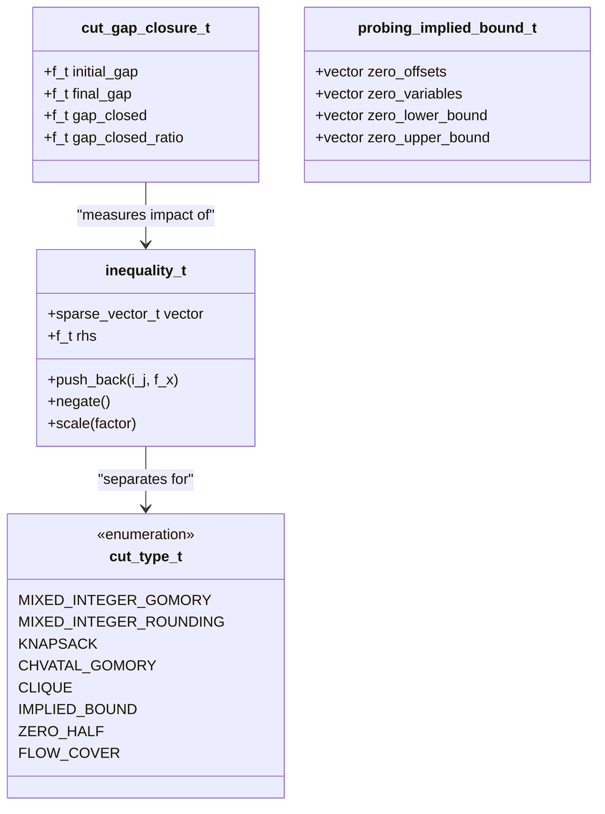
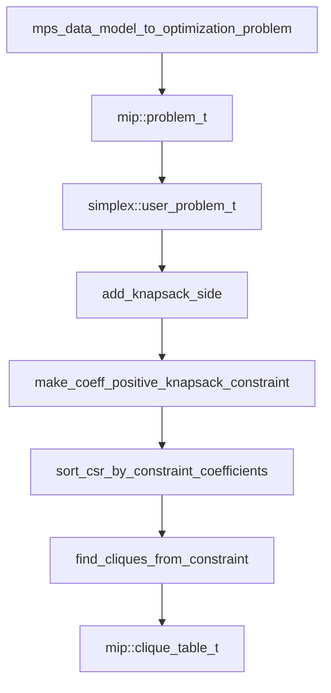
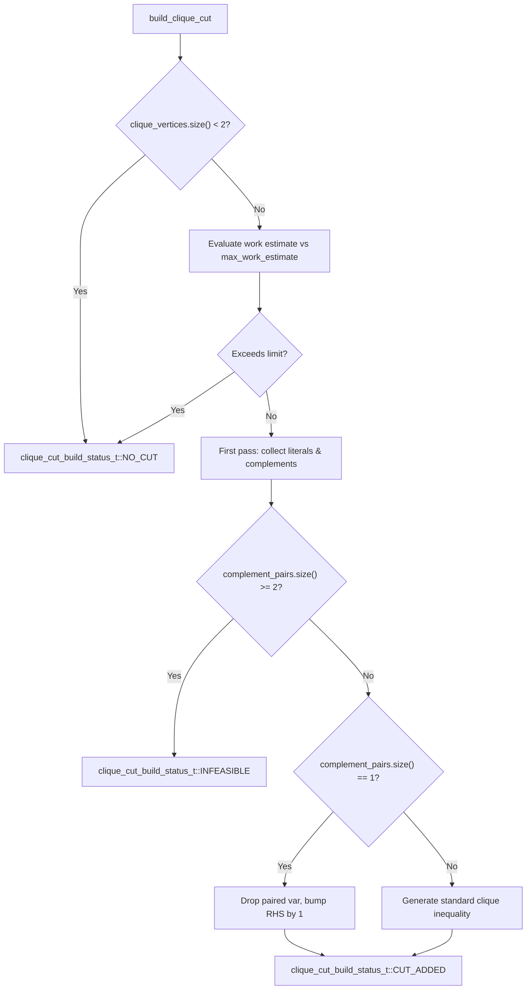

<!-- source: DeepWiki mcp.deepwiki.com · repo NVIDIA/cuopt · extra page Cutting Planes and Conflict Graphs · fetched 2026-10-26 -->

# Cutting Planes and Conflict Graphs

Relevant source files

The following files were used as context for generating this wiki page:

- [cpp/src/branch_and_bound/mip_node.hpp](cpp/src/branch_and_bound/mip_node.hpp)
- [cpp/src/cuts/cuts.cpp](cpp/src/cuts/cuts.cpp)
- [cpp/src/cuts/cuts.hpp](cpp/src/cuts/cuts.hpp)
- [cpp/src/mip_heuristics/presolve/conflict_graph/clique_table.cu](cpp/src/mip_heuristics/presolve/conflict_graph/clique_table.cu)
- [cpp/src/mip_heuristics/presolve/conflict_graph/clique_table.cuh](cpp/src/mip_heuristics/presolve/conflict_graph/clique_table.cuh)
- [cpp/tests/mip/cuts_test.cu](cpp/tests/mip/cuts_test.cu)

This document details the cut generation subsystem and conflict graph infrastructure within NVIDIA cuOpt's Mixed Integer Programming (MIP) solver. The cutting plane engine strengthens LP relaxations by separating invalid fractional solutions, while the conflict graph and clique table subsystem detects logical incompatibilities among binary variables to generate clique cuts, bound tightenings, and domain reductions.

---

## 1. Cut Types and Subsystem Architecture

The cuOpt cut generation framework defines a unified taxonomy of cutting plane types via the `cut_type_t` enumeration [cpp/src/cuts/cuts.hpp:40-50](). These cuts are represented internally using sparse inequality data structures that support normalization, scaling, and coefficient manipulation.

The core data structures supporting cut generation include:
- `cut_type_t`: Enumerates supported cut classes including Mixed-Integer Gomory, MIR, Knapsack, Chvátal-Gomory, Clique, Implied Bounds, Zero-Half, and Flow Cover [cpp/src/cuts/cuts.hpp:40-50]().
- `inequality_t`: A sparse inequality representation wrapping `sparse_vector_t` alongside a right-hand side (`rhs`) scalar, providing utilities for scaling, negation, and coefficient squeezing [cpp/src/cuts/cuts.hpp:115-165]().
- `cut_gap_closure_t`: Computes and tracks objective gap reduction metrics before and after cut application [cpp/src/cuts/cuts.hpp:52-71]().
- `probing_implied_bound_t`: Stores logical probing implications in Compressed Sparse Row (CSR) format, mapping variable assignments to bound tightenings [cpp/src/cuts/cuts.hpp:73-112]().

### Diagram: Cut Subsystem Entity Relationships

*Sources: `cpp/src/cuts/cuts.hpp:40-112`*

---

## 2. Conflict Graphs and Clique Tables

Logical constraints and set-packing relationships are compiled into a conflict graph managed by `clique_table_t` [cpp/src/mip_heuristics/presolve/conflict_graph/clique_table.cuh:141-183](). The conflict graph represents mutual exclusions between binary variables (and their complements), enabling rapid clique cut generation and domain reduction.

### Conflict Graph Data Structures
- `csr_var_map_t`: A CSR-backed per-vertex adjacency map that stores sorted, deduplicated adjacency slices for conflict graph vertices [cpp/src/mip_heuristics/presolve/conflict_graph/clique_table.cuh:63-139]().
- `clique_config_t`: Configuration structure defining thresholds such as `min_clique_size`, `max_clique_size_for_extension`, and work budgets (`min_extend_work`, `max_extend_work`) [cpp/src/mip_heuristics/presolve/conflict_graph/clique_table.cuh:25-37]().
- `knapsack_constraint_t`: Represents a normalized knapsack inequality during preprocessing and clique extraction [cpp/src/mip_heuristics/presolve/conflict_graph/clique_table.cuh:47-54]().

### Knapsack and Clique Extraction Workflow
Constraints are converted into knapsack form, coefficients are normalized to be positive (handling variable complementations via $x_j \to 1 - x_j$), and set-packing structures are identified [cpp/src/mip_heuristics/presolve/conflict_graph/clique_table.cu:83-123]().

### Diagram: Conflict Graph Building Pipeline

*Sources: `cpp/tests/mip/cuts_test.cu:217-235`, `cpp/src/mip_heuristics/presolve/conflict_graph/clique_table.cu:27-123`*

---

## 3. Cut Generation and Separation Subsystem

Once cliques and conflict relations are established, separation routines construct cutting planes. A primary example is `build_clique_cut()`, which translates clique vertices into valid cut inequalities [cpp/src/cuts/cuts.cpp:80-92]().

### Separation Mechanics and Work Budgets
- **Work Estimation**: Clique cut generation evaluates estimated work complexity based on clique size ($O(K \log K)$ sorting and dot-product overheads) and aborts if `max_work_estimate` is exceeded [cpp/src/cuts/cuts.cpp:97-106]().
- **Complement Validation**: The routine tracks original and complement variable appearances (`seen_original`, `seen_complement`) [cpp/src/cuts/cuts.cpp:121-125]().
- **Infeasibility Detection**: If two distinct variables appear with both themselves and their complements (`complement_pairs.size() >= 2`), the node is proven LP-infeasible [cpp/src/cuts/cuts.cpp:150-154]().
- **Fixing Cuts**: Exactly one complement pair forces a variable fixing, reducing the clique support and adjusting the right-hand side [cpp/src/cuts/cuts.cpp:156-159]().

### Diagram: Clique Cut Generation Flow

*Sources: `cpp/src/cuts/cuts.cpp:80-159`*

---

## 4. Cut Management and Selection in Branch-and-Bound Nodes

Cuts generated during branch-and-bound are managed locally within tree nodes (`mip_node_t`) [cpp/src/branch_and_bound/mip_node.hpp:41-42](). 

### Bound Inheritance and Node Context
- `mip_node_t` records branching decisions (`branch_var`, `branch_dir`, `branch_var_lower`, `branch_var_upper`) and compresses basis statuses (`packed_vstatus`) [cpp/src/branch_and_bound/mip_node.hpp:103-129]().
- When exploring a node, variable bounds are recursively updated by traversing up the parent chain via `get_variable_bounds()` and `update_branched_variable_bounds()` [cpp/src/branch_and_bound/mip_node.hpp:131-167]().
- Cuts separated at ancestor nodes can be filtered or inherited depending on local slack and active constraints, avoiding redundant separation passes across deep subtrees.

### Sources
- `cpp/src/cuts/cuts.cpp:33-159`
- `cpp/src/cuts/cuts.hpp:33-165`
- `cpp/tests/mip/cuts_test.cu:217-241`
- `cpp/src/mip_heuristics/presolve/conflict_graph/clique_table.cuh:25-183`
- `cpp/src/mip_heuristics/presolve/conflict_graph/clique_table.cu:27-123`
- `cpp/src/branch_and_bound/mip_node.hpp:41-167`

---

