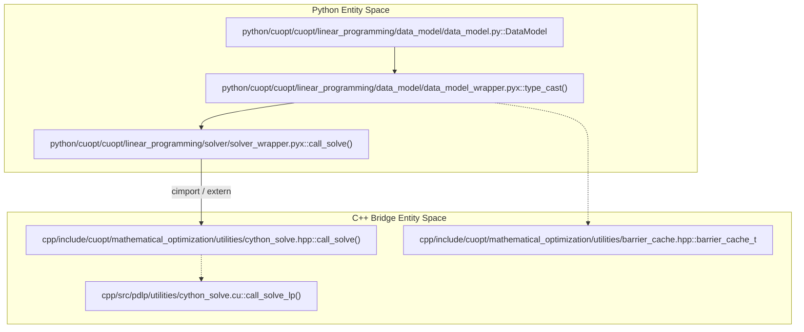
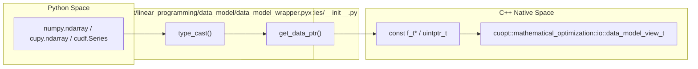

<!-- source: DeepWiki mcp.deepwiki.com · repo NVIDIA/cuopt · extra page Cython Bridges and Type Conversion · fetched 2026-10-26 -->

# Cython Bridges and Type Conversion

<details>
<summary>Relevant source files</summary>

The following files were used as context for generating this wiki page:

- [ci/build_wheel_libcuopt_client.sh](ci/build_wheel_libcuopt_client.sh)
- [cpp/include/cuopt/mathematical_optimization/solve.hpp](cpp/include/cuopt/mathematical_optimization/solve.hpp)
- [cpp/include/cuopt/mathematical_optimization/utilities/barrier_cache.hpp](cpp/include/cuopt/mathematical_optimization/utilities/barrier_cache.hpp)
- [cpp/include/cuopt/mathematical_optimization/utilities/cython_solve.hpp](cpp/include/cuopt/mathematical_optimization/utilities/cython_solve.hpp)
- [cpp/include/cuopt/mathematical_optimization/utilities/cython_types.hpp](cpp/include/cuopt/mathematical_optimization/utilities/cython_types.hpp)
- [cpp/src/CMakeLists.txt](cpp/src/CMakeLists.txt)
- [cpp/src/barrier/barrier_cache.cu](cpp/src/barrier/barrier_cache.cu)
- [cpp/src/barrier/barrier_transform.hpp](cpp/src/barrier/barrier_transform.hpp)
- [cpp/src/pdlp/utilities/cython_solve.cu](cpp/src/pdlp/utilities/cython_solve.cu)
- [python/cuopt/cuopt/CMakeLists.txt](python/cuopt/cuopt/CMakeLists.txt)
- [python/cuopt/cuopt/distance_engine/CMakeLists.txt](python/cuopt/cuopt/distance_engine/CMakeLists.txt)
- [python/cuopt/cuopt/distance_engine/waypoint_matrix_wrapper.pyx](python/cuopt/cuopt/distance_engine/waypoint_matrix_wrapper.pyx)
- [python/cuopt/cuopt/linear_programming/data_model/CMakeLists.txt](python/cuopt/cuopt/linear_programming/data_model/CMakeLists.txt)
- [python/cuopt/cuopt/linear_programming/data_model/data_model.py](python/cuopt/cuopt/linear_programming/data_model/data_model.py)
- [python/cuopt/cuopt/linear_programming/data_model/data_model_wrapper.pyx](python/cuopt/cuopt/linear_programming/data_model/data_model_wrapper.pyx)
- [python/cuopt/cuopt/linear_programming/internals/CMakeLists.txt](python/cuopt/cuopt/linear_programming/internals/CMakeLists.txt)
- [python/cuopt/cuopt/linear_programming/io/CMakeLists.txt](python/cuopt/cuopt/linear_programming/io/CMakeLists.txt)
- [python/cuopt/cuopt/linear_programming/solver/CMakeLists.txt](python/cuopt/cuopt/linear_programming/solver/CMakeLists.txt)
- [python/cuopt/cuopt/linear_programming/solver/solver.pxd](python/cuopt/cuopt/linear_programming/solver/solver.pxd)
- [python/cuopt/cuopt/linear_programming/solver/solver_wrapper.pyx](python/cuopt/cuopt/linear_programming/solver/solver_wrapper.pyx)
- [python/cuopt/cuopt/linear_programming/solver_settings/CMakeLists.txt](python/cuopt/cuopt/linear_programming/solver_settings/CMakeLists.txt)
- [python/cuopt/cuopt/routing/CMakeLists.txt](python/cuopt/cuopt/routing/CMakeLists.txt)
- [python/cuopt/cuopt/routing/utils_wrapper.pyx](python/cuopt/cuopt/routing/utils_wrapper.pyx)
- [python/cuopt/cuopt/tests/linear_programming/test_barrier_sequence_solve.py](python/cuopt/cuopt/tests/linear_programming/test_barrier_sequence_solve.py)
- [python/cuopt/cuopt/utilities/__init__.py](python/cuopt/cuopt/utilities/__init__.py)
- [python/cuopt/cuopt/utilities/utils.py](python/cuopt/cuopt/utilities/utils.py)
- [python/cuopt/distance_engine/waypoint_matrix_wrapper.pyx](python/cuopt/distance_engine/waypoint_matrix_wrapper.pyx)
- [python/libcuopt_client/pyproject.toml](python/libcuopt_client/pyproject.toml)

</details>


The purpose and scope of this page are to detail the Cython layer (`.pyx` and `.pxd` files) that bridges Python code and C++ solver engines in cuOpt. This includes Python-to-C++ type conversion, data marshalling across boundaries, memory management semantics using RMM and C++ `std::unique_ptr`, caching mechanisms (`barrier_cache_t`), and the `scikit-build-core` / CMake integration pipeline.

Sources: [python/cuopt/cuopt/linear_programming/data_model/data_model_wrapper.pyx:1-25](), [python/cuopt/cuopt/linear_programming/solver/solver_wrapper.pyx:1-61](), [cpp/include/cuopt/mathematical_optimization/utilities/cython_solve.hpp:22-42]()

---

## Cython Layer Architecture

The Cython layer acts as the translation boundary between the high-level Python SDK (`cuopt.linear_programming` and `cuopt.routing`) and the compiled C++ core engines (`libcuopt_mathopt`, `libcuopt_routing`, and `libcuopt_client`).

### Package Structure and File Organization



**Diagram: Code Entity Bridge for Cython Layer**

The Cython implementation files (`.pyx`) declare external C++ symbols via definition files (`.pxd`). For example, `solver_wrapper.pyx` imports structures from `solver.pxd` to invoke C++ entry points like `call_solve` and `call_solve_lp`.

Sources: [python/cuopt/cuopt/linear_programming/data_model/data_model_wrapper.pyx:10-33](), [python/cuopt/cuopt/linear_programming/solver/solver_wrapper.pyx:40-61](), [cpp/include/cuopt/mathematical_optimization/utilities/cython_solve.hpp:54-60]()

### Cython File Types and Compilation

| File Type | Extension | Role in Build Pipeline | Code Reference |
|-----------|-----------|------------------------|----------------|
| Cython Implementation | `.pyx` | Compiled into C++ extension modules via Cython | `python/cuopt/cuopt/linear_programming/solver/solver_wrapper.pyx` [python/cuopt/cuopt/linear_programming/solver/solver_wrapper.pyx:1-12]() |
| Cython Declaration | `.pxd` | Exposes C++ declarations for `cimport` | `python/cuopt/cuopt/linear_programming/solver/solver.pxd` [python/cuopt/cuopt/linear_programming/solver/solver.pxd:1-15]() |
| C++ Header | `.hpp` | Native C++ function signatures and interfaces | `cpp/include/cuopt/mathematical_optimization/utilities/cython_solve.hpp` [cpp/include/cuopt/mathematical_optimization/utilities/cython_solve.hpp:35-69]() |

Sources: [python/cuopt/cuopt/linear_programming/solver/solver_wrapper.pyx:1-12](), [python/cuopt/cuopt/linear_programming/solver/solver.pxd:1-15](), [cpp/include/cuopt/mathematical_optimization/utilities/cython_solve.hpp:35-69]()

---

## Type Conversion and Marshalling

Passing data between Python (NumPy, CuPy, cuDF) and C++ (dense vectors, CSR/CSC sparse matrices, and `data_model_view_t`) requires explicit type coercion and memory pointer extraction.

### Array Marshalling Pipeline



**Diagram: Data Marshalling Flow from Python to C++**

### Type Casting and Memory Access Helpers

NumPy arrays and cuDF series are validated and type-cast using `type_cast` before pointers are passed to C++. Floating-point and integer types are strictly enforced to match C++ expectations (`double` for coefficients/bounds, `int32` for indices/offsets).

```python
def type_cast(np_obj, np_type, name):
    if not isinstance(np_obj, np.ndarray):
        np_obj = np.asarray(np_obj)
    obj_type = np_obj.dtype
    if ((np.issubdtype(np_type, np.floating) and (not np.issubdtype(obj_type, np.floating)))
       or (np.issubdtype(np_type, np.integer) and (not np.issubdtype(obj_type, np.integer)))):
        warnings.warn("Casting " + name + " from " + str(obj_type) + " to " + str(np.dtype(np_type)))
    np_obj = np_obj.astype(np.dtype(np_type))
    return np_obj
```

Sources: [python/cuopt/cuopt/linear_programming/data_model/data_model_wrapper.pyx:34-46](), [python/cuopt/cuopt/linear_programming/solver/solver_wrapper.pyx:176-198]()

---

## Key Bridge Classes and Functions

### `DataModel` and `barrier_cache_t` Interoperability

The `DataModel` Cython class maintains a C++ `data_model_view_t` and optionally manages a `barrier_cache_t` capsule (`barrier_cache_capsule`) for warm-starting or sequence solves (e.g. updating objective coefficients or RHS without re-running presolve).

```cython
cdef class DataModel:
    def __init__(self):
        self.c_data_model_view.reset(new data_model_view_t[int, double]())
        self.barrier_cache_capsule = None
        ...
```

When linear objectives are updated via `update_linear_objective`, the data is crushed directly into the cached C++ `iteration_data_t` structure if a prior barrier solve cache exists:

```cython
    def update_linear_objective(self, coefficients):
        cdef barrier_cache_t[int, double]* cache
        cdef double[::1] c_view
        new_c = type_cast(coefficients, np.float64, "coefficients")
        ...
```

Sources: [python/cuopt/cuopt/linear_programming/data_model/data_model_wrapper.pyx:49-182](), [cpp/include/cuopt/mathematical_optimization/utilities/barrier_cache.hpp:43-89]()

### Solver Entry Points (`call_solve`)

The C++ entry point `call_solve` in `cython_solve.cu` handles execution dispatch. It determines the memory backend (`GPU` vs `CPU`), configures ephemeral RAFT handles and CUDA streams, manages `barrier_cache_t` lifecycle, and dispatches to `solve_lp` or `solve_mip`.

```cpp
std::unique_ptr<solver_ret_t> call_solve(
  cuopt::mathematical_optimization::io::data_model_view_t<int, double>* data_model,
  cuopt::mathematical_optimization::solver_settings_t<int, double>* solver_settings,
  unsigned int flags,
  bool is_batch_mode,
  barrier_cache_t* cache_in)
{
    ...
}
```

Sources: [cpp/src/pdlp/utilities/cython_solve.cu:104-156](), [cpp/include/cuopt/mathematical_optimization/utilities/cython_solve.hpp:54-60]()

---

## Memory Management and Ownership Semantics

Memory across the Cython boundary is managed through strict ownership conventions:

1. **Unique Pointers (`std::unique_ptr`)**: C++ functions such as `call_solve` return `std::unique_ptr<solver_ret_t>`, transferring full ownership of solution structures and metadata to Cython wrappers.
2. **Raw Pointers**: Functions like `call_solve_lp` and `call_solve_mip` return raw pointers (`lp_solution_interface_t*`) backed by the container object (`solver_ret_t`), ensuring the parent structure outlives any derived views.
3. **GPU Device Buffers**: GPU solution arrays use `rmm::device_buffer` encapsulated in C++ solution structs (`lp_gpu_solutions_t`), which are seamlessly converted into CuPy or cuDF views in Python without host-side memory roundtrips.

Sources: [python/cuopt/cuopt/linear_programming/solver/solver.pxd:67-96](), [cpp/include/cuopt/mathematical_optimization/utilities/cython_solve.hpp:37-41](), [cpp/src/pdlp/utilities/cython_solve.cu:54-74]()

---

## scikit-build-core and CMake Integration

The compilation of Cython extension modules is driven by CMake targets and `scikit-build-core` configuration files.

- **Component Libraries**: Core math optimization sources are compiled into `cuopt_mathopt` and routing sources into `cuopt_routing` within `cpp/src/CMakeLists.txt`.
- **Cython Extension Generation**: RAPIDS CMake macros (`rapids_cython_create_modules`) automate the translation and linking of `.pyx` modules against `cuopt::cuopt` and dependent libraries (`libmps_parser`, `libcudss`, `librmm`).

Sources: [cpp/src/CMakeLists.txt:37-56](), [python/cuopt/cuopt/CMakeLists.txt:33-37](), [ci/build_wheel_libcuopt_client.sh:81-92]()

---

