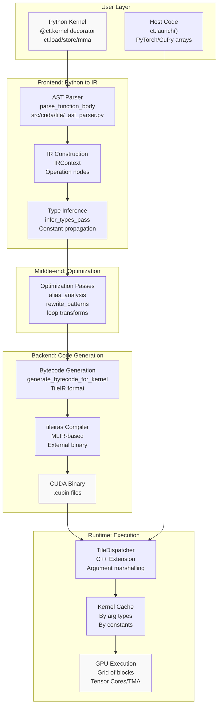
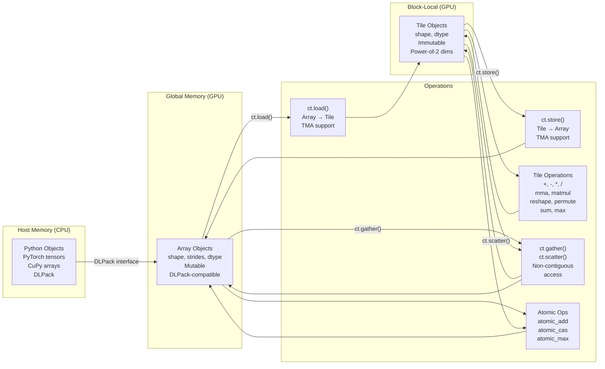
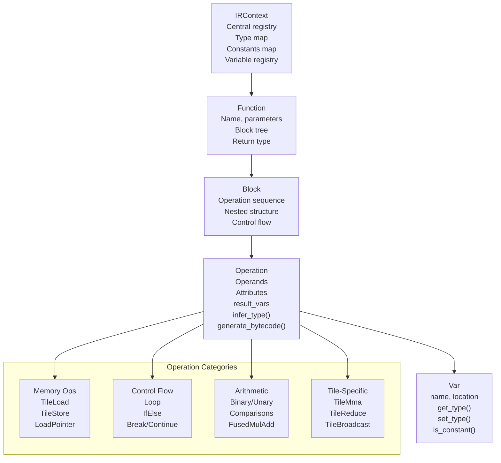
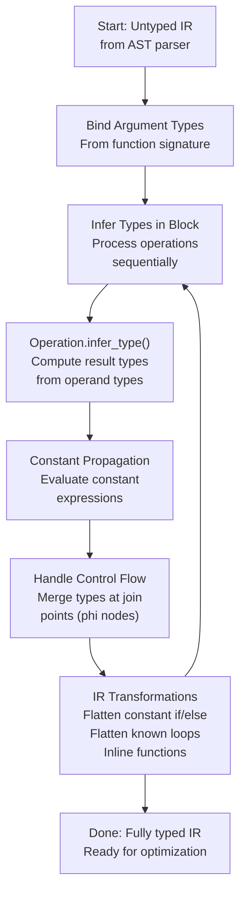
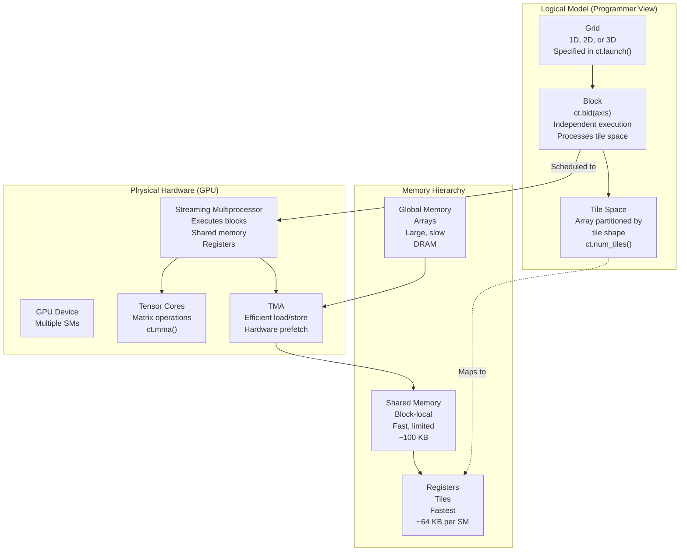
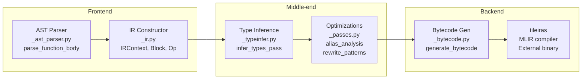
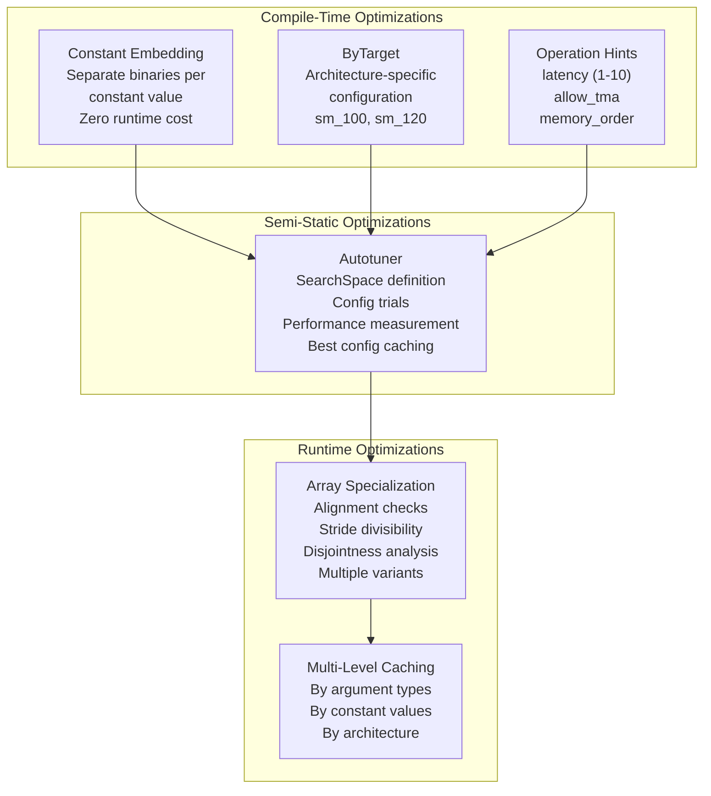

<!-- source: DeepWiki mcp.deepwiki.com · repo NVIDIA/cutile-python · page 1 Overview · fetched 2026-10-26 -->

# Overview

<details>
<summary>Relevant source files</summary>

The following files were used as context for generating this wiki page:

- [LICENSE.md](LICENSE.md)
- [README.md](README.md)
- [docs/source/debugging.rst](docs/source/debugging.rst)
- [docs/source/index.rst](docs/source/index.rst)
- [docs/source/release_notes.rst](docs/source/release_notes.rst)
- [test/requirements.txt](test/requirements.txt)
- [test/test_frontpage_example.py](test/test_frontpage_example.py)
- [test/test_readme_example.py](test/test_readme_example.py)

</details>


This document provides a high-level introduction to cuda.tile, its architecture, and key components. For specific details on individual subsystems, refer to the specialized pages: [Quick Start](#1.1) for a first example, [Core Concepts](#2) for foundational programming model details, [API Reference](#3) for operation documentation, and [Compilation System](#4) for compiler internals.

## What is cuda.tile?

cuda.tile is a Python-based Domain-Specific Language (DSL) for GPU programming on NVIDIA hardware. It provides a high-level abstraction for writing GPU kernels that automatically leverages advanced hardware features such as Tensor Cores and Tensor Memory Accelerators (TMA) while maintaining portability across different GPU architectures.

The system consists of three primary components:

| Component | Description | Key Classes/Functions |
|-----------|-------------|----------------------|
| **Python API** | User-facing interface for writing GPU kernels | `@ct.kernel`, `ct.launch()`, `ct.load()`, `ct.store()` |
| **Compilation Pipeline** | Transforms Python code to GPU binaries | `IRContext`, `infer_types_pass`, bytecode generation, `tileiras` compiler |
| **Execution Runtime** | Manages kernel launching and caching | `TileDispatcher`, argument marshalling, kernel cache |

**Sources:** [docs/source/index.rst:1-57](), [src/cuda/tile/_stub.py:1-1237]()

## Programming Model Overview

cuda.tile kernels operate on two fundamental data structures:

- **Arrays** ([src/cuda/tile/_stub.py:134-183]()): Mutable containers in global GPU memory with arbitrary shapes and strides. Arrays are DLPack-compatible and can be used in both host and tile code.

- **Tiles** ([src/cuda/tile/_stub.py:185-371]()): Immutable block-local data structures with power-of-2 dimensions. Tiles exist only within kernel execution and support rich computational operations.

A typical cuda.tile program follows this pattern:

```python
@ct.kernel
def kernel_function(array_in, array_out):
    block_id = ct.bid(0)
    tile = ct.load(array_in, index=(block_id,), shape=(TILE_SIZE,))
    result = tile + 1  # Tile operations
    ct.store(array_out, index=(block_id,), tile=result)

# Launch from host
ct.launch(stream, grid_shape, kernel_function, (input_array, output_array))
```

**Sources:** [test/test_frontpage_example.py:9-29](), [docs/source/index.rst:13-40]()

## End-to-End System Architecture

The following diagram illustrates the complete compilation and execution flow from user code to GPU execution:



**Key Pipeline Stages:**

1. **Frontend Compilation**: Python AST is parsed into an Intermediate Representation (IR) consisting of typed operations organized in blocks. Type inference and constant propagation run as compiler passes.

2. **Middle-end Optimization**: Multiple optimization passes transform the IR, including alias analysis, pattern rewriting, and loop transformations.

3. **Backend Code Generation**: The optimized IR is converted to TileIR bytecode, which is fed to the external `tileiras` MLIR-based compiler to produce CUDA binaries.

4. **Runtime Execution**: The C++ extension layer (`TileDispatcher`) manages kernel launching, argument marshalling, caching, and stream management.

**Sources:** [src/cuda/tile/_ast_parser.py:1-1000](), [src/cuda/tile/_ir.py:1-500](), [src/cuda/tile/_compile.py:1-300]()

## Data Flow and Memory Hierarchy

The following diagram shows how data moves between different memory spaces and representations:



**Memory Operation Categories:**

| Operation Type | Functions | Purpose |
|----------------|-----------|---------|
| **Regular Access** | `ct.load()`, `ct.store()` | Tile-space partitioned access with optional TMA |
| **Indirect Access** | `ct.gather()`, `ct.scatter()` | Non-contiguous access via index tiles |
| **Atomic Access** | `ct.atomic_add()`, `ct.atomic_cas()`, etc. | Thread-safe concurrent updates |
| **Factory** | `ct.arange()`, `ct.full()`, `ct.zeros()`, `ct.ones()` | Create tiles from scratch |

**Sources:** [src/cuda/tile/_stub.py:134-669](), [src/cuda/tile/_array.py:1-200](), [src/cuda/tile/_tile_api.py:1-300]()

## Compilation Pipeline Details

### IR Structure

The Intermediate Representation is organized hierarchically:



**Sources:** [src/cuda/tile/_ir.py:1-1000](), [src/cuda/tile/_ir_ops.py:1-2000]()

### Type Inference Process

Type inference operates in multiple stages:



**Key Type Inference Components:**

| Component | Location | Purpose |
|-----------|----------|---------|
| `TypingContext` | [src/cuda/tile/_typeinfer.py]() | Wraps IRContext, tracks phi states |
| `infer_types_in_func` | [src/cuda/tile/_typeinfer.py]() | Main entry point for type inference |
| `Operation.infer_type()` | [src/cuda/tile/_ir_ops.py]() | Per-operation type rules |
| Constant propagation | [src/cuda/tile/_typeinfer.py]() | Evaluates constant expressions |

**Sources:** [src/cuda/tile/_typeinfer.py:1-800](), [src/cuda/tile/_ir_ops.py:1-2000]()

## Execution Model and Hardware Mapping

### Logical to Physical Mapping



**Execution Characteristics:**

- **Block Parallelism**: Explicit, programmer-controlled via grid dimensions
- **Thread Parallelism**: Implicit, implementation-managed by compiler
- **Synchronization**: No intra-block synchronization primitives exposed
- **Memory Model**: Relaxed consistency, explicit atomic operations available

**Sources:** [docs/source/execution.rst:1-100](), [src/cuda/tile/_execution.py:1-300]()

## Key System Components

### Core API Layer

The main user-facing API is defined in these modules:

| Module | Purpose | Key Exports |
|--------|---------|-------------|
| `_stub.py` | API stubs and type hints | `Array`, `Tile`, all operations |
| `_execution.py` | Kernel decorator and launch | `@kernel`, `launch()` |
| `_array.py` | Array implementation | Array class, DLPack interface |
| `_datatype.py` | Type system | `DType`, type promotion rules |
| `_memory_model.py` | Memory semantics | `MemoryOrder`, `MemoryScope` |

**Sources:** [src/cuda/tile/_stub.py:1-1237](), [src/cuda/tile/_execution.py:1-400](), [src/cuda/tile/_array.py:1-300]()

### Compiler Infrastructure



**Sources:** [src/cuda/tile/_ast_parser.py:1-1000](), [src/cuda/tile/_ir.py:1-1000](), [src/cuda/tile/_typeinfer.py:1-800](), [src/cuda/tile/_bytecode.py:1-500]()

### Runtime Execution Layer

The C++ extension provides the runtime infrastructure:

| Component | Purpose | Implementation |
|-----------|---------|----------------|
| `TileDispatcher` | Kernel launching and caching | C++ extension in `cpp_ext/` |
| Argument marshalling | Convert Python objects to GPU pointers | `TileDispatcher::marshal_args()` |
| Kernel cache | Cache compiled kernels by signature | Multi-level: by type, constants, arch |
| Stream management | Manage CUDA streams and events | Per-context stream pools |

**Sources:** [cpp_ext/tile_dispatcher.cpp:1-500](), [cpp_ext/kernel_cache.cpp:1-300]()

## Performance Optimization System

### Multi-Level Optimization Strategy



**Optimization Features:**

- **Constant Embedding**: Compile separate kernel variants for different constant parameter values, enabling aggressive optimization
- **Autotuning**: Automatically search configuration space and cache best-performing configurations
- **Architecture Specialization**: Use `ByTarget` to specify different values for different GPU architectures (e.g., sm_100 vs sm_120)
- **Array Specialization**: Generate optimized kernel variants based on array properties like alignment and stride patterns

**Sources:** [src/cuda/tile/_autotuner.py:1-400](), [src/cuda/tile/_by_target.py:1-200](), [cpp_ext/array_specialization.cpp:1-300]()

## Error Handling and Debugging

cuda.tile provides structured error types for different failure modes:

| Exception Type | When Raised | Location |
|---------------|-------------|----------|
| `TileSyntaxError` | Invalid Python syntax in kernel | AST parsing phase |
| `TileTypeError` | Type mismatch or invalid operation | Type inference pass |
| `TileValueError` | Invalid parameter values | Various validation points |
| `TileCompilerExecutionError` | `tileiras` compiler failure | Backend compilation |
| `TileCompilerTimeoutError` | Compiler timeout exceeded | Backend compilation |

**Debugging Environment Variables:**

- `CUDA_TILE_LOGS=CUTILEIR`: Print IR during compilation
- `CUDA_TILE_ENABLE_CRASH_DUMP=1`: Enable crash dump archives
- `CUDA_TILE_DUMP_BYTECODE=1`: Dump TileIR bytecode
- `CUDA_TILE_DUMP_MLIR=1`: Dump MLIR text
- `CUDA_TILE_COMPILER_TIMEOUT_SEC`: Set compiler timeout

**Sources:** [docs/source/debugging.rst:1-41](), [src/cuda/tile/_exceptions.py:1-100]()

## Project Structure

The codebase is organized as follows:

```
cutile-python/
├── src/cuda/tile/          # Main Python package
│   ├── _stub.py            # API stubs and type hints
│   ├── _execution.py       # Kernel decorator, launch
│   ├── _array.py           # Array implementation
│   ├── _ast_parser.py      # Python AST → IR
│   ├── _ir.py              # IR core structures
│   ├── _ir_ops.py          # Operation definitions
│   ├── _typeinfer.py       # Type inference pass
│   ├── _bytecode.py        # Bytecode generation
│   ├── _autotuner.py       # Autotuning system
│   └── _by_target.py       # Architecture config
├── cpp_ext/                # C++ extension
│   ├── tile_dispatcher.cpp # Kernel launching
│   ├── kernel_cache.cpp    # Caching infrastructure
│   └── array_marshal.cpp   # Argument marshalling
├── test/                   # Test suite
│   ├── util.py             # Test utilities
│   ├── test_*.py           # Test cases
│   └── kernels/            # Example kernels
└── docs/                   # Documentation
    └── source/             # Sphinx docs
```

**Sources:** [src/cuda/tile/](), [cpp_ext/](), [test/]()

---

