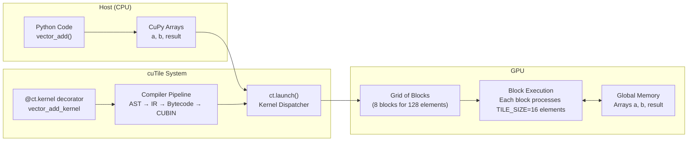
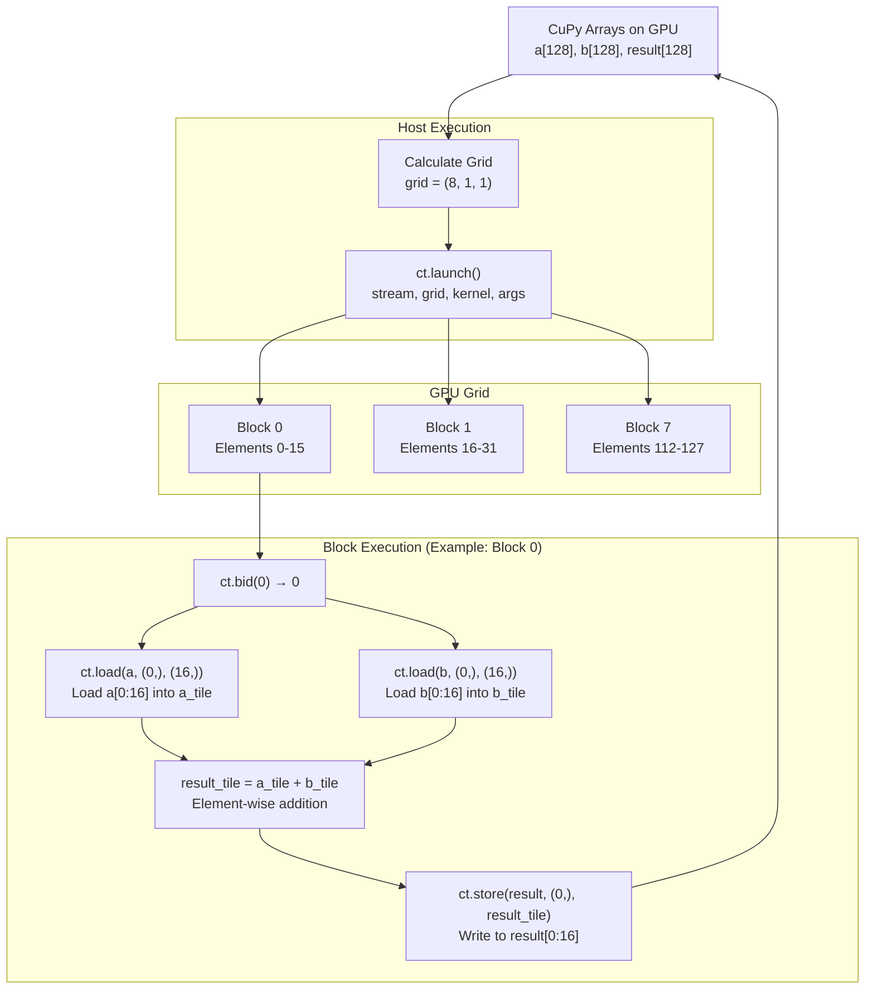

<!-- source: DeepWiki mcp.deepwiki.com · repo NVIDIA/cutile-python · page 1.1 Quick Start · fetched 2026-10-26 -->

# Quick Start

<details>
<summary>Relevant source files</summary>

The following files were used as context for generating this wiki page:

- [LICENSE.md](LICENSE.md)
- [README.md](README.md)
- [docs/source/debugging.rst](docs/source/debugging.rst)
- [docs/source/index.rst](docs/source/index.rst)
- [docs/source/release_notes.rst](docs/source/release_notes.rst)
- [test/requirements.txt](test/requirements.txt)
- [test/test_frontpage_example.py](test/test_frontpage_example.py)
- [test/test_readme_example.py](test/test_readme_example.py)

</details>


This page provides a minimal working example to get started with cuTile Python. It covers installation, a complete vector addition kernel, and a step-by-step explanation of the key components. For deeper understanding of the execution model and data abstractions, see [Core Concepts](#2). For detailed API documentation, see [API Reference](#3).

---

## Prerequisites

cuTile Python requires the following components:

| Component | Requirement | Notes |
|-----------|------------|-------|
| **NVIDIA Driver** | r580 or later | Required for Tile IR execution |
| **CUDA Toolkit** | 13.1 or later | Includes `tileiras` compiler |
| **GPU Architecture** | Blackwell | 13.1 release limitation (will be lifted in future versions) |
| **Python** | 3.10 or later | With development headers |
| **Array Library** | CuPy or PyTorch | For GPU array management |

The driver requirement is due to cuTile generating kernels based on Tile IR, which requires recent driver support. See [README.md:58-65]() for the complete list of requirements.

---

## Installation

Install cuTile Python from PyPI:

```bash
pip install cuda-tile
```

Install the CUDA Toolkit 13.1+ separately. On Debian-based systems:

```bash
sudo apt-get install cuda-tileiras-13.1 cuda-compiler-13.1
```

For the examples in this guide, install CuPy:

```bash
pip install cupy-cuda13x
```

Alternatively, PyTorch can be used as the array library. See [test/requirements.txt:14-18]() for the exact versions used in testing.

**Sources:** [README.md:68-78](), [README.md:89](), [test/requirements.txt:14-16]()

---

## Complete Working Example

The following example implements vector addition on the GPU using cuTile:

```python
import cuda.tile as ct
import cupy

TILE_SIZE = 16

# cuTile kernel for adding two dense vectors. It runs in parallel on the GPU.
@ct.kernel
def vector_add_kernel(a, b, result):
    block_id = ct.bid(0)
    a_tile = ct.load(a, index=(block_id,), shape=(TILE_SIZE,))
    b_tile = ct.load(b, index=(block_id,), shape=(TILE_SIZE,))
    result_tile = a_tile + b_tile
    ct.store(result, index=(block_id,), tile=result_tile)

# Host-side function that launches the above kernel.
def vector_add(a: cupy.ndarray, b: cupy.ndarray, result: cupy.ndarray):
    assert a.shape == b.shape == result.shape
    grid = (ct.cdiv(a.shape[0], TILE_SIZE), 1, 1)
    ct.launch(cupy.cuda.get_current_stream(), grid, vector_add_kernel, (a, b, result))


# Test the implementation
import numpy as np

a = cupy.random.uniform(-5, 5, 128)
b = cupy.random.uniform(-5, 5, 128)
result = cupy.zeros_like(a)

vector_add(a, b, result)

a_np = cupy.asnumpy(a)
b_np = cupy.asnumpy(b)
result_np = cupy.asnumpy(result)

expected = a_np + b_np
np.testing.assert_array_almost_equal(result_np, expected)
```

This complete example can be found in [test/test_frontpage_example.py:7-44]() and [README.md:14-56]().

**Sources:** [test/test_frontpage_example.py:7-44](), [README.md:14-56](), [docs/source/index.rst:18-22]()

---

## Understanding the Example

### System Architecture Overview



**Sources:** [test/test_frontpage_example.py:14-26](), [docs/source/index.rst:13-16]()

---

### Kernel Function Components

#### The `@ct.kernel` Decorator

```python
@ct.kernel
def vector_add_kernel(a, b, result):
    ...
```

The `@ct.kernel` decorator marks `vector_add_kernel` as a GPU kernel entry point. This function:
- Cannot be called directly from Python
- Must be launched via `ct.launch()`
- Executes in parallel across a grid of blocks

See [Execution Model](#2.2) for details on execution spaces and [docs/source/index.rst:14]().

#### Block Identification

```python
block_id = ct.bid(0)
```

`ct.bid(0)` returns the block index along dimension 0. Each block in the grid has a unique ID that determines which portion of the data it processes. For 128 elements with `TILE_SIZE=16`, blocks 0-7 each process 16 elements.

#### Loading Data into Tiles

```python
a_tile = ct.load(a, index=(block_id,), shape=(TILE_SIZE,))
b_tile = ct.load(b, index=(block_id,), shape=(TILE_SIZE,))
```

`ct.load()` transfers data from a global memory `Array` into a kernel-local `Tile`:
- **`a`**: The source array (CuPy ndarray passed as kernel argument)
- **`index=(block_id,)`**: Starting position in element space (multidimensional index)
- **`shape=(TILE_SIZE,)`**: The tile shape (must be compile-time constant, power-of-2)

The tile dimensions (16 in this case) must be known at compile time and must be powers of two. See [Data Model](#2.1) for the Array/Tile distinction.

#### Tile Operations

```python
result_tile = a_tile + b_tile
```

Tiles support various operations including arithmetic, matrix multiplication, and reductions. Here, element-wise addition is performed entirely in kernel-local storage (registers/shared memory). Tiles are immutable—operations produce new tiles rather than modifying existing ones.

See [API Reference](#3) for all supported tile operations.

#### Storing Results

```python
ct.store(result, index=(block_id,), tile=result_tile)
```

`ct.store()` writes the tile back to global memory:
- **`result`**: The destination array
- **`index=(block_id,)`**: Starting position in element space
- **`tile=result_tile`**: The tile to write

**Sources:** [test/test_frontpage_example.py:14-20](), [docs/source/index.rst:24-39]()

---

### Host-Side Wrapper Function

```python
def vector_add(a: cupy.ndarray, b: cupy.ndarray, result: cupy.ndarray):
    assert a.shape == b.shape == result.shape
    grid = (ct.cdiv(a.shape[0], TILE_SIZE), 1, 1)
    ct.launch(cupy.cuda.get_current_stream(), grid, vector_add_kernel, (a, b, result))
```

This host-side function:
1. **Validates inputs**: Ensures all arrays have the same shape
2. **Calculates grid dimensions**: Uses `ct.cdiv(N, TILE_SIZE)` to compute ceiling division, determining how many blocks are needed
3. **Launches the kernel**: Calls `ct.launch()` with the CUDA stream, grid dimensions, kernel function, and arguments

#### Grid Calculation

For 128 elements with `TILE_SIZE=16`:
```
grid = (ct.cdiv(128, 16), 1, 1) = (8, 1, 1)
```

This creates 8 blocks along dimension 0, each processing 16 elements. The grid is 3-dimensional `(x, y, z)` though only the x-dimension is used here.

**Sources:** [test/test_frontpage_example.py:23-26]()

---

### Data Flow Diagram



**Sources:** [test/test_frontpage_example.py:14-26]()

---

### Compilation and Execution Flow

```mermaid
flowchart LR
    subgraph "First Launch (Compilation)"
        Source["Python Source<br/>@ct.kernel def vector_add_kernel(...)"]
        AST["Parse AST<br/>Extract function body"]
        IR["Generate IR<br/>IRContext, Operations, Blocks"]
        TypeInfer["Type Inference Pass<br/>Bind argument types<br/>Infer operation types"]
        Bytecode["Generate Bytecode<br/>TileIR bytecode"]
        Tileiras["tileiras Compiler<br/>Bytecode → CUBIN"]
        CachedCubin["Cached CUBIN<br/>Stored in TileLibrary"]
    end
    
    subgraph "Subsequent Launches (Cached)"
        Lookup["Lookup cached CUBIN<br/>by kernel function + arg types"]
        Execute["Launch GPU Kernel<br/>Using cached binary"]
    end
    
    Launch["ct.launch() called"]
    
    Launch --> Source
    Source --> AST
    AST --> IR
    IR --> TypeInfer
    TypeInfer --> Bytecode
    Bytecode --> Tileiras
    Tileiras --> CachedCubin
    
    Launch --> Lookup
    Lookup --> Execute
    CachedCubin -.-> Lookup
```



On the first call to `ct.launch()` for a given kernel and argument types, the compilation pipeline executes. Subsequent calls reuse the cached CUBIN. See [Compilation System](#4) for detailed pipeline documentation.

**Sources:** [docs/source/index.rst:13-16]()

---

## Verification

The test code validates correctness by comparing GPU results with CPU computation:

```python
import numpy as np

# Compute on GPU
vector_add(a, b, result)

# Transfer to CPU
a_np = cupy.asnumpy(a)
b_np = cupy.asnumpy(b)
result_np = cupy.asnumpy(result)

# Verify
expected = a_np + b_np
np.testing.assert_array_almost_equal(result_np, expected)
```

This pattern is used throughout the test suite. See [Testing Infrastructure](#8.1) for utilities like `assert_close()` that simplify validation.

**Sources:** [test/test_frontpage_example.py:30-44]()

---

## Key Concepts Reference

| Concept | Description | Learn More |
|---------|-------------|------------|
| **Array** | Mutable tensor in global GPU memory with strided layout | [Data Model](#2.1) |
| **Tile** | Immutable, kernel-local tensor with power-of-2 dimensions | [Data Model](#2.1) |
| **Block** | Unit of parallel execution; each block has a unique ID | [Execution Model](#2.2) |
| **Grid** | 3D array of blocks that execute the kernel in parallel | [Execution Model](#2.2) |
| **Element Space** | Logical indexing space for arrays (e.g., `index=(block_id,)`) | [Memory Model](#2.4) |
| **Tile Space** | Partitioned indexing where each tile covers a region | [Memory Model](#2.4) |
| **`@ct.kernel`** | Decorator marking a function as a GPU kernel | [docs/source/index.rst:14]() |
| **`ct.load()`** | Transfer data from Array to Tile | [Memory Operations](#3.2) |
| **`ct.store()`** | Transfer data from Tile to Array | [Memory Operations](#3.2) |
| **`ct.launch()`** | Queue kernel for execution on GPU | [docs/source/index.rst:16]() |

**Sources:** [docs/source/index.rst:24-40]()

---

## Next Steps

- **[Core Concepts](#2)**: Understand the data model, execution model, and type system in depth
- **[API Reference](#3)**: Explore all operations available on arrays and tiles
- **[Examples and Patterns](#6)**: Study complete implementations of MatMul, FMHA, and LayerNorm
- **[Performance Optimization](#5)**: Learn about the autotuner and performance tuning strategies
- **[Debugging](#4.4)**: Familiarize yourself with error types and debugging tools

For PyTorch integration and building autograd-compatible kernels, see [PyTorch Integration](#6.4).

**Sources:** [docs/source/index.rst:41-56]()

---

