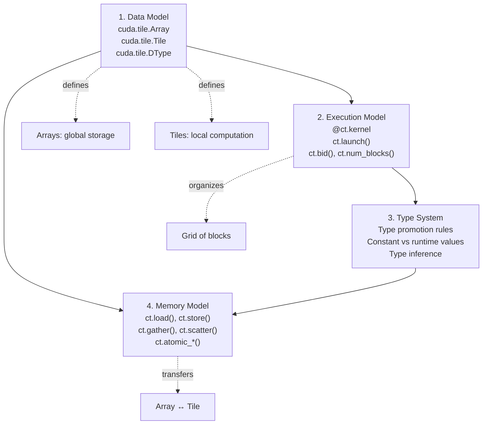
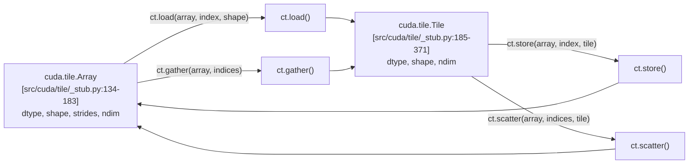
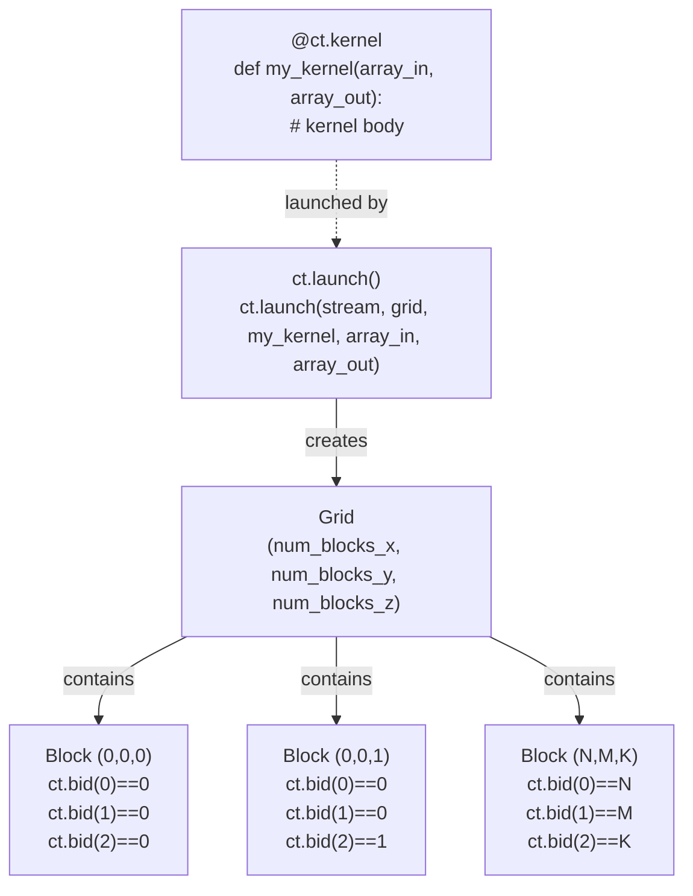
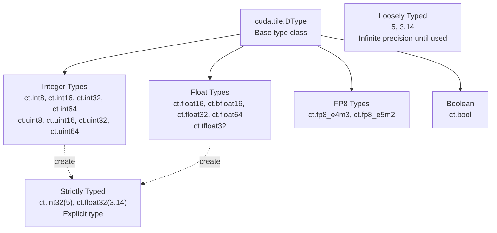
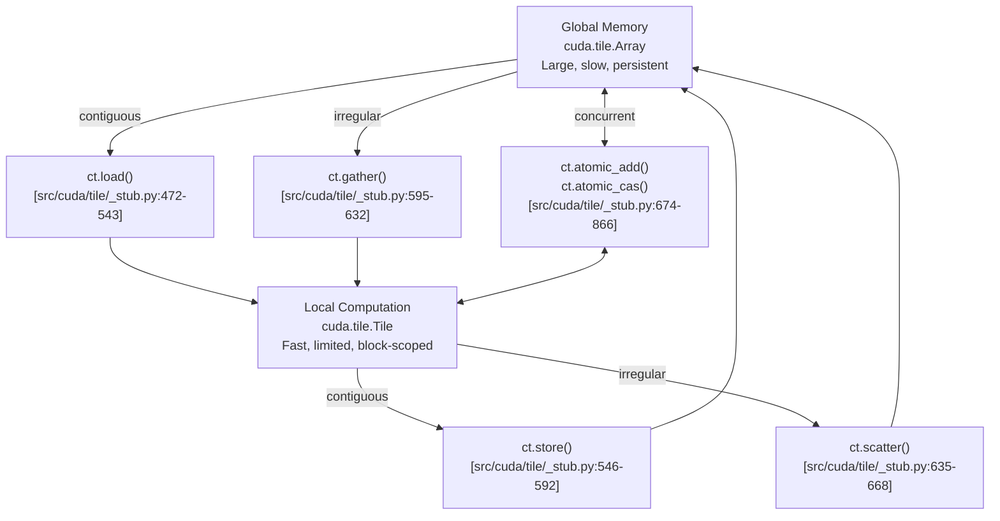
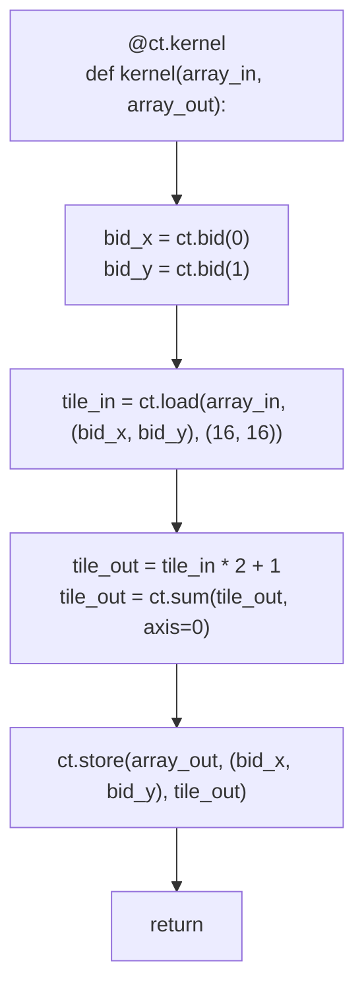

<!-- source: DeepWiki mcp.deepwiki.com · repo NVIDIA/cutile-python · page 2 Core Concepts · fetched 2026-10-26 -->

# Core Concepts

<details>
<summary>Relevant source files</summary>

The following files were used as context for generating this wiki page:

- [docs/source/debugging.rst](docs/source/debugging.rst)
- [docs/source/index.rst](docs/source/index.rst)
- [docs/source/release_notes.rst](docs/source/release_notes.rst)
- [src/cuda/tile/_stub.py](src/cuda/tile/_stub.py)

</details>


## Overview

`cuda.tile` is built on four fundamental abstractions that work together to enable efficient GPU programming. This page provides a high-level introduction to these concepts. For detailed information, see the child pages:

- **[Data Model (2.1)](#2.1)** - `Array` and `Tile` classes, `DType` system, element space vs tile space
- **[Execution Model (2.2)](#2.2)** - `@ct.kernel` decorator, `ct.launch()`, grid/block hierarchy, execution spaces
- **[Type System (2.3)](#2.3)** - Loosely-typed vs strictly-typed constants, type promotion, type inference
- **[Memory Model (2.4)](#2.4)** - Memory hierarchy, data movement operations, synchronization primitives

## The Four Core Abstractions
</thinking>

The `cuda.tile` programming model consists of four interconnected systems:



**Sources:** [src/cuda/tile/_stub.py:1-2147](), [docs/source/index.rst:1-57]()

## Fundamental Abstractions

`cuda.tile` is built on four core abstractions that work together to enable efficient GPU programming:

### 1. Data Model: Arrays and Tiles

#### Dual Data Representation

`cuda.tile` separates **storage** from **computation** through two distinct classes:

| Class | Storage | Mutability | Dimensions | Accessibility | Purpose |
|-------|---------|-----------|------------|---------------|---------|
| `cuda.tile.Array` | Global GPU memory | Mutable | Arbitrary shape/stride | Host + tile code | Data storage and transfer |
| `cuda.tile.Tile` | Registers/shared mem | Immutable | Power-of-2 only | Tile code only | Computation |



**Sources:** [src/cuda/tile/_stub.py:134-183](), [src/cuda/tile/_stub.py:185-371](), [src/cuda/tile/_stub.py:472-668]()

- **`cuda.tile.Array`** provides properties `dtype`, `shape`, `strides`, `ndim`. Arrays interoperate with PyTorch tensors and CuPy arrays via DLPack.
- **`cuda.tile.Tile`** provides properties `dtype`, `shape`, `ndim` and methods for shape manipulation (`reshape`, `permute`, `transpose`, `astype`).

Data transfer operations bridge these representations:
- `ct.load(array, index, shape)` - Loads a tile from array at tile-space index
- `ct.store(array, index, tile)` - Stores a tile to array at tile-space index  
- `ct.gather(array, indices)` - Irregular reads via index tiles
- `ct.scatter(array, indices, value)` - Irregular writes via index tiles

See [Data Model (2.1)](#2.1) for element space vs tile space, `DType` system, and detailed semantics.

### 2. Execution Model: Blocks and Grids

#### Block-Parallel Execution

Kernels execute as a **grid** of **blocks**. The programmer specifies block-level parallelism; thread-level parallelism is implicit.



**Sources:** [src/cuda/tile/_stub.py:408-441](), [docs/source/execution.rst:8-36]()

Key execution primitives:
- `@ct.kernel` - Decorator marking a function as a kernel entry point
- `ct.launch(stream, grid, kernel, *args)` - Launches kernel on GPU with specified grid dimensions
- `ct.bid(axis)` - Returns current block's index along axis (0, 1, or 2) [src/cuda/tile/_stub.py:408-423]()
- `ct.num_blocks(axis)` - Returns total number of blocks along axis [src/cuda/tile/_stub.py:426-441]()

Each block executes the kernel body independently. Blocks cannot communicate except through global memory. The compiler manages threads within each block automatically.

See [Execution Model (2.2)](#2.2) for execution spaces, Python subset restrictions, and detailed semantics.

### 3. Type System: Constants and Promotion

#### Data Types and Type Inference

The type system centers on `cuda.tile.DType` and automatic type inference:



**Sources:** [src/cuda/tile/_datatype.py](), [src/cuda/tile/_stub.py:134-225](), [docs/source/execution.rst:144-156]()

Key concepts:
- **Loosely typed constants**: Literals like `5` or `3.14` have unspecified type until used in a typed context
- **Strictly typed constants**: Created via `ct.int32(5)` or `ct.float32(3.14)`, have explicit types
- **Type promotion**: When types differ, operands promote to a common type following specific rules
- **Type inference**: The compilation system infers types throughout the IR automatically

Example type promotion:
```python
# Loosely typed: 5 has no specific integer width yet
tile = ct.full((4, 4), 5, dtype=ct.int32)  # 5 promotes to int32

# Strictly typed: explicit type from construction
x = ct.int16(5)
y = ct.int32(7)
z = x + y  # Result is int32 (wider type)
```

See [Type System (2.3)](#2.3) for complete promotion rules, constant embedding with `Constant[T]` annotation, and type inference details.

### 4. Memory Model: Data Movement and Synchronization

#### Memory Operations

Data moves between global memory (`Array`) and local computation (`Tile`) through explicit operations:

| Operation | Direction | Pattern | Function |
|-----------|-----------|---------|----------|
| **Load** | Array → Tile | Contiguous block | `ct.load(array, index, shape)` |
| **Store** | Tile → Array | Contiguous block | `ct.store(array, index, tile)` |
| **Gather** | Array → Tile | Irregular indices | `ct.gather(array, indices)` |
| **Scatter** | Tile → Array | Irregular indices | `ct.scatter(array, indices, value)` |
| **Atomic** | Tile ↔ Array | Concurrent access | `ct.atomic_add`, `ct.atomic_cas`, etc. |



**Sources:** [src/cuda/tile/_stub.py:472-866]()

Atomic operations support memory ordering and scope parameters:
- `memory_order`: `RELAXED`, `ACQUIRE`, `RELEASE`, `ACQ_REL` [src/cuda/tile/_memory_model.py]()
- `memory_scope`: `BLOCK`, `DEVICE`, `SYSTEM` [src/cuda/tile/_memory_model.py]()

See [Memory Model (2.4)](#2.4) for memory hierarchy, padding modes, synchronization semantics, and detailed operation specifications.

## Typical Kernel Pattern

Most `cuda.tile` kernels follow this structure:



**Sources:** [docs/source/index.rst:18-22](), [docs/source/execution.rst:8-36]()

Each block:
1. Identifies its position in the grid using `ct.bid(axis)`
2. Loads tiles from global arrays using `ct.load()`
3. Performs computations on tiles (arithmetic, `ct.mma`, reductions)
4. Stores results using `ct.store()`

## Code Entity Reference

### Primary Classes and Decorators

| Entity | Location | Purpose |
|--------|----------|---------|
| `cuda.tile.Array` | [src/cuda/tile/_stub.py:134-183]() | Global memory container with `dtype`, `shape`, `strides`, `ndim` |
| `cuda.tile.Tile` | [src/cuda/tile/_stub.py:185-371]() | Immutable block-local computation with `dtype`, `shape`, `ndim` |
| `cuda.tile.DType` | [src/cuda/tile/_datatype.py]() | Type system base class |
| `@ct.kernel` | [src/cuda/tile/_execution.py]() | Marks function as kernel entry point |
| `ct.launch()` | [src/cuda/tile/_execution.py]() | Launches kernel on GPU with grid specification |

### Core Operations

| Category | Functions | Location |
|----------|-----------|----------|
| **Data Movement** | `ct.load()`, `ct.store()`, `ct.gather()`, `ct.scatter()` | [src/cuda/tile/_stub.py:472-668]() |
| **Block Info** | `ct.bid()`, `ct.num_blocks()`, `ct.num_tiles()` | [src/cuda/tile/_stub.py:408-469]() |
| **Atomics** | `ct.atomic_add()`, `ct.atomic_cas()`, `ct.atomic_xchg()` | [src/cuda/tile/_stub.py:674-866]() |
| **Factory** | `ct.full()`, `ct.zeros()`, `ct.ones()`, `ct.arange()` | [src/cuda/tile/_stub.py:872-938]() |
| **Matrix** | `ct.mma()`, `ct.matmul()` | [src/cuda/tile/_stub.py:943-1020]() |
| **Shape** | `ct.reshape()`, `ct.permute()`, `ct.transpose()`, `ct.cat()` | [src/cuda/tile/_stub.py:1022-1178]() |
| **Type Conversion** | `ct.astype()`, `ct.bitcast()` | [src/cuda/tile/_stub.py:1181-1218]() |
| **Arithmetic** | `ct.add()`, `ct.mul()`, `ct.div()`, `ct.pow()` | [src/cuda/tile/_stub.py:1422-1516]() |
| **Reduction** | `ct.sum()`, `ct.max()`, `ct.min()`, `ct.argmax()` | [src/cuda/tile/_stub.py:1275-1310]() |
| **Comparison** | `ct.equal()`, `ct.greater()`, `ct.less()` | [src/cuda/tile/_stub.py:1555-1646]() |

**Sources:** [src/cuda/tile/_stub.py:1-2147]()

## Immutability and Constraints

### Object Mutability

| Object Type | Mutability in Tile Code | Creation Context |
|------------|-------------------------|------------------|
| `Array` | Mutable (writeable via `ct.store`, atomics) | Host code only |
| `Tile` | Immutable (all operations return new tiles) | Tile code |
| Scalar | Immutable | Any context |
| Tuple | Immutable | Any context |

**Sources:** [docs/source/execution.rst:90-104]()

Operations like `tile.reshape(new_shape)` create and return new `Tile` objects rather than modifying in place. This immutability enables aggressive compiler optimizations.

### Shape Constraints

| Constraint | Array | Tile |
|-----------|-------|------|
| **Dimensions** | Arbitrary positive integers | Must be powers of 2 |
| **Rank** | Any non-negative integer | Any non-negative integer |
| **Layout** | Arbitrary strides | Implicit (implementation-managed) |

**Sources:** [src/cuda/tile/_stub.py:134-225]()

Tile shape constraints enable efficient hardware utilization. Use `ct.load()` with appropriate `shape` parameter to load power-of-2 sized tiles from arbitrarily shaped arrays.

## Execution Spaces Overview

Three distinct execution contexts determine what code can run where:

| Space | Decorator | Runtime | Thread Model | Typical Use |
|-------|-----------|---------|--------------|-------------|
| **Host** | None | CPython | Single-threaded Python | Array creation, kernel launch, post-processing |
| **Tile** | `@ct.kernel` | GPU (no Python runtime) | Block-parallel (implicit threads) | Main computation kernels |
| **SIMT** | `@ct.function(target='simt')` | GPU (no Python runtime) | Thread-parallel | Advanced use cases only |

**Sources:** [docs/source/execution.rst:42-90]()

Most programming uses **host** space for orchestration and **tile** space for computation. Arrays exist in both spaces; Tiles exist only in tile space.

## Summary

The `cuda.tile` programming model centers on four key concepts:

1. **Dual Data Model**: Arrays for storage, Tiles for computation
2. **Block-Parallel Execution**: Explicit block parallelism, implicit thread parallelism
3. **Execution Spaces**: Host code for orchestration, tile code for computation
4. **Immutable Computation**: All tile objects are immutable, enabling optimization

This design provides high-level abstractions that map efficiently to GPU hardware while maintaining programmer control over block-level parallelism. The following sections provide detailed documentation on each aspect of this model.

---

