<!-- source: DeepWiki mcp.deepwiki.com · repo NVIDIA/cutile-python · page 2.1 Data Model · fetched 2026-10-26 -->

# Data Model

<details>
<summary>Relevant source files</summary>

The following files were used as context for generating this wiki page:

- [docs/source/data.rst](docs/source/data.rst)
- [src/cuda/tile/_stub.py](src/cuda/tile/_stub.py)

</details>


## Purpose and Scope

This page describes the fundamental data structures and type system in cuda.tile. It covers:

- **Arrays** and **Tiles**: The two primary data structures for storing multidimensional data
- **DTypes**: The type system for representing numeric data
- **Scalars**: Single-value data and their typing rules
- **Element Space and Tile Space**: The dual indexing model for array partitioning
- **Type Promotion and Broadcasting**: Rules for combining values of different types and shapes

For information about how these data structures are used during kernel execution, see [Execution Model](#2.2). For details on memory ordering and atomic operations, see [Memory Model](#2.4). For the complete API reference of operations on these data structures, see [API Reference](#3).

**Sources:** [docs/source/data.rst:1-173](), [src/cuda/tile/_stub.py:1-1901]()

---

## Overview: Dual Data Model

cuda.tile uses a dual data model that separates **storage** from **computation**:

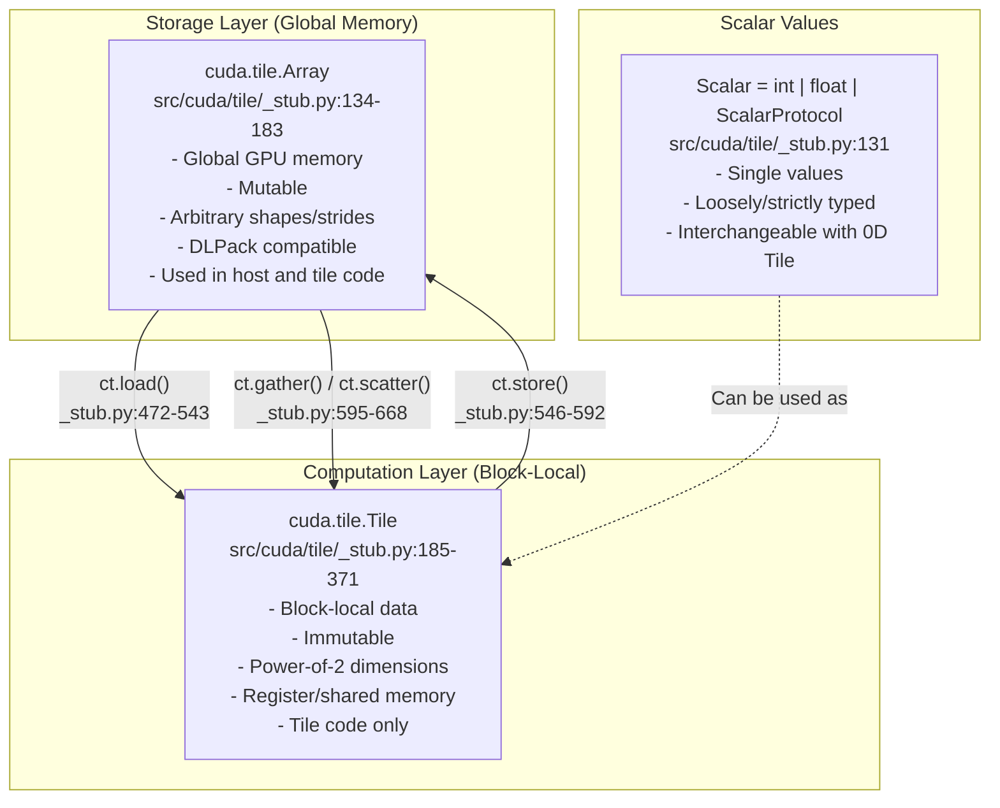

**Sources:** [src/cuda/tile/_stub.py:134-371](), Diagram 2 from high-level architecture

---

## Arrays

### Definition

An **Array** (also called a **global array**) is a container of objects stored in a logical multidimensional space in GPU global memory.

**Sources:** [src/cuda/tile/_stub.py:134-146]()

### Key Properties

| Property | Type | Description |
|----------|------|-------------|
| `dtype` | `DType` (constant) | The data type of the array's elements |
| `shape` | `tuple[int, ...]` | Number of elements in each dimension |
| `strides` | `tuple[int, ...]` | Number of elements to step in each dimension |
| `ndim` | `int` (constant) | Number of dimensions |

**Sources:** [src/cuda/tile/_stub.py:148-182]()

### Characteristics

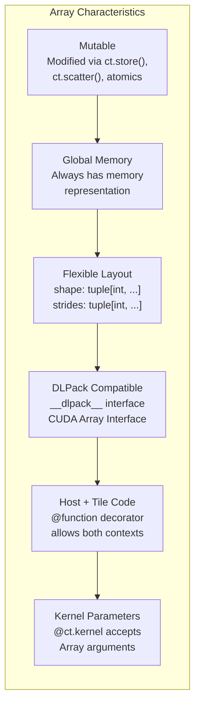

- **Mutable**: Array contents can be modified via `ct.store()`, `ct.scatter()`, or atomic operations
- **Stored in memory**: Always have a memory representation in GPU global memory
- **Arbitrary shapes**: No power-of-2 constraints on dimensions
- **DLPack compatible**: Any object implementing DLPack or CUDA Array Interface can be used as an Array
- **Cross-space usage**: Can be accessed from both host code (CPU) and tile code (GPU kernels)
- **Kernel parameters**: Can be passed as arguments to `@ct.kernel` decorated functions

**Sources:** [src/cuda/tile/_stub.py:134-183](), [docs/source/data.rst:23-37]()

### Array in Code

```python
# Arrays can be created from PyTorch tensors, CuPy arrays, etc.
import torch
import cuda.tile as ct

# Create array from PyTorch tensor
array = torch.zeros((128, 256), dtype=torch.float32, device='cuda')

# Access array properties in tile code
@ct.kernel
def example_kernel(arr: ct.Array):
    dtype = arr.dtype      # DType (constant)
    shape = arr.shape      # tuple[int32, int32]
    strides = arr.strides  # tuple[int32, int32]
    ndim = arr.ndim        # int (constant = 2)
```

**Sources:** [src/cuda/tile/_stub.py:134-183]()

---

## Tiles

### Definition

A **Tile** (also called a **tile array**) is an immutable multidimensional collection of values that is local to a block. Tiles represent the fundamental unit of computation in cuda.tile.

**Sources:** [src/cuda/tile/_stub.py:185-197]()

### Key Properties

| Property | Type | Description |
|----------|------|-------------|
| `dtype` | `DType` (constant) | The data type of the tile's elements |
| `shape` | `tuple[const int, ...]` | Number of elements in each dimension (compile-time constant) |
| `ndim` | `int` (constant) | Number of dimensions (compile-time constant) |

**Sources:** [src/cuda/tile/_stub.py:199-224]()

### Characteristics

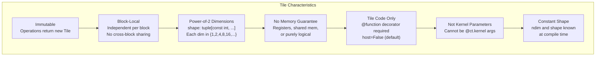

- **Immutable**: Once created, tile contents cannot be changed; operations produce new tiles
- **Block-local**: Each block has its own independent copy of tile data
- **Power-of-2 constraint**: Each dimension must be a power of 2 (1, 2, 4, 8, 16, ...)
- **No memory guarantee**: Tiles may reside in registers, shared memory, or be purely logical
- **Tile code only**: Cannot be used in host code or passed as kernel parameters
- **Constant shape**: Shape and ndim must be known at compile time

**Sources:** [src/cuda/tile/_stub.py:185-224](), [docs/source/data.rst:39-53]()

### Tile Creation Methods

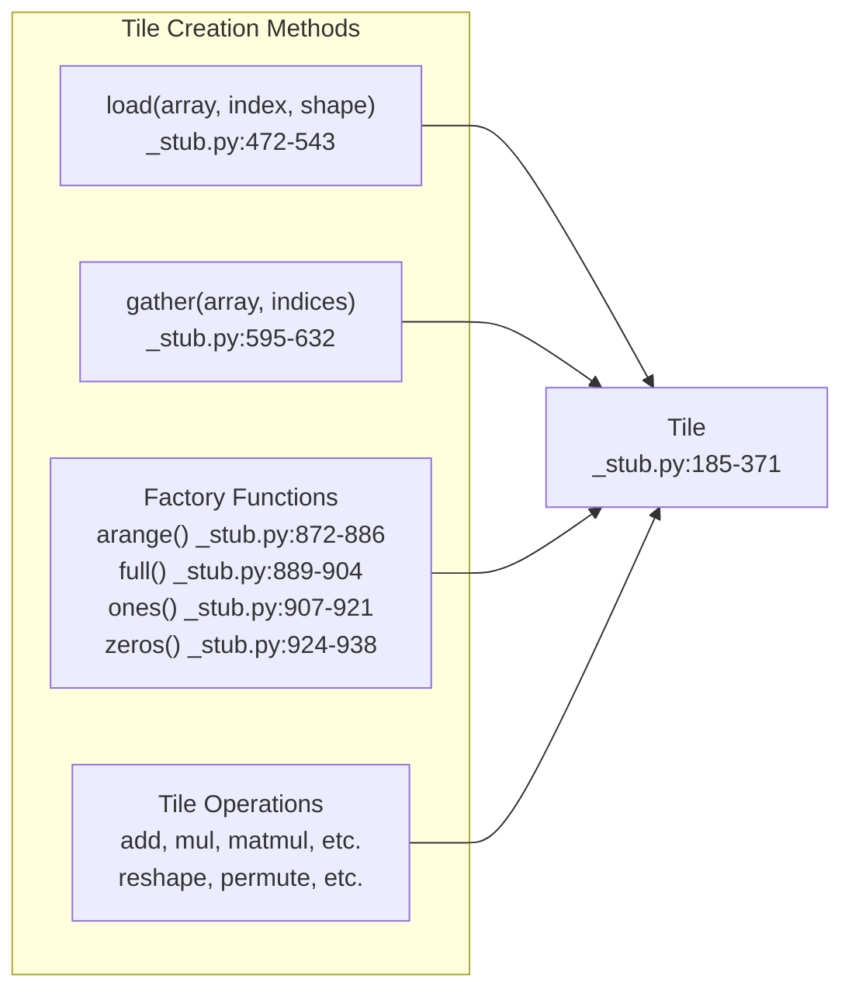

**Sources:** [src/cuda/tile/_stub.py:472-543, 872-938]()

### Tile Methods

The `Tile` class provides several methods for manipulation:

| Method | Description | Reference |
|--------|-------------|-----------|
| `item()` | Extract scalar from single-element tile | [src/cuda/tile/_stub.py:226-239]() |
| `extract(index, shape)` | Extract smaller tile from larger tile | [src/cuda/tile/_stub.py:241-243]() |
| `reshape(shape)` | Change tile shape | [src/cuda/tile/_stub.py:245-247]() |
| `permute(axes)` | Permute tile axes | [src/cuda/tile/_stub.py:249-251]() |
| `transpose(axis0, axis1)` | Transpose two axes | [src/cuda/tile/_stub.py:253-255]() |
| `astype(dtype)` | Convert tile data type | [src/cuda/tile/_stub.py:257-259]() |

**Sources:** [src/cuda/tile/_stub.py:226-259]()

---

## Scalars

### Definition

A **Scalar** is a single immutable value of a specific data type. Scalars bridge between Python values and GPU computation.

**Sources:** [src/cuda/tile/_stub.py:131](), [docs/source/data.rst:139-152]()

### Scalar Types and Equivalence

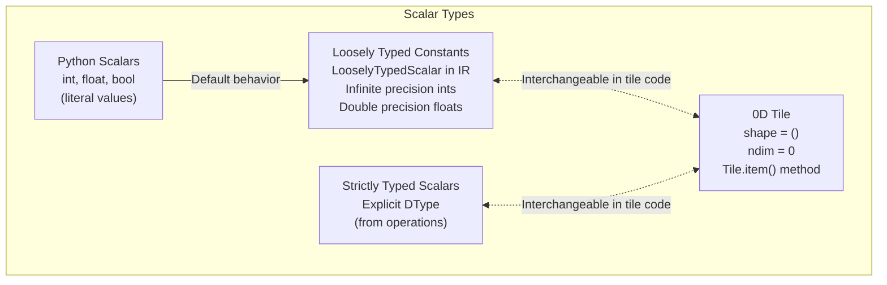

A scalar and a 0D tile can be used interchangeably in tile code. Both can also be kernel parameters.

**Sources:** [src/cuda/tile/_stub.py:21-131, 227-239](), [docs/source/data.rst:139-152]()

### Scalar Typing Rules

| Scalar Source | Typing Behavior |
|---------------|-----------------|
| Literal values (e.g., `2`, `3.14`) | Loosely typed by default |
| Constant properties (e.g., `Tile.ndim`, `Tile.shape[0]`) | Loosely typed |
| `Array.shape`, `Array.strides` | Strictly typed as `int32` (runtime values) |
| 0D Tile from operations | Strictly typed with operation's output dtype |

**Important:** `Array.shape` and `Array.strides` default to `int32` for performance. This limits the maximum representable dimension size but makes kernels more efficient.

**Sources:** [docs/source/data.rst:145-151]()

### Loosely Typed Constants

**Loosely typed numeric constants** have special properties:

- **Integral constants**: Infinite precision until used in typed context
- **Floating-point constants**: Double precision until used in typed context
- **Constant expressions**: Results of operations on loosely typed constants remain loosely typed

Example:
```python
# Loosely typed constants
x = 5 + 7        # Loosely typed int: 12
y = 5 + 3.0      # Loosely typed float: 8.0

# Used in typed context
tile = ct.full((4,), x, dtype=ct.float32)  # x promoted to float32
```

**Sources:** [docs/source/data.rst:115-118]()

---

## Data Types (DType)

### DType Hierarchy

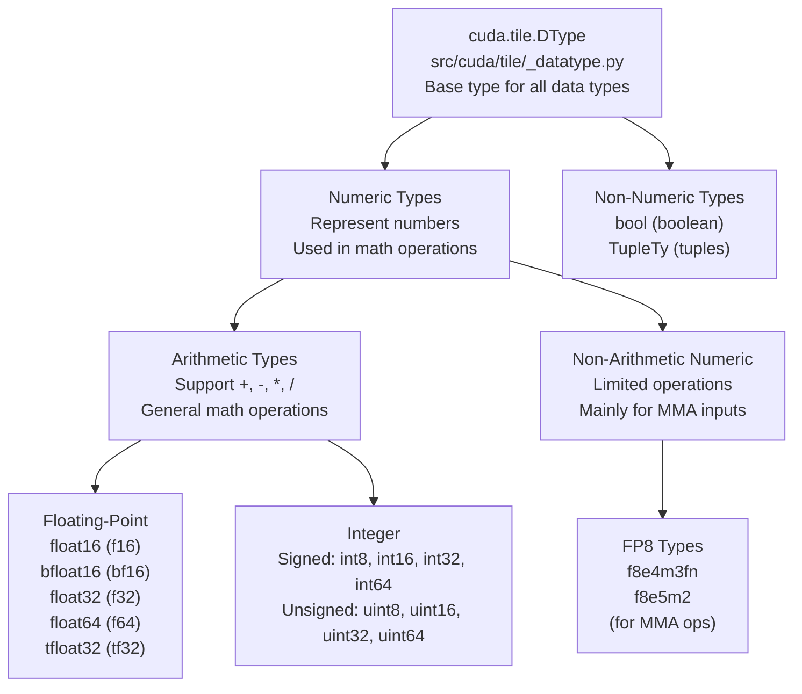

**Sources:** [docs/source/data.rst:96-108]()

### Available Data Types

| Category | Types |
|----------|-------|
| **Floating-Point** | `float16`, `bfloat16`, `float32`, `float64`, `tfloat32` |
| **Integer** | `int8`, `int16`, `int32`, `int64`, `uint8`, `uint16`, `uint32`, `uint64` |
| **FP8** | `f8e4m3fn`, `f8e5m2` |
| **Boolean** | `bool` |

**Sources:** [src/cuda/tile/_datatype.py]() (referenced in [src/cuda/tile/_stub.py:13]())

### Type Promotion Rules

When binary operations combine operands of different types, cuda.tile follows these promotion rules:

```mermaid
graph TB
    subgraph Categories["Type Categories (Ordered)"]
        Bool["Boolean Category<br/>bool<br/>(lowest priority)"]
        Integral["Integral Category<br/>int8, int16, int32, int64<br/>uint8, uint16, uint32, uint64<br/>(medium priority)"]
        Float["Floating-Point Category<br/>float16, bfloat16<br/>float32, float64, tfloat32<br/>(highest priority)"]
    end
    
    Bool -->|"Promoted to"| Integral
    Integral -->|"Promoted to"| Float
    
    subgraph Process["Promotion Algorithm"]
        Step1["1. Classify operands<br/>_ir/ops.py implements<br/>type inference logic"]
        Step2["2. Handle LooselyTypedScalar<br/>int literals → int32/int64/uint64<br/>float literals → float32"]
        Step3["3. Select higher category<br/>If categories differ,<br/>use higher category's dtype"]
        Step4["4. Same-category promotion<br/>Apply dtype-specific rules<br/>from promotion table"]
    end
    
    Step1 --> Step2
    Step2 --> Step3
    Step3 --> Step4
```

**Promotion Algorithm:**

1. **Classify operands**: Each operand is classified as boolean, integral, or floating-point
2. **Handle loosely typed constants**: 
   - Integral constants → `int32`, `int64`, or `uint64` (depending on value)
   - Floating-point constants → `float32`
3. **Category comparison**: If categories differ, choose the higher category's dtype
4. **Same category**: Apply dtype-specific promotion table (see documentation)

**Sources:** [docs/source/data.rst:110-137]()

### Type Promotion Examples

```python
# Category-based promotion
bool_tile + int_tile    # → int (integral > boolean)
int_tile + float_tile   # → float (floating-point > integral)

# Loosely typed constant promotion
tile_f32 + 5           # 5 treated as int32, promoted to float32
tile_f32 + 5.0         # 5.0 treated as float32

# Loosely typed expression
x = 5 + 7              # Loosely typed int
y = tile_f32 + x       # x promoted to float32
```

**Sources:** [docs/source/data.rst:115-133]()

---

## Element Space and Tile Space

cuda.tile uses a dual indexing model that separates the logical organization of array elements from the logical organization of tiles.

### Definitions

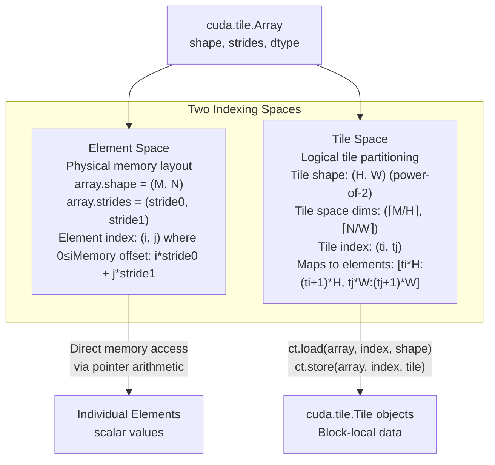

**Sources:** [docs/source/data.rst:55-79]()

### Tile Space Partitioning

The **tile space** is created by partitioning an array using a fixed tile shape:

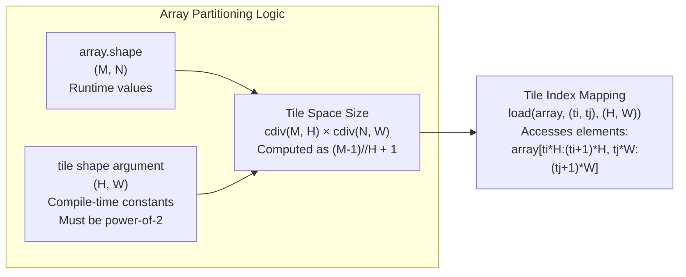

**Tile Space Size:** For an array of shape `(M, N)` and tile shape `(H, W)`, the tile space has size `(⌈M/H⌉, ⌈N/W⌉)` where ⌈⌉ denotes ceiling division.

**Index Mapping:** A tile index `(ti, tj)` refers to elements with indices in the range:
- Row: `ti * H` to `(ti + 1) * H - 1`
- Column: `tj * W` to `(tj + 1) * W - 1`

**Sources:** [docs/source/data.rst:70-79](), [src/cuda/tile/_stub.py:480-543]()

### Element Space vs Tile Space Example

Consider a 2D array of shape `(12, 16)`:

**With tile shape (4, 4):**
- Element space: 12 × 16 = 192 elements at indices `[0:12, 0:16]`
- Tile space: 3 × 4 = 12 tiles at indices `[0:3, 0:4]`
- Tile `(1, 2)` contains elements `[4:8, 8:12]`

**With tile shape (2, 8):**
- Element space: Still 12 × 16 = 192 elements
- Tile space: 6 × 2 = 12 tiles at indices `[0:6, 0:2]`
- Tile `(2, 1)` contains elements `[4:6, 8:16]`

**Sources:** [docs/source/data.rst:58-68]()

### Tile Space Operations

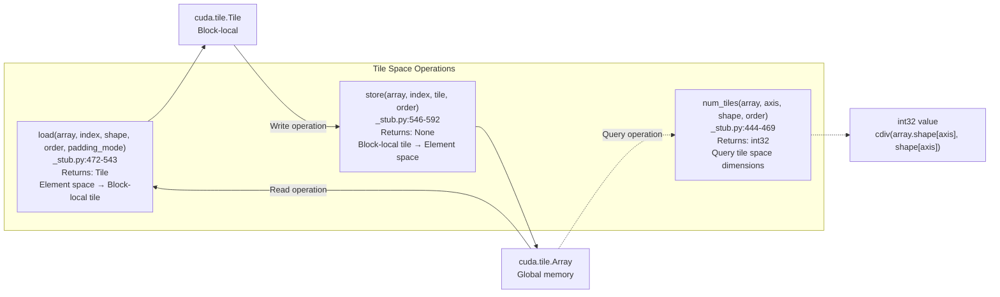

**Key Operations:**

- **`ct.load(array, index, shape)`**: Loads a tile from the array's tile space
  - `index`: Tile coordinates in tile space
  - `shape`: Tile dimensions defining the partitioning
  - Returns: Tile containing elements from the specified tile region

- **`ct.store(array, index, tile)`**: Stores a tile to the array's tile space
  - `index`: Tile coordinates in tile space
  - `tile`: Tile to store (shape defines partitioning)

- **`ct.num_tiles(array, axis, shape)`**: Returns the number of tiles along an axis
  - Computed as `⌈array.shape[axis] / shape[axis]⌉`

**Sources:** [src/cuda/tile/_stub.py:444-592]()

### Memory Layout and Order Parameter

The `order` parameter in `ct.load()` and `ct.store()` controls how tile axes map to array axes:

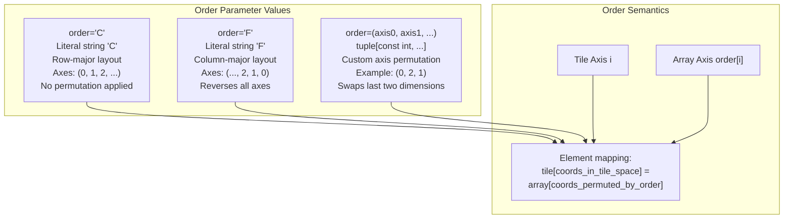

**Example:**
```python
# Load with transpose
tile = ct.load(array, (i, j), shape=(4, 8), order='F')
# Equivalent to: tile[y, x] = array[i*4 + x, j*8 + y]

# Load with custom permutation (swap last two axes)
tile = ct.load(array3d, (i, j, k), shape=(8, 4, 2), order=(0, 2, 1))
```

**Sources:** [src/cuda/tile/_stub.py:497-542]()

---

## Shape Broadcasting

Shape broadcasting allows tiles of different shapes to be combined in arithmetic operations without explicit reshaping.

### Broadcasting Rules

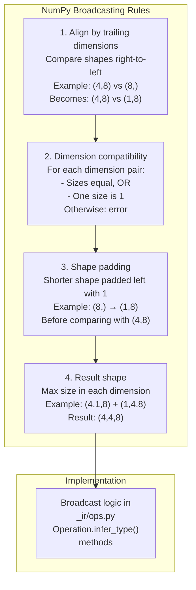

**Broadcasting follows NumPy semantics:**

1. **Alignment**: Shapes are aligned by their trailing (rightmost) dimensions
2. **Compatibility**: For each dimension pair:
   - Sizes are equal, OR
   - One size is 1
3. **Padding**: If one shape has fewer dimensions, pad with 1s on the left

**Sources:** [docs/source/data.rst:81-93]()

### Broadcasting Examples

```python
# Basic broadcasting
tile_4x8 = ct.full((4, 8), 1.0, dtype=ct.float32)
tile_8 = ct.full((8,), 2.0, dtype=ct.float32)
result = tile_4x8 + tile_8  # Shape: (4, 8)
# Broadcasting: (4, 8) + (1, 8) → (4, 8)

# Multi-dimensional broadcasting
tile_4x1x8 = ct.full((4, 1, 8), 1.0, dtype=ct.float32)
tile_4x8 = ct.full((4, 8), 2.0, dtype=ct.float32)
result = tile_4x1x8 + tile_4x8  # Shape: (4, 4, 8)
# Broadcasting: (4, 1, 8) + (1, 4, 8) → (4, 4, 8)

# Scalar broadcasting
tile = ct.full((4, 8), 1.0, dtype=ct.float32)
result = tile + 5.0  # Shape: (4, 8)
# Scalar broadcasts to all elements
```

**Sources:** [docs/source/data.rst:81-93]()

---

## Mapping to Code Entities

### Core Classes and Their Locations

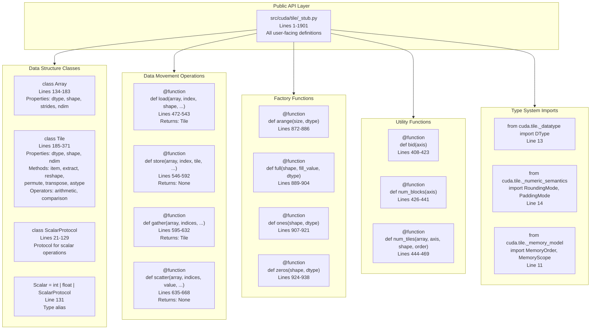

**Sources:** [src/cuda/tile/_stub.py:1-1901]()

### Type System and Supporting Enums

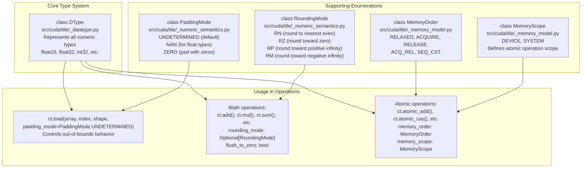

**Sources:** [src/cuda/tile/_stub.py:11-14]()

### Properties and Methods Map

| Entity | Location | Type | Description |
|--------|----------|------|-------------|
| `Array.dtype` | [src/cuda/tile/_stub.py:148-155]() | Property | Returns DType (constant) |
| `Array.shape` | [src/cuda/tile/_stub.py:157-164]() | Property | Returns tuple[int, ...] |
| `Array.strides` | [src/cuda/tile/_stub.py:166-173]() | Property | Returns tuple[int, ...] |
| `Array.ndim` | [src/cuda/tile/_stub.py:175-182]() | Property | Returns int (constant) |
| `Tile.dtype` | [src/cuda/tile/_stub.py:199-206]() | Property | Returns DType (constant) |
| `Tile.shape` | [src/cuda/tile/_stub.py:208-215]() | Property | Returns tuple[const int, ...] |
| `Tile.ndim` | [src/cuda/tile/_stub.py:217-224]() | Property | Returns int (constant) |
| `Tile.item()` | [src/cuda/tile/_stub.py:226-239]() | Method | Extract scalar from single-element tile |
| `Tile.extract()` | [src/cuda/tile/_stub.py:241-243]() | Method | Extract smaller tile |
| `Tile.reshape()` | [src/cuda/tile/_stub.py:245-247]() | Method | Change tile shape |
| `Tile.permute()` | [src/cuda/tile/_stub.py:249-251]() | Method | Permute axes |
| `Tile.transpose()` | [src/cuda/tile/_stub.py:253-255]() | Method | Transpose two axes |
| `Tile.astype()` | [src/cuda/tile/_stub.py:257-259]() | Method | Convert data type |

**Sources:** [src/cuda/tile/_stub.py:134-371]()

---

## Summary

The cuda.tile data model provides:

1. **Dual data structures**: Arrays for storage, Tiles for computation
2. **Strong type system**: DType with clear promotion rules
3. **Flexible scalars**: Loosely and strictly typed values
4. **Dual indexing**: Element space for memory layout, tile space for partitioning
5. **Broadcasting semantics**: NumPy-compatible shape broadcasting

This model enables high-performance GPU programming while maintaining Python-like expressiveness.

**Sources:** [docs/source/data.rst:1-173](), [src/cuda/tile/_stub.py:1-1901](), Diagrams 1-2 from high-level architecture

---

