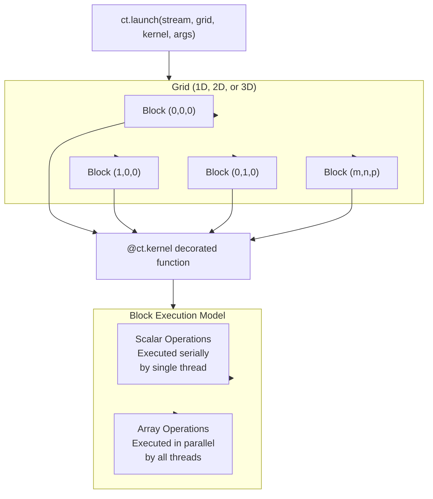
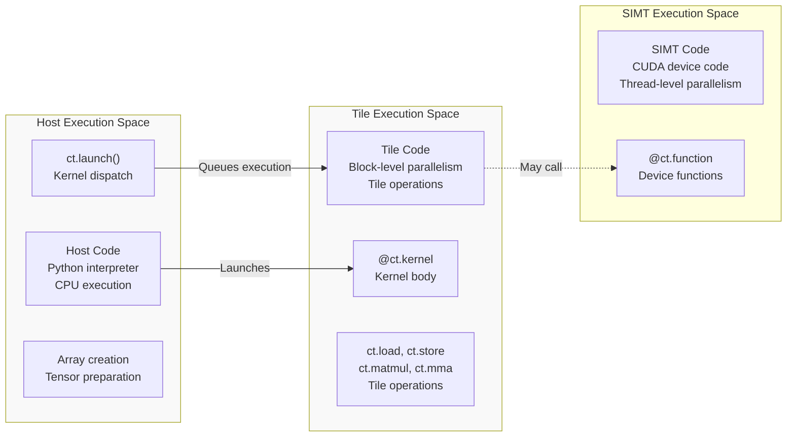
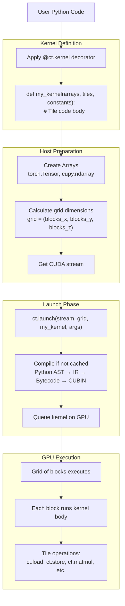
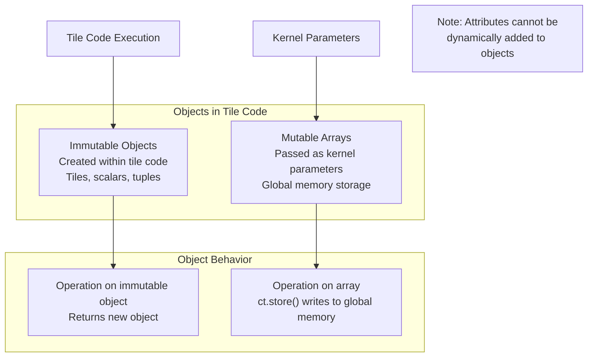
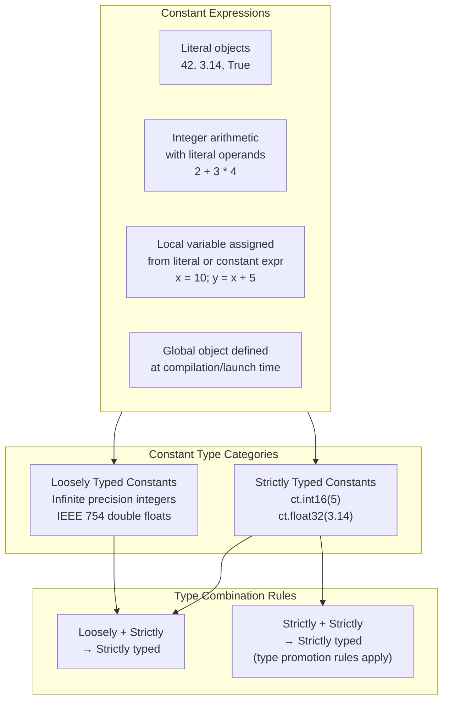
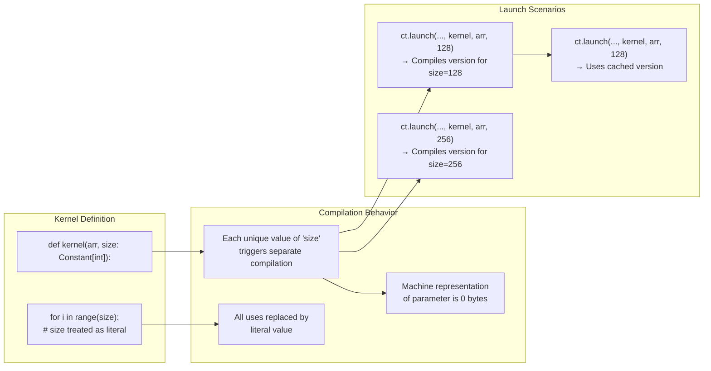

<!-- source: DeepWiki mcp.deepwiki.com · repo NVIDIA/cutile-python · page 2.2 Execution Model · fetched 2026-10-26 -->

# Execution Model

<details>
<summary>Relevant source files</summary>

The following files were used as context for generating this wiki page:

- [docs/source/debugging.rst](docs/source/debugging.rst)
- [docs/source/execution.rst](docs/source/execution.rst)
- [docs/source/index.rst](docs/source/index.rst)
- [docs/source/release_notes.rst](docs/source/release_notes.rst)

</details>


## Purpose and Scope

This document describes cuTile's execution model: how kernels are organized into grids and blocks, the three execution spaces (Host, SIMT, and Tile), and the programming constraints imposed by the tile abstraction. This includes the abstract machine model, kernel launch mechanics, the Python language subset supported in tile code, and constantness semantics.

For information about data structures (Arrays and Tiles), see [Data Model](#2.1). For type inference and promotion rules, see [Type System](#2.3). For memory hierarchy and data movement, see [Memory Model](#2.4).

---

## Abstract Machine

### Grid and Block Organization

A **tile kernel** is executed by logical thread **blocks** that are organized in a 1D, 2D, or 3D **grid**. Each block executes the body of the kernel independently.



**Grid and Block Execution Model**

Key properties:
- Each block is executed by a subset of GPU resources (decided by implementation, not programmer)
- Scalar operations within a block execute serially by a single thread
- Array operations execute collectively in parallel by all threads of the block
- Tile programs describe **block-level parallelism**, not thread-level parallelism
- Threads cannot be explicitly identified or manipulated in tile programs

**Important Distinction**: Do not confuse **blocks** (units of execution) with **tiles** (units of data). A block may work with multiple tiles with different shapes originating from different global arrays.

Sources: [docs/source/execution.rst:8-36]()

### Synchronization Model

| Synchronization Type | Within Block | Between Blocks |
|---------------------|--------------|----------------|
| Explicit synchronization | Not permitted | Allowed |
| Explicit communication | Not permitted | Allowed |

The tile programming model does not permit explicit synchronization or communication within a block. However, synchronization and communication between different blocks is allowed through global memory operations.

Sources: [docs/source/execution.rst:29-30]()

---

## Execution Spaces

cuTile code executes on one or more **targets**, which are distinct execution environments distinguished by different hardware resources or programming models. A construct's **execution space** is the set of targets where it can be used.

### Three Execution Spaces



**Execution Space Classification**

| Execution Space | Description | Hardware Target |
|----------------|-------------|-----------------|
| **Host code** | Python code running on CPU | All CPU targets |
| **SIMT code** | CUDA device code with thread-level control | All CUDA SIMT targets |
| **Tile code** | Tile kernel code with block-level parallelism | All CUDA tile targets |

A function, type, or object is **usable** in an execution space if:
- Functions can be called
- Type or object attributes are accessible (read and written)
- Methods are callable

Sources: [docs/source/execution.rst:42-62]()

---

## Kernel and Function Decorators

### Kernel Definition and Launch



**Kernel Compilation and Launch Flow**

### Code Decorators

| Decorator | Purpose | Execution Space | Callable From |
|-----------|---------|----------------|---------------|
| `@ct.kernel` | Marks kernel entry point | Tile code | Host code via `ct.launch()` |
| `@ct.function` | Marks tile function | Tile code | Tile code only |

The `@ct.kernel` decorator marks a Python function as a kernel's entry point. Kernels:
- Cannot be called directly from host code
- Must be launched via `ct.launch()`
- Execute in the tile execution space
- Accept arrays, tiles, and constants as parameters

The `@ct.function` decorator marks a function usable within tile code. These functions can be called from kernels or other tile functions.

Sources: [docs/source/execution.rst:67-79](), [docs/source/index.rst:13-16]()

### Launch Function

The `ct.launch()` function queues a kernel for execution on the GPU:

```python
ct.launch(stream, grid, kernel, *args)
```

Parameters:
- `stream`: CUDA stream for execution
- `grid`: Tuple of (blocks_x, blocks_y, blocks_z) defining grid dimensions
- `kernel`: Function decorated with `@ct.kernel`
- `*args`: Arguments passed to kernel (arrays, tiles, constants)

The caller must ensure:
- No arrays passed to the kernel alias one another
- All passed arrays remain valid until kernel execution completes

Sources: [docs/source/execution.rst:79](), [docs/source/execution.rst:101-104]()

---

## Python Subset in Tile Code

Tile code supports a **subset** of the Python language. Within tile code, there is no Python runtime. Only Python features explicitly enumerated in this documentation are supported.

### Unsupported Features

Many Python features are **not supported** in tile code, including:
- Lambdas
- Exceptions
- Coroutines
- Dynamic attribute addition
- Classes (beyond built-in tile types)

Sources: [docs/source/execution.rst:81-88]()

### Object Model and Lifetimes



**Object Mutability in Tile Code**

Key properties:
- **All objects created within tile code are immutable**
- Any operation that conceptually modifies an object creates and returns a **new object**
- **Attributes cannot be dynamically added** to objects
- **Arrays are the only mutable objects** and must be passed as kernel parameters
- Arrays are stored in global memory and can be modified via `ct.store()`

Sources: [docs/source/execution.rst:90-99]()

### Control Flow Support

Tile code supports standard Python control flow statements:
- `if`, `elif`, `else`
- `for` loops
- `while` loops
- These can be arbitrarily nested

#### Current Limitations

| Constraint | Description | Example |
|-----------|-------------|---------|
| Positive step only | `range()` step must be strictly positive | `range(10, 0, -1)` is **not supported** |
| Step sign | Passing negative step indirectly may cause undefined behavior | Variables with negative values as step |

Sources: [docs/source/execution.rst:106-122]()

---

## Tile Parallelism

When a block executes a function that takes tiles as parameters, it may **parallelize the evaluation** of the function across the block's execution resources.

Unless otherwise specified:
- The execution shall **complete before the function returns**
- No explicit synchronization is required by the programmer
- The runtime manages parallelization automatically

This is a key property of the tile abstraction: operations on tiles are automatically parallelized across the threads of a block without explicit thread management.

Sources: [docs/source/execution.rst:123-128]()

---

## Constantness

### Constant Expressions and Objects

Some operations require parameters that are **known statically at compilation time**. These are called **constant expressions**, which produce **constant objects**.



**Constant Type System**

#### Constant Expressions Include:
1. **Literal objects**: `42`, `3.14`, `True`
2. **Integer arithmetic** where all operands are literals: `2 + 3 * 4`
3. **Local variables** assigned from literals or constant expressions
4. **Global objects** defined at compilation or launch time

#### Type Semantics:

**Loosely Typed Constants** (default):
- Integer constants have **infinite precision** until used in a context requiring specific width
- Floating-point constants stored in **IEEE 754 double precision**

**Strictly Typed Constants**:
- Created by calling dtype as constructor: `ct.int16(5)`
- When combined with loosely typed constant, result is strictly typed: `ct.int16(5) + 2` → `int16(7)`
- When two strictly typed constants combine, type promotion rules apply: `ct.int16(5) + ct.int32(7)` → `int32(12)`

Sources: [docs/source/execution.rst:130-156]()

### Constant Embedding



**Constant Embedding Compilation Flow**

If a kernel parameter is **constant embedded** (using `Constant[T]` type hint):

1. **All uses act as if replaced by the literal value** of the parameter
2. **Distinct machine representation** exists for each different value
3. **Parameter size is 0 bytes** in machine representation
4. **Separate compilation** occurs for each unique value (even with JIT caching enabled)

This enables aggressive compiler optimizations, such as:
- Loop unrolling when bounds are constant
- Constant propagation through control flow
- Dead code elimination based on constant conditions

### Constant Type Hints

The `Constant[T]` type hint annotation marks a parameter for constant embedding:

```python
from cuda.tile import Constant

@ct.kernel
def my_kernel(array: Array, tile_size: Constant[int]):
    # tile_size is constant embedded
    # All uses are replaced with literal value
    for i in range(tile_size):  # Loop bounds known at compile time
        ...
```

The `ConstantAnnotation` class and `Constant` type alias are provided for this purpose.

Sources: [docs/source/execution.rst:158-184]()

---

## Summary Table

| Concept | Key Properties | Code Reference |
|---------|---------------|----------------|
| Grid | 1D/2D/3D organization of blocks | [docs/source/execution.rst:13-14]() |
| Block | Unit of execution; runs kernel body | [docs/source/execution.rst:18-20]() |
| Host code | CPU execution space | [docs/source/execution.rst:59]() |
| SIMT code | CUDA device code execution space | [docs/source/execution.rst:60-61]() |
| Tile code | Tile kernel execution space | [docs/source/execution.rst:62]() |
| `@ct.kernel` | Kernel entry point decorator | [docs/source/execution.rst:74-77]() |
| `@ct.function` | Tile function decorator | [docs/source/execution.rst:68-70]() |
| `ct.launch()` | Kernel launch function | [docs/source/execution.rst:79]() |
| Immutability | All tile code objects are immutable | [docs/source/execution.rst:93-95]() |
| Arrays | Only mutable objects in tile code | [docs/source/execution.rst:98-99]() |
| Constant embedding | Parameter becomes compile-time literal | [docs/source/execution.rst:161-165]() |

Sources: [docs/source/execution.rst:1-185](), [docs/source/index.rst:13-40]()

---

