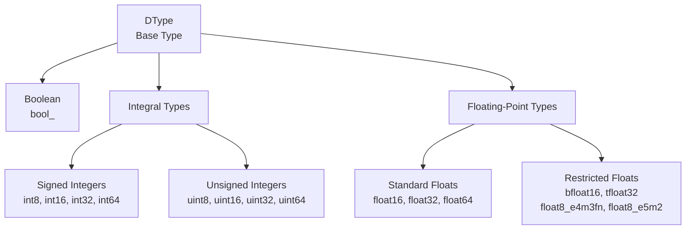
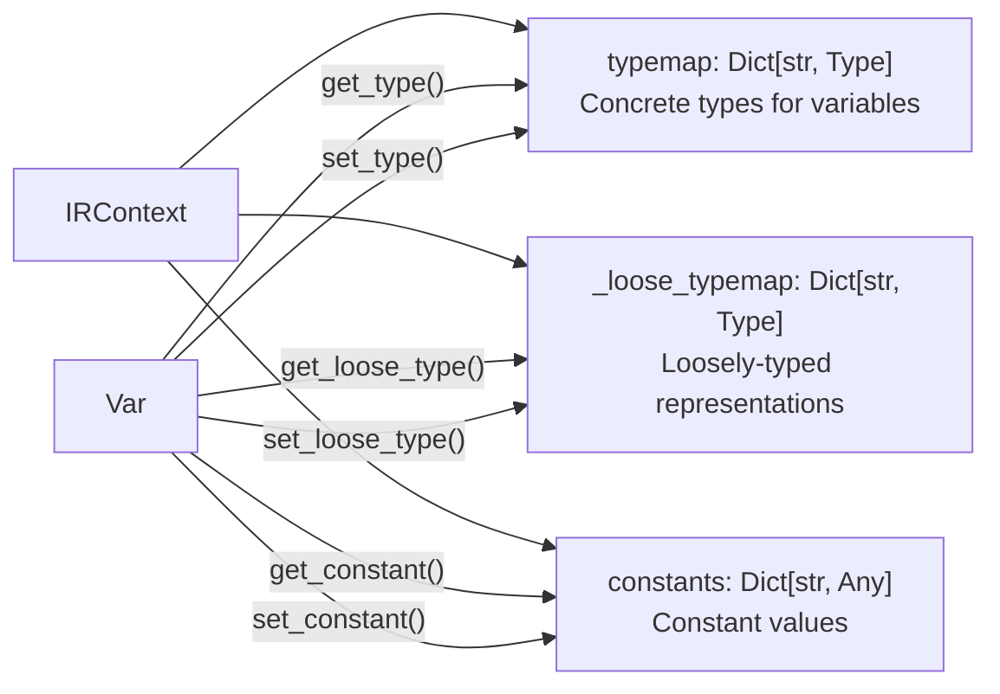
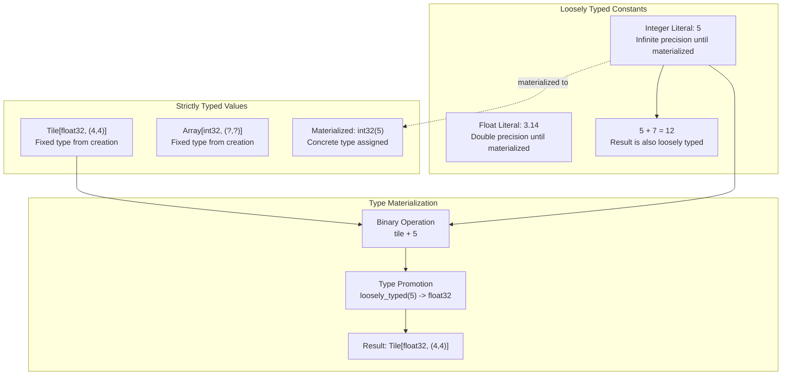
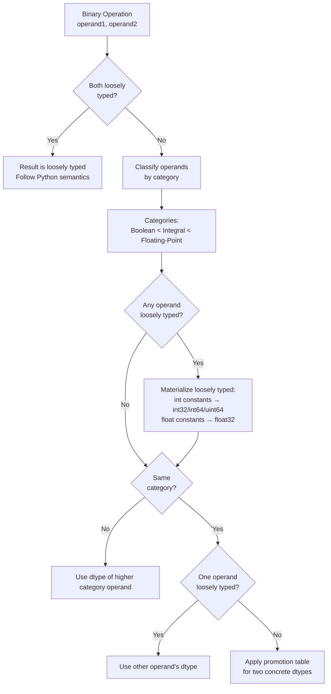
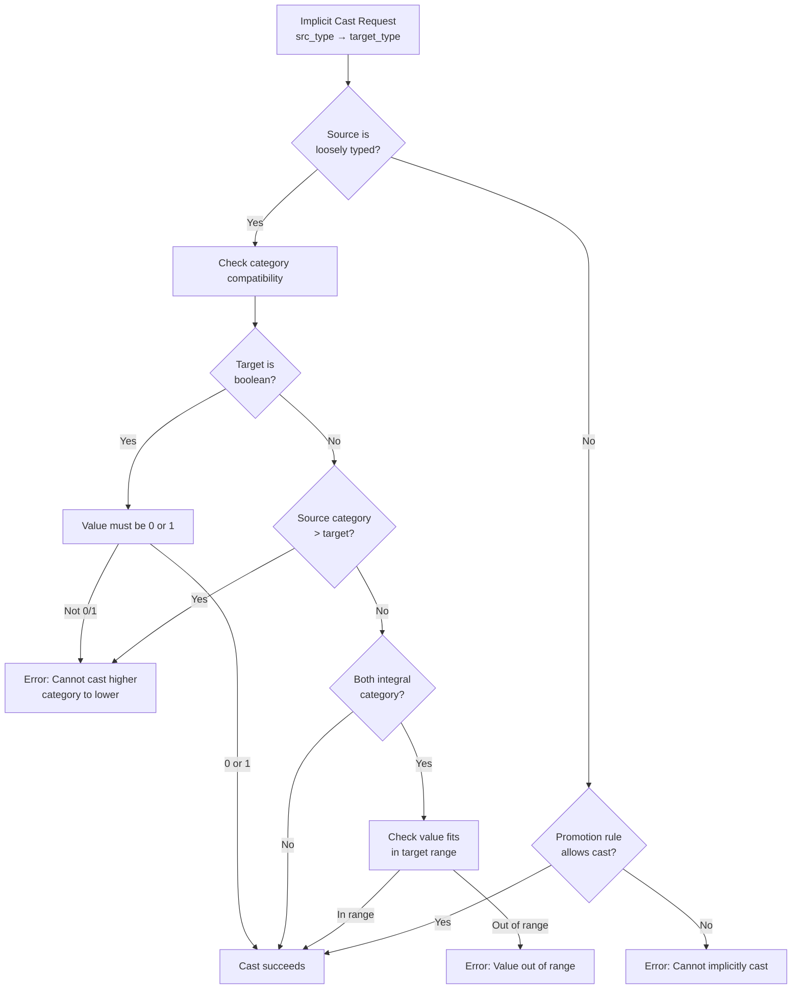
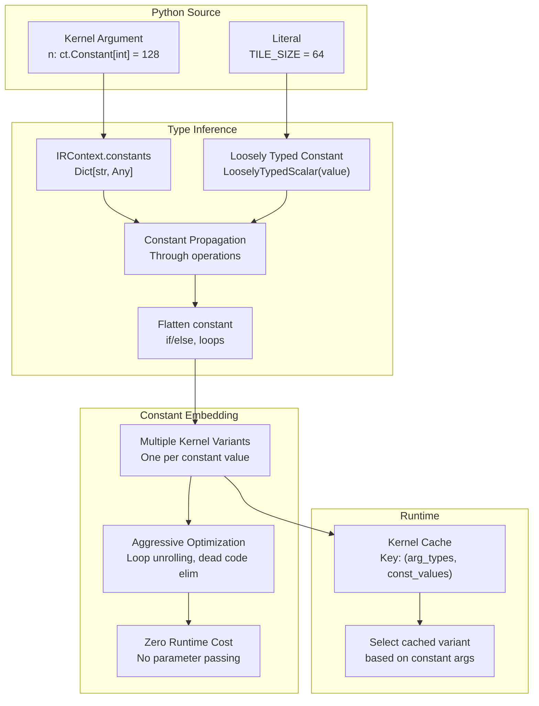
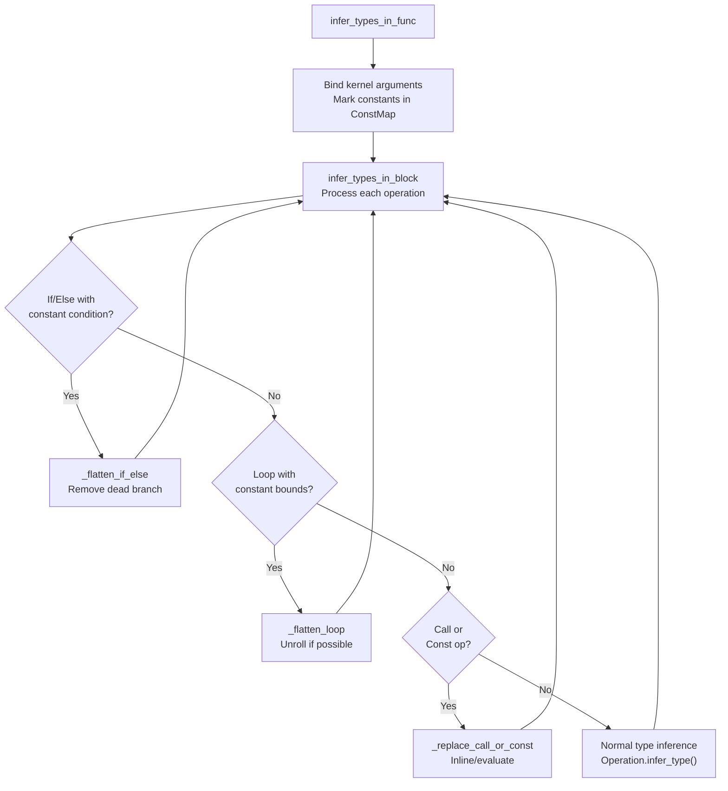
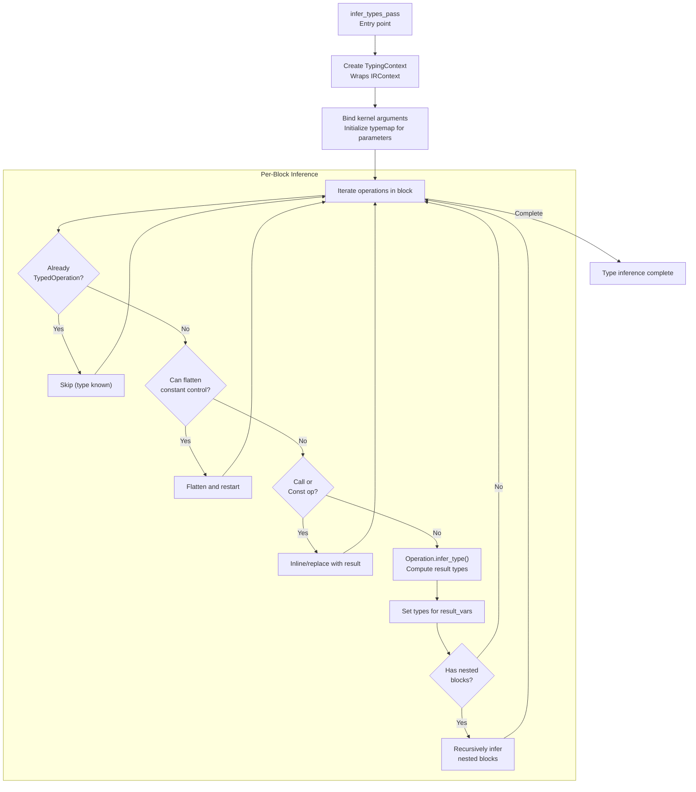
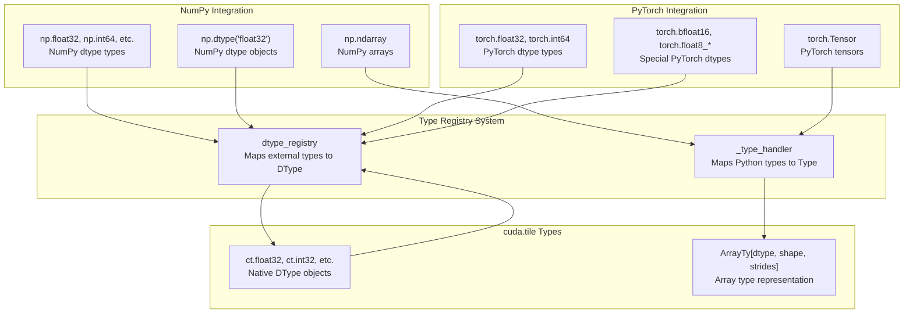

<!-- source: DeepWiki mcp.deepwiki.com · repo NVIDIA/cutile-python · page 2.3 Type System · fetched 2026-10-26 -->

# Type System

<details>
<summary>Relevant source files</summary>

The following files were used as context for generating this wiki page:

- [src/cuda/tile/_ir/ir.py](src/cuda/tile/_ir/ir.py)
- [src/cuda/tile/_ir/ops.py](src/cuda/tile/_ir/ops.py)
- [src/cuda/tile/_ir/typing_support.py](src/cuda/tile/_ir/typing_support.py)
- [src/cuda/tile/_passes/typeinfer.py](src/cuda/tile/_passes/typeinfer.py)
- [test/test_cat.py](test/test_cat.py)
- [test/test_typeinfer.py](test/test_typeinfer.py)

</details>


## Purpose and Scope

This page describes the type system used in cuda.tile, covering how data types (DTypes) are represented, how type promotion works in operations, and the distinction between loosely-typed and strictly-typed values. The type system is central to compilation, enabling both type safety and performance optimizations through constant embedding.

For information about the memory model and synchronization semantics, see [Memory Model](#2.4). For details on how Arrays and Tiles use these types, see [Data Model](#2.1).

**Sources**: [docs/source/data.rst:95-173]()

---

## DType Hierarchy

cuda.tile supports a comprehensive set of numeric data types organized into categories. The type system distinguishes between boolean, integral, and floating-point types, with further subdivisions for specialized formats.

### DType Categories



**Numeric Type Categories** (from strongest to weakest):
1. **Floating-Point**: `float64`, `float32`, `float16`, `bfloat16`, `tfloat32`, `float8_e4m3fn`, `float8_e5m2`
2. **Integral**: `int64`, `int32`, `int16`, `int8`, `uint64`, `uint32`, `uint16`, `uint8`
3. **Boolean**: `bool_`

The category hierarchy determines type promotion behavior: floating-point types always dominate integral types, which dominate boolean types.

**Sources**: [docs/source/data.rst:95-110](), [src/cuda/tile/_ir/ops_utils.py:20-21]()

---

## Type Representation in IR

The type system is implemented through several interconnected components in the IR layer.

### Core Type Structures



**Key Classes:**

| Class | Purpose | Key Methods |
|-------|---------|-------------|
| `IRContext` | Central registry for type information | Maintains `typemap`, `constants`, `_loose_typemap` |
| `Var` | Variable representation | `get_type()`, `set_type()`, `get_loose_type()`, `is_constant()` |
| `Type` | Base type representation | `TileTy`, `DType`, `LooselyTypedScalar`, `ArrayTy` |

Each `Var` object references an `IRContext` and uses its variable name as a key to look up type information. This indirection allows multiple variables to share type information and enables efficient type updates during inference.

**Sources**: [src/cuda/tile/_ir/ir.py:40-76](), [src/cuda/tile/_ir/ir.py:78-138]()

---

## Loosely Typed vs Strictly Typed

cuda.tile employs a dual typing system that distinguishes between loosely-typed constants and strictly-typed values. This system enables both flexibility in constant expressions and type safety in operations.

### Dual Typing Model



### Loosely Typed Constants

**Properties:**
- Integer constants have infinite precision (within int64/uint64 limits)
- Floating-point constants use double precision
- Remain loosely typed through constant expression evaluation
- Type is materialized when combined with strictly-typed values

**Example: Constant Expression**
```python
# Both operands are loosely typed, result is loosely typed
result = 5 + 7  # loosely typed integral constant 12

# Mixed typed and loosely typed
tile = ct.full((4, 4), 1.0, dtype=ct.float32)
result = tile + 5  # 5 is promoted to float32, result is Tile[float32, (4,4)]
```

**Sources**: [docs/source/data.rst:115-118](), [src/cuda/tile/_ir/type.py (via ops_utils.py references)]()

### Strictly Typed Values

**Strictly typed from creation:**
- Tiles created with factory functions (`ct.full`, `ct.arange`)
- Arrays loaded from memory
- Results of operations on strictly-typed values
- Kernel parameters (non-constant)

**Type Assignment:**
- Integer kernel parameters default to `int32`
- Array properties (`Array.shape`, `Array.stride`) default to `int32`
- Constant properties (`Tile.ndim`, `Tile.shape`) remain loosely typed

**Sources**: [docs/source/data.rst:145-151](), [src/cuda/tile/_ir/typing_support.py:128-152]()

---

## Type Promotion Rules

When binary operations combine values of different types, cuda.tile applies type promotion to determine a common type. The promotion rules balance type safety with flexibility.

### Promotion Algorithm



### Type Promotion Table

When both operands are strictly typed and in the same category, the promotion table determines the common type:

| Type 1 | Type 2 | Result |
|--------|--------|--------|
| `int32` | `int64` | `int64` |
| `int32` | `uint32` | `int64` |
| `float16` | `float32` | `float32` |
| `float32` | `float64` | `float64` |
| `bfloat16` | `float32` | `float32` |

**Complete table**: [docs/source/data.rst:134-137]()

### Promotion with Loosely Typed Constants

**Special behavior for loosely typed operands:**

1. **Both loosely typed**: Result is loosely typed
   ```python
   5 + 7        # → loosely typed integral 12
   5 + 3.0      # → loosely typed float 8.0
   ```

2. **One loosely typed, same category**: Use the concrete type
   ```python
   ct.int32(5) + 7    # → int32 (7 promoted to int32)
   ```

3. **One loosely typed, different category**: Use higher category
   ```python
   ct.int32(5) + 3.0  # → float32 (3.0 materialized as float32)
   ```

4. **Range checking for integers**: Loosely typed integral constants must fit in target type
   ```python
   ct.int32(5) + 2147483648  # ERROR: constant out of int32 range
   ```

**Sources**: [docs/source/data.rst:110-136](), [src/cuda/tile/_ir/ops_utils.py:233-277]()

---

## Implicit Casting Rules

cuda.tile performs implicit casts in certain contexts, but enforces strict rules to prevent unintended precision loss or truncation.

### Implicit Cast Validation



### Implicit Cast Examples

**Valid Casts:**
```python
# Loosely typed constant fits in target
ct.scatter(int32_array, index, 42)  # 42 fits in int32

# Same-category promotion
ct.scatter(int64_array, index, ct.int32(5))  # int32 → int64

# Lower to higher category
ct.scatter(float32_array, index, ct.int32(5))  # int32 → float32
```

**Invalid Casts:**
```python
# Loosely typed constant out of range
ct.scatter(int32_array, index, 2**31)  # ERROR: out of int32 range

# Higher to lower category
ct.scatter(int32_array, index, 3.14)  # ERROR: float → int

# Incompatible boolean value
ct.scatter(bool_array, index, 5)  # ERROR: not 0 or 1
```

**Sources**: [src/cuda/tile/_ir/ops_utils.py:298-324](), [test/test_typeinfer.py:324-353]()

---

## Constant Propagation and Embedding

Constants flow through the compilation pipeline, enabling both type inference optimizations and performance improvements through constant embedding.

### Constant Flow Through Compilation



### Constant Argument Types

**Three types of constants:**

1. **Kernel Constant Arguments** (`ct.Constant[T]`)
   - Specified via type annotation
   - Trigger separate compilation per value
   - Enable aggressive optimization
   ```python
   @ct.kernel
   def kernel(x, TILE_SIZE: ct.Constant[int]):
       tile = ct.full((TILE_SIZE, TILE_SIZE), 0, dtype=ct.float32)
   ```

2. **Constant Literals**
   - Python literals in kernel code
   - Remain loosely typed until materialized
   - Propagated through operations
   ```python
   offset = ct.arange(128, dtype=ct.int32)  # 128 is loosely typed constant
   ```

3. **Constant Properties**
   - Static properties like `Tile.shape`, `Tile.ndim`
   - Known at compile time
   - Enable shape-dependent optimizations
   ```python
   if tile.ndim == 2:  # Condition known at compile time
       ...
   ```

**Sources**: [docs/source/data.rst:145-151](), [src/cuda/tile/_ir/ir.py:45-48]()

### Constant Propagation in Type Inference

The type inference pass tracks constants and performs optimizations:



**Key Optimizations:**

| Optimization | Trigger | Effect |
|--------------|---------|--------|
| Constant if/else flattening | Condition is constant | Dead branch removed, living branch inlined |
| Loop flattening | Loop with known `break` condition | Loop body inlined once |
| Constant call replacement | Call to operation with constant args | Result computed at compile time |

**Sources**: [src/cuda/tile/_passes/typeinfer.py:141-160](), [src/cuda/tile/_passes/typeinfer.py:162-184](), [src/cuda/tile/_passes/typeinfer.py:224-290]()

---

## Type Inference Process

Type inference is a multi-pass process that resolves types bottom-up through the IR, handling control flow and propagating constants.

### Type Inference Pipeline



### TypingContext

The `TypingContext` wraps the `IRContext` and provides additional state tracking for type inference:

```python
class TypingContext:
    ir_ctx: IRContext              # Core IR context
    phis: Dict[str, PhiState]      # Phi node state for control flow
    
    # Delegated properties:
    typemap -> ir_ctx.typemap
    constants -> ir_ctx.constants
    range_infos -> ir_ctx.range_infos
```

**Key Methods:**

| Method | Purpose |
|--------|---------|
| `get_constant(var)` | Retrieve constant value, raise if not constant |
| `is_constant(var)` | Check if variable has constant value |
| `get_type(var)` | Get concrete type for variable |
| `set_type(var, ty)` | Assign type to variable |

**Sources**: [src/cuda/tile/_passes/typeinfer.py:49-105]()

### Operation Type Inference

Each operation implements `infer_type()` to compute result types from operand types:

**Example: Binary Arithmetic Operation**
```python
def infer_type(self, typing_context: TypingContext) -> Type:
    # Get operand types (may be loosely typed)
    lhs_ty = self.lhs.get_loose_type()
    rhs_ty = self.rhs.get_loose_type()
    
    # Apply type promotion
    result_ty = promote_types(lhs_ty, rhs_ty)
    
    return result_ty
```

**Example: Load Operation**
```python
def infer_type(self, typing_context: TypingContext) -> Type:
    # Get array dtype
    array_ty = self.array.get_type()
    assert isinstance(array_ty, ArrayTy)
    
    # Get tile shape (must be constant)
    shape = typing_context.get_constant(self.shape)
    
    # Return tile type
    return TileTy(array_ty.dtype, shape)
```

**Sources**: [src/cuda/tile/_passes/typeinfer.py:127-139](), [src/cuda/tile/_passes/typeinfer.py:362-375]()

### Control Flow and Phi Nodes

Type inference handles control flow by tracking types through branches:

**Phi State Tracking:**
- Each variable that crosses control flow has a `PhiState`
- `PhiState` tracks whether the variable is constant and its value
- If different branches assign different values, marked as non-constant
- If all branches assign the same value, remains constant

**Example: If/Else with Constant Condition**
```python
# Before inference
if const_condition:
    x = 5
else:
    x = 10

# After inference (const_condition is True)
x = 5  # Dead branch removed, x is constant
```

**Sources**: [src/cuda/tile/_passes/typeinfer.py:27-47](), [src/cuda/tile/_passes/typeinfer.py:94-105]()

---

## Integration with External Frameworks

cuda.tile seamlessly integrates with NumPy and PyTorch by registering type handlers for their data types and arrays.

### Framework Type Registration



### DType Registration

External framework dtypes are registered to map to cuda.tile `DType` objects:

**NumPy Registration:**
```python
register_dtypes({
    np.float32: datatype.float32,
    np.int64: datatype.int64,
    # ... etc
}, usable_as_constructor=True)
```

**PyTorch Registration:**
```python
register_dtypes({
    torch.float32: datatype.float32,
    torch.bfloat16: datatype.bfloat16,
    torch.float8_e4m3fn: datatype.float8_e4m3fn,
    # ... etc
})
```

**Sources**: [src/cuda/tile/_ir/typing_support.py:17-24](), [src/cuda/tile/_ir/typing_support.py:247-277](), [src/cuda/tile/_ir/typing_support.py:291-307]()

### Array Type Handlers

Framework-specific arrays are converted to `ArrayTy` with shape and stride information:

**PyTorch Tensor Handler:**
- Extracts `dtype`, `shape`, and `stride` from tensor
- Computes array specialization properties (alignment, disjointness)
- Creates `ArrayTy` with dynamic shape/stride information
- Uses `ArraySpecialization` to determine which strides are compile-time constants

**CUDA Array Interface Handler:**
- Supports any object with `__cuda_array_interface__`
- Extracts dtype from typestr, shape/strides from interface
- Computes element strides from byte strides
- Enables interop with CuPy, Numba, and other CUDA libraries

**Sources**: [src/cuda/tile/_ir/typing_support.py:309-330](), [src/cuda/tile/_ir/typing_support.py:350-378]()

---

## Type Error Handling

The type system provides detailed error messages for type mismatches and invalid operations.

### Type Error Categories

| Error Type | Trigger | Example |
|------------|---------|---------|
| `TileTypeError` | Type mismatch in operation | Binary op on incompatible types |
| `TileValueError` | Value out of valid range | Constant exceeds dtype range |
| Invalid implicit cast | Precision loss or truncation | Casting float to int |
| Invalid constant | Non-constant where constant required | Runtime value for shape parameter |
| Category mismatch | Operation requires specific category | Arithmetic on boolean |

### Common Type Errors

**Invalid Shape Type:**
```python
ct.load(x, (0, 0), shape=(2, 2.0))
# TileTypeError: Expected a tuple of integers, but element #1 has type float32
```

**Constant Out of Range:**
```python
ct.scatter(int32_array, index, 2**31)
# TileValueError: Integer constant 2147483648 is out of range of int32
```

**Invalid Implicit Cast:**
```python
ct.atomic_add(int32_array, index, 3.14)
# TileTypeError: cannot implicitly cast float32 to int32
```

**Non-Constant Shape:**
```python
def kernel(x, size):
    ct.full((size, size), 0, dtype=ct.float32)  # size must be constant
# TileTypeError: Expected a constant integer tuple, but given value is not constant
```

**Sources**: [test/test_typeinfer.py:26-95](), [test/test_atomic.py:137-143]()

---

## Summary

The cuda.tile type system provides:

1. **Rich DType Support**: Comprehensive numeric types including specialized formats
2. **Dual Typing Model**: Loosely-typed constants for flexibility, strictly-typed values for safety
3. **Smart Type Promotion**: Category-based promotion with special handling for constants
4. **Constant Propagation**: Compile-time constant evaluation and optimization
5. **Type Safety**: Strict implicit casting rules prevent precision loss
6. **Framework Integration**: Seamless interop with NumPy and PyTorch

The type system is central to cuda.tile's compilation pipeline, enabling both type safety through the inference pass and performance optimization through constant embedding and specialization.

**Sources**: [docs/source/data.rst:95-173](), [src/cuda/tile/_passes/typeinfer.py:1-376](), [src/cuda/tile/_ir/ops_utils.py:233-342]()

---

