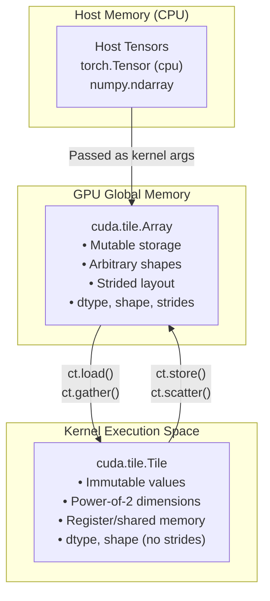
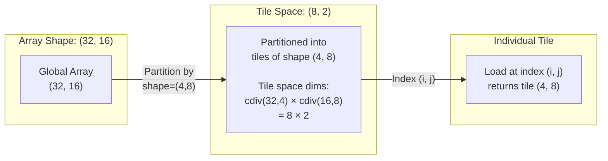
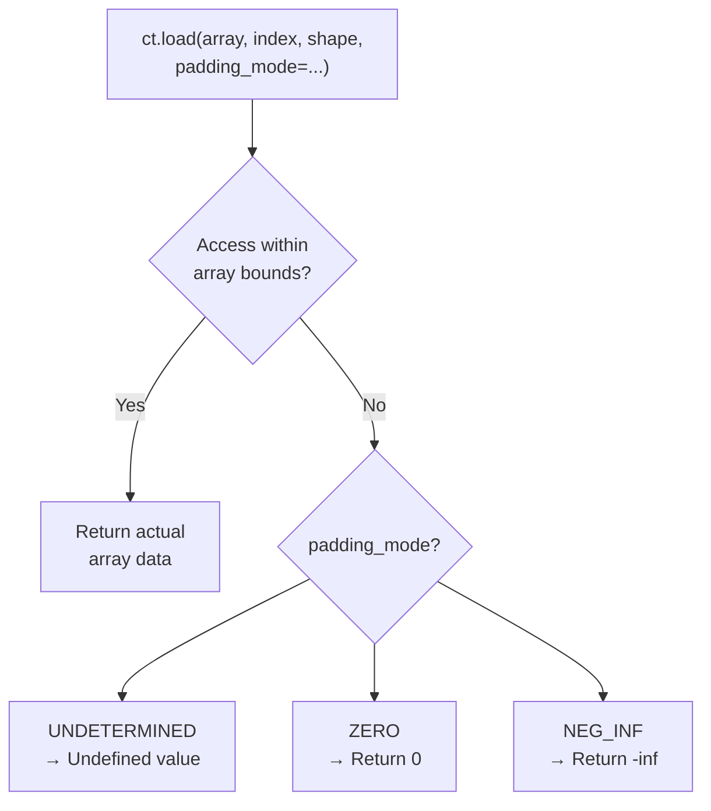
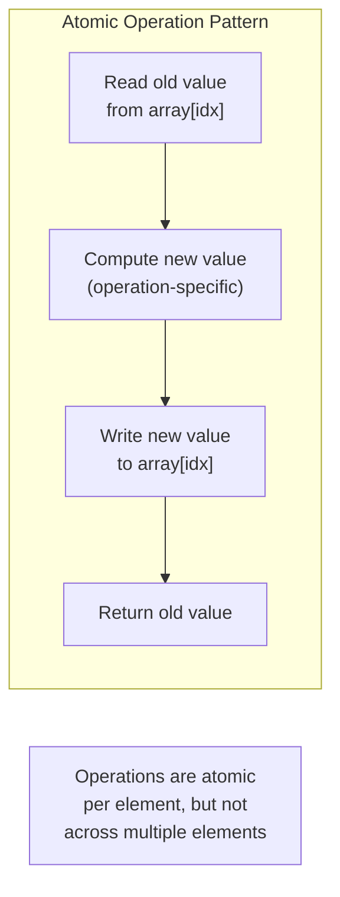
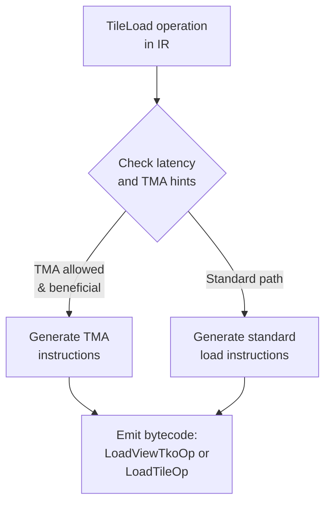

<!-- source: DeepWiki mcp.deepwiki.com · repo NVIDIA/cutile-python · page 2.4 Memory Model · fetched 2026-10-26 -->

# Memory Model

<details>
<summary>Relevant source files</summary>

The following files were used as context for generating this wiki page:

- [src/cuda/tile/_ir/ops.py](src/cuda/tile/_ir/ops.py)
- [src/cuda/tile/_stub.py](src/cuda/tile/_stub.py)
- [test/test_cat.py](test/test_cat.py)

</details>


This page describes the memory model in cuTile Python, including the memory hierarchy, data types that exist at different memory levels, and operations for moving data between memory spaces.

For information about the abstract execution model and how blocks and threads are organized, see [Execution Model](#2.2). For information about the type system and how types are inferred, see [Type System](#2.3).

## Purpose and Scope

The memory model defines:
- The distinction between **global arrays** (stored in device memory) and **local tiles** (stored in registers/shared memory)
- How data moves between memory spaces using load, store, gather, and scatter operations
- Memory ordering semantics for atomic operations
- Padding behavior when accessing data outside array bounds

## Memory Hierarchy Overview

cuTile operates on a two-level memory abstraction:



**Sources:** [_stub.py:134-183](), [_stub.py:185-372](), high-level diagram 5

## Global Arrays

A **global array** (`cuda.tile.Array`) is a container stored in GPU global memory that can be accessed from both host code and kernel code.

### Characteristics

| Property | Description |
|----------|-------------|
| **Mutability** | Mutable - can be written to via `ct.store()` |
| **Shape** | Arbitrary dimensions and sizes |
| **Layout** | Strided - supports non-contiguous layouts |
| **Storage** | Device global memory (DRAM) |
| **Lifetime** | Managed externally (e.g., by PyTorch/CuPy) |

### Array Properties

Arrays expose the following properties accessible in kernel code:

```python
@property
def dtype(self) -> DType:
    """The data type of array elements (constant)"""

@property
def shape(self) -> tuple[int, ...]:
    """Element counts in each dimension (runtime values)"""

@property
def strides(self) -> tuple[int, ...]:
    """Element strides for traversing the array"""

@property
def ndim(self) -> int:
    """Number of dimensions (constant)"""
```

### Compatibility

Any object implementing the **DLPack** format or **CUDA Array Interface** can be used as a global array:
- PyTorch tensors (`torch.Tensor`)
- CuPy arrays (`cupy.ndarray`)
- NumPy arrays automatically transferred to device

**Sources:** [_stub.py:134-183](), [_ir/ops.py:3599-3653]()

## Local Tiles

A **local tile** (`cuda.tile.Tile`) represents an immutable collection of values local to a block's execution space. Tiles do not necessarily have a concrete memory representation - they may exist only in registers or as compiler abstractions.

### Characteristics

| Property | Description |
|----------|-------------|
| **Mutability** | Immutable - operations create new tiles |
| **Shape** | All dimensions must be powers of 2 |
| **Layout** | No explicit layout - logical abstraction |
| **Storage** | Registers, shared memory, or optimized away |
| **Lifetime** | Scoped to the kernel execution |

### Tile Properties

```python
@property
def dtype(self) -> DType:
    """The data type of tile elements (constant)"""

@property
def shape(self) -> tuple[int, ...]:
    """Element counts in each dimension (all constant, powers of 2)"""

@property
def ndim(self) -> int:
    """Number of dimensions (constant)"""
```

### Power-of-Two Constraint

All tile dimensions must be powers of 2. This constraint enables efficient hardware operations:

```python
# Valid tile shapes
ct.full((1,), 0, ct.int32)      # 1D tile
ct.full((4, 8), 0, ct.int32)    # 2D tile  
ct.full((2, 4, 8), 0, ct.int32) # 3D tile

# Invalid - will raise TileTypeError
ct.full((3, 5), 0, ct.int32)    # Not powers of 2
```

**Sources:** [_stub.py:185-372](), [_ir/ops.py:1703-1749](), [test/test_cat.py:44-47]()

## Tile Space Partitioning

Arrays are logically partitioned into a **tile space** - a regular grid where each cell corresponds to a tile of fixed shape.



The tile space has dimensions:
```
tile_space[d] = cdiv(array.shape[d], tile_shape[d])
```

where `cdiv(a, b)` computes ceiling division: `(a - 1) // b + 1`.

**Sources:** [_stub.py:472-543](), [_ir/ops.py:1856-1906]()

## Data Movement Operations

### Load Operation

`ct.load()` reads a tile from an array at a specified index in the tile space:

```python
def load(array: Array, /,
         index: Shape,
         shape: Constant[Shape], *,
         order: Constant[Order] = "C",
         padding_mode: PaddingMode = PaddingMode.UNDETERMINED,
         latency: Optional[int] = None,
         allow_tma: Optional[bool] = None) -> Tile
```

#### Load Semantics

For a 2D example with array shape `(M, N)`, tile shape `(tm, tn)`, and index `(i, j)`:

```
result[x, y] = array[i * tm + x, j * tn + y]
```

for all `0 <= x < tm` and `0 <= y < tn`.

#### Axis Ordering

The `order` parameter controls axis permutation before partitioning:

| Order | Meaning | Example |
|-------|---------|---------|
| `"C"` | No permutation `(0, 1, 2, ...)` | Default row-major |
| `"F"` | Reverse axes `(..., 2, 1, 0)` | Fortran/column-major |
| `(1, 0)` | Custom permutation | Transpose last two axes |

#### Performance Hints

- `latency`: Integer 1-10 indicating expected DRAM traffic (1=low, 10=high)
- `allow_tma`: Set to `False` to disable Tensor Memory Accelerator usage

**Sources:** [_stub.py:472-543](), [_ir/ops.py:1856-1968]()

### Store Operation

`ct.store()` writes a tile to an array at a specified index in the tile space:

```python
def store(array: Array, /,
          index: Shape,
          tile: TileOrScalar, *,
          order: Constant[Order] = "C",
          latency: Optional[int] = None,
          allow_tma: Optional[bool] = None) -> None
```

#### Store Semantics

For a tile `t` of shape `(tm, tn)` stored at index `(i, j)`:

```
array[i * tm + x, j * tn + y] = t[x, y]
```

Out-of-bounds writes are silently ignored.

#### Scalar Storage

Scalars and 0D tiles can be stored and will be broadcast:

```python
ct.store(array, (0, 0), tile=42)  # Store scalar
ct.store(array, (0, 0), tile=ct.full((), 42, ct.int32))  # Store 0D tile
```

**Sources:** [_stub.py:546-592](), [_ir/ops.py:1970-2049]()

### Gather Operation

`ct.gather()` performs irregular reads using index tiles:

```python
def gather(array, indices, /, *, 
           padding_value=0, 
           check_bounds=True, 
           latency=None) -> Tile
```

#### Gather Semantics

For a 2D array with index tiles `ind0` of shape `(M, N, 1)` and `ind1` of shape `(M, 1, K)`:

```python
result = ct.gather(array, (ind0, ind1))
# result.shape == (M, N, K) - broadcasted shape

# Computed as:
# result[i, j, k] = array[ind0[i,j,0], ind1[i,0,k]]
```

#### Bounds Checking

- When `check_bounds=True` (default): out-of-bounds indices return `padding_value`
- When `check_bounds=False`: out-of-bounds access has undefined behavior
- Negative indices are treated as out of bounds (no Python-style wraparound)

**Sources:** [_stub.py:595-632](), [_ir/ops.py:2051-2163]()

### Scatter Operation

`ct.scatter()` performs irregular writes using index tiles:

```python
def scatter(array, indices, value, /, *, 
            check_bounds=True, 
            latency=None)
```

#### Scatter Semantics

For a 2D array with indices `(ind0, ind1)` and value tile:

```python
ct.scatter(array, (ind0, ind1), value)
# Performs:
# array[ind0[i,j,k], ind1[i,j,k]] = value[i,j,k]
```

Out-of-bounds writes are silently ignored when `check_bounds=True`.

**Sources:** [_stub.py:635-668](), [_ir/ops.py:2165-2289]()

## Padding Modes

When `ct.load()` accesses data outside array bounds, the `padding_mode` parameter determines the returned values:



### PaddingMode Enum

| Mode | Description | Use Case |
|------|-------------|----------|
| `UNDETERMINED` | Undefined value (default) | Maximum performance when bounds guaranteed |
| `ZERO` | Pad with zero | Standard padding for convolutions |
| `NEG_INF` | Pad with negative infinity | Softmax masking in attention |

Example usage:

```python
# Attention masking with -inf padding
tile = ct.load(array, (i, j), shape=(16, 16), 
               padding_mode=ct.PaddingMode.NEG_INF)

# Safe zero-padding for edge cases
tile = ct.load(array, (i, j), shape=(16, 16),
               padding_mode=ct.PaddingMode.ZERO)
```

**Sources:** [_stub.py:472-543](), [_ir/ops.py:1856-1906](), [_numeric_semantics.py]()

## Atomic Operations

Atomic operations provide thread-safe read-modify-write operations on array elements accessed via indices.



### Atomic Operation Types

All atomic operations follow the gather/scatter indexing convention:

#### Compare-and-Swap

```python
old = ct.atomic_cas(array, indices, expected, desired, 
                    memory_order=MemoryOrder.ACQ_REL,
                    memory_scope=MemoryScope.DEVICE)
# If array[indices] == expected, set to desired
# Return original value
```

#### Read-Modify-Write Operations

```python
# Addition
old = ct.atomic_add(array, indices, update)
# array[indices] += update, return old value

# Exchange
old = ct.atomic_xchg(array, indices, update)
# array[indices] = update, return old value

# Min/Max
old = ct.atomic_min(array, indices, update)
old = ct.atomic_max(array, indices, update)
# array[indices] = min/max(array[indices], update)

# Bitwise operations
old = ct.atomic_and(array, indices, update)
old = ct.atomic_or(array, indices, update)
old = ct.atomic_xor(array, indices, update)
```

### Memory Ordering

The `memory_order` parameter controls synchronization semantics:

| Order | Description |
|-------|-------------|
| `MemoryOrder.RELAXED` | No ordering guarantees |
| `MemoryOrder.ACQUIRE` | Subsequent loads/stores cannot move before |
| `MemoryOrder.RELEASE` | Previous loads/stores cannot move after |
| `MemoryOrder.ACQ_REL` | Both acquire and release (default) |
| `MemoryOrder.SEQ_CST` | Sequentially consistent ordering |

### Memory Scope

The `memory_scope` parameter controls visibility:

| Scope | Description |
|-------|-------------|
| `MemoryScope.CTA` | Visible within thread block |
| `MemoryScope.CLUSTER` | Visible within thread cluster |
| `MemoryScope.DEVICE` | Visible across device (default) |
| `MemoryScope.SYSTEM` | Visible system-wide |

**Sources:** [_stub.py:674-866](), [_ir/ops.py:2565-2749](), [_memory_model.py]()

## Memory Coherence and Fencing

### Token-Based Ordering

Operations can return tokens to establish dependencies:

```python
token = ct.make_token()  # Create ordering token

# Load/store operations accept tokens for ordering
tile = ct.load(array, (i, j), shape=(4, 4), token=token)
ct.store(array, (i, j), tile, token=token)
```

### Fence Operations

```python
ct.fence(memory_order=MemoryOrder.ACQ_REL,
         memory_scope=MemoryScope.DEVICE)
```

Fences ensure memory operations are visible according to the specified order and scope.

**Sources:** [_ir/ops.py:3916-3980](), [_stub.py]()

## Implementation Details

### Load/Store Code Generation

The load and store operations are implemented with special lowering logic:



The implementation uses specialized bytecode generation in [_ir/load_store_impl.py]() with functions:
- `tile_load_generate_bytecode()` for load operations
- `tile_store_generate_bytecode()` for store operations
- `check_load_store_hints()` for validating hint parameters

**Sources:** [_ir/ops.py:1-67](), [_ir/load_store_impl.py:26-30]()

### Type System Integration

Load and store operations interact with the type system:

1. **Array Type**: `ArrayTy(dtype, ndim)` represents the array parameter
2. **Tile Type**: `TileTy(dtype, shape)` represents the loaded/stored tile
3. **Type Inference**: Shape constants must be known at compile time for tile type inference

The tile shape must be a compile-time constant to determine the result type:

```python
# Valid - shape is constant
shape = (4, 8)
tile = ct.load(array, (i, j), shape=shape)

# Invalid - shape must be constant
shape = (array.shape[0], 8)  # Runtime dependent
tile = ct.load(array, (i, j), shape=shape)  # TypeError
```

**Sources:** [_ir/ops.py:1856-1968](), [_ir/type.py:50-52]()

---

