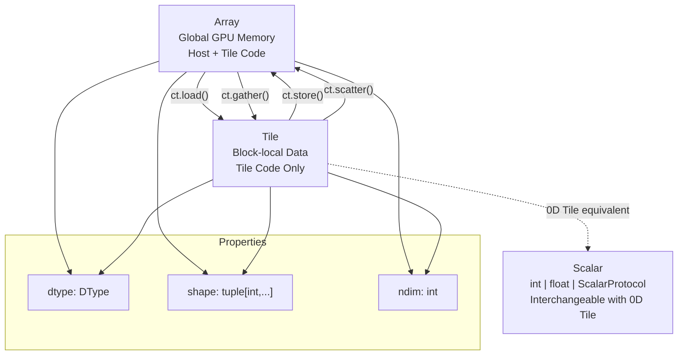
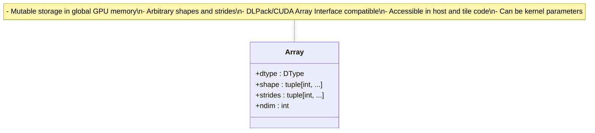
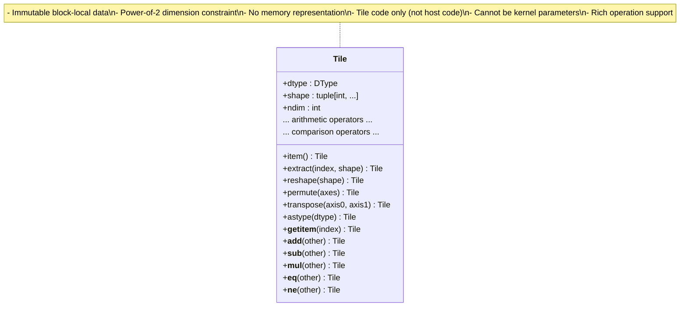
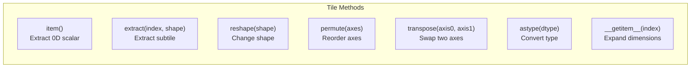
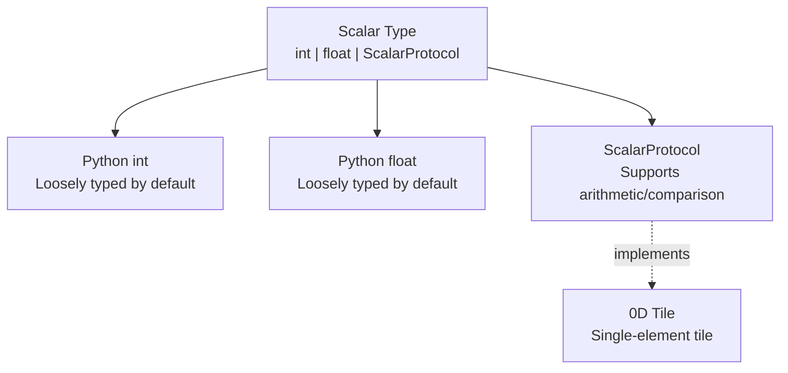
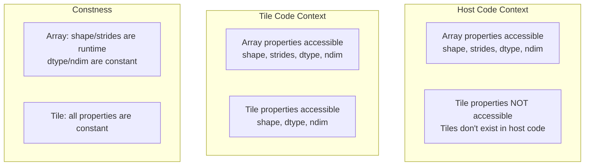
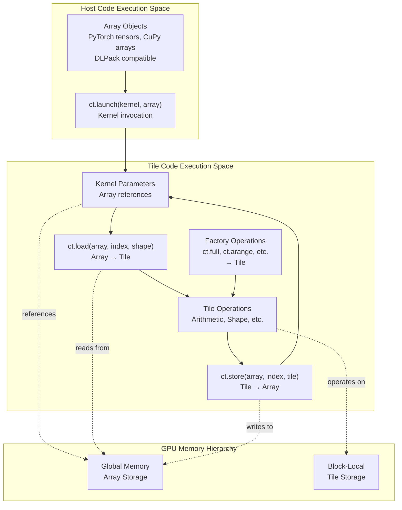

<!-- source: DeepWiki mcp.deepwiki.com · repo NVIDIA/cutile-python · page 3.1 Array and Tile Classes · fetched 2026-10-26 -->

# Array and Tile Classes

<details>
<summary>Relevant source files</summary>

The following files were used as context for generating this wiki page:

- [src/cuda/tile/_stub.py](src/cuda/tile/_stub.py)

</details>


This page documents the `Array` and `Tile` classes, which are the fundamental data structures in cuda.tile. These classes represent multidimensional collections of values with distinct characteristics and use cases.

**Scope**: This page covers the class definitions, properties, methods, and usage patterns of `Array` and `Tile`. For conceptual information about the data model including element space, tile space, and type promotion, see [Data Model](#2.1). For memory operations on these classes (load, store, gather, scatter), see [Memory Operations](#3.2).

---

## Class Overview

The following diagram shows the relationship between the core data structure classes:



**Sources**: [src/cuda/tile/_stub.py:134-225]()

---

## Array Class

The `Array` class represents a **global array** stored in GPU memory. Arrays are accessible from both host code and tile code, and can be passed as kernel parameters.

### Definition and Characteristics



**Key Characteristics**:
- **Storage Location**: Global GPU memory (device memory)
- **Mutability**: Arrays are mutable containers (though the Array object itself acts as a reference)
- **Accessibility**: Can be used in both host code and tile code
- **Layout**: Supports arbitrary shapes, strides, and memory layouts
- **Interoperability**: Compatible with DLPack and CUDA Array Interface (works with PyTorch, CuPy, NumPy, etc.)
- **Copy Semantics**: Copying an Array does not copy the underlying data; it creates a new reference

**Sources**: [src/cuda/tile/_stub.py:134-184](), [docs/source/data.rst:23-37]()

### Properties

| Property | Type | Constness | Description |
|----------|------|-----------|-------------|
| `dtype` | `DType` | constant | The data type of the array's elements |
| `shape` | `tuple[int, ...]` | runtime | The number of elements in each dimension |
| `strides` | `tuple[int, ...]` | runtime | Element steps in each dimension for traversal |
| `ndim` | `int` | constant | The number of dimensions in the array |

**Important Notes**:
- `shape` and `strides` are runtime values (typically `int32`) by default, not compile-time constants
- `dtype` and `ndim` are compile-time constants that can be queried during type inference
- These properties can be accessed in both host code and tile code

**Sources**: [src/cuda/tile/_stub.py:148-183]()

### Usage Example

```python
import cuda.tile as ct
import torch

# Arrays can be created from PyTorch tensors, CuPy arrays, etc.
array = torch.zeros((32, 64), dtype=torch.float32, device='cuda')

# Access properties in host code
print(array.shape)    # (32, 64)
print(array.dtype)    # float32

# Use in kernel as parameter
@ct.kernel
def my_kernel(arr: ct.Array):
    # Access properties in tile code
    rows = arr.shape[0]    # runtime int32
    cols = arr.shape[1]    # runtime int32
    elem_type = arr.dtype  # constant DType
```

**Sources**: [src/cuda/tile/_stub.py:134-184]()

---

## Tile Class

The `Tile` class represents a **tile array** - an immutable, block-local multidimensional collection of values. Tiles exist only within kernel execution and are optimized for computation.

### Definition and Characteristics



**Key Characteristics**:
- **Storage Location**: Block-local (registers, shared memory - implementation-managed)
- **Mutability**: Tiles are immutable; operations return new tiles
- **Accessibility**: Can only be used in tile code (within `@ct.kernel` functions)
- **Shape Constraint**: Each dimension must be a power of 2
- **Memory**: Contents do not necessarily have a memory representation
- **Operations**: Support arithmetic, comparison, shape manipulation, and more

**Sources**: [src/cuda/tile/_stub.py:185-372](), [docs/source/data.rst:39-53]()

### Properties

| Property | Type | Constness | Description |
|----------|------|-----------|-------------|
| `dtype` | `DType` | constant | The data type of the tile's elements |
| `shape` | `tuple[int, ...]` | constant | The number of elements in each dimension (all powers of 2) |
| `ndim` | `int` | constant | The number of dimensions in the tile |

**Important Notes**:
- All Tile properties are compile-time constants
- `shape` elements must be powers of 2 (e.g., 1, 2, 4, 8, 16, 32, 64, 128, ...)
- These properties enable aggressive compile-time optimizations

**Sources**: [src/cuda/tile/_stub.py:199-224]()

### Methods

#### Core Methods



| Method | Signature | Description |
|--------|-----------|-------------|
| `item()` | `() -> Tile` | Extract scalar (0D Tile) from single-element tile |
| `extract(index, shape)` | `(Shape, Shape) -> Tile` | Extract smaller tile from input tile (see [extract](#3.9)) |
| `reshape(shape)` | `(Shape) -> Tile` | Reshape tile to specified shape (see [reshape](#3.6)) |
| `permute(axes)` | `(tuple[int,...]) -> Tile` | Permute tile axes (see [permute](#3.6)) |
| `transpose(axis0, axis1)` | `(int, int) -> Tile` | Transpose two axes (see [transpose](#3.6)) |
| `astype(dtype)` | `(DType) -> Tile` | Convert to different data type (see [astype](#3.7)) |
| `__getitem__(index)` | `(index) -> Tile` | Syntax sugar for `expand_dims` using NumPy-style indexing |

**Sources**: [src/cuda/tile/_stub.py:226-268]()

#### Arithmetic Operators

Tiles support the full range of Python arithmetic operators:

| Category | Operators | Methods |
|----------|-----------|---------|
| Binary Arithmetic | `+`, `-`, `*`, `/`, `//`, `%`, `**` | `__add__`, `__sub__`, `__mul__`, `__truediv__`, `__floordiv__`, `__mod__`, `__pow__` |
| Bitwise | `&`, `\|`, `^` | `__and__`, `__or__`, `__xor__` |
| Comparison | `==`, `!=`, `<`, `<=`, `>`, `>=` | `__eq__`, `__ne__`, `__lt__`, `__le__`, `__gt__`, `__ge__` |
| Reverse Operations | `r+`, `r-`, `r*`, etc. | `__radd__`, `__rsub__`, `__rmul__`, etc. |

All arithmetic operations:
- Support broadcasting (see [Data Model](#2.1))
- Promote types according to promotion rules (see [Type System](#2.3))
- Return new Tile objects (tiles are immutable)

**Sources**: [src/cuda/tile/_stub.py:265-372]()

### Usage Example

```python
import cuda.tile as ct

@ct.kernel
def compute_kernel(array_in: ct.Array, array_out: ct.Array):
    # Load tile from array (creates Tile)
    tile = ct.load(array_in, (0, 0), shape=(32, 64))
    
    # Tiles are immutable - operations return new tiles
    tile = tile * 2.0
    tile = tile + 1.0
    
    # Access properties (all constant)
    rows = tile.shape[0]      # 32 (constant)
    cols = tile.shape[1]      # 64 (constant)
    n_dims = tile.ndim        # 2 (constant)
    data_type = tile.dtype    # float32 (constant)
    
    # Shape operations
    reshaped = tile.reshape((64, 32))
    transposed = tile.transpose()
    
    # Extract single element as scalar
    single_tile = ct.full((1,), 5, dtype=ct.int32)
    scalar = single_tile.item()
    
    # Store back to array
    ct.store(array_out, (0, 0), tile)
```

**Sources**: [src/cuda/tile/_stub.py:185-372]()

---

## Array vs Tile Comparison

The following table highlights the key differences between Arrays and Tiles:

| Aspect | Array | Tile |
|--------|-------|------|
| **Storage** | Global GPU memory | Block-local (registers/shared memory) |
| **Memory Representation** | Always has memory representation | May not have memory representation |
| **Mutability** | Mutable storage (copy by reference) | Immutable (operations return new tiles) |
| **Shape Constraints** | Arbitrary shapes and strides | All dimensions must be powers of 2 |
| **Accessibility** | Host code + Tile code | Tile code only |
| **Kernel Parameters** | ✓ Can be kernel parameters | ✗ Cannot be kernel parameters |
| **Property Constness** | `shape`, `strides` are runtime values | All properties are compile-time constants |
| **Interoperability** | DLPack/CUDA Array Interface compatible | Internal representation only |
| **Operations** | Limited (used for storage) | Rich operation set (arithmetic, shape, etc.) |
| **Lifetime** | Persists across kernel launches | Exists only during kernel execution |
| **Creation** | Created outside kernels (PyTorch, etc.) | Created via load/factory operations |

**Sources**: [src/cuda/tile/_stub.py:134-372](), [docs/source/data.rst:23-53]()

---

## Scalar Protocol and Types

### Scalar Definition

A scalar in cuda.tile can be one of:
- Python `int`
- Python `float`
- An object implementing `ScalarProtocol` (including 0D tiles)



**Sources**: [src/cuda/tile/_stub.py:21-132]()

### ScalarProtocol

The `ScalarProtocol` defines the interface that scalar-like objects must implement:

| Operation Category | Methods |
|-------------------|---------|
| **Index Support** | `__index__()` - allows use in `range()` |
| **Arithmetic** | `__add__`, `__sub__`, `__mul__`, `__truediv__`, `__floordiv__`, `__mod__`, `__pow__` |
| **Bitwise** | `__and__`, `__or__`, `__xor__` |
| **Reverse Ops** | `__radd__`, `__rsub__`, etc. |
| **Comparison** | `__eq__`, `__ne__`, `__lt__`, `__le__`, `__gt__`, `__ge__` |

**Key Points**:
- 0D Tiles automatically satisfy `ScalarProtocol`
- Scalars can be used anywhere a Tile is expected (implicit broadcast)
- Type `TileOrScalar = Union[Tile, Scalar]` is used for operations that accept both

**Sources**: [src/cuda/tile/_stub.py:21-132]()

### Scalar-Tile Interchangeability

```python
import cuda.tile as ct

@ct.kernel
def example_kernel(array: ct.Array):
    # Create 0D tile
    zero_d = ct.full((), 42, dtype=ct.int32)
    
    # Use .item() to extract scalar from single-element tile
    single_elem = ct.full((1,), 5, dtype=ct.int32)
    scalar = single_elem.item()
    
    # Scalars can be used in tile operations (broadcasting)
    tile = ct.full((32, 64), 1.0, dtype=ct.float32)
    result = tile * 2.0  # scalar broadcasts to tile shape
    
    # 0D tile can be used as scalar
    offset_tile = ct.full((), 10, dtype=ct.int32)
    indexed_tile = ct.load(array, (offset_tile, 0), shape=(4, 4))
```

**Sources**: [src/cuda/tile/_stub.py:21-132](), [src/cuda/tile/_stub.py:226-240]()

---

## Type Annotations and Helpers

The cuda.tile module provides several type annotations and helper types for working with Arrays and Tiles:

### Shape and Order Types

```python
# Shape can be a single int or tuple of ints
Shape = Union[int, tuple[int, ...]]

# Order for memory layout in load/store operations
Order = Union[tuple[int, ...], Literal['C'], Literal['F']]

# TileOrScalar for operations accepting both
TileOrScalar = Union[Tile, Scalar]
```

**Usage**:
- `Shape`: Used in `load()`, `store()`, factory functions, reshape operations
- `Order`: Specifies axis permutation in `load()`/`store()` operations
  - `"C"`: C-order (row-major), equivalent to `(0, 1, 2, ...)`
  - `"F"`: Fortran-order (column-major), equivalent to `(..., 2, 1, 0)`
  - `tuple[int, ...]`: Custom axis permutation
- `TileOrScalar`: Return type for operations that can produce tiles or scalars

**Sources**: [src/cuda/tile/_stub.py:374-378]()

### Constant Annotation

```python
from typing import Annotated

# Indicate that a parameter should be constant-embedded
Constant = Annotated[T, ConstantAnnotation()]

# Example usage in function signature
def load(array: Array, /,
         index: Shape,
         shape: Constant[Shape], *,
         order: Constant[Order] = "C",
         ...) -> Tile:
    ...
```

The `Constant` annotation indicates that a parameter should be constant-embedded during compilation, enabling aggressive optimizations. See [Constant Embedding](#5.4) for details.

**Sources**: [src/cuda/tile/_stub.py:384-402]()

---

## Property Access Patterns

### Accessing Properties in Different Contexts



**Host Code**:
```python
import cuda.tile as ct
import torch

# Create array in host code
array = torch.zeros((32, 64), dtype=torch.float32, device='cuda')

# Access array properties in host code
print(array.shape)    # Works: (32, 64)
print(array.dtype)    # Works: float32

# Tiles don't exist in host code
# tile = ct.full((32, 64), 1.0, dtype=ct.float32)  # ERROR!
```

**Tile Code**:
```python
@ct.kernel
def kernel(arr: ct.Array):
    # Array properties in tile code
    m = arr.shape[0]       # Runtime int32 value
    n = arr.shape[1]       # Runtime int32 value
    d = arr.dtype          # Constant DType
    
    # Create and use tiles in tile code
    tile = ct.full((32, 64), 1.0, dtype=ct.float32)
    rows = tile.shape[0]   # Constant 32
    cols = tile.shape[1]   # Constant 64
    dims = tile.ndim       # Constant 2
```

**Sources**: [src/cuda/tile/_stub.py:134-225](), [docs/source/data.rst:23-53]()

---

## Summary Diagram: Class Relationships and Data Flow



**Key Takeaways**:
1. **Arrays** are references to global GPU memory, accessible in both host and tile code
2. **Tiles** are block-local data structures that exist only in tile code
3. **Data flows** from Arrays to Tiles via `load`, and from Tiles to Arrays via `store`
4. **Tiles** are created via memory operations or factory functions, never directly instantiated
5. **All tile properties** are compile-time constants enabling aggressive optimization
6. **Array shapes/strides** are runtime values, but dtype and ndim are constant

**Sources**: [src/cuda/tile/_stub.py:134-372](), [docs/source/data.rst:1-173]()

---

