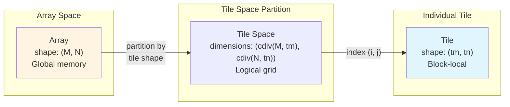
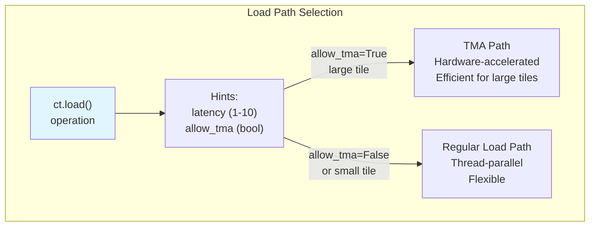
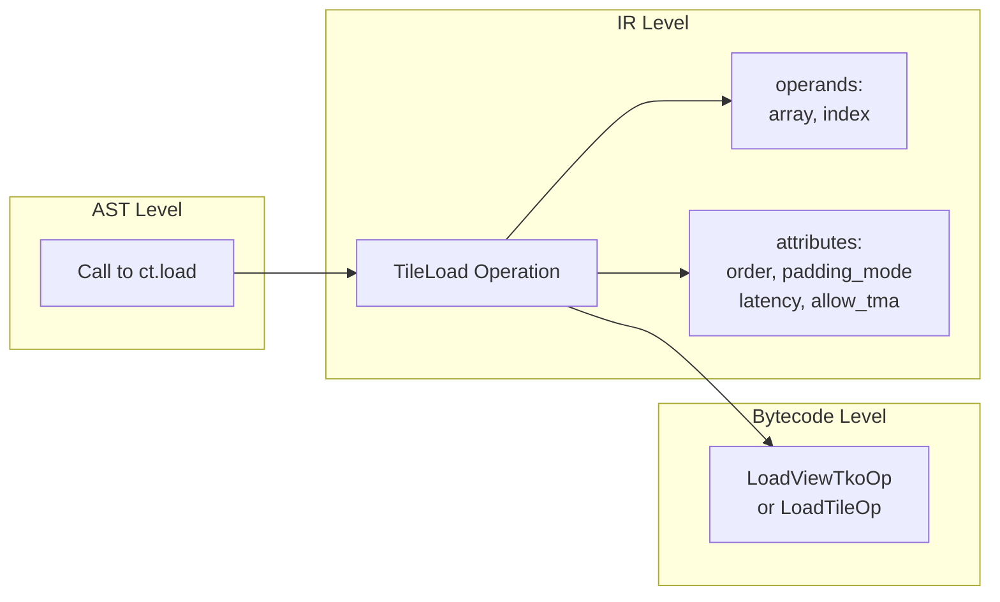
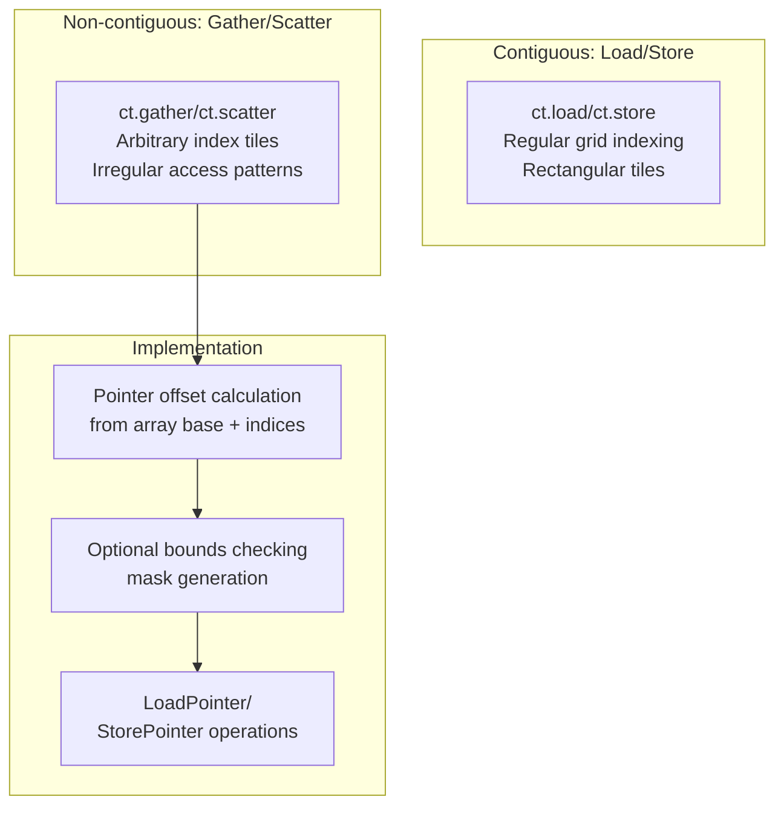
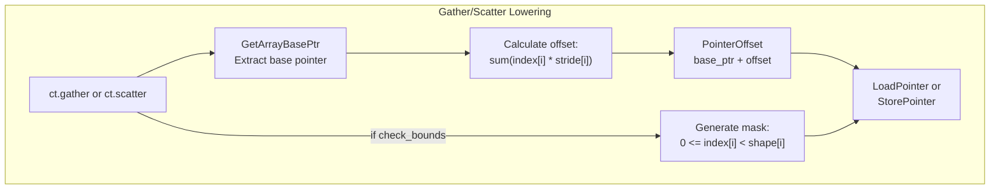

<!-- source: DeepWiki mcp.deepwiki.com · repo NVIDIA/cutile-python · page 3.2 Memory Operations · fetched 2026-10-26 -->

# Memory Operations

<details>
<summary>Relevant source files</summary>

The following files were used as context for generating this wiki page:

- [src/cuda/tile/_ir/ops.py](src/cuda/tile/_ir/ops.py)
- [src/cuda/tile/_stub.py](src/cuda/tile/_stub.py)
- [test/test_cat.py](test/test_cat.py)

</details>


This page documents the memory operations provided by `cuda.tile` for transferring data between global memory (Arrays) and block-local memory (Tiles). Memory operations are the primary mechanism for moving data in tile kernels.

For mathematical operations on tiles, see [Mathematical Operations](#3.4). For shape manipulation operations, see [Shape Manipulation](#3.6). For atomic memory operations with specific memory ordering semantics, see [Atomic Operations](#3.8).

## Overview

Memory operations in `cuda.tile` fall into four categories:

1. **Structured load/store** (`ct.load`, `ct.store`) - Transfer rectangular tiles between arrays and tile space using regular grid indexing
2. **Indexed load/store** (`ct.gather`, `ct.scatter`) - Transfer data using arbitrary index tiles for non-contiguous access patterns
3. **Atomic operations** (`ct.atomic_*`) - Read-modify-write operations with memory ordering guarantees
4. **Low-level pointer operations** (internal) - Direct pointer-based load/store used to implement gather/scatter

All memory operations operate on Arrays (global GPU memory) and produce or consume Tiles (block-local data).

**Sources:** [src/cuda/tile/_stub.py:472-868](), [src/cuda/tile/_ir/ops.py:1856-2400]()

## Tile Space and Indexing

### Tile Space Concept

The `load` and `store` operations work with a **tile space** - a logical grid created by partitioning an array into equal-sized tiles. Given an array of shape `(M, N)` and a tile shape `(tm, tn)`, the tile space has dimensions `(cdiv(M, tm), cdiv(N, tn))`.



**Diagram: Tile Space Partitioning** - An array is logically partitioned into a grid of tiles, creating a tile space that can be indexed.

The relationship between tile space index `(i, j)` and element space is:

```
tile[x, y] = array[i * tm + x, j * tn + y]  (for 0 <= x < tm, 0 <= y < tn)
```

**Sources:** [src/cuda/tile/_stub.py:481-494](), [src/cuda/tile/_ir/ops.py:1877-1882]()

### Order Parameter

The `order` parameter controls how tile axes map to array axes before partitioning. It enables loading transposed or permuted tiles without additional reshape operations.

| Order Value | Meaning | Example (2D) |
|-------------|---------|--------------|
| `"C"` | Default C-order, no permutation | `(0, 1)` |
| `"F"` | Fortran-order, reverse all axes | `(1, 0)` |
| `(0, 2, 1)` | Custom permutation (3D) | Swaps last two axes |

With `order=(1, 0)`, the load relationship becomes:
```
tile[y, x] = array[i * tm + x, j * tn + y]
```

**Sources:** [src/cuda/tile/_stub.py:512-517](), [src/cuda/tile/_ir/ops.py:1862-1869]()

## Load Operation

```python
ct.load(array: Array, /,
        index: Shape,
        shape: Constant[Shape], *,
        order: Constant[Order] = "C",
        padding_mode: PaddingMode = PaddingMode.UNDETERMINED,
        latency: Optional[int] = None,
        allow_tma: Optional[bool] = None) -> Tile
```

Loads a tile from an array using tile space indexing.

### Parameters

| Parameter | Type | Description |
|-----------|------|-------------|
| `array` | `Array` | Source array in global memory |
| `index` | `tuple[int,...]` | Index into the tile space |
| `shape` | `tuple[const int,...]` | Shape of the tile to load (constant) |
| `order` | `"C"`, `"F"`, or `tuple[const int,...]` | Axis permutation (constant) |
| `padding_mode` | `PaddingMode` | Value for out-of-bounds access |
| `latency` | `Optional[int]` | Hint for DRAM traffic intensity (1-10) |
| `allow_tma` | `Optional[bool]` | Whether to allow Tensor Memory Accelerator |

### Padding Modes

When a tile extends beyond array boundaries, `padding_mode` determines the value for out-of-bounds elements:

- `PaddingMode.UNDETERMINED` (default) - Undefined value (fastest)
- `PaddingMode.ZERO` - Pad with zeros
- `PaddingMode.NAN` - Pad with NaN (float types only)

### Performance Hints



**Diagram: Load Operation Path Selection** - The compiler selects between TMA and regular load based on hints and tile characteristics.

- **latency**: Integer 1-10 indicating expected DRAM traffic intensity. Higher values suggest more aggressive prefetching.
- **allow_tma**: When `False`, disables Tensor Memory Accelerator. Useful for debugging or when TMA is not beneficial.

**Sources:** [src/cuda/tile/_stub.py:472-543](), [src/cuda/tile/_ir/ops.py:1856-1904](), [src/cuda/tile/_ir/load_store_impl.py:26-28]()

### IR Representation



**Diagram: Load Operation Compilation Pipeline** - From Python API to bytecode instruction.

The `TileLoad` IR operation [src/cuda/tile/_ir/ops.py:1856-1874]() represents load operations during compilation. It stores:
- Array and index operands
- Order tuple for axis mapping
- Padding mode, latency, and TMA hints as attributes

**Sources:** [src/cuda/tile/_ir/ops.py:1856-1904](), [src/cuda/tile/_ir/load_store_impl.py:1-102]()

## Store Operation

```python
ct.store(array: Array, /,
         index: Shape,
         tile: TileOrScalar, *,
         order: Constant[Order] = "C",
         latency: Optional[int] = None,
         allow_tma: Optional[bool] = None) -> None
```

Stores a tile value into an array using tile space indexing.

### Parameters

| Parameter | Type | Description |
|-----------|------|-------------|
| `array` | `Array` | Destination array in global memory |
| `index` | `tuple[int,...]` | Index into the tile space |
| `tile` | `Tile` or scalar | Value to store |
| `order` | `"C"`, `"F"`, or `tuple[const int,...]` | Axis permutation (constant) |
| `latency` | `Optional[int]` | Hint for DRAM traffic intensity (1-10) |
| `allow_tma` | `Optional[bool]` | Whether to allow Tensor Memory Accelerator |

### Type Compatibility

The `tile` parameter undergoes implicit type casting to match the array's dtype:

```python
# Implicit cast from int32 to float32
array = torch.zeros((16, 16), dtype=torch.float32, device='cuda')
tile = ct.full((4, 4), 42, dtype=ct.int32)
ct.store(array, (0, 0), tile)  # tile implicitly cast to float32
```

The implementation checks implicit cast validity [src/cuda/tile/_ir/ops.py:1957-1965]() before generating the store operation.

### Out-of-Bounds Behavior

Store operations that fall outside array boundaries are silently ignored (no error, no undefined behavior).

**Sources:** [src/cuda/tile/_stub.py:546-592](), [src/cuda/tile/_ir/ops.py:1928-1985]()

### IR Representation

The `TileStore` IR operation [src/cuda/tile/_ir/ops.py:1928-1944]() is marked with `@has_side_effects` to prevent elimination during optimization passes. It stores:
- Array, index, and tile operands
- Order, latency, and TMA hints as attributes

**Sources:** [src/cuda/tile/_ir/ops.py:1928-1985](), [src/cuda/tile/_ir/load_store_impl.py:104-177]()

## Gather and Scatter Operations

Gather and scatter provide non-contiguous memory access using arbitrary index tiles. Unlike load/store which use regular grid indexing, gather/scatter allow loading/storing individual elements at any location.



**Diagram: Gather/Scatter Implementation Strategy** - Non-contiguous access is implemented via pointer arithmetic and masking.

**Sources:** [src/cuda/tile/_ir/ops.py:2149-2290]()

### Gather Operation

```python
ct.gather(array, indices, /, *,
          padding_value=0,
          check_bounds=True,
          latency=None) -> Tile
```

Loads array elements at arbitrary indices.

#### Index Specification

The `indices` parameter must be:
- A tuple of length equal to array rank, OR
- A single tile/scalar for 1D arrays (convenience notation)

Each element of the tuple must be an integer tile or scalar. All index tiles are broadcasted to a common shape, which becomes the result shape.

**Example: 2D Array Gather**
```python
# Array shape: (M, N)
# ind0 shape: (8, 4, 1)
# ind1 shape: (8, 1, 4)
result = ct.gather(array, (ind0, ind1))  # result shape: (8, 4, 4)

# Equivalent to:
# result[i, j, k] = array[ind0[i, j, 0], ind1[i, 0, k]]
```

#### Bounds Checking

When `check_bounds=True` (default):
- Indices are checked against array dimensions
- Out-of-bounds accesses return `padding_value`
- Negative indices are treated as out-of-bounds (not Python-style negative indexing)

When `check_bounds=False`:
- No bounds checking is performed
- Out-of-bounds access has undefined behavior
- Slightly faster, but requires caller to guarantee valid indices

**Sources:** [src/cuda/tile/_stub.py:595-633](), [src/cuda/tile/_ir/ops.py:2149-2171]()

### Scatter Operation

```python
ct.scatter(array, indices, value, /, *,
           check_bounds=True,
           latency=None)
```

Stores values into array elements at arbitrary indices.

#### Parameters

| Parameter | Type | Description |
|-----------|------|-------------|
| `array` | `Array` | Destination array |
| `indices` | `tuple[Tile,...]` or `Tile` | Index tiles (must be integers) |
| `value` | `Tile` or scalar | Values to store |
| `check_bounds` | `bool` | Enable bounds checking |
| `latency` | `Optional[int]` | DRAM traffic hint (1-10) |

The `value` shape must be broadcastable to the common index shape. Type casting rules are the same as for `store`.

**Example: Histogram Scatter**
```python
# Count occurrences (assuming indices in valid range)
indices = ct.arange(32, dtype=ct.int32) % 16  # Map to 16 bins
ones = ct.ones((32,), dtype=ct.int32)
ct.scatter(histogram_array, indices, ones, check_bounds=False)
```

**Sources:** [src/cuda/tile/_stub.py:636-668](), [src/cuda/tile/_ir/ops.py:2173-2188]()

### Implementation via Pointer Operations



**Diagram: Gather/Scatter Lowering to Pointer Operations** - High-level gather/scatter operations are lowered to pointer arithmetic.

The implementation [src/cuda/tile/_ir/ops.py:2205-2290]() performs:

1. Extract array base pointer via `GetArrayBasePtr` [src/cuda/tile/_ir/ops.py:1597-1610]()
2. Calculate flat offset from multi-dimensional indices using array strides
3. Generate boolean mask for bounds checking (if enabled)
4. Compute pointer offsets via `PointerOffset` [src/cuda/tile/_ir/ops.py:2118-2146]()
5. Issue `LoadPointer` [src/cuda/tile/_ir/ops.py:2004-2062]() or `StorePointer` [src/cuda/tile/_ir/ops.py:2064-2116]() operations

**Sources:** [src/cuda/tile/_ir/ops.py:2004-2290](), [src/cuda/tile/_ir/load_store_impl.py:179-287]()

## Token-Ordered Memory Operations

All memory operations have token-ordered variants that participate in explicit memory ordering:

| Standard Operation | Token-Ordered Variant |
|-------------------|----------------------|
| `TileLoad` | `TileLoadTokenOrdered` [src/cuda/tile/_ir/ops.py:1906-1926]() |
| `TileStore` | `TileStoreTokenOrdered` [src/cuda/tile/_ir/ops.py:1987-2002]() |
| `LoadPointer` | `LoadPointerTokenOrdered` [src/cuda/tile/_ir/ops.py:2028-2053]() |
| `StorePointer` | `StorePointerTokenOrdered` [src/cuda/tile/_ir/ops.py:2088-2111]() |

Token-ordered operations accept an input token operand and produce an output token result, allowing explicit control over memory operation ordering. This is primarily used for advanced optimization passes.

**Sources:** [src/cuda/tile/_ir/ops.py:1906-2111]()

## Implementation Summary

### Key IR Operations

| IR Operation | Purpose | File Location |
|--------------|---------|---------------|
| `TileLoad` | Structured array-to-tile load | [src/cuda/tile/_ir/ops.py:1856-1874]() |
| `TileStore` | Structured tile-to-array store | [src/cuda/tile/_ir/ops.py:1928-1944]() |
| `GetArrayBasePtr` | Extract array base pointer | [src/cuda/tile/_ir/ops.py:1597-1610]() |
| `PointerOffset` | Compute pointer with offset | [src/cuda/tile/_ir/ops.py:2118-2146]() |
| `LoadPointer` | Load from pointer tile | [src/cuda/tile/_ir/ops.py:2004-2026]() |
| `StorePointer` | Store to pointer tile | [src/cuda/tile/_ir/ops.py:2064-2086]() |

### Bytecode Generation

Memory operations are lowered to TileIR bytecode instructions:

- `LoadViewTkoOp` - TMA-based load with token ordering
- `LoadTileOp` - Regular tile load
- `StoreViewTkoOp` - TMA-based store with token ordering
- `StoreTileOp` - Regular tile store

The bytecode generation is handled by functions in [src/cuda/tile/_ir/load_store_impl.py]():
- `tile_load_generate_bytecode` [src/cuda/tile/_ir/load_store_impl.py:30-102]()
- `tile_store_generate_bytecode` [src/cuda/tile/_ir/load_store_impl.py:104-177]()
- `load_pointer_lowering` [src/cuda/tile/_ir/load_store_impl.py:179-235]()
- `store_pointer_lowering` [src/cuda/tile/_ir/load_store_impl.py:237-287]()

**Sources:** [src/cuda/tile/_ir/ops.py:1856-2290](), [src/cuda/tile/_ir/load_store_impl.py:1-287]()

---

