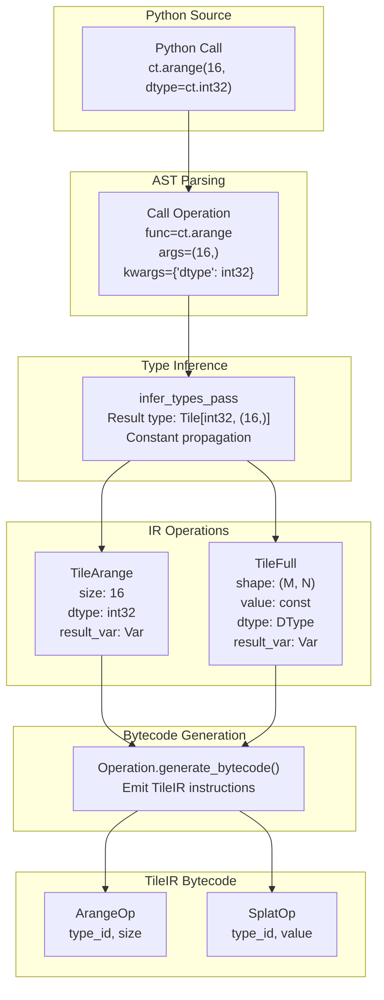
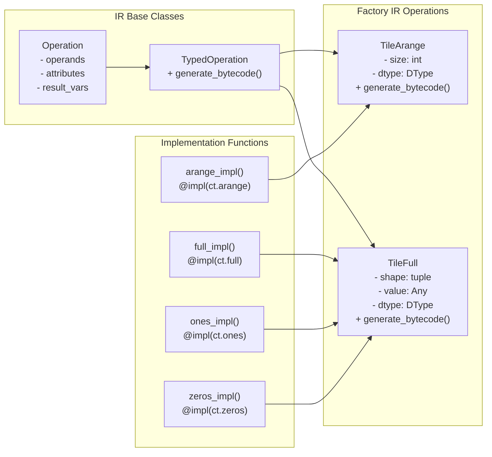
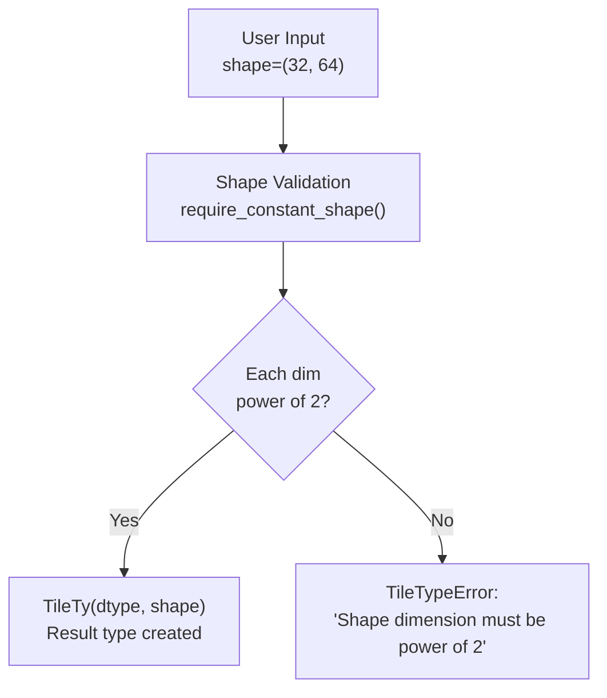
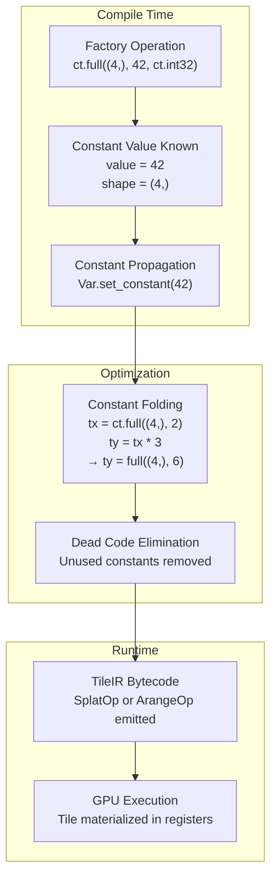
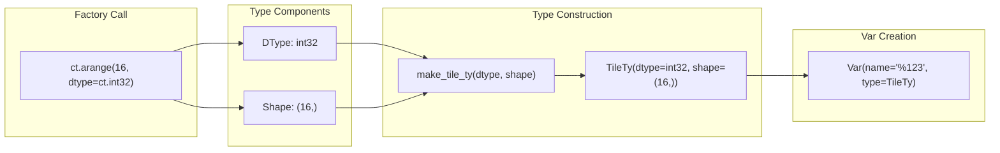

<!-- source: DeepWiki mcp.deepwiki.com · repo NVIDIA/cutile-python · page 3.3 Factory Operations · fetched 2026-10-26 -->

# Factory Operations

<details>
<summary>Relevant source files</summary>

The following files were used as context for generating this wiki page:

- [src/cuda/tile/_ir/ops.py](src/cuda/tile/_ir/ops.py)
- [src/cuda/tile/_stub.py](src/cuda/tile/_stub.py)
- [test/test_cat.py](test/test_cat.py)

</details>


Factory operations create tiles from scratch by generating values programmatically, without loading from external memory. These operations are fundamental building blocks for tile-based computation, providing ways to initialize tiles with sequential values, constants, or special patterns.

For operations that load tiles from arrays, see [Memory Operations](#3.2). For operations that manipulate existing tiles, see [Mathematical Operations](#3.4) and [Shape Manipulation](#3.6).

## Overview of Factory Operations

The `cuda.tile` API provides four factory operations that create tiles:

| Operation | Purpose | Shape | Value Pattern |
|-----------|---------|-------|---------------|
| `arange` | Sequential integers | 1D only | 0, 1, 2, ..., size-1 |
| `full` | Constant value | Any shape | User-specified value |
| `ones` | All ones | Any shape | 1 |
| `zeros` | All zeros | Any shape | 0 |

All factory operations:
- Execute in **tile code only** (not available in host code)
- Require explicit `dtype` specification
- Produce immutable `Tile` objects
- Satisfy power-of-2 dimension constraints for all dimensions
- Support constant propagation during compilation

Sources: [src/cuda/tile/_stub.py:869-938]()

## Operation Details

### arange

```python
ct.arange(size, /, *, dtype) -> Tile
```

Creates a 1D tile containing sequential integer values from 0 to `size - 1`.

**Parameters:**
- `size` (const int): The number of elements in the resulting tile. Must be a power of 2.
- `dtype` (DType): The data type of the tile elements.

**Constraints:**
- `size` must be a compile-time constant
- `size` must be a power of 2 (e.g., 1, 2, 4, 8, 16, 32, 64, ...)
- Result is always 1D

**Example Usage:**
```python
# Create a tile with values [0, 1, 2, ..., 15]
indices = ct.arange(16, dtype=ct.int32)

# Use for indexing
offset = ct.bid(0) * 64
tile_indices = ct.arange(64, dtype=ct.int32) + offset
```

Sources: [src/cuda/tile/_stub.py:872-886]()

### full

```python
ct.full(shape, fill_value, dtype) -> Tile
```

Creates a tile of specified shape filled with a constant value.

**Parameters:**
- `shape` (tuple[const int, ...]): The shape of the tile. Each dimension must be a power of 2.
- `fill_value` (int | float | bool): The value to fill the tile with.
- `dtype` (DType): The data type of the tile elements.

**Constraints:**
- `shape` must be a compile-time constant tuple
- Each dimension in `shape` must be a power of 2
- `fill_value` must be compatible with `dtype`

**Example Usage:**
```python
# Create a 2D tile filled with 3.14
tile = ct.full((16, 32), 3.14, dtype=ct.float32)

# Initialize accumulator for matrix multiply
acc = ct.full((64, 64), 0.0, dtype=ct.float32)

# Create boolean mask
mask = ct.full((128,), True, dtype=ct.bool_)
```

Sources: [src/cuda/tile/_stub.py:889-904]()

### ones

```python
ct.ones(shape, dtype) -> Tile
```

Creates a tile filled with ones. This is a convenience function equivalent to `ct.full(shape, 1, dtype)`.

**Parameters:**
- `shape` (tuple[const int, ...]): The shape of the tile. Each dimension must be a power of 2.
- `dtype` (DType): The data type of the tile elements.

**Example Usage:**
```python
# Create a tile of ones
tile = ct.ones((32, 32), dtype=ct.float16)

# Equivalent to:
# tile = ct.full((32, 32), 1, dtype=ct.float16)
```

Sources: [src/cuda/tile/_stub.py:907-921]()

### zeros

```python
ct.zeros(shape, dtype) -> Tile
```

Creates a tile filled with zeros. This is a convenience function equivalent to `ct.full(shape, 0, dtype)`.

**Parameters:**
- `shape` (tuple[const int, ...]): The shape of the tile. Each dimension must be a power of 2.
- `dtype` (DType): The data type of the tile elements.

**Example Usage:**
```python
# Initialize accumulator
acc = ct.zeros((64, 64), dtype=ct.float32)

# Equivalent to:
# acc = ct.full((64, 64), 0, dtype=ct.float32)
```

Sources: [src/cuda/tile/_stub.py:924-938]()

## Factory Operations in the Compilation Pipeline

Factory operations follow the standard compilation pipeline from Python AST to TileIR bytecode:



**Diagram: Factory Operation Compilation Flow**

The compilation process involves:
1. **AST Parsing**: Python function calls are parsed into `Call` operations
2. **Type Inference**: The result type is determined (TileTy with shape and dtype)
3. **IR Construction**: Factory-specific IR operations are created
4. **Bytecode Generation**: IR operations emit TileIR bytecode instructions

Sources: [src/cuda/tile/_ir/ops.py:98-123]()

## IR Operation Classes

Factory operations are implemented as typed IR operations that generate bytecode:



**Diagram: Factory Operation Class Hierarchy**

Each factory operation has:
- An **implementation function** decorated with `@impl` that validates parameters and creates IR operations
- An **IR operation class** that stores operation metadata and generates bytecode
- A **bytecode generation method** that emits TileIR instructions

Sources: [src/cuda/tile/_ir/ops.py:1-67](), [src/cuda/tile/_ir/ir.py:22-24]()

## Type Requirements and Validation

### Shape Constraints

All tile shapes must satisfy power-of-2 requirements:



**Diagram: Shape Validation Flow**

Valid shapes: `(1,)`, `(2,)`, `(4,)`, `(16, 32)`, `(1, 1, 64)`

Invalid shapes: `(3,)`, `(10,)`, `(16, 30)`, `(5, 8, 16)`

Sources: [src/cuda/tile/_ir/ops.py:31-40]()

### Data Type Constraints

Factory operations require explicit dtype specification:

| Operation | dtype Parameter | Value Parameter | Type Checking |
|-----------|----------------|-----------------|---------------|
| `arange` | Required | N/A (sequential) | Integer types only |
| `full` | Required | Required | Value must be compatible with dtype |
| `ones` | Required | Implicit (1) | Any numeric type |
| `zeros` | Required | Implicit (0) | Any numeric type |

The `dtype` parameter must be:
- A `DType` constant from `cuda.tile` (e.g., `ct.float32`, `ct.int32`)
- Specified at compile time (cannot be a runtime variable)
- Compatible with the target GPU architecture

Sources: [src/cuda/tile/_datatype.py:1-56](), [src/cuda/tile/_stub.py:869-938]()

## Constant Propagation

Factory operations participate in constant propagation during type inference:



**Diagram: Constant Propagation for Factory Operations**

When factory operations produce constant values:
1. The IR system marks the result `Var` as constant
2. Subsequent operations on constants may be folded at compile time
3. Unused constants may be eliminated via dead code elimination
4. Only necessary operations emit bytecode

Sources: [src/cuda/tile/_ir/ops.py:571-625](), [src/cuda/tile/_passes/typeinfer.py:64-66]()

## Common Usage Patterns

### Pattern 1: Index Generation with arange

```python
@ct.kernel
def indexed_load_kernel(input: ct.Array, output: ct.Array):
    block_idx = ct.bid(0)
    
    # Generate local indices
    local_indices = ct.arange(64, dtype=ct.int32)
    
    # Compute global indices
    global_indices = block_idx * 64 + local_indices
    
    # Use for gather operation
    tile = ct.gather(input, global_indices, padding_value=0)
    ct.store(output, (block_idx,), tile)
```

### Pattern 2: Accumulator Initialization

```python
@ct.kernel
def matmul_kernel(A: ct.Array, B: ct.Array, C: ct.Array):
    # Initialize accumulator with zeros
    acc = ct.zeros((64, 64), dtype=ct.float32)
    
    # Accumulate matrix products
    for k in range(num_k_tiles):
        tile_a = ct.load(A, (bi, k), shape=(64, 32))
        tile_b = ct.load(B, (k, bj), shape=(32, 64))
        acc = ct.mma(tile_a, tile_b, acc)
    
    ct.store(C, (bi, bj), acc)
```

### Pattern 3: Broadcasting with full

```python
@ct.kernel
def scale_and_shift_kernel(input: ct.Array, output: ct.Array, 
                            scale: float, shift: float):
    tile = ct.load(input, (ct.bid(0),), shape=(128,))
    
    # Create broadcast tiles for scale and shift
    scale_tile = ct.full((128,), scale, dtype=ct.float32)
    shift_tile = ct.full((128,), shift, dtype=ct.float32)
    
    result = tile * scale_tile + shift_tile
    ct.store(output, (ct.bid(0),), result)
```

### Pattern 4: Masking with zeros/ones

```python
@ct.kernel
def masked_operation_kernel(input: ct.Array, mask: ct.Array, output: ct.Array):
    tile = ct.load(input, (ct.bid(0),), shape=(64,))
    mask_tile = ct.load(mask, (ct.bid(0),), shape=(64,))
    
    # Create tiles for masked values
    zero_tile = ct.zeros((64,), dtype=ct.float32)
    
    # Apply mask
    result = ct.where(mask_tile, tile, zero_tile)
    ct.store(output, (ct.bid(0),), result)
```

Sources: [src/cuda/tile/_stub.py:869-938]()

## Interaction with Type System

Factory operations integrate with the type system through:

### Type Construction



**Diagram: Type Construction for Factory Operations**

Sources: [src/cuda/tile/_ir/ops.py:49-53]()

### Loosely Typed Constants

Factory operations producing compile-time constants may have both strict and loose types:

```python
# Strictly typed: TileTy(int32, (4,))
tile = ct.full((4,), 42, dtype=ct.int32)

# Loosely typed: LooselyTypedScalar with infinite precision
scalar_const = 42  # Represented as LooselyTypedScalar in IR

# Type promotion when combined
result = tile + scalar_const  # scalar_const promoted to int32
```

Sources: [src/cuda/tile/_ir/type.py:49-52](), [src/cuda/tile/_ir/ops.py:607-625]()

## Implementation Considerations

### Memory Efficiency

Factory operations generate tiles without memory loads:
- `arange` uses index-based computation (each lane computes its own index)
- `full` uses broadcast/splat instructions (single value replicated)
- No DRAM bandwidth consumed
- Values materialize directly in registers or shared memory

### Optimization Opportunities

The compiler can optimize factory operations through:

1. **Constant Folding**: Operations on factory-generated constants may fold at compile time
2. **Dead Code Elimination**: Unused factory operations may be removed
3. **Instruction Selection**: Specialized hardware instructions for splat/broadcast
4. **Strength Reduction**: Complex operations on known patterns simplified

Sources: [src/cuda/tile/_ir/ops.py:1-67]()

## Comparison with Memory Operations

| Aspect | Factory Operations | Memory Operations |
|--------|-------------------|-------------------|
| Source | Programmatic generation | Array memory |
| Bandwidth | Zero DRAM bandwidth | Consumes DRAM bandwidth |
| Latency | Low (no memory access) | High (memory latency) |
| Use case | Indices, constants, initialization | Loading data |
| Examples | `arange`, `full`, `ones`, `zeros` | `load`, `store`, `gather`, `scatter` |

Factory operations complement memory operations:
- Use factory operations for indices, masks, and constant initialization
- Use memory operations to load actual data from arrays
- Combine both for efficient computation patterns

Sources: [src/cuda/tile/_stub.py:472-669](), [src/cuda/tile/_stub.py:869-938]()

---

