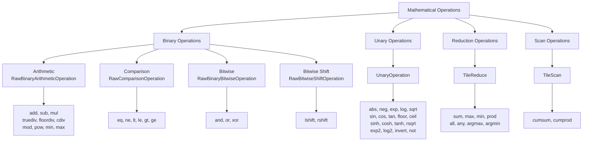
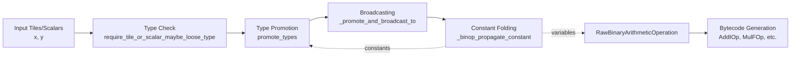
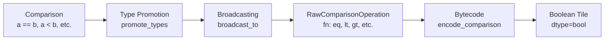
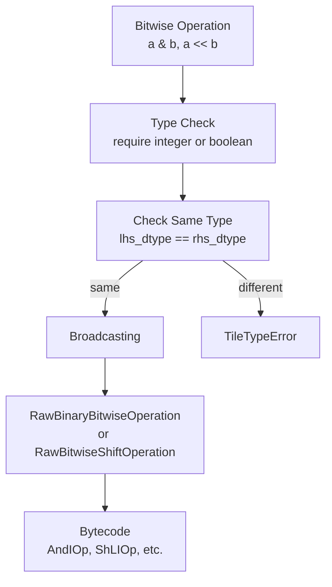
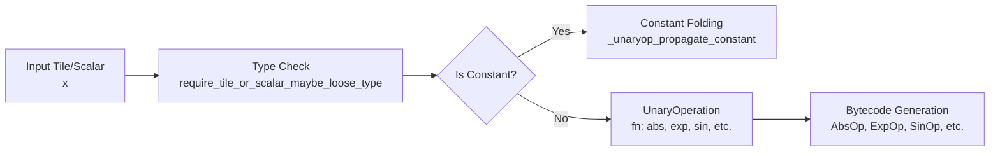
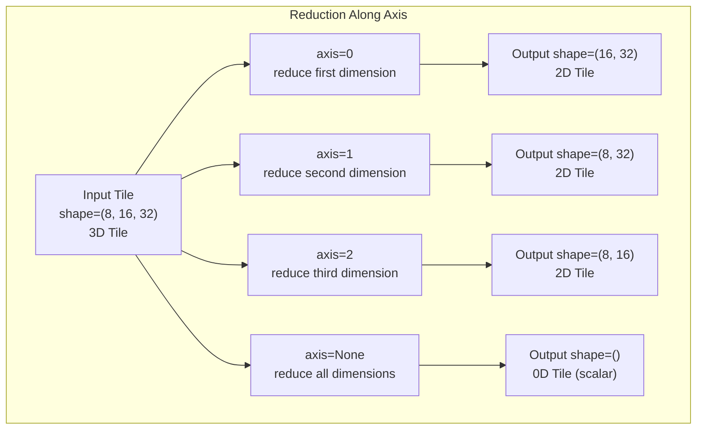
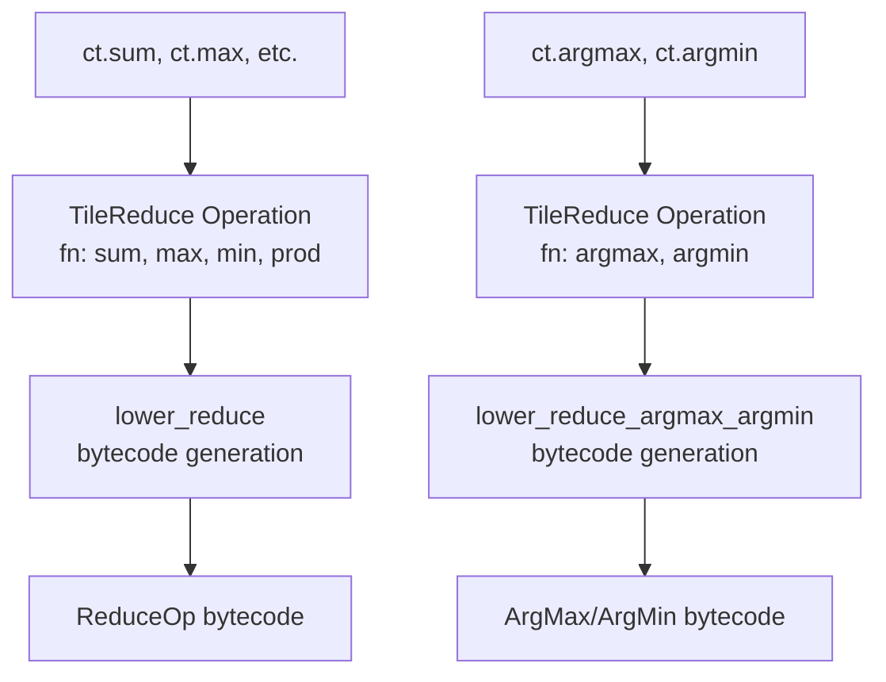
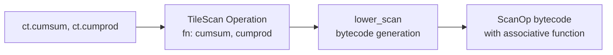
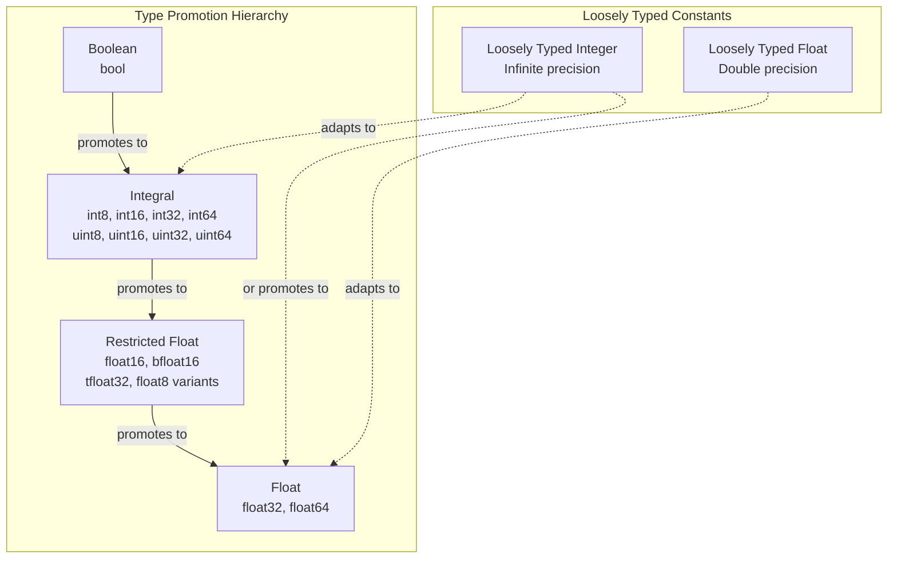
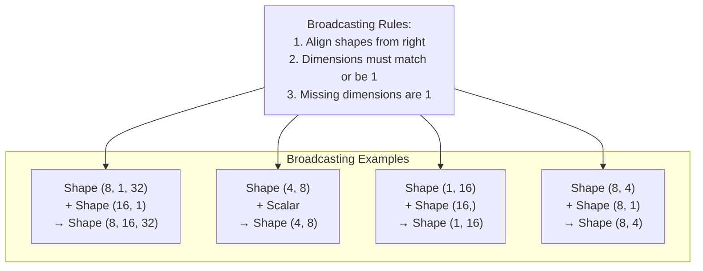

<!-- source: DeepWiki mcp.deepwiki.com · repo NVIDIA/cutile-python · page 3.4 Mathematical Operations · fetched 2026-10-26 -->

# Mathematical Operations

Relevant source files

The following files were used as context for generating this wiki page:

- [src/cuda/tile/_ir/ops.py](src/cuda/tile/_ir/ops.py)
- [src/cuda/tile/_stub.py](src/cuda/tile/_stub.py)
- [test/test_cat.py](test/test_cat.py)

This page documents mathematical operations that can be performed on Tiles and scalars in `cuda.tile`. These include arithmetic operations, comparisons, bitwise operations, unary functions, and reductions. All operations perform element-wise computation on Tiles, with automatic type promotion and shape broadcasting.

For matrix multiplication operations, see [Matrix Operations](#3.5). For type conversion operations, see [Type Conversion](#3.7). For atomic operations on arrays, see [Atomic Operations](#3.8).

**Sources:** [src/cuda/tile/_ir/ops.py:1-3177](), [src/cuda/tile/_stub.py:1-1654](), [src/cuda/tile/_ir/ops_utils.py:1-342]()

## Operation Categories

Mathematical operations in `cuda.tile` are organized into several categories, each implemented by specific IR operation classes.

**Sources:** [src/cuda/tile/_ir/ops.py:901-1063](), [src/cuda/tile/_ir/ops.py:1065-1324](), [src/cuda/tile/_ir/ops_utils.py:34-101]()

## Arithmetic Operations

Arithmetic operations perform element-wise computation on Tiles and scalars. They support type promotion and broadcasting.

### Binary Arithmetic

Binary arithmetic operations are available through both Python operators and explicit functions:

| Operation | Operator | Function | Description |
|-----------|----------|----------|-------------|
| Addition | `a + b` | `ct.add(a, b)` | Element-wise addition |
| Subtraction | `a - b` | `ct.subtract(a, b)` | Element-wise subtraction |
| Multiplication | `a * b` | `ct.multiply(a, b)` | Element-wise multiplication |
| True Division | `a / b` | `ct.divide(a, b)` | Element-wise division (float result) |
| Floor Division | `a // b` | `ct.floor_divide(a, b)` | Element-wise division rounded down |
| Ceiling Division | - | `ct.cdiv(a, b)` | Element-wise division rounded up |
| Modulo | `a % b` | `ct.mod(a, b)` | Element-wise remainder |
| Power | `a ** b` | `ct.power(a, b)` | Element-wise exponentiation |
| Minimum | - | `ct.minimum(a, b)` | Element-wise minimum |
| Maximum | - | `ct.maximum(a, b)` | Element-wise maximum |

All binary arithmetic operations are implemented through the `RawBinaryArithmeticOperation` class after type promotion and broadcasting.

**Implementation Flow:**

**Sources:** [src/cuda/tile/_ir/ops.py:901-1004](), [src/cuda/tile/_ir/ops.py:1005-1007](), [src/cuda/tile/_stub.py:270-335]()

### Precision Control

Floating-point arithmetic operations support optional precision control through two parameters:

- **`rounding_mode`** (RoundingMode): Controls rounding behavior for floating-point operations
- **`flush_to_zero`** (bool): If `True`, flush denormal values to zero (float32 only)

**Supported Rounding Modes:**

| Mode | Description | Operations |
|------|-------------|------------|
| `RoundingMode.RN` | Round to nearest even (default) | add, sub, mul, truediv, sqrt |
| `RoundingMode.RZ` | Round toward zero | add, sub, mul, truediv, sqrt |
| `RoundingMode.RM` | Round toward negative infinity | add, sub, mul, truediv, sqrt |
| `RoundingMode.RP` | Round toward positive infinity | add, sub, mul, truediv, sqrt |
| `RoundingMode.FULL` | Full precision (float32 only) | truediv |
| `RoundingMode.APPROX` | Approximate (float32 only) | truediv, sqrt |
| `RoundingMode.RZI` | Round to nearest integer toward zero | - |

Rounding mode and flush-to-zero are validated by `check_rd_and_ftz()` to ensure they are only used with supported operations and data types.

**Sources:** [src/cuda/tile/_ir/ops_utils.py:104-163](), [src/cuda/tile/_ir/ops.py:628-651](), [src/cuda/tile/_numeric_semantics.py:1-36]()

### Fused Multiply-Add

The `ct.fma(x, y, acc)` operation computes `x * y + acc` as a single fused operation, which can be more accurate and efficient than separate multiply and add:

- Preserves full precision of intermediate product
- Single rounding step instead of two
- Implemented via `FusedMulAddOperation` class

**Sources:** [src/cuda/tile/_ir/ops.py:628-651](), [src/cuda/tile/_stub.py:1434-1448]()

## Comparison Operations

Comparison operations perform element-wise comparison and return boolean Tiles.

### Comparison Operators

| Operator | Function | Description |
|----------|----------|-------------|
| `a == b` | `ct.equal(a, b)` | Element-wise equality |
| `a != b` | `ct.not_equal(a, b)` | Element-wise inequality |
| `a < b` | `ct.less(a, b)` | Element-wise less than |
| `a <= b` | `ct.less_equal(a, b)` | Element-wise less than or equal |
| `a > b` | `ct.greater(a, b)` | Element-wise greater than |
| `a >= b` | `ct.greater_equal(a, b)` | Element-wise greater than or equal |

Comparison operations:
1. Promote operands to a common type
2. Broadcast shapes to match
3. Perform element-wise comparison
4. Return a boolean Tile (or scalar) with the same shape

The `is` operator is special: it only supports comparison with `None` and returns a scalar boolean constant.

**Sources:** [src/cuda/tile/_ir/ops.py:705-758](), [src/cuda/tile/_stub.py:350-371]()

### Implementation

Comparisons are implemented through `RawComparisonOperation`, which generates the appropriate bytecode comparison operation based on the data type (signed, unsigned, or floating-point).

**Sources:** [src/cuda/tile/_ir/ops.py:654-681](), [src/cuda/tile/_ir2bytecode.py:1069-1109]()

## Bitwise Operations

Bitwise operations operate on the binary representation of integer and boolean values.

### Bitwise Logical Operations

| Operator | Function | Description |
|----------|----------|-------------|
| `a & b` | `ct.bitwise_and(a, b)` | Bitwise AND |
| `a \| b` | `ct.bitwise_or(a, b)` | Bitwise OR |
| `a ^ b` | `ct.bitwise_xor(a, b)` | Bitwise XOR |

**Requirements:**
- Both operands must be integers or booleans
- Operands must have the same data type (no automatic promotion for bitwise ops)
- Explicit `ct.bitcast()` required for non-integer types
- Special restriction: `bool` and `int8` cannot be mixed

**Sources:** [src/cuda/tile/_ir/ops.py:796-834]()

### Bitwise Shift Operations

| Operator | Function | Description |
|----------|----------|-------------|
| `a << b` | `ct.bitwise_lshift(a, b)` | Left shift |
| `a >> b` | `ct.bitwise_rshift(a, b)` | Right shift (arithmetic for signed, logical for unsigned) |

**Requirements:**
- Both operands must be integers
- Right shift behavior depends on signedness of left operand

**Sources:** [src/cuda/tile/_ir/ops.py:869-897]()

### Implementation

Bitwise operations are implemented through specialized operation classes that ensure type safety:

**Sources:** [src/cuda/tile/_ir/ops.py:767-897]()

## Unary Operations

Unary operations apply a function element-wise to a single Tile or scalar.

### Available Unary Operations

| Function | Description | Supported Types |
|----------|-------------|-----------------|
| `ct.abs(x)` | Absolute value | All numeric types |
| `ct.negative(x)` | Negation (-x) | All numeric types |
| `ct.exp(x)` | Exponential (e^x) | Float types |
| `ct.exp2(x)` | Base-2 exponential (2^x) | Float types |
| `ct.log(x)` | Natural logarithm | Float types |
| `ct.log2(x)` | Base-2 logarithm | Float types |
| `ct.sqrt(x)` | Square root | Float types |
| `ct.rsqrt(x)` | Reciprocal square root (1/√x) | Float types |
| `ct.sin(x)` | Sine | Float types |
| `ct.cos(x)` | Cosine | Float types |
| `ct.tan(x)` | Tangent | Float types |
| `ct.sinh(x)` | Hyperbolic sine | Float types |
| `ct.cosh(x)` | Hyperbolic cosine | Float types |
| `ct.tanh(x)` | Hyperbolic tangent | Float types |
| `ct.floor(x)` | Floor (round down) | Float types |
| `ct.ceil(x)` | Ceiling (round up) | Float types |
| `ct.invert(x)` | Bitwise NOT (~x) | Integer and boolean types |
| `ct.logical_not(x)` | Logical NOT | Boolean type |

Some operations support rounding modes and flush-to-zero:
- `sqrt`: supports `RN`, `RZ`, `RM`, `RP`, `APPROX`
- `exp2`, `rsqrt`: support flush-to-zero

**Sources:** [src/cuda/tile/_ir/ops.py:1009-1063](), [src/cuda/tile/_stub.py:1084-1285](), [src/cuda/tile/_ir/ops_utils.py:79-101]()

### Implementation

Unary operations are implemented by the `UnaryOperation` class, which performs constant folding when possible:

**Sources:** [src/cuda/tile/_ir/ops.py:1009-1063]()

## Reduction Operations

Reduction operations aggregate values along specified axes, reducing the dimensionality of a Tile.

### Available Reductions

| Function | Description | Return Type |
|----------|-------------|-------------|
| `ct.sum(x, axis)` | Sum of elements | Same as input |
| `ct.max(x, axis)` | Maximum value | Same as input |
| `ct.min(x, axis)` | Minimum value | Same as input |
| `ct.prod(x, axis)` | Product of elements | Same as input |
| `ct.all(x, axis)` | Logical AND (all True) | bool |
| `ct.any(x, axis)` | Logical OR (any True) | bool |
| `ct.argmax(x, axis)` | Index of maximum | int32 |
| `ct.argmin(x, axis)` | Index of minimum | int32 |

### Reduction Axes

### Parameters

- **`axis`** (optional int): Axis along which to reduce. If `None`, reduces all axes to a scalar.
- **`keepdims`** (optional bool): If `True`, keeps reduced dimensions with size 1. Default is `False`.

### Implementation

Reductions are implemented by the `TileReduce` class, which lowers to different bytecode operations depending on the reduction type:

**Sources:** [src/cuda/tile/_ir/ops.py:1065-1234](), [src/cuda/tile/_ir2bytecode.py:631-726](), [src/cuda/tile/_stub.py:1287-1389]()

## Scan Operations

Scan operations (also called prefix operations) compute cumulative results along a specified axis.

### Available Scans

| Function | Description |
|----------|-------------|
| `ct.cumsum(x, axis)` | Cumulative sum |
| `ct.cumprod(x, axis)` | Cumulative product |

### Behavior

For an input tile `x` along axis `k`:
- `cumsum(x, axis=k)[..., i, ...]` = sum of `x[..., :i+1, ...]`
- `cumprod(x, axis=k)[..., i, ...]` = product of `x[..., :i+1, ...]`

The output has the same shape as the input.

### Implementation

Scan operations are implemented by the `TileScan` class:

**Sources:** [src/cuda/tile/_ir/ops.py:1240-1324](), [src/cuda/tile/_ir2bytecode.py:728-806](), [src/cuda/tile/_stub.py:1391-1432]()

## Type Promotion and Broadcasting

Mathematical operations automatically promote types and broadcast shapes to make operands compatible.

### Type Promotion Rules

Type promotion follows a hierarchy based on numeric categories:

**Promotion Logic:**
1. Within the same category, the wider type wins (e.g., `int32` + `int64` → `int64`)
2. Across categories, the higher category wins (e.g., `int32` + `float32` → `float32`)
3. Loosely typed constants adapt to the concrete type or promote minimally
4. Signed/unsigned mixing within integers promotes to the signed type

**Sources:** [src/cuda/tile/_ir/ops_utils.py:233-295](), [src/cuda/tile/_datatype.py:215-313]()

### Broadcasting Rules

Broadcasting follows NumPy semantics:

Broadcasting is performed by `broadcast_shapes2()`, which:
1. Aligns dimensions from the rightmost axis
2. For each dimension, requires sizes to match or one to be 1
3. The result dimension is the maximum of the two sizes

**Sources:** [src/cuda/tile/_ir/ops_utils.py:331-342](), [src/cuda/tile/_ir/ops.py:760-764]()

### Implicit Casting

Some operations require implicit casting validation:

- **Comparisons**: Operands must be implicitly castable to a common type
- **Atomic operations**: Update value must be implicitly castable to array dtype
- **Reductions**: Input type must support the reduction operation

Implicit casting is checked by `check_implicit_cast()`, which validates that type promotion would result in the target type.

**Sources:** [src/cuda/tile/_ir/ops_utils.py:298-324]()

## Operation Registration

Mathematical operations are registered in dictionaries that map operation names to their metadata and implementations:

**Binary Operations Registry (`BINOP_REGISTRY`):**
- Maps operation names (e.g., `"add"`, `"mul"`) to `MathOpDef` objects
- `MathOpDef` contains Python fallback implementation, supported rounding modes, and flush-to-zero support
- Used for constant folding and validation

**Unary Operations Registry (`UNARYOP_REGISTRY`):**
- Maps operation names (e.g., `"exp"`, `"sin"`) to `MathOpDef` objects
- Similar structure to binary operations

These registries enable:
1. Constant folding: evaluating operations on compile-time constants
2. Validation: checking rounding mode and flush-to-zero compatibility
3. Bytecode generation: mapping high-level ops to low-level instructions

**Sources:** [src/cuda/tile/_ir/ops_utils.py:34-101](), [src/cuda/tile/_ir/ops.py:694-703]()

## Error Handling

Mathematical operations validate inputs and raise specific errors:

| Error Type | Condition | Example |
|------------|-----------|---------|
| `TileTypeError` | Type mismatch or incompatible types | Bitwise op on float, rounding mode on integer |
| `TileValueError` | Invalid value | Integer constant out of range for target type |
| `BroadcastError` | Incompatible shapes | Shapes `(8, 4)` and `(16, 2)` cannot broadcast |

Validation occurs during:
1. Type inference pass: `infer_type()` methods check operand types
2. Constant folding: Python operations may raise exceptions
3. Bytecode generation: Final validation before emission

**Sources:** [src/cuda/tile/_ir/ops.py:559-569](), [src/cuda/tile/_ir/ops.py:684-692](), [src/cuda/tile/_ir/ops_utils.py:326-327]()

---

