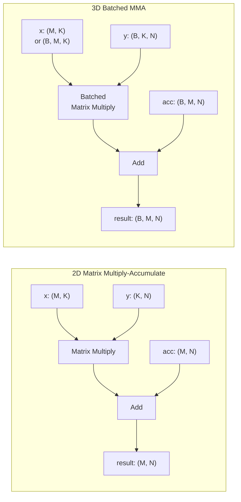
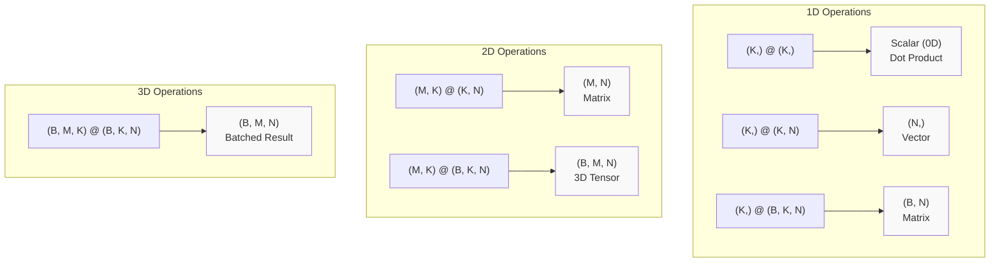
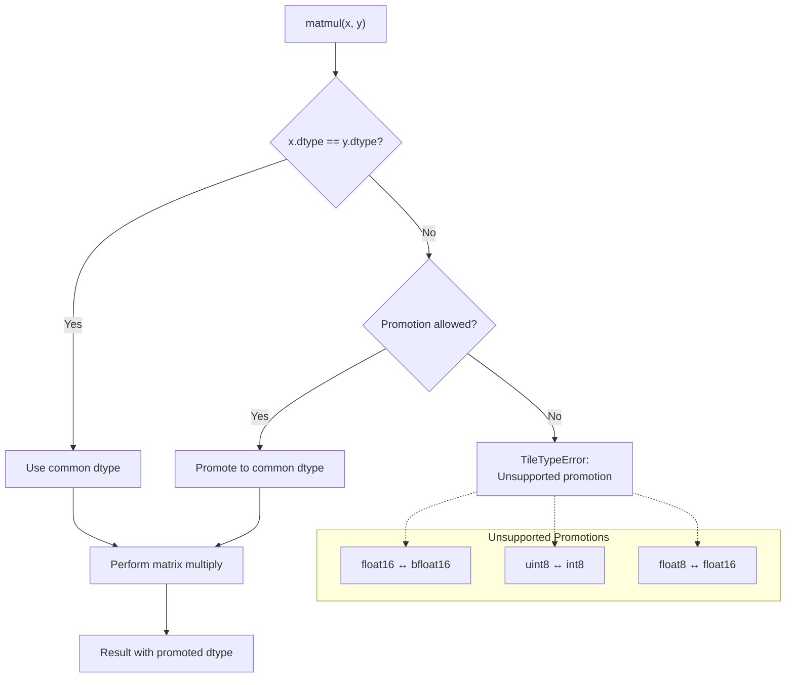
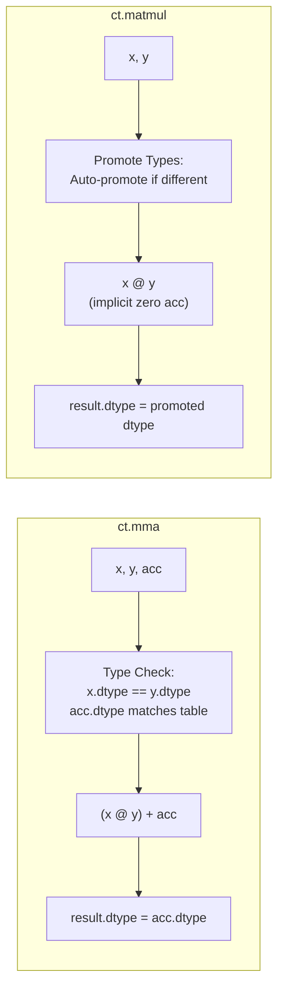

<!-- source: DeepWiki mcp.deepwiki.com · repo NVIDIA/cutile-python · page 3.5 Matrix Operations · fetched 2026-10-26 -->

# Matrix Operations

<details>
<summary>Relevant source files</summary>

The following files were used as context for generating this wiki page:

- [src/cuda/tile/_ir/ops.py](src/cuda/tile/_ir/ops.py)
- [src/cuda/tile/_stub.py](src/cuda/tile/_stub.py)
- [test/test_cast.py](test/test_cast.py)
- [test/test_cat.py](test/test_cat.py)
- [test/test_mma.py](test/test_mma.py)
- [test/util.py](test/util.py)

</details>


This page documents the matrix multiplication operations in cuda.tile: `ct.mma` and `ct.matmul`. These operations perform matrix multiplication on tile data structures, with different characteristics regarding type handling and accumulation.

For element-wise arithmetic operations on tiles, see page 3.4. For operations that change tile shape, see page 3.6.

---

## Operations Overview

cuda.tile provides two matrix multiplication operations with distinct behaviors:

| Operation | Full Name | Accumulator | Type Promotion | Primary Use Case |
|-----------|-----------|-------------|----------------|------------------|
| `ct.mma` | Matrix Multiply-Accumulate | Required | None (inputs must match) | Fused multiply-add with explicit accumulator control |
| `ct.matmul` | Matrix Multiply | Implicit (zero) | Automatic | General matrix multiplication with type flexibility |

**Sources:** [src/cuda/tile/_stub.py:943-1019](), [src/cuda/tile/_ir/ops.py:1969-2305]()
</thinking>

<old_str>
**Sources:** [src/cuda/tile/_stub.py:956-976](), [test/test_mma.py:66-97](), [src/cuda/tile/_ir/ops.py:1998-2048]()
</old_str>

<new_str>
**Sources:** [src/cuda/tile/_stub.py:943-991](), [src/cuda/tile/_ir/ops.py:1969-2153]()

### Parameters

- **x** (`Tile`): Left-hand side operand, must be 2D or 3D tile
- **y** (`Tile`): Right-hand side operand, must be 2D or 3D tile
- **acc** (`Tile`): Accumulator tile that determines output dtype

---

## Matrix Multiply-Accumulate (`mma`)

### Function Signature

```python
ct.mma(x, y, /, acc) -> Tile
```

Computes `(x @ y) + acc` as a single fused operation, where `@` denotes matrix multiplication. The result preserves the dtype of the accumulator.

**Sources:** [src/cuda/tile/_stub.py:943-991]()

### Parameters

- **x** (`Tile`): Left-hand side operand, must be 2D or 3D
- **y** (`Tile`): Right-hand side operand, must be 2D or 3D  
- **acc** (`Tile`): Accumulator tile that determines output dtype

### Supported Data Types

The following table shows valid combinations of input and accumulator dtypes:

| Input Dtype(s) | Accumulator/Output Dtype(s) |
|----------------|----------------------------|
| `float16` | `float16` or `float32` |
| `bfloat16` | `float32` |
| `float32` | `float32` |
| `float64` | `float64` |
| `tfloat32` | `float32` |
| `float8_e4m3fn` | `float16` or `float32` |
| `float8_e5m2` | `float16` or `float32` |
| `int8` or `uint8` | `int32` |

**Note:** If `x` and `y` have different dtypes, they will **not** be promoted to a common dtype. For integer types, `int8` and `uint8` can be mixed.

**Sources:** [src/cuda/tile/_stub.py:956-976](), [test/test_mma.py:66-97]()

### Broadcasting Behavior



**Diagram: mma Broadcasting Behavior**

Shape broadcasting applies to dimensions before the last two axes. The last two dimensions follow standard matrix multiplication rules: `(M, K) @ (K, N) -> (M, N)`.

**Sources:** [src/cuda/tile/_stub.py:979-980](), [test/test_mma.py:173-196](), [src/cuda/tile/_ir/ops.py:2067-2087]()

### Usage Examples

#### Basic 2D Matrix Multiply-Accumulate

```python
@ct.kernel
def mma_kernel(A, B, C, tm, tn, tk):
    # Load tiles from global arrays
    tx = ct.load(A, index=(0, 0), shape=(tm, tk))
    ty = ct.load(B, index=(0, 0), shape=(tk, tn))
    acc = ct.load(C, index=(0, 0), shape=(tm, tn))
    
    # Perform fused multiply-accumulate
    result = ct.mma(tx, ty, acc)
    
    # Store result back to global memory
    ct.store(C, index=(0, 0), tile=result)
```

**Sources:** [test/test_mma.py:17-26]()

#### Float16 with Float32 Accumulator

```python
@ct.kernel
def mixed_precision_mma(A, B, C, m, n, k):
    # Inputs are float16
    tx = ct.load(A, index=(0, 0), shape=(m, k))  # float16
    ty = ct.load(B, index=(0, 0), shape=(k, n))  # float16
    
    # Accumulator is float32
    acc = ct.load(C, index=(0, 0), shape=(m, n))  # float32
    
    # Result will be float32 (determined by acc)
    result = ct.mma(tx, ty, acc)
    ct.store(C, index=(0, 0), tile=result)
```

**Sources:** [test/test_mma.py:81-111]()

#### TensorFloat32 (TF32) Mode

```python
@ct.kernel  
def mma_tf32_kernel(A, B, C, tm, tn, tk):
    # Cast float32 inputs to tfloat32
    tx = ct.load(A, index=(0, 0), shape=(tm, tk)).astype(ct.tfloat32)
    ty = ct.load(B, index=(0, 0), shape=(tk, tn)).astype(ct.tfloat32)
    
    # Accumulator remains float32
    acc = ct.load(C, index=(0, 0), shape=(tm, tn))
    
    # Compute with TF32 precision
    acc = ct.mma(tx, ty, acc)
    ct.store(C, index=(0, 0), tile=acc)
```

**Sources:** [test/test_mma.py:29-38]()

#### Batched Matrix Multiply-Accumulate

```python
@ct.kernel
def mma_batch_kernel(A, B, C, tb, tm, tn, tk):
    # 2D tile multiplied by 3D batch
    tx = ct.load(A, index=(0, 0), shape=(tm, tk))
    ty = ct.load(B, index=(0, 0, 0), shape=(tb, tk, tn))
    acc = ct.load(C, index=(0, 0, 0), shape=(tb, tm, tn))
    
    # Broadcasting: (tm, tk) @ (tb, tk, tn) -> (tb, tm, tn)
    acc = ct.mma(tx, ty, acc)
    ct.store(C, index=(0, 0, 0), tile=acc)
```

**Sources:** [test/test_mma.py:173-183]()

---

## Matrix Multiply (`matmul`)

### Function Signature

```python
ct.matmul(x, y, /) -> Tile
```

Performs matrix multiplication on the given tiles. Unlike `mma`, this operation has an implicit zero accumulator and automatically promotes input types.

The operator `@` can be used as syntactic sugar: `x @ y` is equivalent to `ct.matmul(x, y)`.

**Sources:** [src/cuda/tile/_stub.py:994-1019](), [src/cuda/tile/_ir/ops.py:2156-2305]()

### Parameters

- **x** (`Tile`): Left-hand side operand, can be 1D, 2D, or 3D tile
- **y** (`Tile`): Right-hand side operand, can be 1D, 2D, or 3D tile

### Supported Data Types

Input dtypes: `float16`, `bfloat16`, `float32`, `float64`, `tfloat32`, `float8_e4m3fn`, `float8_e5m2`, `int8`, `uint8`

**Type Promotion Rules:**
- If `x` and `y` have different dtypes, they are promoted to a common dtype using standard promotion rules
- The result dtype matches the promoted input dtype
- Some promotions are **not supported** and will raise `TileTypeError`:
  - `float16 ↔ bfloat16`
  - `uint8 ↔ int8`
  - `float8_e4m3fn ↔ float16` or `float8_e5m2 ↔ float16`

**Sources:** [src/cuda/tile/_stub.py:1002-1006](), [test/test_mma.py:239-261](), [src/cuda/tile/_ir/ops.py:2188-2235]()

### N-Dimensional Support



**Diagram: matmul N-Dimensional Broadcasting**

**Sources:** [test/test_mma.py:318-388]()

### Type Promotion Flow



**Diagram: matmul Type Promotion Logic**

**Sources:** [src/cuda/tile/_stub.py:1004-1006](), [test/test_mma.py:298-315](), [src/cuda/tile/_ir/ops.py:2188-2235]()

### Usage Examples

#### Basic Matrix Multiply

```python
@ct.kernel
def matmul_kernel(A, B, C, tm, tn, tk):
    tx = ct.load(A, index=(0, 0), shape=(tm, tk))
    ty = ct.load(B, index=(0, 0), shape=(tk, tn))
    
    # No explicit accumulator needed
    result = ct.matmul(tx, ty)
    
    ct.store(C, index=(0, 0), tile=result)
```

**Sources:** [test/test_mma.py:228-236]()

#### Using the @ Operator

```python
@ct.kernel
def matmul_operator_kernel(A, B, C, tm, tn, tk):
    tx = ct.load(A, index=(0, 0), shape=(tm, tk))
    ty = ct.load(B, index=(0, 0), shape=(tk, tn))
    
    # Equivalent to ct.matmul(tx, ty)
    result = tx @ ty
    
    ct.store(C, index=(0, 0), tile=result)
```

**Sources:** [src/cuda/tile/_stub.py:1017-1018]()

#### Mixed Precision with Automatic Promotion

```python
@ct.kernel
def mixed_precision_matmul(A, B, C, m, n, k):
    # A is float16, B is float32
    tx = ct.load(A, index=(0, 0), shape=(m, k))  # float16
    ty = ct.load(B, index=(0, 0), shape=(k, n))  # float32
    
    # Both promoted to float32, result is float32
    result = ct.matmul(tx, ty)
    
    ct.store(C, index=(0, 0), tile=result)
```

**Sources:** [test/test_mma.py:242-260]()

#### 1D Vector Operations

```python
@ct.kernel
def vector_dot_product(A, B, C, k):
    # 1D @ 1D produces scalar (0D tile)
    tx = ct.load(A, index=(0,), shape=(k,))
    ty = ct.load(B, index=(0,), shape=(k,))
    
    result = ct.matmul(tx, ty)  # Scalar result
    
    ct.store(C, index=(0,), tile=result)
```

**Sources:** [test/test_mma.py:325-329]()

#### Vector-Matrix Multiplication

```python
@ct.kernel
def vector_matrix_multiply(A, B, C, k, n):
    # (K,) @ (K, N) -> (N,)
    tx = ct.load(A, index=(0,), shape=(k,))
    ty = ct.load(B, index=(0, 0), shape=(k, n))
    
    result = ct.matmul(tx, ty)  # 1D result
    
    ct.store(C, index=(0,), tile=result)
```

**Sources:** [test/test_mma.py:330-334]()

---

## Key Differences Between `mma` and `matmul`



**Diagram: Operation Flow Comparison**

| Aspect | `mma` | `matmul` |
|--------|-------|----------|
| **Accumulator** | Explicit (required parameter) | Implicit (zero) |
| **Type Promotion** | None (inputs must match) | Automatic when allowed |
| **Output Dtype** | Determined by accumulator | Same as promoted input |
| **Supported Ranks** | 2D or 3D only | 1D, 2D, or 3D |
| **Use Case** | Fine-grained accumulator control, iterative algorithms | General matrix multiplication, simpler API |
| **Operator Overload** | No | Yes (`@`) |

**Sources:** [src/cuda/tile/_stub.py:943-1019](), [src/cuda/tile/_ir/ops.py:1969-2305]()

---

## Implementation Details

### IR Operations

Both `mma` and `matmul` are implemented as IR operations in the compilation pipeline:

- **`MmaOperation`**: Represents the `ct.mma` operation in the IR, defined in [src/cuda/tile/_ir/ops.py:1969-2153]()
- **`MatMulOperation`**: Represents the `ct.matmul` operation in the IR, defined in [src/cuda/tile/_ir/ops.py:2156-2305]()

These operations implement:
- `infer_type()`: Type inference and validation logic that checks dtype compatibility and determines output types
- `generate_bytecode()`: Bytecode generation that translates to TileIR instructions

### Type Inference

Type inference for matrix operations occurs during the compilation pass:

1. Extract dtypes and shapes from input tiles
2. Validate dtype combinations according to supported configurations
3. Perform shape inference following matrix multiplication rules
4. Set the output tile type

For `mma`, the accumulator dtype is preserved as the output dtype. For `matmul`, type promotion is applied if inputs have different dtypes.

**Sources:** [src/cuda/tile/_ir/ops.py:1998-2048](), [src/cuda/tile/_ir/ops.py:2188-2235]()

---

## Common Error Conditions

### Unsupported Type Combinations for `mma`

```python
# ERROR: x and y have different dtypes
tx = ct.full((2, 4), 3, dtype=ct.float16)
ty = ct.full((4, 8), 4, dtype=ct.bfloat16)
acc = ct.full((2, 8), 0, dtype=ct.float32)
result = ct.mma(tx, ty, acc)  # TileTypeError: x and y must have the same dtype
```

```python
# ERROR: Accumulator dtype not supported for input dtype
tx = ct.full((2, 4), 3, dtype=ct.bfloat16)
ty = ct.full((4, 8), 4, dtype=ct.bfloat16)
acc = ct.full((2, 8), 0, dtype=ct.float16)
result = ct.mma(tx, ty, acc)  # TileTypeError: Unsupported acc dtype
```

**Sources:** [test/test_mma.py:207-223]()

### Unsupported Type Promotions for `matmul`

```python
# ERROR: float16 and bfloat16 promotion not allowed
tx = ct.full((2, 4), 3, dtype=ct.float16)
ty = ct.full((4, 8), 4, dtype=ct.bfloat16)
result = ct.matmul(tx, ty)  # TileTypeError: Implicit promotion not supported
```

```python
# ERROR: uint8 and int8 promotion not allowed
tx = ct.full((2, 4), 3, dtype=ct.uint8)
ty = ct.full((4, 8), 4, dtype=ct.int8)
result = ct.matmul(tx, ty)  # TileTypeError: Implicit promotion not supported
```

**Sources:** [test/test_mma.py:298-315]()

### Unsupported Input Dtypes

```python
# ERROR: int16 not supported
tx = ct.full((2, 4), 3, dtype=ct.int16)
ty = ct.full((4, 8), 4, dtype=ct.int16)
result = ct.matmul(tx, ty)  # TileTypeError: Unsupported input dtype
```

**Sources:** [test/test_mma.py:302-315]()

---

## Performance Considerations

### Tensor Core Utilization

Both `mma` and `matmul` can utilize GPU Tensor Cores for accelerated matrix multiplication when:
- Input dtypes are supported by hardware (float16, bfloat16, float8, tfloat32, int8)
- Tile dimensions are appropriately sized (typically multiples of 8 or 16)
- The GPU architecture supports Tensor Cores (Volta and later)

**Sources:** [src/cuda/tile/_stub.py:956-976](), [src/cuda/tile/_ir/ops.py:1998-2048]()

### Choosing Between `mma` and `matmul`

Use `ct.mma` when:
- You need explicit control over the accumulator dtype
- Implementing iterative algorithms (e.g., blocked GEMM) where accumulation happens across multiple operations
- You want to ensure no implicit type conversions occur

Use `ct.matmul` when:
- Performing standalone matrix multiplication
- Working with mixed precision and automatic promotion is acceptable
- You want simpler, more readable code with the `@` operator
- Working with 1D vectors (dot products)

**Sources:** [src/cuda/tile/_stub.py:943-1019](), [test/test_mma.py:1-388]()

---

