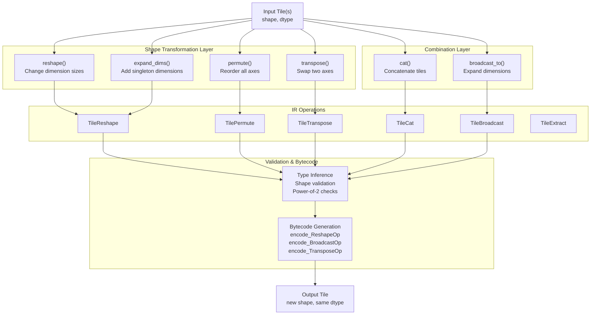
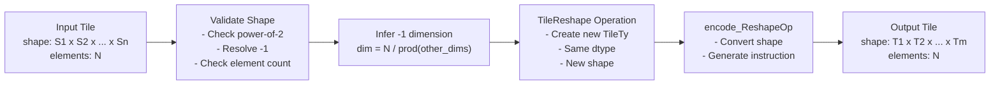
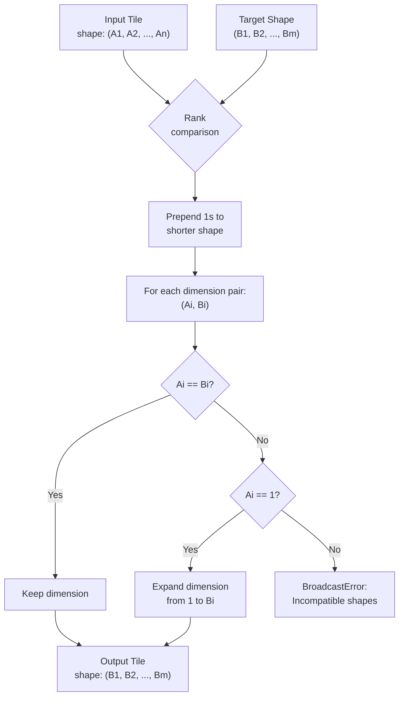
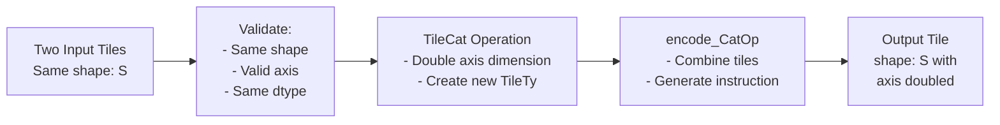
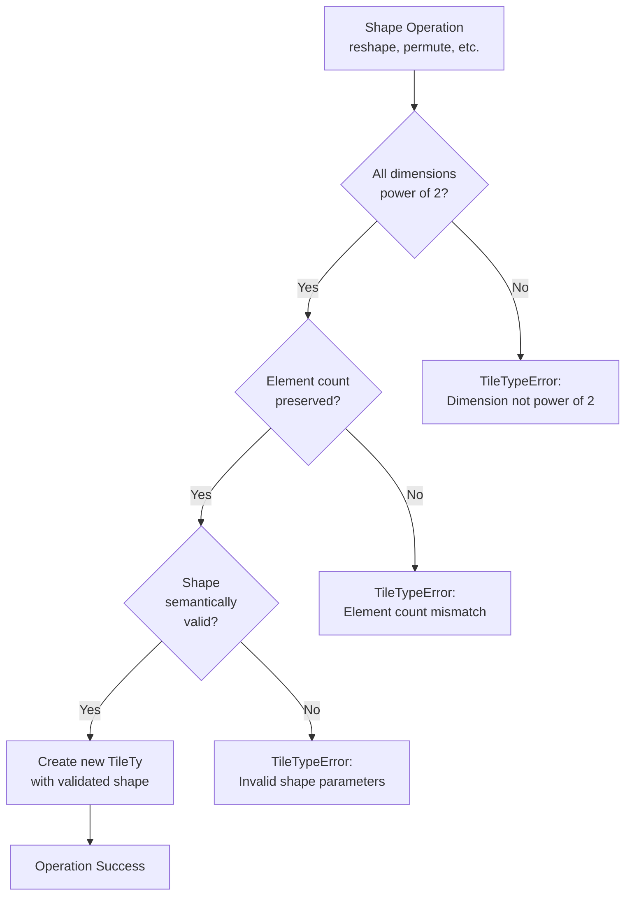
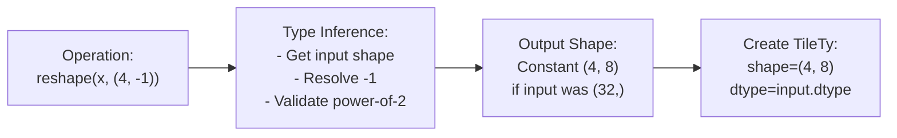

<!-- source: DeepWiki mcp.deepwiki.com · repo NVIDIA/cutile-python · page 3.6 Shape Manipulation · fetched 2026-10-26 -->

# Shape Manipulation

<details>
<summary>Relevant source files</summary>

The following files were used as context for generating this wiki page:

- [src/cuda/tile/_ir/ops.py](src/cuda/tile/_ir/ops.py)
- [src/cuda/tile/_stub.py](src/cuda/tile/_stub.py)
- [test/test_cat.py](test/test_cat.py)

</details>


Shape manipulation operations transform the dimensional structure of tiles without modifying their underlying data. These operations enable reshaping, reordering, and combining tiles to prepare data for computation. All shape manipulation operations preserve the data type of the input tile and operate at compile-time where possible to enable optimization.

For operations that change data types, see [Type Conversion](#3.7). For operations that extract subregions, see [Utility Operations](#3.9).

---

## Overview of Shape Operations

Shape manipulation operations fall into three categories:

| Category | Operations | Purpose |
|----------|-----------|---------|
| **Dimensional transforms** | `reshape`, `expand_dims` | Change number or size of dimensions |
| **Axis reordering** | `permute`, `transpose` | Reorder axes without changing data layout |
| **Tile combination** | `cat` | Concatenate tiles along an axis |
| **Broadcasting** | `broadcast_to` | Expand dimensions to match a target shape |

All operations maintain the tile's total element count (except `cat` which combines multiple tiles). Tile dimensions must remain powers of 2 after shape operations due to hardware alignment requirements.

**Sources:** [src/cuda/tile/_stub.py:1022-1178]()

---

## Shape Operation Pipeline



**Sources:** [src/cuda/tile/_ir/ops.py:1-70](), [src/cuda/tile/_stub.py:1022-1178]()

---

## reshape

**Function:** `ct.reshape(x, shape)` or `x.reshape(shape)`

Reshapes a tile to the specified shape while preserving the total number of elements. One dimension may be specified as `-1` to be inferred automatically based on the total element count.

### Parameters

- **x** (`Tile`): Input tile to reshape
- **shape** (`tuple[const int, ...]`): Target shape. One element may be `-1` for automatic inference.

### Returns

`Tile`: Reshaped tile with the same dtype as input

### Behavior

The reshape operation validates that:
1. Total element count is preserved: `prod(input_shape) == prod(output_shape)`
2. All dimensions are powers of 2 (or can be inferred to be powers of 2)
3. At most one dimension is specified as `-1`

If a dimension is `-1`, it is computed as `total_elements / prod(other_dimensions)`.

### Examples

```python
# Basic reshape
tx = ct.arange(8, dtype=ct.int32)  # shape: (8,)
ty = ct.reshape(tx, (2, 4))         # shape: (2, 4)

# Inferred dimension
tz = ct.reshape(tx, (2, -1))        # shape: (2, 4), inferred from 8 / 2 = 4

# Method syntax
tw = tx.reshape((4, 2))             # shape: (4, 2)

# Flatten to 1D
tv = ct.reshape(ty, (8,))           # shape: (8,)

# Reshape to 0D (scalar tile)
t0d = ct.reshape(ct.full((1,), 42, dtype=ct.int32), ())  # shape: ()
```

### Implementation Details



**Sources:** [src/cuda/tile/_stub.py:1101-1130](), [src/cuda/tile/_ir/ops.py:3863-3938]()

---

## permute

**Function:** `ct.permute(x, axes)` or `x.permute(axes)`

Permutes the axes of a tile according to the specified order. This reorders dimensions without changing the data layout in memory.

### Parameters

- **x** (`Tile`): Input tile to permute
- **axes** (`tuple[const int, ...]`): Desired order of axes. Must be a permutation of `(0, 1, ..., ndim-1)`.

### Returns

`Tile`: Tile with axes reordered according to `axes`

### Behavior

The `axes` parameter specifies the new order of dimensions. The value at `axes[i]` indicates which input dimension becomes output dimension `i`.

For example, `permute(x, (2, 0, 1))` creates a tile where:
- Output dimension 0 is input dimension 2
- Output dimension 1 is input dimension 0  
- Output dimension 2 is input dimension 1

### Examples

```python
# 3D permutation
tx = ct.full((2, 4, 8), 3.14, dtype=ct.float32)  # shape: (2, 4, 8)
ty = ct.permute(tx, (0, 2, 1))                    # shape: (2, 8, 4)

# Reverse all axes
tz = ct.permute(tx, (2, 1, 0))                    # shape: (8, 4, 2)

# Method syntax
tw = tx.permute((1, 2, 0))                        # shape: (4, 8, 2)

# Identity permutation (no-op)
tv = ct.permute(tx, (0, 1, 2))                    # shape: (2, 4, 8)
```

### Implementation Details

The permute operation validates that `axes` is a valid permutation (contains each index 0 to ndim-1 exactly once) and creates a new tile type with reordered dimensions.

**Sources:** [src/cuda/tile/_stub.py:1133-1150](), [src/cuda/tile/_ir/ops.py:4069-4140]()

---

## transpose

**Function:** `ct.transpose(x, axis0=None, axis1=None)` or `x.transpose(axis0, axis1)`

Transposes two axes of a tile. For 2D tiles, defaults to swapping the two dimensions if axes are not specified.

### Parameters

- **x** (`Tile`): Input tile with at least 2 dimensions
- **axis0** (`const int`, optional): First axis to transpose
- **axis1** (`const int`, optional): Second axis to transpose

### Returns

`Tile`: Tile with specified axes transposed

### Behavior

For 2D tiles, `transpose()` without arguments swaps the two dimensions. For higher-dimensional tiles, `axis0` and `axis1` must be explicitly specified.

### Examples

```python
# 2D transpose (implicit)
tx = ct.full((4, 8), 1.0, dtype=ct.float32)  # shape: (4, 8)
ty = ct.transpose(tx)                         # shape: (8, 4)

# 3D transpose (explicit axes)
tx = ct.full((2, 4, 8), 1.0, dtype=ct.float32)  # shape: (2, 4, 8)
ty = ct.transpose(tx, axis0=0, axis1=2)         # shape: (8, 4, 2)

# Method syntax
tw = tx.transpose(1, 2)                          # shape: (2, 8, 4)

# Equivalent to permute for 2D
ty = ct.permute(tx, (1, 0))  # Same as transpose for 2D
```

### Implementation Details

Transpose is implemented as a special case of permute. For 2D tiles, it generates the permutation `(1, 0)`. For higher dimensions, it constructs a permutation that swaps the specified axes while keeping others in their original positions.

**Sources:** [src/cuda/tile/_stub.py:1153-1178](), [src/cuda/tile/_ir/ops.py:4142-4189]()

---

## expand_dims

**Function:** `ct.expand_dims(x, axis)` or NumPy-style `x[None, ...]`

Inserts a new axis of size 1 at the specified position, increasing the tile's dimensionality.

### Parameters

- **x** (`Tile`): Input tile
- **axis** (`const int`): Position where the new axis is inserted. Negative indices count from the end.

### Returns

`Tile`: Tile with an additional dimension of size 1

### Behavior

The `axis` parameter indicates where to insert the new dimension:
- Positive indices: Insert before the specified position
- Negative indices: Insert counting from the end
- Supports multiple expansions via NumPy-style indexing with `None` or `np.newaxis`

### Examples

```python
# Expand at end
tx = ct.arange(16, dtype=ct.float32)  # shape: (16,)
ty = ct.expand_dims(tx, 1)             # shape: (16, 1)

# Expand at beginning
tz = ct.expand_dims(tx, 0)             # shape: (1, 16)

# NumPy-style syntax (preferred)
tw = tx[None, ...]                     # shape: (1, 16)
tv = tx[:, None]                       # shape: (16, 1)
tu = tx[None, ..., None, None]        # shape: (1, 16, 1, 1)

# Multiple new axes with ellipsis
tx2d = ct.full((4, 8), 1.0, dtype=ct.float32)  # shape: (4, 8)
ty = tx2d[None, :, None, :]                     # shape: (1, 4, 1, 8)
```

### Implementation Details

The NumPy-style indexing syntax (`x[None, :]`) is handled by the `tile_getitem` function [src/cuda/tile/_ir/ops.py:2235-2246](), which processes the index tuple and calls `tile_expand_dims` [src/cuda/tile/_ir/ops.py:2204-2232](). The function validates the index tuple, identifies where `None` values appear, and calls `reshape` to insert singleton dimensions.

**Sources:** [src/cuda/tile/_stub.py:1023-1047](), [src/cuda/tile/_ir/ops.py:2204-2246]()

---

## broadcast_to

**Function:** `ct.broadcast_to(x, shape)`

Broadcasts a tile to a target shape following NumPy broadcasting rules. This expands dimensions of size 1 to match the target shape without copying data.

### Parameters

- **x** (`Tile`): Input tile to broadcast
- **shape** (`tuple[const int, ...]`): Target shape

### Returns

`Tile`: Broadcasted tile with the target shape

### Behavior

Broadcasting follows these rules:
1. If ranks differ, prepend dimensions of size 1 to the smaller-rank tile
2. For each dimension pair:
   - If both dimensions are equal, no change needed
   - If one dimension is 1, expand it to match the other
   - Otherwise, shapes are incompatible (error)

### Examples

```python
# Broadcast 1D to 2D
tx = ct.arange(4, dtype=ct.float32)    # shape: (4,)
ty = ct.broadcast_to(tx, (2, 4))       # shape: (2, 4)

# Broadcast with leading dimensions
tx = ct.arange(4, dtype=ct.float32)    # shape: (4,)
ty = ct.broadcast_to(tx, (8, 2, 4))    # shape: (8, 2, 4)

# Broadcast singleton dimension
tx = ct.full((4, 1), 1.0, dtype=ct.float32)  # shape: (4, 1)
ty = ct.broadcast_to(tx, (4, 8))              # shape: (4, 8)

# No-op broadcast (already correct shape)
tx = ct.full((4, 8), 1.0, dtype=ct.float32)
ty = ct.broadcast_to(tx, (4, 8))  # shape: (4, 8), no change
```

### Broadcasting Rules Diagram



**Sources:** [src/cuda/tile/_stub.py:1078-1098](), [src/cuda/tile/_ir/ops.py:3690-3770]()

---

## cat

**Function:** `ct.cat(tiles, axis)`

Concatenates two tiles along a specified axis. Due to power-of-2 constraints, both input tiles must have identical shapes.

### Parameters

- **tiles** (`tuple[Tile, Tile]`): A pair of tiles to concatenate
- **axis** (`const int`): Axis along which to concatenate

### Returns

`Tile`: Concatenated tile with doubled size along the specified axis

### Behavior

The concatenation operation:
1. Validates that both tiles have identical shapes
2. Doubles the size along the specified axis
3. Maintains power-of-2 dimension requirements

The result shape is identical to the input shapes except at the concatenation axis, where the size is doubled.

### Examples

```python
# Concatenate along first axis
tx = ct.full((2, 4), 3.0, dtype=ct.float32)  # shape: (2, 4)
ty = ct.full((2, 4), 4.0, dtype=ct.float32)  # shape: (2, 4)
tz = ct.cat((tx, ty), axis=0)                 # shape: (4, 4)

# Concatenate along second axis
tz = ct.cat((tx, ty), axis=1)                 # shape: (2, 8)

# Concatenate 1D tiles
tx = ct.arange(8, dtype=ct.int32)            # shape: (8,)
ty = ct.arange(8, dtype=ct.int32)            # shape: (8,)
tz = ct.cat((tx, ty), 0)                      # shape: (16,)
```

### Power-of-2 Constraint

Due to the requirement that all tile dimensions be powers of 2, `cat` can only concatenate tiles of identical shape. This ensures the result dimension remains a power of 2 (doubled from the input).

### Implementation Details



**Sources:** [src/cuda/tile/_stub.py:1051-1075](), [src/cuda/tile/_ir/ops.py:4191-4266]()

---

## Shape Constraints and Power-of-2 Requirements

All tile dimensions must be powers of 2 (1, 2, 4, 8, 16, ...). This constraint enables efficient hardware utilization and memory alignment.

### Valid and Invalid Shapes

| Shape | Valid? | Reason |
|-------|--------|--------|
| `(8,)` | ✓ | Single power-of-2 dimension |
| `(4, 16)` | ✓ | Both dimensions are powers of 2 |
| `(1, 8, 32)` | ✓ | All dimensions are powers of 2 |
| `(6, 8)` | ✗ | 6 is not a power of 2 |
| `(16, 24)` | ✗ | 24 is not a power of 2 |
| `()` | ✓ | 0D tile (scalar) is valid |

### Shape Operation Validation



**Sources:** [src/cuda/tile/_ir/ops.py:3863-3938](), [src/cuda/tile/_ir/type.py]()

---

## Common Usage Patterns

### Preparing Tiles for Matrix Operations

```python
# Reshape 1D tile to 2D for matrix multiplication
tx = ct.arange(32, dtype=ct.float32)  # shape: (32,)
tx_2d = ct.reshape(tx, (4, 8))        # shape: (4, 8)

# Transpose for correct matrix orientation
ty = ct.arange(64, dtype=ct.float32)  # shape: (64,)
ty_2d = ct.reshape(ty, (8, 8))        # shape: (8, 8)
ty_t = ct.transpose(ty_2d)            # shape: (8, 8) transposed

# Matrix multiply
result = tx_2d @ ty_t                 # shape: (4, 8)
```

### Broadcasting for Element-wise Operations

```python
# Broadcast scalar to tile shape
bias = ct.full((1,), 0.5, dtype=ct.float32)     # shape: (1,)
tile = ct.arange(16, dtype=ct.float32)          # shape: (16,)
bias_bc = ct.broadcast_to(bias, (16,))          # shape: (16,)
result = tile + bias_bc                          # shape: (16,)

# Broadcast for 2D addition
row_vector = ct.arange(8, dtype=ct.float32)     # shape: (8,)
matrix = ct.full((4, 8), 1.0, dtype=ct.float32) # shape: (4, 8)
row_bc = ct.broadcast_to(row_vector, (4, 8))   # shape: (4, 8)
result = matrix + row_bc                         # shape: (4, 8)
```

### Axis Reordering for Memory Layout

```python
# Change from (batch, height, width) to (batch, width, height)
tile_bhw = ct.full((2, 4, 8), 1.0, dtype=ct.float32)  # (batch=2, h=4, w=8)
tile_bwh = ct.permute(tile_bhw, (0, 2, 1))             # (batch=2, w=8, h=4)

# Prepare for transposed convolution
tile_hwc = ct.full((8, 8, 4), 1.0, dtype=ct.float32)  # (h=8, w=8, c=4)
tile_chw = ct.permute(tile_hwc, (2, 0, 1))             # (c=4, h=8, w=8)
```

**Sources:** [src/cuda/tile/_stub.py:1022-1178](), examples from documentation

---

## Type Inference and Constant Propagation

Shape operations perform compile-time type inference to determine output shapes. When all shape parameters are constants, the compiler computes the output shape during compilation.

### Compile-Time Shape Resolution



The type inference system [src/cuda/tile/_passes/typeinfer.py]() propagates shape information through the IR, enabling optimizations based on known shapes.

**Sources:** [src/cuda/tile/_ir/ops.py:3863-4266](), [src/cuda/tile/_passes/typeinfer.py:1-66]()

---

## Error Handling

Shape manipulation operations validate inputs and raise specific errors:

| Error Type | Condition | Example |
|------------|-----------|---------|
| `TileTypeError` | Non-power-of-2 dimension | `reshape(x, (3, 8))` where 3 is invalid |
| `TileTypeError` | Element count mismatch | `reshape((16,), (4, 8))` incorrect count |
| `TileTypeError` | Invalid permutation | `permute(x, (0, 2))` missing axis 1 |
| `TileTypeError` | Incompatible broadcast | `broadcast_to((4, 8), (4, 7))` |
| `TileTypeError` | Cat shape mismatch | `cat((4, 8), (4, 16))` different shapes |

All validation occurs during compilation, not at runtime, ensuring errors are caught early.

**Sources:** [src/cuda/tile/_ir/ops.py:3863-4266](), [src/cuda/tile/_exception.py]()

---

