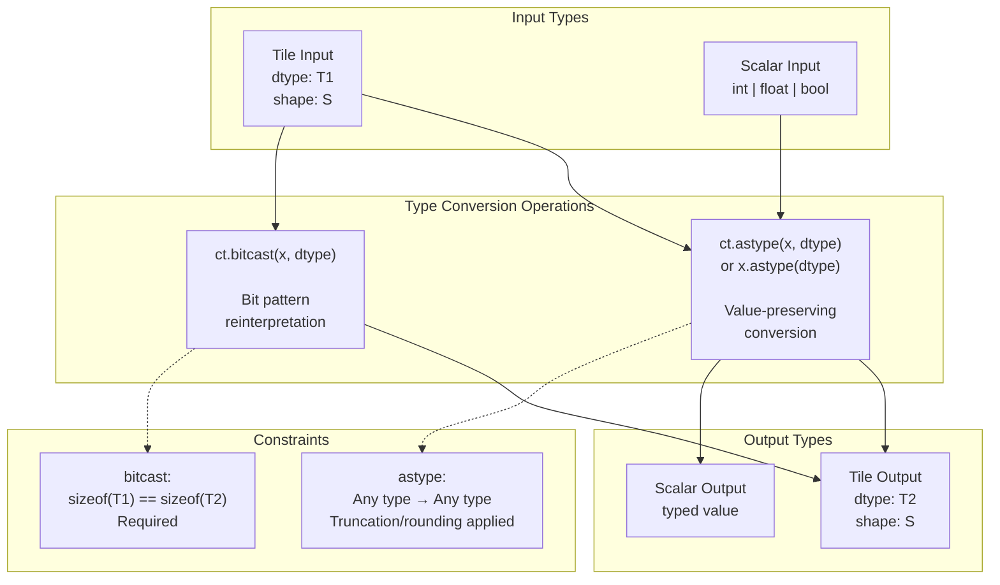
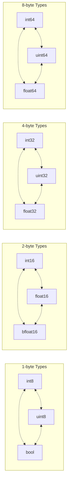
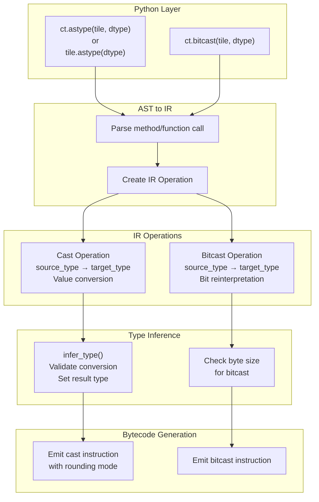

<!-- source: DeepWiki mcp.deepwiki.com · repo NVIDIA/cutile-python · page 3.7 Type Conversion · fetched 2026-10-26 -->

# Type Conversion

<details>
<summary>Relevant source files</summary>

The following files were used as context for generating this wiki page:

- [src/cuda/tile/_stub.py](src/cuda/tile/_stub.py)
- [test/test_cast.py](test/test_cast.py)
- [test/test_mma.py](test/test_mma.py)
- [test/util.py](test/util.py)

</details>


Type conversion operations transform tile data between different data types. This page documents the two type conversion operations available in cuda.tile: `astype` for value-preserving conversions and `bitcast` for bit-level reinterpretation.

For information about the type system and type promotion rules, see [Type System](#2.3). For information about available data types, see [Array and Tile Classes](#3.1).

## Overview

cuda.tile provides two distinct type conversion operations:

| Operation | Purpose | Requirement | Semantic |
|-----------|---------|-------------|----------|
| `astype` | Convert values to a different type | None | Value-preserving conversion with truncation/rounding |
| `bitcast` | Reinterpret bit pattern as a different type | Same byte size | Bit-level reinterpretation without conversion |

Both operations work on tiles and scalars. The `astype` operation can be invoked as either a function `ct.astype(x, dtype)` or a method `x.astype(dtype)`. The `bitcast` operation is only available as a function.

**Sources:** [src/cuda/tile/_stub.py:1182-1218]()

## Conversion Operations Diagram



**Sources:** [src/cuda/tile/_stub.py:1182-1218](), [test/test_cast.py:1-167]()

## The `astype` Operation

### Function Signature

```python
ct.astype(x, dtype, /) -> Tile
```

Or as a method:

```python
x.astype(dtype) -> Tile
```

Converts a tile to the specified data type. The operation preserves the value as closely as possible, applying truncation for narrowing conversions and appropriate rounding modes for floating-point conversions.

**Parameters:**
- `x` (Tile or Scalar): Input tile or scalar to convert
- `dtype` (DType): Target data type

**Returns:**
- Tile with the same shape as input but with the new dtype

### Usage Examples

#### Basic Array Conversion

```python
@ct.kernel
def convert_int_to_float(x, y, TILE: ct.Constant[int]):
    bid = ct.bid(0)
    tx = ct.load(x, index=(bid,), shape=(TILE,))
    ty = ct.astype(tx, ct.float32)  # Function syntax
    # Or: ty = tx.astype(ct.float32)  # Method syntax
    ct.store(y, index=(bid,), tile=ty)
```

#### Scalar Conversion

```python
@ct.kernel
def convert_scalar(scalar, array_out):
    x = ct.astype(scalar, array_out.dtype)
    ct.store(array_out, (0,), x)
```

**Sources:** [src/cuda/tile/_stub.py:1182-1198](), [test/test_cast.py:28-46](), [test/test_cast.py:132-143]()

### Supported Type Conversions

The `astype` operation supports conversions between all cuda.tile data types:

| From ↓ / To → | float16 | float32 | float64 | bfloat16 | int8 | int32 | int64 | uint8 | bool |
|---------------|---------|---------|---------|----------|------|-------|-------|-------|------|
| **float16**   | ✓ | ✓ | ✓ | ✓ | ✓ | ✓ | ✓ | ✓ | ✓ |
| **float32**   | ✓ | ✓ | ✓ | ✓ | ✓ | ✓ | ✓ | ✓ | ✓ |
| **float64**   | ✓ | ✓ | ✓ | ✓ | ✓ | ✓ | ✓ | ✓ | ✓ |
| **bfloat16**  | ✓ | ✓ | ✓ | ✓ | ✓ | ✓ | ✓ | ✓ | ✓ |
| **int8**      | ✓ | ✓ | ✓ | ✓ | ✓ | ✓ | ✓ | ✓ | ✓ |
| **int32**     | ✓ | ✓ | ✓ | ✓ | ✓ | ✓ | ✓ | ✓ | ✓ |
| **int64**     | ✓ | ✓ | ✓ | ✓ | ✓ | ✓ | ✓ | ✓ | ✓ |
| **uint8**     | ✓ | ✓ | ✓ | ✓ | ✓ | ✓ | ✓ | ✓ | ✓ |
| **bool**      | ✓ | ✓ | ✓ | ✓ | ✓ | ✓ | ✓ | ✓ | ✓ |

**Conversion Semantics:**
- **Float to Int:** Truncates towards zero (fractional part discarded)
- **Int to Float:** May lose precision for large integers
- **Bool to Numeric:** `True` → 1, `False` → 0
- **Numeric to Bool:** Non-zero → `True`, zero → `False`
- **Narrowing conversions:** Values outside target range produce undefined results

**Sources:** [test/test_cast.py:155-166]()

### TensorFloat32 (tfloat32) Conversion

The special `ct.tfloat32` type represents TensorFloat32, a reduced-precision format used for accelerating matrix operations. Converting to `tfloat32` rounds a float32 value to 10 bits of mantissa precision (from 23 bits).

```python
@ct.kernel
def convert_to_tf32(x, y, TILE: ct.Constant[int]):
    bid = ct.bid(0)
    tx = ct.load(x, index=(bid,), shape=(TILE,))
    # Convert to tfloat32 (reduces precision)
    ty = ct.astype(tx, ct.tfloat32)
    # Convert back to original dtype
    ty = ct.astype(ty, y.dtype)
    ct.store(y, index=(bid,), tile=ty)
```

**Key Properties:**
- TensorFloat32 has the same range as float32 (8-bit exponent)
- Mantissa is reduced from 23 bits to 10 bits
- Used for `ct.mma` operations with `tfloat32` inputs
- Conversion to `tfloat32` applies RNE (round to nearest even) rounding

**Sources:** [test/test_cast.py:58-79](), [test/test_mma.py:30-38](), [test/util.py:89-111]()

### Method vs Function Syntax

The `astype` operation supports both function and method call syntax:

```python
# Function syntax
result = ct.astype(tile, ct.float32)

# Method syntax (equivalent)
result = tile.astype(ct.float32)
```

Both forms produce identical results. The method syntax is provided for convenience and familiarity with NumPy/PyTorch conventions.

**Sources:** [src/cuda/tile/_stub.py:258-259](), [test/test_cast.py:29-36]()

## The `bitcast` Operation

### Function Signature

```python
ct.bitcast(x, /, dtype) -> Tile
```

Reinterprets a tile's bit pattern as a different data type without performing any conversion. This is analogous to C++ `reinterpret_cast` or viewing a memory buffer as a different type.

**Parameters:**
- `x` (Tile): Input tile to reinterpret
- `dtype` (DType): Target data type (must have same byte size as input)

**Returns:**
- Tile with reinterpreted bits

**Constraint:** The source and target types must have the same size in bytes. Attempting to bitcast between types of different sizes raises a `TileTypeError`.

### Bitcast Type Compatibility



Within each size group, bitcast operations are allowed. Across size groups, bitcast operations will raise `TileTypeError`.

**Sources:** [test/test_cast.py:82-114]()

### Usage Example

```python
@ct.kernel
def reinterpret_bits(x, y, TILE: ct.Constant[int]):
    bid = ct.bid(0)
    tx = ct.load(x, index=(bid,), shape=(TILE,))
    # Reinterpret float32 bits as int32
    ty = ct.bitcast(tx, ct.int32)
    ct.store(y, index=(bid,), tile=ty)
```

**Common Use Cases:**
- Inspecting floating-point bit patterns
- Implementing custom numeric types
- Low-level bit manipulation algorithms
- Type punning for specific optimizations

**Sources:** [src/cuda/tile/_stub.py:1201-1218](), [test/test_cast.py:49-114]()

## Type Conversion in the IR



**Sources:** [src/cuda/tile/_stub.py:1182-1218]()

## Conversion Semantics and Edge Cases

### Truncation Behavior

When converting from wider to narrower types, truncation occurs:

```python
# Integer truncation
x = ct.full((4,), 256, dtype=ct.int32)
y = ct.astype(x, ct.int8)  # Result: 0 (256 & 0xFF = 0)

# Float to int truncation
x = ct.full((4,), 3.7, dtype=ct.float32)
y = ct.astype(x, ct.int32)  # Result: 3 (fractional part discarded)
```

### Boolean Conversion

```python
# Bool to numeric: True → 1, False → 0
x = ct.full((4,), True, dtype=ct.bool_)
y = ct.astype(x, ct.float32)  # Result: 1.0

# Numeric to bool: 0 → False, non-zero → True
x = ct.full((4,), 5, dtype=ct.int32)
y = ct.astype(x, ct.bool_)  # Result: True
```

**Sources:** [test/test_cast.py:117-128](), [test/test_cast.py:157-160]()

### Scalar Type Conversion

Both `astype` and scalar inputs work together:

```python
@ct.kernel
def convert_scalar(scalar, array_out):
    # scalar is a Python int/float
    x = ct.astype(scalar, array_out.dtype)
    ct.store(array_out, (0,), x)
```

This enables conversion of loosely-typed Python constants to strictly-typed tile values.

**Sources:** [test/test_cast.py:132-143]()

## Error Conditions

### Bitcast Size Mismatch

Attempting to bitcast between types of different sizes raises `TileTypeError`:

```python
x = ct.full((4,), 1.0, dtype=ct.float32)  # 4 bytes
y = ct.bitcast(x, ct.int64)  # Error: 4 bytes → 8 bytes
```

**Error Message:** `TileTypeError: Bitcast requires source and target types to have the same size`

**Sources:** [test/test_cast.py:108-110]()

### Invalid Type Combinations

While `astype` supports conversions between all types, the implementation may raise errors for unsupported combinations in specific contexts. Always consult the type promotion rules in [Type System](#2.3) for implicit conversions vs. explicit casts.

## Summary

| Aspect | `astype` | `bitcast` |
|--------|----------|-----------|
| **Operation** | Value-preserving conversion | Bit-level reinterpretation |
| **Syntax** | Function or method | Function only |
| **Constraint** | None | Same byte size required |
| **Precision loss** | Possible (truncation/rounding) | No conversion, exact bits |
| **Use case** | Type conversion | Bit manipulation, type punning |
| **Inputs** | Tiles and scalars | Tiles only |

**Sources:** [src/cuda/tile/_stub.py:1182-1218](), [test/test_cast.py:1-167]()

---

