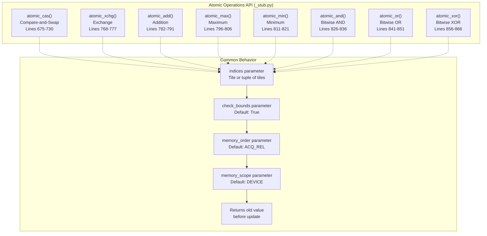
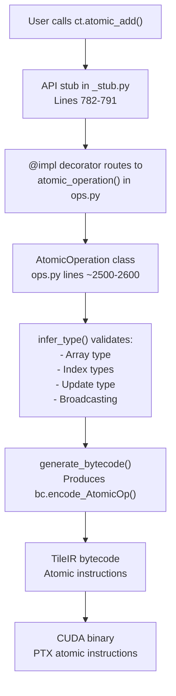
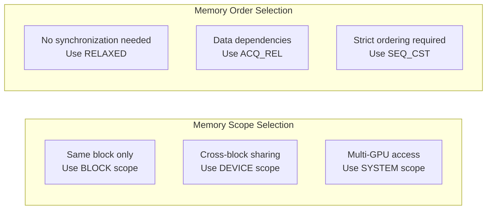
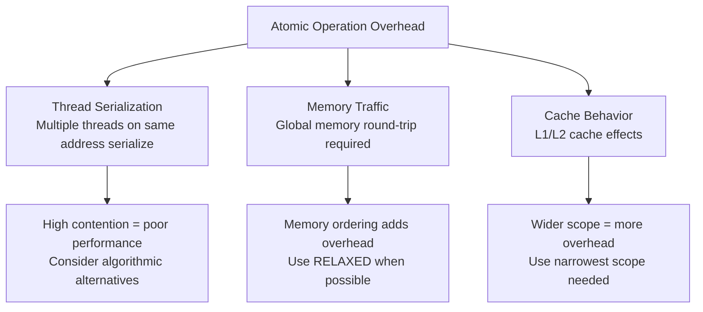
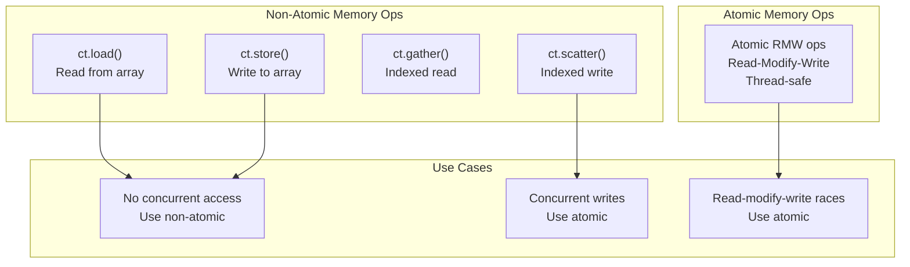

<!-- source: DeepWiki mcp.deepwiki.com · repo NVIDIA/cutile-python · page 3.8 Atomic Operations · fetched 2026-10-26 -->

# Atomic Operations

<details>
<summary>Relevant source files</summary>

The following files were used as context for generating this wiki page:

- [src/cuda/tile/_ir/ops.py](src/cuda/tile/_ir/ops.py)
- [src/cuda/tile/_stub.py](src/cuda/tile/_stub.py)
- [test/test_cat.py](test/test_cat.py)

</details>


Atomic operations in cuTile provide thread-safe read-modify-write access to array elements in global memory. They enable safe concurrent updates from multiple threads in a tile block or across different blocks, ensuring that each individual element operation completes atomically without interference from other threads.

For general memory operations without atomicity guarantees, see [Memory Operations](#3.2). For details on memory ordering semantics, see [Memory Model](#2.4).

## Purpose and Scope

Atomic operations allow multiple threads to safely update shared array elements by performing read-modify-write sequences atomically. Each operation:

- Reads the current value from a specified array element
- Performs a computation (add, exchange, compare-and-swap, etc.)
- Writes the result back to the same location
- Returns the original value before the update

The atomicity guarantee applies **per element**: each individual element's operation is atomic, but operations across multiple elements occur in an unspecified order and are not atomic as a group.

Sources: [src/cuda/tile/_stub.py:671-866]()

## Available Atomic Operations

### Atomic Operation Types



| Operation | Description | Updates Element To |
|-----------|-------------|-------------------|
| `atomic_cas` | Compare-and-swap | `desired` if element equals `expected`, else unchanged |
| `atomic_xchg` | Exchange | `update` |
| `atomic_add` | Addition | `element + update` |
| `atomic_max` | Maximum | `max(element, update)` |
| `atomic_min` | Minimum | `min(element, update)` |
| `atomic_and` | Bitwise AND | `element & update` |
| `atomic_or` | Bitwise OR | `element | update` |
| `atomic_xor` | Bitwise XOR | `element ^ update` |

Sources: [src/cuda/tile/_stub.py:674-866]()

## Common Parameters

All atomic operations share a common parameter structure following the same convention as `gather()` and `scatter()`:

### Required Parameters

**`array`** (Array): The global array to perform atomic operations on.

**`indices`**: Index specification for target elements. Must be:
- A tuple whose length equals the array rank, OR
- A single tile (shorthand for 1D arrays, equivalent to a tuple of length 1)

Each element of the indices tuple must be an integer tile or scalar. Multiple indices with different shapes are broadcast to a common shape.

**Operation-specific parameters**:
- `atomic_cas`: `expected` and `desired` values
- `atomic_xchg`: `update` value
- `atomic_add`, `atomic_max`, `atomic_min`, `atomic_and`, `atomic_or`, `atomic_xor`: `update` value

The `update`, `expected`, and `desired` parameters must be scalars or tiles whose shapes are broadcastable to the common shape of indices.

### Optional Parameters

**`check_bounds`** (const bool, default: True): 
- If True, indices are checked against array bounds
- Out-of-bounds indices: no operation performed, implementation-defined value returned (for `atomic_cas`, returns `expected`)
- If False, caller must ensure all indices are valid; out-of-bounds access is undefined behavior

**`memory_order`** (MemoryOrder, default: ACQ_REL):
- Specifies memory ordering semantics for the atomic operation
- See `MemoryOrder` enum in [src/cuda/tile/_memory_model.py]()

**`memory_scope`** (MemoryScope, default: DEVICE):
- Specifies the scope of memory synchronization
- See `MemoryScope` enum in [src/cuda/tile/_memory_model.py]()

Sources: [src/cuda/tile/_stub.py:675-866]()

## Atomic Compare-and-Swap (CAS)

### Signature and Behavior

```python
atomic_cas(array, indices, expected, desired, /, *,
           check_bounds=True,
           memory_order=MemoryOrder.ACQ_REL,
           memory_scope=MemoryScope.DEVICE) -> Tile
```

`atomic_cas()` performs a conditional update: for each specified index, it compares the array element to the `expected` value. If they match, the element is overwritten with `desired`; otherwise, no update occurs. The original value is returned in both cases.

### Operation Semantics

For 2D array with indices `(ind0, ind1)` of shapes `(M, N, 1)` and `(M, 1, K)`:

```python
# Pseudocode behavior
in parallel, for all (i, j, k) where 0<=i<M, 0<=j<N, 0<=k<K:
    if check_bounds and (ind0[i, j, 0] < 0 or ind0[i, j, 0] >= array.shape[0]
                         or ind1[i, 0, k] < 0 or ind1[i, 0, k] >= array.shape[1]):
        result[i, j, k] = expected[j, k]
    else:
        do atomically:
            actual = array[ind0[i, j, 0], ind1[i, 0, k]]
            if actual == expected[j, k]:
                array[ind0[i, j, 0], ind1[i, 0, k]] = desired[j, k]
            result[i, j, k] = actual
```

### Example

```python
indices = ct.arange(32, dtype=ct.int32)
expected = ct.full((32,), 1, dtype=ct.int32)
desired = ct.arange(32, dtype=ct.int32)
old_value = ct.atomic_cas(array, indices, expected, desired)
```

Sources: [src/cuda/tile/_stub.py:675-730]()

## Read-Modify-Write Atomic Operations

### Atomic Exchange

```python
atomic_xchg(array, indices, update, /, *,
            check_bounds=True,
            memory_order=MemoryOrder.ACQ_REL,
            memory_scope=MemoryScope.DEVICE) -> Tile
```

Unconditionally stores `update` to the specified array elements and returns the original values.

### Arithmetic Operations

**`atomic_add(array, indices, update, ...)`**: Atomically adds `update` to array elements.

```python
# Pseudocode
atomically:
    old = array[index]
    array[index] = old + update
    return old
```

**`atomic_max(array, indices, update, ...)`**: Atomically computes maximum.

```python
# Pseudocode
atomically:
    old = array[index]
    array[index] = max(old, update)
    return old
```

**`atomic_min(array, indices, update, ...)`**: Atomically computes minimum.

```python
# Pseudocode
atomically:
    old = array[index]
    array[index] = min(old, update)
    return old
```

### Bitwise Operations

**`atomic_and(array, indices, update, ...)`**: Atomically performs bitwise AND.

**`atomic_or(array, indices, update, ...)`**: Atomically performs bitwise OR.

**`atomic_xor(array, indices, update, ...)`**: Atomically performs bitwise XOR.

### Example

```python
indices = ct.arange(32, dtype=ct.int32)
update = ct.arange(32, dtype=ct.int32)
old_value = ct.atomic_add(array, indices, update)
```

Sources: [src/cuda/tile/_stub.py:768-866]()

## Implementation Architecture

### Compilation Flow



Sources: [src/cuda/tile/_stub.py:674-866](), [src/cuda/tile/_ir/ops.py]()

### IR Operation Structure

The implementation follows the standard operation pattern:

1. **Operation Definition**: `AtomicOperation` class extends `TypedOperation` in [src/cuda/tile/_ir/ops.py]()
2. **Type Inference**: Validates array, indices, and update parameters; checks broadcasting compatibility
3. **Bytecode Generation**: Emits atomic instructions with appropriate memory ordering and scope attributes

All atomic operations share common validation logic:
- Array must be of `ArrayTy` type
- Indices must be integer tiles or scalars
- Broadcasting rules apply to indices and update values
- Bounds checking is optional but enabled by default

Sources: [src/cuda/tile/_ir/ops.py:1-100]()

## Memory Ordering and Scope

### MemoryOrder Enumeration

The `memory_order` parameter controls synchronization guarantees:

- **`RELAXED`**: No synchronization ordering constraints
- **`ACQUIRE`**: Prevents subsequent reads/writes from moving before the atomic
- **`RELEASE`**: Prevents prior reads/writes from moving after the atomic
- **`ACQ_REL`**: Combines ACQUIRE and RELEASE (default)
- **`SEQ_CST`**: Sequential consistency, strongest ordering

### MemoryScope Enumeration

The `memory_scope` parameter defines visibility:

- **`DEVICE`**: Synchronizes across all threads on the device (default)
- **`BLOCK`**: Synchronizes only within the current block
- **`SYSTEM`**: Synchronizes across the entire system (multi-GPU)

### Usage Considerations



**Performance Note**: Stronger ordering and wider scope have performance costs. Use the weakest ordering and narrowest scope that satisfies correctness requirements.

Sources: [src/cuda/tile/_memory_model.py](), [src/cuda/tile/_stub.py:675-866]()

## Type Support and Constraints

### Supported Data Types

Atomic operations support a subset of cuTile's data types, depending on the operation:

| Operation | Supported Types |
|-----------|----------------|
| `atomic_cas` | Integer types (int32, int64, uint32, uint64) |
| `atomic_xchg` | Integer types, float types |
| `atomic_add` | Integer types, float types (with hardware support) |
| `atomic_max/min` | Integer types, float types |
| `atomic_and/or/xor` | Integer types only |

### Broadcasting Rules

Index tiles and update values follow NumPy-style broadcasting:

```python
# Example: Different index shapes broadcast
ind0 = ct.full((4, 1, 8), 0, dtype=ct.int32)    # Shape: (4, 1, 8)
ind1 = ct.full((1, 16, 8), 0, dtype=ct.int32)   # Shape: (1, 16, 8)
update = ct.full((16, 1), 1.0, dtype=ct.float32) # Shape: (16, 1)

# Broadcast to common shape: (4, 16, 8)
result = ct.atomic_add(array_2d, (ind0, ind1), update)
# result.shape == (4, 16, 8)
```

### Index Type Requirements

- Indices must be integer types (`int32`, `int64`, etc.)
- Negative indices are treated as out-of-bounds (not Python-style negative indexing)
- Each index tile dimension must be a power of 2 (standard tile constraint)

Sources: [src/cuda/tile/_stub.py:674-866](), [src/cuda/tile/_ir/ops.py]()

## Usage Patterns

### Pattern 1: Histogram Accumulation

```python
@ct.kernel
def histogram_kernel(data, histogram, num_bins: ct.Constant[int]):
    bid = ct.bid(0)
    values = ct.load(data, (bid,), shape=(64,))
    
    # Compute bin indices
    bins = ct.astype(values * num_bins, ct.int32)
    
    # Atomic increment for each bin
    ones = ct.ones((64,), dtype=ct.int32)
    ct.atomic_add(histogram, bins, ones)
```

### Pattern 2: Global Reduction with Atomics

```python
@ct.kernel
def reduce_sum_atomic(data, result):
    bid = ct.bid(0)
    tile = ct.load(data, (bid,), shape=(256,))
    
    # Local reduction within tile
    local_sum = ct.sum(tile, axis=None, keepdims=True)
    
    # Atomic accumulation to global result
    ct.atomic_add(result, (0,), local_sum.item())
```

### Pattern 3: Lock-Free Update

```python
@ct.kernel
def conditional_update(array, indices, new_values, threshold):
    # Load current values
    current = ct.gather(array, indices)
    
    # Decide which elements to update
    mask = current < threshold
    expected = ct.where(mask, current, ct.full(current.shape, -1, ct.int32))
    desired = ct.where(mask, new_values, current)
    
    # Attempt atomic update
    old = ct.atomic_cas(array, indices, expected, desired)
```

Sources: [src/cuda/tile/_stub.py:674-866]()

## Performance Considerations

### Atomic Operation Costs



### Optimization Strategies

1. **Reduce Contention**: 
   - Use local reductions before atomic accumulation
   - Distribute updates across multiple array elements

2. **Batch Operations**:
   - Process multiple elements per atomic call using tile operations
   - Leverage hardware support for bulk atomics

3. **Memory Ordering**:
   - Use `RELAXED` ordering when no synchronization is needed
   - Use narrower scopes (`BLOCK` vs `DEVICE`) when possible

4. **Bounds Checking**:
   - Set `check_bounds=False` when indices are guaranteed valid
   - Significant performance benefit in tight loops

Sources: [src/cuda/tile/_stub.py:674-866]()

## Relationship to Other Operations

### Atomic vs Non-Atomic Memory Operations



**Key Differences**:
- `scatter()`: Non-atomic write; race conditions possible with concurrent writers
- `atomic_*()`: Atomic read-modify-write; safe for concurrent access
- Atomics return the old value; `scatter()` does not return a value

Sources: [src/cuda/tile/_stub.py:595-669](), [src/cuda/tile/_stub.py:674-866]()

## Error Handling

### Type Errors

Common type-related errors:

- **Non-integer indices**: Indices must be integer types
- **Type mismatch**: Update value type must match array element type
- **Non-broadcastable shapes**: Indices and update must be broadcastable

### Bounds Checking

When `check_bounds=True` (default):
- Out-of-bounds access is safe but returns implementation-defined values
- No exception is raised from the kernel

When `check_bounds=False`:
- Out-of-bounds access results in undefined behavior
- May cause memory corruption or program crash
- Use only when indices are guaranteed valid

Sources: [src/cuda/tile/_stub.py:674-866]()

---

