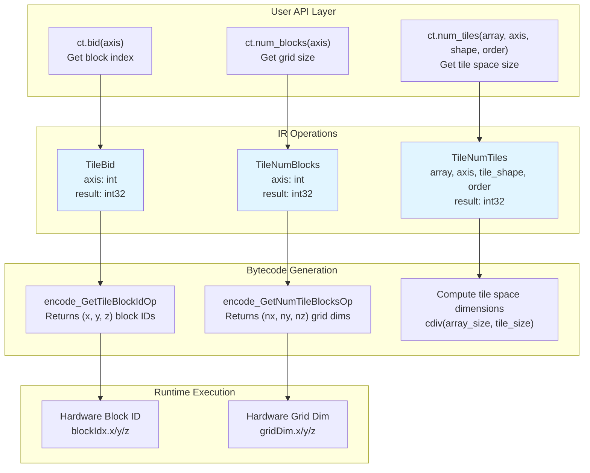
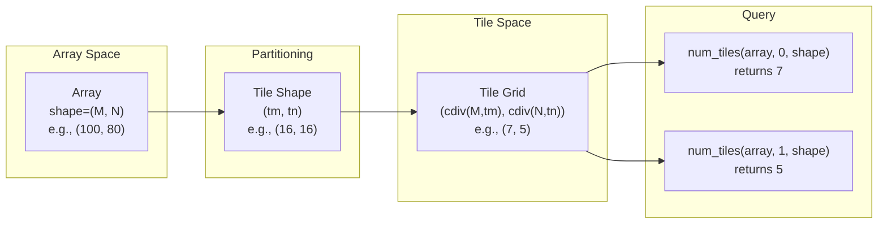
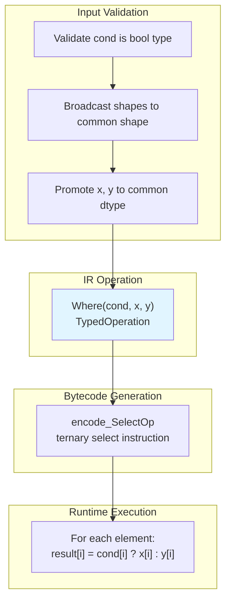
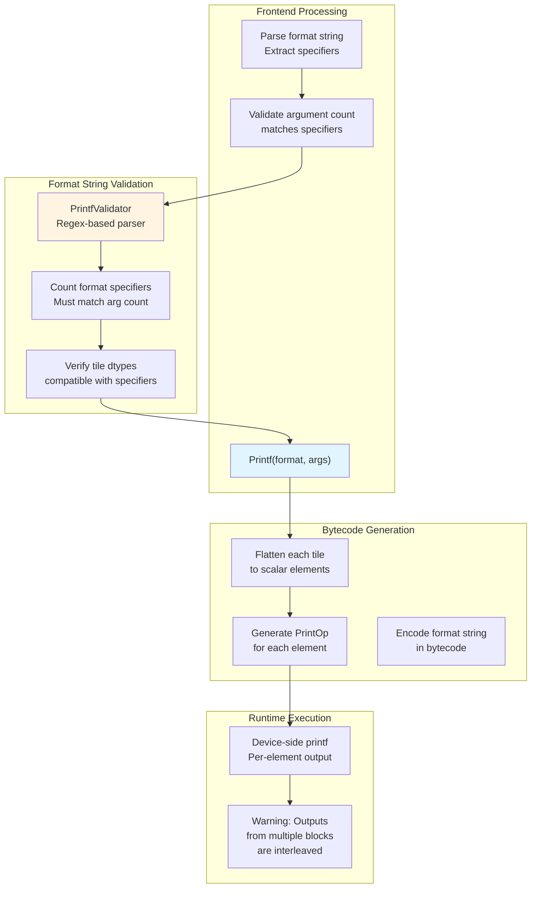
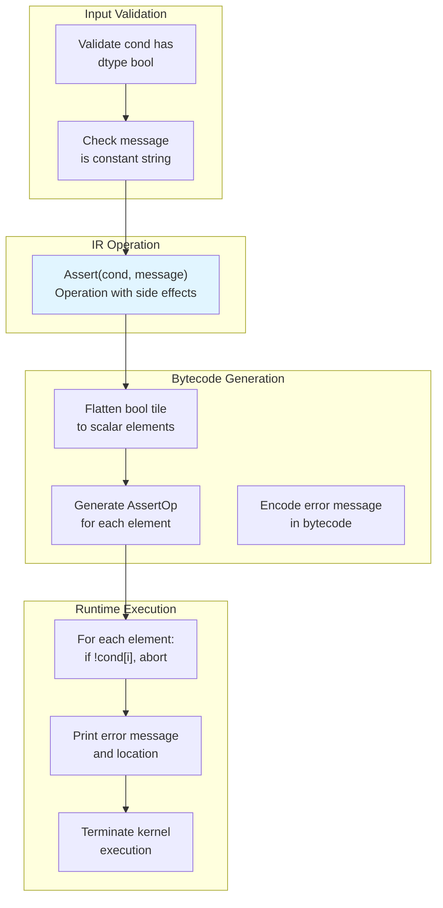
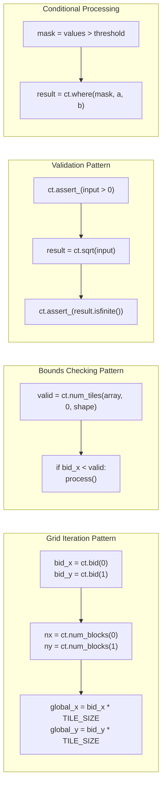

<!-- source: DeepWiki mcp.deepwiki.com · repo NVIDIA/cutile-python · page 3.9 Utility Operations · fetched 2026-10-26 -->

# Utility Operations

<details>
<summary>Relevant source files</summary>

The following files were used as context for generating this wiki page:

- [src/cuda/tile/_ir/ops.py](src/cuda/tile/_ir/ops.py)
- [src/cuda/tile/_stub.py](src/cuda/tile/_stub.py)
- [test/test_cat.py](test/test_cat.py)

</details>


This page documents utility operations that provide essential runtime information and debugging capabilities in `cuda.tile`. These operations fall into three categories:

1. **Block Information Operations**: Query the grid configuration and tile space dimensions (`bid`, `num_blocks`, `num_tiles`)
2. **Conditional Selection**: Select values based on boolean conditions (`where`)
3. **Debugging Operations**: Runtime printing and assertions (`printf`, `assert_`)

For memory operations like `load` and `store`, see [Memory Operations](#3.2). For mathematical operations, see [Mathematical Operations](#3.4).

---

## Block Information Operations

Block information operations provide access to the execution grid structure. These operations return runtime values that identify the current block and query grid dimensions.

### System Architecture



**Sources:** [src/cuda/tile/_stub.py:408-469](), [src/cuda/tile/_ir/ops.py:1807-1853](), [src/cuda/tile/_ir/ops.py:2995-3035]()

### bid()

Returns the index of the current block along the specified axis. This operation maps directly to CUDA's `blockIdx` intrinsic.

**API Signature:**
```python
def bid(axis: int) -> int32
```

**Parameters:**
- `axis` (const int): Axis index (0, 1, or 2) corresponding to x, y, or z dimensions

**Returns:**
- `int32`: Block index along the specified axis

**Implementation Flow:**

| Layer | Component | File Reference |
|-------|-----------|----------------|
| User API | `ct.bid(axis)` | [src/cuda/tile/_stub.py:409-423]() |
| IR Frontend | `bid_impl()` validates axis, calls `bid()` | [src/cuda/tile/_ir/ops.py:1826-1829]() |
| IR Operation | `TileBid(axis, result_var, loc)` | [src/cuda/tile/_ir/ops.py:1807-1818]() |
| Bytecode | `encode_GetTileBlockIdOp()` returns tuple | [src/cuda/tile/_ir/ops.py:1817]() |
| Runtime | Extracts appropriate component from result tuple | [src/cuda/tile/_ir/ops.py:1817]() |

**Example Usage:**
```python
@ct.kernel
def my_kernel(array: ct.Array):
    block_x = ct.bid(0)  # Get x-axis block index
    block_y = ct.bid(1)  # Get y-axis block index
    block_z = ct.bid(2)  # Get z-axis block index
```

**IR Representation:**

The `TileBid` operation is a `TypedOperation` that stores the axis as an attribute and generates bytecode by calling `encode_GetTileBlockIdOp`, which returns a 3-tuple. The operation extracts the appropriate element based on the axis.

**Sources:** [src/cuda/tile/_stub.py:409-423](), [src/cuda/tile/_ir/ops.py:1807-1829]()

### num_blocks()

Returns the total number of blocks in the grid along the specified axis. This operation maps to CUDA's `gridDim` intrinsic.

**API Signature:**
```python
def num_blocks(axis: int) -> int32
```

**Parameters:**
- `axis` (const int): Axis index (0, 1, or 2) corresponding to x, y, or z dimensions

**Returns:**
- `int32`: Number of blocks along the specified axis

**Implementation Flow:**

| Layer | Component | File Reference |
|-------|-----------|----------------|
| User API | `ct.num_blocks(axis)` | [src/cuda/tile/_stub.py:427-441]() |
| IR Frontend | `num_blocks()` validates axis | [src/cuda/tile/_ir/ops.py:1848-1853]() |
| IR Operation | `TileNumBlocks(axis, result_var, loc)` | [src/cuda/tile/_ir/ops.py:1832-1841]() |
| Bytecode | `encode_GetNumTileBlocksOp()` returns tuple | [src/cuda/tile/_ir/ops.py:1845]() |
| Runtime | Extracts appropriate component from result tuple | [src/cuda/tile/_ir/ops.py:1845]() |

**Example Usage:**
```python
@ct.kernel
def my_kernel(array: ct.Array):
    total_blocks_x = ct.num_blocks(0)
    total_blocks_y = ct.num_blocks(1)
    total_blocks_z = ct.num_blocks(2)
```

**Sources:** [src/cuda/tile/_stub.py:427-441](), [src/cuda/tile/_ir/ops.py:1832-1853]()

### num_tiles()

Computes the number of tiles in the array's tile space along the specified axis. The tile space is created by partitioning the array into tiles of the given shape.

**API Signature:**
```python
def num_tiles(array: Array, axis: int, shape: Constant[Shape], 
              order: Constant[Order] = "C") -> int32
```

**Parameters:**
- `array` (Array): The array to partition
- `axis` (const int): The axis of the tile partition space
- `shape` (const int | tuple[const int,...]): The shape of tiles used for partitioning
- `order` (const Order): Axis mapping order ("C", "F", or tuple)

**Returns:**
- `int32`: Number of tiles along the specified axis, computed as `cdiv(array_dim, tile_dim)`

**Tile Space Computation:**



**Implementation Details:**

The `TileNumTiles` operation performs compile-time computation when array shape is statically known, otherwise generates runtime division. The operation:

1. Extracts array shape (static or dynamic)
2. Applies axis order permutation
3. Computes `cdiv(array_shape[axis], tile_shape[axis])`

**Example Usage:**
```python
@ct.kernel
def my_kernel(array: ct.Array):
    # Array shape is (128, 256), tile shape is (16, 16)
    num_x = ct.num_tiles(array, 0, shape=(16, 16))  # Returns 8
    num_y = ct.num_tiles(array, 1, shape=(16, 16))  # Returns 16
    
    # Common pattern: iterate over tile space
    bid_x = ct.bid(0)
    if bid_x < num_x:
        tile = ct.load(array, (bid_x, 0), shape=(16, 16))
```

**Sources:** [src/cuda/tile/_stub.py:445-469](), [src/cuda/tile/_ir/ops.py:2995-3035]()

---

## Conditional Selection

### where()

The `where()` operation performs element-wise conditional selection between two tiles based on a boolean condition tile.

**API Signature:**
```python
def where(cond: Tile, x: Tile, y: Tile) -> Tile
```

**Parameters:**
- `cond` (Tile): Boolean tile of shape S
- `x` (Tile): Tile of shape S, selected when condition is True
- `y` (Tile): Tile of shape S, selected when condition is False

**Returns:**
- `Tile`: Result tile of shape S with elements from `x` or `y` based on `cond`

**Type and Shape Requirements:**

| Requirement | Description |
|-------------|-------------|
| Condition Type | `cond` must have dtype `bool` |
| Shape Compatibility | All three tiles must have broadcastable shapes |
| Type Promotion | `x` and `y` are promoted to a common dtype |
| Result Type | Result has the promoted common dtype of `x` and `y` |

**Operation Flow:**



**Implementation Components:**

| Component | File Reference | Description |
|-----------|----------------|-------------|
| User API | [src/cuda/tile/_stub.py:1783-1807]() | Public interface with documentation |
| IR Frontend | [src/cuda/tile/_ir/ops.py:2765-2800]() | `where_impl()` validation and type promotion |
| IR Operation | [src/cuda/tile/_ir/ops.py:2765-2791]() | `Where` class (TypedOperation) |
| Bytecode | [src/cuda/tile/_ir/ops.py:2793-2800]() | Uses `encode_SelectOp` |

**Example Usage:**
```python
@ct.kernel
def threshold_kernel(array: ct.Array, output: ct.Array):
    tile = ct.load(array, (ct.bid(0),), shape=(32,))
    
    # Clamp negative values to zero
    result = ct.where(tile < 0, 0.0, tile)
    
    # Select between two tiles
    mask = tile > 0.5
    ones = ct.ones((32,), dtype=ct.float32)
    zeros = ct.zeros((32,), dtype=ct.float32)
    binary = ct.where(mask, ones, zeros)
    
    ct.store(output, (ct.bid(0),), binary)
```

**Broadcasting Behavior:**

The `where()` operation follows NumPy broadcasting rules:
- Scalar values are broadcast to tile shapes
- Tiles with compatible shapes are broadcast to common shape
- Broadcasting rules are the same as arithmetic operations

**Sources:** [src/cuda/tile/_stub.py:1783-1807](), [src/cuda/tile/_ir/ops.py:2765-2800]()

---

## Debugging Operations

Debugging operations provide runtime introspection capabilities. These operations have significant performance overhead and should be used only during development.

### printf()

The `printf()` operation prints values from the GPU at runtime using C-style format strings.

**API Signature:**
```python
def printf(format: str, *args: Tile) -> None
```

**Parameters:**
- `format` (const str): C printf-style format string with specifiers `[diuoxXeEfFgGaA]`
- `*args` (Tile...): Tiles to print; only tile arguments are supported

**Format String Syntax:**

The format string follows C printf conventions: `%[flags][width][.precision][length]specifier`

| Specifier Category | Supported Specifiers | Notes |
|-------------------|---------------------|-------|
| Integer | `d`, `i`, `u`, `o`, `x`, `X` | Signed/unsigned integers, hex, octal |
| Float | `e`, `E`, `f`, `F`, `g`, `G`, `a`, `A` | Scientific, fixed, general, hex float |

**Implementation Architecture:**



**Implementation Components:**

| Component | File Reference | Description |
|-----------|----------------|-------------|
| User API | [src/cuda/tile/_stub.py:1837-1868]() | Public interface with format documentation |
| Format Validation | [src/cuda/tile/_ir/op_impl.py]() | `PrintfValidator` class parses format strings |
| IR Operation | [src/cuda/tile/_ir/ops.py:2850-2890]() | `Printf` class stores format and args |
| Bytecode | [src/cuda/tile/_ir/ops.py:2893-2915]() | Flattens tiles and emits PrintOp instructions |

**Example Usage:**
```python
@ct.kernel
def debug_kernel(array: ct.Array):
    tile = ct.load(array, (ct.bid(0),), shape=(4,))
    
    # Print single tile with integer format
    ct.printf("Tile values: %d\n", tile)
    
    # Print multiple tiles with mixed formats
    float_tile = ct.astype(tile, ct.float32)
    ct.printf("Int: %d, Float: %f\n", tile, float_tile)
    
    # Print with format modifiers
    ct.printf("Hex: %#x, Scientific: %e\n", tile, float_tile)
```

**Output Behavior:**

- **Element-wise printing**: Each element of a tile is printed separately
- **Interleaved output**: When multiple blocks execute concurrently, outputs are interleaved
- **Workaround for ordered output**: Set `opt_level=0` to serialize execution:

```python
@ct.kernel(opt_level=0)
def serial_print_kernel():
    ct.printf("Block %d\n", ct.bid(0))
```

**Performance Considerations:**

- **Significant overhead**: printf operations synchronize device execution
- **Use sparingly**: Only enable during debugging
- **Consider alternatives**: Use store operations to save data for post-processing

**Sources:** [src/cuda/tile/_stub.py:1837-1868](), [src/cuda/tile/_ir/ops.py:2850-2915]()

### assert_()

The `assert_()` operation verifies that all elements of a boolean tile are True, terminating execution with an error message if any element is False.

**API Signature:**
```python
def assert_(cond: Tile, message: Optional[str] = None) -> None
```

**Parameters:**
- `cond` (Tile): Boolean tile; assertion fails if any element is False
- `message` (const str, optional): Error message to display on assertion failure

**Assertion Semantics:**

| Aspect | Behavior |
|--------|----------|
| Success Condition | All elements of `cond` must be True |
| Failure Behavior | Terminates kernel execution with error |
| Element-wise Check | Each element is validated individually |
| Message Display | Optional custom message included in error output |

**Implementation Flow:**



**Implementation Components:**

| Component | File Reference | Description |
|-----------|----------------|-------------|
| User API | [src/cuda/tile/_stub.py:1871-1889]() | Public interface with usage documentation |
| IR Frontend | [src/cuda/tile/_ir/ops.py:2918-2960]() | `assert_impl()` validation |
| IR Operation | [src/cuda/tile/_ir/ops.py:2918-2943]() | `Assert` class (marked with `@has_side_effects`) |
| Bytecode | [src/cuda/tile/_ir/ops.py:2945-2960]() | Flattens condition and emits AssertOp |

**Example Usage:**
```python
@ct.kernel
def validated_kernel(array: ct.Array, output: ct.Array):
    tile = ct.load(array, (ct.bid(0),), shape=(32,))
    
    # Assert all values are positive
    ct.assert_(tile > 0)
    
    # Assert with custom message
    ct.assert_(tile < 100, "Values must be less than 100")
    
    # Assert complex conditions
    valid = (tile > 0) & (tile < 100)
    ct.assert_(valid, "Values must be in range (0, 100)")
    
    result = ct.sqrt(tile)  # Safe to call sqrt after assertion
    ct.store(output, (ct.bid(0),), result)
```

**Assertion Failure Output:**

When an assertion fails, the runtime prints:
1. The assertion failure message (if provided)
2. Source location information (file, line number)
3. Kernel execution is aborted

**Performance Considerations:**

- **Significant overhead**: Each element check adds synchronization cost
- **Debug builds only**: Disable assertions in production by conditionally removing calls
- **Early termination**: Kernel stops at first failing element
- **Alternative validation**: Consider storing validation flags for post-kernel inspection

**Sources:** [src/cuda/tile/_stub.py:1871-1889](), [src/cuda/tile/_ir/ops.py:2918-2960]()

---

## Operation Summary

The following table summarizes all utility operations:

| Operation | Category | Return Type | Side Effects | Constant-Time |
|-----------|----------|-------------|--------------|---------------|
| `bid(axis)` | Block Info | int32 | No | No (runtime query) |
| `num_blocks(axis)` | Block Info | int32 | No | No (runtime query) |
| `num_tiles(array, axis, shape, order)` | Block Info | int32 | No | Sometimes (if array shape known) |
| `where(cond, x, y)` | Selection | Tile | No | Yes |
| `printf(format, *args)` | Debug | None | Yes (I/O) | No |
| `assert_(cond, message)` | Debug | None | Yes (may abort) | No |

**Common Usage Patterns:**



**Sources:** [src/cuda/tile/_stub.py:408-1889](), [src/cuda/tile/_ir/ops.py:1807-2960]()

---

