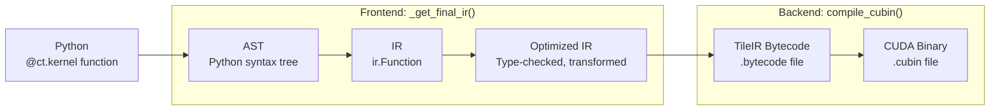
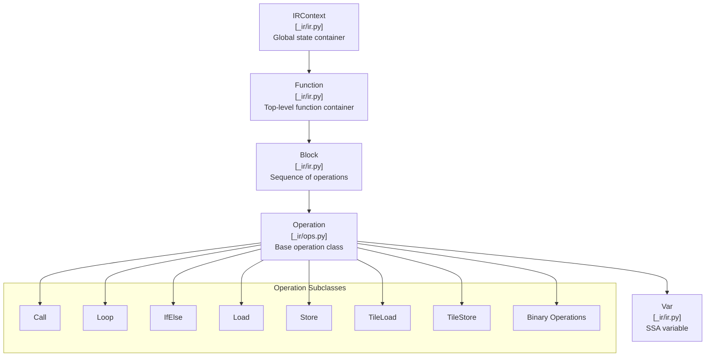
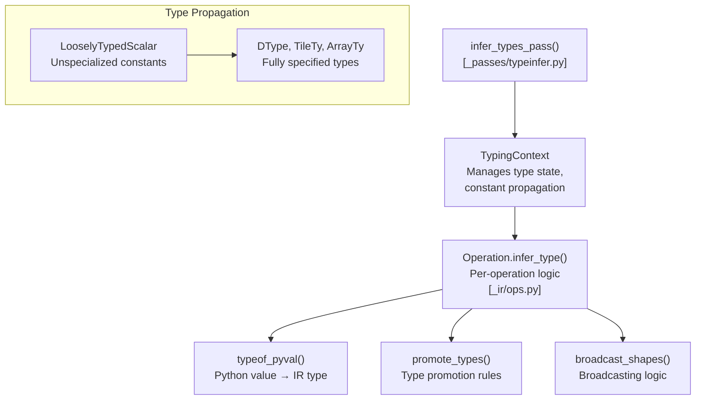

<!-- source: DeepWiki mcp.deepwiki.com · repo NVIDIA/cutile-python · page 4 Compilation System · fetched 2026-10-26 -->

# Compilation System

<details>
<summary>Relevant source files</summary>

The following files were used as context for generating this wiki page:

- [src/cuda/tile/_compile.py](src/cuda/tile/_compile.py)
- [src/cuda/tile/_ir/ops.py](src/cuda/tile/_ir/ops.py)
- [src/cuda/tile/_passes/eliminate_assign_ops.py](src/cuda/tile/_passes/eliminate_assign_ops.py)
- [test/test_cat.py](test/test_cat.py)
- [test/test_fma.py](test/test_fma.py)

</details>


## Purpose and Scope

This page provides a high-level overview of how cuTile compiles Python kernel functions into executable GPU binaries. The compilation system consists of multiple stages that transform Python code through intermediate representations, apply optimizations, and generate optimized CUDA binaries.

This overview focuses on architecture and key components. For detailed information:
- [Compilation Pipeline](#4.1): End-to-end compilation flow and pass ordering
- [Intermediate Representation](#4.2): IR structure (IRContext, Var, Operation, Block, Function)
- [Type Inference Pass](#4.3): Type inference, constant propagation, control flow flattening
- [Error Handling and Debugging](#4.4): Error types, debugging flags, crash dumps

## System Overview

The compilation system has two major phases:

**Phase 1: Frontend (Python → TileIR Bytecode)**
- Python AST parsing → IR construction
- Type inference with constant propagation
- Optimization passes (DCE, alias analysis, loop transforms)
- Bytecode serialization

**Phase 2: Backend (TileIR Bytecode → CUBIN)**
- External `tileiras` compiler (MLIR-based)
- MLIR optimizations and code generation
- Target-specific CUDA binary output

This separation allows high-level Python abstractions in the frontend while leveraging MLIR infrastructure for low-level optimizations and code generation.

## System Architecture

### Main Entry Point: compile_tile()

The `compile_tile()` function in [src/cuda/tile/_compile.py:147-215]() orchestrates the entire compilation process. It accepts a Python function and returns a `TileLibrary` object containing the compiled binary and metadata.

**Function signature:**
```python
def compile_tile(pyfunc, args, compiler_options: CompilerOptions, 
                 context: TileContext = default_tile_context) -> TileLibrary
```

### Component Architecture

```mermaid
graph TB
    subgraph "Entry Points"
        compile_tile["compile_tile()<br/>[_compile.py:147-215]"]
        CompileCallback["CompileCallback<br/>[_compile.py:218-226]"]
    end
    
    subgraph "Frontend: Python to IR"
        get_function_ir["get_function_ir()<br/>[_ast2ir.py]<br/>AST parsing"]
        _get_final_ir["_get_final_ir()<br/>[_compile.py:74-94]<br/>IR transformation pipeline"]
        bind_arguments["func_ir.bind_arguments()<br/>[_ir/ir.py]<br/>Bind argument types"]
    end
    
    subgraph "Type System"
        infer_types_pass["infer_types_pass()<br/>[_passes/typeinfer.py]<br/>Type inference, constant propagation"]
        Operation_infer_type["Operation.infer_type()<br/>[_ir/ops.py]<br/>Per-operation type inference"]
        TypingContext["TypingContext<br/>[_passes/typeinfer.py]<br/>Type state management"]
    end
    
    subgraph "Optimization Passes"
        eliminate_assign_ops["eliminate_assign_ops()<br/>[_passes/eliminate_assign_ops.py]"]
        dead_code_elimination_pass["dead_code_elimination_pass()<br/>[_passes/dce.py]"]
        alias_analysis_pass["alias_analysis_pass()<br/>[_passes/alias_analysis.py]"]
        token_order_pass["token_order_pass()<br/>[_passes/token_order.py]"]
        hoist_loop_invariants["hoist_loop_invariants()<br/>[_passes/code_motion.py]"]
        split_loops["split_loops()<br/>[_passes/loop_split.py]"]
    end
    
    subgraph "Bytecode Generation"
        generate_bytecode_for_kernel["generate_bytecode_for_kernel()<br/>[_ir2bytecode.py]"]
        write_bytecode["bc.write_bytecode()<br/>[_bytecode.py]<br/>Serialization"]
    end
    
    subgraph "Backend Compilation"
        compile_cubin["compile_cubin()<br/>[_compile.py:334-375]"]
        _find_compiler_bin["_find_compiler_bin()<br/>[_compile.py:246-282]"]
        tileiras["tileiras binary<br/>MLIR compiler"]
    end
    
    subgraph "Output"
        TileLibrary["TileLibrary<br/>[_compile.py:54-59]<br/>func_name, fname_cubin,<br/>bytecode, final_ir"]
    end
    
    compile_tile --> _get_final_ir
    _get_final_ir --> get_function_ir
    _get_final_ir --> bind_arguments
    _get_final_ir --> infer_types_pass
    _get_final_ir --> eliminate_assign_ops
    _get_final_ir --> dead_code_elimination_pass
    _get_final_ir --> alias_analysis_pass
    _get_final_ir --> token_order_pass
    _get_final_ir --> hoist_loop_invariants
    _get_final_ir --> split_loops
    
    infer_types_pass --> TypingContext
    infer_types_pass --> Operation_infer_type
    
    compile_tile --> generate_bytecode_for_kernel
    generate_bytecode_for_kernel --> write_bytecode
    
    compile_tile --> compile_cubin
    compile_cubin --> _find_compiler_bin
    compile_cubin --> tileiras
    
    tileiras --> TileLibrary
    compile_tile --> TileLibrary
    
    CompileCallback --> compile_tile
```



Sources: [src/cuda/tile/_compile.py:54-375](), [src/cuda/tile/_ir/ops.py:1-100]()

## Compilation Pipeline Overview

The compilation process executes in a fixed sequence of stages. The `_get_final_ir()` function in [src/cuda/tile/_compile.py:74-94]() implements the frontend pipeline, while `compile_tile()` orchestrates both frontend and backend.

### High-Level Pipeline



### Pass Execution Order

The `_get_final_ir()` function applies passes in this order:

| Order | Pass Function | File | Purpose |
|-------|--------------|------|---------|
| 1 | `get_function_ir()` | [_ast2ir.py]() | Parse Python AST into IR |
| 2 | `func_ir.bind_arguments()` | [_ir/ir.py]() | Bind argument types from call site |
| 3 | `infer_types_pass()` | [_passes/typeinfer.py]() | Type inference, constant propagation, control flow flattening |
| 4 | `eliminate_assign_ops()` | [_passes/eliminate_assign_ops.py]() | Remove assignment operations |
| 5 | `dead_code_elimination_pass()` | [_passes/dce.py]() | Remove unused operations |
| 6 | `alias_analysis_pass()` | [_passes/alias_analysis.py]() | Analyze memory access patterns |
| 7 | `token_order_pass()` | [_passes/token_order.py]() | Order memory operations |
| 8 | `rewrite_patterns()` | [_passes/rewrite_patterns.py]() | Apply pattern-based rewrites |
| 9 | `hoist_loop_invariants()` | [_passes/code_motion.py]() | Move loop-invariant code |
| 10 | `split_loops()` | [_passes/loop_split.py]() | Split loop structures |
| 11 | `dead_code_elimination_pass()` | [_passes/dce.py]() | Final cleanup |

**Pass Dependencies:**
- Type inference must run first (all optimizations require type information)
- Token ordering requires alias analysis results
- Loop invariant hoisting must run after token ordering to avoid incorrectly hoisting memory operations
- Dead code elimination runs twice: after assignment elimination and as final cleanup

See [Compilation Pipeline](#4.1) for detailed information about each pass.

Sources: [src/cuda/tile/_compile.py:74-94]()

## Backend: External Compiler Integration

The frontend produces TileIR bytecode, which the external `tileiras` compiler (MLIR-based) transforms into optimized CUDA binaries.

### Compiler Discovery: _find_compiler_bin()

The `_find_compiler_bin()` function in [src/cuda/tile/_compile.py:246-282]() searches for the `tileiras` binary:

**Search order:**
1. `cuda/tile/_deps/bin` - Local package dependencies
2. `PATH` - System-wide installation
3. `CUDA_HOME/bin` or `CUDA_PATH/bin` - CUDA Toolkit
4. Default CUDA Toolkit paths:
   - Linux: `/usr/local/cuda-XX/bin`
   - Windows: `C:\Program Files\NVIDIA GPU Computing Toolkit\CUDA\vXX\bin`

**Returns:** `(tileiras_path, bin_path, ld_library_path)`

If not found, raises `FileNotFoundError` with instructions to set `CUDA_HOME` or `CUDA_PATH`.

### Compiler Invocation: compile_cubin()

The `compile_cubin()` function in [src/cuda/tile/_compile.py:334-375]() invokes `tileiras`:

**Command structure:**
```bash
tileiras <input.bytecode> -o <output.cubin> --gpu-name sm_XX -O<level> --lineinfo
```

**Parameters:**

| Flag | Value | Source |
|------|-------|--------|
| `<input>` | Temporary `.bytecode` file | Generated by frontend |
| `-o` | `.cubin` output file | Same basename as input |
| `--gpu-name` | `sm_XX` (e.g., `sm_90`) | `get_sm_arch()` from GPU query |
| `-O` | `0`, `1`, `2`, or `3` | `compiler_options.opt_level` |
| `--lineinfo` | Always present | Line info for profiling |

**Environment:**
- `PATH`: Extended with compiler bin directory
- `LD_LIBRARY_PATH` (Linux): Extended with compiler lib directory

**Timeout:** Configurable via `context.config.compiler_timeout_sec`. If exceeded, raises `TileCompilerTimeoutError`.

**Error handling:** If `tileiras` returns non-zero exit code, raises `TileCompilerExecutionError` with stderr output. See [Error Handling and Debugging](#4.4).

Sources: [src/cuda/tile/_compile.py:246-282](), [src/cuda/tile/_compile.py:334-375]()

## Key Data Structures

### TileLibrary

The `TileLibrary` class in [src/cuda/tile/_compile.py:54-59]() encapsulates compilation output:

| Attribute | Type | Description |
|-----------|------|-------------|
| `func_name` | `str` | Qualified kernel function name (e.g., `"my_module.my_kernel"`) |
| `fname_cubin` | `Path` | Path to compiled `.cubin` file |
| `bytecode` | `bytes` | TileIR bytecode buffer |
| `final_ir` | `ir.Function` | Final IR after all optimization passes |

This object is returned by `compile_tile()` and consumed by the kernel launch system.

### CompileCallback

The `CompileCallback` class in [src/cuda/tile/_compile.py:218-226]() adapts `compile_tile()` for use by the kernel dispatcher:

```python
@dataclass
class CompileCallback:
    pyfunc: Callable                    # Python kernel function
    compiler_options: CompilerOptions   # Compilation settings
    
    def __call__(self, pyfunc_args, tile_context):
        lib = compile_tile(self.pyfunc, pyfunc_args, 
                          self.compiler_options, tile_context)
        return str(lib.fname_cubin), lib.func_name
```

When `TileDispatcher` needs to compile a kernel for a specific argument signature, it invokes this callback. See the kernel launch system for details.

### Thread Safety

The `_compiler_lock` (reentrant lock) in [src/cuda/tile/_compile.py:62-71]() protects compilation from race conditions:

```python
_compiler_lock = threading.RLock()

@global_compiler_lock
def compile_tile(...):
    # Protected by global lock
```

This ensures thread-safe compilation when multiple threads launch kernels concurrently.

Sources: [src/cuda/tile/_compile.py:54-71](), [src/cuda/tile/_compile.py:218-226]()

## Intermediate Representation Structure

The IR is the central data structure transformed by the compilation system. All operations, types, and control flow are represented in this form.

### Core IR Classes



**Key IR classes:**
- `IRContext`: Global context managing variables, types, constants, range information
- `Function`: Top-level function with parameters and root block
- `Block`: Linear sequence of operations, may contain nested blocks
- `Operation`: Base class for all operations (150+ subclasses in [_ir/ops.py]())
- `Var`: SSA (Static Single Assignment) variable with type and optional constant value

See [Intermediate Representation](#4.2) for detailed IR structure documentation.

Sources: [src/cuda/tile/_ir/ir.py](), [src/cuda/tile/_ir/ops.py:1-100]()

## Type Inference System

Type inference is the most complex compilation pass. Each `Operation` implements `infer_type()` to compute result types from operand types.

### Type Inference Flow



**Key functions:**
- `infer_types_pass()`: Main entry point, orchestrates type inference
- `TypingContext`: Manages type state and constant propagation across control flow
- `Operation.infer_type()`: Each operation implements type inference logic
- `typeof_pyval()`: Converts Python values to IR types
- `promote_types()`: Resolves type promotion for mixed-type operations

See [Type Inference Pass](#4.3) for detailed information.

Sources: [src/cuda/tile/_passes/typeinfer.py](), [src/cuda/tile/_ir/ops.py:700-800]()

## Debugging and Diagnostics

### Debug Environment Variables

| Variable | Effect |
|----------|--------|
| `CUDA_TILE_DUMP_BYTECODE=<dir>` | Dump TileIR bytecode to directory |
| `CUDA_TILE_DUMP_TILEIR=<dir>` | Dump MLIR textual representation |
| `CUDA_TILE_TESTING_DISABLE_TOKEN_ORDER=1` | Disable token ordering (testing only) |

### Verbose Logging

Set `TileContext.config.log_keys`:
- `'CUTILEIR'`: Print CuTile IR after optimization passes
- `'TILEIR'`: Print MLIR module text from tileiras

### Crash Dump Generation

When `tileiras` compilation fails and `context.config.enable_crash_dump` is enabled, `_compiler_crash_dump()` generates:

**File:** `crash_dump_{funcname}_{timestamp}.zip`

**Contents:**
1. `{funcname}.bytecode` - TileIR bytecode (anonymized)
2. `{funcname}.cutileir` - Human-readable IR
3. `debug_info.txt` - Error message, compiler flags, versions

See [Error Handling and Debugging](#4.4) for comprehensive debugging guide.

Sources: [src/cuda/tile/_compile.py:36-40](), [src/cuda/tile/_compile.py:114-144](), [src/cuda/tile/_compile.py:153-195]()

## Target Architecture

The `get_sm_arch()` function in [src/cuda/tile/_compile.py:328-331]() queries GPU compute capability:

```python
@cache
def get_sm_arch() -> str:
    major, minor = get_compute_capability()
    return f'sm_{major}{minor}'
```

**Usage:**
- Passed to `tileiras` via `--gpu-name sm_XX`
- Used by `compiler_options.specialize_for_target(sm_arch)` to resolve architecture-specific values

**Examples:** `sm_80` (Ampere), `sm_90` (Hopper), `sm_100` (Blackwell)

Sources: [src/cuda/tile/_compile.py:328-331]()

## Summary

The cuda.tile compilation system transforms Python kernel functions into optimized GPU binaries through a multi-stage pipeline:

1. **Frontend**: Python AST → IR → Type Inference → Optimization Passes → TileIR Bytecode
2. **Backend**: TileIR Bytecode → `tileiras` (MLIR compiler) → CUDA Binary (`.cubin`)

Key design principles include:
- **Separation of concerns**: Frontend handles Python-level transformations; backend handles low-level code generation
- **Multiple optimization passes**: Each pass has clear responsibilities and dependencies
- **Robust error handling**: Detailed error reporting with source locations and crash dumps
- **Flexible compiler discovery**: Searches multiple locations for `tileiras` binary
- **Thread-safe compilation**: Global lock prevents race conditions

For implementation details of each subsystem, refer to the child pages: [Compilation Pipeline](#4.1), [Intermediate Representation](#4.2), [Type Inference Pass](#4.3), and [Error Handling and Debugging](#4.4).

---

