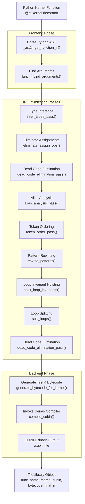
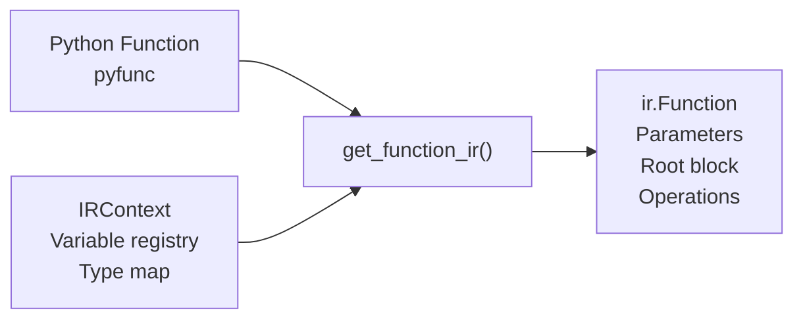
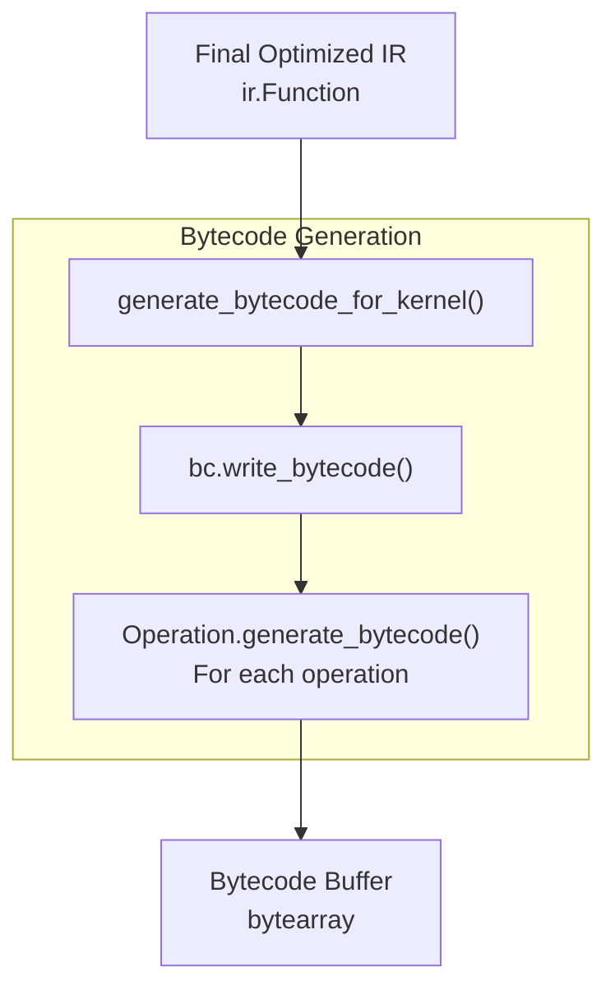
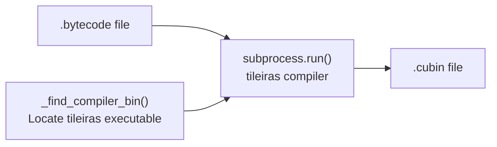
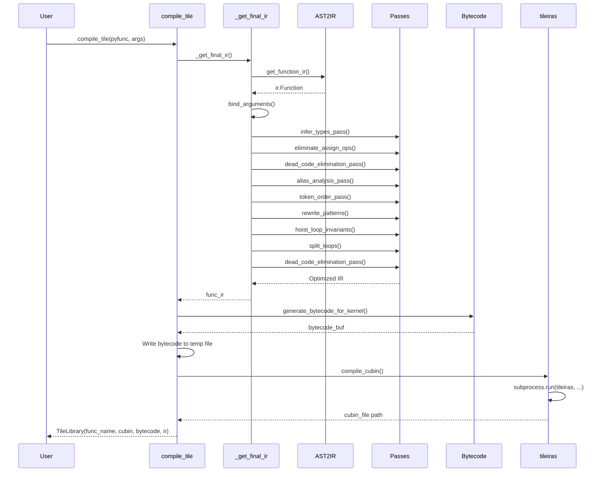

<!-- source: DeepWiki mcp.deepwiki.com · repo NVIDIA/cutile-python · page 4.1 Compilation Pipeline · fetched 2026-10-26 -->

# Compilation Pipeline

<details>
<summary>Relevant source files</summary>

The following files were used as context for generating this wiki page:

- [src/cuda/tile/_compile.py](src/cuda/tile/_compile.py)
- [src/cuda/tile/_ir/ops.py](src/cuda/tile/_ir/ops.py)
- [src/cuda/tile/_passes/eliminate_assign_ops.py](src/cuda/tile/_passes/eliminate_assign_ops.py)
- [test/test_cat.py](test/test_cat.py)
- [test/test_fma.py](test/test_fma.py)

</details>


## Purpose and Scope

This page describes the end-to-end compilation pipeline that transforms Python kernel functions into executable GPU binaries. The pipeline consists of three major phases: converting Python AST to an intermediate representation (IR), applying optimization passes to the IR, and generating bytecode that is compiled to CUBIN format by the `tileiras` compiler.

For details about the IR structure itself, see [Intermediate Representation](#4.2). For an in-depth explanation of the type inference algorithm, see [Type Inference Pass](#4.3). For debugging and error handling mechanisms, see [Error Handling and Debugging](#4.4).

**Sources**: [src/cuda/tile/_compile.py:1-376]()

---

## Pipeline Overview

The compilation pipeline is orchestrated by the `compile_tile()` function in [src/cuda/tile/_compile.py:147-215](). The process can be divided into three main phases:

### High-Level Compilation Flow



**Sources**: [src/cuda/tile/_compile.py:74-94](), [src/cuda/tile/_compile.py:147-215]()

---

## Frontend: Python to IR

The frontend phase converts Python kernel source code into the cuTile IR. This process is handled by the `_get_final_ir()` function.

### Step 1: AST Parsing and IR Construction

The `get_function_ir()` function in the `_ast2ir` module parses the Python AST and constructs an initial IR representation:



The IR context (`IRContext`) maintains:
- Variable registry mapping names to `Var` objects
- Type mappings for variables
- Constant value mappings
- Range information for loop induction variables

**Sources**: [src/cuda/tile/_compile.py:75-76]()

### Step 2: Argument Binding

The `bind_arguments()` method creates IR variables for function parameters and binds actual argument values:

```python
ir_args = func_ir.bind_arguments(args, get_constant_annotations(pyfunc))
```

This step:
1. Extracts `Constant[T]` type hints from the function signature
2. Converts Python values to IR types using `typeof_pyval()`
3. Creates parameter variables in the IR
4. Embeds constant arguments directly into the IR

**Sources**: [src/cuda/tile/_compile.py:77](), [src/cuda/tile/_const_utils.py]()

---

## IR Optimization Passes

After the initial IR is constructed, a series of optimization passes transform and refine it. The passes are applied in a specific order to maximize optimization opportunities.

### Pass Execution Order

| Pass Name | Function | Purpose |
|-----------|----------|---------|
| Type Inference | `infer_types_pass()` | Infers types for all variables, propagates constants, flattens control flow |
| Eliminate Assignments | `eliminate_assign_ops()` | Removes redundant assignment operations |
| Dead Code Elimination | `dead_code_elimination_pass()` | Removes unused operations (first pass) |
| Alias Analysis | `alias_analysis_pass()` | Analyzes memory dependencies |
| Token Ordering | `token_order_pass()` | Orders memory operations for correct synchronization |
| Pattern Rewriting | `rewrite_patterns()` | Applies pattern-based optimizations |
| Loop Invariant Hoisting | `hoist_loop_invariants()` | Moves loop-invariant code outside loops |
| Loop Splitting | `split_loops()` | Splits loops for better optimization |
| Dead Code Elimination | `dead_code_elimination_pass()` | Removes unused operations (second pass) |

**Sources**: [src/cuda/tile/_compile.py:78-93]()

### Type Inference Pass

The type inference pass is the most complex optimization stage. It performs multiple tasks:

1. **Type Propagation**: Assigns types to all variables by analyzing operations
2. **Constant Folding**: Evaluates constant expressions at compile time
3. **Control Flow Flattening**: Simplifies control flow when conditions are constant

Every operation implements its own `infer_type()` method that defines how types flow through it. See [Type Inference Pass](#4.3) for detailed information.

**Sources**: [src/cuda/tile/_compile.py:78](), [src/cuda/tile/_passes/typeinfer.py]()

### Assignment Elimination

The `eliminate_assign_ops()` pass removes intermediate assignment operations by directly substituting variable references. This simplification makes subsequent passes more effective.

**Code Reference**: [src/cuda/tile/_passes/eliminate_assign_ops.py:9-26]()

### Token Ordering Pass

The token ordering pass is crucial for correctness. It ensures that memory operations are properly synchronized by inserting token dependencies. This pass is skipped in testing when `CUDA_TILE_TESTING_DISABLE_TOKEN_ORDER` is set.

```python
if not CUDA_TILE_TESTING_DISABLE_TOKEN_ORDER:
    alias_result = alias_analysis_pass(func_ir)
    token_order_pass(func_ir, alias_result)
```

**Sources**: [src/cuda/tile/_compile.py:82-84]()

### Loop Optimization Passes

Two passes optimize loop structures:

1. **Loop Invariant Hoisting**: Moves computations that don't change inside loops to outside the loop body
2. **Loop Splitting**: Divides loops into smaller sections for better optimization opportunities

Note that loop invariant hoisting must run *after* token ordering to avoid incorrectly moving memory operations.

**Sources**: [src/cuda/tile/_compile.py:88-92]()

---

## Backend: Bytecode Generation and Compilation

The backend phase generates TileIR bytecode and invokes the `tileiras` compiler to produce GPU binaries.

### Bytecode Generation

The `generate_bytecode_for_kernel()` function traverses the optimized IR and emits TileIR bytecode:



Each IR operation implements a `generate_bytecode()` method that emits the corresponding TileIR instructions. The bytecode context (`BytecodeContext`) manages:
- Type table for type serialization
- Value mappings for variables
- Builder for emitting instructions

**Sources**: [src/cuda/tile/_compile.py:161-166](), [src/cuda/tile/_ir2bytecode.py]()

### TileIR Bytecode Format

The bytecode is written to a buffer using the `bc.write_bytecode()` context manager:

```python
bytecode_buf = bytearray()
with bc.write_bytecode(num_functions=1, buf=bytecode_buf) as writer:
    bytecode_generator(writer, anonymize_debug_attr=False)
```

The bytecode can optionally be dumped to disk when `CUDA_TILE_DUMP_BYTECODE` is set.

**Sources**: [src/cuda/tile/_compile.py:164-179]()

### Invoking the tileiras Compiler

The `compile_cubin()` function invokes the `tileiras` compiler to transform bytecode into CUBIN:



The compilation command includes:
- GPU architecture flag: `--gpu-name sm_XX`
- Optimization level: `-OX`
- Line information: `--lineinfo`

**Sources**: [src/cuda/tile/_compile.py:334-375]()

### Compiler Discovery

The system searches for the `tileiras` compiler in the following order:

1. Package-local dependencies: `cuda/tile/_deps/bin/`
2. System `PATH` environment variable
3. `CUDA_HOME/bin` or `CUDA_PATH/bin` (platform-dependent)
4. Default CUDA Toolkit installation paths

If the compiler is not found, a `FileNotFoundError` is raised.

**Sources**: [src/cuda/tile/_compile.py:246-283]()

---

## Compilation Context and Options

### CompilerOptions

The `CompilerOptions` class configures the compilation process:

```python
@dataclass
class CompilerOptions:
    opt_level: int  # Optimization level (0-3)
    # ... other fields
```

Options can be specialized for specific target architectures using `specialize_for_target()`.

**Sources**: [src/cuda/tile/_compile.py:341](), [src/cuda/tile/_compiler_options.py]()

### TileContext

The `TileContext` object provides runtime configuration:
- `config.log_keys`: Controls logging output (e.g., `'CUTILEIR'`, `'TILEIR'`)
- `config.temp_dir`: Directory for temporary files
- `config.compiler_timeout_sec`: Timeout for compiler invocation
- `config.enable_crash_dump`: Whether to generate crash dumps on errors

**Sources**: [src/cuda/tile/_compile.py:151-170]()

### Logging and Debugging Output

The pipeline supports multiple debugging outputs:

| Environment Variable | Output |
|---------------------|--------|
| Context `log_keys` includes `'CUTILEIR'` | Prints optimized IR to stderr |
| Context `log_keys` includes `'TILEIR'` | Prints TileIR MLIR module to stderr |
| `CUDA_TILE_DUMP_BYTECODE` | Writes bytecode to specified directory |
| `CUDA_TILE_DUMP_TILEIR` | Writes MLIR text to specified directory |

**Sources**: [src/cuda/tile/_compile.py:154-197]()

---

## Compilation Output

### TileLibrary Result

The compilation pipeline returns a `TileLibrary` object containing:

```python
class TileLibrary:
    func_name: str           # Qualified kernel name
    fname_cubin: str         # Path to CUBIN file
    bytecode: bytes          # TileIR bytecode
    final_ir: ir.Function    # Final optimized IR
```

This object is used by the kernel launch system to execute the compiled kernel on the GPU.

**Sources**: [src/cuda/tile/_compile.py:54-59](), [src/cuda/tile/_compile.py:215]()

### CompileCallback Adapter

The `CompileCallback` class adapts the `compile_tile()` function for use with the kernel dispatcher:

```python
@dataclass
class CompileCallback:
    pyfunc: Callable
    compiler_options: CompilerOptions
    
    def __call__(self, pyfunc_args, tile_context):
        lib = compile_tile(self.pyfunc, pyfunc_args, 
                          self.compiler_options, tile_context)
        return str(lib.fname_cubin), lib.func_name
```

**Sources**: [src/cuda/tile/_compile.py:219-226]()

---

## Thread Safety and Caching

### Global Compiler Lock

All compilation operations are protected by a global lock to ensure thread safety:

```python
_compiler_lock = threading.RLock()

@global_compiler_lock
def compile_tile(...):
    # compilation logic
```

This prevents race conditions when multiple threads attempt to compile kernels simultaneously.

**Sources**: [src/cuda/tile/_compile.py:63-71](), [src/cuda/tile/_compile.py:147]()

### Architecture Detection

The target GPU architecture is detected at runtime and cached:

```python
@cache
def get_sm_arch() -> str:
    major, minor = get_compute_capability()
    return f'sm_{major}{minor}'
```

**Sources**: [src/cuda/tile/_compile.py:328-331]()

---

## Error Handling and Crash Dumps

When compilation fails, the system can generate a crash dump containing:
- Error message and stack trace
- Compiler flags and version information
- Anonymized bytecode
- CuTile IR representation
- Debug information

Crash dumps are enabled when `context.config.enable_crash_dump` is `True`. The dump is written as a ZIP file with timestamp: `crash_dump_{func_name}_{timestamp}.zip`

**Sources**: [src/cuda/tile/_compile.py:115-145](), [src/cuda/tile/_compile.py:208-213]()

---

## Complete Compilation Sequence



**Sources**: [src/cuda/tile/_compile.py:74-215]()

---

