<!-- source: DeepWiki mcp.deepwiki.com · repo NVIDIA/cutile-python · page 4.2 Intermediate Representation · fetched 2026-10-26 -->

# Intermediate Representation

<details>
<summary>Relevant source files</summary>

The following files were used as context for generating this wiki page:

- [src/cuda/tile/_ir/ir.py](src/cuda/tile/_ir/ir.py)
- [src/cuda/tile/_ir/ops.py](src/cuda/tile/_ir/ops.py)
- [src/cuda/tile/_ir/typing_support.py](src/cuda/tile/_ir/typing_support.py)
- [src/cuda/tile/_passes/typeinfer.py](src/cuda/tile/_passes/typeinfer.py)
- [test/test_cat.py](test/test_cat.py)
- [test/test_typeinfer.py](test/test_typeinfer.py)

</details>


The Intermediate Representation (IR) is the core data structure used throughout the cuda.tile compilation pipeline. It provides a typed, Static Single Assignment (SSA)-like representation of the kernel code that sits between the Python AST and the final TileIR bytecode. The IR enables multiple transformation passes including type inference, constant propagation, control flow flattening, and optimization.

For information about how Python code is converted to IR, see [Compilation Pipeline](#4.1). For details on the type inference pass that operates on this IR, see [Type Inference Pass](#4.3). For bytecode generation from IR, see [Bytecode Generation](#7.4).

## Core Data Structures

The IR system is built around five primary data structures that work together to represent a compiled kernel:

### IRContext

`IRContext` is the central registry that manages all state for an IR function. It maintains:

- **Variable registry** (`_all_vars`): Tracks all variable names and ensures uniqueness
- **Type map** (`typemap`): Maps variable names to their inferred types
- **Constants map** (`constants`): Stores compile-time constant values
- **Loose type map** (`_loose_typemap`): Tracks loosely-typed scalar representations
- **Range information** (`range_infos`): Stores metadata about range iterators

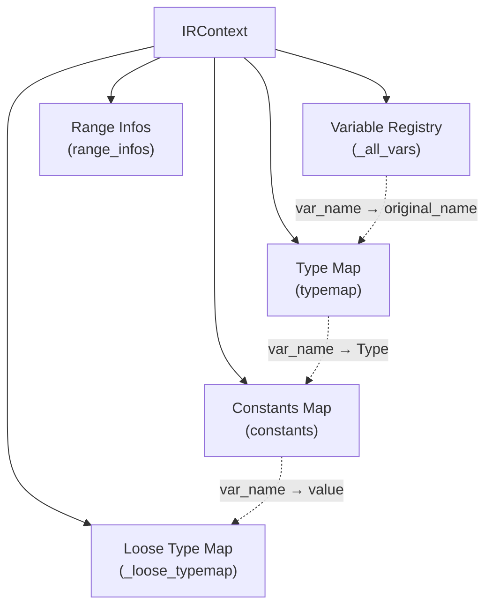

**IRContext Responsibilities**

The `IRContext` provides methods for variable creation and management:
- `make_var(name, loc)`: Creates a unique variable name based on a given name [src/cuda/tile/_ir/ir.py:51-56]()
- `make_temp(loc)`: Creates a temporary variable with an auto-generated name [src/cuda/tile/_ir/ir.py:61-62]()
- `get_original_name(var_name)`: Retrieves the original name before uniquification [src/cuda/tile/_ir/ir.py:64-65]()
- `copy_type_information(src, dst)`: Copies type, constant, and range information between variables [src/cuda/tile/_ir/ir.py:67-76]()

**Sources:** [src/cuda/tile/_ir/ir.py:40-76]()

### Var

`Var` represents a variable in the IR, serving as a typed reference with location information. Each `Var` is immutable once created and uniquely identified by its name within an `IRContext`.

**Variable Properties:**
- `name`: Unique string identifier within the context
- `loc`: Source location (`Loc`) for error reporting
- `ctx`: Back-reference to the owning `IRContext`
- `_undefined`: Flag indicating if this represents an undefined value

**Type and Constant Information:**

Variables store and retrieve type information through their context:
- `get_type()` / `set_type(ty)`: Access strictly-typed information [src/cuda/tile/_ir/ir.py:88-99]()
- `get_loose_type()` / `set_loose_type(ty)`: Access loosely-typed scalar representations [src/cuda/tile/_ir/ir.py:111-118]()
- `is_constant()` / `get_constant()` / `set_constant(value)`: Query and set constant values [src/cuda/tile/_ir/ir.py:101-109]()

**Sources:** [src/cuda/tile/_ir/ir.py:78-138]()

### Block

`Block` is an ordered container of operations that represents a sequence of instructions. Blocks are the basic unit of control flow nesting.

**Block Structure:**
- `ctx`: Reference to the `IRContext`
- `_operations`: Ordered list of `Operation` instances

**Operations Management:**

Blocks provide list-like access to their operations:
- `append(op)` / `extend(ops)`: Add operations [src/cuda/tile/_ir/ir.py:477-484]()
- `__getitem__`, `__setitem__`, `__delitem__`: Index-based access [src/cuda/tile/_ir/ir.py:489-499]()
- `detach_all()`: Remove and return all operations [src/cuda/tile/_ir/ir.py:506-510]()

The block automatically maintains parent pointers, ensuring each operation knows which block contains it.

**Sources:** [src/cuda/tile/_ir/ir.py:472-554]()

### Operation

`Operation` is the base class for all IR operations. It represents a single computation or side effect with typed operands and results.

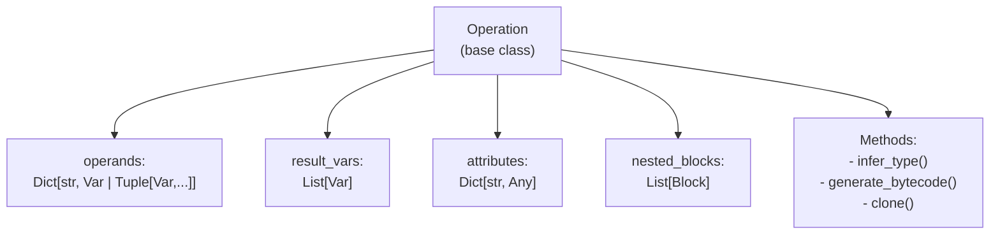

**Operation Components:**

1. **Operands** (`operands`): Dictionary mapping parameter names to `Var` instances or tuples of `Var` [src/cuda/tile/_ir/ir.py:316-318]()
2. **Result variables** (`result_vars`): List of `Var` instances produced by this operation [src/cuda/tile/_ir/ir.py:275]()
3. **Attributes** (`attributes`): Dictionary of compile-time constant metadata [src/cuda/tile/_ir/ir.py:276]()
4. **Nested blocks** (`nested_blocks`): List of `Block` instances for control flow operations [src/cuda/tile/_ir/ir.py:277]()
5. **Location** (`loc`): Source location for error reporting [src/cuda/tile/_ir/ir.py:278]()

**Key Methods:**

- `infer_type(typing_context)`: Computes result types during type inference pass [src/cuda/tile/_ir/ir.py:364-365]()
- `generate_bytecode(ctx)`: Emits bytecode instructions [src/cuda/tile/_ir/ir.py:367-368]()
- `clone(mapper)`: Creates a deep copy with variable remapping [src/cuda/tile/_ir/ir.py:286-313]()

**Operation Markers:**

Operations can be decorated with special properties:
- `@terminator`: Marks operations that terminate a block (e.g., `Return`, `Break`) [src/cuda/tile/_ir/ir.py:143-145]()
- `@has_side_effects`: Marks operations with observable side effects [src/cuda/tile/_ir/ir.py:148-150]()

**Sources:** [src/cuda/tile/_ir/ir.py:262-441]()

### Function

`Function` is the top-level IR structure representing a kernel or helper function. It is immutable (using `@dataclass(frozen=True)`) and contains the complete IR for a callable.

**Function Components:**
- `qualname`: Fully qualified name of the function
- `root_block`: The top-level `Block` containing all operations
- `parameters`: Tuple of `Var` instances representing function parameters
- `return_value`: Optional `Var` for helper functions (kernels always return `None`)
- `loc`: Source location

**Argument Binding:**

The `bind_arguments(args, constant_args)` method converts Python values to typed `Argument` instances:
1. Determines which arguments are constants (from `constant_args` set)
2. Infers types using `typeof_pyval()`
3. Extracts constant values for compile-time specialization
4. Creates `Argument` instances with type and constant information

**Sources:** [src/cuda/tile/_ir/ir.py:556-616](), [src/cuda/tile/_ir/ir.py:619-654]()

## Operation Hierarchy

The IR defines three main operation categories that serve different roles in the compilation pipeline:

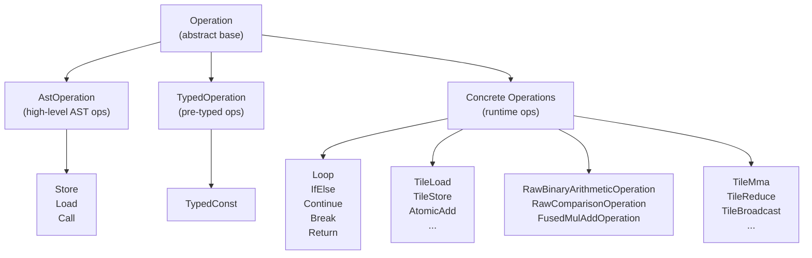

### AstOperation

`AstOperation` represents high-level operations directly from Python AST parsing. These operations are replaced during type inference with more specific operations.

**Key AST Operations:**
- **Store**: Assigns a value to a variable name [src/cuda/tile/_ir/ops.py:73-83]()
- **Load**: Reads a variable by name [src/cuda/tile/_ir/ops.py:86-95]()
- **Call**: Invokes a function or method [src/cuda/tile/_ir/ops.py:98-123]()
- **Const**: Represents a Python constant (replaced with `TypedConst` during inference) [src/cuda/tile/_ir/ops.py:571-588]()

These operations do not implement `infer_type()` or `generate_bytecode()` because they are eliminated before those phases.

**Sources:** [src/cuda/tile/_ir/ir.py:443-463](), [src/cuda/tile/_ir/ops.py:73-125](), [src/cuda/tile/_ir/ops.py:571-588]()

### TypedOperation

`TypedOperation` marks operations that are created with type information already set. The type inference pass skips these operations.

**Example: TypedConst**

The `TypedConst` operation replaces `Const` during type inference:
```python
class TypedConst(TypedOperation):
    def __init__(self, value: Any, result_var: Var, loc: Loc):
        super().__init__("typed_const", operands={}, result_vars=[result_var],
                         attributes={"value": value}, loc=loc)
```

It directly generates bytecode without further type inference [src/cuda/tile/_ir/ops.py:591-605]().

**Sources:** [src/cuda/tile/_ir/ir.py:465-470](), [src/cuda/tile/_ir/ops.py:591-625]()

### Concrete Operations by Category

The IR defines numerous concrete operation types, organized by function:

**Control Flow Operations:**

| Operation | Purpose | Terminator |
|-----------|---------|------------|
| `Loop` | For/while loop with carried variables | No |
| `IfElse` | Conditional branching | No |
| `Continue` | Continue to next loop iteration | Yes |
| `Break` | Exit loop early | Yes |
| `EndBranch` | Yield values from if/else branch | Yes |
| `Return` | Return from function | Yes |

All control flow operations contain nested `Block` instances and manage variable flow through control flow boundaries [src/cuda/tile/_ir/ops.py:128-556]().

**Memory Operations:**

Memory operations handle data movement between arrays and tiles:
- `TileLoad` / `TileStore`: Load/store tiles from/to arrays [src/cuda/tile/_ir/ops.py:1277-1421]()
- `LoadPointer` / `StorePointer`: Scalar pointer operations [src/cuda/tile/_ir/ops.py:1423-1500]()
- Atomic operations: `AtomicAdd`, `AtomicMax`, `AtomicCAS`, etc. [src/cuda/tile/_ir/ops.py:2546-2748]()

**Arithmetic Operations:**

These operations implement element-wise computation:
- `RawBinaryArithmeticOperation`: Add, subtract, multiply, divide [src/cuda/tile/_ir/ops.py:901-960]()
- `RawComparisonOperation`: Equality, less-than, etc. [src/cuda/tile/_ir/ops.py:654-672]()
- `RawBinaryBitwiseOperation`: AND, OR, XOR [src/cuda/tile/_ir/ops.py:767-788]()
- `FusedMulAddOperation`: Fused multiply-add (FMA) [src/cuda/tile/_ir/ops.py:628-651]()

**Tile Operations:**

Tile-specific operations for transformations and reductions:
- `TileMma`: Matrix multiply-accumulate [src/cuda/tile/_ir/ops.py:1756-1855]()
- `TileReduce`: Reductions (sum, max, min) [src/cuda/tile/_ir/ops.py:1921-2110]()
- `TileScan`: Prefix scans (cumsum) [src/cuda/tile/_ir/ops.py:2218-2297]()
- `TileReshape`, `TilePermute`, `TileBroadcast`: Shape manipulation [src/cuda/tile/_ir/ops.py:2299-2544]()

**Sources:** [src/cuda/tile/_ir/ops.py:128-3061]()

## Variable Management and SSA

The IR uses a Static Single Assignment (SSA)-like form where each variable is conceptually assigned exactly once. Variable uniquification and type tracking enable this model.

### Variable Naming and Uniquification

The `IRContext` ensures all variable names are unique using a counter-based system:

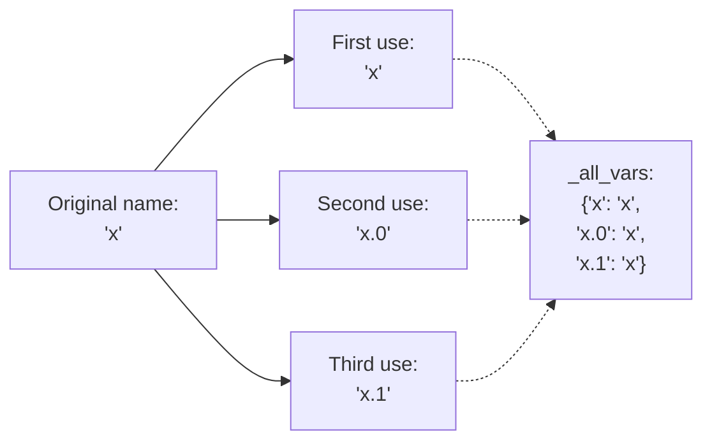

When creating a variable with `make_var(name, loc)`:
1. Check if `name` already exists in `_all_vars`
2. If it does, append `.N` where N is from a per-name counter
3. Store the mapping from unique name to original name
4. Return a new `Var` with the unique name

This allows multiple assignments to the same Python variable to be represented as distinct SSA variables.

**Sources:** [src/cuda/tile/_ir/ir.py:51-56]()

### Type Information Flow

Type information flows through the IR in multiple stages:

**Stage 1: Type Inference**

The type inference pass (`infer_types_in_func`) walks the IR and calls `infer_type()` on each operation [src/cuda/tile/_passes/typeinfer.py:329-359]():

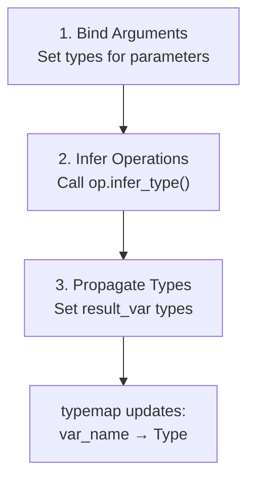

**Stage 2: Constant Propagation**

During type inference, operations can propagate constant values:
- If all operands are constant, compute the result at compile time
- Store the result in `IRContext.constants`
- Enable constant folding and optimization

For example, `2 + 3` with constant operands becomes a `TypedConst` with value `5`.

**Stage 3: Type Queries**

After type inference, any code can query types via `Var.get_type()`, which looks up in `IRContext.typemap`.

**Sources:** [src/cuda/tile/_passes/typeinfer.py:127-139](), [src/cuda/tile/_passes/typeinfer.py:329-359]()

### Loose Types and Type Promotion

The IR maintains two parallel type systems:

1. **Strict types** (`typemap`): The actual runtime type (e.g., `int32`, `float32`)
2. **Loose types** (`_loose_typemap`): Represent infinite-precision constants for type promotion

For example, the Python integer literal `42` has:
- Strict type: `int32` (default integer type)
- Loose type: `LooselyTypedScalar(42)` (infinite precision)

This enables operations like `int32_var + 42` to avoid unnecessary type errors while still catching genuine mismatches.

**Sources:** [src/cuda/tile/_ir/type.py:243-258](), [src/cuda/tile/_ir/typing_support.py:208-214]()

## Control Flow Representation

Control flow in the IR is represented using nested blocks and special carried variable mechanisms for maintaining SSA properties across control flow edges.

### Loop Representation

The `Loop` operation represents both `for` and `while` loops using a single IR construct:

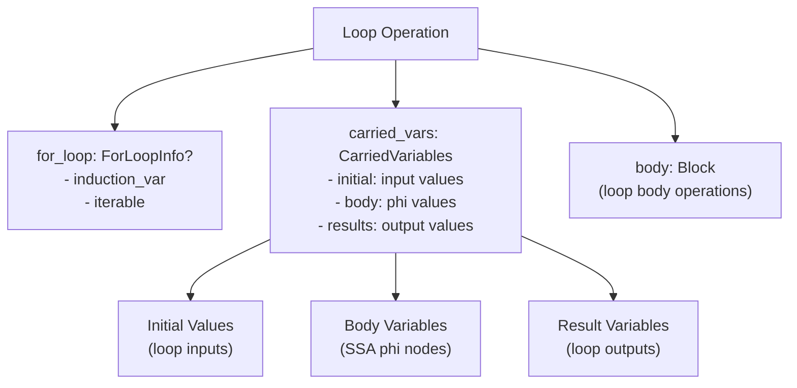

**Carried Variables:**

The `CarriedVariables` structure implements phi nodes for SSA:
- `initial`: Variables holding values before the loop
- `body`: Variables representing the phi nodes at loop start (same values as `initial` on first iteration)
- `results`: Variables holding values after the loop exits

Each iteration of the loop:
1. Reads from `body` variables
2. Computes new values
3. Passes them via `Continue` operation
4. They become the new `body` values for the next iteration

**For Loop Specifics:**

When `for_loop` is set, the loop includes:
- `induction_var`: The loop counter variable
- `iterable`: A `Var` of type `RangeIterType` providing start, stop, step

**Sources:** [src/cuda/tile/_ir/ops.py:132-176](), [src/cuda/tile/_ir/ops.py:158-289]()

### IfElse Representation

The `IfElse` operation represents conditional branching with two blocks:

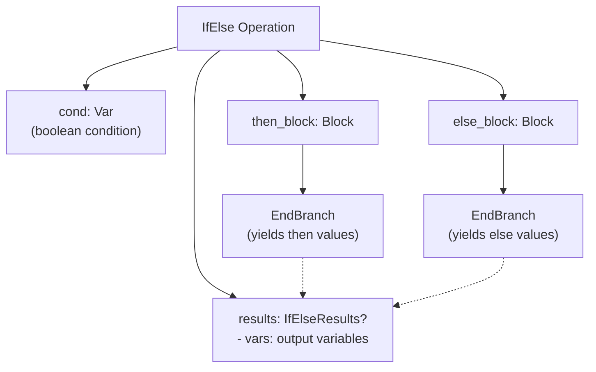

**Result Variables:**

If the if/else produces values, the `results` field contains:
- `names`: Original variable names
- `vars`: SSA variables to receive the phi-merged values

Each branch must end with an `EndBranch` operation that specifies which values to yield. The type inference pass ensures both branches yield compatible types.

**Constant Folding:**

If the condition is a compile-time constant, the type inference pass flattens the if/else by replacing it with the taken branch's operations [src/cuda/tile/_passes/typeinfer.py:141-159]().

**Sources:** [src/cuda/tile/_ir/ops.py:292-374]()

### Terminators

Terminator operations end a block and transfer control:

| Terminator | Usage | Operands |
|------------|-------|----------|
| `Continue` | Continue loop iteration | `next_vars`: values for next iteration |
| `Break` | Exit loop | `output_vars`: final loop values |
| `EndBranch` | End if/else branch | `outputs`: branch result values |
| `Return` | Return from function | `value`: return value (must be `None` for kernels) |

All terminators are marked with the `@terminator` decorator, and blocks are expected to end with exactly one terminator.

**Sources:** [src/cuda/tile/_ir/ops.py:378-556]()

## IR Construction with Builder

The `Builder` class provides a context manager for constructing IR operations in a controlled way.

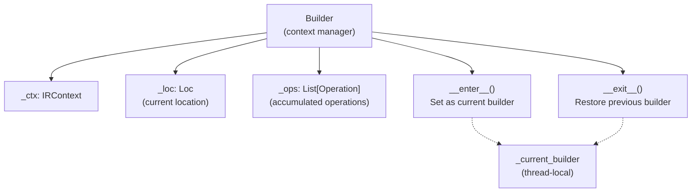

### Builder Usage Pattern

Code constructing IR operations uses the builder as a context manager:

```python
with ir.Builder(ctx, loc) as builder:
    # Operations created here are automatically added to builder._ops
    var1 = add_operation(SomeOp, result_type, ...)
    var2 = add_operation(AnotherOp, result_type, ...)
    
# Access accumulated operations
new_ops = builder.ops
```

The `add_operation()` helper:
1. Gets the current builder via `Builder.get_current()`
2. Creates a temporary result variable
3. Sets its type if provided
4. Creates the operation with the result variable
5. Appends the operation to the builder's list
6. Returns the result variable

**Sources:** [src/cuda/tile/_ir/ir.py:208-253](), [src/cuda/tile/_ir/ir.py:187-205]()

### Location Tracking

Builders track source locations for error reporting. The `change_loc()` context manager temporarily changes the location:

```python
with builder.change_loc(op.loc):
    # Operations created here use op.loc
    ...
# Location restored
```

This ensures all operations have accurate source locations even when inlined from other functions.

**Sources:** [src/cuda/tile/_ir/ir.py:232-239]()

## Cloning and Transformation

IR operations and blocks can be cloned to support inlining, loop unrolling, and other transformations. The `Mapper` class manages variable remapping during cloning.

### Mapper

The `Mapper` maintains mappings between old and new variables (and other objects) during cloning:

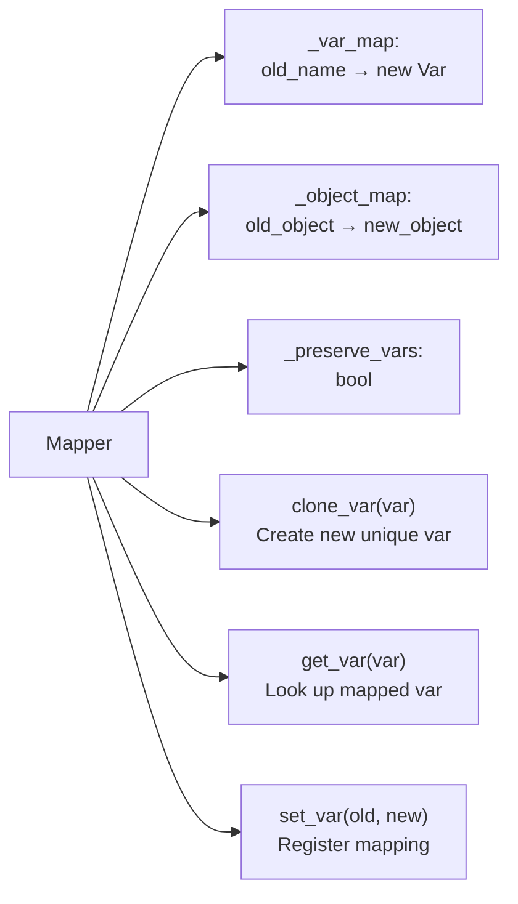

**Variable Remapping:**

When `_preserve_vars` is `False` (default):
- `clone_var(var)` creates a new unique variable via `IRContext.make_var_like()`
- Copies type information from the old variable to the new one
- Registers the mapping in `_var_map`

When `_preserve_vars` is `True`:
- `clone_var(var)` returns the original variable unchanged
- Used when replacing operations in-place without creating new variables

**Object Remapping:**

For non-variable objects (e.g., `CarriedVariables`, `IfElseResults`):
- `set_object(old, new)` registers a mapping
- `get_object(old)` retrieves the new object

**Sources:** [src/cuda/tile/_ir/ir.py:153-185]()

### Operation Cloning

The `Operation.clone(mapper)` method creates a deep copy with variable remapping:

**Cloning Process:**

1. Clone result variables via `mapper.clone_vars()`
2. Call `_clone_impl(mapper, result_vars)`:
   - Clone nested blocks recursively
   - Remap all operand variables via `mapper.get_var()`
   - Copy attributes
   - Create new operation instance
3. Handle special state (e.g., `Loop.carried_vars`, `IfElse.results`)

**Example: Loop Cloning**

The `Loop` operation overrides `clone()` to handle carried variables:
```python
def clone(self, mapper: Mapper) -> Operation:
    if self.carried_vars is not None:
        new_carried_vars = CarriedVariables(
            names=self.carried_vars.names,
            initial=tuple(mapper.get_var(v) for v in self.carried_vars.initial),
            body=mapper.clone_vars(self.carried_vars.body),
            results=mapper.clone_vars(self.carried_vars.results),
        )
        mapper.set_object(self.carried_vars, new_carried_vars)
    # ... continue cloning
```

This ensures carried variables are properly remapped in both the loop and its terminators (`Continue`, `Break`).

**Sources:** [src/cuda/tile/_ir/ir.py:286-313](), [src/cuda/tile/_ir/ops.py:180-202]()

### Block Cloning

Blocks are cloned by creating a new block and cloning all operations:

```python
new_block = Block(old_block.ctx)
for old_op in old_block:
    new_block.append(old_op.clone(mapper))
```

Nested blocks in operations are cloned as part of the operation's `_clone_impl()` method.

**Sources:** [src/cuda/tile/_ir/ir.py:291-297]()

## Type Information Storage

The IR stores type information at multiple levels to support type inference, constant propagation, and bytecode generation.

### Type Storage Architecture

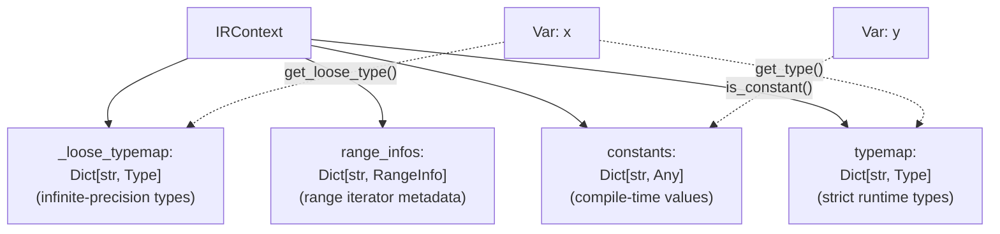

### Strict vs Loose Types

**Strict Types** (`typemap`): The actual runtime type used for code generation
- Example: `int32`, `Tile[float32, (16, 16)]`
- Set by type inference based on operations and arguments
- Used for bytecode generation

**Loose Types** (`_loose_typemap`): Extended type for compile-time constants
- Example: `LooselyTypedScalar(42)` for integer literals
- Represents infinite-precision constants
- Enables type promotion without errors
- Falls back to strict type if not set

**Example:**

```python
# Python code: x + 5
# Strict type of '5': int32 (default integer type)
# Loose type of '5': LooselyTypedScalar(5) (infinite precision)

# If x is int16:
#   5 is implicitly cast to int16 (from loose type)
# If x is int64:
#   5 is implicitly cast to int64 (from loose type)
```

**Sources:** [src/cuda/tile/_ir/ir.py:45-48](), [src/cuda/tile/_ir/ir.py:111-118](), [src/cuda/tile/_ir/type.py:243-258]()

### Constant Propagation

During type inference, constant values are tracked and propagated:

**Constant Storage:**

When an operation has all constant operands:
1. Compute the result at compile time
2. Store in `IRContext.constants[var.name]`
3. Create a `TypedConst` operation with the value

**Phi State Tracking:**

For control flow, the `TypingContext` tracks constant state through branches:
- `PhiState.UNSET`: No branches seen yet
- `PhiState.MAY_BE_CONSTANT`: All branches produce the same constant
- `PhiState.NONCONSTANT`: Branches produce different values or non-constants

**Example: If/Else Constants**

```python
if condition:
    x = 5
else:
    x = 5
# x is constant with value 5
```

```python
if condition:
    x = 5
else:
    x = 10
# x is nonconstant
```

**Sources:** [src/cuda/tile/_passes/typeinfer.py:27-105](), [src/cuda/tile/_ir/ops.py:694-703]()

### Range Information

For range iterators, the IR stores `RangeInfo` metadata:

```python
@dataclass
class RangeInfo:
    known_step: int  # The step value if known at compile time
```

This enables optimizations like loop unrolling when the step is constant.

**Sources:** [src/cuda/tile/_ir/ir.py:35-37]()

## Complete IR Structure Example

Here's how a simple kernel is represented in IR:

**Python Code:**
```python
@ct.kernel
def add_kernel(x, y, out):
    idx = ct.bid(0)
    tile_x = ct.load(x, idx, shape=(16,))
    tile_y = ct.load(y, idx, shape=(16,))
    result = tile_x + tile_y
    ct.store(out, idx, result)
```

**IR Representation (Simplified):**

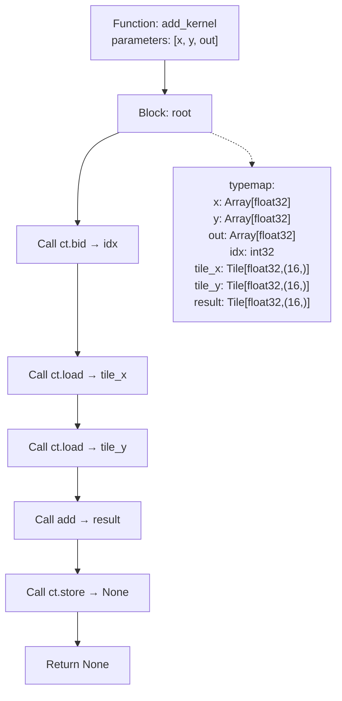

**Sources:** [src/cuda/tile/_ir/ir.py:556-616](), [src/cuda/tile/_passes/typeinfer.py:329-359]()

---

