<!-- source: DeepWiki mcp.deepwiki.com · repo NVIDIA/cutile-python · page 4.3 Type Inference Pass · fetched 2026-10-26 -->

# Type Inference Pass

<details>
<summary>Relevant source files</summary>

The following files were used as context for generating this wiki page:

- [src/cuda/tile/_ir/ir.py](src/cuda/tile/_ir/ir.py)
- [src/cuda/tile/_ir/ops.py](src/cuda/tile/_ir/ops.py)
- [src/cuda/tile/_ir/typing_support.py](src/cuda/tile/_ir/typing_support.py)
- [src/cuda/tile/_passes/typeinfer.py](src/cuda/tile/_passes/typeinfer.py)
- [test/test_cat.py](test/test_cat.py)
- [test/test_typeinfer.py](test/test_typeinfer.py)

</details>


The type inference pass is a critical compilation phase that determines the types of all variables in the Intermediate Representation (IR), validates type compatibility, propagates constant values, and performs IR transformations that simplify the code before bytecode generation. This pass bridges the gap between untyped Python AST operations and fully-typed IR operations ready for compilation.

For information about the IR structures that the type inference pass operates on, see [Intermediate Representation](#4.2). For details on compilation errors raised during type inference, see [Error Handling and Debugging](#4.4).

## Overview

The type inference pass performs multiple tasks in a single traversal of the IR:

1. **Type Inference**: Determines the concrete type of every variable by calling `infer_type()` on each operation
2. **Constant Propagation**: Tracks which variables have known constant values and propagates them through control flow
3. **IR Transformations**: Simplifies the IR by flattening constant conditionals, unrolling known loops, and inlining function calls
4. **Type Validation**: Ensures type compatibility for operations, implicit casts, and function arguments
5. **Constant Embedding**: Replaces constant parameters with their actual values to enable specialization

Sources: [src/cuda/tile/_passes/typeinfer.py:362-376]()

## Core Data Structures

### TypingContext Class

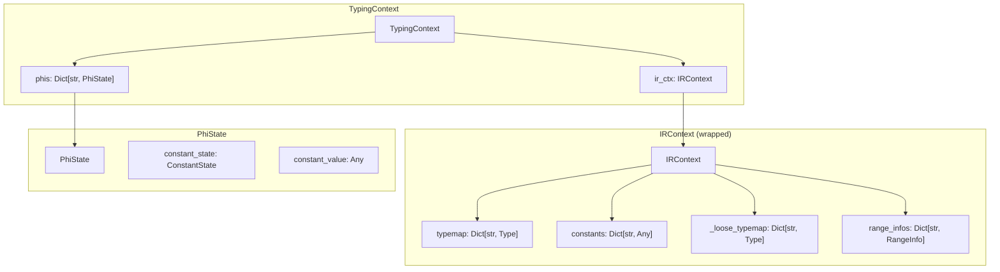

**TypingContext**

The `TypingContext` class wraps an `IRContext` and extends it with additional state needed for type inference, particularly for tracking phi nodes in control flow. It provides convenience methods for accessing type maps and constant values.

Key methods:
- `get_type(var)` / `set_type(var, type)` - Access variable types
- `get_constant(var)` / `set_constant(var, value)` - Access constant values
- `is_constant(var)` - Check if a variable has a known constant value
- `phi_propagate_constant(src, dst)` - Track constants through control flow branches
- `phi_finalize_constant(dst)` - Finalize constant value after all branches converge

Sources: [src/cuda/tile/_passes/typeinfer.py:49-105]()

### PhiState for Control Flow

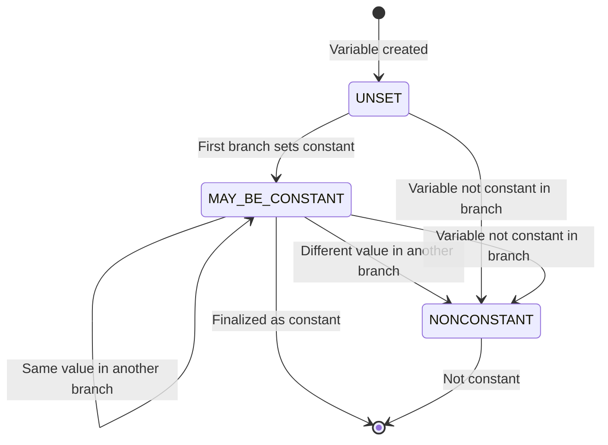

**PhiState Tracking**

Phi states track whether a variable that flows through multiple control flow paths (e.g., if/else branches, loop iterations) has a consistent constant value. The three states are:

- `UNSET`: No information yet
- `MAY_BE_CONSTANT`: Has the same constant value in all branches seen so far
- `NONCONSTANT`: Has different values in different branches, or is not constant in at least one branch

Sources: [src/cuda/tile/_passes/typeinfer.py:27-47]()

### Type Maps in IRContext

The `IRContext` maintains several mappings to track type information:

| Map Name | Type | Purpose |
|----------|------|---------|
| `typemap` | `Dict[str, Type]` | Concrete types of variables (e.g., `Tile[float32,(4,4)]`) |
| `constants` | `Dict[str, Any]` | Constant values known at compile time |
| `_loose_typemap` | `Dict[str, Type]` | Loosely typed scalars before materialization |
| `range_infos` | `Dict[str, RangeInfo]` | Step information for loop iteration variables |

Variables use these maps through accessor methods like `Var.get_type()`, `Var.set_type()`, `Var.is_constant()`, etc.

Sources: [src/cuda/tile/_ir/ir.py:40-76](), [src/cuda/tile/_ir/ir.py:78-138]()

## Type Inference Pipeline

### Entry Point: infer_types_pass

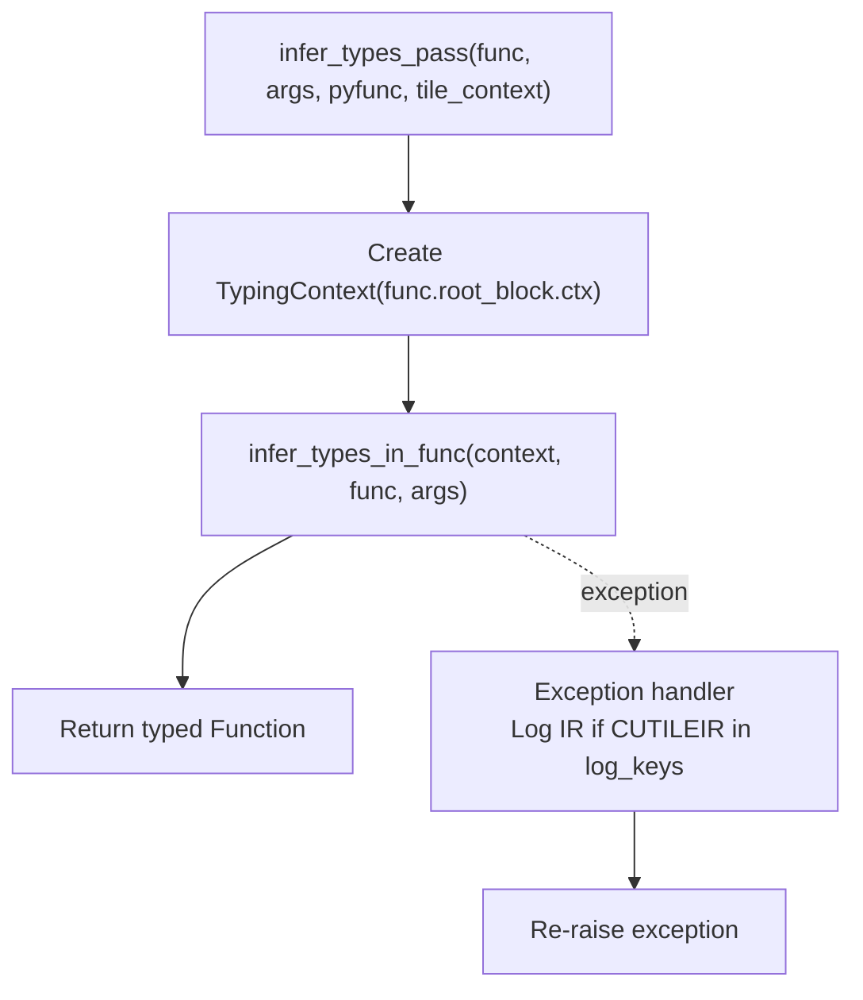

The `infer_types_pass()` function is the main entry point called by the compilation pipeline. It:

1. Creates a `TypingContext` wrapping the function's IR context
2. Calls `infer_types_in_func()` to process the function
3. Returns the updated function with type information
4. On error, optionally dumps the partial IR for debugging

Sources: [src/cuda/tile/_passes/typeinfer.py:362-376]()

### Function-Level: infer_types_in_func

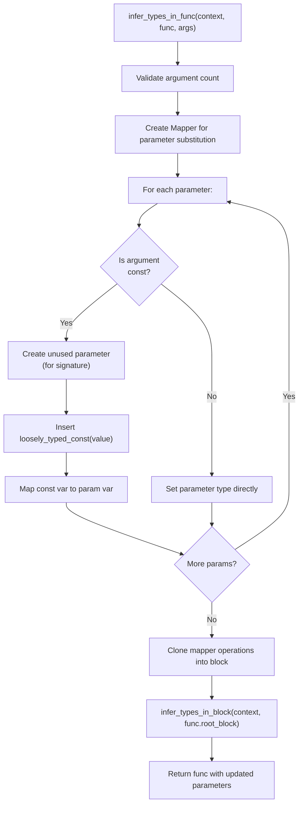

This function processes function parameters and initializes type information:

**Constant Parameters**: When an argument is marked as constant (via `ct.Constant` annotation):
1. Creates an unused parameter variable for the function signature
2. Inserts a `loosely_typed_const` operation with the constant value
3. Maps the constant to the parameter variable using a `Mapper`
4. This allows constant embedding while preserving function signature

**Regular Parameters**: Sets the type directly from the argument.

Sources: [src/cuda/tile/_passes/typeinfer.py:329-360]()

### Block-Level: infer_types_in_block

The `infer_types_in_block()` function iterates through operations in a block:

```python
def infer_types_in_block(context: TypingContext, block: Block) -> None:
    i = 0
    while i < len(block):
        op = block[i]
        if isinstance(op, TypedOperation):
            i += 1
            continue
        
        with op.loc:
            try:
                i += infer_types_for_op(context, block, i)
            except TileError:
                raise
            except Exception as e:
                raise TileInternalError(str(e)) from e
```

Key behaviors:
- Skips `TypedOperation` instances (already have types)
- Uses `with op.loc` to set location context for error reporting
- Calls `infer_types_for_op()` which returns the increment (0 if operation was replaced)

Sources: [src/cuda/tile/_passes/typeinfer.py:312-327]()

### Operation-Level: infer_types_for_op

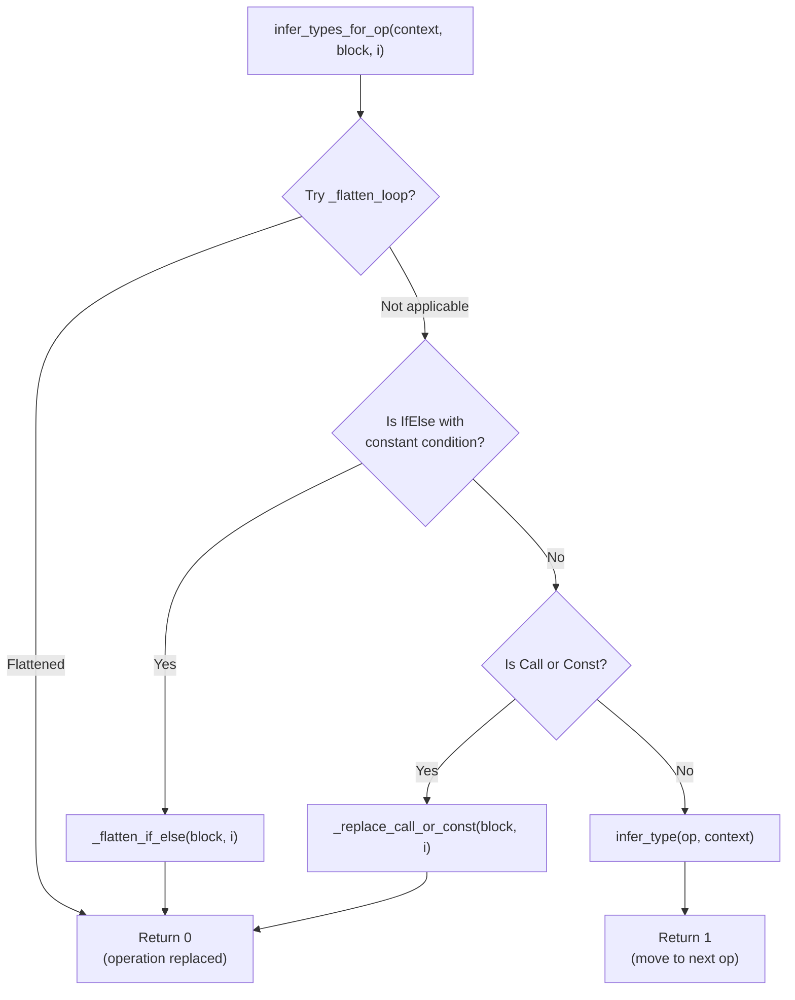

This function determines how to handle each operation:

1. **Loop Flattening**: If the loop is a trivial while loop that executes once, flatten it
2. **Constant If/Else**: If condition is constant, flatten to the taken branch
3. **Call/Const Replacement**: Inline function calls or replace constant operations
4. **Normal Type Inference**: Call the operation's `infer_type()` method

Returns 0 if the operation was replaced (restart at same index), or 1 to advance.

Sources: [src/cuda/tile/_passes/typeinfer.py:292-310]()

## IR Transformations

### Constant If/Else Flattening

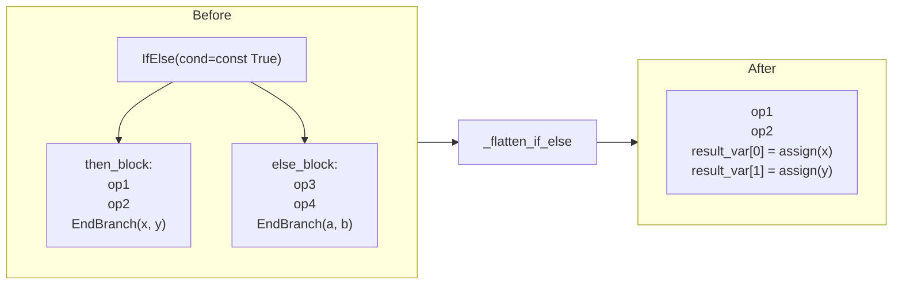

When an `IfElse` operation has a constant condition, the type inference pass replaces it with the operations from the taken branch. This eliminates dead code and simplifies control flow.

**Process**:
1. Determine which branch to take based on constant condition
2. Detach operations from the taken branch
3. Replace `EndBranch` operation with `assign` operations mapping outputs to result variables
4. Replace the `IfElse` operation with the branch's operations
5. If branch contains early terminator (`Break`, `Continue`), delete subsequent operations

Sources: [src/cuda/tile/_passes/typeinfer.py:141-160]()

### Loop Flattening

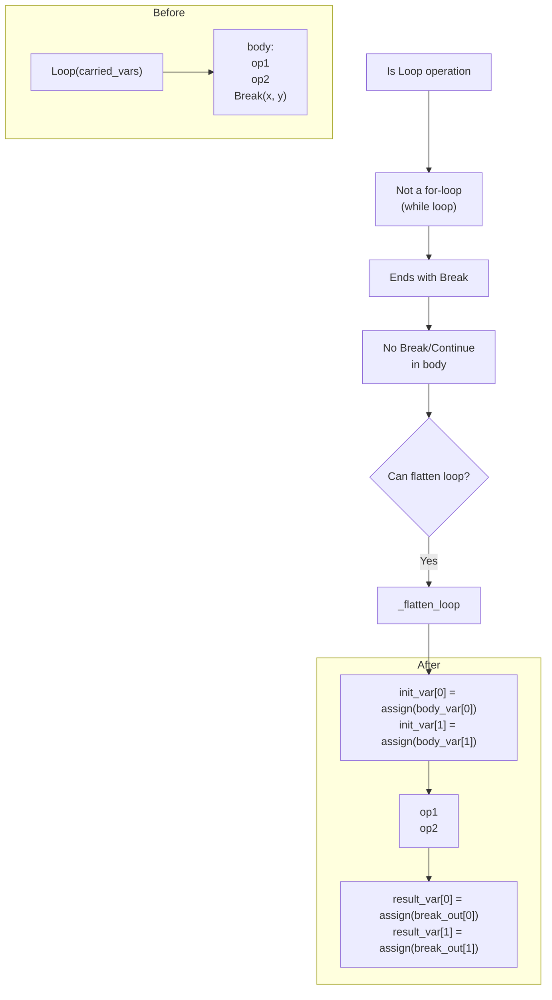

The type inference pass can flatten trivial while loops that execute exactly once. This optimization eliminates loop overhead for simple patterns.

**Conditions for flattening**:
- Must be a `Loop` operation (not marked as a for-loop)
- Body must end with an unconditional `Break`
- Body must not contain any other `Break` or `Continue` operations

Sources: [src/cuda/tile/_passes/typeinfer.py:162-195]()

### Function Call Inlining

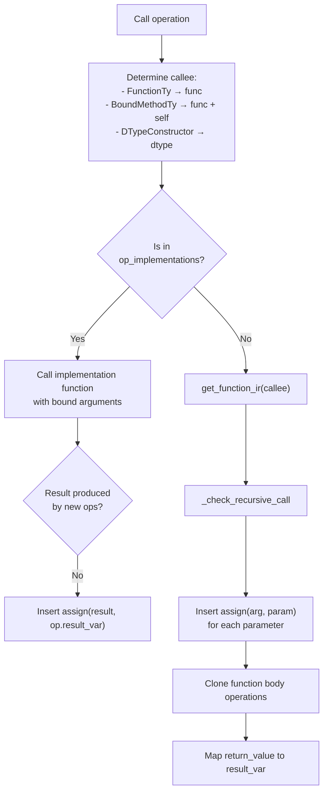

**Built-in Operation Implementations**: Operations in `op_implementations` (e.g., `ct.load`, `ct.store`, `ct.mma`) are implemented as Python functions that generate IR operations. The type inference pass:
1. Binds arguments to parameters
2. Calls the implementation function
3. Inserts generated operations into the IR
4. Maps the result to the call's result variable

**User-Defined Functions**: For functions not in `op_implementations`:
1. Checks for recursive calls (not supported)
2. Obtains the function's IR via `get_function_ir()`
3. Inserts `assign` operations to pass arguments to parameters
4. Clones the function body into the call site
5. Maps the return value to the call's result variable

This enables full function inlining, allowing the compiler to optimize across function boundaries.

Sources: [src/cuda/tile/_passes/typeinfer.py:224-290](), [src/cuda/tile/_passes/typeinfer.py:197-215](), [src/cuda/tile/_passes/typeinfer.py:217-222]()

## Type Promotion and Implicit Casting

### Type Promotion Rules

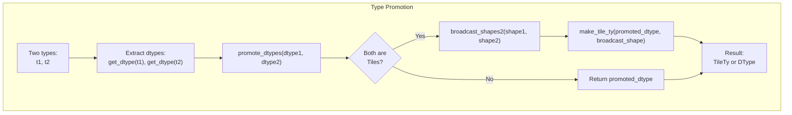

**Type promotion** determines the result type when combining two values of different types. The process:

1. Extract the dtype from each type (handles `TileTy`, `DType`, and `LooselyTypedScalar`)
2. Promote the dtypes using dtype promotion rules
3. If either input is a `Tile`, compute the broadcasted shape
4. Return either a `TileTy` or a scalar `DType`

**DType Promotion Categories**:

| Category | DTypes | Rank |
|----------|---------|------|
| Boolean | `bool_` | 0 |
| Integral | `int8`, `int16`, `int32`, `int64`, `uint8`, `uint16`, `uint32`, `uint64` | 1 |
| RestrictedFloat | `bfloat16`, `float16`, `float8_e4m3fn`, `float8_e5m2`, `tfloat32` | 2 |
| Float | `float32`, `float64` | 3 |

Promotion rules:
- Within same category: larger type wins
- Across categories: higher rank wins
- Special handling for loosely typed constants (see below)

Sources: [src/cuda/tile/_ir/ops_utils.py:261-296]()

### Loosely Typed Scalar Promotion

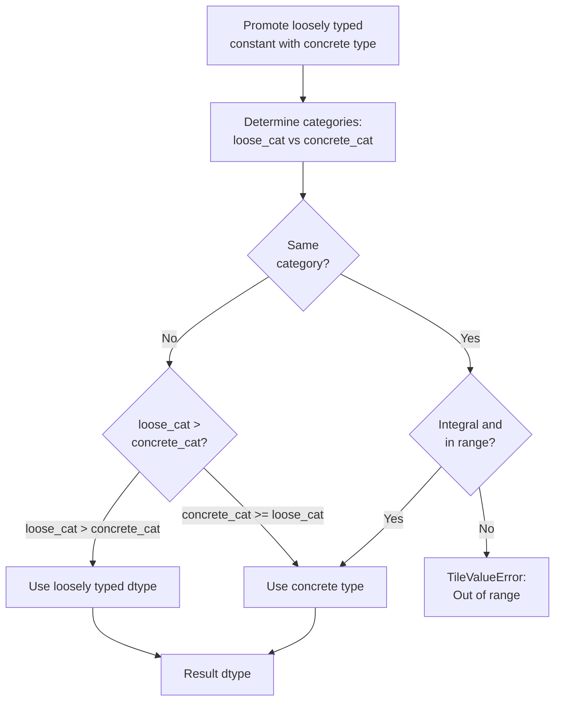

**Loosely typed scalars** are Python literal values (integers, floats, booleans) that haven't been assigned a concrete type yet. They represent "infinite precision" intermediate values in constant expressions.

Special promotion rules:
- **Same category**: Use the concrete type, but validate range for integers
  - Example: `5` + `int8(x)` → `int8` (if 5 fits in int8)
- **Different category**: Higher category wins
  - Example: `5.0` + `int32(x)` → `float64` (float > integral)
- **Force float mode**: Some operations force float promotion for integer constants
  - Example: Division promotes integer constants to float

This allows expressions like `x * 2` to work naturally without explicit type annotations, while preventing accidental overflow.

Sources: [src/cuda/tile/_ir/ops_utils.py:233-259](), [src/cuda/tile/_ir/type.py]() (LooselyTypedScalar definition)

### Implicit Cast Validation

Implicit casting is allowed when the source type can be promoted to the target type without data loss:

```python
def check_implicit_cast(src_ty, target_dtype):
    src_dtype = get_dtype(src_ty)
    if isinstance(src_ty, LooselyTypedScalar):
        # Special handling for loosely typed constants
        # Check category compatibility and range
    else:
        # Regular types: check if promotion yields target
        if promote_dtypes(src_dtype, target_dtype) != target_dtype:
            raise TileTypeError(...)
```

**Examples**:
- `int16` → `int32`: ✓ (widening integer conversion)
- `int32` → `int16`: ✗ (narrowing, potential data loss)
- `float32` → `float64`: ✓ (widening float conversion)
- `int32` → `float32`: ✗ (different category, requires explicit cast)
- `5` (loosely typed) → `int8`: ✓ (if 5 fits in int8 range)
- `300` (loosely typed) → `int8`: ✗ (out of range [-128, 127])

Sources: [src/cuda/tile/_ir/ops_utils.py:306-324]()

## Constant Propagation

### Constant Value Tracking

The type inference pass tracks constant values through the IR to enable:
- Compile-time evaluation of constant expressions
- Constant folding optimizations
- Validation of compile-time-required parameters (shapes, order, etc.)
- Constant embedding for specialization

**Constant Sources**:
1. **Python literals**: `5`, `3.14`, `True`, `None`, `"hello"`
2. **DType constructors**: `ct.float32`, `torch.int64`
3. **Constant parameters**: Function arguments marked with `ct.Constant` annotation
4. **Computed constants**: Results of operations on constants

**Extracting Constants**:

```python
def get_constant_value(val: Any) -> Any:
    # Primitives and special values
    if val is None or isinstance(val, (int, float, bool, ModuleType, 
                                       FunctionType, type, Enum)):
        return val
    # DType objects
    if is_dtype(val):
        return to_dtype(val)
    # Tuples (but not nested)
    if isinstance(val, tuple) and not any(isinstance(x, tuple) for x in val):
        return tuple(get_constant_value(x) for x in val)
    # Otherwise: error
    raise TileTypeError(...)
```

Sources: [src/cuda/tile/_ir/typing_support.py:217-228](), [src/cuda/tile/_ir/ir.py:101-109]()

### Phi State Propagation Through Control Flow

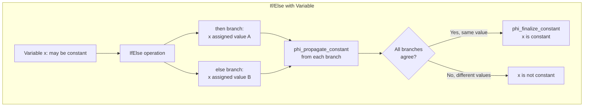

**Phi State Transitions**:

1. **First branch**: `UNSET` → `MAY_BE_CONSTANT(value_A)`
2. **Second branch with same value**: `MAY_BE_CONSTANT(value_A)` → `MAY_BE_CONSTANT(value_A)`
3. **Second branch with different value**: `MAY_BE_CONSTANT(value_A)` → `NONCONSTANT`
4. **Branch with non-constant**: any state → `NONCONSTANT`

After all branches are processed, if state is `MAY_BE_CONSTANT`, the variable is marked as constant.

**Example**:

```python
# Both branches assign same constant → constant
if condition:
    x = 5
else:
    x = 5
# x is constant with value 5

# Branches assign different values → not constant
if condition:
    x = 5
else:
    x = 10
# x is not constant

# One branch uses non-constant → not constant  
if condition:
    x = 5
else:
    x = some_variable
# x is not constant
```

Sources: [src/cuda/tile/_passes/typeinfer.py:94-105](), [src/cuda/tile/_passes/typeinfer.py:34-47]()

## Type Inference for Operations

### Operation Type Inference Contract

Each `Operation` subclass must implement:

```python
def infer_type(self, typing_context: TypingContext) -> TypeResult:
    # Examine operand types
    # Validate constraints
    # Compute and return result type(s)
    # May set result types directly or return them
```

Return value can be:
- A single `Type` for operations with one result
- A `List[Type]` for operations with multiple results
- Types are automatically assigned to `result_vars` by the framework

Sources: [src/cuda/tile/_ir/ir.py:364-366](), [src/cuda/tile/_passes/typeinfer.py:127-139]()

### Type Inference Example: Binary Operations

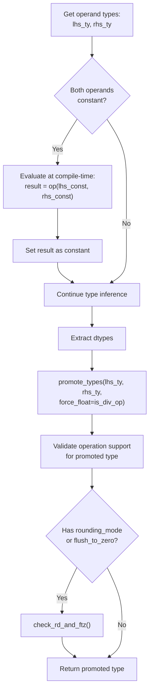

Binary arithmetic operations follow a standard type inference pattern:

1. **Constant evaluation**: If both operands are constant, evaluate at compile time
2. **Type promotion**: Determine the common type using promotion rules
3. **Validation**: Check operation is supported for the promoted type
4. **Rounding/FTZ**: Validate rounding mode and flush-to-zero flags if present
5. **Result**: Return the promoted type

Sources: [src/cuda/tile/_ir/ops_utils.py:137-163]() (validation), Binary operation implementations in op_impl.py

### Type Inference Example: Load Operation

```python
def infer_type(self, typing_context: TypingContext) -> Type:
    # 1. Validate array type
    array_ty = self.array.get_type()
    if not isinstance(array_ty, ArrayTy):
        raise TileTypeError(...)
    
    # 2. Get and validate shape constant
    shape_const = typing_context.get_constant(self.shape_var)
    validate_tile_shape(shape_const)
    
    # 3. Validate index rank matches array rank
    index_ty = self.index.get_type()
    if index_ty.rank != array_ty.rank:
        raise TileTypeError(...)
    
    # 4. Validate padding mode
    padding_mode = typing_context.get_constant(self.padding_mode_var)
    if padding_mode != PaddingMode.UNDETERMINED:
        validate_padding_mode(padding_mode, array_ty.dtype)
    
    # 5. Return TileTy with array's dtype and specified shape
    return TileTy(array_ty.dtype, tuple(shape_const))
```

Load operations demonstrate validation of multiple constraints:
- Array type compatibility
- Constant shape requirement
- Index rank validation
- Padding mode compatibility with dtype

Sources: Load operation implementation in [src/cuda/tile/_ir/op_impl.py]()

### Type Inference for Control Flow

**IfElse Operations**:
- Condition must be boolean or integer type
- Result types are unified across both branches
- Phi states track constant propagation through branches

**Loop Operations**:
- Carried variables must have compatible types across iterations
- For-loops validate iteration count is a constant integer
- Range variables get `RangeInfo` with step information

**Break/Continue/Return**:
- Break carries output values from loop
- Return sets the function's return value type
- These operations are terminators (mark end of basic block)

Sources: Control flow operation implementations in op_impl.py, [src/cuda/tile/_ir/ir.py:143-145]()

## Error Handling in Type Inference

### Common Type Errors

The type inference pass raises `TileTypeError` for various violations:

| Error Category | Example Message | Cause |
|----------------|-----------------|-------|
| Shape validation | "Expected shape length to be 2, got 3" | Index rank doesn't match array rank |
| Type mismatch | "cannot implicitly cast float32 to int32" | Incompatible types in assignment |
| Constant required | "Expected a constant integer tuple" | Non-constant value used where constant required |
| Invalid value | "Dimension #0 of shape (0, 4) is not positive" | Shape dimension is zero or negative |
| Unsupported operation | "Binary arithmetic op `add` does not support bool" | Operation not defined for type |
| Recursive call | "Recursive function call detected" | Function calls itself directly or indirectly |

### Error Location Tracking

Operations carry location information (`op.loc`) that traces back to the original Python source:

```python
# Using context manager for error location
with op.loc:
    try:
        i += infer_types_for_op(context, block, i)
    except TileError:
        raise  # Preserve original error
    except Exception as e:
        raise TileInternalError(str(e)) from e
```

When an error occurs, the exception includes the `Loc` which can print:
- Python source file and line number
- Call stack through inlined functions
- Specific operation in the IR

Sources: [src/cuda/tile/_passes/typeinfer.py:320-326](), [src/cuda/tile/_exception.py]() (Loc class)

### Debug Output

When type inference fails, setting `CUTILEIR` in log_keys causes the pass to dump the partial IR:

```python
if 'CUTILEIR' in tile_context.config.log_keys:
    highlight_loc = e.loc if hasattr(e, 'loc') else None
    code = (f"====Partial CuTile IR for {func}==== \n\n"
            f"{func.to_string(highlight_loc=highlight_loc)}\n\n")
    print(f'\n{code}', file=sys.stderr)
```

This shows:
- All operations processed so far
- Highlighted operation where error occurred (in red if terminal supports color)
- Variable types inferred up to the error point
- Which operations remain untyped

Sources: [src/cuda/tile/_passes/typeinfer.py:370-375]()

## Summary

The type inference pass is a multi-faceted transformation that:

1. **Infers types** for all variables by calling `infer_type()` on operations
2. **Propagates constants** through the IR, tracking values across control flow with phi states
3. **Transforms IR** by flattening constant conditionals, unrolling known loops, and inlining functions
4. **Validates types** including promotion rules, implicit casts, and operation support
5. **Enables specialization** by embedding constant parameter values

This pass converts the untyped AST-level IR into a fully-typed, simplified IR ready for optimization passes and bytecode generation.

Sources: [src/cuda/tile/_passes/typeinfer.py](), [src/cuda/tile/_ir/ir.py](), [src/cuda/tile/_ir/ops_utils.py](), [src/cuda/tile/_ir/typing_support.py]()

---

