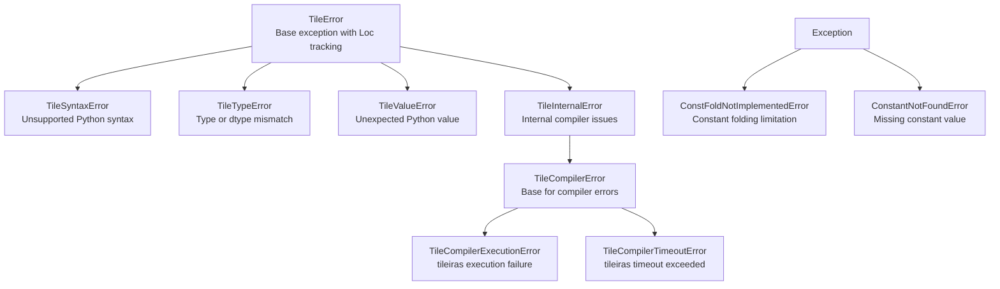
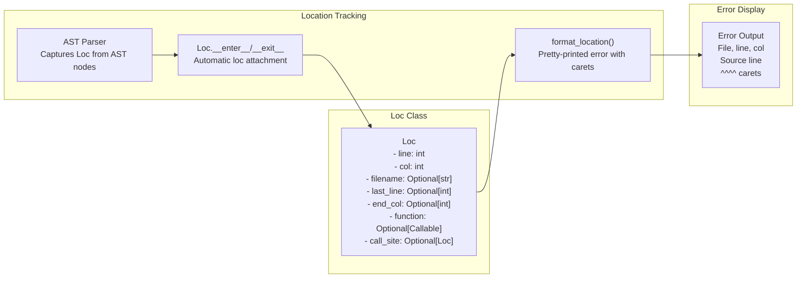
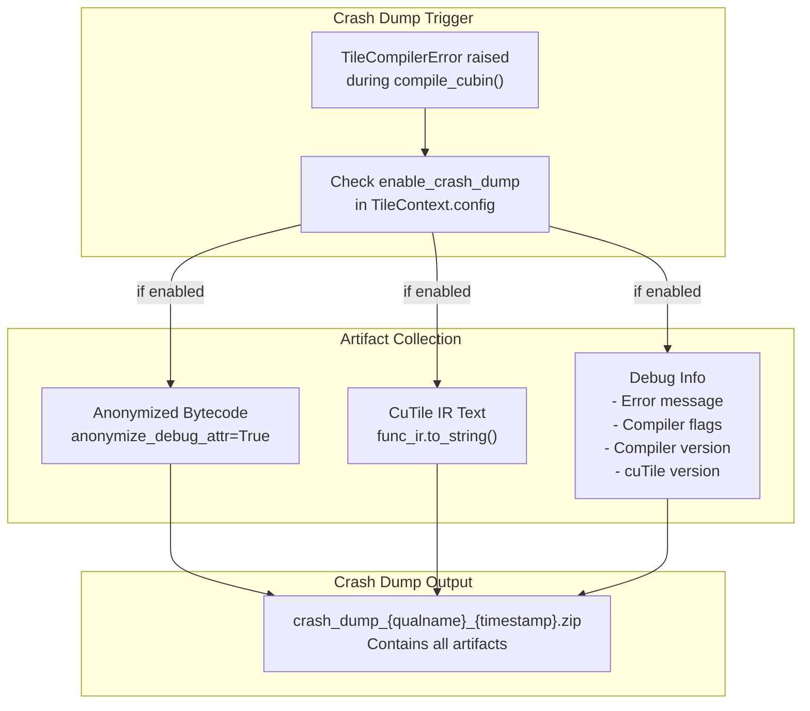
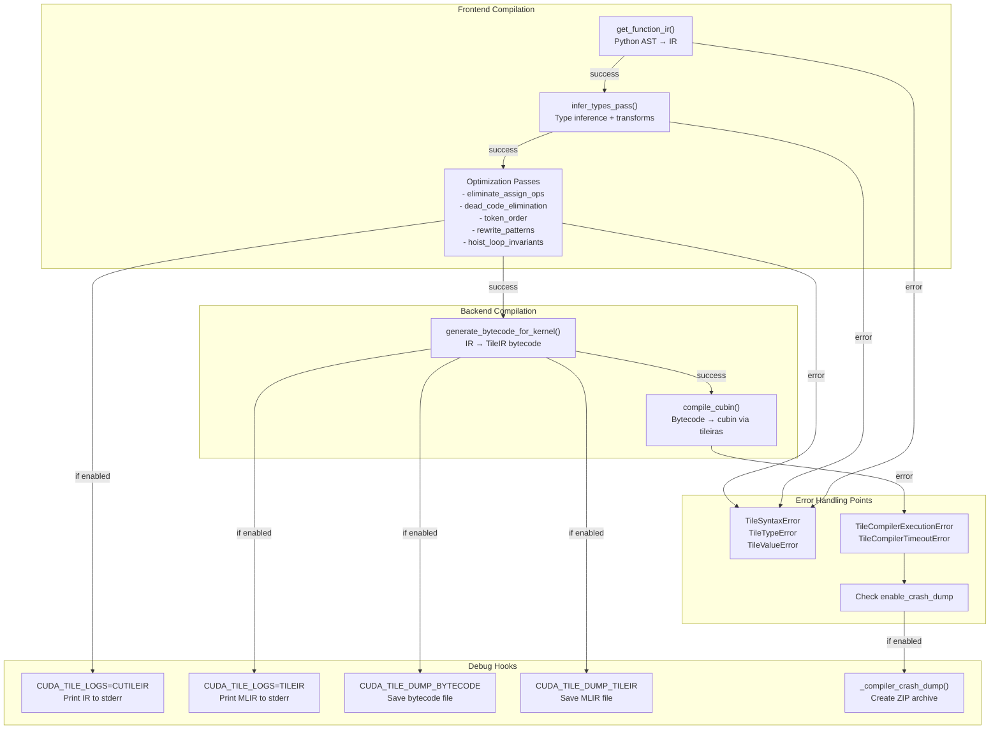
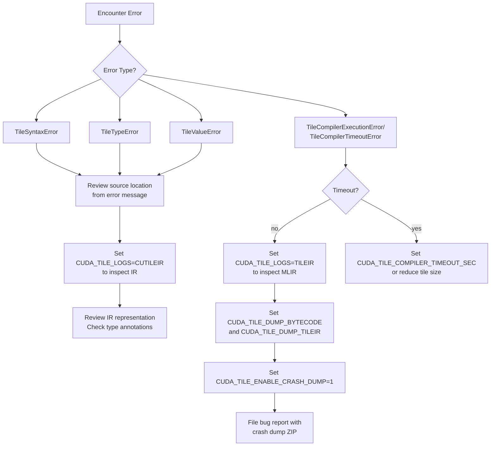

<!-- source: DeepWiki mcp.deepwiki.com · repo NVIDIA/cutile-python · page 4.4 Error Handling and Debugging · fetched 2026-10-26 -->

# Error Handling and Debugging

<details>
<summary>Relevant source files</summary>

The following files were used as context for generating this wiki page:

- [docs/source/debugging.rst](docs/source/debugging.rst)
- [docs/source/index.rst](docs/source/index.rst)
- [docs/source/release_notes.rst](docs/source/release_notes.rst)
- [src/cuda/tile/_compile.py](src/cuda/tile/_compile.py)
- [src/cuda/tile/_passes/eliminate_assign_ops.py](src/cuda/tile/_passes/eliminate_assign_ops.py)
- [test/test_fma.py](test/test_fma.py)

</details>


This page documents the error handling and debugging infrastructure in cuda.tile, including exception types, error location tracking, debugging environment variables, and crash dump generation. For information about testing and validation methods, see [Testing Infrastructure](#8.1). For advanced debugging techniques including bytecode inspection and MLIR dumps, see [Debugging Techniques](#8.2).

## Exception Hierarchy

cuda.tile defines a structured exception hierarchy that categorizes errors by their source and nature. All exceptions inherit from `TileError`, which provides location tracking and formatted error messages.



**Exception Categories**

| Exception Type | Purpose | When Raised |
|---------------|---------|-------------|
| `TileSyntaxError` | Unsupported Python syntax | Python constructs not supported by cuda.tile |
| `TileTypeError` | Type mismatches | Incorrect types or dtype usage |
| `TileValueError` | Invalid values | Unexpected Python values or constants |
| `TileInternalError` | Internal errors | Compiler bugs or unimplemented features |
| `TileCompilerExecutionError` | Compiler failures | `tileiras` returns non-zero exit code |
| `TileCompilerTimeoutError` | Compiler timeouts | `tileiras` exceeds configured timeout |
| `ConstFoldNotImplementedError` | Folding limitation | Constant expression cannot be folded |
| `ConstantNotFoundError` | Missing constant | Required constant value not available |

Sources: [src/cuda/tile/_exception.py:87-193]()

## Error Location Tracking

The `Loc` class tracks source code locations for errors, providing file name, line number, column number, and optional end positions. Location information flows through the compilation pipeline via context managers.



**Location Context Manager Pattern**

[src/cuda/tile/_exception.py:34-41]() implements a context manager pattern that automatically attaches location information to exceptions:

```python
with loc:
    # Any TileError raised here gets loc attached if it has Loc.unknown()
    operation_that_may_fail()
```

**Formatted Error Output**

The `format_location()` function [src/cuda/tile/_exception.py:51-84]() produces formatted error messages with:
- File path and line/column range
- Source code line from file
- Caret markers (^) showing exact error position
- Support for multi-byte characters (using `east_asian_width`)

Sources: [src/cuda/tile/_exception.py:12-84]()

## Debugging Environment Variables

cuda.tile provides several environment variables for debugging and inspection during development.

```mermaid
graph TB
    subgraph "Compilation Logging"
        CUTILEIR["CUDA_TILE_LOGS=CUTILEIR<br/>Print CuTile IR to stderr"]
        TILEIR_LOG["CUDA_TILE_LOGS=TILEIR<br/>Print TileIR MLIR to stderr"]
    end
    
    subgraph "Artifact Dumping"
        DUMP_BYTECODE["CUDA_TILE_DUMP_BYTECODE=<dir><br/>Save bytecode to directory"]
        DUMP_TILEIR["CUDA_TILE_DUMP_TILEIR=<dir><br/>Save MLIR text to directory"]
    end
    
    subgraph "Error Handling"
        CRASH_DUMP["CUDA_TILE_ENABLE_CRASH_DUMP=1<br/>Generate crash dumps"]
        TIMEOUT["CUDA_TILE_COMPILER_TIMEOUT_SEC=<sec><br/>Limit compiler time"]
    end
    
    subgraph "Configuration"
        TEMP_DIR["CUDA_TILE_TEMP_DIR=<dir><br/>Configure temp directory"]
    end
    
    subgraph "Testing"
        DISABLE_TOKEN["CUDA_TILE_TESTING_DISABLE_TOKEN_ORDER<br/>Skip token ordering pass"]
    end
    
    CompilePhase["compile_tile()"]
    
    CompilePhase --> CUTILEIR
    CompilePhase --> TILEIR_LOG
    CompilePhase --> DUMP_BYTECODE
    CompilePhase --> DUMP_TILEIR
    CompilePhase --> CRASH_DUMP
    CompilePhase --> TIMEOUT
    CompilePhase --> TEMP_DIR
    CompilePhase --> DISABLE_TOKEN
```



**Environment Variable Reference**

| Variable | Purpose | Value Format | Location in Code |
|----------|---------|--------------|------------------|
| `CUDA_TILE_LOGS` | Print IR during compilation | `CUTILEIR` or `TILEIR` (comma-separated) | [src/cuda/tile/_compile.py:153-168]() |
| `CUDA_TILE_DUMP_BYTECODE` | Save TileIR bytecode | Directory path | [src/cuda/tile/_compile.py:170-178]() |
| `CUDA_TILE_DUMP_TILEIR` | Save MLIR text | Directory path | [src/cuda/tile/_compile.py:181-195]() |
| `CUDA_TILE_ENABLE_CRASH_DUMP` | Enable crash dump generation | `1` to enable | [src/cuda/tile/_compile.py:207-209]() |
| `CUDA_TILE_COMPILER_TIMEOUT_SEC` | Compiler timeout limit | Seconds (integer) | [src/cuda/tile/_compile.py:363]() |
| `CUDA_TILE_TEMP_DIR` | Temporary file directory | Directory path | [src/cuda/tile/_compile.py:199]() |
| `CUDA_TILE_TESTING_DISABLE_TOKEN_ORDER` | Skip token ordering pass | Any value to disable | [src/cuda/tile/_compile.py:82]() |

**Usage Examples**

Print CuTile IR during compilation:
```bash
CUDA_TILE_LOGS=CUTILEIR python my_kernel.py
```

Save bytecode and MLIR for inspection:
```bash
CUDA_TILE_DUMP_BYTECODE=/tmp/bytecode \
CUDA_TILE_DUMP_TILEIR=/tmp/mlir \
python my_kernel.py
```

Enable crash dumps and set timeout:
```bash
CUDA_TILE_ENABLE_CRASH_DUMP=1 \
CUDA_TILE_COMPILER_TIMEOUT_SEC=300 \
python my_kernel.py
```

Sources: [src/cuda/tile/_compile.py:153-209](), [src/cuda/tile/_debug.py:36-40](), [docs/source/debugging.rst:20-41]()

## Crash Dump Generation

When a compiler error occurs and crash dumps are enabled, cuda.tile generates a ZIP archive containing diagnostic information for bug reports.



**Crash Dump Contents**

The `_compiler_crash_dump()` function [src/cuda/tile/_compile.py:114-143]() generates a ZIP file with:

1. **{qualname}.bytecode** - Anonymized TileIR bytecode (debug attributes removed for privacy)
2. **{qualname}.cutileir** - Human-readable CuTile IR representation
3. **debug_info.txt** - Metadata including:
   - Error message
   - Compiler flags used
   - Compiler version (if available)
   - cuTile version

**File Naming**

Crash dumps are named: `crash_dump_{func_name}_{unix_timestamp}.zip`

Example: `crash_dump_my_kernel_1704067200.123.zip`

**Debug Attribute Anonymization**

When generating crash dumps, debug attributes are anonymized [src/cuda/tile/_compile.py:129]() to remove potentially sensitive information like file paths and source code snippets while preserving structural information needed for debugging.

Sources: [src/cuda/tile/_compile.py:114-143]()

## Compiler Error Handling

cuda.tile handles errors from the external `tileiras` MLIR-based compiler, parsing stderr output to extract error messages and locations.

```mermaid
graph TB
    subgraph "Compilation Process"
        InvokeCompiler["subprocess.run()<br/>Execute tileiras"]
        MonitorExecution["Monitor execution<br/>- Capture stdout/stderr<br/>- Check timeout<br/>- Check return code"]
    end
    
    subgraph "Error Scenarios"
        NonZeroExit["CalledProcessError<br/>Non-zero return code"]
        Timeout["TimeoutExpired<br/>Exceeded timeout limit"]
    end
    
    subgraph "Error Parsing"
        ParseStderr["_parse_tileir_stderr()<br/>Extract error and location"]
        LocRegexSimple["LOC_RE_SIMPLE<br/>loc(\"file\":line:col): error: ..."]
        LocRegexFused["LOC_RE_FUSED<br/>loc(fused<...>[\"file\":line:col]): error: ..."]
        ErrorRegex["ERROR_RE<br/>error: ..."]
    end
    
    subgraph "Exception Creation"
        CompilerExecutionError["TileCompilerExecutionError<br/>- return_code<br/>- message<br/>- loc<br/>- compiler_flags<br/>- compiler_version"]
        CompilerTimeoutError["TileCompilerTimeoutError<br/>- message<br/>- compiler_flags<br/>- compiler_version"]
    end
    
    InvokeCompiler --> MonitorExecution
    MonitorExecution --> NonZeroExit
    MonitorExecution --> Timeout
    
    NonZeroExit --> ParseStderr
    ParseStderr --> LocRegexSimple
    ParseStderr --> LocRegexFused
    ParseStderr --> ErrorRegex
    ParseStderr --> CompilerExecutionError
    
    Timeout --> CompilerTimeoutError
```

**Compiler Error Parsing**

The `_parse_tileir_stderr()` function [src/cuda/tile/_exception.py:139-158]() parses `tileiras` stderr output using three regex patterns:

1. **LOC_RE_SIMPLE** [src/cuda/tile/_exception.py:124-127]() - Matches simple location format:
   ```
   loc("file":line:col): error: message
   ```

2. **LOC_RE_FUSED** [src/cuda/tile/_exception.py:130-133]() - Matches fused/debug location format:
   ```
   loc(fused<...>["file":line:col]): error: message
   ```

3. **ERROR_RE** [src/cuda/tile/_exception.py:136]() - Matches generic error prefix:
   ```
   error: message
   ```

**Subprocess Execution**

The `compile_cubin()` function [src/cuda/tile/_compile.py:332-373]() invokes `tileiras`:

```python
subprocess.run(command + flags, env=env, check=True, 
               capture_output=True, timeout=timeout_sec)
```

**Error Handling**

[src/cuda/tile/_compile.py:364-371]() catches two error conditions:

- `subprocess.CalledProcessError` → `TileCompilerExecutionError` (includes return code, stderr, flags, version)
- `subprocess.TimeoutExpired` → `TileCompilerTimeoutError` (suggests using smaller tile sizes)

Sources: [src/cuda/tile/_exception.py:124-193](), [src/cuda/tile/_compile.py:332-373]()

## Compilation Pipeline Error Flow

The following diagram shows how errors propagate through the compilation pipeline and how debugging hooks are triggered.



**Error Propagation**

Errors raised during the frontend compilation [src/cuda/tile/_compile.py:74-94]() propagate directly to the caller. These include:
- `TileSyntaxError` from unsupported Python constructs
- `TileTypeError` from type inference failures
- `TileValueError` from invalid constant values

Errors during backend compilation [src/cuda/tile/_compile.py:198-212]() are caught and optionally trigger crash dump generation before re-raising.

**Debug Hook Integration**

Debug hooks are checked at specific points in the pipeline:
- After type inference and optimization passes [src/cuda/tile/_compile.py:153-156]()
- After bytecode generation [src/cuda/tile/_compile.py:167-178]()
- After MLIR conversion [src/cuda/tile/_compile.py:181-195]()

Sources: [src/cuda/tile/_compile.py:74-213]()

## Debugging Workflow

A typical debugging workflow when encountering compilation errors:



**Recommended Debugging Steps**

1. **For Frontend Errors** (`TileSyntaxError`, `TileTypeError`, `TileValueError`):
   - Review the source location in the error message
   - Check Python syntax compatibility with cuda.tile restrictions
   - Enable `CUDA_TILE_LOGS=CUTILEIR` to inspect IR
   - Verify type annotations and constant values

2. **For Compiler Errors** (`TileCompilerExecutionError`):
   - Check if timeout-related; if yes, increase `CUDA_TILE_COMPILER_TIMEOUT_SEC` or reduce tile size
   - Enable `CUDA_TILE_LOGS=TILEIR` to inspect MLIR
   - Set `CUDA_TILE_DUMP_BYTECODE` and `CUDA_TILE_DUMP_TILEIR` to save artifacts
   - Enable `CUDA_TILE_ENABLE_CRASH_DUMP=1` for comprehensive diagnostics
   - Submit crash dump ZIP file when filing bug reports

3. **For Compiler Timeouts** (`TileCompilerTimeoutError`):
   - Reduce tile sizes (e.g., `TILE_M`, `TILE_N`, `TILE_K`)
   - Increase `CUDA_TILE_COMPILER_TIMEOUT_SEC` if reduction not feasible
   - Consider simplifying kernel logic

Sources: [docs/source/debugging.rst:1-41](), [src/cuda/tile/_compile.py:146-213]()

## Compiler Discovery and Logging

cuda.tile searches for the `tileiras` compiler in multiple locations and logs detailed information for troubleshooting.

**Compiler Search Order**

The `_find_compiler_bin()` function [src/cuda/tile/_compile.py:244-280]() searches in this order:

1. `cuda/tile/_deps/bin` directory (bundled compiler)
2. System `PATH` environment variable
3. `CUDA_HOME/bin` (or `CUDA_PATH/bin` on Windows)
4. Default CUDA Toolkit paths:
   - Linux: `/usr/local/cuda-*` (sorted by version, highest first)
   - Windows: `C:\Program Files\NVIDIA GPU Computing Toolkit\CUDA\v*`

**Compiler Version Detection**

The `_try_get_compiler_version()` function [src/cuda/tile/_compile.py:317-323]() executes `tileiras --version` to capture version information, which is included in error messages and crash dumps.

**Logging**

Compiler invocation details are logged [src/cuda/tile/_compile.py:355-357]():
```python
logger.debug(f"Invoke tile compiler: {' '.join(command + flags)}\n"
             f"LD_LIBRARY_PATH:{ld_path}\n"
             f"PATH:{bin_path}")
```

Sources: [src/cuda/tile/_compile.py:244-329]()

---

