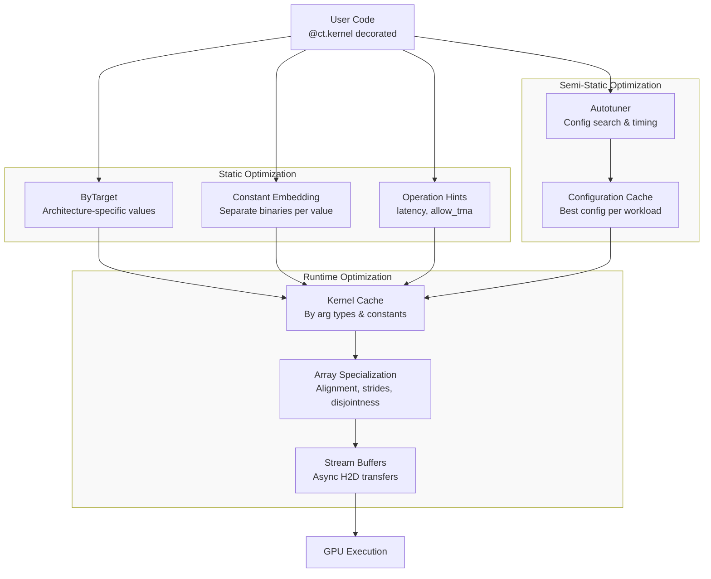
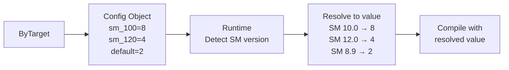
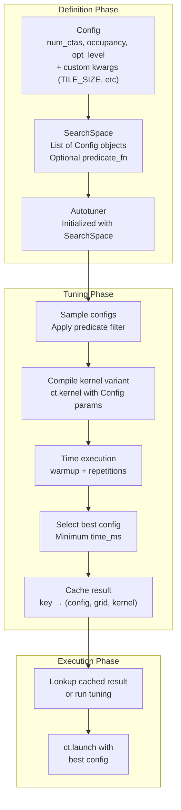
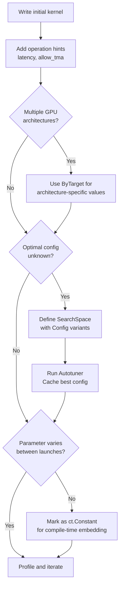

<!-- source: DeepWiki mcp.deepwiki.com · repo NVIDIA/cutile-python · page 5 Performance Optimization · fetched 2026-10-26 -->

# Performance Optimization

<details>
<summary>Relevant source files</summary>

The following files were used as context for generating this wiki page:

- [samples/MatMul.py](samples/MatMul.py)
- [samples/templates/MatMul.py](samples/templates/MatMul.py)
- [samples/utils/autotuner.py](samples/utils/autotuner.py)
- [test/autotuner/autotuner.py](test/autotuner/autotuner.py)
- [test/bench_matmul.py](test/bench_matmul.py)
- [test/kernels/rms_norm.py](test/kernels/rms_norm.py)
- [test/test_autotuner.py](test/test_autotuner.py)

</details>


This page provides an overview of the performance optimization system in `cuda.tile`. It introduces the key concepts and components that enable users to write high-performance GPU kernels through both manual tuning and automatic optimization.

For detailed information on specific optimization techniques, see:
- **[Performance Tuning Basics](#5.1)** - Operation-level hints and manual tuning
- **[Architecture-Specific Configuration](#5.2)** - Using `ByTarget` for GPU-specific settings
- **[Autotuner](#5.3)** - Automatic configuration search and selection
- **[Constant Embedding](#5.4)** - Compile-time specialization for zero-cost parameters

---

## Optimization Layers

The `cuda.tile` performance optimization system operates at multiple layers, providing both automatic and manual control over kernel performance:



**Diagram: Multi-layered optimization pipeline from user code to GPU execution**

Sources: [samples/utils/autotuner.py:1-347](), [src/cuda/tile/_by_target.py:1-73](), [test/test_load_store.py:1-200]()

---

## Configuration Space

The performance of `cuda.tile` kernels is determined by a configuration space consisting of kernel-level parameters, architecture-specific values, and operation-level hints.

### Kernel Parameters

Three primary parameters control kernel compilation and execution:

| Parameter | Type | Purpose | Example |
|-----------|------|---------|---------|
| `num_ctas` | `int` or `ByTarget[int]` | Number of cooperative thread arrays per SM | `num_ctas=4` |
| `occupancy` | `int` or `ByTarget[int]` | Target occupancy level | `occupancy=2` |
| `opt_level` | `int` (0-3) or `ByTarget[int]` | Optimization level | `opt_level=3` |

These parameters can be specified when decorating a kernel:

```python
@ct.kernel(num_ctas=8, occupancy=2, opt_level=3)
def my_kernel(x, y):
    ...
```

### Architecture-Specific Configuration: ByTarget

The `ByTarget` class allows specifying different parameter values for different GPU architectures:



**Diagram: ByTarget resolution flow at runtime**

The `ByTarget` class is defined in [src/cuda/tile/_by_target.py:19-73]() and supports initialization with keyword arguments for specific architectures:

```python
# Different num_ctas for different architectures
@ct.kernel(num_ctas=ByTarget(sm_100=8, sm_120=4, default=2))
def kernel_fn(x):
    ...
```

Valid architecture names follow the pattern `"sm_<major><minor>"` (e.g., `"sm_100"`, `"sm_120"`). The `default` parameter provides a fallback value for unlisted architectures.

Sources: [src/cuda/tile/_by_target.py:19-73]()

### Operation-Level Hints

Individual memory operations (`ct.load`, `ct.store`, `ct.gather`, `ct.scatter`) accept performance hints:

| Hint | Type | Purpose | Range |
|------|------|---------|-------|
| `latency` | `int` or `None` | DRAM traffic intensity | 1 (low) to 10 (high) |
| `allow_tma` | `bool` or `None` | Allow Tensor Memory Accelerator usage | `True` (default) or `False` |

Example from [test/test_load_store.py:21-37]():

```python
@ct.kernel
def load_store_with_hints_kernel(x, y):
    bid = ct.bid(0)
    tx = ct.load(
        x,
        index=(bid,),
        shape=(TILE_SIZE,),
        latency=8,        # high-latency DRAM load
    )
    ct.store(
        y,
        index=(bid,),
        tile=tx,
        latency=2,        # cheaper write
        allow_tma=False,  # disallow TMA
    )
```

These hints influence code generation decisions without changing kernel semantics. See **[Performance Tuning Basics](#5.1)** for detailed usage.

Sources: [test/test_load_store.py:21-37](), [docs/source/performance.rst:28-46]()

---

## Autotuning System

The autotuner provides automatic search and selection of optimal kernel configurations. It is particularly useful when the best configuration depends on runtime properties (e.g., input shapes, hardware characteristics).

### Core Components



**Diagram: Autotuner workflow from definition to execution**

Sources: [samples/utils/autotuner.py:25-330]()

### Config Class

The `Config` class represents a single kernel configuration variant [samples/utils/autotuner.py:25-46]():

```python
class Config:
    def __init__(self, *, num_ctas=None, occupancy=None, opt_level=3, **kwargs):
        self.kwargs = dict(kwargs)  # Custom parameters (e.g., TILE_SIZE)
        self.num_ctas = num_ctas
        self.occupancy = occupancy
        self.opt_level = opt_level
```

Custom parameters in `kwargs` are typically tile sizes or other meta-parameters that require separate compilation:

```python
configs = [
    Config(TILE_SIZE=64, num_ctas=4),
    Config(TILE_SIZE=128, num_ctas=8),
    Config(TILE_SIZE=256, num_ctas=16),
]
```

### SearchSpace Class

The `SearchSpace` class encapsulates multiple configurations and an optional filtering predicate [samples/utils/autotuner.py:48-80]():

```python
class SearchSpace:
    def __init__(self, configs: list[Config], predicate_fn: Callable | None = None):
        # Validates all configs have same kwargs keys
        self.configs = configs
        self.predicate_fn = predicate_fn
    
    def filter(self, named_args: dict[str, Any], cfg: Config) -> bool:
        # Returns True if config is valid for given runtime args
        ...
```

The `predicate_fn` allows runtime filtering of configurations based on input properties:

```python
def predicate(named_args, cfg):
    # Only use TILE_SIZE=256 for large arrays
    if cfg.TILE_SIZE == 256:
        return named_args["x"].shape[0] >= 1024
    return True

search_space = SearchSpace(configs, predicate_fn=predicate)
```

Sources: [samples/utils/autotuner.py:48-80](), [test/test_autotuner.py:42-53]()

### Autotuner Class

The `Autotuner` class manages the search process and caching [samples/utils/autotuner.py:195-330]():

```python
class Autotuner:
    def __init__(self, search_space: SearchSpace | Sequence[Config]):
        self._search_space = _normalize_search_space(search_space)
        self._cache = {}  # key → (best_idx, best_grid, best_kernel)
```

The `__call__` method performs tuning and returns a `TunedResult`:

```python
tuned_result = autotuner(
    stream=torch.cuda.current_stream(),
    grid_fn=lambda named_args, cfg: (ceil(named_args["x"].shape[0] / cfg.TILE_SIZE), 1, 1),
    kernel=my_kernel,
    args_fn=lambda cfg: (x, y, cfg.TILE_SIZE),
    max_iter=60,                     # Max configs to try
    compiler_time_limit_sec=10,      # Per-config timeout
)
```

Key arguments:

| Argument | Type | Purpose |
|----------|------|---------|
| `stream` | CUDA stream | Stream for kernel launches |
| `grid_fn` | `Callable[[dict, Config], tuple]` | Computes grid dimensions from args and config |
| `kernel` | `TileDispatcher` | Kernel to tune |
| `args_fn` | `Callable[[Config], tuple]` | Generates runtime arguments from config |
| `transforms` | `dict[str, Callable]` | Optional per-argument transforms for tuning runs |
| `key_fn` | `Callable` | Cache key function (default: based on arg shapes/dtypes) |
| `max_iter` | `int` | Maximum configs to sample (default: 60) |
| `compiler_time_limit_sec` | `int` | Compilation timeout per config (default: 10) |
| `force_retune` | `bool` | Ignore cached result and re-tune (default: False) |

The autotuner uses [samples/utils/autotuner.py:96-110]() to generate a default cache key from kernel name and argument properties (shape, dtype, stride).

Sources: [samples/utils/autotuner.py:195-330](), [test/test_autotuner.py:1-322]()

### Timing and Selection

The autotuner measures execution time for each valid configuration [samples/utils/autotuner.py:113-130]():

1. **Warmup**: Runs the kernel `warmup` times (default: 2) to stabilize GPU state
2. **Timed runs**: Executes `rep` times (default: 10) using CUDA events
3. **Average**: Computes mean time per run

The configuration with minimum average time is selected and cached. Subsequent calls with the same cache key reuse the cached configuration.

### Usage Patterns

**Direct usage:**

```python
tuner = Autotuner(search_space)
result = tuner(stream, grid_fn, kernel, args_fn)
# Access tuned parameters
print(f"Best TILE_SIZE: {result.TILE_SIZE}")
print(f"Best grid: {result.grid}")
```

**Decorator pattern** [samples/utils/autotuner.py:333-346]():

```python
@autotune(search_space=SearchSpace(configs))
def my_function(stream, x, autotuner: Autotuner):
    result = autotuner(
        stream=stream,
        grid_fn=grid_fn,
        kernel=my_kernel,
        args_fn=lambda cfg: (x, cfg.TILE_SIZE),
    )
    return result
```

The `@autotune` decorator injects the `Autotuner` instance into the function's keyword arguments.

Sources: [samples/utils/autotuner.py:333-346](), [test/test_autotuner.py:302-321]()

---

## Compilation and Runtime Optimization

Beyond configuration selection, `cuda.tile` performs several automatic optimizations at compilation and runtime.

### Constant Embedding

Parameters marked with `ct.Constant[T]` are embedded at compile time, generating separate kernel binaries for different constant values. This enables aggressive compiler optimizations (loop unrolling, constant propagation) at zero runtime cost.

Example:
```python
@ct.kernel
def my_kernel(x, y, TILE_SIZE: ct.Constant[int]):
    # Separate binary compiled for each TILE_SIZE value
    for i in range(TILE_SIZE):  # Fully unrolled at compile time
        ...
```

See **[Constant Embedding](#5.4)** for detailed information.

### Kernel Caching

Compiled kernels are cached based on:
- Argument types
- Constant parameter values
- Target architecture (SM version)

This multi-level caching ensures that compilation occurs only once per unique configuration.

### Array Specialization

The compiler analyzes array properties at launch time and may select specialized kernel variants based on:
- **Alignment**: Whether array base addresses are aligned to specific boundaries
- **Stride divisibility**: Whether strides are divisible by power-of-2 values
- **Disjointness**: Whether input and output arrays overlap

See **[Array Specialization](#7.2)** for details.

Sources: Referenced from Diagram 5 in high-level architecture overview

---

## Performance Optimization Workflow



**Diagram: Recommended workflow for optimizing cuda.tile kernels**

This workflow guides users through the available optimization techniques:

1. **Start with hints**: Add `latency` and `allow_tma` hints to critical memory operations
2. **Architecture adaptation**: Use `ByTarget` if different GPUs need different parameters
3. **Autotuning**: Use `Autotuner` when optimal configuration is workload-dependent
4. **Constant embedding**: Mark compile-time parameters with `ct.Constant` for zero-cost specialization
5. **Profile**: Measure and iterate on performance

---

## Summary

The `cuda.tile` performance optimization system provides multiple mechanisms for achieving high performance:

- **Manual control** through kernel parameters, `ByTarget`, and operation hints
- **Automatic optimization** through the autotuner with caching
- **Compile-time specialization** through constant embedding
- **Runtime adaptation** through array specialization and kernel caching

These techniques work together to enable both ease of use (automatic optimization) and expert control (manual tuning) for high-performance GPU kernels.

For implementation details, see:
- **[Performance Tuning Basics](#5.1)** - Detailed information on hints and manual tuning
- **[Architecture-Specific Configuration](#5.2)** - `ByTarget` usage and examples
- **[Autotuner](#5.3)** - Complete autotuner API reference and patterns
- **[Constant Embedding](#5.4)** - Constant embedding semantics and use cases

Sources: [samples/utils/autotuner.py:1-347](), [src/cuda/tile/_by_target.py:1-73](), [test/test_load_store.py:1-200](), [docs/source/performance.rst:1-53]()

---

