<!-- source: DeepWiki mcp.deepwiki.com · repo NVIDIA/cutile-python · page 5.1 Performance Tuning Basics · fetched 2026-10-26 -->

# Performance Tuning Basics

<details>
<summary>Relevant source files</summary>

The following files were used as context for generating this wiki page:

- [samples/MatMul.py](samples/MatMul.py)
- [samples/templates/MatMul.py](samples/templates/MatMul.py)
- [samples/utils/autotuner.py](samples/utils/autotuner.py)
- [test/autotuner/autotuner.py](test/autotuner/autotuner.py)
- [test/bench_matmul.py](test/bench_matmul.py)
- [test/kernels/rms_norm.py](test/kernels/rms_norm.py)
- [test/test_autotuner.py](test/test_autotuner.py)

</details>


## Purpose and Scope

This page covers fundamental performance tuning strategies for cuTile kernels, focusing on three key areas:

1. **Tile Size Selection** - Choosing optimal dimensions for data processing tiles
2. **Grid Configuration and Occupancy** - Determining how many blocks to launch
3. **Data Type and Hardware Utilization** - Leveraging Tensor Cores and appropriate numeric types

These concepts form the foundation for kernel optimization. For advanced topics, see:
- [Autotuner System](#5.2) - Automatically searching for optimal configurations
- [Constant Embedding](#5.3) - Compile-time specialization for compile-time parameters
</thinking>

## Overview

cuTile kernel performance depends on several interrelated factors:

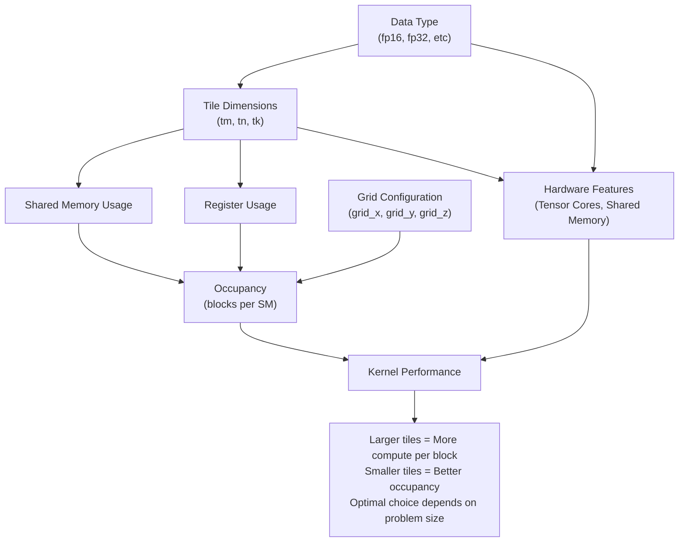

**Diagram: Factors Affecting cuTile Kernel Performance**

The primary tuning parameters are:
- **Tile dimensions**: `tm` (M dimension), `tn` (N dimension), `tk` (K dimension)
- **Grid size**: Number of blocks launched
- **Data types**: Choosing types that enable hardware acceleration

**Sources:** [samples/MatMul.py:210-218](), [samples/MatMul.py:230-238]()
</thinking>

## Tile Size Selection

### What Are Tiles?

In cuTile, each CUDA block processes one or more **tiles** of data. The tile dimensions determine:
- How much data each block loads from global memory
- How much shared memory and registers are consumed
- Whether Tensor Cores can be utilized efficiently

### Hardware Constraints

Tile size selection must consider GPU hardware limitations:

| Constraint | Typical Limit | Impact |
|------------|---------------|--------|
| Shared memory per block | 48-164 KB | Limits tile size for cached data |
| Registers per block | 65536 | Affects occupancy with large tiles |
| Tensor Core requirements | Dimensions divisible by 8/16 | Dictates minimum tile sizes |
| TMA alignment | Power-of-2 dimensions preferred | Better memory coalescing |

**Sources:** [samples/MatMul.py:210-218]()

### Data Type Dependent Sizing

cuTile kernels typically choose tile sizes based on input data type:

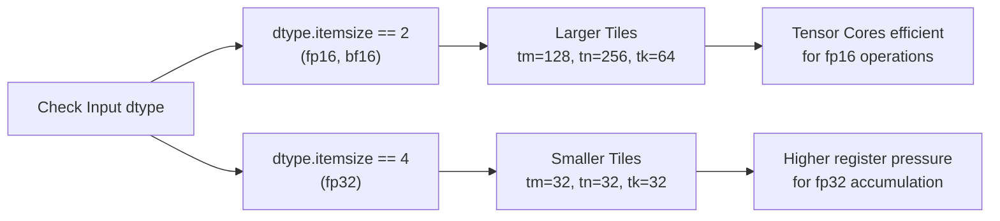

**Diagram: Data Type Influences Tile Size Selection**

From [samples/MatMul.py:210-218]():

```python
if A.dtype.itemsize == 2:  # Likely torch.float16 or torch.bfloat16
    tm, tn, tk = 128, 256, 64  # Larger tiles for Tensor Core friendly types
else:  # Likely torch.float32 or other
    tm, tn, tk = 32, 32, 32   # Smaller, more general tiles
```

**Rationale:**
- **fp16/bf16**: Tensor Cores provide high throughput, justifying larger tiles despite higher shared memory usage
- **fp32**: Higher register and memory pressure makes smaller tiles more practical

**Sources:** [samples/MatMul.py:210-218]()

### Matrix Multiplication Tile Sizing Example

For matrix multiplication `C = A @ B`, the tile dimensions have specific meanings:

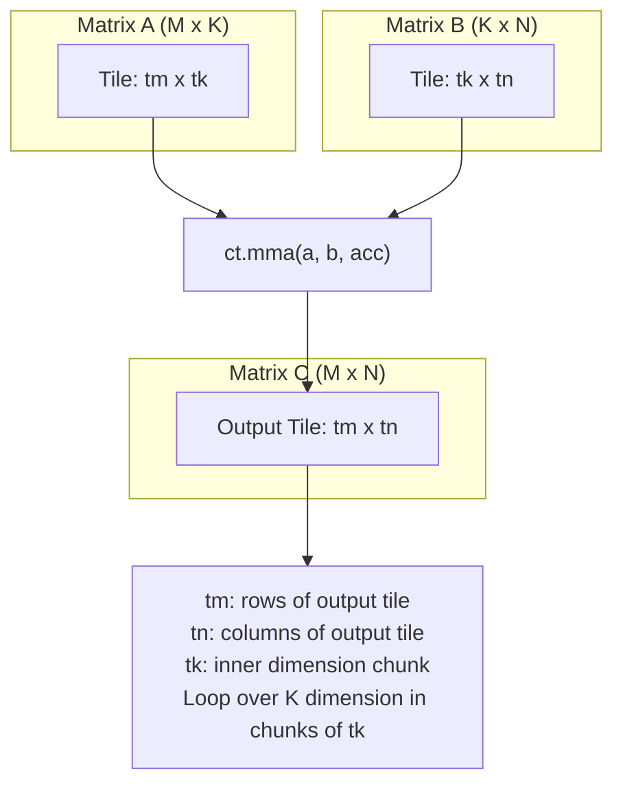

**Diagram: Tile Dimensions in Matrix Multiplication**

The kernel loops over the K dimension, loading `tm × tk` tiles from A and `tk × tn` tiles from B:

[samples/MatMul.py:80-93]()
```python
for k in range(num_tiles_k):
    # Load tm x tk tile from A
    a = ct.load(A, index=(bidx, k), shape=(tm, tk), padding_mode=zero_pad)
    
    # Load tk x tn tile from B
    b = ct.load(B, index=(k, bidy), shape=(tk, tn), padding_mode=zero_pad)
    
    # Accumulate: (tm x tk) @ (tk x tn) -> (tm x tn)
    accumulator = ct.mma(a, b, accumulator)
```

**Sources:** [samples/MatMul.py:66-93]()

### Common Tile Size Patterns

| Pattern | Tile Sizes | Use Case |
|---------|------------|----------|
| Square tiles | tm=tn=tk=32 or 64 | General purpose, simple tuning |
| Tensor Core optimized | tm=128, tn=256, tk=64 | fp16/bf16 with Tensor Cores |
| K-dimension heavy | tm=32, tn=32, tk=256 | Large inner dimension, reduce loop iterations |
| Output-focused | tm=128, tn=128, tk=32 | Maximize output tile, minimize K-loop iterations |

**Sources:** [samples/MatMul.py:210-218](), [test/bench_matmul.py:95-98]()

## Grid Configuration and Occupancy

### Calculating Grid Dimensions

The grid size determines how many CUDA blocks are launched. Each block processes one tile of the output:

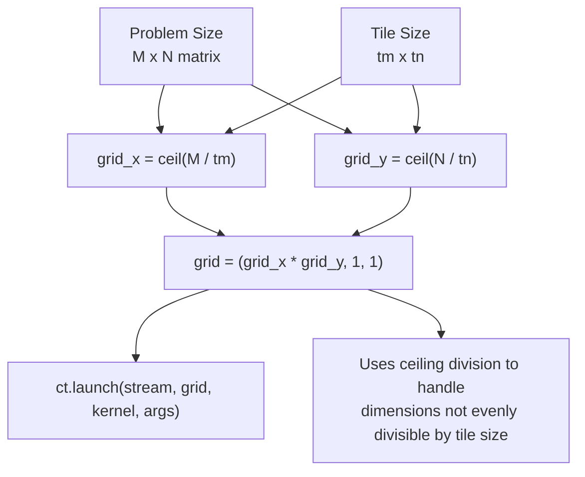

**Diagram: Grid Size Calculation**

From [samples/MatMul.py:225-232]():

```python
from math import ceil

m, k_a = A.shape
k_b, n = B.shape

grid_x = ceil(m / tm)  # Number of blocks along M dimension
grid_y = ceil(n / tn)  # Number of blocks along N dimension
grid_size = grid_x * grid_y
grid = (grid_size, 1, 1)
```

**Important:** Using `ceil` ensures coverage even when dimensions aren't perfect multiples of tile sizes. cuTile's `PaddingMode.ZERO` handles out-of-bounds access.

**Sources:** [samples/MatMul.py:225-232]()

### The num_ctas Hint

The `@ct.kernel` decorator accepts a `num_ctas` parameter that controls how many blocks are launched per streaming multiprocessor (SM):

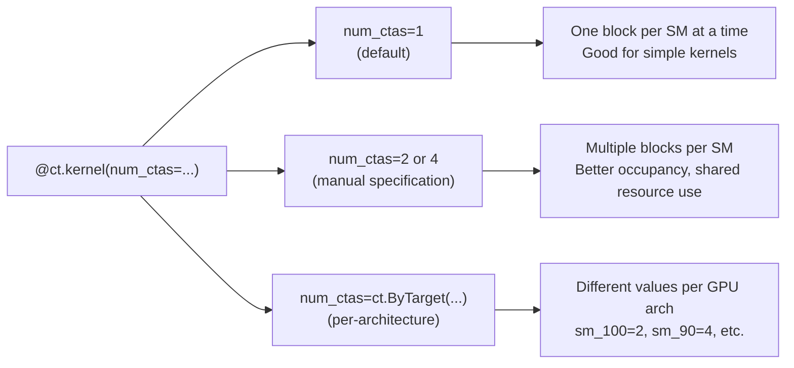

**Diagram: num_ctas Configuration Options**

Example from [samples/MatMul.py:33]():

```python
@ct.kernel(num_ctas=ct.ByTarget(sm_100=2))
def matmul_kernel(A, B, C, tm: ConstInt, tn: ConstInt, tk: ConstInt):
    # kernel implementation
```

This specifies that on SM 10.0 (Blackwell architecture), 2 blocks should be scheduled per SM, improving occupancy.

**Sources:** [samples/MatMul.py:33]()

### Persistent Kernels

Traditional kernels launch one block per output tile. **Persistent kernels** launch fewer blocks (typically matching the number of SMs), with each block processing multiple tiles:

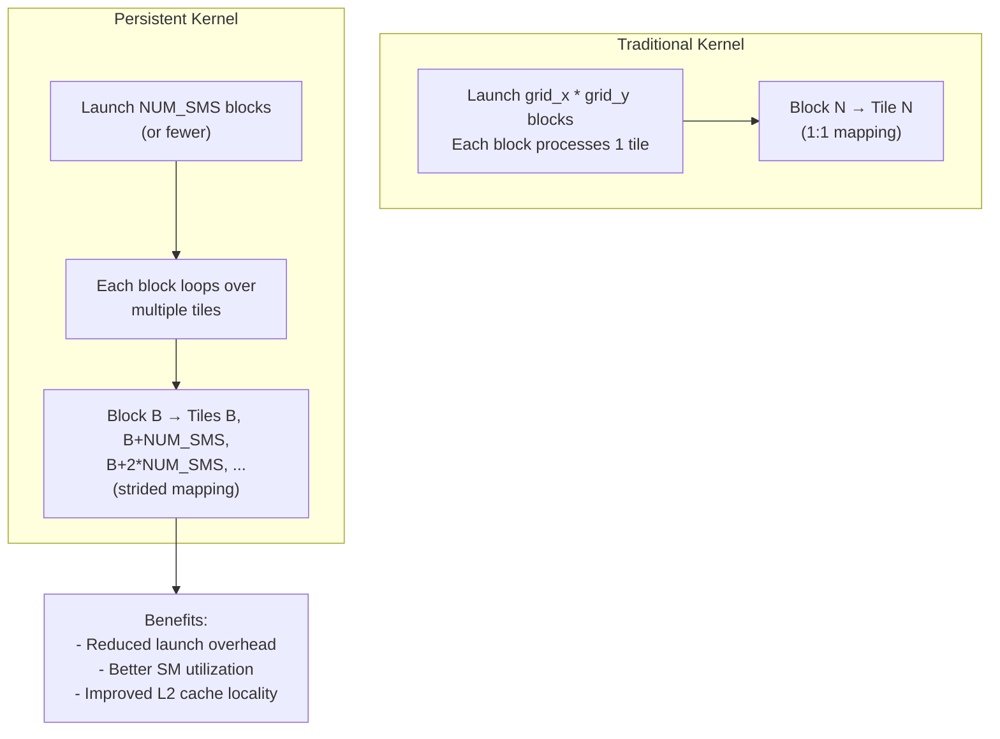

**Diagram: Traditional vs Persistent Kernel Patterns**

From [samples/MatMul.py:148-154]():

```python
# Calculate total number of output tiles
num_bid_m = ct.cdiv(M, tm)
num_bid_n = ct.cdiv(N, tn)
upper_bound = num_bid_m * num_bid_n

# Static persistent loop: each block processes multiple tiles
num_tile_blocks = ct.num_blocks(0)
for current_bid in range(bid, upper_bound, num_tile_blocks):
    # process tile at current_bid
```

And the grid is sized to match available SMs [samples/MatMul.py:233-237]():

```python
if persistent:
    NUM_SMS = torch.cuda.get_device_properties("cuda").multi_processor_count
    grid_size = min(NUM_SMS, grid_size)
grid = (grid_size, 1, 1)
```

**When to use persistent kernels:**
- Large problem sizes with many output tiles
- When tile processing time is relatively uniform
- To improve L2 cache utilization through block-level data reuse

**Sources:** [samples/MatMul.py:104-177](), [samples/MatMul.py:233-237]()

### Block Swizzling

Block swizzling improves cache locality by reordering how blocks are mapped to output tiles:

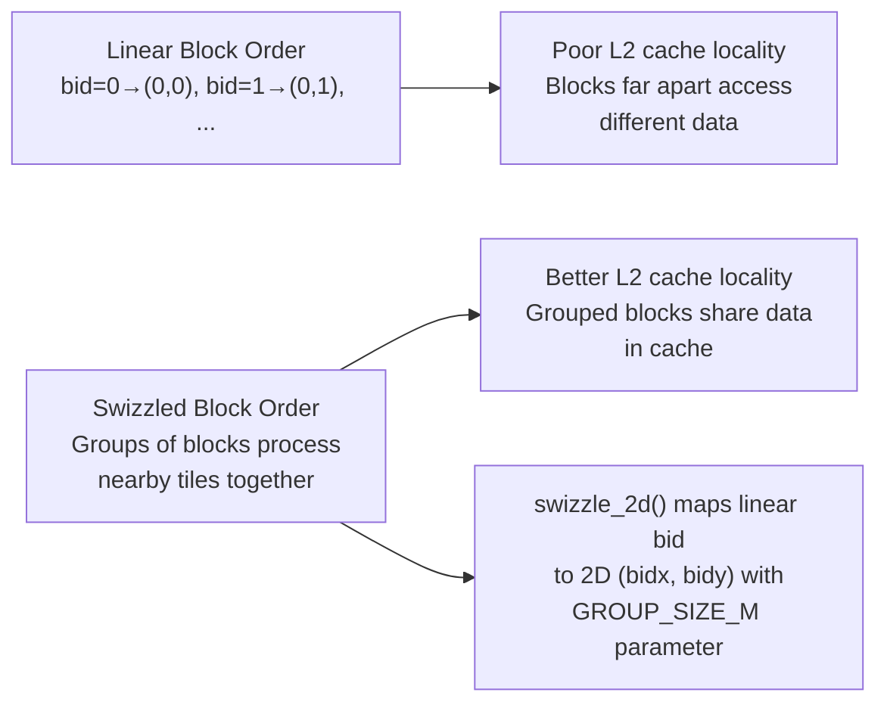

**Diagram: Block Swizzling for Cache Locality**

From [samples/MatMul.py:14-30]():

```python
def swizzle_2d(M, N, tm, tn, GROUP_SIZE_M):
    bid = ct.bid(0)  # 1D block ID
    num_bid_m = ct.cdiv(M, tm)
    num_bid_n = ct.cdiv(N, tn)
    num_bid_in_group = GROUP_SIZE_M * num_bid_n
    group_id = bid // num_bid_in_group
    first_bid_m = group_id * GROUP_SIZE_M
    group_size_m = min(num_bid_m - first_bid_m, GROUP_SIZE_M)
    bid_m = first_bid_m + (bid % group_size_m)
    bid_n = (bid % num_bid_in_group) // group_size_m
    return bid_m, bid_n
```

**Sources:** [samples/MatMul.py:14-30](), [samples/MatMul.py:56-59]()

## Data Type Selection and Hardware Utilization

### Tensor Core Requirements

Modern NVIDIA GPUs have specialized Tensor Core units for matrix operations. To utilize them effectively:

| Data Type | Tensor Core Support | Recommended Tile Constraints |
|-----------|---------------------|------------------------------|
| `float16`, `bfloat16` | Yes | Dimensions divisible by 8 or 16 |
| `float32` | Via TF32 conversion | Dimensions divisible by 8 |
| `float8_e4m3fn`, `float8_e5m2` | Yes (Hopper+) | Dimensions divisible by 16 |
| `int8` | Yes | Dimensions divisible by 16 |

**Sources:** [samples/MatMul.py:74-75]()

### TF32 Conversion

For `float32` inputs, cuTile can automatically convert to TF32 (TensorFloat-32) format to use Tensor Cores:

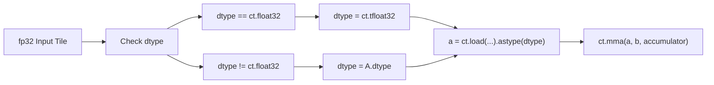

**Diagram: TF32 Conversion for Tensor Core Utilization**

From [samples/MatMul.py:74-84]():

```python
# Convert fp32 to tf32 to use tensorcore
dtype = ct.tfloat32 if A.dtype == ct.float32 else A.dtype

for k in range(num_tiles_k):
    a = ct.load(A, index=(bidx, k), shape=(tm, tk), padding_mode=zero_pad).astype(dtype)
    b = ct.load(B, index=(k, bidy), shape=(tk, tn), padding_mode=zero_pad).astype(dtype)
    accumulator = ct.mma(a, b, accumulator)
```

**Benefits of TF32:**
- Maintains fp32 dynamic range
- Reduces mantissa precision to 10 bits (vs 23 for fp32)
- Enables Tensor Core usage for fp32-like operations
- Minimal accuracy loss for most ML workloads

**Sources:** [samples/MatMul.py:74-84]()

### Accumulator Precision

It's common practice to use higher precision for accumulators than for input data:

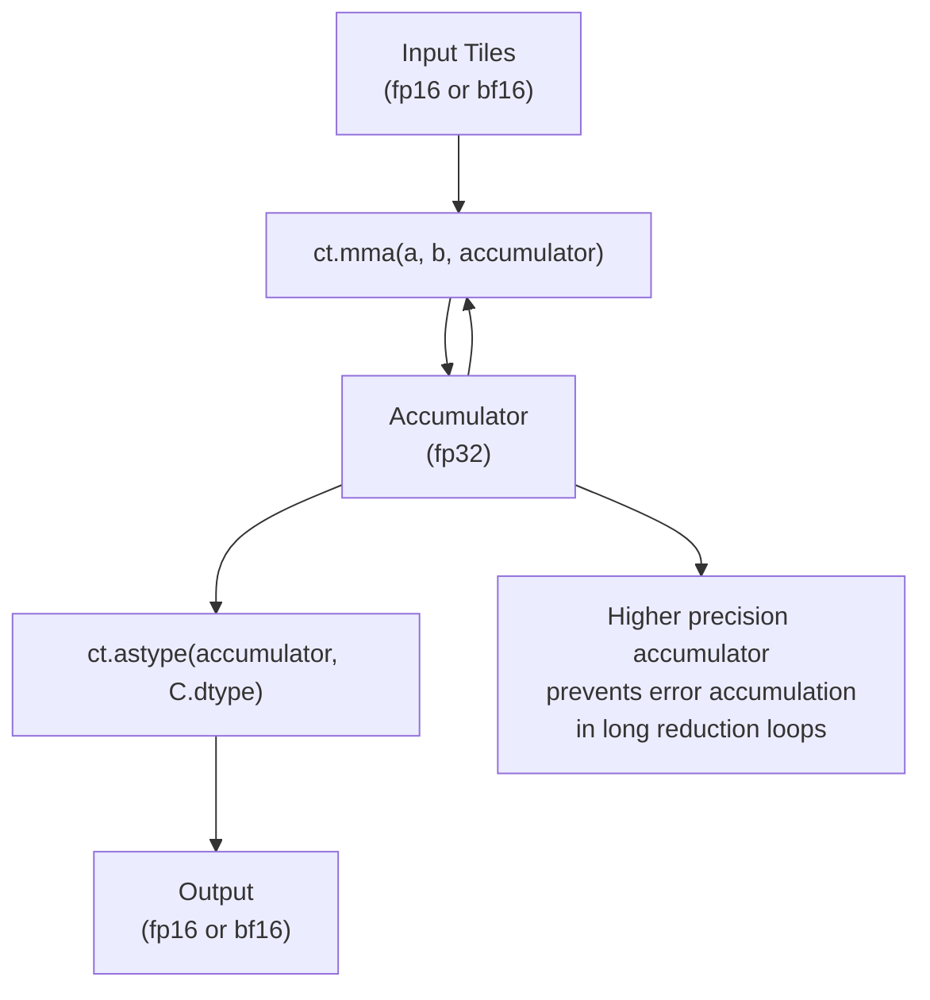

**Diagram: Mixed Precision Pattern**

From [samples/MatMul.py:69-97]():

```python
# Initialize accumulator with float32 for higher precision
accumulator = ct.full((tm, tn), 0, dtype=ct.float32)

for k in range(num_tiles_k):
    a = ct.load(A, index=(bidx, k), shape=(tm, tk), ...).astype(dtype)
    b = ct.load(B, index=(k, bidy), shape=(tk, tn), ...).astype(dtype)
    # Accumulate in fp32
    accumulator = ct.mma(a, b, accumulator)

# Convert back to output dtype
accumulator = ct.astype(accumulator, C.dtype)
```

**Sources:** [samples/MatMul.py:69-97]()

## Basic Optimization Patterns

### Pattern: Zero Padding for Boundary Handling

When matrix dimensions aren't exact multiples of tile sizes, use `PaddingMode.ZERO`:

```python
zero_pad = ct.PaddingMode.ZERO
a = ct.load(A, index=(bidx, k), shape=(tm, tk), padding_mode=zero_pad)
```

This returns zeros for out-of-bounds accesses, eliminating the need for explicit boundary checks.

**Sources:** [samples/MatMul.py:72](), [samples/MatMul.py:84-89]()

### Pattern: Constant Integer Parameters

Declare tile sizes as `Constant[int]` to enable compile-time specialization:

```python
ConstInt = ct.Constant[int]

@ct.kernel
def matmul_kernel(A, B, C,
                  tm: ConstInt,
                  tn: ConstInt,
                  tk: ConstInt):
    # Compiler knows these values at compile time
```

This allows the compiler to:
- Unroll loops based on tile dimensions
- Optimize shared memory allocation
- Generate specialized code per configuration

**Sources:** [samples/MatMul.py:11](), [samples/MatMul.py:34-37]()

### Pattern: Grid Size Calculation Helper

Use `ct.num_tiles()` to calculate the number of tiles along a dimension:

```python
# Calculate how many K-dimension tiles to loop over
num_tiles_k = ct.num_tiles(A, axis=1, shape=(tm, tk))

for k in range(num_tiles_k):
    # Process tile k
```

This is equivalent to `ct.cdiv(A.shape[1], tk)` but more readable.

**Sources:** [samples/MatMul.py:66]()

### Pattern: Architecture-Specific Tuning

Use `ct.ByTarget` to specify different parameters per GPU architecture:

```python
@ct.kernel(num_ctas=ct.ByTarget(sm_100=2, sm_90=4, default=1))
def my_kernel(...):
    pass
```

This enables optimal configurations for different hardware without maintaining separate kernel versions.

**Sources:** [samples/MatMul.py:33]()

## Performance Measurement and Iteration

### Benchmarking Approach

From [test/bench_matmul.py:24-46]():

```python
# Measure FLOP/s and memory bandwidth
flop_count = 2 * m * n * k  # Multiply-add operations
bytes_rw = sum([t.numel() * t.dtype.itemsize for t in (A, B, C)])

# Run warmup and timed iterations
warmup_rounds, iterations, rounds = estimate_bench_iter(backend, args)
benchmark.pedantic(backend, args, rounds=rounds, 
                  warmup_rounds=warmup_rounds, iterations=iterations)
```

**Sources:** [test/bench_matmul.py:24-46]()

### Correctness Validation

Always verify correctness against a reference implementation:

```python
with torch_use_tf32_matmul():
    backend(*args)
    torch.testing.assert_close(C, A @ B, atol=1e-3, rtol=1e-3)
```

**Sources:** [test/bench_matmul.py:32-34]()

### Tuning Workflow

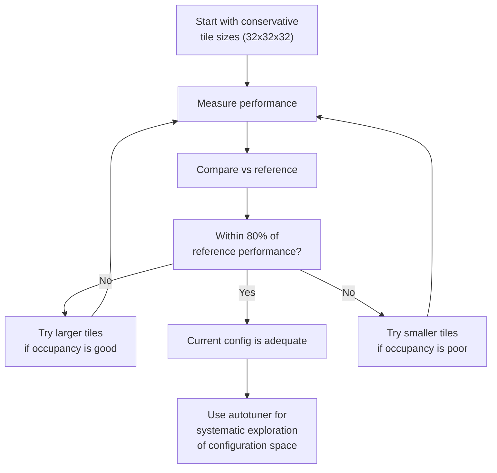

**Diagram: Iterative Performance Tuning Workflow**

**Sources:** [samples/MatMul.py:210-218]()

## Summary

Key takeaways for performance tuning:

| Aspect | Guideline |
|--------|-----------|
| **Tile sizes** | Choose based on dtype: larger for fp16 (128×256×64), smaller for fp32 (32×32×32) |
| **Grid size** | Use `ceil(M/tm) * ceil(N/tn)` for traditional, `NUM_SMS` for persistent |
| **Occupancy** | Control with `num_ctas` hint, consider persistent pattern for large problems |
| **Data types** | Use fp16/bf16 for Tensor Cores, convert fp32 to tf32 |
| **Accumulators** | Use fp32 accumulation even with fp16 inputs |
| **Boundary handling** | Use `PaddingMode.ZERO` instead of explicit checks |
| **Specialization** | Declare tile sizes as `Constant[int]` parameters |

For systematic optimization, use the autotuner (page 5.2) to explore configuration spaces automatically.

**Sources:** [samples/MatMul.py:1-340](), [test/bench_matmul.py:1-217]()

## Overview of Performance Hints

cuda.tile provides two optional keyword arguments for memory operations that influence compilation and execution:

| Hint | Type | Purpose | Applies To |
|------|------|---------|------------|
| `latency` | `Optional[int]` | Indicates expected DRAM traffic intensity (1=low, 10=high) | `load`, `store`, `gather`, `scatter` |
| `allow_tma` | `Optional[bool]` | Controls whether Tensor Memory Accelerator may be used | `load`, `store` |

These hints are **optional**: kernels compile and execute correctly without them. However, providing appropriate hints helps the compiler make better scheduling and lowering decisions for specific memory access patterns.

**Sources:** [src/cuda/tile/_stub.py:472-593](), [docs/source/performance.rst:28-46]()

## Performance Hint Flow

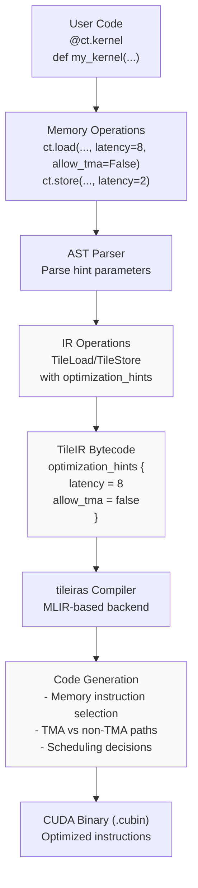

**Diagram: How Performance Hints Flow Through Compilation Pipeline**

The hints specified in user code are preserved through AST parsing, IR representation, and bytecode generation, ultimately influencing the MLIR-based compiler's code generation decisions.

**Sources:** [src/cuda/tile/_stub.py:472-593](), [test/test_load_store.py:82-102]()

## Latency Hint

### Purpose

The `latency` parameter hints at the expected intensity of DRAM traffic for a memory operation. It accepts integer values from **1** (low latency/light traffic) to **10** (high latency/heavy traffic).

### Compiler Behavior

- **Low latency (1-3)**: Suggests the operation accesses cached or frequently-used data. Compiler may optimize for throughput over latency hiding.
- **High latency (7-10)**: Indicates expensive DRAM access. Compiler may insert prefetch instructions, schedule operations differently, or allocate more resources for latency hiding.
- **Default (None)**: Compiler infers appropriate latency based on access patterns and array properties.

### Usage Example

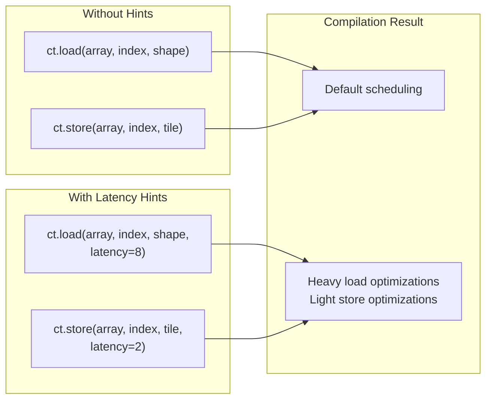

**Diagram: Impact of Latency Hints on Compilation**

Here's a practical example from a kernel that performs memory-intensive operations:

[test/test_load_store.py:21-37]() demonstrates using different latency values for loads and stores:

```python
@ct.kernel
def load_store_with_hints_kernel(x, y):
    bid = ct.bid(0)
    tx = ct.load(
        x,
        index=(bid,),
        shape=(TILE_SIZE,),
        latency=8,        # high-latency DRAM load
    )
    ct.store(
        y,
        index=(bid,),
        tile=tx,
        latency=2,        # cheaper write
        allow_tma=False,  # disallow TMA
    )
```

**Sources:** [src/cuda/tile/_stub.py:478,521,551,577](), [test/test_load_store.py:21-37](), [docs/source/performance.rst:34-37]()

### When to Use Latency Hints

| Scenario | Recommended Latency | Rationale |
|----------|-------------------|-----------|
| Loading small, frequently-accessed arrays | 1-3 | Data likely in cache |
| Loading large arrays or irregular patterns | 7-10 | Expect cache misses, heavy DRAM traffic |
| Storing final results | 2-4 | Writes are typically buffered |
| Storing intermediate values used by other blocks | 5-7 | May require synchronization overhead |
| Gather/scatter with sparse indices | 7-10 | Random access patterns are expensive |

**Sources:** [docs/source/performance.rst:34-37]()

## TMA Control (allow_tma)

### What is TMA?

The **Tensor Memory Accelerator (TMA)** is a hardware feature on recent NVIDIA GPUs (starting with Hopper architecture) that provides efficient multidimensional data transfers between global memory and shared memory.

### The allow_tma Parameter

The `allow_tma` parameter controls whether the compiler may lower a `load` or `store` operation to use TMA:

- **`allow_tma=True` (default)**: Compiler may use TMA if the target architecture supports it and the access pattern is suitable.
- **`allow_tma=False`**: Compiler will not use TMA for this operation, using traditional load/store instructions instead.
- **`allow_tma=None`**: Same as `True` (default behavior).

### When to Disable TMA

While TMA generally provides better performance for multidimensional transfers, there are cases where disabling it may be beneficial:

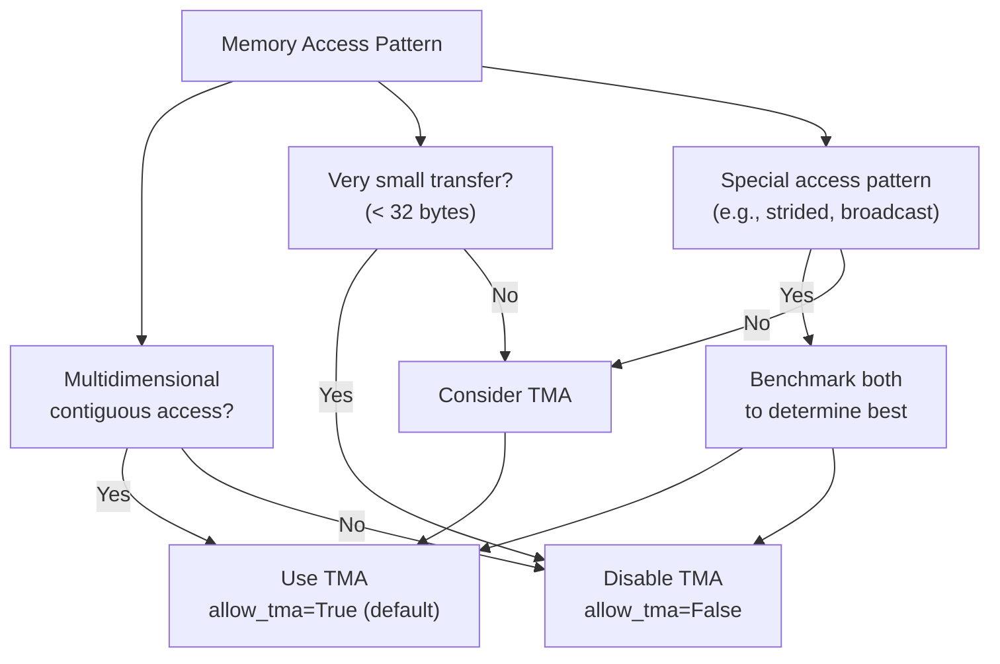

**Diagram: Decision Tree for TMA Usage**

**Common scenarios for disabling TMA:**

1. **Very small tiles**: TMA overhead may exceed benefits for tiny transfers
2. **Irregular access patterns**: Traditional loads may be more efficient for sparse or pointer-chasing patterns
3. **Architecture compatibility**: When targeting older architectures that don't support TMA
4. **Mixed workloads**: When combining with operations that don't benefit from TMA

**Sources:** [src/cuda/tile/_stub.py:478,523,578](), [docs/source/performance.rst:38-41]()

## Operations Accepting Hints

```mermaid
graph TB
    subgraph "Memory Operations with Hints"
        Load["ct.load<br/>latency: Optional[int]<br/>allow_tma: Optional[bool]"]
        Store["ct.store<br/>latency: Optional[int]<br/>allow_tma: Optional[bool]"]
        Gather["ct.gather<br/>latency: Optional[int]"]
        Scatter["ct.scatter<br/>latency: Optional[int]"]
    end
    
    subgraph "Hint Support"
        LatencyHint["latency hint<br/>Values: 1-10 or None<br/>Purpose: DRAM traffic intensity"]
        TMAHint["allow_tma hint<br/>Values: bool or None<br/>Purpose: TMA enablement"]
    end
    
    Load --> LatencyHint
    Load --> TMAHint
    Store --> LatencyHint
    Store --> TMAHint
    Gather --> LatencyHint
    Scatter --> LatencyHint
    
    subgraph "Note"
        Note["gather/scatter only support latency<br/>TMA not applicable to pointer-based access"]
    end
    
    Gather -.-> Note
    Scatter -.-> Note
```

**Diagram: Operations Supporting Performance Hints**

The table below summarizes which operations accept which hints:

| Operation | `latency` | `allow_tma` | Notes |
|-----------|-----------|-------------|-------|
| `ct.load()` | ✓ | ✓ | Full hint support for array-based loads |
| `ct.store()` | ✓ | ✓ | Full hint support for array-based stores |
| `ct.gather()` | ✓ | ✗ | TMA not applicable to indirect access |
| `ct.scatter()` | ✓ | ✗ | TMA not applicable to indirect access |

**Sources:** [src/cuda/tile/_stub.py:472-669]()

## Verifying Hint Usage in Bytecode

You can verify that hints are properly encoded in the generated bytecode using the test utilities. The hints appear as `optimization_hints` attributes in the TileIR:

[test/test_load_store.py:82-102]() shows how to check for hints in bytecode:

```python
def _create_check_directive(allow_tma: bool | None,
                            latency: int | None,
                            load_op: str,
                            store_op: str) -> str:
    wildcard = "{{.*}}"
    check_directives = ["// CHECK: div_by<16>"]
    if allow_tma is None and latency is None:
        # no optimization hints
        check_directives.append(f"// CHECK-NOT: {load_op} {wildcard} optimization_hints")
        check_directives.append(f"// CHECK-NOT: {store_op} {wildcard} optimization_hints")
    else:
        allow_tma_hint = [f"allow_tma = {str(allow_tma).lower()}"] if allow_tma is not None else []
        latency_hint = [f"latency = {latency}"] if latency is not None else []
        hints = ", ".join(allow_tma_hint + latency_hint)
        check_directives.append(
            f"// CHECK: {load_op} {wildcard} optimization_hints{wildcard}{hints}"
        )
        check_directives.append(
            f"// CHECK: {store_op} {wildcard} optimization_hints{wildcard}{hints}"
        )
    return "\n".join(check_directives)
```

The test verifies that operations like `load_view_tko` (for `ct.load`) and `store_view_tko` (for `ct.store`) contain the expected `optimization_hints` attributes in the MLIR representation.

**Sources:** [test/test_load_store.py:82-143]()

## Practical Example: Matrix Multiplication

Here's a complete example showing how to use hints in a matrix multiplication kernel:

[test/test_load_store.py:48-64]() demonstrates hint usage in a real kernel:

```python
def make_ct_matmul_kernel(latency: int | None, allow_tma: bool | None):
    def kernel(A, B, C,
               tm: ct.Constant[int],
               tn: ct.Constant[int],
               tk: ct.Constant[int]):
        bidx = ct.bid(0)
        bidy = ct.bid(1)
        num_tiles = ct.num_tiles(A, axis=1, shape=(tm, tk))
        sum = ct.full((tm, tn), 0, dtype=np.float32)

        for k in range(num_tiles):
            a = ct.load(A, index=(bidx, k), shape=(tm, tk), 
                       latency=latency, allow_tma=allow_tma)
            b = ct.load(B, index=(k, bidy), shape=(tk, tn), 
                       latency=latency, allow_tma=allow_tma)
            sum = ct.mma(a, b, sum)
            sum = ct.astype(sum, C.dtype)
            ct.store(C, index=(bidx, bidy), tile=sum, 
                    latency=latency, allow_tma=allow_tma)
    return kernel
```

In this example:
- **Loads from A and B**: Both use the same `latency` and `allow_tma` settings since they have similar access patterns
- **Store to C**: Uses the same hints for consistency, though writes typically have different characteristics than reads
- **Flexibility**: The kernel is parameterized so different hint values can be tested

**Sources:** [test/test_load_store.py:48-64]()

## Best Practices

### General Guidelines

1. **Start without hints**: Let the compiler infer appropriate settings first. Only add hints if profiling reveals opportunities.

2. **Profile before tuning**: Use CUDA profiling tools (NSight Compute, nvprof) to identify memory bottlenecks before adding hints.

3. **Be consistent within loops**: If a kernel has multiple similar loads in a loop, use consistent hint values unless there's a specific reason for differences.

4. **Test both TMA paths**: For kernels targeting Hopper+ architectures, benchmark with and without TMA to determine optimal settings.

### Common Patterns

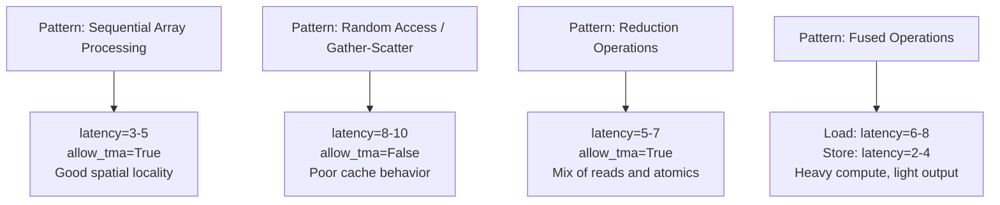

**Diagram: Common Kernel Patterns and Recommended Hints**

### Hint Value Selection Strategy

| Access Pattern | Suggested `latency` | Suggested `allow_tma` |
|----------------|--------------------|-----------------------|
| Small tile from large array | 6-8 | True |
| Full array scan | 3-5 | True |
| Sparse/indirect access | 8-10 | False (or use gather/scatter) |
| Broadcast from scalar | 1-2 | False |
| Multiple reuse of same tile | 2-4 | True |
| Write-only (no reuse) | 2-3 | Don't specify (default) |

### Debugging Hints

When performance doesn't match expectations:

1. **Check bytecode**: Use `get_bytecode()` and `filecheck()` to verify hints are encoded correctly
2. **Compare variants**: Create multiple kernel versions with different hint combinations
3. **Use CUDA_TILE_LOGS**: Enable logging to see compilation decisions
4. **Profile memory operations**: Use NSight Compute's memory workload analysis

**Sources:** [test/test_load_store.py:105-143](), [docs/source/performance.rst:28-53]()

## Interaction with Other Optimization Features

Performance hints work in conjunction with other cuda.tile optimization mechanisms:

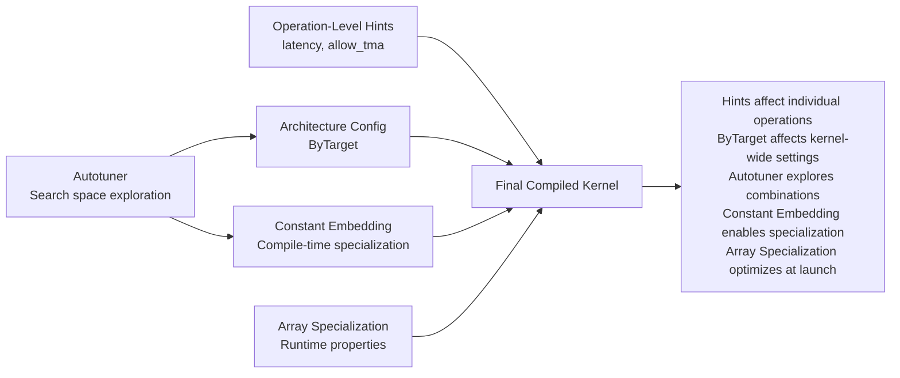

**Diagram: How Performance Hints Integrate with Other Optimization Systems**

- **ByTarget ([#5.2](#5.2))**: Can use different hint values for different architectures
- **Autotuner ([#5.3](#5.3))**: Can search over different hint combinations along with other parameters
- **Constant Embedding ([#5.4](#5.4))**: Hints are always compile-time constants, enabling aggressive optimization
- **Array Specialization ([#7.2](#7.2))**: Runtime array properties (alignment, strides) combine with hints for optimal code selection

**Sources:** [src/cuda/tile/_stub.py:472-593](), [src/cuda/tile/_by_target.py:19-73]()

## Summary

Performance hints provide fine-grained control over individual memory operations:

- **`latency`**: Integer 1-10 indicating DRAM traffic intensity, guides scheduling and prefetch decisions
- **`allow_tma`**: Boolean controlling TMA usage, useful for specialized access patterns
- **Optional**: Kernels work without hints; use them for targeted optimization
- **Verifiable**: Appear in bytecode as `optimization_hints` attributes
- **Composable**: Work alongside architecture configs, autotuning, and other optimization features

Start with default compiler inference, add hints based on profiling data, and verify with bytecode inspection.

**Sources:** [src/cuda/tile/_stub.py:472-593](), [test/test_load_store.py:1-200](), [docs/source/performance.rst:1-53]()

---

