<!-- source: DeepWiki mcp.deepwiki.com · repo NVIDIA/cutile-python · page 5.2 Autotuner System · fetched 2026-10-26 -->

# Autotuner System

<details>
<summary>Relevant source files</summary>

The following files were used as context for generating this wiki page:

- [samples/utils/autotuner.py](samples/utils/autotuner.py)
- [test/autotuner/autotuner.py](test/autotuner/autotuner.py)
- [test/test_autotuner.py](test/test_autotuner.py)

</details>


## Purpose and Scope

The Autotuner system provides automatic performance optimization for `cuda.tile` kernels by searching through a space of kernel configurations, timing their execution, and caching the best configuration for future use. The system is implemented as a function-based API centered around `autotune_launch()`.

For understanding how constant parameters affect compilation, see page 5.3 (Constant Embedding).

**Sources:** [samples/utils/autotuner.py:1-343](), [test/autotuner/autotuner.py:1-343]()

---

## Overview

The autotuner addresses a fundamental challenge in GPU kernel optimization: finding optimal meta-parameters (tile sizes, thread block counts, occupancy hints) varies across different input shapes, hardware architectures, and workloads. Rather than manually selecting these parameters, the autotuner automatically:

1. Samples configurations from a search space
2. Compiles kernel variants with different constant parameters
3. Times each variant's execution with representative inputs
4. Caches the fastest configuration indexed by kernel and argument characteristics
5. Reuses cached results for matching inputs in future runs

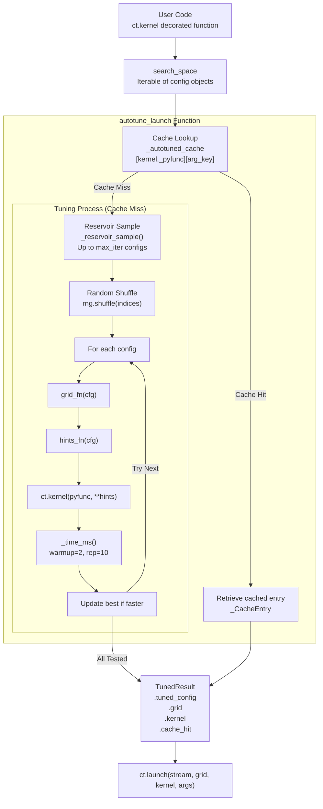

**Workflow:**
- **First invocation**: Sample and shuffle search space, compile and time each config, cache best
- **Subsequent invocations**: Lookup cached best configuration using two-level cache
- **Final launch**: Execute kernel with best configuration and return `TunedResult`

**Sources:** [samples/utils/autotuner.py:170-342](), [test/test_autotuner.py:46-223]()

---

## Core Function: autotune_launch

The `autotune_launch()` function is the primary entry point for autotuning. It performs configuration search, timing, caching, and kernel launch in a single call.

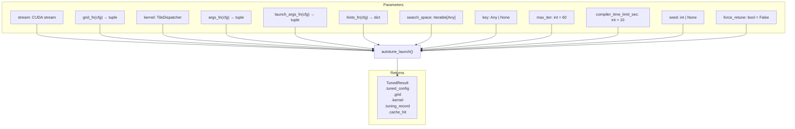

### Function Signature

[samples/utils/autotuner.py:170-180]()

```python
def autotune_launch(stream, grid_fn, kernel,
                    args_fn: Callable[[Any], tuple[Any, ...]],
                    launch_args_fn: Callable[[Any], tuple[Any, ...]] | None = None,
                    hints_fn: Callable[[Any], dict[str, Any]] | None = None,
                    *,
                    search_space: Iterable[Any] | Callable[[], Iterable[Any]],
                    key: Any | None = None,
                    max_iter: int = 60,
                    compiler_time_limit_sec: int = 10,
                    seed: int | None = None,
                    force_retune: bool = False) -> TunedResult
```

### Parameter Reference

| Parameter | Type | Default | Description |
|-----------|------|---------|-------------|
| `stream` | CUDA stream | Required | CUDA stream for all kernel launches during tuning and final run |
| `grid_fn` | `Callable[[Any], tuple]` | Required | Takes config object, returns grid dimensions tuple |
| `kernel` | `TileDispatcher` | Required | The `@ct.kernel` decorated function to autotune |
| `args_fn` | `Callable[[Any], tuple]` | Required | Takes config object, returns tuple of runtime arguments for tuning |
| `launch_args_fn` | `Callable[[Any], tuple] \| None` | `None` | Optional separate args for final launch (defaults to `args_fn`) |
| `hints_fn` | `Callable[[Any], dict] \| None` | `None` | Takes config object, returns dict of hints for `ct.kernel()` |
| `search_space` | `Iterable[Any] \| Callable` | Required | Iterable of config objects or callable returning iterable |
| `key` | `Any \| None` | `None` | Optional hashable cache key (defaults to arg shapes/dtypes/strides) |
| `max_iter` | `int` | `60` | Maximum number of valid configurations to sample |
| `compiler_time_limit_sec` | `int` | `10` | Compilation timeout per configuration in seconds |
| `seed` | `int \| None` | `None` | Optional random seed for reproducible config sampling |
| `force_retune` | `bool` | `False` | If True, ignore cache and re-run search |

**Sources:** [samples/utils/autotuner.py:170-247]()

## Data Structures

### TunedResult Dataclass

The `TunedResult` dataclass packages the results returned by `autotune_launch()`.

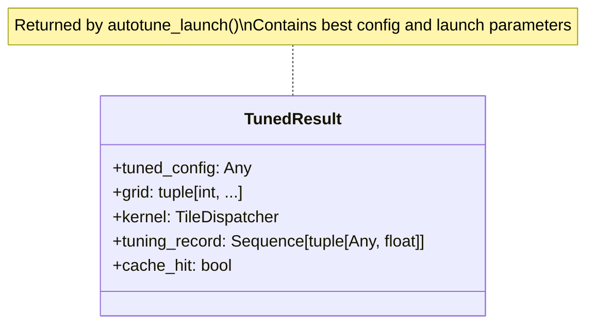

| Field | Type | Description |
|-------|------|-------------|
| `tuned_config` | `Any` | The best configuration object from the search space |
| `grid` | `tuple[int, ...]` | Grid dimensions computed by `grid_fn(tuned_config)` |
| `kernel` | `TileDispatcher` | Updated kernel compiled with best hints |
| `tuning_record` | `Sequence[tuple[Any, float]]` | List of (config, time_ms) pairs from tuning run |
| `cache_hit` | `bool` | True if result came from cache, False if newly tuned |

**Sources:** [samples/utils/autotuner.py:74-86]()

### _CacheEntry Dataclass (Internal)

The internal `_CacheEntry` dataclass stores cached tuning results.

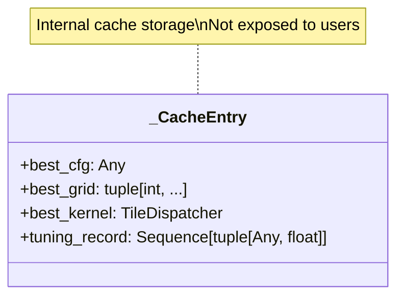

**Sources:** [samples/utils/autotuner.py:88-94]()

---

## Cache System

The autotuner maintains a two-level global cache to reuse optimal configurations across kernel invocations.

### Cache Architecture

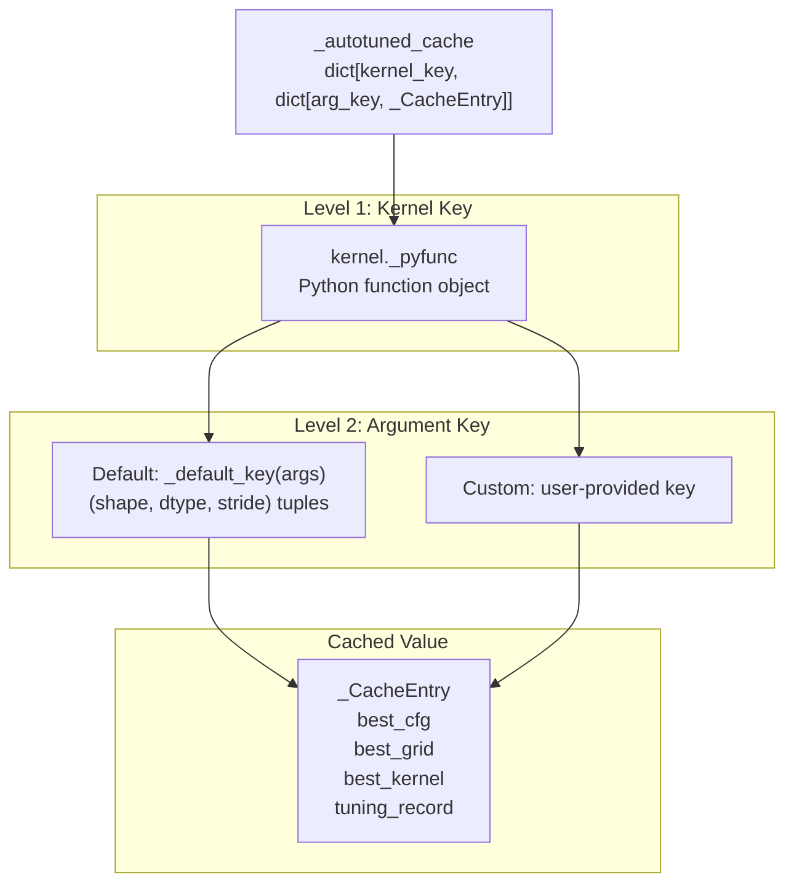

**Cache Structure:** [samples/utils/autotuner.py:96-99]()

```python
_autotuned_cache: dict[Any, dict[Any, _CacheEntry]] = {}
```

The cache uses a two-level mapping:
- **Outer level**: Indexed by `kernel._pyfunc` (the Python function object)
- **Inner level**: Indexed by argument key (default or user-provided)

This structure allows:
- Multiple kernels to be cached independently
- Same kernel to have different cached configs for different argument patterns
- Efficient lookup without recomputing signatures

**Sources:** [samples/utils/autotuner.py:96-99]()

### Default Cache Key

The default key function `_default_key()` creates a cache key from runtime arguments.

[samples/utils/autotuner.py:38-51]()

```python
def _default_key(args: tuple[Any, ...]):
    """Default cache key for autotune.
    The key(for now) is:
    - a tuple of (shape, dtype, stride) for each argument in the runtime argument (tensor),
    - or its type name for each argument in the runtime argument (other types).
    """
    tinfo = []
    for arg in args:
        if hasattr(arg, "shape") and hasattr(arg, "dtype"):
            shape, dtype, stride = _shape_dtype_stride(arg)
            tinfo.append((shape, dtype, stride))
        else:
            tinfo.append(type(arg).__name__)
    return tuple(tinfo)
```

**Key Components:**
- For tensor arguments: `(shape, dtype, stride)` tuple
- For other arguments: Type name string
- Result is a hashable tuple

**Rationale:** This default key captures the primary factors affecting kernel performance (data layout and size) while remaining hashable for dictionary lookup.

**Sources:** [samples/utils/autotuner.py:24-51]()

### clear_cache Function

The `clear_cache()` function provides cache management capabilities.

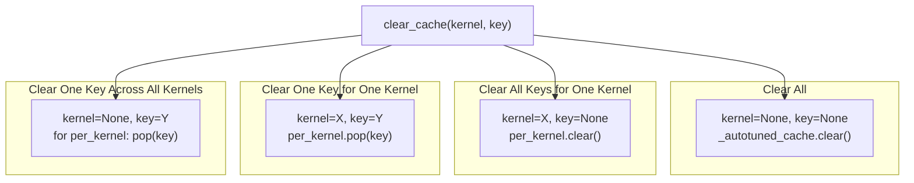

[samples/utils/autotuner.py:102-131]()

| Parameters | Effect |
|------------|--------|
| `kernel=None, key=None` | Clear entire cache for all kernels |
| `kernel=X, key=None` | Clear all keys for kernel X |
| `kernel=X, key=Y` | Clear specific key Y for kernel X |
| `kernel=None, key=Y` | Clear key Y across all kernels |

**Example Usage:**
```python
# Clear entire cache
clear_cache()

# Clear cache for specific kernel
clear_cache(kernel=my_kernel)

# Clear specific key for specific kernel
clear_cache(kernel=my_kernel, key=custom_key)
```

**Sources:** [samples/utils/autotuner.py:102-131](), [test/test_autotuner.py:46-122]()

## Configuration Sampling

The autotuner uses reservoir sampling to uniformly sample configurations from potentially large or infinite iterables.

### Reservoir Sampling Algorithm

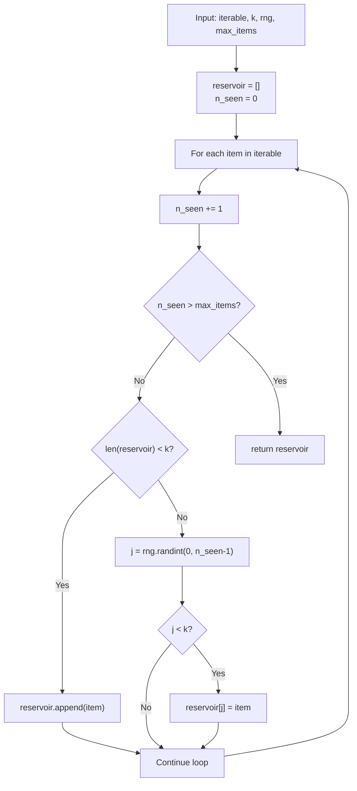

[samples/utils/autotuner.py:143-167]()

**Algorithm Properties:**
- **Uniform sampling**: Each item has equal probability of selection
- **Memory efficient**: Only stores up to `k` items regardless of iterable size
- **Handles infinite streams**: Limited by `max_items` safety cap
- **Single pass**: Only iterates through iterable once

**Parameters:**
- `k`: Number of items to sample (typically `max_iter`)
- `max_items`: Safety cap (default: 10,000) to prevent infinite iteration
- `rng`: `random.Random` instance for reproducibility

**Sources:** [samples/utils/autotuner.py:143-167]()

### Search Space Shuffling

After sampling, configurations are shuffled randomly to avoid ordering bias.

[samples/utils/autotuner.py:251-280]()

```python
rng = random.Random(seed)
search_space = _reservoir_sample(search_space, k=max_iter, rng=rng, max_items=_MAX_SEARCH_ITEMS)
indices = list(range(len(search_space)))
rng.shuffle(indices)
```

**Process:**
1. Create `random.Random` instance with optional seed
2. Reservoir sample up to `max_iter` configurations
3. Create index list `[0, 1, 2, ..., len(search_space)-1]`
4. Shuffle indices randomly
5. Iterate through configs in shuffled order

**Benefits:**
- Avoids bias from user-provided ordering
- With `seed` parameter, provides reproducible tuning runs
- Ensures fair evaluation across different config characteristics

**Sources:** [samples/utils/autotuner.py:251-280]()

## Usage Patterns

### Basic Usage

The typical pattern involves calling `autotune_launch()` with a search space and callback functions.

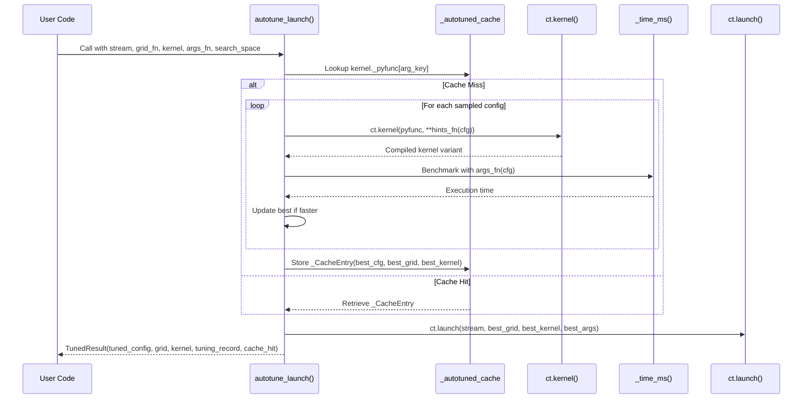

**Example:**
```python
import cuda.tile as ct
import torch
import math
from test.autotuner.autotuner import autotune_launch

@ct.kernel
def my_kernel(x, TILE_SIZE: ct.Constant[int]):
    bid = ct.bid(0)
    tile = ct.load(x, index=(bid,), shape=(TILE_SIZE,))
    result = tile + 1
    ct.store(x, index=(bid,), tile=result)

# Define search space (simple list of tile sizes)
search_space = [64, 128, 256]

# Use autotuner
x = torch.randn(1024, device='cuda')
result = autotune_launch(
    stream=torch.cuda.current_stream(),
    grid_fn=lambda cfg: (math.ceil(x.shape[0] / cfg),),
    kernel=my_kernel,
    args_fn=lambda cfg: (x, cfg),
    search_space=search_space,
)

# Access tuned configuration
print(f"Best TILE_SIZE: {result.tuned_config}")
print(f"Cache hit: {result.cache_hit}")
```

**Sources:** [test/test_autotuner.py:18-27](), [test/test_autotuner.py:46-62]()

### Custom Cache Keys

By default, the cache key is computed from argument shapes, dtypes, and strides. Custom keys enable more precise cache control.

**Example: Cache by Scalar Parameter**
```python
# Define custom key based on scalar parameter
custom_key = (scalar_value,)

result = autotune_launch(
    stream=torch.cuda.current_stream(),
    grid_fn=lambda cfg: (math.ceil(x.shape[0] / cfg),),
    kernel=my_kernel,
    args_fn=lambda cfg: (x, scalar_value, cfg),
    search_space=search_space,
    key=custom_key,  # Use custom key instead of default
)
```

**When to Use Custom Keys:**
- When scalar parameters significantly affect performance
- When you want to force separate tuning for different workload types
- When default key (shape/dtype/stride) is too coarse or too fine

**Sources:** [test/test_autotuner.py:125-173]()

### Separate Tuning and Launch Arguments

The `launch_args_fn` parameter allows using different arguments for benchmarking vs. final launch.

**Use Case: In-Place Operations**
```python
@ct.kernel
def inplace_kernel(x, TILE_SIZE: ct.Constant[int]):
    bid = ct.bid(0)
    tx = ct.load(x, index=(bid,), shape=(TILE_SIZE,))
    tx_updated = tx + 1
    ct.store(x, index=(bid,), tile=tx_updated)

x = torch.empty((1024,), device="cuda")

result = autotune_launch(
    stream=torch.cuda.current_stream(),
    grid_fn=lambda cfg: (math.ceil(x.shape[0] / cfg),),
    kernel=inplace_kernel,
    args_fn=lambda cfg: (x.clone(), cfg),        # Clone for benchmarking
    launch_args_fn=lambda cfg: (x, cfg),         # Original for final launch
    search_space=[64, 128],
)
```

**Mechanism:**
- During tuning: `args_fn(cfg)` generates arguments (potentially with clones or scratch buffers)
- Final launch: `launch_args_fn(cfg)` generates arguments (typically the original data)
- If `launch_args_fn` is `None`, final launch uses `args_fn(cfg)`

**Sources:** [test/test_autotuner.py:226-267](), [test/test_autotuner.py:449-477]()

### Dynamic Hints

The `hints_fn` parameter allows passing different compilation hints for each configuration.

**Example: Varying num_ctas**
```python
# Search space with configuration objects
from dataclasses import dataclass

@dataclass
class Config:
    tile_size: int
    num_ctas: int

search_space = [
    Config(tile_size=64, num_ctas=1),
    Config(tile_size=128, num_ctas=2),
    Config(tile_size=256, num_ctas=4),
]

result = autotune_launch(
    stream=torch.cuda.current_stream(),
    grid_fn=lambda cfg: (math.ceil(x.shape[0] / cfg.tile_size),),
    kernel=my_kernel,
    args_fn=lambda cfg: (x, cfg.tile_size),
    hints_fn=lambda cfg: {"num_ctas": cfg.num_ctas},  # Pass hints to ct.kernel()
    search_space=search_space,
)
```

**Compilation:** Each config creates a new kernel via:
```python
updated_kernel = ct.kernel(kernel._pyfunc, **hints_fn(cfg))
```

**Sources:** [samples/utils/autotuner.py:286-291]()

### Search Space as Callable

The `search_space` parameter accepts either an iterable or a callable returning an iterable.

**Example: Lazy Search Space Generation**
```python
def generate_search_space():
    # Generate configurations on-demand
    for tile_m in [64, 128, 256]:
        for tile_n in [64, 128, 256]:
            yield {"TILE_M": tile_m, "TILE_N": tile_n}

result = autotune_launch(
    stream=torch.cuda.current_stream(),
    grid_fn=lambda cfg: (math.ceil(M / cfg["TILE_M"]), math.ceil(N / cfg["TILE_N"])),
    kernel=matmul_kernel,
    args_fn=lambda cfg: (A, B, C, cfg["TILE_M"], cfg["TILE_N"]),
    search_space=generate_search_space,  # Callable, not iterable
)
```

**Mechanism:** If `callable(search_space)` returns `True`, the function is called to obtain the iterable.

**Sources:** [samples/utils/autotuner.py:248-249](), [test/test_autotuner.py:313-326]()

---

## Timing and Benchmarking

The `_time_ms()` function uses CUDA events to measure kernel execution time accurately.

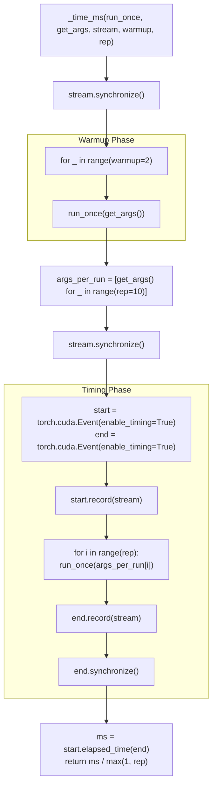

[samples/utils/autotuner.py:54-71]()

### Benchmarking Process

| Phase | Description |
|-------|-------------|
| **Initial Sync** | `stream.synchronize()` ensures all previous GPU work completes |
| **Warmup** | Execute kernel `warmup` times (default: 2) to warm caches and eliminate cold-start effects |
| **Argument Prep** | Pre-generate arguments for all repetitions to exclude generation time from measurement |
| **Sync Again** | Ensure warmup completes before timing begins |
| **Timed Execution** | Record CUDA event, run `rep` iterations (default: 10), record end event |
| **Synchronization** | `end.synchronize()` blocks until all timed work completes |
| **Calculate Average** | `start.elapsed_time(end) / rep` returns average time per run in milliseconds |

### Parameters

| Parameter | Default | Description |
|-----------|---------|-------------|
| `run_once` | Required | Callable that executes one kernel launch |
| `get_args` | Required | Callable that generates fresh arguments for each run |
| `stream` | Required | CUDA stream for execution |
| `warmup` | `2` | Number of warmup iterations (discarded) |
| `rep` | `10` | Number of timed repetitions |

**Why Pre-generate Arguments:** The `args_per_run` list is created before timing to exclude argument generation overhead from measurements. This is especially important when `get_args()` involves cloning tensors or other expensive operations.

**Sources:** [samples/utils/autotuner.py:54-71]()

---

## Tuning Algorithm

The core tuning loop in `autotune_launch()` performs random sampling, compilation, timing, and best-config tracking.

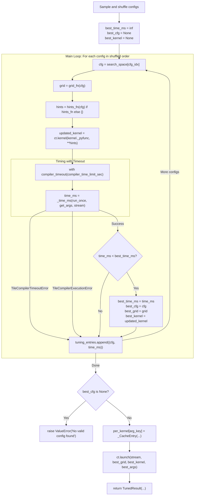

[samples/utils/autotuner.py:279-322]()

### Algorithm Steps

1. **Initialization**: Set `best_time_ms = inf`, initialize tracking variables
2. **Index Shuffling**: Randomize config order to avoid ordering bias
3. **Per-Config Loop**:
   - Compute grid dimensions: `grid = grid_fn(cfg)`
   - Get compilation hints: `hints = hints_fn(cfg)` (if provided)
   - Compile kernel variant: `ct.kernel(kernel._pyfunc, **hints)`
   - Benchmark execution: `_time_ms()` with timeout protection
   - Handle exceptions: Skip config on timeout or compilation error
   - Update best if faster: Track best config, grid, kernel, and time
   - Record result: Append `(cfg, time_ms)` to tuning record
4. **Validation**: Raise `ValueError` if no valid config found
5. **Cache Update**: Store `_CacheEntry` with best config details
6. **Final Launch**: Execute kernel with best config and actual launch args
7. **Return**: Package results in `TunedResult`

**Sources:** [samples/utils/autotuner.py:279-334]()

---

## Error Handling

The autotuner gracefully handles compilation failures and timeouts during the configuration search.

### Compiler Timeout Protection

The `compiler_timeout` context manager temporarily modifies the global compiler timeout for each configuration.

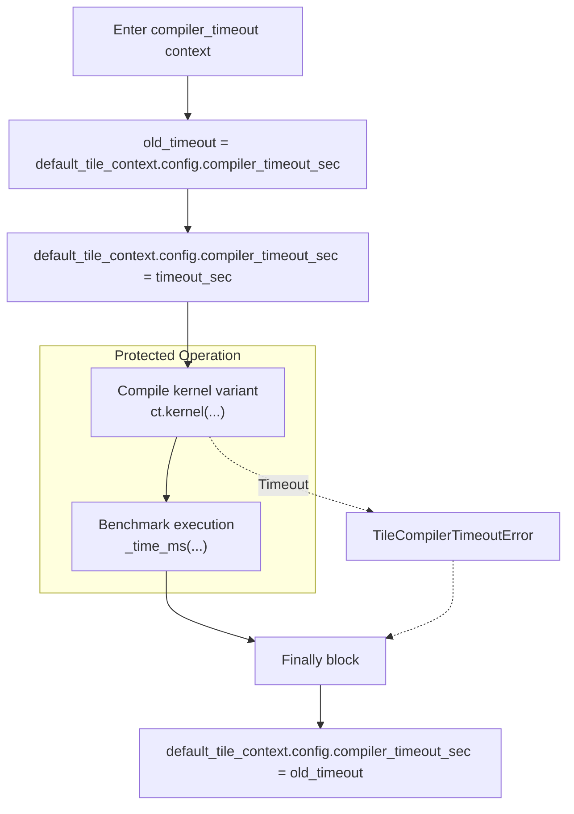

[samples/utils/autotuner.py:133-141]()

```python
@contextmanager
def compiler_timeout(timeout_sec: int):
    old_timeout = default_tile_context.config.compiler_timeout_sec
    default_tile_context.config.compiler_timeout_sec = timeout_sec
    try:
        yield
    finally:
        default_tile_context.config.compiler_timeout_sec = old_timeout
```

**Usage in autotune_launch:**
```python
try:
    with compiler_timeout(compiler_time_limit_sec):
        time_ms = _time_ms(run_once, get_args=lambda: args_fn(cfg), stream=stream)
except TileCompilerTimeoutError as e:
    logger.debug(f"{cfg} compilation timeout: {e}")
    continue  # Skip this config
```

**Behavior:**
- Each config gets `compiler_time_limit_sec` (default: 10 seconds) to compile
- On timeout, `TileCompilerTimeoutError` is caught and logged
- Config is skipped and search continues with next config
- Timeout is always restored in `finally` block

**Sources:** [samples/utils/autotuner.py:133-141](), [samples/utils/autotuner.py:296-305](), [test/test_autotuner.py:270-310]()

### Compilation Errors

Compilation failures (type errors, invalid operations, etc.) are caught separately.

[samples/utils/autotuner.py:306-308]()

```python
except TileCompilerExecutionError as e:
    logger.debug(f"{cfg} compilation error: {e}")
    continue  # Skip this config
```

**Exception:** `TileCompilerExecutionError` is caught when:
- Kernel contains type errors
- Invalid IR operations
- Bytecode generation fails
- Any other compilation-time error

**Behavior:** Config is logged and skipped, search continues.

**Sources:** [samples/utils/autotuner.py:306-308](), [test/test_autotuner.py:416-446]()

### No Valid Configuration

If all configurations fail (timeout, compilation error, or zero configs), the autotuner raises `ValueError`.

[samples/utils/autotuner.py:320-321]()

```python
if best_cfg is None:
    raise ValueError("No valid config found")
```

**Causes:**
- All configs timed out during compilation
- All configs failed to compile
- Search space was empty
- All configs were filtered by reservoir sampling

**Sources:** [samples/utils/autotuner.py:258-259](), [samples/utils/autotuner.py:320-321](), [test/test_autotuner.py:296-307]()

---

## Integration with cuda.tile

### Kernel Compilation

For each configuration, the autotuner creates a new kernel variant using `ct.kernel()` with hints from `hints_fn()`.

[samples/utils/autotuner.py:288-291]()

```python
hints = hints_fn(cfg) if hints_fn else {}
updated_kernel = ct.kernel(
    kernel._pyfunc,
    **hints
)
```

**Hints Dictionary:** The `hints_fn()` callback can return any parameters accepted by `ct.kernel()`:
- `num_ctas`: Number of cooperative thread arrays
- `occupancy`: Target occupancy percentage
- `opt_level`: Optimization level (0-3)
- Any other compilation hints

**Example:**
```python
def hints_fn(cfg):
    return {
        "num_ctas": cfg.num_ctas,
        "occupancy": cfg.occupancy,
    }
```

Each configuration gets a freshly compiled `TileDispatcher` instance, allowing independent specialization.

**Sources:** [samples/utils/autotuner.py:288-291]()

### Kernel Launch

Kernel execution uses the standard `ct.launch()` API during both benchmarking and final execution.

[samples/utils/autotuner.py:293-294]()

```python
def run_once(args):
    ct.launch(stream, grid, updated_kernel, args)
```

**Benchmarking Loop:** This closure is passed to `_time_ms()` which calls it multiple times with fresh arguments.

**Final Launch:** After tuning, the best configuration is used for one final launch with `launch_args_fn()` arguments (or `args_fn()` if `launch_args_fn` is not provided).

[samples/utils/autotuner.py:328-333]()

```python
best_args = (
    launch_args_fn(cache_entry.best_cfg)
    if launch_args_fn
    else args_fn(cache_entry.best_cfg)
)
ct.launch(stream, cache_entry.best_grid, cache_entry.best_kernel, best_args)
```

**Sources:** [samples/utils/autotuner.py:293-294](), [samples/utils/autotuner.py:328-333]()

### Relationship to Constant Embedding

The autotuner naturally works with constant-embedded parameters (see page 5.3).

**Example: Tuning Constant TILE_SIZE**
```python
@ct.kernel
def kernel(x, TILE_SIZE: ct.Constant[int]):
    # Compiler optimizes for specific TILE_SIZE value
    bid = ct.bid(0)
    tile = ct.load(x, index=(bid,), shape=(TILE_SIZE,))
    result = tile + 1
    ct.store(x, index=(bid,), tile=result)

# Each config compiles a specialized kernel
search_space = [64, 128, 256]  # Different TILE_SIZE values

result = autotune_launch(
    stream=stream,
    grid_fn=lambda cfg: (math.ceil(x.shape[0] / cfg),),
    kernel=kernel,
    args_fn=lambda cfg: (x, cfg),  # cfg is the TILE_SIZE value
    search_space=search_space,
)
```

**Benefit:** Each configuration gets aggressive constant folding, loop unrolling, and other optimizations specific to that constant value.

**Sources:** [test/test_autotuner.py:18-26](), [test/test_autotuner.py:449-458]()

---

## Best Practices

### Designing Search Spaces

**1. Start small, expand gradually:**
```python
# Initial search
configs_small = [Config(TILE_SIZE=ts) for ts in [64, 128, 256]]

# After finding promising range, refine
configs_refined = [Config(TILE_SIZE=ts) for ts in [96, 128, 160, 192]]
```

**2. Use predicates to prune invalid configs:**
```python
def valid_tiles(named_args, cfg):
    M, N, K = named_args['a'].shape[0], named_args['b'].shape[1], named_args['a'].shape[1]
    return (cfg.TILE_M <= M and cfg.TILE_N <= N and cfg.TILE_K <= K)
```

**3. Combine with architecture-specific hints:**
```python
configs = [
    Config(
        TILE_SIZE=ByTarget(sm_100=64, sm_120=128, default=64),
        num_ctas=ByTarget(sm_100=1, sm_120=2, default=1),
    ),
    # ... more configs ...
]
```

### Managing Cache

**1. Clear cache when code changes:**
```python
# After modifying kernel implementation
tuner.clear_cache()
```

**2. Use custom keys for important parameters:**
```python
def cache_key(kernel, args):
    # Include important scalar parameters in key
    matrix, threshold = args[0], args[1]
    return (kernel._pyfunc.__name__, matrix.shape, matrix.dtype, threshold)
```

**3. Use `force_retune` for benchmarking:**
```python
# Re-benchmark without cache interference
result = tuner(..., force_retune=True)
```

### Limiting Search Time

**1. Set reasonable `max_iter`:**
```python
# Quick search: try up to 10 configs
tuner(..., max_iter=10)

# Thorough search: try up to 100 configs
tuner(..., max_iter=100)
```

**2. Set compilation timeouts:**
```python
# Limit per-config compilation to 30 seconds
tuner(..., compiler_time_limit_sec=30)
```

**3. Use transforms to avoid expensive preprocessing:**
```python
# Don't recompute expensive preprocessing in args_fn
def args_fn(cfg):
    # Expensive: recalculated for each config
    preprocessed = expensive_preprocess(x)
    return (preprocessed, cfg.TILE_SIZE)

# Better: compute once, use transforms if needed
preprocessed = expensive_preprocess(x)
def args_fn(cfg):
    return (preprocessed, cfg.TILE_SIZE)
```

**Sources:** [samples/utils/autotuner.py:206-331](), [test/test_autotuner.py:1-322]()

---

