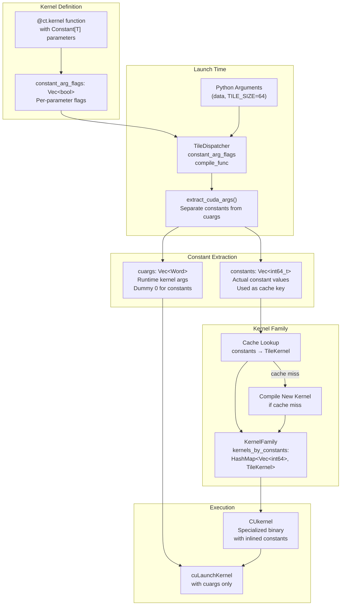
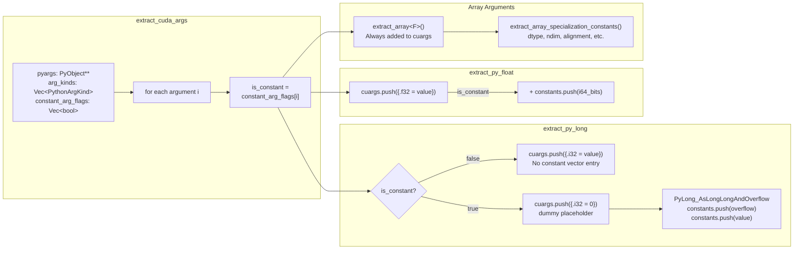
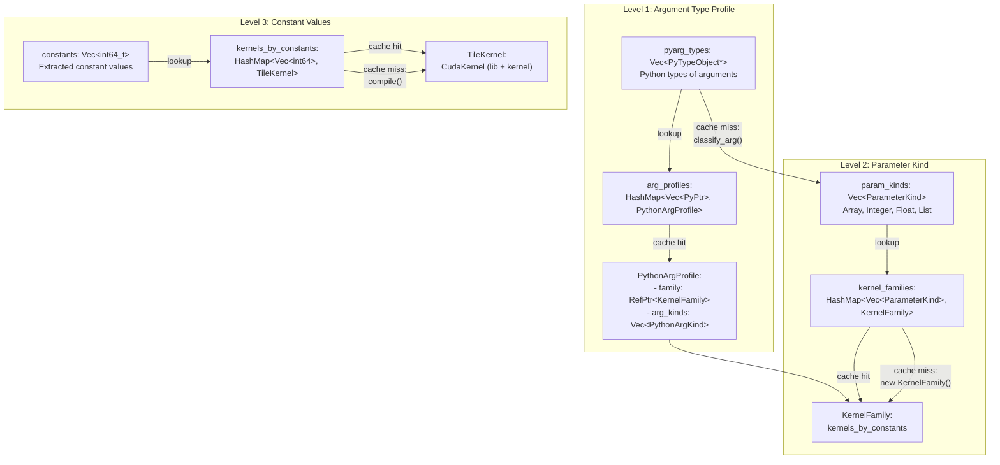
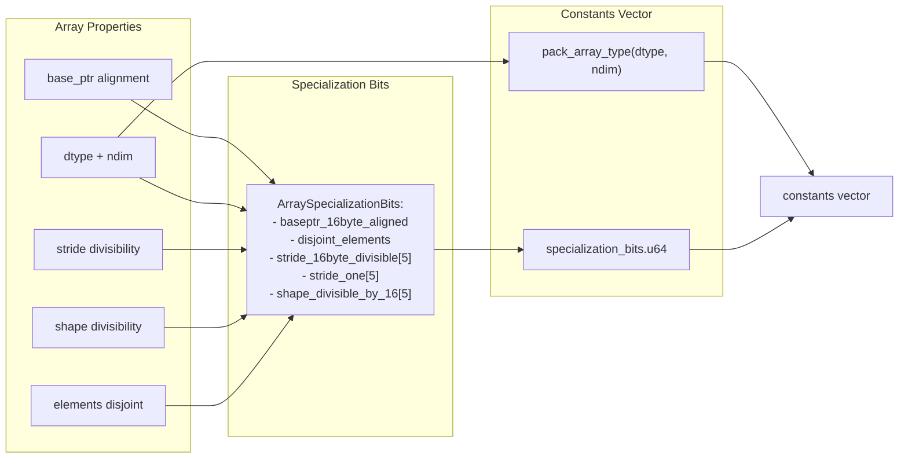

<!-- source: DeepWiki mcp.deepwiki.com · repo NVIDIA/cutile-python · page 5.3 Constant Embedding · fetched 2026-10-26 -->

# Constant Embedding

<details>
<summary>Relevant source files</summary>

The following files were used as context for generating this wiki page:

- [docs/source/execution.rst](docs/source/execution.rst)
- [src/cuda/tile/_ir/ir.py](src/cuda/tile/_ir/ir.py)
- [src/cuda/tile/_ir/typing_support.py](src/cuda/tile/_ir/typing_support.py)
- [src/cuda/tile/_passes/typeinfer.py](src/cuda/tile/_passes/typeinfer.py)
- [test/test_typeinfer.py](test/test_typeinfer.py)

</details>


This page describes **constant embedding**, a performance optimization technique that enables compile-time specialization of kernel parameters. For general performance tuning, see [Performance Tuning Basics](#5.1). For architecture-specific optimizations, see [Architecture-Specific Configuration](#5.2).

## Purpose and Scope

Constant embedding allows kernel parameters to be compiled directly into the kernel binary as literal values, eliminating runtime memory overhead and enabling aggressive compiler optimizations. When a parameter is marked as constant embedded, the compiler generates separate kernel binaries for each distinct parameter value, treating the parameter as a compile-time constant throughout the kernel.

This technique is particularly useful for:
- Tile dimensions (e.g., `TILE_M`, `TILE_N`, `TILE_K`)
- Algorithm selection flags
- Loop bounds and unrolling factors
- Any parameter that remains constant across multiple kernel launches

## Constant Embedding Semantics

When a parameter is constant embedded, three guarantees apply:

1. **Value Propagation**: All uses of the parameter behave as if replaced by the literal value
2. **Multiple Binaries**: A distinct kernel binary exists for each unique parameter value
3. **Zero Runtime Cost**: The parameter occupies 0 bytes in the kernel's argument memory

These semantics are defined in [docs/source/execution.rst:158-166]().

**Key Insight**: Constant embedded parameters are resolved during compilation, not at launch time. Each unique value triggers a new kernel compilation, which is then cached for future use.

Sources: [docs/source/execution.rst:158-166]()

## Usage: Marking Parameters as Constant

### Using ConstantAnnotation

Parameters are marked for constant embedding using the `ConstantAnnotation` type hint:

```python
from cuda.tile import ConstantAnnotation

@ct.kernel
def my_kernel(
    data: ct.Array,
    TILE_SIZE: ConstantAnnotation[int]  # Constant embedded
):
    # TILE_SIZE is treated as a compile-time constant
    tile = ct.arange(TILE_SIZE, dtype=ct.int32)
```

### Using the Constant Alias

For convenience, `cuda.tile.Constant` provides a shorter alias:

```python
from cuda.tile import Constant

@ct.kernel  
def my_kernel(
    data: ct.Array,
    TILE_SIZE: Constant[int]  # Equivalent to ConstantAnnotation[int]
):
    pass
```

Example code is shown in [docs/source/execution.rst:170-184]().

Sources: [docs/source/execution.rst:167-184](), [src/cuda/tile/_cext.pyi:1-32]()

## Implementation Architecture

### Constant Embedding Pipeline

The following diagram illustrates how constant embedding flows through the compilation and execution pipeline:



**Diagram: Constant Embedding Flow**

The pipeline separates constant parameters from runtime arguments early in the launch process. Constants become part of the cache key for kernel lookup, while runtime arguments receive dummy placeholder values.

Sources: [cext/tile_kernel.cpp:746-901](), [cext/tile_kernel.cpp:1160-1228]()

### TileDispatcher Structure

The `TileDispatcher` manages constant embedding at the C++ extension level:

| Component | Type | Purpose |
|-----------|------|---------|
| `constant_arg_flags` | `Vec<bool>` | Per-parameter flags indicating which arguments are constant embedded |
| `compile_func` | `PyPtr` | Python callback to compile new kernel variants |
| `default_context_dispatcher` | `TileContextDispatcher` | Manages kernel families and argument profiles |

Each `TileContextDispatcher` contains:

| Component | Type | Purpose |
|-----------|------|---------|
| `kernel_families` | `HashMap<Vec<ParameterKind>, RefPtr<KernelFamily>>` | Maps parameter type signatures to kernel families |
| `arg_profiles` | `ProfileMap` | Caches argument classification by Python type |

Each `KernelFamily` maintains:

| Component | Type | Purpose |
|-----------|------|---------|
| `kernels_by_constants` | `HashMap<Vec<int64_t>, TileKernel>` | Maps constant value vectors to compiled kernel binaries |

Sources: [cext/tile_kernel.cpp:931-935](), [cext/tile_kernel.cpp:924-928](), [cext/tile_kernel.cpp:173-177]()

## Constant Extraction Process

### Code Entity Mapping

The following diagram maps the extraction process to specific code functions:



**Diagram: Argument Extraction Logic**

Sources: [cext/tile_kernel.cpp:862-901](), [cext/tile_kernel.cpp:746-770](), [cext/tile_kernel.cpp:772-781]()

### Integer Constant Extraction

When extracting a constant integer parameter:

1. **Dummy Runtime Value**: A zero is pushed to `cuargs` as a placeholder ([cext/tile_kernel.cpp:749]())
2. **Overflow Handling**: The value is extracted with overflow detection ([cext/tile_kernel.cpp:752]())
3. **Constant Storage**: 
   - If no overflow: `constants.push(0)`, `constants.push(value)` ([cext/tile_kernel.cpp:761-762]())
   - If overflow: `constants.push(1)`, `constants.push(unsigned_value)` ([cext/tile_kernel.cpp:756-758]())

This design supports arbitrarily large constant integers while maintaining a consistent vector structure for cache key generation.

Sources: [cext/tile_kernel.cpp:746-770]()

### Float Constant Extraction

Float constants follow a simpler pattern:

1. **Runtime Value**: The float value is always pushed to `cuargs` as `float32` ([cext/tile_kernel.cpp:774]())
2. **Constant Storage**: If constant, the bit pattern is reinterpreted as `int64_t` and pushed to `constants` ([cext/tile_kernel.cpp:776-779]())

This ensures consistent binary representation across cache lookups.

Sources: [cext/tile_kernel.cpp:772-781]()

## Kernel Family and Caching

### Multi-Level Caching Strategy



**Diagram: Three-Level Kernel Cache**

The caching hierarchy optimizes for common cases:
- **Level 1** avoids repeated Python type classification
- **Level 2** groups kernels by parameter structure
- **Level 3** specializes kernels by constant values

Sources: [cext/tile_kernel.cpp:1177-1228](), [cext/tile_kernel.cpp:903-918](), [cext/tile_kernel.cpp:924-928]()

### Cache Key Construction

The `constants` vector serves as the cache key for kernel lookups. For a kernel with parameters `(Array, int, float, int)` where the two integers are constant embedded:

| Argument | Type | Contribution to `constants` |
|----------|------|----------------------------|
| `arr` | Array | `pack_array_type(dtype, ndim)`, `specialization_bits` |
| `x` | int (constant) | `overflow_flag`, `value` |
| `y` | float (runtime) | _(none)_ |
| `z` | int (constant) | `overflow_flag`, `value` |

The resulting `constants` vector uniquely identifies this kernel variant. Two launches with the same constant values (but potentially different runtime values) will share the same kernel binary.

Sources: [cext/tile_kernel.cpp:447-471](), [cext/tile_kernel.cpp:1220-1228]()

## Array Specialization Constants

Even non-constant array parameters contribute to the cache key through **array specialization**:



**Diagram: Array Specialization Constant Generation**

This allows the compiler to generate optimized variants based on array properties. For example, a kernel may have separate binaries for 16-byte aligned vs. unaligned arrays, enabling the use of vectorized load instructions. See [Array Specialization](#7.2) for details.

Sources: [cext/tile_kernel.cpp:385-471](), [cext/tile_kernel.cpp:71-92]()

## Compilation on Cache Miss

When a kernel variant does not exist in the cache:

1. **Compile Function Call**: The Python `compile_func` is invoked with the original arguments ([cext/tile_kernel.cpp:945-957]())
2. **Bytecode Generation**: The compiler generates specialized TileIR bytecode with constants inlined
3. **MLIR Compilation**: The `tileiras` compiler produces a `.cubin` file
4. **Kernel Loading**: The kernel is loaded via `cuLibraryLoadFromFile` and `cuLibraryGetKernel` ([cext/tile_kernel.cpp:124-151]())
5. **Cache Insertion**: The `TileKernel` is inserted into `kernels_by_constants` ([cext/tile_kernel.cpp:1227]())

Subsequent launches with the same constant values will skip compilation and use the cached kernel.

Sources: [cext/tile_kernel.cpp:945-987](), [cext/tile_kernel.cpp:124-151](), [cext/tile_kernel.cpp:1220-1228]()

## Performance Implications

### When to Use Constant Embedding

**Use constant embedding when:**

| Scenario | Benefit |
|----------|---------|
| Tile dimensions (e.g., 64, 128, 256) | Enables loop unrolling, bounds check elimination |
| Algorithm variants (e.g., 0=naive, 1=tiled, 2=fused) | Enables dead code elimination |
| Small sets of discrete values | Compilation overhead amortized over many launches |
| Known at kernel definition time | No runtime cost, maximum optimization |

**Avoid constant embedding when:**

| Scenario | Reason |
|----------|--------|
| High cardinality parameters | Each value triggers compilation; cache memory grows |
| Frequently changing values | Compilation overhead dominates |
| Large numeric ranges | Defeats caching benefit |
| Values unknown until runtime | Cannot leverage constant semantics |

### Zero Runtime Cost Guarantee

Constant embedded parameters impose **zero bytes** of argument memory ([docs/source/execution.rst:166]()). Consider a kernel:

```python
@ct.kernel
def kernel(arr: ct.Array, size: Constant[int]):
    pass
```

**Without constant embedding:**
- Argument memory: `sizeof(void*) + sizeof(int32) + 2*ndim*sizeof(int32)` ≈ 8 + 4 + ... bytes

**With constant embedding:**
- Argument memory: `sizeof(void*) + 2*ndim*sizeof(int32)` bytes (no space for `size`)
- `size` exists only as an immediate value in the instruction stream

The dummy value pushed to `cuargs` ([cext/tile_kernel.cpp:749]()) is a placeholder and is not actually read by the kernel.

Sources: [docs/source/execution.rst:158-166](), [cext/tile_kernel.cpp:746-770]()

### Compilation Overhead

Each unique constant value incurs:
- **One-time cost**: Compilation (Python → IR → bytecode → MLIR → cubin)
- **Amortized cost**: Kernel cache lookup (hash map lookup on `Vec<int64_t>`)

For example, if a kernel is launched 1000 times with `TILE_SIZE=64` and 500 times with `TILE_SIZE=128`:
- Two compilations occur (first launch of each size)
- Remaining 1498 launches use cached kernels

If `TILE_SIZE` varies across 1000 different values, 1000 compilations occur, likely exceeding the runtime benefit.

Sources: [cext/tile_kernel.cpp:1220-1228](), [cext/tile_kernel.cpp:945-987]()

## Integration with Autotuner

Constant embedding works seamlessly with the autotuner (see [Autotuner](#5.3)). The autotuner explores different constant values and automatically benefits from kernel caching:

```python
space = ct.SearchSpace()
space.add_config(ct.Config(meta={'TILE_M': 64}))
space.add_config(ct.Config(meta={'TILE_M': 128}))

@ct.autotune(space)
@ct.kernel
def kernel(arr: ct.Array, TILE_M: Constant[int]):
    pass
```

The autotuner will:
1. Compile and time the kernel with `TILE_M=64`
2. Compile and time the kernel with `TILE_M=128`
3. Cache both variants
4. Select the best configuration
5. Use the cached winner for subsequent launches

Sources: [docs/source/execution.rst:158-184]()

## Summary

Constant embedding provides:
- **Aggressive Optimization**: Constants enable loop unrolling, bounds elimination, and dead code removal
- **Zero Runtime Cost**: Parameters occupy 0 bytes in kernel arguments
- **Automatic Caching**: Multiple binaries are cached by constant values
- **Seamless Integration**: Works with autotuner and array specialization

The implementation uses a three-level cache (type profile → parameter kind → constant values) to minimize compilation overhead while maintaining flexibility.

Key code entities:
- `TileDispatcher.constant_arg_flags` tracks which parameters are constant
- `KernelFamily.kernels_by_constants` caches compiled variants
- `extract_cuda_args` separates constants from runtime arguments
- `LaunchHelper.constants` serves as the cache key

Sources: [cext/tile_kernel.cpp:746-1228](), [docs/source/execution.rst:158-184]()

---

