<!-- source: DeepWiki mcp.deepwiki.com · repo NVIDIA/cutile-python · page 6 Examples and Patterns · fetched 2026-10-26 -->

# Examples and Patterns

<details>
<summary>Relevant source files</summary>

The following files were used as context for generating this wiki page:

- [.pre-commit-config.yaml](.pre-commit-config.yaml)
- [samples/LayerNorm.py](samples/LayerNorm.py)
- [samples/MatMul.py](samples/MatMul.py)
- [samples/templates/MatMul.py](samples/templates/MatMul.py)
- [test/bench_matmul.py](test/bench_matmul.py)
- [test/kernels/layer_norm.py](test/kernels/layer_norm.py)
- [test/kernels/rms_norm.py](test/kernels/rms_norm.py)

</details>


This page provides an overview of common programming patterns used when writing cuTile kernels. It demonstrates the recurring structures, idioms, and best practices found across the sample implementations in the codebase. These patterns form the building blocks for writing efficient GPU kernels.

For detailed explanations of specific kernel implementations, see:
- Matrix multiplication: [Matrix Multiplication](#6.1)
- Fused multi-head attention: [Fused Multi-Head Attention](#6.2)  
- Layer normalization: [Layer Normalization](#6.3)
- PyTorch integration techniques: [PyTorch Integration](#6.4)

For API documentation of individual operations, see [API Reference](#3).

## Kernel Structure Pattern

Every cuTile kernel follows a consistent structure. The fundamental pattern consists of:

1. **Kernel decoration** with `@ct.kernel` decorator
2. **Parameter declaration** with type hints for constants
3. **Block ID retrieval** to determine which tile this block computes
4. **Tile iteration** to process data in chunks
5. **Data movement** via `ct.load` and `ct.store`
6. **Computation** using tile operations

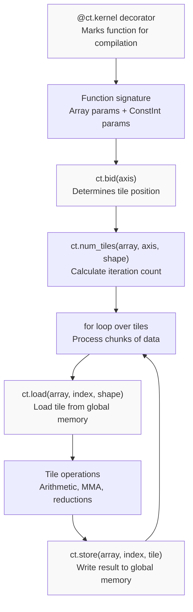

**Example: Basic kernel skeleton**

[samples/MatMul.py:33-101]()

Sources: [samples/MatMul.py](), [samples/LayerNorm.py](), [test/kernels/rms_norm.py]()

## Constant Parameters Pattern

Tile dimensions must be compile-time constants for optimal code generation. The `ct.Constant[int]` type hint signals that a parameter value will be embedded in the compiled binary.

| Pattern | Type Hint | Usage |
|---------|-----------|-------|
| Runtime parameter | No type hint or Python type | Array references, epsilon values |
| Compile-time constant | `ct.Constant[int]` | Tile dimensions (tm, tn, tk) |
| Alternative syntax | `ConstInt = ct.Constant[int]` | Common abbreviation |

**Example: Constant parameter declaration**

[samples/MatMul.py:11]() defines `ConstInt = ct.Constant[int]`

[samples/MatMul.py:34-37]() uses `ConstInt` type hints for `tm`, `tn`, `tk`

[samples/LayerNorm.py:18]() uses `TILE_N: ConstInt` for tile size

For more details on constant embedding and its performance implications, see [Constant Embedding](#5.3).

Sources: [samples/MatMul.py](), [samples/LayerNorm.py](), [test/kernels/layer_norm.py]()

## Block ID and Grid Mapping Pattern

Each CUDA block processes a specific tile of the output. The block ID determines which tile to compute.

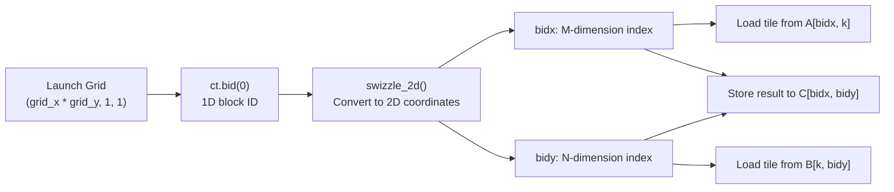

**Pattern 1: Direct block ID usage**

[samples/LayerNorm.py:32]() - Simple 1D mapping: `bid_m = ct.bid(0)`

**Pattern 2: Block swizzling for 2D grids**

[samples/MatMul.py:14-24]() - `swizzle_2d_from_bid()` converts 1D grid to 2D coordinates

[samples/MatMul.py:27-30]() - `swizzle_2d()` wrapper using current block ID

[samples/MatMul.py:59]() - Usage: `bidx, bidy = swizzle_2d(M, N, tm, tn, GROUP_SIZE_M)`

Block swizzling improves cache locality by grouping spatially adjacent tiles. The `GROUP_SIZE_M` parameter (typically 8) controls how many M-dimension blocks are processed before moving to the next N-dimension block.

Sources: [samples/MatMul.py]()

## Tile Iteration Pattern

Kernels iterate over tiles along reduction dimensions (e.g., K-dimension in matmul) or feature dimensions (e.g., N-dimension in layer norm).

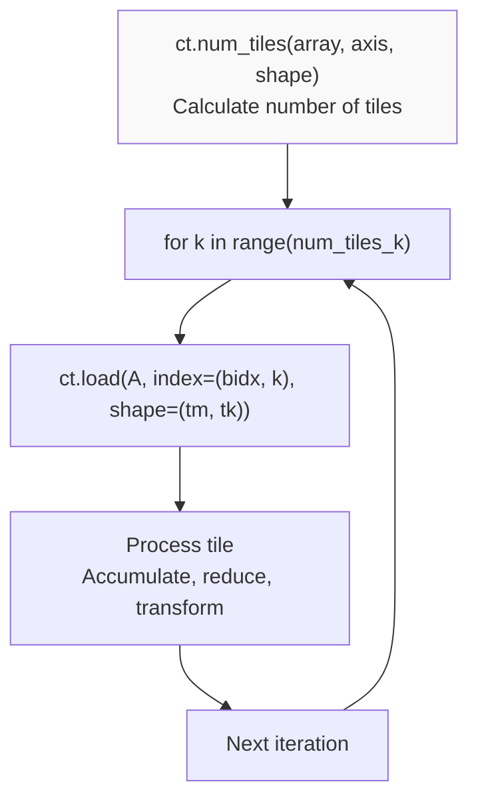

**Pattern: K-dimension reduction in matrix multiplication**

[samples/MatMul.py:66]() - Calculate tiles: `num_tiles_k = ct.num_tiles(A, axis=1, shape=(tm, tk))`

[samples/MatMul.py:80-93]() - Iterate and accumulate:
```python
for k in range(num_tiles_k):
    a = ct.load(A, index=(bidx, k), shape=(tm, tk), padding_mode=zero_pad)
    b = ct.load(B, index=(k, bidy), shape=(tk, tn), padding_mode=zero_pad)
    accumulator = ct.mma(a, b, accumulator)
```

**Pattern: N-dimension iteration in layer norm**

[samples/LayerNorm.py:33]() - Calculate tiles: `num_tiles = ct.num_tiles(X, axis=1, shape=(1, TILE_N))`

[samples/LayerNorm.py:37-40]() - Iterate for mean computation:
```python
for j in range(num_tiles):
    tx = ct.load(X, index=(bid_m, j), shape=(1, TILE_N), padding_mode=PAD_ZERO)
    mean += tx
```

Sources: [samples/MatMul.py](), [samples/LayerNorm.py](), [test/kernels/layer_norm.py]()

## Data Movement Patterns

### Load Pattern

`ct.load` transfers data from global memory Arrays to local Tiles. Key aspects:

| Parameter | Purpose | Common Values |
|-----------|---------|---------------|
| `array` | Source array | Input matrices A, B, X, W |
| `index` | Tile index (tuple) | `(bidx, k)`, `(bid_m, j)` |
| `shape` | Tile dimensions | `(tm, tk)`, `(1, TILE_N)` |
| `padding_mode` | Boundary handling | `ct.PaddingMode.ZERO` |

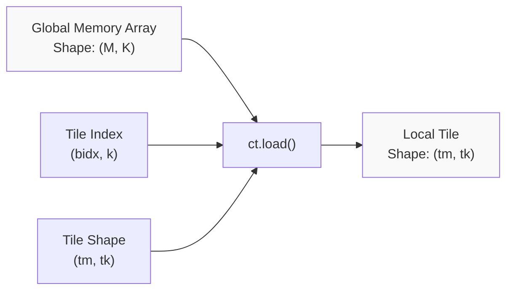

**Examples:**

[samples/MatMul.py:84]() - Load with zero padding:
```python
a = ct.load(A, index=(bidx, k), shape=(tm, tk), padding_mode=zero_pad)
```

[samples/LayerNorm.py:58]() - 1D tile load:
```python
tw = ct.load(W, index=(j,), shape=(TILE_N,), padding_mode=PAD_ZERO)
```

### Store Pattern

`ct.store` writes Tiles back to global memory Arrays.

[samples/MatMul.py:101]() - Store result tile:
```python
ct.store(C, index=(bidx, bidy), tile=accumulator)
```

[samples/LayerNorm.py:42]() - Store scalar value:
```python
ct.store(Mean, index=(bid_m,), tile=mean)
```

[samples/LayerNorm.py:62]() - Store with type conversion:
```python
ct.store(Y, index=(bid_m, j), tile=ty.astype(Y.dtype))
```

### Padding Modes

When tile boundaries extend beyond array bounds, padding modes control behavior:

- `ct.PaddingMode.ZERO` - Pad out-of-bounds regions with zeros (most common)
- Allows processing non-multiple dimensions without explicit bounds checking

[samples/MatMul.py:72]() - Define padding: `zero_pad = ct.PaddingMode.ZERO`

[samples/LayerNorm.py:14]() - Module-level constant: `PAD_ZERO = ct.PaddingMode.ZERO`

Sources: [samples/MatMul.py](), [samples/LayerNorm.py]()

## Accumulation and Reduction Patterns

### Accumulator Initialization Pattern

Matrix multiplication and normalization kernels initialize accumulators before iterating:

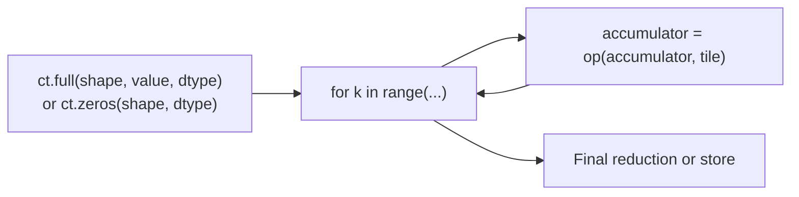

**Matrix multiplication accumulator:**

[samples/MatMul.py:71]() - Initialize to zeros:
```python
accumulator = ct.full((tm, tn), 0, dtype=ct.float32)
```

[samples/MatMul.py:93]() - Accumulate products:
```python
accumulator = ct.mma(a, b, accumulator)
```

**Layer norm mean accumulator:**

[samples/LayerNorm.py:36]() - Initialize mean accumulator:
```python
mean = ct.full((1, TILE_N), 0, dtype=ct.float32)
```

[samples/LayerNorm.py:40]() - Accumulate values:
```python
mean += tx
```

### Reduction Pattern

After accumulation, reduce along axes to produce final values:

[samples/LayerNorm.py:41]() - Reduce and normalize:
```python
mean = ct.sum(mean, axis=1) / N
```

[samples/LayerNorm.py:51]() - Variance reduction:
```python
var = ct.sum(var, axis=1) / N
```

[test/kernels/layer_norm.py:152-153]() - Multi-axis reduction:
```python
sum_dw = ct.sum(dw, axis=0)
sum_db = ct.sum(db, axis=0)
```

Sources: [samples/MatMul.py](), [samples/LayerNorm.py](), [test/kernels/layer_norm.py]()

## Type Conversion Patterns

### Precision Management

High-precision accumulation with lower-precision I/O is a common pattern:

**Pattern: FP32 accumulation with FP16 I/O**

[samples/MatMul.py:71]() - Accumulate in FP32:
```python
accumulator = ct.full((tm, tn), 0, dtype=ct.float32)
```

[samples/MatMul.py:97]() - Convert to output dtype:
```python
accumulator = ct.astype(accumulator, C.dtype)
```

**Pattern: TF32 conversion for Tensor Cores**

[samples/MatMul.py:75]() - Conditional TF32 conversion:
```python
dtype = ct.tfloat32 if A.dtype == ct.float32 else A.dtype
```

[samples/MatMul.py:84]() - Apply conversion:
```python
a = ct.load(A, index=(bidx, k), shape=(tm, tk), padding_mode=zero_pad).astype(dtype)
```

This pattern enables FP32 matmul to use Tensor Cores by converting to TF32 format.

Sources: [samples/MatMul.py]()

## Grid Calculation Pattern

The host-side wrapper function calculates grid dimensions based on problem size and tile size:

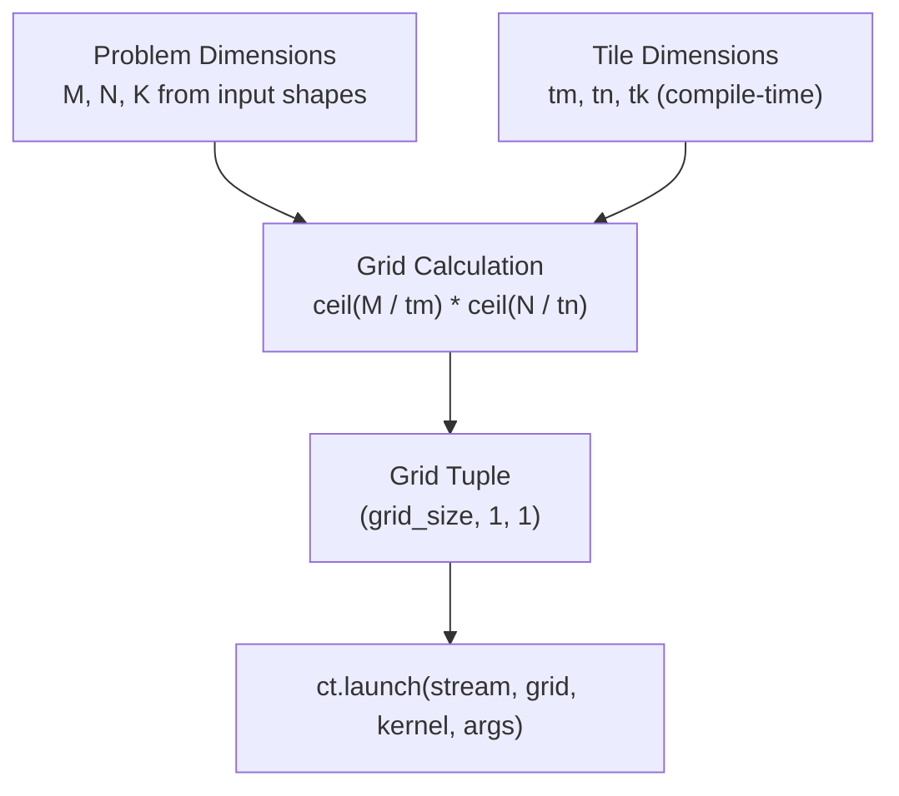

**Standard grid calculation:**

[samples/MatMul.py:230-232]() - Compute grid dimensions:
```python
grid_x = ceil(m / tm)  # Number of blocks along M dimension
grid_y = ceil(n / tn)  # Number of blocks along N dimension
grid_size = grid_x * grid_y
```

**Layer norm grid calculation:**

[samples/LayerNorm.py:200]() - 1D grid for row-wise operations:
```python
ct.launch(torch.cuda.current_stream(), (M,), layer_norm_fwd, ...)
```

[samples/LayerNorm.py:248]() - Grid for reduction:
```python
ct.launch(torch.cuda.current_stream(), (math.ceil(N / TILE_N),), layer_norm_bwd_dwdb, ...)
```

Sources: [samples/MatMul.py](), [samples/LayerNorm.py](), [samples/templates/MatMul.py]()

## Kernel Launch Pattern

The `ct.launch` function dispatches kernels to the GPU. The standard pattern:

```python
ct.launch(stream, grid, kernel_function, (args_tuple))
```

**Key components:**

| Component | Type | Purpose |
|-----------|------|---------|
| `stream` | CUDA stream | `torch.cuda.current_stream()` for PyTorch integration |
| `grid` | Tuple (x, y, z) | Number of blocks in each dimension |
| `kernel_function` | Decorated function | The `@ct.kernel` function to execute |
| `args_tuple` | Tuple | Arrays and constants passed to kernel |

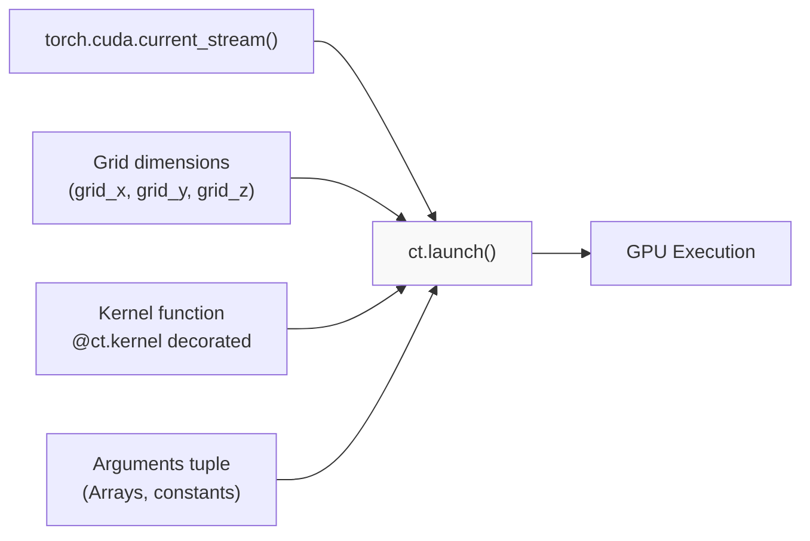

**Examples:**

[samples/MatMul.py:249]() - Matmul launch:
```python
ct.launch(torch.cuda.current_stream(), grid, kernel, (A, B, C, tm, tn, tk))
```

[samples/LayerNorm.py:200-201]() - Forward launch:
```python
ct.launch(torch.cuda.current_stream(), (M,), layer_norm_fwd,
          (x, weight, bias, y, mean, rstd, eps, TILE_N))
```

[samples/LayerNorm.py:240-241]() - Backward launch with locks:
```python
ct.launch(torch.cuda.current_stream(), (M,), layer_norm_bwd_dx_partial_dwdb,
          (dx, dy, dw, db, x, weight, mean, rstd, locks, TILE_N))
```

Sources: [samples/MatMul.py](), [samples/LayerNorm.py](), [test/bench_matmul.py]()

## Persistent Kernel Pattern

Persistent kernels launch fewer blocks than output tiles, with each block processing multiple tiles:

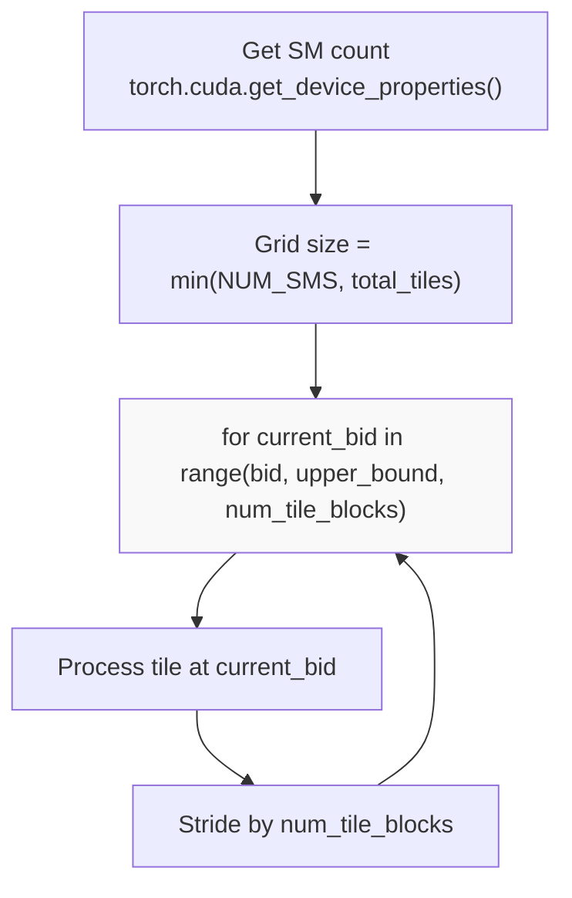

**Host-side grid calculation:**

[samples/MatMul.py:234-237]() - Limit grid to SM count:
```python
NUM_SMS = torch.cuda.get_device_properties("cuda").multi_processor_count
grid_size = min(NUM_SMS, grid_size)
```

**Kernel-side persistent loop:**

[samples/MatMul.py:148-149]() - Iterate with stride:
```python
num_tile_blocks = ct.num_blocks(0)
for current_bid in range(bid, upper_bound, num_tile_blocks):
```

[samples/MatMul.py:154]() - Convert to 2D indices:
```python
bidx, bidy = swizzle_2d_from_bid(M, N, tm, tn, GROUP_SIZE_M, current_bid)
```

This pattern reduces kernel launch overhead and improves occupancy for small problem sizes.

Sources: [samples/MatMul.py](), [test/bench_matmul.py](), [test/kernels/rms_norm.py]()

## Atomic Synchronization Pattern

When multiple blocks need to accumulate into shared memory locations, atomic operations ensure correctness:

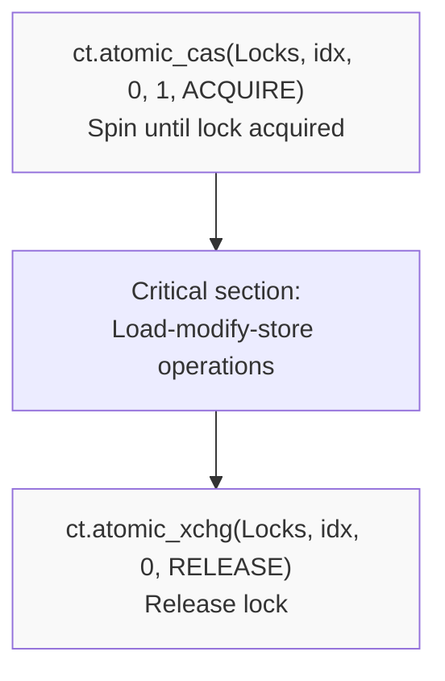

**Acquire-release pattern:**

[samples/LayerNorm.py:124-125]() - Spin until lock acquired:
```python
while ct.atomic_cas(Locks, group_bid_m, 0, 1, memory_order=ct.MemoryOrder.ACQUIRE) == 1:
    pass
```

[samples/LayerNorm.py:128-131]() - Critical section:
```python
partial_dw += ct.load(DW, index=(group_bid_m, j), shape=(1, TILE_N), padding_mode=PAD_ZERO)
partial_db += ct.load(DB, index=(group_bid_m, j), shape=(1, TILE_N), padding_mode=PAD_ZERO)
ct.store(DW, index=(group_bid_m, j), tile=partial_dw)
ct.store(DB, index=(group_bid_m, j), tile=partial_db)
```

[samples/LayerNorm.py:133]() - Release lock:
```python
ct.atomic_xchg(Locks, group_bid_m, 0, memory_order=ct.MemoryOrder.RELEASE)
```

**Lock allocation:**

[samples/LayerNorm.py:237]() - Allocate lock array:
```python
locks = torch.zeros(GROUP_SIZE_M, dtype=torch.int32, device=weight.device)
```

This pattern enables parallel gradient accumulation in backward passes.

Sources: [samples/LayerNorm.py](), [test/kernels/layer_norm.py]()

## PyTorch Integration Pattern

cuTile kernels integrate with PyTorch via `torch.autograd.Function`:

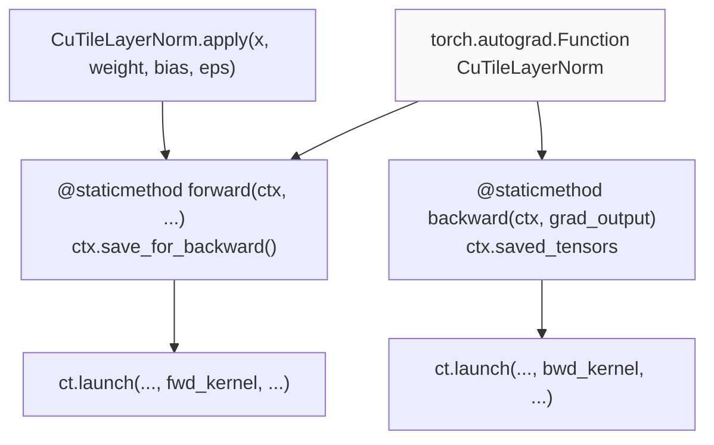

**Class definition:**

[samples/LayerNorm.py:167-172]() - Define autograd function:
```python
class CuTileLayerNorm(torch.autograd.Function):
    """
    A PyTorch Autograd Function wrapper for the cuTile LayerNorm kernel.
    """
```

**Forward method:**

[samples/LayerNorm.py:174-207]() - Forward implementation:
- Flatten input tensors
- Launch forward kernel
- Save tensors for backward via `ctx.save_for_backward()`
- Return reshaped output

**Backward method:**

[samples/LayerNorm.py:209-251]() - Backward implementation:
- Retrieve saved tensors via `ctx.saved_tensors`
- Launch backward kernels (potentially multiple passes)
- Return gradients for each input

**Usage wrapper:**

[samples/LayerNorm.py:254-255]() - Convenience function:
```python
def cutile_layer_norm(x, weight, bias, eps):
    return CuTileLayerNorm.apply(x, weight, bias, eps)
```

This pattern enables automatic differentiation and seamless integration with PyTorch training loops.

For detailed PyTorch integration examples, see [PyTorch Integration](#6.4).

Sources: [samples/LayerNorm.py]()

## Masking Pattern

When tile dimensions don't evenly divide problem dimensions, masking prevents invalid memory access:

[samples/LayerNorm.py:48-49]() - Compute mask and apply:
```python
mask = (j * TILE_N + ct.arange(TILE_N, dtype=ct.int32)) < N
centered_tx = ct.where(mask, tx - mean, 0)
```

[test/kernels/layer_norm.py:66-68]() - Mask in backward helper:
```python
mask = j * TILE_N + ct.arange(TILE_N, dtype=ct.int32) < N
xhat = ct.where(mask, xhat, 0)
wdy = ct.where(mask, wdy, 0)
```

The mask sets out-of-bounds elements to zero, preventing them from affecting reductions while maintaining correct computation for valid elements.

Sources: [samples/LayerNorm.py](), [test/kernels/layer_norm.py]()

## Tile Size Selection Pattern

Choosing appropriate tile sizes impacts performance significantly:

**Half-precision (float16, bfloat16) - Tensor Core optimized:**

[samples/MatMul.py:216]() - Larger tiles for FP16:
```python
tm, tn, tk = 128, 256, 64  # Larger tiles for Tensor Core friendly types
```

**Single-precision (float32) - General purpose:**

[samples/MatMul.py:218]() - Smaller tiles for FP32:
```python
tm, tn, tk = 32, 32, 32   # Smaller, more general tiles
```

**Normalization kernels:**

[samples/LayerNorm.py:198]() - Large feature dimension tiles:
```python
TILE_N = 1024
```

General guidelines:
- Half-precision: Use larger tiles (128-256) to maximize Tensor Core utilization
- Single-precision: Use moderate tiles (32-64) for register efficiency
- Row-wise operations: Tile along feature dimension with large sizes (1024+)
- Matrix multiply: Balance M/N/K dimensions based on memory hierarchy

Sources: [samples/MatMul.py](), [samples/LayerNorm.py]()

## Two-Pass Reduction Pattern

Complex reductions may require multiple kernel launches:

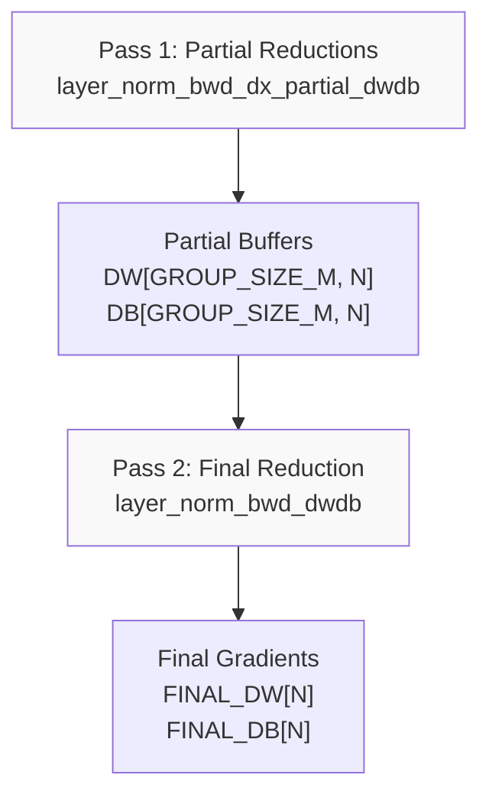

**First pass - partial accumulation:**

[samples/LayerNorm.py:235-241]() - Launch first kernel:
```python
dw = torch.zeros((GROUP_SIZE_M, N), dtype=torch.float32, device=weight.device)
db = torch.zeros((GROUP_SIZE_M, N), dtype=torch.float32, device=bias.device)
locks = torch.zeros(GROUP_SIZE_M, dtype=torch.int32, device=weight.device)

ct.launch(torch.cuda.current_stream(), (M,), layer_norm_bwd_dx_partial_dwdb,
          (dx, dy, dw, db, x, weight, mean, rstd, locks, TILE_N))
```

**Second pass - final reduction:**

[samples/LayerNorm.py:243-249]() - Launch reduction kernel:
```python
final_dw = torch.empty((N,), dtype=weight.dtype, device=weight.device)
final_db = torch.empty((N,), dtype=bias.dtype, device=bias.device)
TILE_M = 32

ct.launch(torch.cuda.current_stream(), (math.ceil(N / TILE_N),), layer_norm_bwd_dwdb,
          (dw, db, final_dw, final_db, TILE_M, TILE_N))
```

This pattern avoids atomic operations on the final output by performing local accumulation in pass 1 and reduction in pass 2.

Sources: [samples/LayerNorm.py](), [test/kernels/layer_norm.py]()

---

