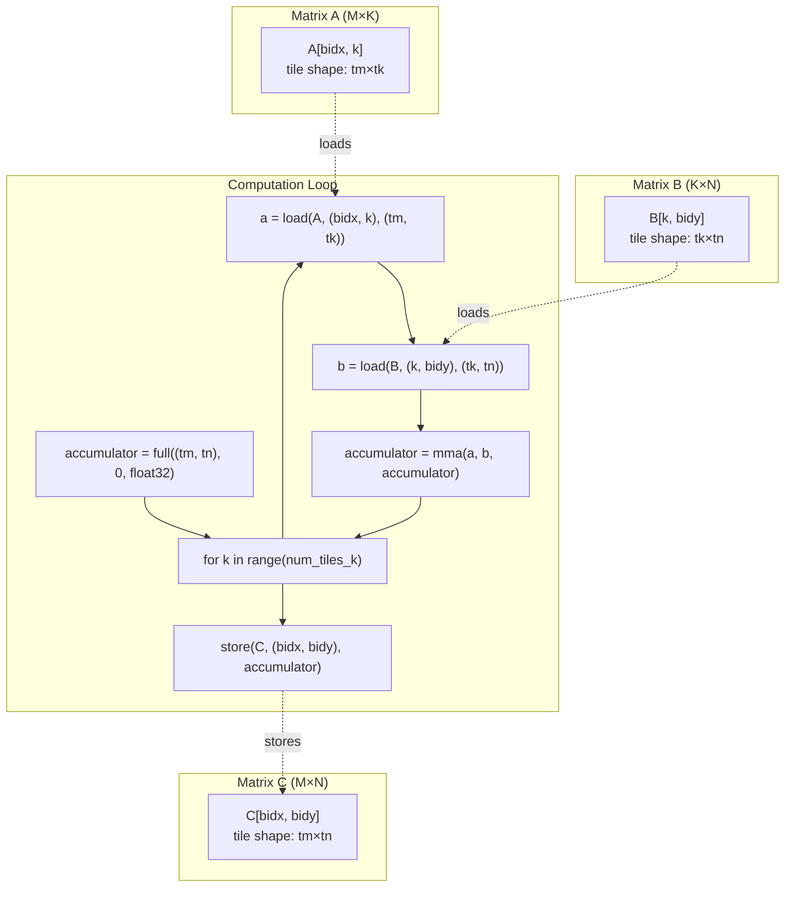
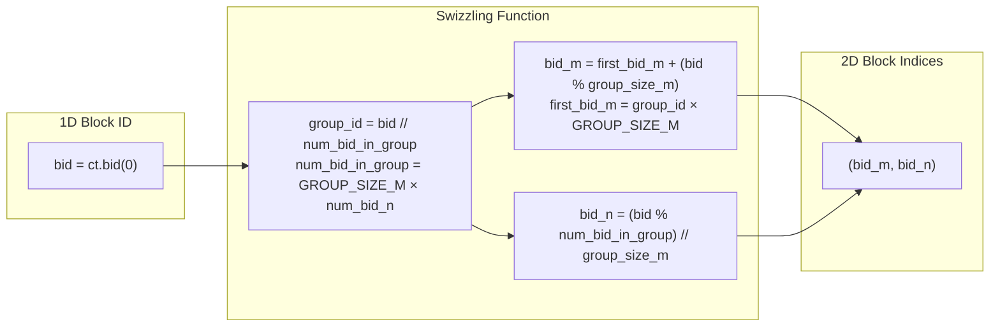
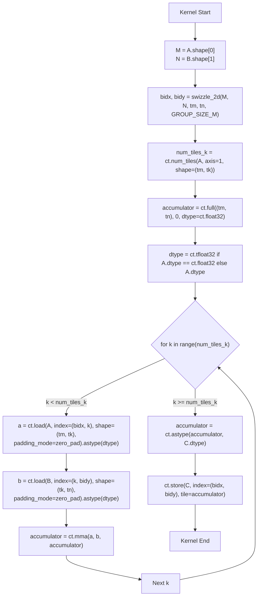
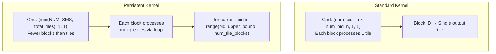
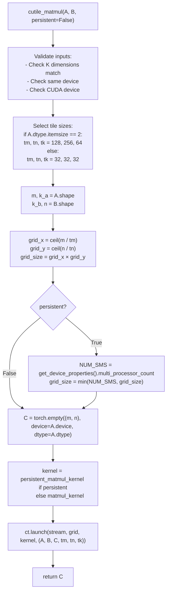

<!-- source: DeepWiki mcp.deepwiki.com · repo NVIDIA/cutile-python · page 6.1 Matrix Multiplication · fetched 2026-10-26 -->

# Matrix Multiplication

<details>
<summary>Relevant source files</summary>

The following files were used as context for generating this wiki page:

- [samples/MatMul.py](samples/MatMul.py)
- [samples/templates/MatMul.py](samples/templates/MatMul.py)
- [test/bench_matmul.py](test/bench_matmul.py)
- [test/kernels/rms_norm.py](test/kernels/rms_norm.py)

</details>


This page explains the matrix multiplication kernel implementations in cuTile, focusing on the tiled approach, block swizzling optimization, and persistent kernel variants. These implementations demonstrate fundamental patterns for writing high-performance GPU matrix multiplication kernels using cuTile's tile-based programming model.

For information about the matrix multiplication API operations (`ct.mma`, `ct.matmul`), see [Matrix Operations](#3.5). For autotuning matrix multiplication kernels, see [Autotuner System](#5.2).

## Purpose and Scope

This document covers two matrix multiplication kernel implementations:
- **`matmul_kernel`**: Standard tiled matrix multiplication with 2D block swizzling for cache locality
- **`persistent_matmul_kernel`**: Persistent kernel variant where each thread block processes multiple output tiles

Both kernels implement the operation `C = A @ B` where `A` is `M×K`, `B` is `K×N`, and `C` is `M×N`.

**Sources**: [samples/MatMul.py:1-340]()

---

## Tiled Matrix Multiplication Overview

Matrix multiplication using tiles decomposes the computation into smaller blocks that fit in fast memory (registers and shared memory). Each thread block computes one output tile of size `tm×tn` by iterating over the K-dimension in chunks of size `tk`.

### Computation Pattern



**Diagram: Tiled Matrix Multiplication Data Flow**

The kernel loads tiles from A and B, performs matrix multiplication using `ct.mma()`, accumulates results in higher precision (float32), then stores the final output tile to C.

**Sources**: [samples/MatMul.py:34-101](), [samples/MatMul.py:105-177]()

---

## Block Swizzling for Cache Locality

Block swizzling reorganizes the 2D grid of thread blocks into a 1D grid with improved cache locality. Instead of processing output tiles in row-major order, blocks are grouped to keep neighboring blocks processing adjacent data.

### Swizzling Algorithm



**Diagram: Block Swizzling Logic**

The `swizzle_2d()` function maps 1D block IDs to 2D tile coordinates, grouping `GROUP_SIZE_M` blocks along the M-dimension to improve cache reuse.

**Sources**: [samples/MatMul.py:14-30]()

### Swizzling Implementation

| Function | Purpose | Parameters |
|----------|---------|------------|
| `swizzle_2d_from_bid` | Maps a given 1D block ID to 2D tile coordinates | `M, N, tm, tn, GROUP_SIZE_M, bid` |
| `swizzle_2d` | Maps current block's ID to 2D tile coordinates | `M, N, tm, tn, GROUP_SIZE_M` |

The swizzling groups blocks into clusters of size `GROUP_SIZE_M` (typically 8) along the M-dimension. Within each group, blocks are assigned sequentially along the M-axis, then the N-axis is incremented.

**Key code constructs**:
- `num_bid_m = ct.cdiv(M, tm)` - Number of blocks along M-dimension
- `num_bid_n = ct.cdiv(N, tn)` - Number of blocks along N-dimension  
- `group_id = bid // num_bid_in_group` - Which group this block belongs to
- `bid_m = first_bid_m + (bid % group_size_m)` - M-coordinate within group

**Sources**: [samples/MatMul.py:14-30]()

---

## Standard Matrix Multiplication Kernel

The `matmul_kernel` uses the `@ct.kernel` decorator with configurable CTA count and takes three tile size constants: `tm`, `tn`, and `tk`.

### Kernel Signature and Parameters

```python
@ct.kernel(num_ctas=ct.ByTarget(sm_100=2))
def matmul_kernel(A, B, C,
                  tm: ConstInt,  # Tile M dimension
                  tn: ConstInt,  # Tile N dimension  
                  tk: ConstInt): # Tile K dimension
```

| Parameter | Type | Description |
|-----------|------|-------------|
| `A` | Array | Input matrix (M×K) |
| `B` | Array | Input matrix (K×N) |
| `C` | Array | Output matrix (M×N) |
| `tm` | `Constant[int]` | Height of output tile (rows) |
| `tn` | `Constant[int]` | Width of output tile (columns) |
| `tk` | `Constant[int]` | K-dimension chunk size |

**Sources**: [samples/MatMul.py:33-55]()

### Kernel Implementation Details



**Diagram: matmul_kernel Execution Flow**

**Key implementation details**:

1. **Block Swizzling** [samples/MatMul.py:59](): Uses `swizzle_2d()` to map 1D block ID to 2D tile coordinates
2. **Tile Count Calculation** [samples/MatMul.py:66](): `ct.num_tiles(A, axis=1, shape=(tm, tk))` determines K-dimension iterations
3. **Accumulator Precision** [samples/MatMul.py:71](): Uses `float32` accumulation for numerical stability even with `float16` inputs
4. **TF32 Conversion** [samples/MatMul.py:75](): Converts `float32` inputs to `tfloat32` for Tensor Core utilization
5. **Zero Padding** [samples/MatMul.py:72](): Handles cases where dimensions aren't multiples of tile sizes
6. **MMA Operation** [samples/MatMul.py:93](): `ct.mma(a, b, accumulator)` performs fused multiply-accumulate

**Sources**: [samples/MatMul.py:34-101]()

---

## Persistent Matrix Multiplication Kernel

The `persistent_matmul_kernel` launches fewer thread blocks than output tiles, with each block processing multiple tiles in a loop. This approach can improve performance by reducing scheduling overhead and improving cache reuse.

### Persistent Kernel Structure



**Diagram: Standard vs Persistent Kernel Grid Configuration**

**Sources**: [samples/MatMul.py:105-177]()

### Implementation Differences

| Aspect | `matmul_kernel` | `persistent_matmul_kernel` |
|--------|-----------------|---------------------------|
| Grid size | `grid_x × grid_y` | `min(NUM_SMS, grid_x × grid_y)` |
| Tiles per block | 1 | Multiple via outer loop |
| Block ID mapping | Direct via `swizzle_2d()` | Loop over `range(bid, upper_bound, num_tile_blocks)` |
| Accumulator location | Outside K-loop | Inside persistent loop |

### Persistent Loop Structure

```python
# Calculate total tiles needed
num_bid_m = ct.cdiv(M, tm)
num_bid_n = ct.cdiv(N, tn)
upper_bound = num_bid_m * num_bid_n

# Each block processes multiple tiles
num_tile_blocks = ct.num_blocks(0)
for current_bid in range(bid, upper_bound, num_tile_blocks):
    # Initialize accumulator for this tile
    accumulator = ct.full((tm, tn), 0, dtype=ct.float32)
    
    # Get tile coordinates
    bidx, bidy = swizzle_2d_from_bid(M, N, tm, tn, GROUP_SIZE_M, current_bid)
    
    # K-dimension loop (same as standard kernel)
    for k in range(num_tiles_k):
        # Load, MMA, accumulate...
    
    # Store this tile's result
    ct.store(C, index=(bidx, bidy), tile=accumulator)
```

**Key differences from standard kernel**:
1. **Outer persistent loop** [samples/MatMul.py:149](): `for current_bid in range(bid, upper_bound, num_tile_blocks)`
2. **`ct.num_blocks(0)`** [samples/MatMul.py:148](): Gets the number of launched blocks
3. **`swizzle_2d_from_bid()`** [samples/MatMul.py:154](): Uses explicit block ID instead of `ct.bid(0)`
4. **Accumulator initialization** [samples/MatMul.py:153](): Inside persistent loop, not outside

**Sources**: [samples/MatMul.py:105-177]()

---

## Host-Side Wrapper Function

The `cutile_matmul()` wrapper handles input validation, tile size selection, grid calculation, and kernel launch.

### Function Flow



**Diagram: cutile_matmul Wrapper Function Flow**

**Sources**: [samples/MatMul.py:179-251]()

### Tile Size Selection Strategy

The wrapper uses data type to determine optimal tile sizes:

```python
if A.dtype.itemsize == 2:  # float16, bfloat16
    tm, tn, tk = 128, 256, 64  # Larger tiles for Tensor Cores
else:  # float32 or other
    tm, tn, tk = 32, 32, 32    # Smaller general tiles
```

| Data Type | `itemsize` | Tile Sizes | Rationale |
|-----------|------------|------------|-----------|
| `float16`, `bfloat16` | 2 | 128×256×64 | Leverage Tensor Core throughput |
| `float32` | 4 | 32×32×32 | Standard configuration |

**Sources**: [samples/MatMul.py:210-218]()

### Grid Size Calculation

For standard kernel:
```python
grid_x = ceil(m / tm)  # Blocks along M-dimension
grid_y = ceil(n / tn)  # Blocks along N-dimension
grid_size = grid_x * grid_y
grid = (grid_size, 1, 1)  # 1D grid with swizzling
```

For persistent kernel:
```python
NUM_SMS = torch.cuda.get_device_properties("cuda").multi_processor_count
grid_size = min(NUM_SMS, grid_x * grid_y)  # Limit to SM count
grid = (grid_size, 1, 1)
```

**Key points**:
- Uses `ceil()` to handle non-multiple dimensions [samples/MatMul.py:230-231]()
- Persistent kernel limits grid to SM count [samples/MatMul.py:234-237]()
- Both use 1D grid; swizzling happens inside kernel [samples/MatMul.py:238]()

**Sources**: [samples/MatMul.py:225-238]()

---

## Usage Examples

### Basic Usage

```python
# Create input tensors
A = torch.randn(512, 768, dtype=torch.float16, device='cuda')
B = torch.randn(768, 512, dtype=torch.float16, device='cuda')

# Standard kernel
C = cutile_matmul(A, B, persistent=False)

# Persistent kernel
C_persistent = cutile_matmul(A, B, persistent=True)
```

**Sources**: [samples/MatMul.py:274-283]()

### Correctness Validation

```python
# Validate against PyTorch reference
torch.testing.assert_close(C, A @ B)
```

**Sources**: [samples/MatMul.py:283]()

### Handling Non-Multiple Dimensions

The kernel automatically handles cases where matrix dimensions aren't multiples of tile sizes using zero padding:

```python
# Dimensions not multiples of tile sizes
A = torch.randn(1000, 700, dtype=torch.float32, device='cuda')
B = torch.randn(700, 500, dtype=torch.float32, device='cuda')

# Works correctly with automatic padding
C = cutile_matmul(A, B)
```

**Sources**: [samples/MatMul.py:311-319]()

### TF32 Precision Mode

For `float32` inputs, the kernel automatically converts to `tfloat32` to use Tensor Cores:

```python
# Ensure consistent TF32 behavior
torch.set_float32_matmul_precision("high")

A = torch.randn(512, 768, dtype=torch.float32, device='cuda')
B = torch.randn(768, 512, dtype=torch.float32, device='cuda')
C = cutile_matmul(A, B)

# Validate with appropriate tolerances for TF32
torch.testing.assert_close(C, A @ B, atol=2e-5, rtol=1e-3)
```

**Sources**: [samples/MatMul.py:289-301]()

---

## Performance Considerations

### When to Use Persistent Kernel

| Scenario | Recommended Kernel | Reason |
|----------|-------------------|--------|
| Small matrices (fits in cache) | Persistent | Better cache reuse, less scheduling overhead |
| Large matrices | Standard | More parallelism, better load balancing |
| High SM occupancy needed | Standard | More blocks = more waves |
| Limited number of tiles | Persistent | Maximizes SM utilization |

**Sources**: [test/bench_matmul.py:195-217]()

### Tile Size Impact

- **Larger tiles** (128×256×64): Better for Tensor Core types, higher arithmetic intensity
- **Smaller tiles** (32×32×32): Better for general precision, lower register pressure
- **K-dimension tile** (`tk`): Balance between memory traffic and reuse

**Sources**: [samples/MatMul.py:215-218]()

### Block Swizzling Benefits

The `GROUP_SIZE_M = 8` parameter groups blocks to improve:
1. **L2 cache hit rate**: Adjacent blocks access nearby data
2. **TLB efficiency**: Grouped memory accesses reduce address translation overhead
3. **Load balancing**: Groups tend to complete at similar times

**Sources**: [samples/MatMul.py:56](), [samples/MatMul.py:126]()

---

## Benchmarking Interface

The test suite provides benchmarking utilities for comparing cuTile implementations against PyTorch:

```python
# From test/bench_matmul.py
def cutile_matmul(A, B, C):
    tm, tn, tk = 256, 256, 64
    m, n, _ = A.shape[0], B.shape[1], A.shape[1]
    grid = (ceil(m / tm) * ceil(n / tn), 1, 1)
    ct.launch(torch.cuda.current_stream(), grid, matmul_kernel, (A, B, C, tm, tn, tk))

def torch_matmul(A, B, C):
    torch.matmul(A, B, out=C)
```

Benchmarks measure:
- **FLOP count**: `2 × M × N × K`
- **Memory traffic**: `(A.numel() + B.numel() + C.numel()) × itemsize`
- **Time**: Multiple warmup and measurement rounds

**Sources**: [test/bench_matmul.py:94-104](), [test/bench_matmul.py:24-47]()

---

## Related Operations

For alternative matmul patterns and related operations:
- **Split-K reduction** [test/bench_matmul.py:117-135](): Partitions K-dimension across multiple blocks
- **Batch matmul** [test/bench_matmul.py:164-169](): Processes multiple independent matmuls
- **FP8 matmul** [test/bench_matmul.py:159-161](): Uses `torch.float8_e4m3fn` and `torch.float8_e5m2` types

**Sources**: [test/bench_matmul.py:1-217]()

---

