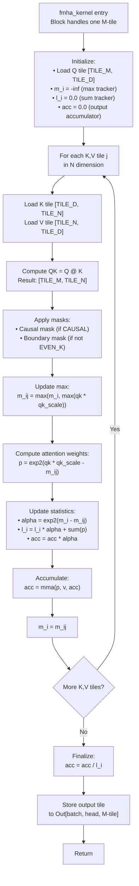
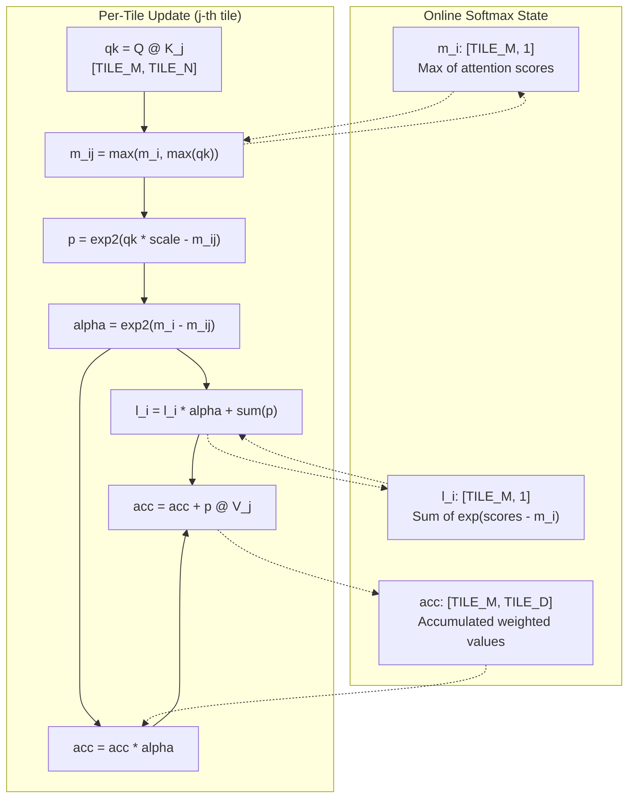
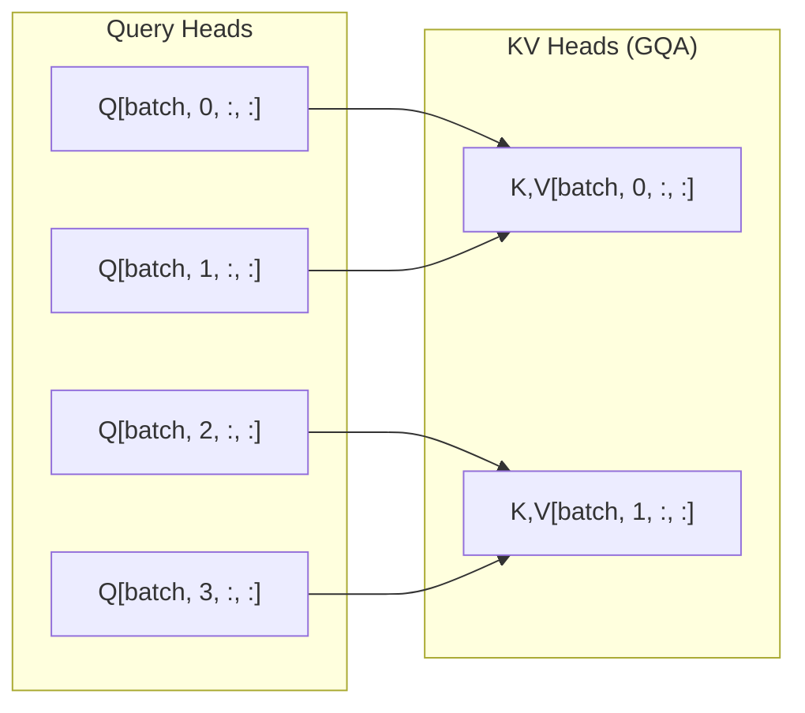
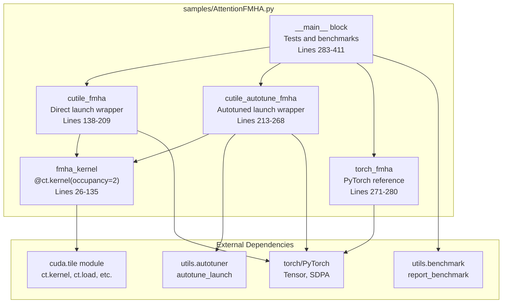

<!-- source: DeepWiki mcp.deepwiki.com · repo NVIDIA/cutile-python · page 6.2 Fused Multi-Head Attention · fetched 2026-10-26 -->

# Fused Multi-Head Attention

<details>
<summary>Relevant source files</summary>

The following files were used as context for generating this wiki page:

- [samples/AttentionFMHA.py](samples/AttentionFMHA.py)
- [samples/templates/AttentionFMHA.py](samples/templates/AttentionFMHA.py)

</details>


## Purpose and Scope

This page documents the Fused Multi-Head Attention (FMHA) kernel implementation in cuTile, which computes scaled dot-product attention in a memory-efficient, tiled manner. The implementation demonstrates advanced cuTile patterns including online softmax, causal masking, grouped query attention, and autotuning.

For general information about matrix operations, see [Matrix Operations](#3.5). For autotuning concepts, see [Autotuner System](#5.2). For PyTorch integration patterns, see [PyTorch Integration](#6.4).

---

## Overview

The FMHA kernel computes the attention operation:

```
Attention(Q, K, V) = softmax(Q * K^T / sqrt(d_k)) * V
```

The implementation uses **online softmax** (also known as streaming softmax or FlashAttention-style attention) to avoid materializing the full attention matrix. Instead, it processes the computation in tiles, maintaining running statistics and accumulating results incrementally.

**Sources:** [samples/AttentionFMHA.py:26-135]()

---

## Algorithm Structure

The FMHA kernel processes attention in a tiled manner, with each thread block responsible for computing output for one query tile (M dimension). The kernel loops over key/value tiles (N dimension), updating running statistics using the online softmax algorithm.



**Diagram: FMHA Kernel Execution Flow**

**Sources:** [samples/AttentionFMHA.py:26-135]()

---

## Kernel Implementation

### Kernel Signature

The `fmha_kernel` is defined with the following parameters:

| Parameter | Type | Description |
|-----------|------|-------------|
| `Q` | `Array` | Query tensor [Batch, Heads, SeqLen_Q, D_k] |
| `K` | `Array` | Key tensor [Batch, KV_Heads, SeqLen_KV, D_k] |
| `V` | `Array` | Value tensor [Batch, KV_Heads, SeqLen_KV, D_v] |
| `Out` | `Array` | Output tensor [Batch, Heads, SeqLen_Q, D_v] |
| `qk_scale` | `float` | Scaling factor (typically 1/sqrt(D_k)) |
| `input_pos` | `int` | Global position offset for causal masking |
| `TILE_D` | `ConstInt` | Head dimension (D_k = D_v) |
| `H` | `ConstInt` | Total number of query heads |
| `TILE_M` | `ConstInt` | Query sequence tile size |
| `TILE_N` | `ConstInt` | Key/value sequence tile size |
| `QUERY_GROUP_SIZE` | `ConstInt` | Number of query heads per KV head |
| `CAUSAL` | `ConstBool` | Whether to apply causal masking |
| `EVEN_K` | `ConstBool` | Whether SeqLen_KV is divisible by TILE_N |

The kernel is decorated with `@ct.kernel(occupancy=2)` to hint the compiler about target occupancy.

**Sources:** [samples/AttentionFMHA.py:26-36]()

---

### Block-to-Data Mapping

Each thread block processes one tile of the query sequence:

```python
# Block ID mapping
bid_x = ct.bid(0)  # M-tile index (query sequence)
bid_y = ct.bid(1)  # Combined batch*head index
batch_idx = bid_y // H
head_idx = bid_y % H
off_kv_h = head_idx // QUERY_GROUP_SIZE  # KV head for GQA
```

The grid dimensions are:
- `grid_x = ceil(SeqLen_Q / TILE_M)` - number of query tiles
- `grid_y = Batch * Heads` - one block per (batch, head) pair
- `grid_z = 1`

**Sources:** [samples/AttentionFMHA.py:42-46](), [samples/AttentionFMHA.py:191-193]()

---

### Initialization Phase

The kernel initializes online softmax accumulators and loads the query tile:

```python
# Initialize online softmax state in float32 for numerical stability
m_i = ct.full((TILE_M, 1), -np.inf, dtype=np.float32)  # Max tracker
l_i = ct.full((TILE_M, 1), 0.0, dtype=np.float32)      # Sum tracker
acc = ct.full((TILE_M, TILE_D), 0.0, dtype=np.float32) # Output accumulator

# Load query tile for this block
q = ct.load(
    Q, index=(batch_idx, head_idx, bid_x, 0), shape=(1, 1, TILE_M, TILE_D)
).reshape((TILE_M, TILE_D))  # [TILE_M, TILE_D]
```

The query tile is loaded once and reused across all key/value tiles. The online softmax state is maintained in `float32` for numerical stability, even when input data is `float16`.

**Sources:** [samples/AttentionFMHA.py:61-68]()

---

## Online Softmax Algorithm

The online softmax algorithm allows computing `softmax(QK^T) @ V` without materializing the full attention matrix. It processes tiles incrementally, maintaining running statistics.

### Mathematical Foundation

For a sequence of values `x_1, x_2, ..., x_n`, softmax is:

```
softmax(x_i) = exp(x_i) / sum_j(exp(x_j))
```

The online algorithm maintains:
- `m_i`: maximum value seen so far
- `l_i`: sum of `exp(x_j - m_i)` for all values seen so far
- `acc`: accumulated `softmax(x_j) * v_j` values

When processing a new tile with maximum `m_ij`:
1. Compute correction factor: `alpha = exp(m_i - m_ij)`
2. Update max: `m_i = max(m_i, m_ij)`
3. Update sum: `l_i = l_i * alpha + sum(exp(new_values - m_ij))`
4. Scale accumulator: `acc = acc * alpha`
5. Add new contribution: `acc += exp(new_values - m_ij) @ new_v`

### Implementation



**Diagram: Online Softmax State Management**

The kernel implementation:

```python
# Compute QK product
qk = ct.mma(q, k, qk)  # [TILE_M, TILE_N]

# Apply masks (causal, boundary)
if (CAUSAL or not EVEN_K) and j >= mask_start:
    # ... masking logic ...
    qk += mask

# Update max (delayed scale multiplication for performance)
m_ij = max(m_i, ct.max(qk, axis=-1, keepdims=True) * qk_scale)
qk = qk * qk_scale - m_ij

# Compute attention weights
p = ct.exp2(qk, flush_to_zero=True)  # [TILE_M, TILE_N]
l_ij = ct.sum(p, axis=-1, keepdims=True)  # [TILE_M, 1]

# Compute correction factor
alpha = ct.exp2(m_i - m_ij, flush_to_zero=True)  # [TILE_M, 1]

# Update statistics
l_i = l_i * alpha + l_ij
acc = acc * alpha

# Accumulate P @ V
acc = ct.mma(p, v, acc)
m_i = m_ij
```

**Note:** The implementation uses `exp2` (base-2 exponential) instead of `exp` for hardware efficiency. The `qk_scale` is pre-multiplied by `1/log(2)` to compensate.

**Sources:** [samples/AttentionFMHA.py:49](), [samples/AttentionFMHA.py:108-129]()

---

## Causal Masking

Causal masking ensures that queries at position `i` can only attend to keys at positions `≤ i`, which is necessary for autoregressive generation.

### Implementation Strategy

The kernel applies causal masking conditionally based on the `CAUSAL` parameter:

```python
if CAUSAL:
    # When KV position could exceed Q position
    mask_start = (input_pos + bid_x * TILE_M) // TILE_N
    # When KV position could exceed sequence length
    mask_start = min(mask_start, k_seqlen // TILE_N)
    Tc = ct.cdiv(min(m_end, k_seqlen), TILE_N)
else:
    Tc = ct.cdiv(k_seqlen, TILE_N)
    mask_start = k_seqlen // TILE_N
```

For tiles that may contain masked elements:

```python
if (CAUSAL or not EVEN_K) and j >= mask_start:
    offs_n = j * TILE_N + offs_n_tile
    mask = ct.full((TILE_M, TILE_N), True, dtype=np.bool)
    
    # Boundary mask (for non-even sequence lengths)
    if not EVEN_K:
        mask = mask & (offs_n < k_seqlen)
    
    # Causal mask
    if CAUSAL:
        mask = mask & (offs_m >= offs_n)  # Q_pos >= K_pos
    
    # Convert to additive mask
    mask = ct.where(mask, 0.0, -np.inf)
    qk += mask
```

The mask is applied additively to the QK scores, where valid positions get `0.0` and invalid positions get `-inf`, which becomes `0.0` after softmax.

**Sources:** [samples/AttentionFMHA.py:71-81](), [samples/AttentionFMHA.py:96-106]()

---

## Grouped Query Attention (GQA)

Grouped Query Attention reduces the number of key/value heads relative to query heads, enabling more efficient inference. Multi-Query Attention (MQA) is the special case where `QUERY_GROUP_SIZE = num_query_heads`.

### Head Mapping

The kernel computes the KV head index from the query head index:

```python
head_idx = bid_y % H  # Query head index
off_kv_h = head_idx // QUERY_GROUP_SIZE  # Corresponding KV head
```

Each KV head is shared by `QUERY_GROUP_SIZE` consecutive query heads.

### Memory Access Pattern



**Diagram: GQA Head Mapping with QUERY_GROUP_SIZE=2**

The K and V tensors are indexed using `off_kv_h` instead of `head_idx`:

```python
k = ct.load(
    K, index=(batch_idx, off_kv_h, 0, j), shape=(1, 1, TILE_D, TILE_N),
    order=(0, 1, 3, 2)
)

v = ct.load(
    V, index=(batch_idx, off_kv_h, j, 0), shape=(1, 1, TILE_N, TILE_D)
)
```

**Sources:** [samples/AttentionFMHA.py:46](), [samples/AttentionFMHA.py:86-91](), [samples/AttentionFMHA.py:123-126]()

---

## Data Movement and Memory Optimization

### K Matrix Transposition

The K matrix is loaded in transposed order to enable efficient matrix multiplication:

```python
k = ct.load(
    K, index=(batch_idx, off_kv_h, 0, j), shape=(1, 1, TILE_D, TILE_N),
    order=(0, 1, 3, 2),  # Transpose last two dimensions
    latency=2,
)
k = k.reshape((TILE_D, TILE_N))  # K^T shape for QK^T
```

The `order=(0, 1, 3, 2)` parameter transposes the last two dimensions during the load, avoiding a separate transpose operation.

### Latency Hints

The kernel provides latency hints to the compiler to help optimize memory access scheduling:

```python
k = ct.load(..., latency=2)  # K loads can have moderate latency
v = ct.load(..., latency=4)  # V loads can have higher latency
```

These hints allow the compiler to schedule other operations while waiting for memory loads.

**Sources:** [samples/AttentionFMHA.py:86-91](), [samples/AttentionFMHA.py:123-126]()

---

## Finalization

After processing all K,V tiles, the kernel normalizes the accumulator and stores the result:

```python
# Final normalization: divide by sum of weights
acc = ct.truediv(acc, l_i, flush_to_zero=True, rounding_mode=RMd.APPROX)

# Reshape and convert to output dtype
acc = acc.reshape((1, 1, TILE_M, TILE_D)).astype(Out.dtype)

# Store result
ct.store(Out, index=(batch_idx, head_idx, bid_x, 0), tile=acc)
```

The division uses `truediv` with approximate rounding mode for performance. The accumulator is converted from `float32` back to the output dtype (typically `float16`).

**Sources:** [samples/AttentionFMHA.py:131-134]()

---

## Wrapper Functions

### Direct Launch: `cutile_fmha`

The `cutile_fmha` function provides a simple interface for launching the FMHA kernel:

```python
def cutile_fmha(Q: torch.Tensor, K: torch.Tensor, V: torch.Tensor,
                qk_scale: float | None = None,
                input_pos: int = 0,
                tile_m: int = 128,
                tile_n: int = 128,
                query_group_size: int = 1,
                causal: bool = False) -> torch.Tensor
```

The function:
1. Validates input shapes and dtypes
2. Creates output tensor
3. Calculates grid dimensions
4. Launches the kernel with `ct.launch()`

**Sources:** [samples/AttentionFMHA.py:138-209]()

### Autotuned Launch: `cutile_autotune_fmha`

The `cutile_autotune_fmha` function uses the autotuner to find optimal configuration:

```python
def cutile_autotune_fmha(Q: torch.Tensor, K: torch.Tensor, V: torch.Tensor,
                         qk_scale: float,
                         input_pos: int = 0,
                         query_group_size: int = 1,
                         causal: bool = False) -> tuple[torch.Tensor, dict[str, int]]
```

The autotuner searches over a space of configurations:

| Configuration | TILE_M | TILE_N | num_ctas | occupancy |
|---------------|--------|--------|----------|-----------|
| Config 0 | 256 | 128 | 1 | 2 |
| Config 1 | 128 | 128 | 2 | 2 |
| Config 2 | 128 | 128 | 1 | 2 |
| Config 3 | 128 | 128 | 1 | 1 |
| Config 4 | 64 | 64 | 1 | 4 |
| Config 5 | 64 | 64 | 2 | 1 |
| Config 6 | 64 | 32 | 1 | 2 |
| Config 7 | 256 | 32 | 2 | 2 |
| Config 8 | 32 | 32 | 1 | 1 |

The autotuner benchmarks each configuration and caches the best result for future calls with similar shapes.

**Sources:** [samples/AttentionFMHA.py:213-268](), [samples/AttentionFMHA.py:255-265]()

---

## Code Organization



**Diagram: FMHA Code Structure**

**Sources:** [samples/AttentionFMHA.py:1-412]()

---

## Usage Example

### Basic Usage

```python
import torch
import cuda.tile as ct
from samples.AttentionFMHA import cutile_fmha

# Create input tensors
Q = torch.randn(2, 8, 128, 64, dtype=torch.float16, device='cuda')
K = torch.randn(2, 8, 128, 64, dtype=torch.float16, device='cuda')
V = torch.randn(2, 8, 128, 64, dtype=torch.float16, device='cuda')

# Compute attention
output = cutile_fmha(Q, K, V, tile_m=128, tile_n=128, causal=False)
```

### Autotuned Usage

```python
from samples.AttentionFMHA import cutile_autotune_fmha
import math

# Compute attention with autotuning
output, config = cutile_autotune_fmha(
    Q, K, V,
    qk_scale=1.0 / math.sqrt(Q.shape[-1]),
    causal=True
)

print(f"Best configuration: {config}")
# Best configuration: {'TILE_M': 128, 'TILE_N': 128, 'num_ctas': 1, 'occupancy': 2}
```

**Sources:** [samples/AttentionFMHA.py:324-330](), [samples/AttentionFMHA.py:379-384]()

---

## Performance Characteristics

### Memory Efficiency

The online softmax algorithm provides:
- **Memory complexity:** O(TILE_M × TILE_D) instead of O(SeqLen_Q × SeqLen_KV)
- **No materialization** of the full attention matrix
- **Streaming computation** that processes tiles sequentially

### Computational Efficiency

Key optimizations:
1. **Tiled matrix multiplication** using `ct.mma` for hardware acceleration
2. **Base-2 exponentials** (`exp2`) for faster computation on GPU
3. **Delayed scaling** of QK product after max reduction
4. **Float32 accumulation** for numerical stability
5. **Latency hints** for memory access scheduling

### Autotuning Impact

The autotuner typically finds configurations that provide:
- **1.5-3x speedup** over naive configurations
- **Competitive performance** with PyTorch's native SDPA
- **Shape-specific optimization** for different problem sizes

**Sources:** [samples/AttentionFMHA.py:278-290]()

---

## Supported Features

| Feature | Supported | Notes |
|---------|-----------|-------|
| **Causal Masking** | ✓ | Via `CAUSAL` parameter |
| **Grouped Query Attention** | ✓ | Via `QUERY_GROUP_SIZE` |
| **Multi-Query Attention** | ✓ | Set `QUERY_GROUP_SIZE = num_heads` |
| **Arbitrary Sequence Lengths** | ✓ | Handled via `EVEN_K` parameter |
| **Mixed Precision** | ✓ | Float16/BFloat16 input, Float32 accumulation |
| **Dropout** | ✗ | Not implemented |
| **Attention Bias** | ✗ | Not implemented |
| **Backward Pass** | ✗ | Not implemented |

**Sources:** [samples/AttentionFMHA.py:26-135]()

---

## Comparison with PyTorch Reference

The implementation validates correctness against PyTorch's `scaled_dot_product_attention`:

```python
def torch_fmha(Q: torch.Tensor, K: torch.Tensor, V: torch.Tensor,
               is_causal: bool, enable_gqa: bool) -> torch.Tensor:
    backend = SDPBackend.CUDNN_ATTENTION \
            if (Q.shape[2] == K.shape[2]) \
            else SDPBackend.FLASH_ATTENTION
    with sdpa_kernel(backend):
        ret = scaled_dot_product_attention(Q, K, V,
                                           is_causal=is_causal,
                                           enable_gqa=enable_gqa)
    return ret
```

Validation uses tolerances of:
- **Non-causal:** `atol=1e-3, rtol=1e-3`
- **Causal:** `atol=1e-2, rtol=5e-2` (slightly relaxed for numerical differences)

**Sources:** [samples/AttentionFMHA.py:271-280](), [samples/AttentionFMHA.py:217](), [samples/AttentionFMHA.py:272]()

---

