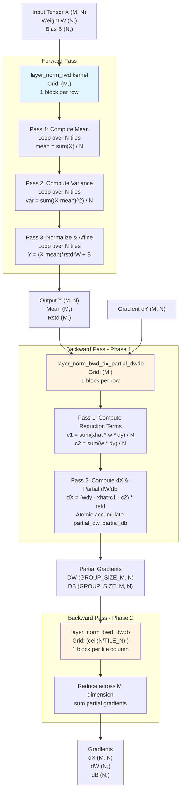
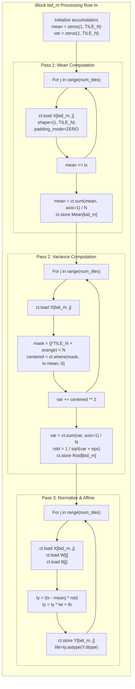
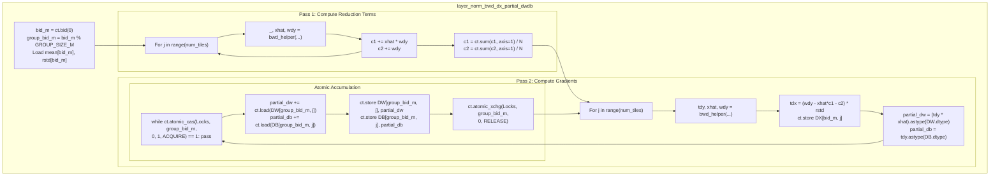
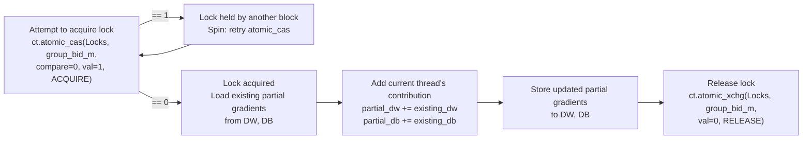
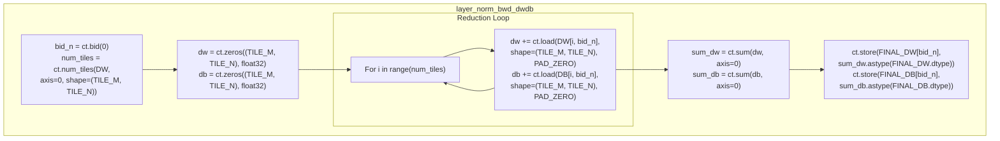

<!-- source: DeepWiki mcp.deepwiki.com · repo NVIDIA/cutile-python · page 6.3 Layer Normalization · fetched 2026-10-26 -->

# Layer Normalization

<details>
<summary>Relevant source files</summary>

The following files were used as context for generating this wiki page:

- [.pre-commit-config.yaml](.pre-commit-config.yaml)
- [samples/LayerNorm.py](samples/LayerNorm.py)
- [test/kernels/layer_norm.py](test/kernels/layer_norm.py)

</details>


This page explains the Layer Normalization sample implementation in cuTile Python, demonstrating row-wise normalization with forward and backward passes. The implementation shows how to use atomic operations for gradient accumulation, two-phase reduction strategies, and PyTorch autograd integration.

For general PyTorch integration patterns, see [PyTorch Integration](#6.4). For other neural network layer examples, see [Fused Multi-Head Attention](#6.2).

Sources: [samples/LayerNorm.py:1-311]()

## Algorithm Overview

Layer normalization normalizes each row of the input tensor independently by computing per-row mean and variance, then applying an affine transformation. The mathematical formulation is:

```
mean = sum(x) / N
var = sum((x - mean)^2) / N
y = (x - mean) / sqrt(var + eps) * weight + bias
```

The implementation uses three kernels to compute forward and backward passes:

| Kernel | Purpose | Grid Dimensions |
|--------|---------|-----------------|
| `layer_norm_fwd` | Forward pass: compute mean, variance, normalize, and apply affine transform | `(M,)` - one block per row |
| `layer_norm_bwd_dx_partial_dwdb` | Backward pass part 1: compute dX and accumulate partial dW/dB | `(M,)` - one block per row |
| `layer_norm_bwd_dwdb` | Backward pass part 2: final reduction of partial dW/dB | `(ceil(N/TILE_N),)` - one block per tile column |

Sources: [samples/LayerNorm.py:18-163](), [test/kernels/layer_norm.py:12-157]()

### Overall Kernel Flow



Sources: [samples/LayerNorm.py:18-163]()

## Forward Kernel Implementation

The `layer_norm_fwd` kernel processes each row independently in three sequential passes over the N dimension. Each block handles one row of the input tensor.

### Forward Pass Structure



Sources: [samples/LayerNorm.py:18-63](), [test/kernels/layer_norm.py:12-57]()

### Key Implementation Details

The forward kernel is implemented in [samples/LayerNorm.py:18-63]():

**Pass 1: Mean Computation** [samples/LayerNorm.py:36-42]()
- Accumulates all values in the row using tiles of size `(1, TILE_N)`
- Uses `ct.PaddingMode.ZERO` to handle non-aligned dimensions
- Reduces the accumulated tile with `ct.sum(mean, axis=1)` and divides by total elements `N`
- Stores the scalar mean value to the `Mean` array

**Pass 2: Variance Computation** [samples/LayerNorm.py:44-53]()
- Computes centered values `(tx - mean)` for each tile
- Uses masking with `ct.where()` to zero out padding elements beyond `N`
- The mask is computed as `j * TILE_N + ct.arange(TILE_N, dtype=ct.int32) < N`
- Accumulates squared centered values and divides by `N`
- Computes reciprocal standard deviation `rstd = 1 / ct.sqrt(var + eps)`

**Pass 3: Normalization and Affine Transform** [samples/LayerNorm.py:55-62]()
- Loads input tile, weight tile, and bias tile for each position
- Normalizes: `ty = (tx - mean) * rstd`
- Applies affine transformation: `ty = ty * tw + tb`
- Casts result to output dtype with `ty.astype(Y.dtype)` before storing

Sources: [samples/LayerNorm.py:18-63]()

## Backward Pass - Phase 1: Computing dX and Partial Gradients

The first backward kernel computes the gradient with respect to the input (`dX`) and accumulates partial gradients for weights and biases. This kernel also processes one row per block.

### Backward Helper Function

The `bwd_helper` function [samples/LayerNorm.py:65-75]() encapsulates common data loading and computation:

```python
def bwd_helper(X, W, DY, bid_m, j, mean, rstd, TILE_N, N):
    tx = ct.load(X, index=(bid_m, j), shape=(1, TILE_N), padding_mode=PAD_ZERO)
    tw = ct.load(W, index=(j,), shape=(TILE_N,), padding_mode=PAD_ZERO)
    tdy = ct.load(DY, index=(bid_m, j), shape=(1, TILE_N), padding_mode=PAD_ZERO)
    xhat = (tx - mean) * rstd
    wdy = tw * tdy
    mask = j * TILE_N + ct.arange(TILE_N, dtype=ct.int32) < N
    xhat = ct.where(mask, xhat, 0)
    wdy = ct.where(mask, wdy, 0)
    return tdy, xhat, wdy
```

This helper computes normalized input `xhat` and weighted gradient `wdy`, applying masking to handle non-aligned dimensions.

Sources: [samples/LayerNorm.py:65-75](), [test/kernels/layer_norm.py:59-69]()

### Backward Phase 1 Structure



Sources: [samples/LayerNorm.py:79-134](), [test/kernels/layer_norm.py:73-128]()

### Gradient Computation Details

The backward kernel [samples/LayerNorm.py:79-134]() implements the gradient formulas:

**Reduction Terms** [samples/LayerNorm.py:105-113]()
- Computes `c1 = sum(xhat * wdy) / N` - term involving correlation between normalized input and weighted gradient
- Computes `c2 = sum(wdy) / N` - mean of weighted gradient
- These terms are used to compute the gradient with respect to the input

**Input Gradient dX** [samples/LayerNorm.py:118-119]()
- Formula: `tdx = (wdy - (xhat * c1 + c2)) * rstd`
- This accounts for how the mean and variance depend on the input
- Stores directly to the `DX` output array

**Partial Weight/Bias Gradients** [samples/LayerNorm.py:121-122]()
- `partial_dw = tdy * xhat` - gradient of loss w.r.t. weight for this row
- `partial_db = tdy` - gradient of loss w.r.t. bias for this row
- These need to be accumulated across all rows (M dimension)

Sources: [samples/LayerNorm.py:105-134]()

### Atomic Accumulation with Locks

Since multiple blocks need to accumulate gradients to the same memory locations, the kernel uses a lock-based synchronization pattern [samples/LayerNorm.py:124-133]():



**Lock Mechanism Details:**

| Operation | Purpose | Memory Order |
|-----------|---------|--------------|
| `ct.atomic_cas(Locks, group_bid_m, 0, 1, ACQUIRE)` | Attempt to acquire lock by setting from 0→1 | `ACQUIRE` ensures subsequent reads see other threads' writes |
| Spin while result == 1 | Wait until lock is free | N/A |
| Load and accumulate gradients | Add partial contribution | Reads are ordered after ACQUIRE |
| `ct.atomic_xchg(Locks, group_bid_m, 0, RELEASE)` | Release lock by setting to 0 | `RELEASE` ensures writes are visible to other threads |

The kernel groups blocks using `group_bid_m = bid_m % GROUP_SIZE_M` [samples/LayerNorm.py:100](). This reduces the number of lock contention points from `M` to `GROUP_SIZE_M`, improving performance while still allowing parallel accumulation.

Sources: [samples/LayerNorm.py:124-133](), [test/kernels/layer_norm.py:118-127]()

## Backward Pass - Phase 2: Final Reduction

The second backward kernel performs the final reduction of partial gradients across the M dimension to produce the final weight and bias gradients.

### Final Reduction Structure



Sources: [samples/LayerNorm.py:137-163](), [test/kernels/layer_norm.py:131-157]()

### Final Reduction Details

The kernel [samples/LayerNorm.py:137-163]() operates with a grid dimension of `(ceil(N / TILE_N),)`, where each block handles one column of tiles:

**Accumulation** [samples/LayerNorm.py:152-157]()
- Loads partial gradients from `DW` and `DB` arrays with shape `(GROUP_SIZE_M, N)`
- Accumulates along the M dimension using tiles of shape `(TILE_M, TILE_N)`
- Uses `ct.PaddingMode.ZERO` to handle non-aligned dimensions

**Final Output** [samples/LayerNorm.py:158-162]()
- Reduces the accumulated tile along axis 0: `ct.sum(dw, axis=0)`
- Produces final gradients with shape `(TILE_N,)` for this tile column
- Casts to output dtype before storing: `sum_dw.astype(FINAL_DW.dtype)`

The two-phase reduction strategy reduces atomic contention compared to a single-phase approach where all blocks would contend on the same `N` memory locations.

Sources: [samples/LayerNorm.py:137-163]()

## PyTorch Integration

The `CuTileLayerNorm` class [samples/LayerNorm.py:167-252]() wraps the cuTile kernels in a `torch.autograd.Function`, enabling automatic differentiation in PyTorch models.

### Autograd Function Structure

```mermaid
graph TB
    subgraph "CuTileLayerNorm.forward"
        FwdInput["Input: x (*, N)<br/>weight (N,)<br/>bias (N,)<br/>eps"]
        Reshape["Reshape input to (M, N)<br/>where M = prod(input.shape[:-1])"]
        Alloc["Allocate output y (M, N)<br/>Allocate mean (M,) float32<br/>Allocate rstd (M,) float32"]
        Launch["ct.launch(stream, (M,),<br/>layer_norm_fwd,<br/>(x, weight, bias, y, mean, rstd, eps, TILE_N))"]
        Save["ctx.save_for_backward(x, weight, bias, mean, rstd)<br/>ctx.TILE_N = TILE_N"]
        Return["Return y.reshape(*input.shape)"]
        
        FwdInput --> Reshape
        Reshape --> Alloc
        Alloc --> Launch
        Launch --> Save
        Save --> Return
    end
    
    subgraph "CuTileLayerNorm.backward"
        BwdInput["Input: grad_output (*, N)"]
        RestoreCtx["x, weight, bias, mean, rstd = ctx.saved_tensors<br/>TILE_N = ctx.TILE_N"]
        BwdReshape["Reshape grad_output to dy (M, N)<br/>Allocate dx (M, N)"]
        AllocPartial["GROUP_SIZE_M = 64<br/>Allocate dw (GROUP_SIZE_M, N) float32<br/>Allocate db (GROUP_SIZE_M, N) float32<br/>Allocate locks (GROUP_SIZE_M,) int32"]
        Launch1["ct.launch(stream, (M,),<br/>layer_norm_bwd_dx_partial_dwdb,<br/>(dx, dy, dw, db, x, weight, mean, rstd, locks, TILE_N))"]
        AllocFinal["Allocate final_dw (N,) weight.dtype<br/>Allocate final_db (N,) bias.dtype<br/>TILE_M = 32"]
        Launch2["ct.launch(stream, (ceil(N/TILE_N),),<br/>layer_norm_bwd_dwdb,<br/>(dw, db, final_dw, final_db, TILE_M, TILE_N))"]
        ReturnGrads["Return dx.reshape(*grad_output.shape),<br/>final_dw, final_db, None"]
        
        BwdInput --> RestoreCtx
        RestoreCtx --> BwdReshape
        BwdReshape --> AllocPartial
        AllocPartial --> Launch1
        Launch1 --> AllocFinal
        AllocFinal --> Launch2
        Launch2 --> ReturnGrads
    end
```



Sources: [samples/LayerNorm.py:167-252]()

### Forward Pass Implementation

The forward method [samples/LayerNorm.py:175-207]() follows this pattern:

**Tensor Preparation** [samples/LayerNorm.py:190-196]()
- Flattens input to `(M, N)` where `M` is the batch size
- Allocates output tensor `y` with same dtype as input
- Allocates `mean` and `rstd` tensors with `dtype=torch.float32`

**Kernel Launch** [samples/LayerNorm.py:198-201]()
- Uses `torch.cuda.current_stream()` to synchronize with PyTorch's stream
- Launches with grid dimension `(M,)` - one block per row
- Passes constant parameter `TILE_N = 1024` for type embedding

**Context Saving** [samples/LayerNorm.py:204-205]()
- Saves `x, weight, bias, mean, rstd` for backward pass
- Saves `TILE_N` parameter to use same configuration in backward

Sources: [samples/LayerNorm.py:175-207]()

### Backward Pass Implementation

The backward method [samples/LayerNorm.py:210-251]() orchestrates the two-phase gradient computation:

**Phase 1: Compute dX and Partial dW/dB** [samples/LayerNorm.py:225-241]()
- Sets `GROUP_SIZE_M = 64` to control lock granularity
- Allocates partial gradient buffers with shape `(GROUP_SIZE_M, N)`
- Allocates lock array with shape `(GROUP_SIZE_M,)` for atomic synchronization
- Launches `layer_norm_bwd_dx_partial_dwdb` with grid `(M,)`

**Phase 2: Final Reduction** [samples/LayerNorm.py:243-249]()
- Allocates final gradient tensors with original dtypes
- Sets `TILE_M = 32` for reduction tile size
- Launches `layer_norm_bwd_dwdb` with grid `(ceil(N / TILE_N),)`

**Return Values** [samples/LayerNorm.py:251]()
- Returns gradients for input, weight, and bias
- Returns `None` for `eps` gradient (not differentiable)

Sources: [samples/LayerNorm.py:210-251]()

## Key Implementation Patterns

### Constant Embedding

The kernel uses `ConstInt = ct.Constant[int]` type annotation [samples/LayerNorm.py:13]() to embed `TILE_N` as a compile-time constant:

```python
def layer_norm_fwd(X, W, B, Y, Mean, Rstd, eps, TILE_N: ConstInt):
```

This enables optimizations like loop unrolling and constant propagation during compilation. See [Constant Embedding](#5.3) for more details.

Sources: [samples/LayerNorm.py:13-18]()

### Padding Mode Usage

All `ct.load()` operations use `padding_mode=ct.PaddingMode.ZERO` [samples/LayerNorm.py:14]() to handle non-aligned dimensions:

```python
tx = ct.load(X, index=(bid_m, j), shape=(1, TILE_N), padding_mode=PAD_ZERO)
```

When `j * TILE_N + TILE_N > N`, the tile extends beyond the array boundary. Zero padding ensures these out-of-bounds elements don't affect the computation. The mask `j * TILE_N + ct.arange(TILE_N) < N` is used to explicitly zero out padded elements in variance and backward computations.

Sources: [samples/LayerNorm.py:14,39,48,58-59,67-69]()

### Memory Order Semantics

The atomic operations use explicit memory order semantics [samples/LayerNorm.py:124,133]():

| Memory Order | Operation | Purpose |
|--------------|-----------|---------|
| `ct.MemoryOrder.ACQUIRE` | `atomic_cas` acquiring lock | Ensures subsequent loads see writes from other threads |
| `ct.MemoryOrder.RELEASE` | `atomic_xchg` releasing lock | Ensures preceding stores are visible to other threads |

These memory orders establish the happens-before relationship necessary for correct synchronization across GPU threads executing in parallel.

Sources: [samples/LayerNorm.py:124,133]()

### Grid Dimension Strategy

The implementation uses different grid dimensions for each kernel:

**Forward and Backward Phase 1** - Grid `(M,)`:
- Each block processes one complete row independently
- Block `bid_m` processes row `m` of the input
- No inter-block communication needed during computation

**Backward Phase 2** - Grid `(ceil(N / TILE_N),)`:
- Each block processes one column tile of partial gradients
- Block `bid_n` processes columns `[bid_n * TILE_N, (bid_n+1) * TILE_N)`
- Reduces across the M dimension

This decomposition maximizes parallelism while minimizing synchronization overhead.

Sources: [samples/LayerNorm.py:32,96,149,200,240,248]()

### Usage Example

The wrapper function [samples/LayerNorm.py:254-255]() provides a simple interface:

```python
def cutile_layer_norm(x, weight, bias, eps):
    return CuTileLayerNorm.apply(x, weight, bias, eps)
```

Example usage [samples/LayerNorm.py:275-294]():

```python
# Create input tensors
shape = (1024, 2048)
weight = torch.randn(shape[-1], dtype=torch.bfloat16, device='cuda', requires_grad=True)
bias = torch.randn(shape[-1], dtype=torch.bfloat16, device='cuda', requires_grad=True)
x = torch.randn(shape, dtype=torch.bfloat16, device='cuda', requires_grad=True)

# Forward pass
y = cutile_layer_norm(x, weight, bias, eps=1e-5)

# Backward pass
dy = torch.randn_like(y)
y.backward(dy)

# Gradients available in x.grad, weight.grad, bias.grad
```

The implementation can be validated against PyTorch's native implementation using `torch.nn.functional.layer_norm` [samples/LayerNorm.py:296-306]().

Sources: [samples/LayerNorm.py:254-310]()

---

