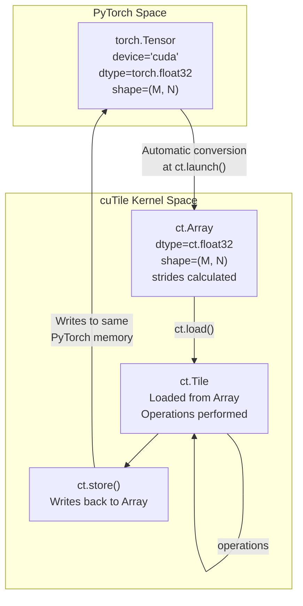
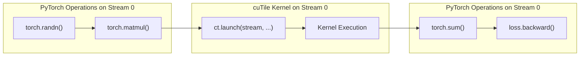
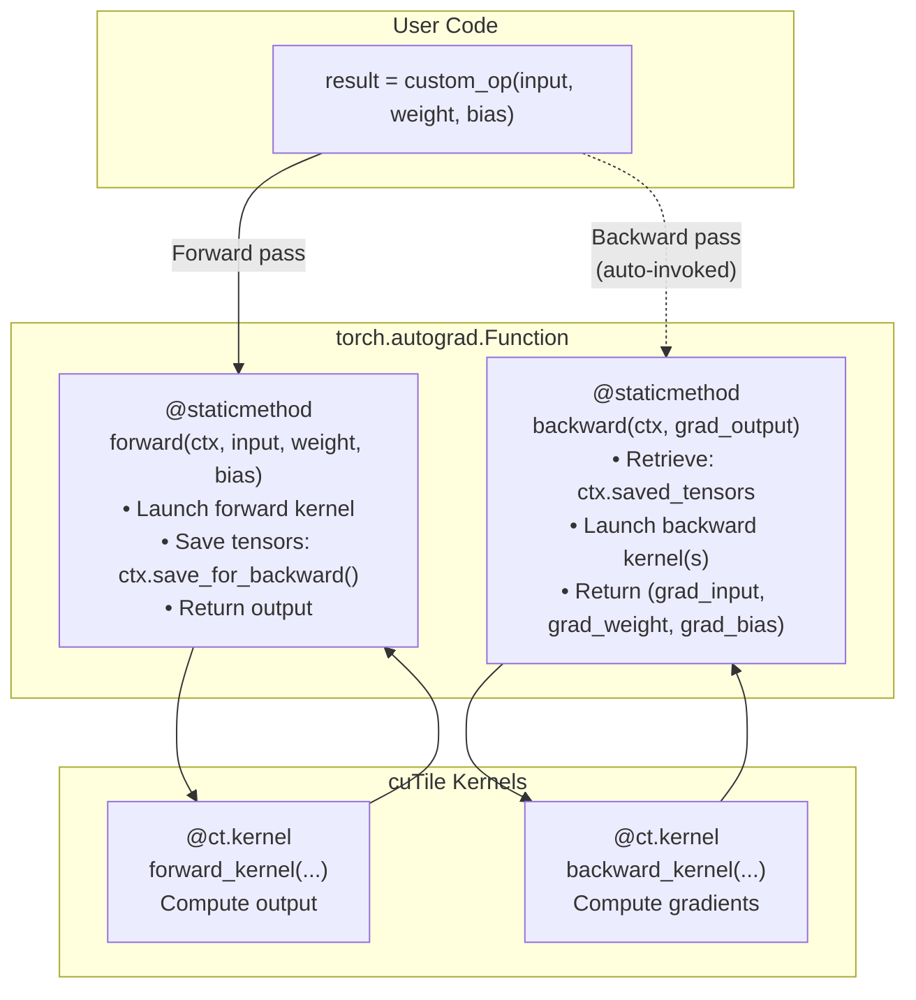
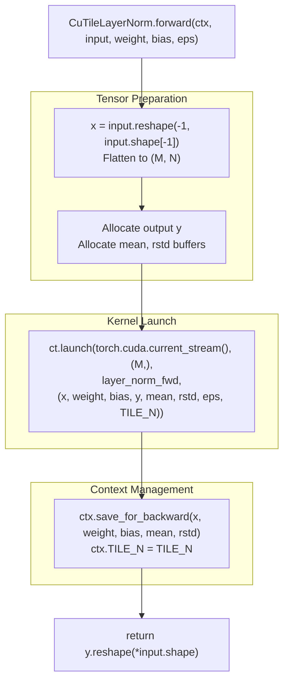
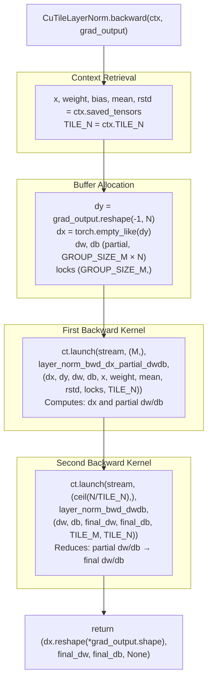

<!-- source: DeepWiki mcp.deepwiki.com · repo NVIDIA/cutile-python · page 6.4 PyTorch Integration · fetched 2026-10-26 -->

# PyTorch Integration

<details>
<summary>Relevant source files</summary>

The following files were used as context for generating this wiki page:

- [.pre-commit-config.yaml](.pre-commit-config.yaml)
- [LICENSE.md](LICENSE.md)
- [README.md](README.md)
- [samples/LayerNorm.py](samples/LayerNorm.py)
- [test/kernels/layer_norm.py](test/kernels/layer_norm.py)
- [test/requirements.txt](test/requirements.txt)
- [test/test_frontpage_example.py](test/test_frontpage_example.py)
- [test/test_readme_example.py](test/test_readme_example.py)

</details>


This document explains how to integrate cuTile kernels with PyTorch, enabling automatic differentiation and seamless use within PyTorch workflows. For information about launching kernels with other array libraries like CuPy or NumPy, see [Data Model](#2.1). For autotuning kernel configurations, see [Autotuner System](#5.2).

---

## Overview

cuTile kernels can be integrated with PyTorch in two ways:

1. **Direct Launch**: Pass PyTorch tensors directly to `ct.launch()` for forward-only operations
2. **Autograd Integration**: Wrap kernels in `torch.autograd.Function` to support automatic differentiation

PyTorch tensors are automatically converted to cuTile `Array` objects when passed as kernel arguments. This allows cuTile kernels to read from and write to PyTorch's GPU memory without explicit data copying.

---

## Tensor Compatibility

### Supported Tensor Types

cuTile kernels accept PyTorch tensors with the following characteristics:

| Requirement | Description |
|-------------|-------------|
| **Device** | Must be CUDA tensors (`.device == 'cuda'`) |
| **Layout** | Must be contiguous or strided (no sparse/quantized formats) |
| **DType** | Standard numeric types: `float16`, `float32`, `bfloat16`, `int32`, `int64`, etc. |
| **Memory** | Tensors can be inputs (read-only) or outputs (writable) |



**Diagram: PyTorch Tensor to cuTile Array Conversion Flow**

The type conversion happens automatically when calling `ct.launch()`. PyTorch tensor metadata (shape, strides, dtype, data pointer) is used to construct a cuTile `Array` view over the same GPU memory.

**Sources:** [samples/LayerNorm.py:189-201](), [test/test_frontpage_example.py:23-26](), [README.md:33-36]()

---

## Direct Kernel Launch

### Basic Pattern

The simplest integration pattern is to launch a cuTile kernel using PyTorch tensors and the current CUDA stream:

```python
import torch
import cuda.tile as ct

@ct.kernel
def my_kernel(input, output):
    # Kernel implementation
    pass

# Create PyTorch tensors
input = torch.randn(1024, dtype=torch.float32, device='cuda')
output = torch.empty_like(input)

# Launch kernel on current PyTorch stream
stream = torch.cuda.current_stream()
grid = (32, 1, 1)
ct.launch(stream, grid, my_kernel, (input, output))

# Results are immediately available in 'output' tensor
# on the same CUDA stream
```

### Stream Synchronization

cuTile kernels are launched on the specified CUDA stream and execute asynchronously. PyTorch's stream semantics apply:

- **Same Stream**: If the kernel is launched on the current stream, subsequent PyTorch operations on the same tensors automatically wait for the kernel to complete
- **Different Streams**: Use `torch.cuda.current_stream().wait_stream(other_stream)` or `torch.cuda.synchronize()` for explicit synchronization



**Diagram: Stream Execution Order with cuTile Kernels**

All operations on the same stream execute in order. PyTorch automatically inserts dependencies.

**Sources:** [samples/LayerNorm.py:200](), [samples/LayerNorm.py:240](), [test/test_frontpage_example.py:26]()

---

## Autograd Integration

### The torch.autograd.Function Pattern

To enable automatic differentiation through cuTile kernels, implement `torch.autograd.Function`:



**Diagram: torch.autograd.Function Integration with cuTile Kernels**

**Sources:** [samples/LayerNorm.py:167-252]()

### Class Structure

```python
class CuTileOperation(torch.autograd.Function):
    @staticmethod
    def forward(ctx, input, *args):
        # 1. Prepare tensors
        # 2. Launch forward kernel(s)
        # 3. Save tensors needed for backward
        # 4. Return output(s)
        pass
    
    @staticmethod
    def backward(ctx, grad_output):
        # 1. Retrieve saved tensors
        # 2. Launch backward kernel(s)
        # 3. Return gradients (one per input to forward)
        pass
```

| Method | Purpose | Returns |
|--------|---------|---------|
| `forward(ctx, ...)` | Execute forward computation | Output tensor(s) |
| `backward(ctx, grad_output)` | Compute input gradients | Tuple of gradients, one per input (or `None` for non-differentiable inputs) |

**Sources:** [samples/LayerNorm.py:167-173](), [samples/LayerNorm.py:174-207](), [samples/LayerNorm.py:209-251]()

---

## Complete Example: Layer Normalization

The [samples/LayerNorm.py]() file demonstrates a complete PyTorch integration with forward and backward passes.

### Forward Pass Implementation



**Diagram: LayerNorm Forward Pass Flow**

The forward pass in [samples/LayerNorm.py:174-207]():

1. **Reshape Input** [line 190](): Flatten input to 2D shape `(M, N)` where `N` is the normalized dimension
2. **Allocate Outputs** [lines 191-196](): Create output tensor `y` and temporary buffers `mean`, `rstd`
3. **Launch Kernel** [lines 200-201](): Call `layer_norm_fwd` kernel with a 1D grid of `M` blocks
4. **Save for Backward** [lines 204-205](): Store `x`, `weight`, `bias`, `mean`, `rstd` for gradient computation
5. **Reshape Output** [line 207](): Return output with original input shape

**Sources:** [samples/LayerNorm.py:174-207]()

### Forward Kernel Structure

The forward kernel [samples/LayerNorm.py:18-62]() computes:

1. **Mean** [lines 32-36](): Accumulate tiles, sum, divide by N
2. **Variance** [lines 38-47](): Accumulate squared deviations, compute `rstd = 1/sqrt(var + eps)`
3. **Normalize** [lines 49-56](): Apply `(x - mean) * rstd * weight + bias`

Each block processes one row (M dimension) and iterates over tiles in the N dimension.

**Sources:** [samples/LayerNorm.py:18-62](), [test/kernels/layer_norm.py:12-56]()

### Backward Pass Implementation



**Diagram: LayerNorm Backward Pass Flow**

The backward pass [samples/LayerNorm.py:209-251]() uses a two-kernel strategy:

1. **Kernel 1: `layer_norm_bwd_dx_partial_dwdb`** [samples/LayerNorm.py:79-133]()
   - Each block computes gradient for one row (dx)
   - Accumulates partial gradients for weight/bias (dw, db) using atomic operations
   - Uses locks to coordinate atomic accumulation across blocks

2. **Kernel 2: `layer_norm_bwd_dwdb`** [samples/LayerNorm.py:136-162]()
   - Reduces partial weight/bias gradients to final values
   - Each block processes one tile of the N dimension

**Why Two Kernels?**

Weight and bias gradients require reduction across the M dimension. The two-kernel approach:
- First kernel: Each block accumulates its contribution to a partial buffer
- Second kernel: Reduces partial buffers to final gradients

This avoids global atomics and enables better performance.

**Sources:** [samples/LayerNorm.py:209-251](), [samples/LayerNorm.py:79-133](), [samples/LayerNorm.py:136-162]()

### Atomic Operations for Gradient Accumulation

The backward kernel uses atomic compare-and-swap (CAS) for lock-based synchronization:

```python
# Acquire lock
while ct.atomic_cas(Locks, group_bid_m, 0, 1, 
                    memory_order=ct.MemoryOrder.ACQUIRE) == 1:
    pass

# Critical section: accumulate gradients
partial_dw += ct.load(DW, index=(group_bid_m, j), shape=(1, TILE_N))
ct.store(DW, index=(group_bid_m, j), tile=partial_dw)

# Release lock
ct.atomic_xchg(Locks, group_bid_m, 0, 
               memory_order=ct.MemoryOrder.RELEASE)
```

**Sources:** [samples/LayerNorm.py:124-133](), [test/kernels/layer_norm.py:118-127]()

### Usage Pattern

```python
# Wrapper function using .apply()
def cutile_layer_norm(x, weight, bias, eps):
    return CuTileLayerNorm.apply(x, weight, bias, eps)

# Use like any PyTorch operation
input = torch.randn(1024, 2048, dtype=torch.bfloat16, device='cuda')
weight = torch.randn(2048, dtype=torch.bfloat16, device='cuda')
bias = torch.randn(2048, dtype=torch.bfloat16, device='cuda')

input.requires_grad = True
weight.requires_grad = True
bias.requires_grad = True

# Forward pass
output = cutile_layer_norm(input, weight, bias, eps=1e-5)

# Backward pass (automatic)
loss = output.sum()
loss.backward()

# Gradients available
grad_input = input.grad
grad_weight = weight.grad
grad_bias = bias.grad
```

**Sources:** [samples/LayerNorm.py:254-255](), [samples/LayerNorm.py:277-294]()

---

## Return Value Conventions

### Forward Pass

The `forward()` method must return:
- Single tensor: `return output`
- Multiple tensors: `return (output1, output2, ...)`

Returned tensors become inputs to the backward pass.

### Backward Pass

The `backward()` method must return a tuple with one gradient per input to `forward()`:

```python
def forward(ctx, input, weight, bias, eps):
    # ... computation ...
    return output

def backward(ctx, grad_output):
    # Compute gradients
    grad_input = ...
    grad_weight = ...
    grad_bias = ...
    grad_eps = None  # eps is not differentiable
    
    return grad_input, grad_weight, grad_bias, grad_eps
```

| Input Type | Gradient |
|------------|----------|
| Differentiable tensor | Computed gradient tensor |
| Non-differentiable tensor | `None` |
| Scalar argument (e.g., `eps`) | `None` |

**Sources:** [samples/LayerNorm.py:251]()

---

## Context Object (`ctx`)

The `ctx` object passed to `forward()` provides methods for managing state between forward and backward passes:

| Method | Purpose | Example |
|--------|---------|---------|
| `ctx.save_for_backward(*tensors)` | Save tensors for backward pass | `ctx.save_for_backward(x, weight, mean, rstd)` |
| `ctx.saved_tensors` | Retrieve saved tensors | `x, weight, mean, rstd = ctx.saved_tensors` |
| `ctx.attribute = value` | Store non-tensor data | `ctx.TILE_N = 1024` |

### Tensor Saving Best Practices

1. **Save Only What's Needed**: Only save tensors required for gradient computation to minimize memory usage
2. **Avoid Saving Intermediates**: Recompute cheap operations in backward pass if possible
3. **Save Constants as Attributes**: Non-tensor values (e.g., tile sizes) should be stored as attributes, not in `save_for_backward()`

```python
# Good: Save only essential tensors
ctx.save_for_backward(x, weight, mean, rstd)
ctx.TILE_N = TILE_N  # Non-tensor attribute

# Avoid: Saving unnecessary intermediates
# ctx.save_for_backward(x, weight, mean, rstd, y, intermediate1, intermediate2)
```

**Sources:** [samples/LayerNorm.py:204-205](), [samples/LayerNorm.py:225-226]()

---

## Memory Layout Considerations

### Tensor Contiguity

cuTile kernels work most efficiently with contiguous tensors. If a tensor is not contiguous:

```python
# Check if contiguous
if not tensor.is_contiguous():
    tensor = tensor.contiguous()

# Or use memory_format parameter
tensor = tensor.contiguous(memory_format=torch.channels_last)
```

### Reshaping and Views

PyTorch's reshape operations may or may not create a copy:
- `view()`: Always returns a view (fails if tensor is not contiguous)
- `reshape()`: Returns a view if possible, otherwise copies

In [samples/LayerNorm.py:190](), `input.reshape()` is used to flatten inputs, which is safe and efficient.

**Sources:** [samples/LayerNorm.py:190](), [samples/LayerNorm.py:231]()

---

## Data Type Handling

### Type Promotion

cuTile kernels handle type promotion automatically for operations on tiles. However, when storing results back to PyTorch tensors, explicit casting may be required:

```python
# Cast tile to match output tensor dtype
ct.store(Y, index=(bid_m, j), tile=ty.astype(Y.dtype))
```

### Mixed Precision

Common pattern for mixed precision:
1. **Forward**: Compute in higher precision (float32), store in lower precision (bfloat16)
2. **Backward**: Compute gradients in float32 for numerical stability

```python
# Example from LayerNorm forward kernel
mean = ct.full((1, TILE_N), 0, dtype=ct.float32)  # Accumulate in float32
# ... computation ...
ct.store(Y, index=(bid_m, j), tile=ty.astype(Y.dtype))  # Store in input dtype
```

**Sources:** [samples/LayerNorm.py:30](), [samples/LayerNorm.py:62]()

---

## Testing and Validation

### Correctness Checking

Compare cuTile implementation against PyTorch reference:

```python
import torch

# cuTile implementation
output_cutile = cutile_layer_norm(x, weight, bias, eps)

# PyTorch reference
output_torch = torch.nn.functional.layer_norm(x, weight.shape, weight, bias, eps)

# Compare
torch.testing.assert_close(output_cutile, output_torch, atol=1e-2, rtol=1e-2)
```

### Gradient Checking

Verify backward pass by comparing gradients:

```python
# Forward pass
output_cutile = cutile_layer_norm(x, weight, bias, eps)
output_torch = torch.nn.functional.layer_norm(x, weight.shape, weight, bias, eps)

# Backward pass
grad_output = torch.randn_like(output_cutile)
output_cutile.backward(grad_output, retain_graph=True)
grad_cutile = x.grad.clone()
x.grad = None

output_torch.backward(grad_output, retain_graph=True)
grad_torch = x.grad.clone()

# Compare
torch.testing.assert_close(grad_cutile, grad_torch, atol=1e-2, rtol=1e-2)
```

**Sources:** [samples/LayerNorm.py:296-306]()

---

## Performance Considerations

### Kernel Fusion Opportunities

cuTile kernels can fuse multiple operations that would otherwise require separate PyTorch operations:

```python
# Unfused (multiple kernel launches)
centered = x - mean
scaled = centered * rstd
weighted = scaled * weight
output = weighted + bias

# Fused (single kernel)
output = (x - mean) * rstd * weight + bias
```

### Autotuning Integration

For optimal performance, combine PyTorch integration with autotuning:

```python
from cuda.tile.autotuner import autotune_launch

# Define search space for tile sizes
def layer_norm_config_space():
    return {'TILE_N': [256, 512, 1024, 2048]}

# Autotune and cache best configuration
output = autotune_launch(
    stream=torch.cuda.current_stream(),
    grid=(M,),
    kernel=layer_norm_fwd,
    args=(x, weight, bias, y, mean, rstd, eps),
    config_space=layer_norm_config_space(),
    key='layer_norm_fwd'
)
```

See [Autotuner System](#5.2) for details on configuration tuning.

**Sources:** [samples/LayerNorm.py:198]()

---

## Common Patterns

### Pattern 1: Single-Kernel Forward

```python
class SimpleOperation(torch.autograd.Function):
    @staticmethod
    def forward(ctx, input):
        output = torch.empty_like(input)
        ct.launch(torch.cuda.current_stream(), grid, kernel, (input, output))
        ctx.save_for_backward(input)
        return output
    
    @staticmethod
    def backward(ctx, grad_output):
        input, = ctx.saved_tensors
        grad_input = torch.empty_like(input)
        ct.launch(torch.cuda.current_stream(), grid, backward_kernel, 
                  (input, grad_output, grad_input))
        return grad_input
```

### Pattern 2: Multi-Kernel Backward

```python
class ComplexOperation(torch.autograd.Function):
    @staticmethod
    def backward(ctx, grad_output):
        # First kernel: compute partial results
        partial = torch.zeros(...)
        ct.launch(stream, grid1, kernel1, (grad_output, partial))
        
        # Second kernel: reduce partial results
        final = torch.empty(...)
        ct.launch(stream, grid2, kernel2, (partial, final))
        
        return final
```

### Pattern 3: Atomic Accumulation

```python
# Allocate locks for synchronization
locks = torch.zeros(num_groups, dtype=torch.int32, device='cuda')

# Launch kernel that uses atomic operations
ct.launch(stream, grid, kernel_with_atomics, (data, locks))

# In kernel:
# while ct.atomic_cas(Locks, idx, 0, 1, memory_order=ct.MemoryOrder.ACQUIRE) == 1:
#     pass
# # critical section
# ct.atomic_xchg(Locks, idx, 0, memory_order=ct.MemoryOrder.RELEASE)
```

**Sources:** [samples/LayerNorm.py:167-255]()

---

## Debugging Tips

### Verify Tensor Properties

```python
def debug_tensor(name, t):
    print(f"{name}:")
    print(f"  shape: {t.shape}")
    print(f"  dtype: {t.dtype}")
    print(f"  device: {t.device}")
    print(f"  is_contiguous: {t.is_contiguous()}")
    print(f"  requires_grad: {t.requires_grad}")
```

### Check Gradient Flow

```python
# Enable anomaly detection
torch.autograd.set_detect_anomaly(True)

# This will raise detailed errors if gradients are NaN or Inf
output = custom_op(input)
loss = output.sum()
loss.backward()
```

### Compare Intermediate Values

Save and compare intermediate values between cuTile and PyTorch implementations to identify where differences emerge.

**Sources:** [samples/LayerNorm.py:296-306]()

---

## Summary

Key points for PyTorch integration:

1. **Direct Launch**: PyTorch tensors automatically convert to cuTile Arrays at launch time
2. **Stream Management**: Use `torch.cuda.current_stream()` for proper synchronization
3. **Autograd**: Implement `torch.autograd.Function` with `forward()` and `backward()` methods
4. **Context**: Use `ctx.save_for_backward()` for tensors, attributes for non-tensors
5. **Return Values**: Backward must return one gradient per forward input (or `None`)
6. **Testing**: Compare against PyTorch reference implementations with appropriate tolerances

The [samples/LayerNorm.py]() file provides a complete, production-ready example demonstrating all these concepts.

**Sources:** [samples/LayerNorm.py](), [test/kernels/layer_norm.py](), [test/test_frontpage_example.py](), [README.md]()

---

