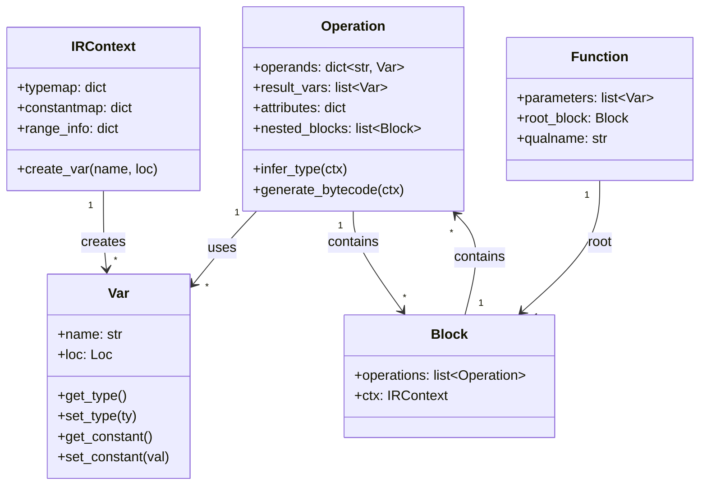
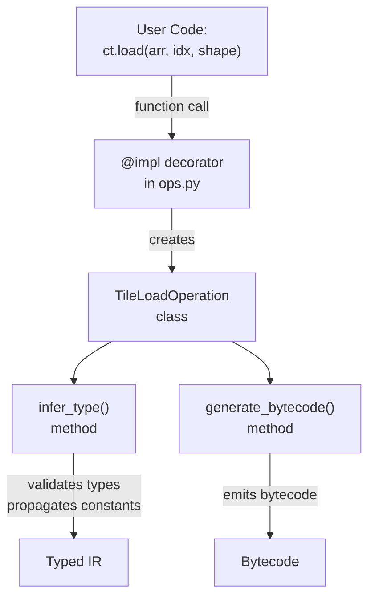
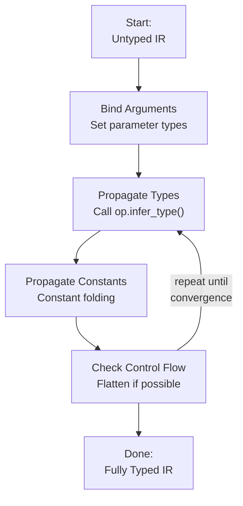
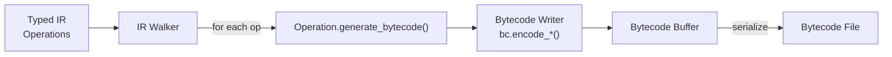
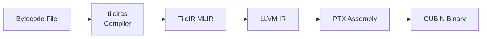

<!-- source: DeepWiki mcp.deepwiki.com · repo NVIDIA/cutile-python · page 7 Advanced Topics · fetched 2026-10-26 -->

# Advanced Topics

<details>
<summary>Relevant source files</summary>

The following files were used as context for generating this wiki page:

- [src/cuda/tile/_compile.py](src/cuda/tile/_compile.py)
- [src/cuda/tile/_ir/ops.py](src/cuda/tile/_ir/ops.py)
- [src/cuda/tile/_passes/eliminate_assign_ops.py](src/cuda/tile/_passes/eliminate_assign_ops.py)
- [test/test_cat.py](test/test_cat.py)
- [test/test_fma.py](test/test_fma.py)

</details>


## Purpose and Scope

This section covers advanced internal details of the cuTile Python compilation system. This material is intended for developers who need to:

- Extend cuTile with new operations or type systems
- Debug complex compilation failures or type errors
- Optimize kernel performance by understanding compilation internals
- Contribute to the cuTile compiler infrastructure

For general usage patterns and kernel development, see [Core Concepts](#2) and [Examples and Patterns](#6). For debugging kernel code (rather than compiler internals), see [Error Handling and Debugging](#4.4).

---

## Internal Architecture Overview

The cuTile compilation system transforms Python kernel code into GPU binaries through a multi-stage pipeline. Understanding this architecture is essential for extending the system or debugging complex issues.

### High-Level Compilation Flow

```mermaid
flowchart LR
    Python["Python Source<br/>@ct.kernel decorated"]
    AST["Python AST"]
    IR["Intermediate<br/>Representation"]
    TypedIR["Typed IR<br/>+ Constants"]
    OptIR["Optimized IR"]
    Bytecode["TileIR Bytecode"]
    CUBIN["GPU Binary"]
    
    Python --> AST
    AST --> IR
    IR --> TypedIR
    TypedIR --> OptIR
    OptIR --> Bytecode
    Bytecode --> CUBIN
    
    AST -.-|"_ast2ir.py"| IR
    IR -.-|"typeinfer.py"| TypedIR
    TypedIR -.-|"Passes"| OptIR
    OptIR -.-|"_ir2bytecode.py"| Bytecode
    Bytecode -.-|"tileiras"| CUBIN
```



**High-Level Compilation Flow**

Sources: [src/cuda/tile/_compile.py:74-94]()

### Core Components

The system is organized into several key layers:

| Layer | Primary Module | Responsibility |
|-------|---------------|----------------|
| **Python API** | `_stub.py` | User-facing operations and type stubs |
| **AST to IR** | `_ast2ir.py` | Parse Python AST and build initial IR |
| **IR Core** | `_ir/ir.py` | IR data structures: `IRContext`, `Var`, `Operation`, `Block` |
| **Operations** | `_ir/ops.py` | Operation definitions and type inference logic |
| **Type System** | `_ir/type.py`, `_ir/typing_support.py` | Type hierarchy and Python↔IR type conversion |
| **Compiler Passes** | `_passes/` | Type inference, optimization, alias analysis |
| **Bytecode Gen** | `_ir2bytecode.py` | IR to TileIR bytecode translation |
| **Backend** | `_compile.py` | Orchestration and `tileiras` compiler invocation |

Sources: [src/cuda/tile/_ir/ops.py:1-68](), [src/cuda/tile/_compile.py:1-48]()

---

## The Intermediate Representation Layer

### IR Data Structures

The IR is built on a small set of core abstractions defined in `_ir/ir.py`:



**IR Core Data Structures**

Every IR construct is immutable after creation except for type and constant information, which is filled in by the type inference pass.

Sources: [src/cuda/tile/_ir/ir.py:22-24]()

### Operation Registry and Implementation

Operations are registered using the `@impl` decorator, which maps Python functions to IR operations:



**Operation Implementation Flow**

Each operation class must implement two critical methods:
- `infer_type(typing_context)`: Determines result types and propagates constants
- `generate_bytecode(ctx)`: Emits TileIR bytecode instructions

Sources: [src/cuda/tile/_ir/ops.py:31-40](), [src/cuda/tile/_ir/ops.py:98-124]()

---

## Compilation Pipeline Stages

The `_compile.py` module orchestrates the complete compilation flow through several distinct stages:

### Stage 1: IR Construction

Python source is parsed into IR using `get_function_ir()`. This creates an untyped IR with variables and operations but without type information.

### Stage 2: Type Inference

The `infer_types_pass()` is the most complex compilation stage:



**Type Inference Pass Structure**

The pass iterates until all types are resolved or an error occurs. Operations implement their own type checking and inference logic via the `infer_type()` method.

Sources: [src/cuda/tile/_compile.py:74-78](), [src/cuda/tile/_passes/typeinfer.py:64-66]()

### Stage 3: Optimization Passes

After type inference, several optimization passes transform the IR:

| Pass | Module | Purpose |
|------|--------|---------|
| `eliminate_assign_ops` | `_passes/eliminate_assign_ops.py` | Remove redundant SSA assignments |
| `dead_code_elimination_pass` | `_passes/dce.py` | Remove unused operations |
| `alias_analysis_pass` | `_passes/alias_analysis.py` | Track memory dependencies |
| `token_order_pass` | `_passes/token_order.py` | Order memory operations for correctness |
| `hoist_loop_invariants` | `_passes/code_motion.py` | Move loop-invariant code outside loops |
| `split_loops` | `_passes/loop_split.py` | Split loops for better optimization |

Sources: [src/cuda/tile/_compile.py:79-93]()

### Stage 4: Bytecode Generation

The `generate_bytecode_for_kernel()` function walks the typed IR and emits TileIR bytecode by calling each operation's `generate_bytecode()` method:



**Bytecode Generation Process**

Sources: [src/cuda/tile/_compile.py:161-166](), [src/cuda/tile/_ir2bytecode.py:58-60]()

### Stage 5: Backend Compilation

The final stage invokes the `tileiras` compiler to translate bytecode to CUBIN:



**Backend Compilation Pipeline**

The `compile_cubin()` function locates the `tileiras` binary and invokes it with appropriate flags for the target architecture.

Sources: [src/cuda/tile/_compile.py:334-375]()

---

## Key Internal Abstractions

### TypingContext

The `TypingContext` class wraps an `IRContext` and provides additional state for type inference:

- **Type Map**: Variable name → Type
- **Constant Map**: Variable name → Constant value
- **Phi State**: Tracks constant propagation across branches (UNSET → MAY_BE_CONSTANT → NONCONSTANT)

This context is passed to each operation's `infer_type()` method.

Sources: [src/cuda/tile/_passes/typeinfer.py:64-66]()

### BytecodeContext

The `BytecodeContext` manages bytecode generation:

- **Type Table**: Maps IR types to bytecode type IDs
- **Value Table**: Maps IR variables to bytecode values
- **Builder**: Constructs bytecode instructions via `bc.encode_*()` calls

This context is passed to each operation's `generate_bytecode()` method.

Sources: [src/cuda/tile/_ir2bytecode.py:58-60]()

### Operation Type Inference Protocol

Every operation must implement the type inference protocol:

```python
def infer_type(self, typing_context: TypingContext) -> TypeResult:
    # 1. Check operand types
    # 2. Perform type compatibility checks
    # 3. Compute result types
    # 4. Propagate constants if possible
    # 5. Handle broadcasting/promotion
    # 6. Return result types
```

This is where most of the type system logic lives. See [Operation Type Inference](#7.2) for details.

Sources: [src/cuda/tile/_ir/ops.py:98-227]()

---

## When You Need Advanced Knowledge

Understanding the compilation internals is necessary when:

### Extending the Type System

Adding new data types requires:
- Registering types in `dtype_registry` ([src/cuda/tile/_ir/typing_support.py:48]())
- Implementing type promotion rules in `promote_types()` ([src/cuda/tile/_ir/ops_utils.py:42-46]())
- Adding bytecode type mappings in `convert_dtype()` ([src/cuda/tile/_ir2bytecode.py:58-61]())

### Adding New Operations

Implementing a new operation requires:
1. Defining an `Operation` subclass in `_ir/ops.py`
2. Implementing `infer_type()` with complete type checking logic
3. Implementing `generate_bytecode()` to emit correct bytecode
4. Registering the operation with `@impl` decorator

See [Adding New Operations](#8.4) for a complete guide.

### Debugging Type Errors

When type inference fails, you need to understand:
- How types flow through operations
- Where constant propagation occurs
- How control flow affects types (phi nodes)
- Broadcasting and promotion rules

Enable `CUDA_TILE_LOGS=CUTILEIR` to dump the IR before type inference.

Sources: [src/cuda/tile/_compile.py:154-157]()

### Debugging Bytecode Issues

When bytecode generation fails or produces incorrect results:
- Use `CUDA_TILE_DUMP_BYTECODE` to save bytecode to disk
- Use `CUDA_TILE_DUMP_TILEIR` to save MLIR to disk (requires internal extension)
- Inspect the IR using `func_ir.to_string()`
- Check operation `generate_bytecode()` implementations

Sources: [src/cuda/tile/_compile.py:171-197]()

### Performance Investigation

To understand why a kernel performs poorly:
1. Examine the final IR to check for optimization opportunities
2. Verify that loop invariants were hoisted
3. Check if memory operations are properly ordered
4. Look for unnecessary type conversions or broadcasts

The optimization passes can be selectively disabled via environment variables for testing.

Sources: [src/cuda/tile/_compile.py:82-84]()

---

## Crash Dump System

When the `tileiras` compiler crashes, cuTile can generate a crash dump containing:
- Anonymized bytecode
- CuTile IR
- Compiler flags and version
- Error message

Enable with `tile_context.config.enable_crash_dump = True`.

Sources: [src/cuda/tile/_compile.py:115-145]()

---

## Relationship to Child Pages

This page provides an overview. For deeper details, see:

- [IR Operations System](#7.1): Deep dive into operation definitions and the `@impl` decorator
- [Operation Type Inference](#7.2): Detailed explanation of type inference, broadcasting, and constant folding
- [Bytecode Generation](#7.3): How IR is translated to TileIR bytecode

For practical examples of working with the IR, see:
- [Testing Infrastructure](#8.1): Using `get_bytecode()` and `filecheck()` to test operations
- [Debugging Techniques](#8.2): Using environment variables and crash dumps

Sources: [src/cuda/tile/_compile.py:74-216](), [src/cuda/tile/_ir/ops.py:1-1068](), [test/test_fma.py:59-87](), [test/test_cat.py:1-117](), [src/cuda/tile/_passes/eliminate_assign_ops.py:1-27]()

---

