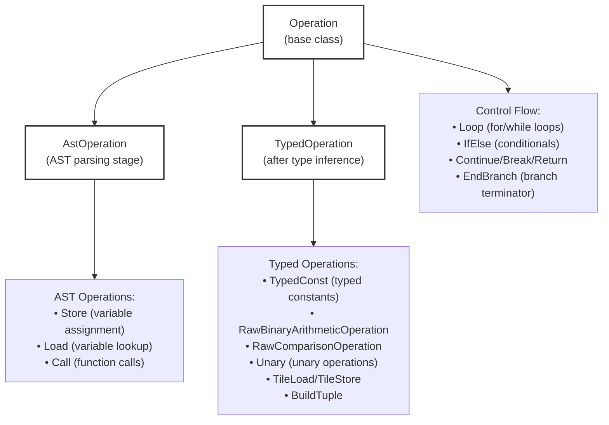
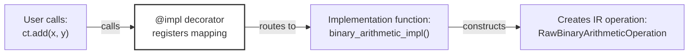
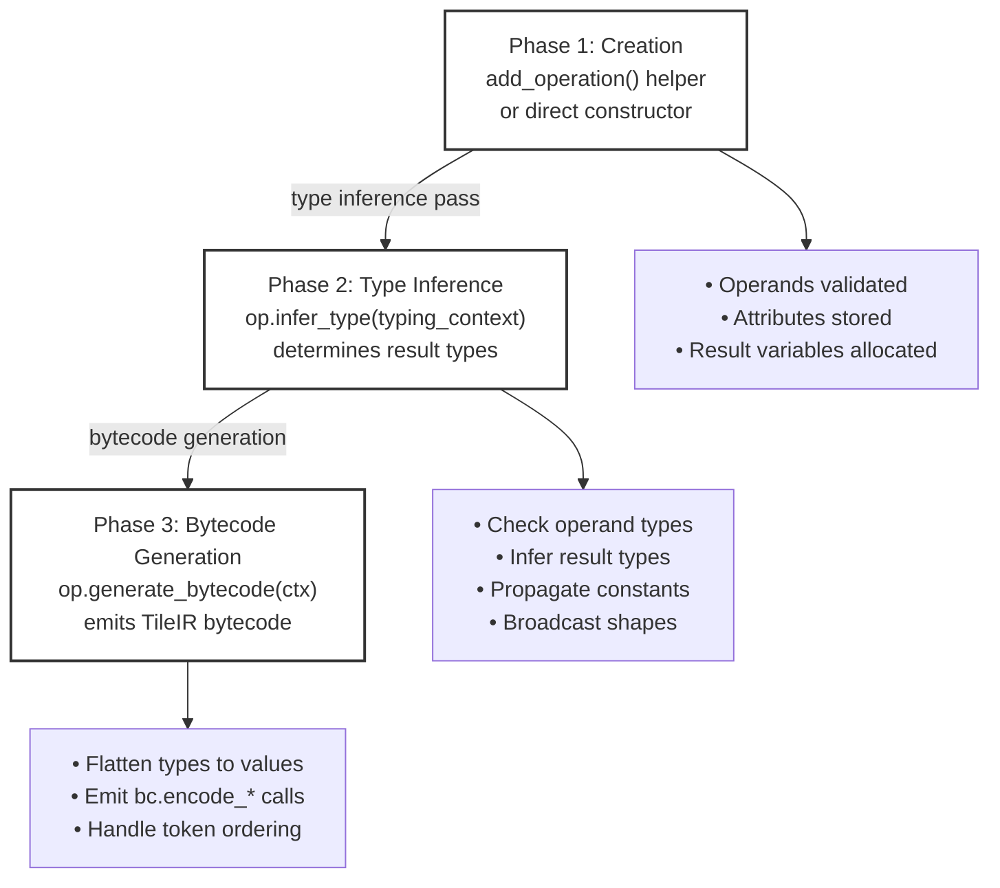
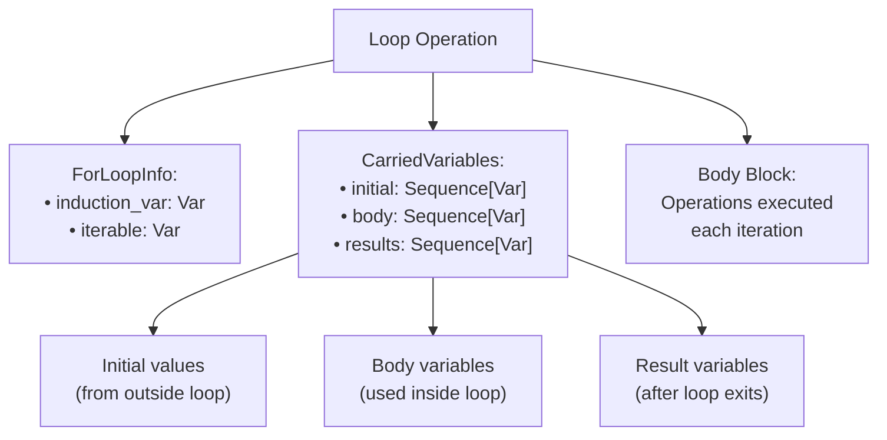
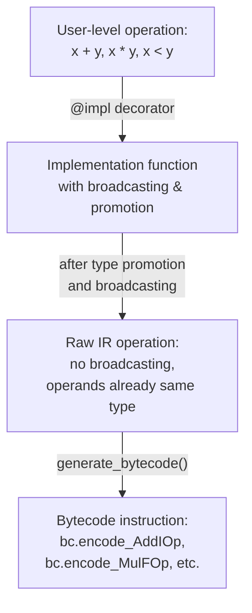
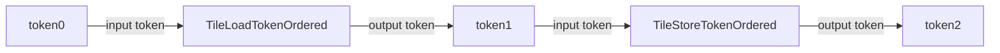

<!-- source: DeepWiki mcp.deepwiki.com · repo NVIDIA/cutile-python · page 7.1 IR Operations System · fetched 2026-10-26 -->

# IR Operations System

<details>
<summary>Relevant source files</summary>

The following files were used as context for generating this wiki page:

- [src/cuda/tile/_ir/ops.py](src/cuda/tile/_ir/ops.py)
- [test/test_cat.py](test/test_cat.py)

</details>


## Purpose and Scope

The IR Operations System defines the fundamental building blocks of cuTile's Intermediate Representation (IR). Each operation represents a single computational step in the kernel, such as arithmetic, memory access, or control flow. This system provides:

1. The `Operation` class hierarchy that represents IR nodes
2. The `@impl` decorator mechanism for registering operation implementations
3. Type inference logic for each operation
4. Bytecode generation for compilation to GPU code

For information about the overall IR structure (contexts, variables, blocks, functions), see [Intermediate Representation](#4.2). For details on how type inference works across the IR, see [Type Inference Pass](#4.3) and [Operation Type Inference](#7.2). For bytecode generation details, see [Bytecode Generation](#7.3).

**Sources:** [src/cuda/tile/_ir/ops.py:1-100]()

---

## Operation Class Hierarchy

Operations form a class hierarchy that represents different stages of IR processing. The base `Operation` class is defined in `_ir/ir.py`, with concrete implementations in `_ir/ops.py`.



**Operation Stages:**

| Stage | Class | Purpose | Example Operations |
|-------|-------|---------|-------------------|
| AST Parsing | `AstOperation` | Created during Python AST traversal | `Store`, `Load`, `Call` |
| Control Flow | `Operation` | Structured control flow constructs | `Loop`, `IfElse`, `Continue`, `Break` |
| Typed | `TypedOperation` | Operations with type information | `TileLoad`, `Unary`, `RawBinaryArithmeticOperation` |

**Key Operation Properties:**

Each `Operation` contains:
- **operands**: Dictionary mapping operand names to `Var` objects
- **attributes**: Dictionary of constant attributes (e.g., rounding mode, axis)
- **result_vars**: List of variables produced by this operation
- **nested_blocks**: Optional nested blocks for control flow
- **loc**: Source location for error reporting

**Sources:** [src/cuda/tile/_ir/ops.py:22-25](), [src/cuda/tile/_ir/ops.py:73-96](), [src/cuda/tile/_ir/ops.py:98-124]()

---

## The @impl Decorator System

The `@impl` decorator is the primary mechanism for registering operation implementations. It connects Python-level functions (from the `cuda.tile` API) to IR operation constructors.

### Decorator Usage Pattern



**Example Registration:**

[src/cuda/tile/_ir/ops.py:1021-1030]() shows a typical usage:

```python
@impl(operator.add, fixed_args=["add"])
@impl(operator.sub, fixed_args=["sub"])
@impl(operator.mul, fixed_args=["mul"])
def binary_arithmetic_impl(fn: str, x: Var, y: Var) -> Var:
    return binary_arithmetic(fn, x, y)
```

The `@impl` decorator:
1. Registers the decorated function as the implementation for the given Python function/operator
2. `fixed_args` injects constant arguments (like operation name) before user arguments
3. During kernel compilation, calls to `operator.add(x, y)` are routed to `binary_arithmetic_impl("add", x, y)`

### Implementation Helper Functions

The decorator system is supported by helper functions defined in `op_impl.py`:

| Helper | Purpose | Example |
|--------|---------|---------|
| `require_constant_int()` | Extract compile-time integer constants | Tile dimensions, axis indices |
| `require_tile_type()` | Validate and extract tile types | Shape operations |
| `require_dtype_spec()` | Extract data type specifications | Type conversions |
| `require_constant_enum()` | Extract enum values | `RoundingMode`, `PaddingMode` |
| `normalize_axis()` | Convert negative axis to positive | `axis=-1` → `axis=ndim-1` |

**Sources:** [src/cuda/tile/_ir/ops.py:31-40](), [src/cuda/tile/_ir/ops.py:705-758](), [src/cuda/tile/_ir/ops.py:1018-1030]()

---

## Operation Lifecycle

Every operation goes through three phases during compilation:



### Phase 1: Creation

Operations are typically created using the `add_operation()` helper from `_ir/ir.py`:

[src/cuda/tile/_ir/ops.py:620-624]() shows a typical creation pattern:

```python
def strictly_typed_const(value: Any, ty: Type) -> Var:
    ret = add_operation(TypedConst, ty, value=value)
    if not isinstance(ty, TileTy):
        ret.set_constant(value)
    return ret
```

The `add_operation()` function:
1. Creates an `Operation` instance with the given arguments
2. Allocates result variables with the specified type
3. Appends the operation to the current block
4. Returns the result variable(s)

### Phase 2: Type Inference

Every operation implements `infer_type(typing_context: TypingContext) -> TypeResult`:

[src/cuda/tile/_ir/ops.py:204-226]() shows the `Loop` operation's type inference:

```python
def infer_type(self, typing_context: TypingContext) -> TypeResult:
    if self.for_loop is not None:
        # Assign type to induction_var
        iterable_type = typing_context.get_type(self.for_loop.iterable)
        typing_context.set_type(self.for_loop.induction_var, iterable_type.dtype)
    
    for initial_var, body_var in zip(self.carried_vars.initial, self.carried_vars.body):
        typing_context.set_type(body_var, typing_context.get_type(initial_var))
    
    for nested_block in self.nested_blocks:
        infer_types_in_block(typing_context, nested_block)
    
    return [typing_context.get_type(body_var) for body_var in self.carried_vars.body]
```

Type inference responsibilities:
- Validate operand types
- Compute result types (may involve broadcasting, promotion)
- Propagate constant values when possible
- Handle control flow merging (phi nodes)

### Phase 3: Bytecode Generation

Operations implement `generate_bytecode(ctx: BytecodeContext) -> tuple[tuple[bc.Value, ...], ...]`:

[src/cuda/tile/_ir/ops.py:913-983]() shows arithmetic bytecode generation:

```python
def generate_bytecode(self, ctx: BytecodeContext) -> bc.Value:
    result_ty = self.result_var.get_type()
    dtype = get_dtype(result_ty)
    kind = "float" if datatype.is_float(dtype) else "int"
    res_typeid = typeid(ctx.type_table, result_ty)
    lhs = ctx.get_value(self.lhs)
    rhs = ctx.get_value(self.rhs)
    
    match self.fn, kind:
        case "add", "int":
            return bc.encode_AddIOp(ctx.builder, res_typeid, lhs, rhs, ...)
        case "add", "float":
            return bc.encode_AddFOp(ctx.builder, res_typeid, lhs, rhs, ...)
        # ... more cases
```

Bytecode generation:
- Retrieves operand values from context
- Emits appropriate `bc.encode_*` bytecode instructions
- Returns tuple of result values (may be flattened for complex types)

**Sources:** [src/cuda/tile/_ir/ir.py:23-25](), [src/cuda/tile/_ir/ops.py:204-226](), [src/cuda/tile/_ir/ops.py:913-983]()

---

## Operation Categories

The IR operations system organizes operations into functional categories:

### Control Flow Operations

Control flow operations manage execution paths and loops:

| Operation | Purpose | Nested Blocks | Terminator |
|-----------|---------|---------------|------------|
| `Loop` | While loop or for loop | 1 (body) | No |
| `IfElse` | Conditional branching | 2 (then, else) | No |
| `Continue` | Continue to next iteration | 0 | Yes |
| `Break` | Exit loop early | 0 | Yes |
| `EndBranch` | Yield values from branch | 0 | Yes |
| `Return` | Return from function | 0 | Yes |

**Loop Operation Structure:**

[src/cuda/tile/_ir/ops.py:158-226]() defines `Loop` with:
- Optional `ForLoopInfo`: induction variable and iterable range
- Optional `CarriedVariables`: loop-carried state (initial values → body vars → results)
- Nested body block containing loop operations



**IfElse Operation Structure:**

[src/cuda/tile/_ir/ops.py:297-375]() defines `IfElse` with:
- Condition variable (boolean)
- Then block (executed if true)
- Else block (executed if false)
- Optional `IfElseResults` for values returned from branches

**Sources:** [src/cuda/tile/_ir/ops.py:128-557]()

### Arithmetic and Comparison Operations

These operations perform mathematical computations:



**Key Operations:**

| IR Operation Class | Purpose | Generated Bytecode |
|--------------------|---------|-------------------|
| `RawBinaryArithmeticOperation` | Add, subtract, multiply, divide, min, max | `AddIOp`, `SubFOp`, `MulIOp`, `DivFOp`, `MinFOp`, `MaxIOp` |
| `RawComparisonOperation` | Equal, less than, greater than, etc. | `CmpIOp`, `CmpFOp` |
| `RawBinaryBitwiseOperation` | Bitwise AND, OR, XOR | `AndIOp`, `OrIOp`, `XOrIOp` |
| `RawBitwiseShiftOperation` | Left shift, right shift | `ShLIOp`, `ShRIOp` |
| `Unary` | Negation, abs, exp, sin, cos, sqrt, etc. | `NegFOp`, `AbsIOp`, `ExpOp`, `SinOp`, etc. |
| `FusedMulAddOperation` | Fused multiply-add (FMA) | `FmaOp` |

**Type Promotion and Broadcasting:**

[src/cuda/tile/_ir/ops.py:994-1015]() shows the pattern:

```python
def binary_arithmetic(fn: str, x: Var, y: Var, ...) -> Var:
    x_ty = require_tile_or_scalar_maybe_loose_type(x)
    y_ty = require_tile_or_scalar_maybe_loose_type(y)
    
    # Handle loosely-typed constants
    if isinstance(x_ty, LooselyTypedScalar) and isinstance(y_ty, LooselyTypedScalar):
        return _binop_propagate_constant(fn, x_ty.value, y_ty.value, None)
    
    # Promote types (int32 + int64 → int64)
    common_ty = promote_types(x_ty, y_ty)
    x = _promote_and_broadcast_to(x, common_ty)
    y = _promote_and_broadcast_to(y, common_ty)
    
    # Constant folding if both operands are constant
    if x.is_constant() and y.is_constant():
        return _binop_propagate_constant(fn, x.get_constant(), y.get_constant(), common_ty)
    
    return raw_binary_arithmetic(fn, x, y, ...)
```

**Sources:** [src/cuda/tile/_ir/ops.py:627-1089](), [src/cuda/tile/_ir/ops.py:654-727](), [src/cuda/tile/_ir/ops.py:901-983]()

### Memory Operations

Memory operations handle data movement between global memory and tile registers:

| Operation | Direction | Token-Ordered Variant | Purpose |
|-----------|-----------|----------------------|---------|
| `TileLoad` | Array → Tile | `TileLoadTokenOrdered` | Load tile from global memory |
| `TileStore` | Tile → Array | `TileStoreTokenOrdered` | Store tile to global memory |
| `LoadPointer` | Pointer → Tile | `LoadPointerTokenOrdered` | Load from pointer (for gather) |
| `StorePointer` | Tile → Pointer | `StorePointerTokenOrdered` | Store to pointer (for scatter) |
| `PointerOffset` | Pointer arithmetic | N/A | Compute pointer offsets |

**TileLoad Operation:**

[src/cuda/tile/_ir/ops.py:1856-1904]() defines `TileLoad` with:
- `array`: Source array to load from
- `index`: Starting index (scalar or tuple)
- `shape`: Tile shape to load
- `order`: Axis traversal order for memory access
- `padding_mode`: How to handle out-of-bounds access
- `latency`: Hint for scheduling
- `allow_tma`: Whether to use Tensor Memory Accelerator

**Token-Ordered Operations:**

Token-ordered variants accept a token operand and produce a result token, enabling explicit ordering of memory operations:



**Gather/Scatter Implementation:**

[src/cuda/tile/_ir/ops.py:2149-2289]() implements gather and scatter using pointer operations:
1. `_gather_scatter_pointer_and_mask()`: Computes element pointers and bounds mask
2. `load_pointer()` or `store_pointer()`: Accesses individual elements
3. Broadcasting is applied to handle non-uniform access patterns

**Sources:** [src/cuda/tile/_ir/ops.py:1856-2290](), [src/cuda/tile/_ir/load_store_impl.py:26-30]()

### Type System Operations

Operations that manipulate types and constants:

| Operation | Purpose | Example |
|-----------|---------|---------|
| `Const` / `TypedConst` | Represent constant values | Literal integers, floats, shapes |
| `TupleItemOperation` | Extract item from tuple | `shape[0]` |
| `TupleSliceOperation` | Slice tuple | `shape[1:3]` |
| `BuildTuple` | Construct tuple | `(x, y, z)` |
| `Assign` | Variable assignment | `result = x + y` |

**Constant Operations:**

[src/cuda/tile/_ir/ops.py:571-625]() defines constant operations:
- `Const`: Untyped constant (used during AST parsing)
- `TypedConst`: Typed constant (after type inference)
- Constants may be "loosely typed" (e.g., literal `1` can be int32 or int64)

**Tuple Operations:**

[src/cuda/tile/_ir/ops.py:1100-1202]() defines tuple manipulation:
- `TupleItemOperation`: Extract single item by index
- `TupleSliceOperation`: Extract slice of items
- These are used for accessing array shapes, function arguments, etc.

**Sources:** [src/cuda/tile/_ir/ops.py:571-625](), [src/cuda/tile/_ir/ops.py:1100-1202](), [src/cuda/tile/_ir/ops.py:1349-1371]()

### Utility and Intrinsic Operations

Specialized operations for kernel intrinsics and utilities:

| Operation | Purpose | API Function |
|-----------|---------|--------------|
| `TileBid` | Get block ID | `ct.bid(axis)` |
| `TileNumBlocks` | Get grid dimension | `ct.num_blocks(axis)` |
| `Range` | Create iteration range | `range(start, stop, step)` |
| `GetArrayShape` | Extract array shape | `array.shape` |
| `GetArrayStrides` | Extract array strides | `array.strides` |
| `BindMethod` | Bind method to object | `tile.reshape` |
| Atomic operations | Atomic memory operations | `ct.atomic_add`, `ct.atomic_cas` |

**Atomic Operations:**

[src/cuda/tile/_ir/ops.py:2292-2573]() defines several atomic operation classes:
- `TileAtomicCAS`: Compare-and-swap
- `TileAtomicRMW`: Read-modify-write (add, min, max, etc.)
- Each has a token-ordered variant for explicit memory ordering

**Sources:** [src/cuda/tile/_ir/ops.py:1807-1854](), [src/cuda/tile/_ir/ops.py:2292-2573](), [src/cuda/tile/_ir/ops.py:1597-1679]()

---

## Operation Implementation Patterns

### Pattern 1: Simple Unary Operation

For operations that apply to a single operand with straightforward type rules:

[src/cuda/tile/_ir/ops.py:1456-1486]() shows the pattern:

```python
def unary(fn: str, behavior: _UnaryBehavior, x: Var, ...) -> Var:
    x_type = require_tile_or_scalar_maybe_loose_type(x)
    
    # Handle loosely-typed constants
    if isinstance(x_type, LooselyTypedScalar):
        res = _unary_propagate_constant(fn, x_type.value)
        return loosely_typed_const(res)
    
    # Apply type-specific handler (may promote type)
    input_dtype = get_dtype(x_type)
    if is_boolean(input_dtype):
        x = behavior.bool_handler(x)
    elif is_integral(input_dtype):
        x = behavior.int_handler(x)
    # ... etc.
    
    # Constant folding
    if x.is_constant():
        res = _unary_propagate_constant(fn, x.get_constant())
        return strictly_typed_const(res, ty)
    
    # Create IR operation
    return add_operation(Unary, ty, fn=fn, operand=x, ...)
```

### Pattern 2: Binary Operation with Broadcasting

For operations that combine two operands with type promotion and shape broadcasting:

[src/cuda/tile/_ir/ops.py:994-1015]() shows the pattern:

```python
def binary_arithmetic(fn: str, x: Var, y: Var, ...) -> Var:
    x_ty = require_tile_or_scalar_maybe_loose_type(x)
    y_ty = require_tile_or_scalar_maybe_loose_type(y)
    
    # Handle two loosely-typed constants
    if isinstance(x_ty, LooselyTypedScalar) and isinstance(y_ty, LooselyTypedScalar):
        return _binop_propagate_constant(fn, x_ty.value, y_ty.value, None)
    
    # Type promotion (e.g., int32 + int64 → int64)
    common_ty = promote_types(x_ty, y_ty)
    
    # Promote and broadcast both operands to common type
    x = _promote_and_broadcast_to(x, common_ty)
    y = _promote_and_broadcast_to(y, common_ty)
    
    # Constant folding
    if x.is_constant() and y.is_constant():
        return _binop_propagate_constant(fn, x.get_constant(), y.get_constant(), common_ty)
    
    return raw_binary_arithmetic(fn, x, y, ...)
```

### Pattern 3: Operation with Nested Blocks

For control flow operations that contain nested code blocks:

[src/cuda/tile/_ir/ops.py:297-375]() shows `IfElse`:

```python
class IfElse(Operation):
    def __init__(self, cond: Var, then_block: Block, else_block: Block, 
                 loc: Loc, results: Optional[IfElseResults] = None):
        super().__init__(
            "ifelse",
            operands={"cond": cond},
            result_vars=results.vars if results else [],
            nested_blocks=[then_block, else_block],  # Two nested blocks
            loc=loc,
        )
    
    def infer_type(self, typing_context: TypingContext) -> TypeResult:
        # Type-check condition
        cond_type = typing_context.get_type(self.cond)
        if not datatype.is_boolean(cond_type):
            raise TileTypeError('condition must be a bool')
        
        # Infer types in both branches
        for nested_block in self.nested_blocks:
            infer_types_in_block(typing_context, nested_block)
        
        # Finalize phi constants for results
        for var in self.results.vars:
            typing_context.phi_finalize_constant(var)
        
        return [typing_context.get_type(var) for var in self.results.vars]
```

### Pattern 4: Memory Operation

For operations that access global memory with optional token ordering:

[src/cuda/tile/_ir/ops.py:1856-1904]() shows `TileLoad`:

```python
@impl(ct.load)
def tile_load_impl(array: Var, index: Var, shape: Var, order: Var,
                   padding_mode: Var, latency: Var, allow_tma: Var) -> Var:
    # Validate operands
    array_ty = require_array_type(array)
    index_ty = require_index_or_index_tuple_type(index)
    
    # Extract constant attributes
    shape = require_constant_shape(shape, ...)
    order = require_constant_axis_order(order, array_ty.ndim)
    padding_mode = require_constant_enum(padding_mode, PaddingMode)
    latency = require_optional_constant_int(latency)
    allow_tma = require_optional_constant_bool(allow_tma)
    
    # Create operation
    result = tile_load(array, index, broadcasted_shape, order, 
                      padding_mode, latency, allow_tma)
    
    # Handle 0-D case
    return reshape(result, shape)
```

**Sources:** [src/cuda/tile/_ir/ops.py:994-1015](), [src/cuda/tile/_ir/ops.py:1456-1486](), [src/cuda/tile/_ir/ops.py:297-375](), [src/cuda/tile/_ir/ops.py:1856-1904]()

---

## Key Helper Functions

The operations system relies on several utility functions defined across multiple files:

### Type Requirements (op_impl.py)

| Function | Purpose | Returns | Exception |
|----------|---------|---------|-----------|
| `require_constant_int(v)` | Extract compile-time integer | `int` | `TileTypeError` |
| `require_tile_type(v)` | Validate tile type | `TileTy` | `TileTypeError` |
| `require_array_type(v)` | Validate array type | `ArrayTy` | `TileTypeError` |
| `require_dtype_spec(v)` | Extract dtype specification | `DType` | `TileTypeError` |
| `require_constant_enum(v, cls)` | Extract enum value | Enum instance | `TileTypeError` |
| `normalize_axis(axis, ndim)` | Convert negative axis | `int` | N/A |

### Type Manipulation (ops_utils.py)

| Function | Purpose | Example |
|----------|---------|---------|
| `promote_types(ty1, ty2)` | Compute common type | `int32, int64 → int64` |
| `promote_dtypes(dt1, dt2)` | Promote data types | `float16, float32 → float32` |
| `broadcast_shapes2(s1, s2)` | Broadcast two shapes | `(2,1), (1,3) → (2,3)` |
| `get_dtype(ty)` | Extract dtype from type | `TileTy(float32, (2,2)) → float32` |
| `change_dtype(ty, dtype)` | Change dtype of type | `TileTy(int32, (2,2)) → TileTy(float32, (2,2))` |

### Operation Construction (ir.py)

| Function | Purpose | Returns |
|----------|---------|---------|
| `add_operation(OpClass, result_type, **kwargs)` | Create and append operation | Result `Var` |
| `loosely_typed_const(value, ty=None)` | Create loosely-typed constant | `Var` with constant |
| `strictly_typed_const(value, ty)` | Create strictly-typed constant | `Var` with constant |

**Sources:** [src/cuda/tile/_ir/op_impl.py:31-40](), [src/cuda/tile/_ir/ops_utils.py:42-47](), [src/cuda/tile/_ir/ir.py:23-25]()

---

## Operation Registration Map

The following table shows how high-level API functions map to implementation functions and IR operations:

### Arithmetic Operations

| API Function | Implementation | IR Operation | Bytecode |
|--------------|----------------|--------------|----------|
| `operator.add(x, y)` | `binary_arithmetic_impl("add", ...)` | `RawBinaryArithmeticOperation` | `AddIOp` / `AddFOp` |
| `operator.mul(x, y)` | `binary_arithmetic_impl("mul", ...)` | `RawBinaryArithmeticOperation` | `MulIOp` / `MulFOp` |
| `ct.sqrt(x)` | `unary_impl("sqrt", ...)` | `Unary` | `SqrtOp` |
| `ct.exp(x)` | `unary_impl("exp", ...)` | `Unary` | `ExpOp` |

### Comparison Operations

| API Function | Implementation | IR Operation | Bytecode |
|--------------|----------------|--------------|----------|
| `operator.lt(x, y)` | `comparison_operator_impl("lt", ...)` | `RawComparisonOperation` | `CmpIOp` / `CmpFOp` |
| `ct.equal(x, y)` | `comparison("eq", ...)` | `RawComparisonOperation` | `CmpIOp` / `CmpFOp` |

### Memory Operations

| API Function | Implementation | IR Operation | Bytecode |
|--------------|----------------|--------------|----------|
| `ct.load(arr, idx, shape)` | `tile_load_impl(...)` | `TileLoad` | `LoadViewTkoOp` |
| `ct.store(arr, idx, tile)` | `tile_store_impl(...)` | `TileStore` | `StoreViewTkoOp` |
| `ct.gather(arr, indices)` | `gather_impl(...)` | `LoadPointer` | `LoadTkoOp` |
| `ct.scatter(arr, indices, val)` | `scatter_impl(...)` | `StorePointer` | `StoreTkoOp` |

### Shape Operations

| API Function | Implementation | IR Operation | Notes |
|--------------|----------------|--------------|-------|
| `ct.reshape(tile, shape)` | `reshape_impl(...)` | Multiple ops | Creates `TileReshape` or `BroadcastPartition` |
| `ct.permute(tile, order)` | `permute_impl(...)` | `TilePermute` | Transposes axes |
| `ct.cat(tiles, axis)` | `cat_impl(...)` | `TileCat` | Concatenates tiles |
| `ct.extract(tile, index)` | `extract_impl(...)` | `TileExtract` | Extracts sub-tile |

**Sources:** [src/cuda/tile/_ir/ops.py:1018-1030](), [src/cuda/tile/_ir/ops.py:1524-1541](), [src/cuda/tile/_ir/ops.py:1885-1904](), [src/cuda/tile/_ir/ops.py:1968-1985]()

---

## Summary

The IR Operations System provides:

1. **Extensible Architecture**: The `Operation` class hierarchy supports diverse operation types
2. **Type Safety**: Each operation implements type inference with validation
3. **Compilation Pipeline**: Operations bridge Python code to GPU bytecode
4. **Optimization Opportunities**: Operations can propagate constants and simplify expressions
5. **Registration Mechanism**: The `@impl` decorator cleanly separates API from implementation

The system is designed to be extended with new operations by:
1. Defining an `Operation` subclass
2. Implementing `infer_type()` and `generate_bytecode()` methods
3. Registering an implementation function with `@impl`
4. Adding necessary helper functions and type checking

For more details on implementing a new operation, see [Adding New Operations](#8.4).

**Sources:** [src/cuda/tile/_ir/ops.py:1-2900](), [src/cuda/tile/_ir/ir.py:22-25](), [src/cuda/tile/_ir/op_impl.py:31-40]()

---

