<!-- source: DeepWiki mcp.deepwiki.com · repo NVIDIA/cutile-python · page 7.2 Operation Type Inference · fetched 2026-10-26 -->

# Operation Type Inference

<details>
<summary>Relevant source files</summary>

The following files were used as context for generating this wiki page:

- [src/cuda/tile/_ir/ir.py](src/cuda/tile/_ir/ir.py)
- [src/cuda/tile/_ir/ops.py](src/cuda/tile/_ir/ops.py)
- [src/cuda/tile/_ir/typing_support.py](src/cuda/tile/_ir/typing_support.py)
- [src/cuda/tile/_passes/typeinfer.py](src/cuda/tile/_passes/typeinfer.py)
- [test/test_cat.py](test/test_cat.py)
- [test/test_typeinfer.py](test/test_typeinfer.py)

</details>


## Purpose and Scope

This page explains how cuTile operations implement type inference to determine result types, propagate constants, and validate type compatibility. Each operation in the IR must implement the `infer_type` method, which is called during the type inference pass to compute result types based on operand types.

For information about how operations are defined and registered, see [IR Operations System](#7.1). For information about the overall compilation pipeline, see [Compilation Pipeline](#4.1). For high-level concepts about the type system, see [Type System](#2.3).

**Sources:** [src/cuda/tile/_ir/ops.py:1-100](), [src/cuda/tile/_passes/typeinfer.py:1-50](), [src/cuda/tile/_ir/ir.py:364-368]()

## Type Inference Contract

### The `infer_type` Method

Every `Operation` subclass must implement the `infer_type` method with the following signature:

```python
def infer_type(self, typing_context: TypingContext) -> TypeResult
```

The method receives a `TypingContext` object that provides access to type information and constant values for all variables, and returns either:
- A single `Type` for operations with one result
- A `list[Type]` for operations with multiple results

The type inference framework automatically assigns these returned types to the operation's `result_vars`.

**Sources:** [src/cuda/tile/_ir/ir.py:364-368](), [src/cuda/tile/_passes/typeinfer.py:127-139]()

### TypingContext

The `TypingContext` class wraps an `IRContext` and provides additional functionality for type inference:

| Method | Purpose |
|--------|---------|
| `get_type(var: Var)` | Retrieve the type of a variable |
| `set_type(var: Var, typ: Type)` | Assign a type to a variable |
| `get_constant(var: Var)` | Retrieve a variable's constant value |
| `set_constant(var: Var, value: Any)` | Mark a variable as constant with a value |
| `is_constant(var: Var)` | Check if a variable has a constant value |
| `phi_propagate_constant(src: Var, dst: Var)` | Propagate constants through control flow |
| `phi_finalize_constant(dst: Var)` | Finalize constant state after control flow merge |

**Sources:** [src/cuda/tile/_passes/typeinfer.py:49-105]()

### PhiState for Control Flow

The `PhiState` class tracks constant values across control flow branches:

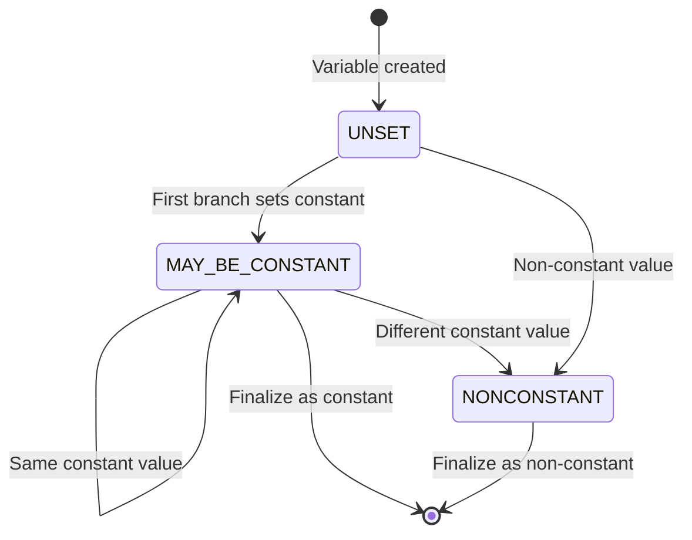

When multiple branches produce different constant values or a non-constant value, the variable becomes `NONCONSTANT`.

**Sources:** [src/cuda/tile/_passes/typeinfer.py:27-47]()

## Type Inference Pass Flow

### High-Level Flow

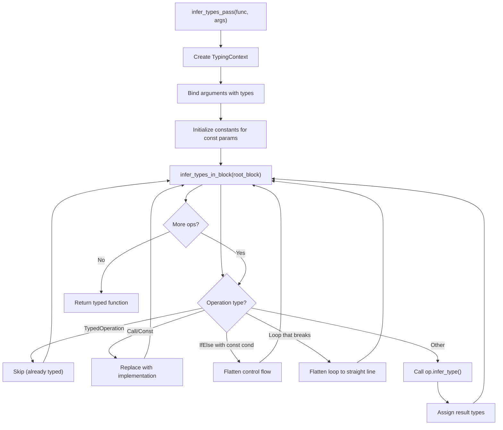

**Sources:** [src/cuda/tile/_passes/typeinfer.py:292-327](), [src/cuda/tile/_passes/typeinfer.py:362-376]()

### Operation Replacement

The type inference pass replaces high-level operations with lower-level implementations:

#### Call Operation Replacement

When a `Call` operation is encountered, it is replaced with the actual implementation:

1. **Built-in operations**: Look up in `op_implementations` and execute the registered handler
2. **User-defined functions**: Inline the function's IR into the call site
3. **Bound methods**: Extract the self argument and call the method implementation

**Sources:** [src/cuda/tile/_passes/typeinfer.py:224-290]()

#### Const Operation Replacement

`Const` operations are replaced with `TypedConst` operations that have explicit types:

```python
# Before type inference
result = Const(value=42, ...)

# After type inference
result = TypedConst(value=42, type=int32, ...)
```

**Sources:** [src/cuda/tile/_ir/ops.py:571-625]()

### Control Flow Flattening

When control flow conditions are constant, the type inference pass flattens the control flow:

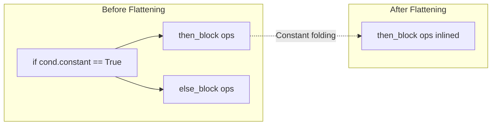

This optimization eliminates dead branches and simplifies the IR when conditions can be determined at compile time.

**Sources:** [src/cuda/tile/_passes/typeinfer.py:141-160](), [src/cuda/tile/_passes/typeinfer.py:162-184]()

## Constant Propagation

### Constant Folding in Operations

Operations perform constant folding when all operands are constant. Here's how binary arithmetic operations handle it:

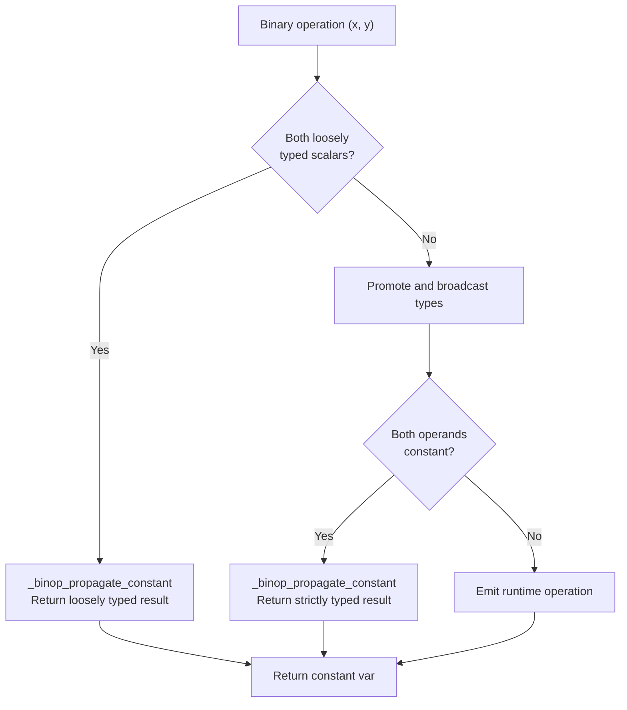

**Example from comparison operations:**

[src/cuda/tile/_ir/ops.py:711-727]()

```python
def comparison(fn: str, x: Var, y: Var) -> Var:
    x_ty = require_tile_or_scalar_maybe_loose_type(x)
    y_ty = require_tile_or_scalar_maybe_loose_type(y)

    # If both are loosely typed scalars, fold immediately
    if isinstance(x_ty, LooselyTypedScalar) and isinstance(y_ty, LooselyTypedScalar):
        return _binop_propagate_constant(fn, x_ty.value, y_ty.value, None)

    # Otherwise promote types and check for constants
    common_ty = promote_types(x_ty, y_ty)
    x = _promote_and_broadcast_to(x, common_ty)
    y = _promote_and_broadcast_to(y, common_ty)

    if x.is_constant() and y.is_constant():
        res_ty = change_dtype(common_ty, datatype.bool_)
        return _binop_propagate_constant(fn, x.get_constant(), y.get_constant(), res_ty)

    return raw_comparison(fn, x, y)
```

**Sources:** [src/cuda/tile/_ir/ops.py:694-727](), [src/cuda/tile/_ir/ops.py:796-834]()

### Constant Propagation Through Control Flow

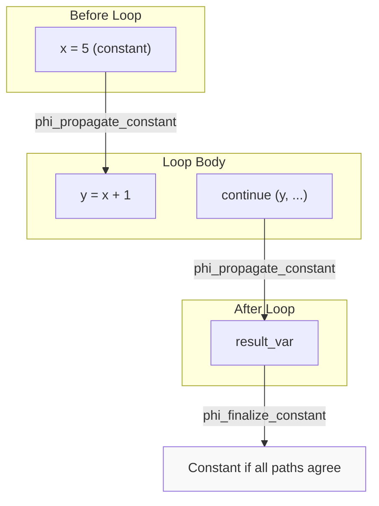

The `PhiState` mechanism tracks whether a variable remains constant across all control flow paths:

1. **Initial state**: `UNSET`
2. **First branch**: Sets state to `MAY_BE_CONSTANT` with the value
3. **Additional branches**: 
   - If same value → remains `MAY_BE_CONSTANT`
   - If different value or non-constant → becomes `NONCONSTANT`
4. **Finalization**: If `MAY_BE_CONSTANT`, mark variable as constant

**Sources:** [src/cuda/tile/_passes/typeinfer.py:34-47](), [src/cuda/tile/_passes/typeinfer.py:94-105](), [src/cuda/tile/_ir/ops.py:204-227]()

## Type Promotion and Broadcasting

### Type Promotion Rules

The `promote_types` function determines the common type for operations involving different types:

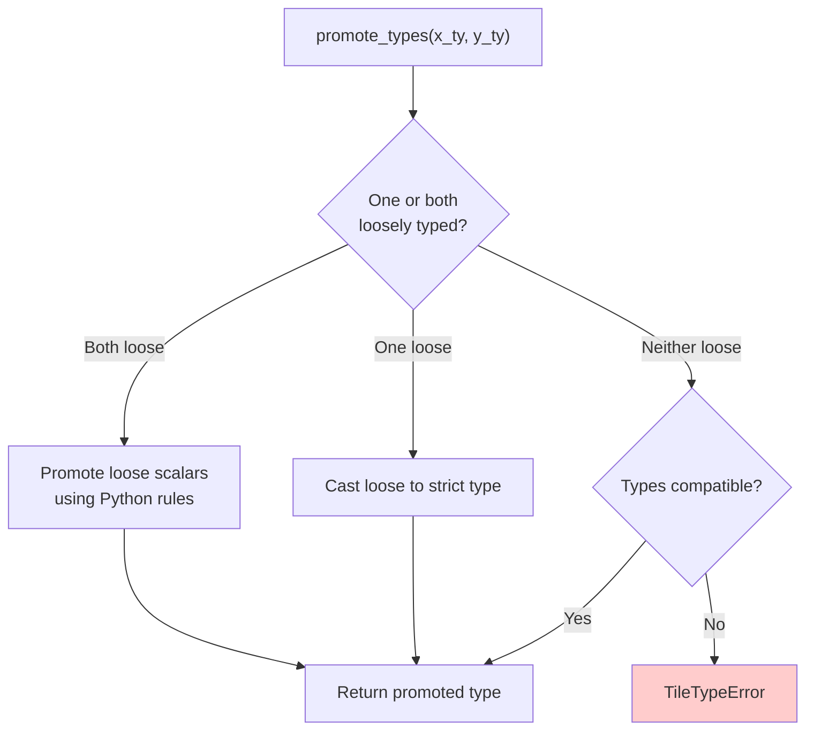

**Type promotion hierarchy for numeric types:**

1. **Integer promotion**: Smaller integer types promote to larger ones
2. **Float promotion**: Lower precision floats promote to higher precision
3. **Integer-to-float**: Integer types promote to float types when mixed
4. **Boolean handling**: Boolean cannot be directly promoted to numeric types

**Sources:** [src/cuda/tile/_ir/ops_utils.py:1-100]() (imports and utilities)

### Broadcasting Mechanics

The `broadcast_shapes2` function computes the result shape when broadcasting two tile shapes:

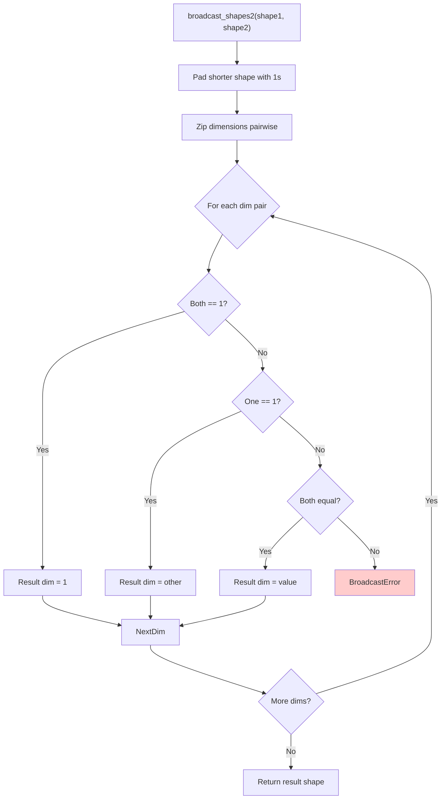

**Broadcasting rules:**
- Dimensions are aligned from the right
- A dimension of size 1 broadcasts to any size
- Dimensions must match exactly or one must be 1
- The result shape is the maximum along each dimension

**Sources:** [src/cuda/tile/_ir/ops_utils.py:1-200]() (broadcasting utilities)

### The `_promote_and_broadcast_to` Helper

This helper function combines type promotion and broadcasting:

[src/cuda/tile/_ir/ops.py:760-764]()

```python
def _promote_and_broadcast_to(x: Var, ty: TileTy | DType) -> Var:
    is_tile = isinstance(ty, TileTy)
    shape = ty.shape_value if is_tile else ()
    return broadcast_to(astype(x, get_dtype(ty)), shape, keep_scalar=not is_tile)
```

**Steps:**
1. Cast the operand to the target dtype using `astype`
2. Broadcast the result to the target shape using `broadcast_to`
3. If target is scalar, use `keep_scalar=True` to avoid creating a 0-d tile

**Sources:** [src/cuda/tile/_ir/ops.py:760-764]()

## Operation Type Inference Examples

### Binary Arithmetic Operations

Binary arithmetic operations follow a standard pattern:

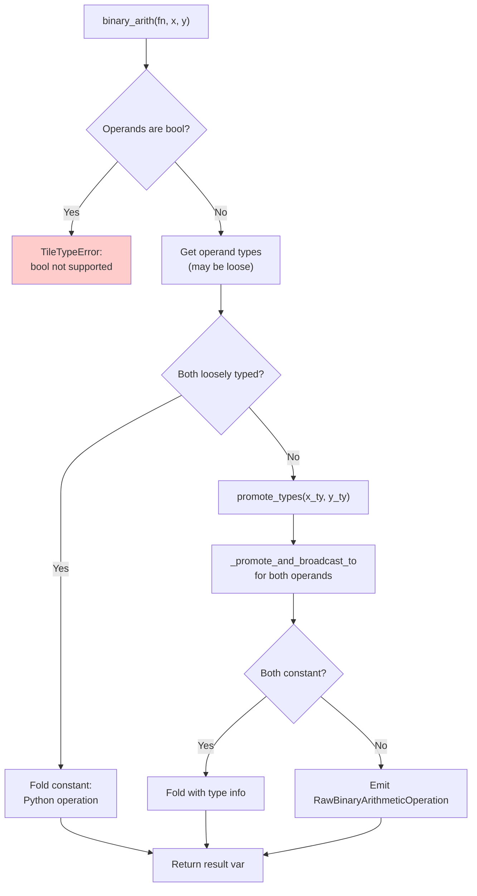

**Example for addition:**

The implementation handles multiple cases:
1. **Loosely typed scalars**: Direct Python addition with loose result type
2. **Mixed types**: Promote to common type, then broadcast
3. **Constants**: Perform constant folding
4. **Runtime values**: Emit a `RawBinaryArithmeticOperation` for bytecode generation

**Sources:** [src/cuda/tile/_ir/ops.py:900-1000]() (binary arithmetic operations)

### Comparison Operations

Comparison operations have special handling for different operand types:

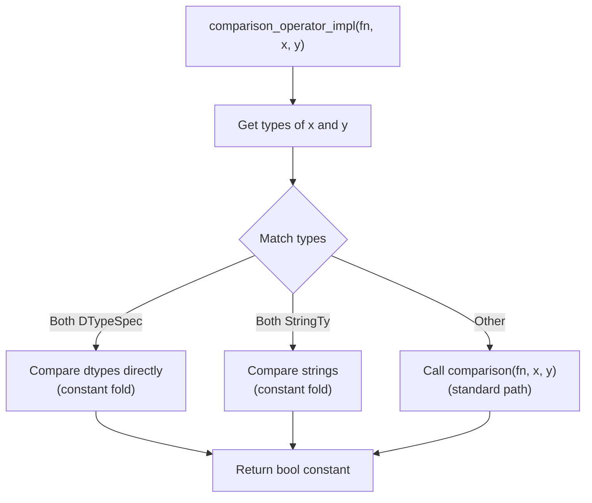

This allows comparing types like `x.dtype == ct.float32` at compile time.

**Sources:** [src/cuda/tile/_ir/ops.py:741-758]()

### Load Operation Type Inference

The `tile_load` operation demonstrates type inference with arrays:

Key validation steps in `infer_type`:
1. **Array type check**: Verify first operand is `ArrayTy`
2. **Index validation**: Check index rank matches array rank
3. **Shape validation**: Verify shape is a constant tuple of positive powers of 2
4. **Order validation**: Check order parameter is valid (`'C'`, `'F'`, or tuple)
5. **Result type construction**: Create `TileTy` with array's dtype and requested shape

**Sources:** [src/cuda/tile/_ir/ops.py:1500-1700]() (approximate location for load operations)

### Control Flow Operations

Control flow operations have special type inference requirements:

#### Loop Operation

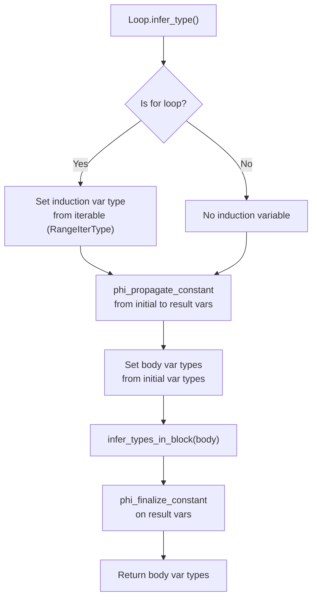

**Loop carried variables:**
- `initial`: Variables provided when entering the loop
- `body`: Variables used inside the loop body
- `results`: Variables after the loop completes

The type inference ensures that loop-carried variables have consistent types across iterations.

**Sources:** [src/cuda/tile/_ir/ops.py:204-227]()

#### IfElse Operation

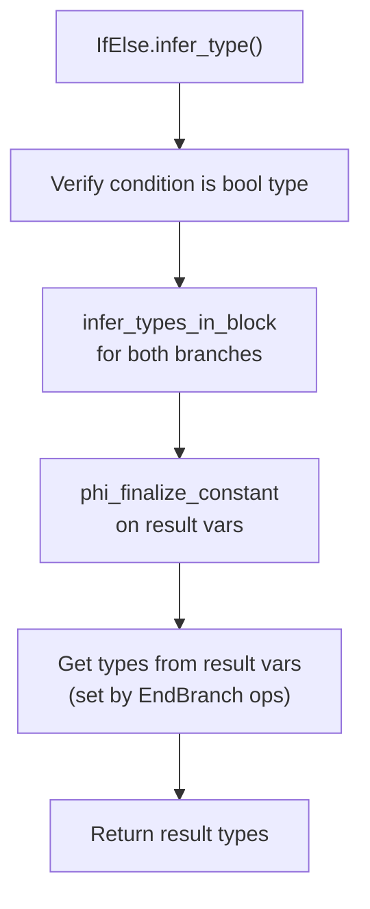

The `EndBranch` operations within each branch propagate types to the parent `IfElse` result variables.

**Sources:** [src/cuda/tile/_ir/ops.py:336-351]()

### Type Inference for Special Operations

#### Cat (Concatenation)

The `cat` operation validates that all input tiles have:
- Same dtype
- Same rank
- Same shape except along concatenation axis
- Result shape is power of 2

**Sources:** [test/test_cat.py:1-117]() (test examples showing validation)

#### Reduce Operations

Reduce operations handle `keepdims` parameter:
- If `keepdims=True`: Result tile has same rank with reduced dimension = 1
- If `keepdims=False`: Result tile has rank decreased by 1

The axis parameter must be a constant integer for type inference.

**Sources:** [src/cuda/tile/_ir/ops.py:2000-2200]() (approximate location for reduce operations)

## Error Handling During Type Inference

Common type errors caught during `infer_type`:

| Error Type | Cause | Example |
|------------|-------|---------|
| `TileTypeError` | Type mismatch or incompatibility | Comparing tiles of different shapes without broadcasting |
| `BroadcastError` | Shapes cannot be broadcast | Adding (2,4) and (3,4) tiles |
| `ConstantNotFoundError` | Required constant value not available | Using non-constant as shape parameter |
| Type mismatch in loops | Loop variable type changes across iterations | Initializing as int32, computing float32 |

All type errors include location information (`op.loc`) for debugging.

**Sources:** [src/cuda/tile/_exception.py:1-100]() (exception definitions), [src/cuda/tile/_passes/typeinfer.py:127-139]()

## Summary

The type inference system in cuTile coordinates between:
- **Operations**: Implement `infer_type` to compute result types
- **TypingContext**: Tracks types and constants across the IR
- **PhiState**: Manages constant propagation through control flow
- **Type promotion**: Ensures operands have compatible types
- **Broadcasting**: Computes result shapes for tile operations
- **Constant folding**: Evaluates operations with constant operands

This system enables compile-time type safety while supporting flexible programming patterns like type promotion and broadcasting.

**Sources:** [src/cuda/tile/_ir/ops.py:1-1000](), [src/cuda/tile/_passes/typeinfer.py:1-376](), [src/cuda/tile/_ir/ir.py:1-654]()

---

