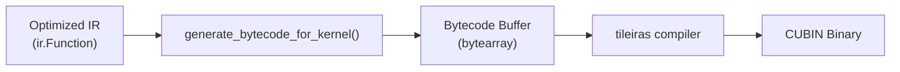
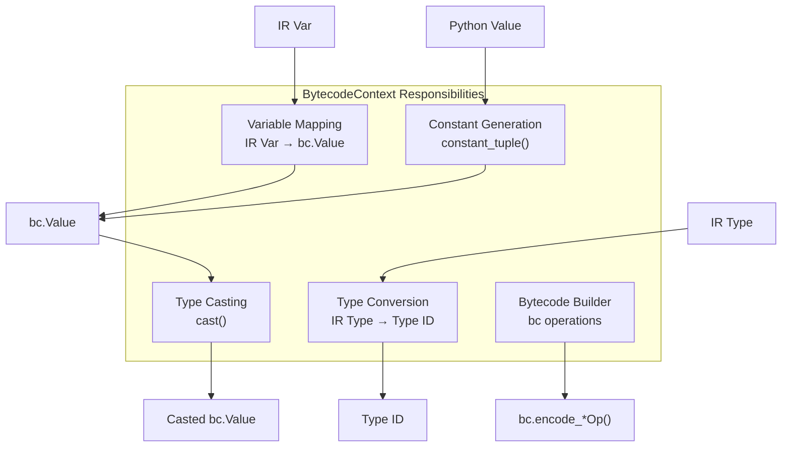
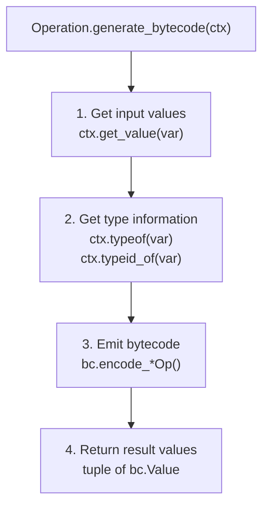
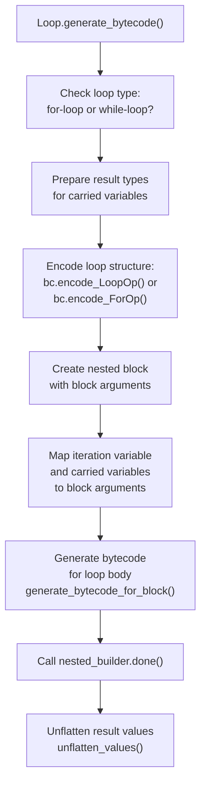
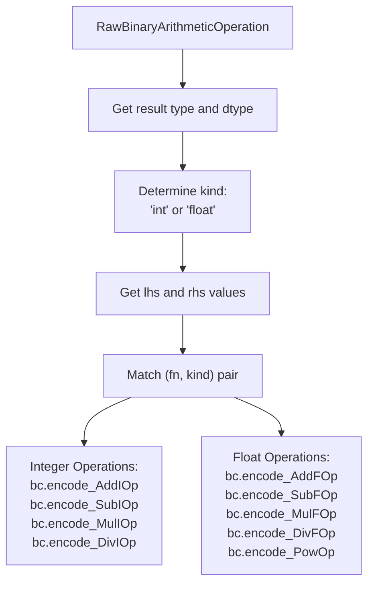
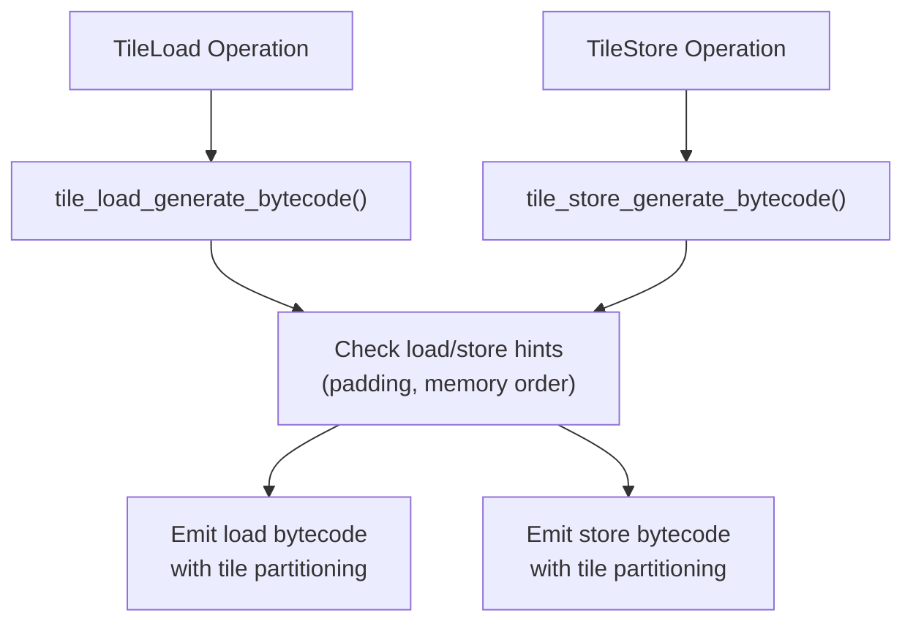
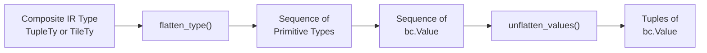

<!-- source: DeepWiki mcp.deepwiki.com · repo NVIDIA/cutile-python · page 7.3 Bytecode Generation · fetched 2026-10-26 -->

# Bytecode Generation

<details>
<summary>Relevant source files</summary>

The following files were used as context for generating this wiki page:

- [src/cuda/tile/_compile.py](src/cuda/tile/_compile.py)
- [src/cuda/tile/_ir/ops.py](src/cuda/tile/_ir/ops.py)
- [src/cuda/tile/_passes/eliminate_assign_ops.py](src/cuda/tile/_passes/eliminate_assign_ops.py)
- [test/test_cat.py](test/test_cat.py)
- [test/test_fma.py](test/test_fma.py)

</details>


## Purpose and Scope

Bytecode generation is the final compilation stage that translates the optimized Intermediate Representation (IR) into TileIR bytecode, a serialized format consumed by the `tileiras` compiler to produce CUBIN executables. This page describes the bytecode generation architecture, the `BytecodeContext` that coordinates the process, and the patterns used by operations to emit bytecode.

For information about the IR structure before bytecode generation, see [Intermediate Representation](#4.2). For the overall compilation flow, see [Compilation Pipeline](#4.1). For how individual operations implement type inference before bytecode generation, see [Operation Type Inference](#7.2).

## Compilation Flow Context

Bytecode generation occurs after all IR optimization passes have completed. The compilation pipeline follows this sequence:



**Sources:** [src/cuda/tile/_compile.py:161-166]()

The main entry point is `generate_bytecode_for_kernel()` from the `_ir2bytecode` module, invoked as follows:

```python
bytecode_generator = functools.partial(generate_bytecode_for_kernel,
                                       func_ir, compiler_options, sm_arch)

bytecode_buf = bytearray()
with bc.write_bytecode(num_functions=1, buf=bytecode_buf) as writer:
    bytecode_generator(writer, anonymize_debug_attr=False)
```

**Sources:** [src/cuda/tile/_compile.py:46](), [src/cuda/tile/_compile.py:161-166]()

## The BytecodeContext

`BytecodeContext` is the central coordination object during bytecode generation. It maintains:

| Responsibility | Description |
|---------------|-------------|
| **Variable Mapping** | Maps IR `Var` objects to `bc.Value` bytecode values |
| **Type System** | Converts IR types to bytecode type IDs via `type_table` |
| **Builder** | Wraps the bytecode writer to emit operations |
| **Constants** | Generates constant values with `constant_tuple()` |
| **Type Casting** | Handles implicit type conversions with `cast()` |



**Sources:** [src/cuda/tile/_ir/ops.py:57-63]()

## Operation Bytecode Generation Pattern

Each `Operation` subclass implements the `generate_bytecode()` method following a standard pattern:



**Pattern Steps:**

1. **Retrieve operand values** using `ctx.get_value(var)` or `ctx.get_value_tuple(var)`
2. **Get type information** using `ctx.typeof(var)` or `ctx.typeid_of(var)`
3. **Emit bytecode** by calling appropriate `bc.encode_*Op()` function
4. **Return result values** as a tuple of `bc.Value` objects

**Sources:** [src/cuda/tile/_ir/ops.py:229](), [src/cuda/tile/_ir/ops.py:354](), [src/cuda/tile/_ir/ops.py:597]()

### Example: TypedConst Operation

The `TypedConst` operation demonstrates the simplest case:

```python
@override
def generate_bytecode(self, ctx: BytecodeContext) -> list[tuple[bc.Value, ...]]:
    try:
        return [ctx.constant_tuple(self.value, ctx.typeof(self.result_var))]
    except ConstFoldNotImplementedError:
        return [()]
```

**Sources:** [src/cuda/tile/_ir/ops.py:597-604]()

### Example: Fused Multiply-Add Operation

The `FusedMulAddOperation` demonstrates type casting and arithmetic operation encoding:

```python
@override
def generate_bytecode(self, ctx: BytecodeContext) -> bc.Value:
    result_type = ctx.typeof(self.result_var)
    lhs = ctx.cast(ctx.get_value(self.lhs), ctx.typeof(self.lhs), result_type)
    rhs = ctx.cast(ctx.get_value(self.rhs), ctx.typeof(self.rhs), result_type)
    acc = ctx.cast(ctx.get_value(self.acc), ctx.typeof(self.acc), result_type)
    return bc.encode_FmaOp(ctx.builder,
                           ctx.typeid_of(self.result_var),
                           lhs, rhs, acc,
                           rounding_mode_to_bytecode[self.rounding_mode],
                           self.flush_to_zero)
```

**Sources:** [src/cuda/tile/_ir/ops.py:641-650]()

## Control Flow Bytecode Generation

Control flow operations create nested bytecode regions and manage block arguments.

### Loop Operation

The `Loop` operation handles both `while`-style loops and `for`-style loops with iteration variables:



**Key aspects:**

- **Initial values**: Carried variables' initial values are flattened and passed to the loop
- **Block arguments**: For-loops receive induction variable + carried variables as block args
- **Body generation**: `generate_bytecode_for_block()` processes nested operations
- **Result unflattening**: Results are unflattened to match IR type structure

**Sources:** [src/cuda/tile/_ir/ops.py:229-262]()

### If-Else Operation

The `IfElse` operation creates two nested regions for the then and else branches:

```python
@override
def generate_bytecode(self, ctx: BytecodeContext) -> tuple[tuple[bc.Value, ...]]:
    cond_val = ctx.get_value(self.cond)
    result_types = tuple(ctx.typeof(v) for v in self.results.vars)
    result_type_id_tuples = tuple(typeid_tuple(ctx.type_table, t) for t in result_types)
    result_type_ids = sum(result_type_id_tuples, ())
    nested_builder = bc.encode_IfOp(ctx.builder, result_type_ids, cond_val)

    for block in (self.then_block, self.else_block):
        with nested_builder.new_block(()):
            generate_bytecode_for_block(ctx, block)

    results = nested_builder.done()
    return unflatten_values(iter(results), result_types)
```

**Sources:** [src/cuda/tile/_ir/ops.py:354-366]()

### Terminator Operations

Terminator operations end control flow regions:

| Operation | Bytecode | Purpose |
|-----------|----------|---------|
| `Continue` | `bc.encode_ContinueOp()` | Continue loop iteration with updated carried variables |
| `Break` | `bc.encode_BreakOp()` | Exit loop with final values for carried variables |
| `EndBranch` | `bc.encode_YieldOp()` | Yield values from if/else branch |
| `Return` | `bc.encode_ReturnOp()` | Return from kernel (always returns empty tuple) |

**Sources:** [src/cuda/tile/_ir/ops.py:428-433](), [src/cuda/tile/_ir/ops.py:486-491](), [src/cuda/tile/_ir/ops.py:525-530](), [src/cuda/tile/_ir/ops.py:550-552]()

## Arithmetic and Logical Operations

Binary operations follow a consistent pattern, dispatching to different bytecode operations based on operand types.

### Binary Arithmetic Operation Structure



**Example: Addition**

```python
match self.fn, kind:
    case "add", "int":
        return bc.encode_AddIOp(ctx.builder, res_typeid, lhs, rhs,
                                overflow=bc.IntegerOverflow.NONE)
    case "add", "float":
        return bc.encode_AddFOp(ctx.builder, res_typeid, lhs, rhs,
                                rounding_mode=rounding_mode,
                                flush_to_zero=self.flush_to_zero)
```

**Sources:** [src/cuda/tile/_ir/ops.py:914-957]()

### Comparison Operations

Comparison operations use `encode_comparison()` helper:

```python
@override
def generate_bytecode(self, ctx: BytecodeContext):
    from .._ir2bytecode import encode_comparison
    lhs = ctx.get_value(self.lhs)
    rhs = ctx.get_value(self.rhs)
    dtype = get_dtype(self.lhs.get_type())
    result_typeid = ctx.typeid_of(self.result_var)
    return encode_comparison(ctx.builder, self.fn, lhs, rhs, dtype, result_typeid)
```

**Sources:** [src/cuda/tile/_ir/ops.py:665-671]()

### Bitwise Operations

Bitwise operations emit integer-only operations:

| Operation | Bytecode Encoding |
|-----------|------------------|
| Bitwise AND | `bc.encode_AndIOp()` |
| Bitwise OR | `bc.encode_OrIOp()` |
| Bitwise XOR | `bc.encode_XOrIOp()` |
| Left Shift | `bc.encode_ShLIOp()` |
| Right Shift | `bc.encode_ShRIOp()` |

**Sources:** [src/cuda/tile/_ir/ops.py:778-787](), [src/cuda/tile/_ir/ops.py:849-860]()

## Memory Operations

Memory operations are generated by dedicated lowering functions in `load_store_impl` module.

### Tile Load and Store

The `tile_load_generate_bytecode()` and `tile_store_generate_bytecode()` functions handle tile-based memory access:



**Sources:** [src/cuda/tile/_ir/ops.py:26-30]()

### Pointer-Based Load and Store

Lower-level load/store operations use `load_pointer_lowering()` and `store_pointer_lowering()`:

**Sources:** [src/cuda/tile/_ir/ops.py:26-30]()

## Type Representation in Bytecode

IR types are converted to bytecode type IDs during generation.

### Type ID Conversion Functions

| Function | Purpose |
|----------|---------|
| `typeid(type_table, ty)` | Convert single IR type to type ID |
| `typeid_tuple(type_table, ty)` | Convert IR type to tuple of type IDs (for composite types) |
| `convert_dtype(dtype)` | Convert IR dtype to bytecode dtype representation |
| `flatten_type(ty)` | Flatten composite types into sequence of primitive types |

**Example usage:**

```python
result_typeid = ctx.typeid_of(self.result_var)
result_type_ids = [type_id
                   for ty in result_types
                   for type_id in typeid_tuple(ctx.type_table, ty)]
```

**Sources:** [src/cuda/tile/_ir/ops.py:57-63]()

### Handling Undefined Types

Some operations may have undefined result types during constant propagation. The context provides `get_value_tuple_allow_undefined()` to handle these cases:

```python
initial_values = [
    val
    for input_var, ty in zip(self.carried_vars.initial, result_types)
    for val in ctx.get_value_tuple_allow_undefined(input_var, ty)
]
```

**Sources:** [src/cuda/tile/_ir/ops.py:232-235]()

## Bytecode Writer and Output

The bytecode is written using a context manager pattern:

```python
bytecode_buf = bytearray()
with bc.write_bytecode(num_functions=1, buf=bytecode_buf) as writer:
    bytecode_generator(writer, anonymize_debug_attr=False)
```

### Debug Information

Debug information can be anonymized for crash dumps:

```python
with bc.write_bytecode(num_functions=1, buf=bytecode_buf) as writer:
    bytecode_generator(writer, anonymize_debug_attr=True)
```

**Sources:** [src/cuda/tile/_compile.py:128-130]()

## Value Flattening and Unflattening

Composite types (tuples, tiles with multiple components) are flattened into sequences of primitive values for bytecode, then unflattened when consumed:



**Usage in operations:**

```python
# Flatten types for block arguments
result_type_ids = [type_id
                   for ty in result_types
                   for type_id in typeid_tuple(ctx.type_table, ty)]

# Unflatten values when processing results
return unflatten_values(iter(results), result_types)
```

**Sources:** [src/cuda/tile/_ir/ops.py:57-63](), [src/cuda/tile/_ir/ops.py:262](), [src/cuda/tile/_ir/ops.py:366]()

## Specialized Lowering Functions

Certain operations have complex lowering logic implemented in dedicated functions:

| Function | Purpose |
|----------|---------|
| `lower_reduce()` | Lowers reduction operations to bytecode |
| `lower_reduce_argmax_argmin()` | Lowers argmax/argmin reductions |
| `lower_scan()` | Lowers scan/prefix-sum operations |

These are called by the respective operation's `generate_bytecode()` method when needed.

**Sources:** [src/cuda/tile/_ir/ops.py:57-63]()

## Testing and Verification

Bytecode output can be verified using the `filecheck()` utility, which performs pattern matching on the generated MLIR representation:

```python
bytecode = get_bytecode(kernel, args)
check_directive = """\
// CHECK: %[[VAL:.*]] = fma
// CHECK-NOT: mulf
// CHECK-NOT: addf
"""
filecheck(bytecode, check_directive)
```

This verifies that the FMA (fused multiply-add) operation was properly generated as a single instruction rather than separate multiply and add operations.

**Sources:** [test/test_fma.py:78-85]()

---

