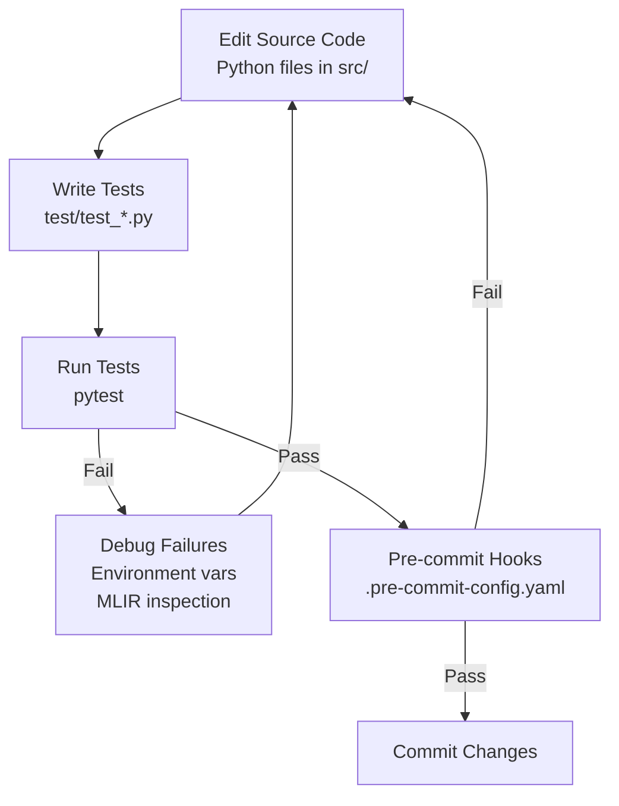
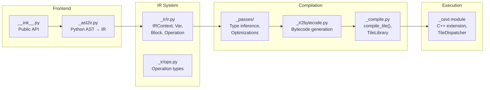
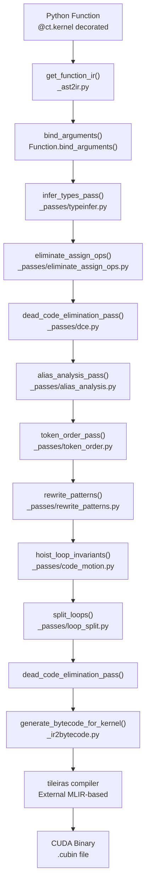
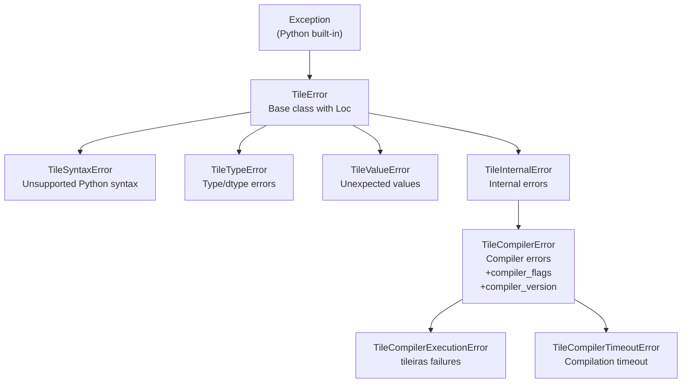
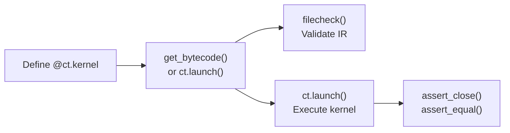

<!-- source: DeepWiki mcp.deepwiki.com · repo NVIDIA/cutile-python · page 8 Development Guide · fetched 2026-10-26 -->

# Development Guide

<details>
<summary>Relevant source files</summary>

The following files were used as context for generating this wiki page:

- [changelog.d/README.md](changelog.d/README.md)
- [changelog.d/cat-errormsg.md](changelog.d/cat-errormsg.md)
- [changelog.d/slice-type-eq.md](changelog.d/slice-type-eq.md)
- [test/test_cast.py](test/test_cast.py)
- [test/test_mma.py](test/test_mma.py)
- [test/util.py](test/util.py)

</details>


This guide is intended for developers working on or extending the `cuda.tile` framework itself. It covers the internal architecture, development workflows, testing infrastructure, debugging techniques, and guidelines for contributing new features.

**Scope**: This page provides an overview of development practices and tools. For detailed information on specific topics, see:
- Testing methodology and utilities: [Testing Infrastructure](#8.1)
- Advanced debugging techniques: [Debugging Techniques](#8.2)
- Extending the system with new operations: [Adding New Operations](#8.3)

## Development Workflow Overview

The typical development workflow for contributing to `cuda.tile` involves:

1. **Making changes** to Python source code (frontend, IR, passes, or backend)
2. **Writing tests** using the utilities in `test/util.py`
3. **Running tests** to validate correctness
4. **Debugging** using environment variables and inspection tools
5. **Pre-commit validation** via automated hooks



**Sources**: [.pre-commit-config.yaml](), [test/util.py]()

## Code Organization

The codebase is organized into several key directories:

| Directory | Purpose |
|-----------|---------|
| `src/cuda/tile/` | Core framework implementation |
| `src/cuda/tile/_ir/` | Intermediate representation classes and operations |
| `src/cuda/tile/_passes/` | Optimization and transformation passes |
| `test/` | Test suites and utilities |
| `test/kernels/` | Reusable kernel definitions for testing |
| `samples/` | Example implementations (e.g., LayerNorm) |

### Key Modules



**Sources**: [src/cuda/tile/_compile.py](), [src/cuda/tile/_ast2ir.py](), [src/cuda/tile/_ir/ir.py](), [src/cuda/tile/_ir2bytecode.py]()

## Compilation System for Developers

Understanding the compilation pipeline is essential for debugging issues and adding features.

### Compilation Stages



This pipeline is implemented in the `_get_final_ir()` function at [src/cuda/tile/_compile.py:74-94]().

### Key Compilation Functions

- **`compile_tile(pyfunc, args, compiler_options, context)`** [src/cuda/tile/_compile.py:146-213](): Main entry point that orchestrates the entire compilation process
- **`_get_final_ir(pyfunc, args, tile_context)`** [src/cuda/tile/_compile.py:74-94](): Applies all transformation passes to produce final IR
- **`compile_cubin(fname_bytecode, compiler_options, sm_arch, timeout_sec)`** [src/cuda/tile/_compile.py:332-373](): Invokes the `tileiras` compiler to produce `.cubin` files

### Compiler Lock

The compilation system uses a global lock (`_compiler_lock`) to ensure thread-safe compilation. All public compilation functions are decorated with `@global_compiler_lock` [src/cuda/tile/_compile.py:66-71]().

**Sources**: [src/cuda/tile/_compile.py:74-213]()

## Exception Hierarchy and Error Handling

The framework defines a hierarchy of exception types for different error categories:



### Location Tracking

All `TileError` exceptions include a `Loc` object [src/cuda/tile/_exception.py:12-43]() that tracks:
- **`line`**: Line number in source file
- **`col`**: Column number
- **`filename`**: Source file path
- **`last_line`, `end_col`**: For multi-line spans
- **`function`**: The function being compiled
- **`call_site`**: For inlined functions

The `Loc` class can be used as a context manager to automatically attach location information to exceptions:

```python
with loc:
    # Code that may raise TileError
    ...
# If TileError is raised and loc is unknown, this loc is attached
```

### Error Formatting

The `format_location()` function [src/cuda/tile/_exception.py:51-84]() produces human-readable error messages with source context:

```
In file "example.py", line 42, col 5--10:
    x = ct.load(A, index=(0, 0), shape=(16, 16))
    ^^^^^
```

**Sources**: [src/cuda/tile/_exception.py:12-193]()

## Testing Utilities

The `test/util.py` module provides essential utilities for writing tests:

### Core Testing Functions

| Function | Purpose |
|----------|---------|
| `get_bytecode(kernel, kernel_args)` | Extracts bytecode from a kernel for inspection |
| `jit_kernel(name, source, tmp_path, globals)` | Compiles kernel from source string |
| `launch_binary(kernel, x, y, z, tile)` | Launches a binary operation kernel |
| `launch_unary(kernel, x, y, tile)` | Launches a unary operation kernel |
| `assert_close(actual, ref, rtol, atol)` | Asserts numerical closeness |
| `assert_equal(actual, ref)` | Asserts exact equality |
| `filecheck(bytecode_buf, check_directive)` | Validates MLIR using FileCheck |

### Testing Workflow



### Example Test Pattern

A typical test follows this structure:

```python
@ct.kernel
def my_kernel(A, B, C, TILE: ct.Constant[int]):
    tile_a = ct.load(A, index=(ct.bid(0),), shape=(TILE,))
    tile_b = ct.load(B, index=(ct.bid(0),), shape=(TILE,))
    result = tile_a + tile_b
    ct.store(C, index=(ct.bid(0),), tile=result)

def test_my_operation():
    # Setup
    A = torch.randn((64,), device='cuda', dtype=torch.float32)
    B = torch.randn((64,), device='cuda', dtype=torch.float32)
    C = torch.zeros_like(A)
    
    # Execute
    ct.launch(torch.cuda.current_stream(), (1,), my_kernel, (A, B, C, 64))
    
    # Validate
    ref = A + B
    assert_close(C, ref, rtol=1e-5, atol=1e-5)
```

**Sources**: [test/util.py:30-185](), [test/test_mma.py:17-111](), [test/test_cast.py:28-46]()

## Debugging Environment Variables

The framework provides several environment variables for debugging:

### Logging and Inspection

| Variable | Purpose | Example |
|----------|---------|---------|
| `CUDA_TILE_LOGS` | Enable specific log categories | `export CUDA_TILE_LOGS=CUTILEIR,TILEIR` |
| `CUDA_TILE_DUMP_BYTECODE` | Dump bytecode to directory | `export CUDA_TILE_DUMP_BYTECODE=./debug` |
| `CUDA_TILE_DUMP_TILEIR` | Dump MLIR text to directory | `export CUDA_TILE_DUMP_TILEIR=./debug` |

### Log Categories

When `'CUTILEIR'` is in `context.config.log_keys`, the CuTile IR is printed to stderr [src/cuda/tile/_compile.py:153-156]().

When `'TILEIR'` is in `context.config.log_keys`, the MLIR module is printed to stderr via `_log_mlir()` [src/cuda/tile/_compile.py:97-111]().

### Bytecode Dumping

If `CUDA_TILE_DUMP_BYTECODE` is set, bytecode files are written to the specified directory with names based on source file and line number [src/cuda/tile/_compile.py:170-178]():
```
{base_filename}.ln{line_number}.cutile
```

### MLIR Dumping

If `CUDA_TILE_DUMP_TILEIR` is set, MLIR text files are written [src/cuda/tile/_compile.py:181-195]():
```
{base_filename}.ln{line_number}.cuda_tile.mlir
```

**Sources**: [src/cuda/tile/_compile.py:97-195](), [src/cuda/tile/_debug.py]()

## Crash Dump System

When compilation fails and `context.config.enable_crash_dump` is `True`, the system generates a crash dump zip file containing:

### Crash Dump Contents

| File | Description |
|------|-------------|
| `{qualname}.bytecode` | Anonymized TileIR bytecode |
| `{qualname}.cutileir` | CuTile IR (without location info) |
| `debug_info.txt` | Error message, compiler flags, versions |

The crash dump function [src/cuda/tile/_compile.py:114-143]() creates a timestamped zip file:
```
crash_dump_{qualname}_{timestamp}.zip
```

This allows developers to reproduce compilation failures without sharing proprietary source code.

**Sources**: [src/cuda/tile/_compile.py:114-209]()

## FileCheck Integration

For validating IR structure, tests can use FileCheck directives via the `filecheck()` utility [test/util.py:165-184]().

### Usage Pattern

```python
# Get bytecode
bytecode = get_bytecode(my_kernel, (A, B, C, 64))

# Define CHECK directives
check_directive = """
// CHECK-LABEL: func @my_kernel
// CHECK: cuda_tile.load
// CHECK: cuda_tile.add
// CHECK: cuda_tile.store
"""

# Validate
filecheck(bytecode, check_directive)
```

The function converts bytecode to MLIR text using the internal extension and runs the `FileCheck` binary with `--dump-input=always` for detailed diagnostics.

**Sources**: [test/util.py:165-184]()

## Type Testing Utilities

The framework provides utilities for testing type promotion and error cases:

### Autocast Error Testing

The `raises_autocast_error()` function [test/util.py:123-135]() checks whether an autocast should fail:

```python
def test_autocast():
    # This should raise if autocast from float16 to int32 is not allowed
    if raises_autocast_error(launch_fn, torch.float16, torch.int32):
        return  # Test passed by raising expected error
    # Otherwise, validate the result
    assert_equal(output, expected)
```

### Conditional Raises

The `raises_if()` context manager [test/util.py:114-120]() conditionally expects exceptions:

```python
with raises_if(should_fail, TileTypeError, "error message"):
    ct.launch(...)
```

**Sources**: [test/util.py:114-135]()

## Tolerance Management

Different data types require different numerical tolerances. The `get_tolerance()` function pattern [test/test_mma.py:41-54]() defines appropriate `rtol` and `atol` values:

```python
def get_tolerance(dtype) -> tuple[float, float]:
    if dtype == torch.float8_e5m2:
        return 1e-1, 1e-1
    elif dtype == torch.float8_e4m3fn:
        return 1e-2, 1e-2
    elif dtype == torch.float16:
        return 1e-3, 1e-3
    elif dtype == torch.bfloat16:
        return 1e-2, 1e-2
    elif dtype == torch.float32:
        return 1e-5, 1e-5
    elif dtype == torch.float64:
        return 1e-6, 1e-6
    return 0, 0
```

Tests use these tolerances with `assert_close()`:
```python
atol, rtol = get_tolerance(A.dtype)
assert_close(output, reference, atol=atol, rtol=rtol)
```

**Sources**: [test/test_mma.py:41-111]()

## Compiler Discovery

The framework searches for the `tileiras` compiler binary in multiple locations [src/cuda/tile/_compile.py:244-280]():

1. `cuda/tile/_deps/bin/` (packaged dependencies)
2. `$PATH` environment variable
3. `$CUDA_HOME/bin` or `$CUDA_PATH/bin` (Windows)
4. Default CUDA Toolkit installation paths

The search order ensures local dependencies take precedence over system-wide installations.

### Compiler Version Detection

The `_try_get_compiler_version()` function [src/cuda/tile/_compile.py:317-323]() extracts version information by running:
```bash
tileiras --version
```

This version is included in crash dumps and error messages for debugging.

**Sources**: [src/cuda/tile/_compile.py:244-323]()

## Threading Considerations

The compilation system uses a global recursive lock (`threading.RLock()`) [src/cuda/tile/_compile.py:63]() to ensure thread-safe compilation. The `@global_compiler_lock` decorator [src/cuda/tile/_compile.py:66-71]() wraps all public compilation functions.

This is necessary because:
- Multiple threads may attempt to compile kernels concurrently
- The `tileiras` compiler may have thread-safety limitations
- Shared state (caches, temp files) requires synchronization

**Sources**: [src/cuda/tile/_compile.py:63-71]()

## Development Best Practices

### When Adding New Features

1. **Write tests first**: Add tests to appropriate `test/test_*.py` file
2. **Use type hints**: All new Python code should include type annotations
3. **Add location tracking**: Ensure operations can report `Loc` for errors
4. **Document IR operations**: Each new `Operation` subclass needs `infer_type()` and `generate_bytecode()`
5. **Validate early**: Check preconditions in IR passes, not just in bytecode generation
6. **Test error cases**: Ensure invalid usage produces clear error messages with proper `Loc`

### Testing Checklist

- [ ] Numerical correctness against reference implementation
- [ ] Multiple data types if applicable
- [ ] Error cases raise appropriate exception types
- [ ] FileCheck validation of generated IR for key optimizations
- [ ] Edge cases (empty tensors, power-of-2 boundaries, etc.)

### Debugging Workflow

1. **Enable CUTILEIR logging** to inspect IR before bytecode generation
2. **Use CUDA_TILE_DUMP_TILEIR** to examine MLIR module
3. **Check crash dumps** for compiler failures
4. **FileCheck assertions** to validate IR transformations
5. **Single-step through passes** by adding print statements

**Sources**: [src/cuda/tile/_compile.py](), [test/util.py](), [test/test_mma.py](), [test/test_cast.py]()

---

