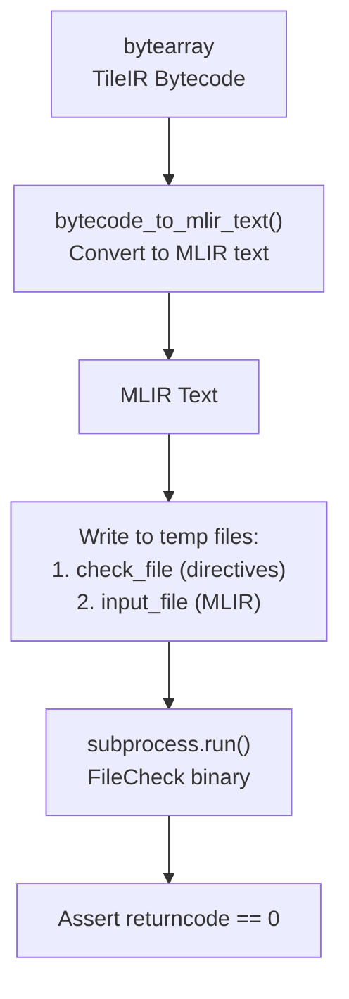
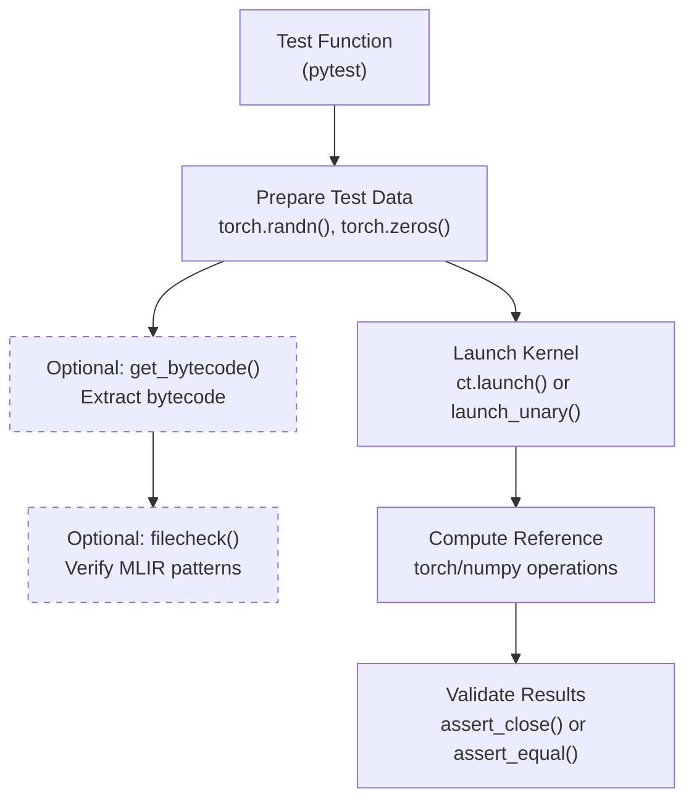
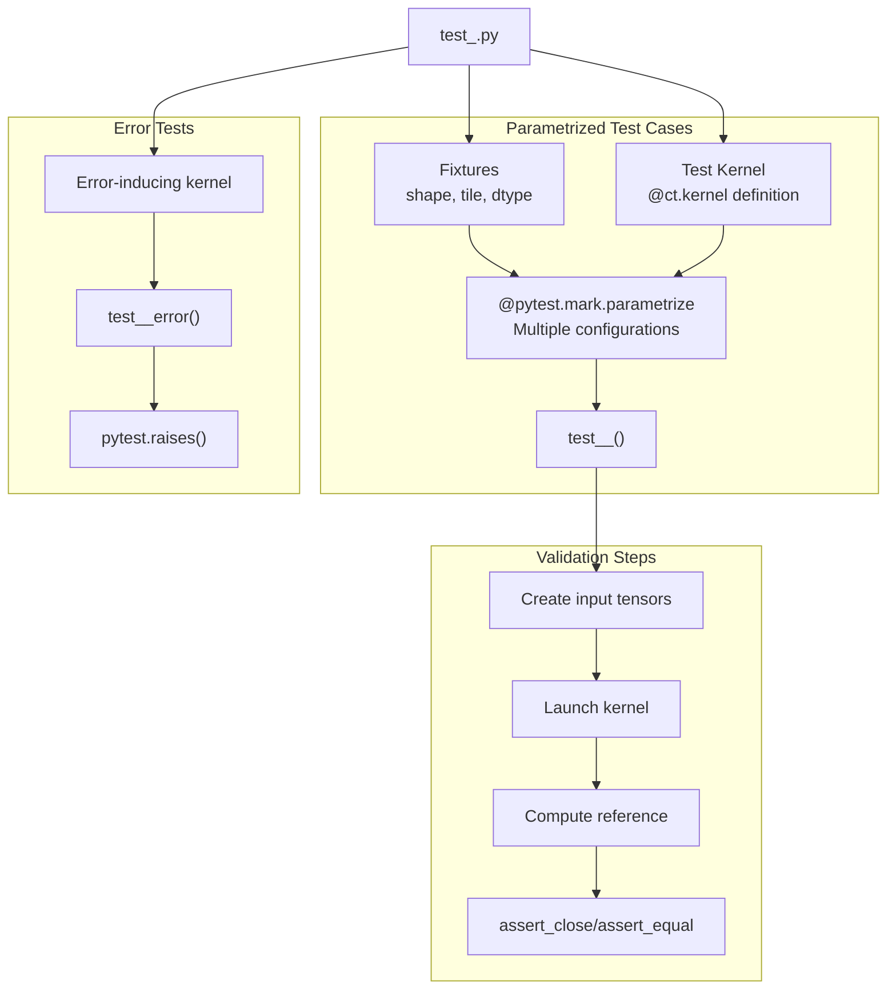

<!-- source: DeepWiki mcp.deepwiki.com · repo NVIDIA/cutile-python · page 8.1 Testing Infrastructure · fetched 2026-10-26 -->

# Testing Infrastructure

<details>
<summary>Relevant source files</summary>

The following files were used as context for generating this wiki page:

- [LICENSE.md](LICENSE.md)
- [README.md](README.md)
- [test/requirements.txt](test/requirements.txt)
- [test/test_cast.py](test/test_cast.py)
- [test/test_frontpage_example.py](test/test_frontpage_example.py)
- [test/test_mma.py](test/test_mma.py)
- [test/test_readme_example.py](test/test_readme_example.py)
- [test/util.py](test/util.py)

</details>


This document describes the testing infrastructure provided by cuTile Python for kernel validation and verification. It covers the test utilities in [test/util.py](), common testing patterns, and integration test approaches.

For information about debugging compiled kernels, see [Debugging Techniques](#8.2). For guidance on writing new tests when adding operations, see [Adding New Operations](#8.4).

**Sources:** [test/util.py](), [README.md:124-143]()

---

## Purpose and Scope

The testing infrastructure provides utilities for:
- Compiling kernels and extracting intermediate representations
- Launching kernels with automatic grid calculation
- Validating numerical results with appropriate tolerances
- Verifying MLIR output using pattern matching
- Testing error conditions and type system behavior
- Benchmarking kernel performance

These utilities are used throughout the test suite to ensure correctness of kernel compilation, execution, and results.

**Sources:** [test/util.py:1-220]()

---

## Core Test Utilities

### Compilation and Bytecode Extraction

#### get_bytecode()

The `get_bytecode()` function compiles a kernel and returns the TileIR bytecode as a `bytearray`. This is useful for inspecting the intermediate representation produced by the compiler.

```python
def get_bytecode(kernel, kernel_args) -> bytearray
```

**Usage:**
```python
bytecode = get_bytecode(my_kernel, (array_a, array_b, 16))
```

The function handles both raw Python functions and `ct.kernel`-decorated functions by extracting the underlying `_pyfunc` when necessary.

**Sources:** [test/util.py:30-32]()

---

#### jit_kernel()

The `jit_kernel()` function dynamically compiles kernels from source code strings at test runtime. This is useful for testing kernel generation or variations without creating separate files.

```python
def jit_kernel(name: str, source: str, tmp_path, globals: dict = None)
```

**Parameters:**
- `name`: Name of the kernel function in the source
- `source`: Python source code as a string
- `tmp_path`: Temporary directory path (typically from pytest fixture)
- `globals`: Optional dictionary of global variables to inject

The function writes the source to a temporary file, compiles it, executes it with `ct` in the globals, and returns the decorated kernel.

**Sources:** [test/util.py:35-45]()

---

### Kernel Launch Helpers

The launch helpers automate grid calculation for common kernel patterns, reducing boilerplate in tests.

#### launch_binary()

Launches a binary operation kernel that takes two input arrays and produces an output:

```python
def launch_binary(kernel, x, y, z, tile: int)
```

Automatically calculates a grid where each dimension is `ceil(z.shape[i] / tile)`. Supports 1D, 2D, and 3D output arrays.

**Sources:** [test/util.py:48-51]()

---

#### launch_unary()

Launches a unary operation kernel that takes one input and produces an output:

```python
def launch_unary(kernel, x, y, tile: int)
```

Similar to `launch_binary()` but for single-input operations.

**Sources:** [test/util.py:54-57]()

---

### Validation Functions

#### assert_close()

Compares tensors with floating-point tolerance, suitable for operations that accumulate rounding errors:

```python
def assert_close(actual: TensorLike, ref: Union[TensorLike, Scalar],
                 rtol: Optional[float] = None, atol: Optional[float] = None)
```

**Features:**
- Validates dtype match between actual and reference
- Accepts scalar references (automatically broadcasts)
- Uses `torch.testing.assert_close()` with configurable tolerances
- Treats NaN values as equal (`equal_nan=True`)

**Common tolerance values:**
- `float64`: `rtol=1e-6, atol=1e-6`
- `float32`: `rtol=1e-5, atol=1e-5`
- `float16`, `tfloat32`: `rtol=1e-3, atol=1e-3`
- `bfloat16`: `rtol=1e-2, atol=1e-2`
- `float8_e4m3fn`: `rtol=1e-2, atol=1e-2`
- `float8_e5m2`: `rtol=1e-1, atol=1e-1`

**Sources:** [test/util.py:60-66](), [test/test_mma.py:41-54]()

---

#### assert_equal()

Validates exact equality, used for integer operations or bit-exact comparisons:

```python
def assert_equal(actual: TensorLike, ref: Union[TensorLike, Scalar])
```

Implemented as `assert_close()` with `rtol=0, atol=0`.

**Sources:** [test/util.py:69-70]()

---

### MLIR Verification

#### filecheck()

Verifies MLIR output using the FileCheck pattern matching tool from LLVM:

```python
def filecheck(bytecode_buf: bytearray, check_directive: str) -> None
```

**Workflow:**



**FileCheck Directive Example:**

```python
check_directive = """
// CHECK: %[[V0:.*]] = tile.load %arg0
// CHECK: %[[V1:.*]] = tile.load %arg1
// CHECK: %[[V2:.*]] = tile.add %[[V0]], %[[V1]]
// CHECK: tile.store %[[V2]], %arg2
"""
bytecode = get_bytecode(vector_add_kernel, (a, b, c, 16))
filecheck(bytecode, check_directive)
```

The FileCheck tool searches for patterns in order, supporting regex and variable capture (`%[[V0:.*]]`). This is essential for verifying that optimizations and transformations produce expected IR.

**Sources:** [test/util.py:158-184]()

---

## Testing Workflow Diagram

The following diagram shows how the testing utilities fit together in a typical test:



**Sources:** [test/test_frontpage_example.py:32-44](), [test/test_mma.py:100-111]()

---

## Type Conversion Testing Utilities

### torch_to_tf32()

Emulates TF32 (TensorFloat-32) rounding behavior for reference computation:

```python
def torch_to_tf32(x: torch.Tensor)
```

**Algorithm:**
1. Convert input to `float32`
2. Extract bit representation as `int32`
3. Apply round-to-nearest-even on the 13 least significant mantissa bits
4. Mask lower 13 bits to zero

This produces bit-exact TF32 results for validating kernels that use `ct.tfloat32`.

**Sources:** [test/util.py:89-111](), [test/test_cast.py:58-79]()

---

### raises_autocast_error()

Tests that type casting operations properly reject invalid implicit conversions:

```python
def raises_autocast_error(launch, from_ty, to_ty) -> bool
```

**Returns:**
- `True` if the autocast is invalid and `TileTypeError` was raised
- `False` if the autocast is valid and no exception occurred

**Usage Example:**
```python
def test_invalid_cast():
    x_bf16 = torch.randn(16, dtype=torch.bfloat16, device='cuda')
    y_f16 = torch.zeros(16, dtype=torch.float16, device='cuda')
    
    # This should fail - bfloat16 to float16 is not allowed
    raises_autocast_error(
        lambda: ct.launch(stream, grid, kernel, (x_bf16, y_f16)),
        torch.bfloat16,
        torch.float16
    )
```

**Sources:** [test/util.py:123-135]()

---

## Benchmarking Support

### estimate_bench_iter()

Estimates appropriate iteration counts for benchmarking:

```python
def estimate_bench_iter(f, tuple_of_args)
```

**Returns:** `(warmup_rounds, main_iter, rounds)`

**Algorithm:**
1. Runs 5 warmup iterations and measures average time
2. Calculates iterations needed for 100ms per round
3. Returns: 1 warmup round, calculated main iterations, 5 measurement rounds

This ensures benchmarks run long enough for stable measurements while avoiding excessive runtime.

**Sources:** [test/util.py:138-155]()

---

### torch_use_tf32_matmul()

Context manager to temporarily enable TF32 mode in PyTorch:

```python
@contextmanager
def torch_use_tf32_matmul()
```

**Usage:**
```python
with torch_use_tf32_matmul():
    ref = torch.matmul(a, b)  # Uses TF32 precision
```

Automatically restores the original precision setting on exit.

**Sources:** [test/util.py:214-219]()

---

## Utility Functions Reference Table

| Function | Purpose | Returns | Primary Use Case |
|----------|---------|---------|------------------|
| `get_bytecode()` | Compile kernel to bytecode | `bytearray` | MLIR inspection |
| `jit_kernel()` | Compile from source string | `ct.kernel` | Dynamic kernel generation |
| `launch_binary()` | Launch with auto grid calc | `None` | Binary operation tests |
| `launch_unary()` | Launch with auto grid calc | `None` | Unary operation tests |
| `assert_close()` | Floating-point comparison | `None` | Numerical validation |
| `assert_equal()` | Exact comparison | `None` | Integer/bit-exact validation |
| `filecheck()` | Verify MLIR patterns | `None` | IR verification |
| `raises_autocast_error()` | Test type rejection | `bool` | Type system validation |
| `torch_to_tf32()` | Reference TF32 conversion | `torch.Tensor` | TF32 kernel validation |
| `estimate_bench_iter()` | Calculate bench iters | `(int, int, int)` | Performance testing |

**Sources:** [test/util.py:30-220]()

---

## Test Organization Patterns

### Integration Tests

Integration tests validate that documentation examples actually work:

#### Frontpage Example Test

[test/test_frontpage_example.py]() executes the example from the documentation front page. The actual example code is marked with `#example-begin` and `#example-end` markers.

**Structure:**
```
#example-begin
<example code>
#example-end

def test_vector_add():
    <validation code>
```

**Sources:** [test/test_frontpage_example.py:1-46]()

---

#### README Example Test

[test/test_readme_example.py]() parses the README.md file, extracts the code block from the "Example" section, writes it to a temporary file, and executes it with subprocess.

**Extraction Algorithm:**
1. Find `"Example\n-------\n```python"` marker
2. Extract code until closing `` ``` ``
3. Write to temporary file
4. Execute with `subprocess.check_call()`

This ensures the README example stays synchronized with the actual API.

**Sources:** [test/test_readme_example.py:1-37]()

---

### Operation-Specific Tests

Operation tests follow a consistent structure:



**Example from test_mma.py:**
```python
@pytest.mark.parametrize("tile_size", [(2, 8, 16)])
@pytest.mark.parametrize("case", regular_float_cases, ids=str)
def test_mma_regular_float(tile_size, case):
    m, n, k = tile_size
    A = torch.randn((m, k), dtype=case.dtype, device="cuda")
    B = torch.randn((k, n), dtype=case.dtype, device="cuda")
    C = torch.ones((m, n), dtype=case.acc_dtype, device="cuda")
    ref = torch.mm(A, B, out_dtype=C.dtype) + C
    ct.launch(torch.cuda.current_stream(), (1,), mma_kernel,
              (A, B, C, m, n, k))
    atol, rtol = get_tolerance(A.dtype)
    assert_close(C, ref, atol=atol, rtol=rtol)
```

**Sources:** [test/test_mma.py:100-111](), [test/test_cast.py:39-46]()

---

## Test Dependencies

The test suite requires additional dependencies beyond the core cuTile package:

| Package | Version | Purpose |
|---------|---------|---------|
| `pytest` | 9.0.1 | Test framework |
| `pytest-benchmark` | 5.1.0 | Performance benchmarking |
| `pytest-cov` | 6.2.1 | Coverage reporting |
| `torch` | 2.9.0 | Reference implementations |
| `cupy-cuda13x` | 13.6.0 | Alternative array interface |
| `numba-cuda` | 0.20.0 | Additional CUDA support |
| `flake8` | 7.3.0 | Linting |

**Installation:**
```bash
pip install -r test/requirements.txt
```

**Sources:** [test/requirements.txt:1-19](), [README.md:126-130]()

---

## Running Tests

### Running All Tests

```bash
pytest test/
```

### Running Specific Test File

```bash
pytest test/test_mma.py
```

### Running Specific Test Function

```bash
pytest test/test_mma.py::test_mma_regular_float
```

### Running with Coverage

```bash
pytest --cov=cuda.tile test/
```

**Sources:** [README.md:124-136]()

---

## Common Testing Patterns

### Pattern 1: Parameterized Type Testing

Test operations across all supported dtypes:

```python
from conftest import float_dtypes, int_dtypes, dtype_id

@pytest.mark.parametrize("dtype", float_dtypes, ids=dtype_id)
def test_operation(dtype):
    # Test implementation
```

**Sources:** [test/test_cast.py:155-166]()

---

### Pattern 2: Conditional Error Testing

Use `raises_if()` context manager for conditional error expectations:

```python
with raises_if(condition, TileTypeError, "error message pattern"):
    ct.launch(stream, grid, kernel, args)
```

**Sources:** [test/util.py:114-120]()

---

### Pattern 3: Dynamic Kernel Generation

For testing code generation variations:

```python
def make_array_astype_kernel(to_dtype):
    @ct.kernel
    def kernel(x, y, TILE: ct.Constant[int]):
        bid = ct.bid(0)
        tx = ct.load(x, index=(bid,), shape=(TILE,))
        ty = ct.astype(tx, to_dtype)
        ct.store(y, index=(bid,), tile=ty)
    return kernel

kernel = make_array_astype_kernel(torch.float32)
```

**Sources:** [test/test_cast.py:145-152]()

---

## Test Utility Ecosystem

This diagram shows the relationships between test utilities and their dependencies:

```mermaid
graph TB
    subgraph "External Dependencies"
        Pytest["pytest"]
        Torch["torch"]
        LLVM["FileCheck<br/>(LLVM tool)"]
        CTInternal["cuda.tile_internal._internal_cext"]
    end
    
    subgraph "test/util.py Utilities"
        GetBytecode["get_bytecode()"]
        JITKernel["jit_kernel()"]
        LaunchBinary["launch_binary()"]
        LaunchUnary["launch_unary()"]
        AssertClose["assert_close()"]
        AssertEqual["assert_equal()"]
        FileCheck["filecheck()"]
        RaisesAutocast["raises_autocast_error()"]
        TorchTF32["torch_to_tf32()"]
        EstimateBench["estimate_bench_iter()"]
    end
    
    subgraph "Compilation System"
        CompileTile["cuda.tile._compile.compile_tile"]
        CompilerOpts["cuda.tile._compiler_options.CompilerOptions"]
    end
    
    subgraph "Type System"
        ToDType["cuda.tile._ir.typing_support.to_dtype"]
        Datatype["cuda.tile._datatype"]
        Exception["cuda.tile._exception.TileTypeError"]
    end
    
    subgraph "cuTile API"
        CT["cuda.tile"]
    end
    
    GetBytecode --> CompileTile
    GetBytecode --> CompilerOpts
    
    JITKernel --> CT
    
    LaunchBinary --> CT
    LaunchUnary --> CT
    
    AssertClose --> Torch
    AssertEqual --> AssertClose
    
    FileCheck --> LLVM
    FileCheck --> CTInternal
    
    RaisesAutocast --> ToDType
    RaisesAutocast --> Datatype
    RaisesAutocast --> Exception
    RaisesAutocast --> Pytest
    
    TorchTF32 --> Torch
    EstimateBench --> Torch
```



**Sources:** [test/util.py:1-220]()

---

