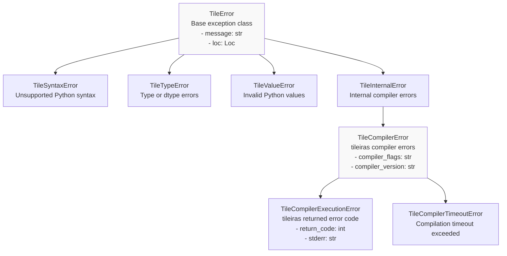
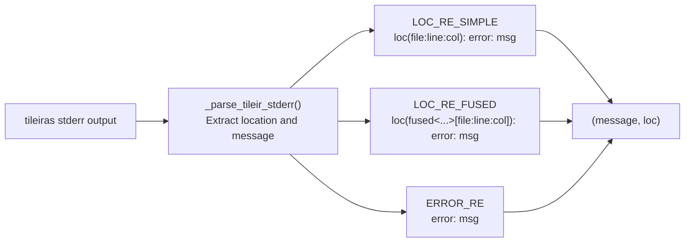
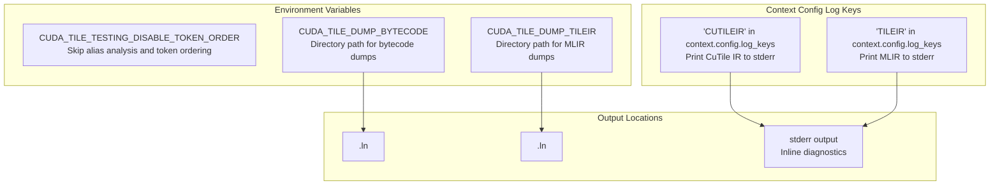
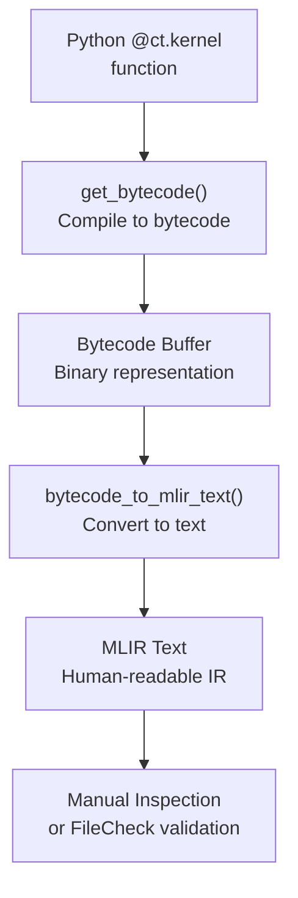
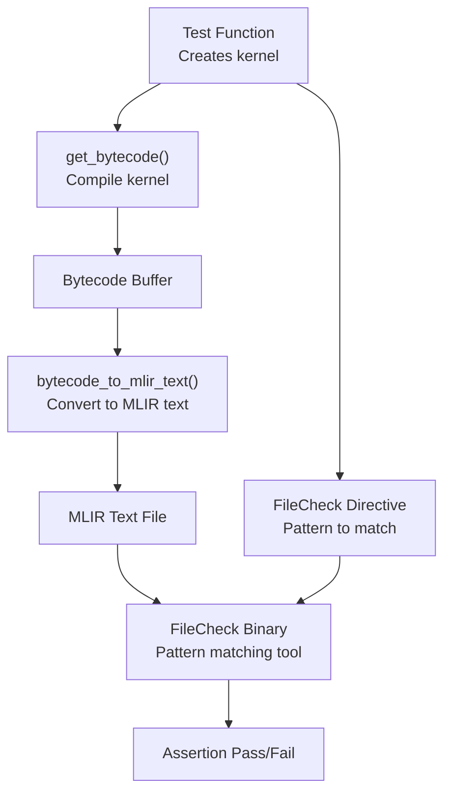
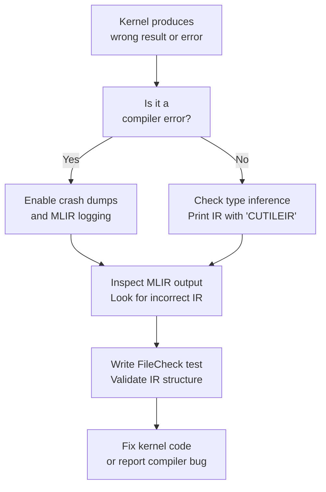

<!-- source: DeepWiki mcp.deepwiki.com · repo NVIDIA/cutile-python · page 8.2 Debugging Techniques · fetched 2026-10-26 -->

# Debugging Techniques

<details>
<summary>Relevant source files</summary>

The following files were used as context for generating this wiki page:

- [docs/source/debugging.rst](docs/source/debugging.rst)
- [docs/source/index.rst](docs/source/index.rst)
- [docs/source/release_notes.rst](docs/source/release_notes.rst)
- [src/cuda/tile/_compile.py](src/cuda/tile/_compile.py)
- [src/cuda/tile/_passes/eliminate_assign_ops.py](src/cuda/tile/_passes/eliminate_assign_ops.py)
- [test/test_fma.py](test/test_fma.py)

</details>


This page covers advanced debugging techniques for developers working on cuda.tile kernels or the cuda.tile compiler itself. It explains how to inspect intermediate representations, understand compiler errors, and use debugging utilities to diagnose issues.

For general testing practices and validation methods, see [Testing Infrastructure](#8.1). For understanding the compilation pipeline, see [Compilation Pipeline](#4.1).

---

## Error Types and Location Tracking

The cuda.tile system provides structured error reporting with precise source location tracking. All errors inherit from `TileError` and include file, line, and column information.

### Error Hierarchy



**Sources:** [src/cuda/tile/_exception.py:87-193]()

### Location Information

The `Loc` class ([src/cuda/tile/_exception.py:12-43]()) tracks the source location of errors:

| Field | Type | Description |
|-------|------|-------------|
| `line` | `int` | Line number (1-indexed) |
| `col` | `int` | Column number (0-indexed) |
| `filename` | `Optional[str]` | Source file path |
| `last_line` | `Optional[int]` | For multi-line spans |
| `end_col` | `Optional[int]` | End column for spans |
| `function` | `Optional[Callable]` | Associated function |
| `call_site` | `Optional[Loc]` | Calling location for inlined functions |

When an error is raised, the `format_location` function ([src/cuda/tile/_exception.py:51-85]()) produces user-friendly output:

```
  In file "my_kernel.py", line 42, col 5--12:
    acc = ct.mma(tx, ty, acc)
    ^^^^^^^
```

**Sources:** [src/cuda/tile/_exception.py:12-85]()

### Compiler Error Parsing

When the `tileiras` compiler fails, stderr output is parsed to extract location and message information ([src/cuda/tile/_exception.py:123-158]()):



The parser tries multiple regex patterns to handle different MLIR diagnostic formats and falls back to raw line output if no pattern matches.

**Sources:** [src/cuda/tile/_exception.py:123-158]()

---

## Environment Variables

Several environment variables control debug output during compilation.

### Debug Flags



**Sources:** [src/cuda/tile/_compile.py:36-196](), [src/cuda/tile/_debug.py]()

### Usage Examples

**Disable token ordering** (useful for debugging alias analysis issues):
```bash
export CUDA_TILE_TESTING_DISABLE_TOKEN_ORDER=1
python my_kernel.py
```

**Dump bytecode to files**:
```bash
export CUDA_TILE_DUMP_BYTECODE=/tmp/cuda_tile_debug
python my_kernel.py
# Creates: /tmp/cuda_tile_debug/my_kernel.ln42.cutile
```

**Dump MLIR text**:
```bash
export CUDA_TILE_DUMP_TILEIR=/tmp/cuda_tile_mlir
python my_kernel.py
# Creates: /tmp/cuda_tile_mlir/my_kernel.ln42.cuda_tile.mlir
```

**Print IR to stderr** (via context config):
```python
import cuda.tile as ct

context = ct.TileContext(config=ct.TileConfig(log_keys=['CUTILEIR', 'TILEIR']))
ct.launch(stream, grid, kernel, args, context=context)
```

The system prints:
- **CUTILEIR**: High-level CuTile IR after optimization passes ([src/cuda/tile/_compile.py:153-156]())
- **TILEIR**: Low-level MLIR module before cubin generation ([src/cuda/tile/_compile.py:167-168]())

**Sources:** [src/cuda/tile/_compile.py:82-196]()

---

## Bytecode and MLIR Inspection

### Bytecode Extraction

The `get_bytecode` utility ([test/util.py:30-32]()) compiles a kernel and returns its bytecode without launching it:

```python
from test.util import get_bytecode

@ct.kernel
def my_kernel(A, B, C):
    tile_a = ct.load(A, index=(0, 0), shape=(16, 16))
    tile_b = ct.load(B, index=(0, 0), shape=(16, 16))
    result = ct.mma(tile_a, tile_b, ct.zeros((16, 16), ct.float32))
    ct.store(C, index=(0, 0), tile=result)

# Extract bytecode
kernel_args = (array_a, array_b, array_c)
bytecode = get_bytecode(my_kernel, kernel_args)
```

This is useful for:
- Inspecting IR structure without GPU execution
- Validating bytecode in tests
- Debugging compilation issues

**Sources:** [test/util.py:30-32]()

### MLIR Conversion

Bytecode can be converted to human-readable MLIR text for inspection:

```python
from cuda.tile_internal._internal_cext import bytecode_to_mlir_text

mlir_text = bytecode_to_mlir_text(bytecode)
print(mlir_text)
```

This produces output like:
```mlir
module {
  func.func @my_kernel(...) {
    %0 = cuda_tile.load ...
    %1 = cuda_tile.load ...
    %2 = cuda_tile.mma %0, %1, ...
    cuda_tile.store %2, ...
    return
  }
}
```

**Note:** The `cuda.tile_internal._internal_cext` module requires the internal extension to be installed.

**Sources:** [src/cuda/tile/_compile.py:97-112](), [test/util.py:165-167]()

### Inspection Workflow



**Sources:** [test/util.py:30-32, 165-167]()

---

## Crash Dumps

When the `tileiras` compiler fails and crash dumps are enabled, the system generates a zip archive containing debugging artifacts.

### Crash Dump Contents

The `_compiler_crash_dump` function ([src/cuda/tile/_compile.py:114-144]()) creates:

| File | Content | Purpose |
|------|---------|---------|
| `<funcname>.bytecode` | Binary bytecode (anonymized) | Can be compiled standalone with `tileiras` |
| `<funcname>.cutileir` | CuTile IR text | High-level IR for manual inspection |
| `debug_info.txt` | Error message, compiler flags, versions | Context about the failure |

### Enabling Crash Dumps

```python
import cuda.tile as ct

config = ct.TileConfig(enable_crash_dump=True)
context = ct.TileContext(config=config)

try:
    ct.launch(stream, grid, problematic_kernel, args, context=context)
except ct.TileCompilerError as e:
    print(f"Crash dump created. See the error message for location.")
```

When a compiler error occurs, the system prints:
```
Dumping crash artifacts to /path/to/crash_dump_kernel_name_1234567890.123.zip
```

**Sources:** [src/cuda/tile/_compile.py:114-144, 206-211]()

### Debug Attribute Anonymization

The crash dump anonymizes debug attributes ([src/cuda/tile/_compile.py:126-129]()) to remove potentially sensitive file paths and line numbers, making it safer to share the artifacts:

```python
with bc.write_bytecode(num_functions=1, buf=bytecode_buf) as writer:
    bytecode_generator(writer, anonymize_debug_attr=True)
```

This ensures that the bytecode can be compiled by `tileiras` without exposing internal file system details.

**Sources:** [src/cuda/tile/_compile.py:126-129]()

### Manual Compilation

You can manually compile the dumped bytecode:

```bash
unzip crash_dump_my_kernel_1234567890.123.zip
tileiras my_kernel.bytecode -o my_kernel.cubin --gpu-name sm_90 -O3
```

This allows:
- Reproducing compiler errors without Python
- Testing compiler fixes
- Reporting issues to the tileiras team

**Sources:** [src/cuda/tile/_compile.py:332-373]()

---

## FileCheck Validation

FileCheck is a powerful tool for validating that generated MLIR contains expected patterns. The `filecheck` utility ([test/util.py:165-184]()) automates this process.

### FileCheck Syntax

FileCheck uses directives in comments to match patterns:

```mlir
// CHECK: func.func @my_kernel
// CHECK: %[[V0:.*]] = cuda_tile.load
// CHECK-SAME: shape = [16, 16]
// CHECK: %[[V1:.*]] = cuda_tile.mma
// CHECK-SAME: %[[V0]]
// CHECK: return
```

**Common directives:**
- `CHECK`: Match a line containing the pattern
- `CHECK-NEXT`: Match the immediately following line
- `CHECK-SAME`: Continue matching on the same line
- `CHECK-NOT`: Ensure pattern does NOT appear
- `CHECK-DAG`: Match in any order within a region
- `%[[VAR:.*]]`: Capture and reuse SSA values

### Using filecheck in Tests

```python
from test.util import get_bytecode, filecheck

@ct.kernel
def my_kernel(A, B):
    tile = ct.load(A, index=(0, 0), shape=(16, 16))
    ct.store(B, index=(0, 0), tile=tile)

bytecode = get_bytecode(my_kernel, (array_a, array_b))

check_directive = """
// CHECK-LABEL: func.func @my_kernel
// CHECK: cuda_tile.load
// CHECK-SAME: shape = [16, 16]
// CHECK: cuda_tile.store
"""

filecheck(bytecode, check_directive)
```

If the check fails, FileCheck shows:
```
FileCheck error: expected string not found in input
// CHECK: cuda_tile.store
          ^
<stdin>:10:1: note: scanning from here
func.func @my_kernel(...) {
^
```

**Sources:** [test/util.py:165-184]()

### FileCheck Workflow



**Sources:** [test/util.py:165-184]()

### Finding FileCheck

The system searches for FileCheck in `$PATH` ([test/util.py:158-162]()):

```python
def _find_filecheck_bin() -> Optional[str]:
    filecheck_path = shutil.which("FileCheck")
    if filecheck_path:
        return filecheck_path
    raise FileNotFoundError("'FileCheck' not found")
```

FileCheck is typically installed with LLVM. On most systems:
```bash
# Ubuntu/Debian
apt-get install llvm

# macOS
brew install llvm

# Verify
which FileCheck
```

**Sources:** [test/util.py:158-162]()

---

## Debugging Workflow

### Typical Debugging Session



### Example: Debugging Type Errors

**Step 1:** Reproduce the error with logging enabled

```python
import os
os.environ['CUDA_TILE_DUMP_TILEIR'] = '/tmp/debug'

import cuda.tile as ct

@ct.kernel
def buggy_kernel(A, B):
    tile = ct.load(A, index=(0, 0), shape=(16, 16))
    # Bug: trying to add incompatible types
    result = tile + ct.full((16, 16), 1.0, dtype=ct.float64)
    ct.store(B, index=(0, 0), tile=result)

# This will fail during type inference
try:
    ct.launch(stream, (1,), buggy_kernel, (array_a, array_b))
except ct.TileTypeError as e:
    print(f"Error: {e}")
    # Check /tmp/debug for MLIR dump
```

**Step 2:** Inspect the CuTile IR

```python
context = ct.TileContext(config=ct.TileConfig(log_keys=['CUTILEIR']))
# Re-run with CuTile IR logging
```

Output shows:
```
==== CuTile IR for buggy_kernel ====

function buggy_kernel(A: array<float32>, B: array<float32>):
  %v0 = TileLoad(A, ...) -> tile<16x16xfloat32>
  %v1 = ConstantTile(...) -> tile<16x16xfloat64>  # <-- Type mismatch
  %v2 = BinaryOp.Add(%v0, %v1) -> ERROR
```

**Step 3:** Fix the dtype

```python
result = tile + ct.full((16, 16), 1.0, dtype=ct.float32)
```

**Sources:** [src/cuda/tile/_compile.py:153-196]()

### Example: Debugging Compilation Failures

**Step 1:** Enable crash dumps

```python
config = ct.TileConfig(enable_crash_dump=True, compiler_timeout_sec=300)
context = ct.TileContext(config=config)

try:
    ct.launch(stream, (1,), large_kernel, args, context=context)
except ct.TileCompilerTimeoutError:
    print("Compilation timed out. Try smaller tile size.")
except ct.TileCompilerExecutionError as e:
    print(f"Compiler error: {e}")
    print(f"Flags: {e.compiler_flags}")
    print(f"Version: {e.compiler_version}")
```

**Step 2:** Extract and compile manually

```bash
unzip crash_dump_large_kernel_*.zip
cat debug_info.txt  # Review error details

# Try different optimization levels
tileiras large_kernel.bytecode -o test.cubin --gpu-name sm_90 -O1
tileiras large_kernel.bytecode -o test.cubin --gpu-name sm_90 -O2
```

**Step 3:** Report or workaround

If the issue is in `tileiras`, file a bug report with the crash dump artifacts. Otherwise, adjust kernel parameters:

```python
# Reduce tile size
TILE_SIZE = 32  # instead of 64

# Adjust compiler options
options = ct.CompilerOptions(opt_level=1)  # instead of 3
kernel = ct.kernel(my_func, compiler_options=options)
```

**Sources:** [src/cuda/tile/_compile.py:332-373](), [src/cuda/tile/_compiler_options.py]()

---

## Advanced Debugging Techniques

### Dumping Raw Bytecode

For low-level debugging, dump raw bytecode and inspect with hex editors:

```python
bytecode = get_bytecode(kernel, args)

# Write to file
with open('/tmp/kernel.bytecode', 'wb') as f:
    f.write(bytecode)

# Inspect structure
print(f"Bytecode size: {len(bytecode)} bytes")
print(f"First 64 bytes: {bytecode[:64].hex()}")
```

**Sources:** [test/util.py:30-32]()

### Testing Specific IR Passes

To test a single IR pass in isolation:

```python
from cuda.tile._compile import _get_final_ir
from cuda.tile._passes.rewrite_patterns import rewrite_patterns

# Get IR before specific pass
func_ir = _get_final_ir(kernel._pyfunc, args, context)

# Manually apply pass
rewrite_patterns(func_ir)

# Inspect results
print(func_ir.to_string(include_loc=False))
```

**Sources:** [src/cuda/tile/_compile.py:74-94]()

### Compiler Version Checking

When reporting issues, include compiler version:

```python
from cuda.tile._compile import _try_get_compiler_version, _find_compiler_bin

compiler_bin, _, _ = _find_compiler_bin()
version = _try_get_compiler_version(compiler_bin)
print(f"tileiras version:\n{version}")
```

**Sources:** [src/cuda/tile/_compile.py:317-323]()

---

## Summary Table

| Technique | Use Case | Key Function | Output |
|-----------|----------|--------------|--------|
| Environment vars | Enable debug logging | N/A | stderr, files |
| `get_bytecode()` | Extract compiled bytecode | [test/util.py:30-32]() | `bytearray` |
| `bytecode_to_mlir_text()` | Convert to readable MLIR | [_internal_cext]() | `str` |
| `filecheck()` | Validate IR structure | [test/util.py:165-184]() | assertion |
| Crash dumps | Capture compilation failures | [_compile.py:114-144]() | `.zip` file |
| CuTile IR logging | Inspect high-level IR | `log_keys=['CUTILEIR']` | stderr |
| MLIR logging | Inspect low-level IR | `log_keys=['TILEIR']` | stderr |

**Sources:** [src/cuda/tile/_compile.py](), [test/util.py](), [src/cuda/tile/_exception.py]()

---

