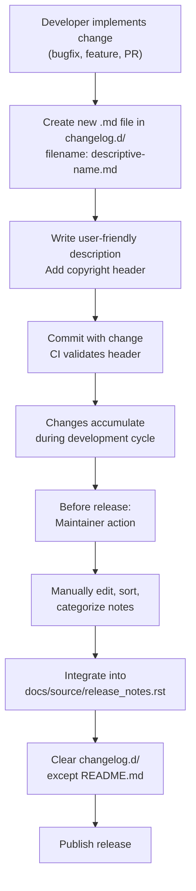
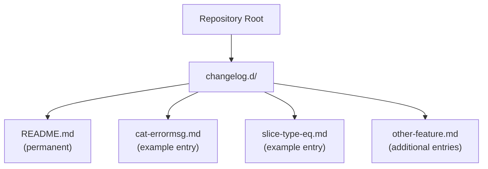
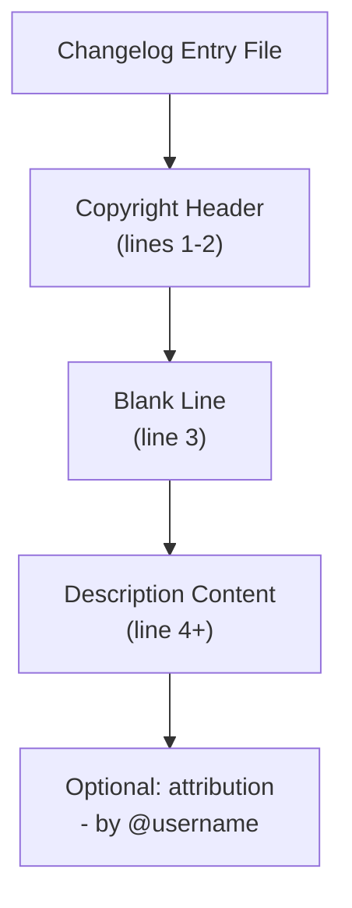
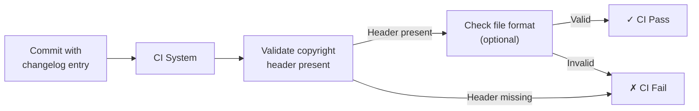
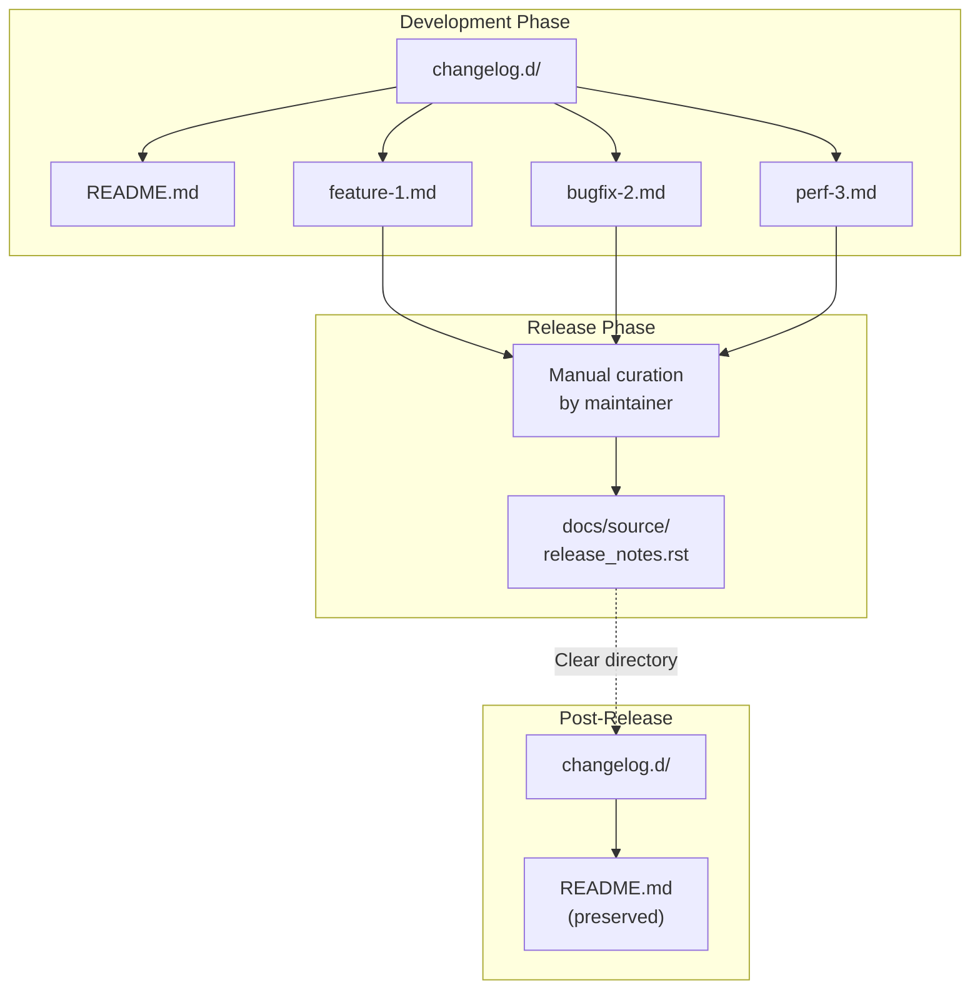

<!-- source: DeepWiki mcp.deepwiki.com · repo NVIDIA/cutile-python · page 8.3 Changelog System · fetched 2026-10-26 -->

# Changelog System

<details>
<summary>Relevant source files</summary>

The following files were used as context for generating this wiki page:

- [changelog.d/README.md](changelog.d/README.md)
- [changelog.d/cat-errormsg.md](changelog.d/cat-errormsg.md)
- [changelog.d/slice-type-eq.md](changelog.d/slice-type-eq.md)

</details>


The changelog system manages release notes for cuTile Python in a staged, merge-conflict-free manner. Individual changes are documented in separate Markdown files within the `changelog.d/` directory during development, then aggregated and integrated into the main release notes before each release.

For information about testing infrastructure and development workflows, see [Testing Infrastructure](#8.1). For debugging techniques during development, see [Debugging Techniques](#8.2).

## Purpose and Workflow

The changelog system serves two primary goals:

1. **Merge Conflict Avoidance**: By storing each change in its own file, multiple contributors can add release notes simultaneously without conflicting edits to a single changelog file.

2. **Staged Release Management**: Changes accumulate in `changelog.d/` throughout a development cycle, then are manually curated and integrated into the official release notes at release time.

**Workflow Overview**



Sources: [changelog.d/README.md:1-18]()

## Directory Structure

The changelog system consists of a dedicated directory at the repository root:



| Component | Purpose | Lifecycle |
|-----------|---------|-----------|
| `changelog.d/` | Directory containing all staged release notes | Permanent |
| `README.md` | Documentation of the changelog system | Permanent (never cleared) |
| `*.md` files | Individual change descriptions | Temporary (cleared at release) |

Sources: [changelog.d/README.md:1-18]()

## Creating a Changelog Entry

### File Naming Convention

Choose a descriptive filename that:
- Uses lowercase with hyphens
- Briefly describes the change
- Ends with `.md` extension
- Is unique (to avoid conflicts)

**Examples from the codebase:**

| Filename | Type of Change |
|----------|----------------|
| `cat-errormsg.md` | Error message improvement |
| `slice-type-eq.md` | Bug fix |

Sources: [changelog.d/cat-errormsg.md:1-6](), [changelog.d/slice-type-eq.md:1-6]()

### File Format

Each changelog entry must follow this structure:



**Required Components:**

1. **Copyright Header** (lines 1-2):
   ```markdown
   <!--- SPDX-FileCopyrightText: Copyright (c) <2025> NVIDIA CORPORATION & AFFILIATES. All rights reserved. -->
   <!--- SPDX-License-Identifier: Apache-2.0 -->
   ```

2. **Blank Line** (line 3)

3. **Description** (line 4+): User-friendly description of the change

4. **Optional Attribution**: Include `- by @username` to credit contributors

Sources: [changelog.d/README.md:12-13](), [changelog.d/cat-errormsg.md:1-6](), [changelog.d/slice-type-eq.md:1-6]()

### Complete Example

From [changelog.d/cat-errormsg.md:1-6]():

```markdown
<!--- SPDX-FileCopyrightText: Copyright (c) <2025> NVIDIA CORPORATION & AFFILIATES. All rights reserved. -->
<!--- SPDX-License-Identifier: Apache-2.0 -->

Improve error message for `ct.cat()` - by @Da1sypetals
```

From [changelog.d/slice-type-eq.md:1-6]():

```markdown
<!--- SPDX-FileCopyrightText: Copyright (c) <2025> NVIDIA CORPORATION & AFFILIATES. All rights reserved. -->
<!--- SPDX-License-Identifier: Apache-2.0 -->

Fix SliceType __eq__ comparison logic (by @Navneetpandit7226)
```

Sources: [changelog.d/cat-errormsg.md:1-6](), [changelog.d/slice-type-eq.md:1-6]()

## Writing Guidelines

### Content Best Practices

| Guideline | Rationale | Example |
|-----------|-----------|---------|
| Write from user perspective | Users don't care about internal implementation | ✓ "Improve error message for `ct.cat()`"<br/>✗ "Refactor ConcatenateOp validation" |
| Be concise | One or two sentences maximum | ✓ "Fix SliceType __eq__ comparison logic"<br/>✗ Long explanation of the bug |
| Use code references | Help users identify affected APIs | Use backticks: `ct.cat()`, `SliceType` |
| Include attribution | Credit contributors | `- by @username` or `(by @username)` |

### What to Document

**Include:**
- Bug fixes that affect user-visible behavior
- New features or operations
- API changes or deprecations
- Performance improvements
- Error message improvements
- Breaking changes

**Omit:**
- Internal refactoring without user impact
- Test-only changes
- Documentation fixes (unless major)
- Build system changes

Sources: [changelog.d/README.md:8-9]()

## CI Validation

The continuous integration system validates changelog entries:

**Checks Performed:**



| Validation | Requirement | Location |
|------------|-------------|----------|
| Copyright header | Must match SPDX format shown above | Lines 1-2 of each `.md` file |
| File extension | Must be `.md` | Filename |

Sources: [changelog.d/README.md:12-13]()

## Release Process

The release process is performed manually by maintainers:

### Steps

1. **Review all `changelog.d/*.md` files** (except `README.md`)
2. **Edit and categorize** changes into logical groups:
   - New Features
   - Bug Fixes
   - Performance Improvements
   - Breaking Changes
   - Documentation
3. **Integrate** into `docs/source/release_notes.rst` with:
   - Version number
   - Release date
   - Organized sections
   - Consistent formatting
4. **Clear `changelog.d/`** directory:
   - Delete all `.md` files except `README.md`
5. **Commit and tag** the release

### Integration Target

The final destination for changelog entries is `docs/source/release_notes.rst`, which is part of the Sphinx documentation system. This file is maintained manually and follows reStructuredText format.

Sources: [changelog.d/README.md:15-17]()

## System Architecture

**File System Layout:**



**Relationship to Documentation System:**

| Component | Purpose | Format | Lifecycle |
|-----------|---------|--------|-----------|
| `changelog.d/*.md` | Staged release notes | Markdown | Temporary |
| `docs/source/release_notes.rst` | Published release notes | reStructuredText | Permanent |
| `README.md` | System documentation | Markdown | Permanent |

Sources: [changelog.d/README.md:1-18]()

## Comparison with Alternative Approaches

**Why this system?**

| Approach | Merge Conflicts? | Manual Work | Structured Output |
|----------|------------------|-------------|-------------------|
| Single `CHANGELOG.md` | ✗ High | Low | High |
| `changelog.d/` (current) | ✓ None | Medium | High |
| Git commit messages | ✓ None | Low | Low |
| GitHub release notes | ✓ None | Medium | Medium |

The `changelog.d/` approach balances merge conflict avoidance with high-quality, curated release notes. It allows parallel development while maintaining editorial control over the final presentation.

Sources: [changelog.d/README.md:4-6]()

## Common Operations

### Adding a Changelog Entry

```bash
# 1. Create new file with descriptive name
touch changelog.d/my-feature.md

# 2. Add copyright header and description
cat > changelog.d/my-feature.md << EOF
<!--- SPDX-FileCopyrightText: Copyright (c) <2025> NVIDIA CORPORATION & AFFILIATES. All rights reserved. -->
<!--- SPDX-License-Identifier: Apache-2.0 -->

Add support for new operation `ct.my_op()` - by @username
EOF

# 3. Commit with your change
git add changelog.d/my-feature.md
git commit -m "Add my_feature with changelog entry"
```

### Viewing Pending Changes

```bash
# List all pending changelog entries
ls -1 changelog.d/*.md | grep -v README.md

# View all pending changes
cat changelog.d/*.md | grep -v "^<!---" | grep -v "^$"
```

### Preparing a Release (Maintainer)

```bash
# 1. Review all entries
ls changelog.d/*.md | grep -v README

# 2. Manually edit docs/source/release_notes.rst
vim docs/source/release_notes.rst

# 3. Clear changelog.d (except README.md)
find changelog.d -name "*.md" ! -name "README.md" -delete

# 4. Commit release
git add changelog.d/ docs/source/release_notes.rst
git commit -m "Release vX.Y.Z"
```

Sources: [changelog.d/README.md:1-18]()

## Summary

The changelog system provides a lightweight, merge-conflict-free approach to release note management:

| Aspect | Implementation |
|--------|----------------|
| Storage | `changelog.d/` directory with individual `.md` files |
| Format | Markdown with required copyright header |
| Validation | CI checks for header presence |
| Integration | Manual curation into `release_notes.rst` |
| Cleanup | Directory cleared (except `README.md`) after release |

This system enables parallel development while maintaining high-quality, curated release documentation.

Sources: [changelog.d/README.md:1-18]()

---

