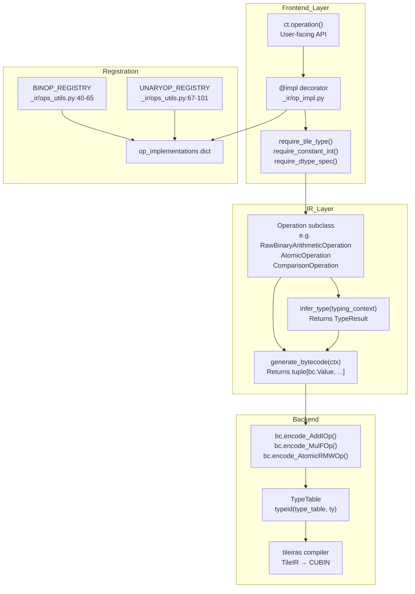
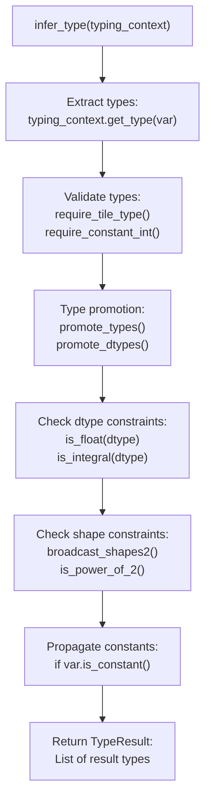
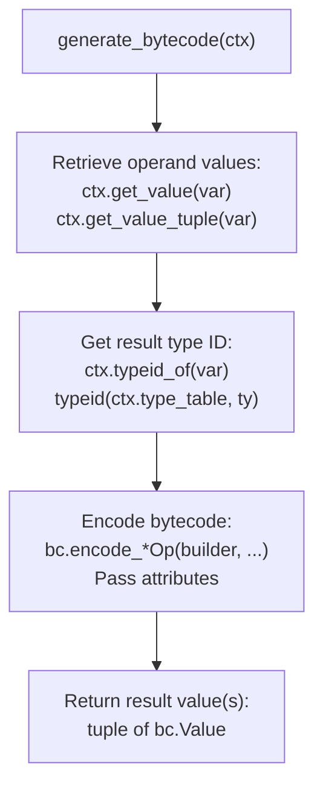
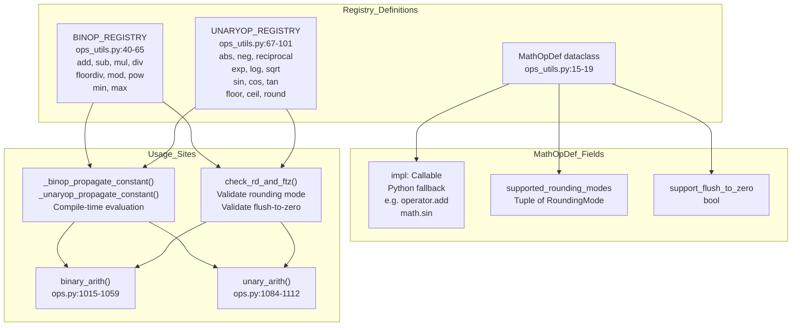
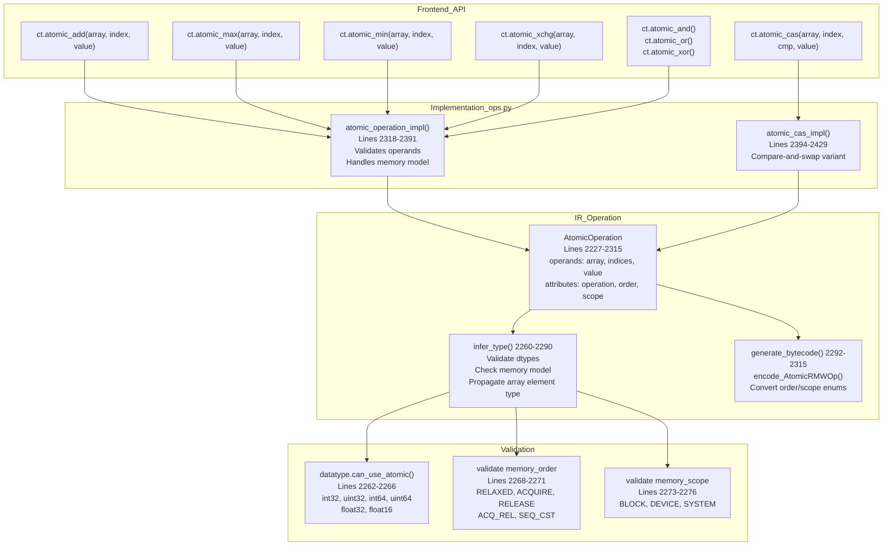
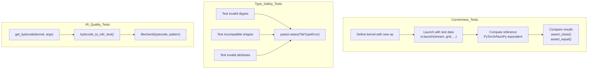

<!-- source: DeepWiki mcp.deepwiki.com · repo NVIDIA/cutile-python · page 8.4 Adding New Operations · fetched 2026-10-26 -->

# Adding New Operations

<details>
<summary>Relevant source files</summary>

The following files were used as context for generating this wiki page:

- [src/cuda/tile/_ir/ops.py](src/cuda/tile/_ir/ops.py)
- [test/test_cast.py](test/test_cast.py)
- [test/test_cat.py](test/test_cat.py)
- [test/test_mma.py](test/test_mma.py)
- [test/util.py](test/util.py)

</details>


This page provides a guide for developers who want to extend cuda.tile by adding new operations or IR nodes. It covers the architecture of operations, the steps required to implement a new operation, and best practices for testing.

For information about using existing operations, see the API Reference ([3](#3)). For details on the IR system structure, see [4.2](#4.2).

## Overview of Operation Architecture

Operations in cuda.tile are represented as IR nodes that transform through multiple compilation stages. Each operation must define how it behaves during type inference and how it generates bytecode for execution.



**Operation Lifecycle:**
1. User calls a Python function (e.g., `ct.add(x, y)`, `ct.atomic_add(arr, idx, val)`)
2. `@impl` decorated function validates arguments via helpers in `op_impl.py`
3. Frontend creates IR `Operation` node (e.g., `RawBinaryArithmeticOperation`)
4. Type inference pass calls `infer_type()` to determine result types
5. Bytecode generation calls `generate_bytecode()` to emit TileIR instructions
6. `tileiras` compiler lowers bytecode to GPU code

Sources: [src/cuda/tile/_ir/ops.py:1-70](), [src/cuda/tile/_ir/op_impl.py](), [src/cuda/tile/_ir/ops_utils.py:40-101]()

## Operation Base Classes

Operations inherit from one of three base classes defined in `_ir/ir.py`, each serving a different purpose:

| Base Class | Purpose | When to Use | Examples |
|------------|---------|-------------|----------|
| `AstOperation` | AST-level operations | High-level constructs transformed during compilation | `Store` [ops.py:73-78](), `Load` [ops.py:86-90](), `Call` [ops.py:98-112]() |
| `TypedOperation` | Type-aware operations | Operations with simple type inference, generate bytecode directly | `TypedConst` [ops.py:591-605](), `RawComparisonOperation` [ops.py:654-672]() |
| `Operation` | Generic operations | Control flow and operations with complex type inference | `Loop` [ops.py:158-227](), `IfElse` [ops.py:297-375]() |

**Key Methods to Implement:**

- `infer_type(typing_context: TypingContext) -> TypeResult`: 
  - Infers and returns result types
  - Validates operand types using helpers from `op_impl.py`
  - Propagates constants when possible
  - Example: [ops.py:336-351]() (`IfElse.infer_type`)

- `generate_bytecode(ctx: BytecodeContext) -> tuple[tuple[bc.Value, ...], ...]`: 
  - Generates TileIR bytecode instructions
  - Retrieves operand values via `ctx.get_value()` or `ctx.get_value_tuple()`
  - Returns tuple(s) of result values
  - Example: [ops.py:354-366]() (`IfElse.generate_bytecode`)

- `clone(mapper: Mapper) -> Operation` (optional):
  - Deep copies the operation for IR transformations
  - Required for operations with custom attributes
  - Example: [ops.py:323-333]() (`IfElse.clone`)

Sources: [src/cuda/tile/_ir/ir.py](), [src/cuda/tile/_ir/ops.py:73-112](), [src/cuda/tile/_ir/ops.py:158-375](), [src/cuda/tile/_ir/ops.py:591-672]()

## Step-by-Step: Adding a New Operation

### 1. Define the Operation Class

Create a class inheriting from the appropriate base class. Store operands and attributes in the constructor.

**Example from `RawBinaryArithmeticOperation`:**
```python
class RawBinaryArithmeticOperation(TypedOperation):
    def __init__(self, fn: str, lhs: Var, rhs: Var,
                 rounding_mode: Optional[RoundingMode], flush_to_zero: bool,
                 result_var: Var, loc: Loc):
        super().__init__(
            "raw_binary_arith",
            operands={"lhs": lhs, "rhs": rhs},
            attributes={"fn": fn, "rounding_mode": rounding_mode, 
                       "flush_to_zero": flush_to_zero},
            result_vars=[result_var],
            loc=loc
        )
```

**Key points:**
- Operation name (first argument) should be descriptive and unique (e.g., `"raw_binary_arith"`, `"atomic"`)
- `operands` dict contains `Var` objects representing runtime values
- `attributes` dict contains compile-time constants:
  - Primitive types: `int`, `str`, `bool`
  - Enums: `RoundingMode`, `MemoryOrder`, `MemoryScope`
  - Operations with multiple variants share implementation (e.g., `fn="add"` vs `fn="mul"`)
- `result_vars` list contains output variables (can be empty for side-effect operations)
- `loc` tracks source location for error reporting

Sources: [src/cuda/tile/_ir/ops.py:98-112](), [src/cuda/tile/_ir/ops.py:901-911](), [src/cuda/tile/_ir/ops.py:628-638]()

### 2. Implement Type Inference

The `infer_type()` method determines result types based on input types. This method must be implemented for all operations except `TypedOperation` subclasses (which infer types automatically).

**Type Inference Flow:**



**Validation Helpers in `op_impl.py`:**

| Helper | Purpose | Returns | Usage Example |
|--------|---------|---------|---------------|
| `require_tile_type(var)` | Ensures operand is Tile | `TileTy` | Shape operations [ops.py:1642-1643]() |
| `require_scalar_or_0d_tile_type(var)` | Scalar or 0D tile | `DType \| TileTy` | Store operations [ops.py:2196-2197]() |
| `require_tile_or_scalar_type(var)` | Tile or scalar | `TileTy \| DType` | Arithmetic [ops.py:712-713]() |
| `require_constant_int(var)` | Constant integer | `int` | Shape parameters [ops.py:1581]() |
| `require_constant_bool(var)` | Constant boolean | `bool` | Optimization flags [ops.py:2142]() |
| `require_dtype_spec(var)` | DType specification | `DType` | Type casting [ops.py:1849]() |
| `require_array_type(var)` | Array operand | `ArrayTy` | Load/store [ops.py:2090]() |

**Example Implementation Pattern:**

Looking at `comparison()` [ops.py:711-727]():
1. Validate operand types: `require_tile_or_scalar_maybe_loose_type(x)`, `require_tile_or_scalar_maybe_loose_type(y)`
2. Handle loosely-typed constants for compile-time evaluation
3. Promote to common type: `promote_types(x_ty, y_ty)`
4. Broadcast operands: `_promote_and_broadcast_to(x, common_ty)`
5. Propagate constants if both operands constant
6. Create operation or return constant

Sources: [src/cuda/tile/_ir/ops.py:204-227](), [src/cuda/tile/_ir/ops.py:711-727](), [src/cuda/tile/_ir/op_impl.py]()

### 3. Implement Bytecode Generation

The `generate_bytecode()` method emits TileIR bytecode instructions. All operations must implement this method (except `AstOperation` subclasses which are transformed away before bytecode generation).

**Bytecode Generation Pattern:**



**Example from `RawBinaryArithmeticOperation` [ops.py:913-959]():**

```python
@override
def generate_bytecode(self, ctx: BytecodeContext) -> bc.Value:
    result_ty = self.result_var.get_type()
    dtype = get_dtype(result_ty)
    kind = "float" if datatype.is_float(dtype) else "int"
    res_typeid = typeid(ctx.type_table, result_ty)
    rounding_mode = rounding_mode_to_bytecode[self.rounding_mode]
    lhs = ctx.get_value(self.lhs)
    rhs = ctx.get_value(self.rhs)

    match self.fn, kind:
        case "add", "int":
            return bc.encode_AddIOp(ctx.builder, res_typeid, lhs, rhs,
                                    overflow=bc.IntegerOverflow.NONE)
        case "add", "float":
            return bc.encode_AddFOp(ctx.builder, res_typeid, lhs, rhs,
                                    rounding_mode=rounding_mode,
                                    flush_to_zero=self.flush_to_zero)
        # ... more cases
```

**BytecodeContext Methods:**

| Method | Purpose | Returns |
|--------|---------|---------|
| `ctx.get_value(var)` | Single value operand | `bc.Value` |
| `ctx.get_value_tuple(var)` | Multi-value operand (ranges, tuples) | `tuple[bc.Value, ...]` |
| `ctx.typeid_of(var)` | Type ID from variable | `int` |
| `ctx.typeof(var)` | Get type from variable | `Type` |
| `ctx.set_values(var, values)` | Set result values | `None` |
| `ctx.constant_tuple(value, ty)` | Create constant | `tuple[bc.Value, ...]` |

**Return Value Conventions:**
- Single result: `return (result_value,)` - tuple with one element
- Multiple results: `return ((val1,), (val2,))` - tuple of tuples
- Tuple result: `return ((val1, val2, val3),)` - nested tuple
- No results (side effects): `return ()` - empty tuple

Sources: [src/cuda/tile/_ir/ops.py:228-262](), [src/cuda/tile/_ir/ops.py:913-959](), [src/cuda/tile/_ir2bytecode.py]()

### 4. Create Frontend API

Provide a user-facing function using the `@impl` decorator. This function validates inputs and creates the IR operation.

**The `@impl` Decorator:**

The `@impl` decorator in `op_impl.py` maps Python functions to implementation functions. It:
- Registers the implementation in `op_implementations` dict
- Supports `fixed_args` for operations sharing logic (e.g., different comparison operators)
- Enables constant folding and optimization
- Handles type checking and validation

**Pattern 1: Simple Operation Implementation**

From `binary_bitwise` [ops.py:796-834]():
```python
@impl(ct.bitwise_and, fixed_args=["and_"])
@impl(ct.bitwise_or, fixed_args=["or_"])
@impl(ct.bitwise_xor, fixed_args=["xor"])
def binary_bitwise(fn: str, x: Var, y: Var) -> Var:
    # 1. Validate and extract types
    x_ty = require_tile_or_scalar_maybe_loose_type(x)
    y_ty = require_tile_or_scalar_maybe_loose_type(y)

    # 2. Handle loosely-typed constants (compile-time evaluation)
    if isinstance(x_ty, LooselyTypedScalar) and isinstance(y_ty, LooselyTypedScalar):
        return _binop_propagate_constant(fn, x_ty.value, y_ty.value, None)

    # 3. Validate dtype constraints
    lhs_dtype = get_dtype(x_ty)
    rhs_dtype = get_dtype(y_ty)
    if not (datatype.is_integral(lhs_dtype) or datatype.is_boolean(lhs_dtype)):
        raise TileTypeError("Bitwise operations require integers or booleans")

    # 4. Type promotion and broadcasting
    common_ty = promote_types(x_ty, y_ty)
    x = _promote_and_broadcast_to(x, common_ty)
    y = _promote_and_broadcast_to(y, common_ty)

    # 5. Constant folding for strictly-typed constants
    if x.is_constant() and y.is_constant():
        return _binop_propagate_constant(fn, x.get_constant(), y.get_constant(), common_ty)

    # 6. Create IR operation
    return raw_binary_bitwise(fn, x, y)
```

**Pattern 2: Multiple Variants with Fixed Args**

From `comparison` [ops.py:705-710]():
```python
@impl(ct.equal, fixed_args=["eq"])
@impl(ct.greater, fixed_args=["gt"])
@impl(ct.not_equal, fixed_args=["ne"])
@impl(ct.greater_equal, fixed_args=["ge"])
@impl(ct.less, fixed_args=["lt"])
@impl(ct.less_equal, fixed_args=["le"])
def comparison(fn: str, x: Var, y: Var) -> Var:
    # Implementation shared across all comparison operations
    # 'fn' parameter is automatically injected by @impl decorator
    ...
```

**Helper Function: `add_operation`**

Creates an IR operation node and assigns its result type:
```python
return add_operation(RawBinaryBitwiseOperation, result_ty,
                    fn=fn, lhs=x, rhs=y)
```

This calls the operation's constructor and registers the result variable with the given type.

Sources: [src/cuda/tile/_ir/ops.py:705-727](), [src/cuda/tile/_ir/ops.py:796-834](), [src/cuda/tile/_ir/op_impl.py](), [src/cuda/tile/_ir/ir.py]()

## Operation Categories and Registries

cuda.tile maintains registries for common operation patterns, enabling code reuse and consistent validation.



**Registry Structure in `ops_utils.py` [ops_utils.py:15-19]():**

```python
@dataclass
class MathOpDef:
    impl: Callable
    supported_rounding_modes: tuple[RoundingMode, ...]
    support_flush_to_zero: bool
```

**Binary Operations Registry [ops_utils.py:40-65]():**

| Operation | Implementation | Rounding Modes | Flush-to-Zero |
|-----------|---------------|----------------|---------------|
| `"add"` | `operator.add` | RN, RZ, RM, RP | Yes |
| `"sub"` | `operator.sub` | RN, RZ, RM, RP | Yes |
| `"mul"` | `operator.mul` | RN, RZ, RM, RP | Yes |
| `"truediv"` | `operator.truediv` | RN, RZ, RM, RP | Yes |
| `"floordiv"` | `operator.floordiv` | RN | No |
| `"pow"` | `operator.pow` | None | No |
| `"min"` | `min` | None | No |
| `"max"` | `max` | None | No |

**Unary Operations Registry [ops_utils.py:67-101]():**

Includes mathematical functions from Python's `math` module and `operator` module:
- Basic: `abs`, `neg`, `reciprocal`
- Exponential: `exp`, `exp2`, `log`, `log2`, `log10`
- Trigonometric: `sin`, `cos`, `tan`, `asin`, `acos`, `atan`
- Hyperbolic: `sinh`, `cosh`, `tanh`
- Rounding: `floor`, `ceil`, `round`, `trunc`
- Other: `sqrt`, `rsqrt`, `erf`

**Registry Usage Pattern:**

From `_binop_propagate_constant()` [ops.py:694-702]():
```python
def _binop_propagate_constant(fn: str, x: Any, y: Any, type: Optional[Type]) -> Var:
    impl = BINOP_REGISTRY[fn].impl  # Get Python callable
    with _reraise_tile_exception():
        res = impl(x, y)  # Evaluate at compile time
    
    if type is None:
        return loosely_typed_const(res)
    else:
        return strictly_typed_const(res, type)
```

Sources: [src/cuda/tile/_ir/ops_utils.py:15-101](), [src/cuda/tile/_ir/ops.py:694-702](), [src/cuda/tile/_ir/ops.py:1015-1112]()

## Example: Complete Implementation of Atomic Operations

Atomic operations provide a complete example of the implementation pattern, including multiple operation variants, validation, and bytecode generation.

**Architecture of Atomic Operations:**



**1. Operation Class Definition [ops.py:2227-2259]():**

The `AtomicOperation` class stores all operands and attributes:
- `array`: Target array in global memory
- `indices`: Index or tuple of indices for array access
- `value`: Value to write (or compare value for CAS)
- `operation`: Atomic operation name (`"add"`, `"max"`, `"cas"`, etc.)
- `memory_order`: Memory ordering semantics (`MemoryOrder.RELAXED`, etc.)
- `memory_scope`: Synchronization scope (`MemoryScope.DEVICE`, etc.)

**2. Type Inference [ops.py:2260-2290]():**

Validates constraints and determines result type:
```python
def infer_type(self, typing_context: TypingContext) -> TypeResult:
    # 1. Validate array and get element type
    array_ty = require_array_type(self.array)
    
    # 2. Validate value type matches array element type
    #    (or is compatible for bitwise operations)
    value_ty = require_scalar_or_0d_tile_type(self.value)
    
    # 3. Check dtype is supported for atomics
    if not datatype.can_use_atomic(array_ty.dtype):
        raise TileTypeError(f"Unsupported dtype for atomics: {array_ty.dtype}")
    
    # 4. Validate memory model parameters
    if self.memory_order not in valid_memory_orders:
        raise TileTypeError(f"Invalid memory_order: {self.memory_order}")
    
    # 5. Return old value type (always returns array element type)
    return [array_ty.dtype]
```

**3. Bytecode Generation [ops.py:2292-2315]():**

Generates atomic bytecode instruction:
```python
def generate_bytecode(self, ctx: BytecodeContext) -> tuple[bc.Value]:
    # Convert memory model enums to bytecode constants
    order = memory_order_to_bytecode[self.memory_order]
    scope = memory_scope_to_bytecode[self.memory_scope]
    
    # Get array pointer
    ptr = load_pointer_lowering(ctx, self.array, self.indices)
    
    # Get value to write
    value = ctx.get_value(self.value)
    
    # Encode atomic operation
    result = bc.encode_AtomicRMWOp(
        ctx.builder,
        ctx.typeid_of(self.result_var),
        operation_map[self.operation],  # Convert op name to enum
        ptr,
        value,
        order,
        scope
    )
    return (result,)
```

**4. Frontend Implementation [ops.py:2318-2391]():**

Uses `@impl` decorator with `fixed_args` to handle multiple variants:
```python
@impl(ct.atomic_add, fixed_args=["add"])
@impl(ct.atomic_max, fixed_args=["max"])
@impl(ct.atomic_min, fixed_args=["min"])
@impl(ct.atomic_and, fixed_args=["and"])
@impl(ct.atomic_or, fixed_args=["or"])
@impl(ct.atomic_xor, fixed_args=["xor"])
@impl(ct.atomic_xchg, fixed_args=["xchg"])
def atomic_operation_impl(
    operation: str,
    array: Var,
    indices: Var,
    value: Var,
    memory_order: MemoryOrder = MemoryOrder.RELAXED,
    memory_scope: MemoryScope = MemoryScope.DEVICE
) -> Var:
    # Validate array
    array_ty = require_array_type(array)
    
    # Validate and process indices
    indices = require_index_or_index_tuple_type(indices)
    
    # Validate value type
    value_ty = require_scalar_or_0d_tile_type(value)
    check_implicit_cast(value_ty, array_ty.dtype)
    
    # Create operation
    return add_operation(AtomicOperation, array_ty.dtype,
                        array=array, indices=indices, value=value,
                        operation=operation,
                        memory_order=memory_order,
                        memory_scope=memory_scope)
```

**5. Testing Pattern [test/test_atomic.py:114-144]():**

Tests validate correctness against reference implementation:
```python
def test_atomic_add():
    # Setup test data
    arr = torch.zeros(size, dtype=dtype, device='cuda')
    values = torch.ones(size, dtype=dtype, device='cuda')
    
    # Define kernel
    @ct.kernel
    def kernel(arr, values, TILE: ct.Constant[int]):
        idx = ct.bid(0) * TILE + ct.arange(TILE)
        val = ct.gather(values, idx)
        old = ct.atomic_add(arr, idx, val)
    
    # Launch multiple times to test atomicity
    for _ in range(num_iterations):
        ct.launch(stream, grid, kernel, (arr, values, tile_size))
    
    # Verify result
    expected = values * num_iterations
    assert_equal(arr, expected)
```

Sources: [src/cuda/tile/_ir/ops.py:2227-2429](), [test/test_atomic.py:1-314]()

## Type Promotion and Broadcasting

When adding operations that combine multiple operands, implement type promotion and broadcasting:

**Type Promotion:**
```python
# Promote dtypes only
result_dtype = promote_dtypes(dtype_a, dtype_b)

# Promote full types (handles tiles and scalars)
result_type = promote_types(type_a, type_b)

# Force float promotion (for division, etc.)
result_type = promote_types(type_a, type_b, force_float=True)
```

**Broadcasting:**
```python
# Check if shape can broadcast
if is_shape_broadcastable_to(src_shape, dst_shape):
    # Safe to broadcast
    result = broadcast_to(operand, dst_shape)

# Compute broadcasted shape from two shapes
try:
    result_shape = broadcast_shapes2(shape_a, shape_b)
except BroadcastError:
    raise TileTypeError("Shapes not broadcastable")
```

**Helper function pattern:**
```python
def _promote_and_broadcast_to(x: Var, ty: TileTy | DType) -> Var:
    is_tile = isinstance(ty, TileTy)
    shape = ty.shape_value if is_tile else ()
    return broadcast_to(astype(x, get_dtype(ty)), shape, 
                       keep_scalar=not is_tile)
```

Sources: [src/cuda/tile/_ir/ops_utils.py:261-296](), [src/cuda/tile/_ir/ops.py:760-764]()

## Constant Folding

Operations should support constant folding for compile-time evaluation:

**Pattern:**
```python
def my_operation_impl(x: Var, y: Var) -> Var:
    x_ty = require_tile_or_scalar_type(x)
    y_ty = require_tile_or_scalar_type(y)
    
    # Handle fully loosely-typed constants
    if isinstance(x_ty, LooselyTypedScalar) and \
       isinstance(y_ty, LooselyTypedScalar):
        return _binop_propagate_constant("my_op", 
                                        x_ty.value, y_ty.value, None)
    
    # Promote types
    result_ty = promote_types(x_ty, y_ty)
    
    # Handle strictly-typed constants
    if x.is_constant() and y.is_constant():
        return _binop_propagate_constant("my_op",
                                        x.get_constant(), 
                                        y.get_constant(),
                                        result_ty)
    
    # Create IR operation for runtime computation
    return raw_my_operation(x, y)
```

**Constant propagation function:**
```python
def _binop_propagate_constant(fn: str, x: Any, y: Any, 
                              type: Optional[Type]) -> Var:
    impl = BINOP_REGISTRY[fn].impl
    with _reraise_tile_exception():
        res = impl(x, y)
    
    if type is None:
        return loosely_typed_const(res)
    else:
        return strictly_typed_const(res, type)
```

This pattern ensures constants are evaluated at compile time, reducing runtime overhead.

Sources: [src/cuda/tile/_ir/ops.py:694-703](), [src/cuda/tile/_ir/ops.py:711-727]()

## Testing New Operations

Comprehensive testing validates correctness, type safety, and IR quality. Use the test utilities in `test/util.py` for consistent test patterns.

### Test Structure

**Three Testing Aspects:**



### 1. Correctness Testing

**Pattern from `test_mma.py` [test/test_mma.py:100-112]():**

```python
@pytest.mark.parametrize("tile_size", [(2, 8, 16)])
@pytest.mark.parametrize("case", regular_float_cases, ids=str)
def test_mma_regular_float(tile_size, case):
    m, n, k = tile_size
    
    # Create test data
    A = torch.randn((m, k), dtype=case.dtype, device="cuda")
    B = torch.randn((k, n), dtype=case.dtype, device="cuda")
    C = torch.ones((m, n), dtype=case.acc_dtype, device="cuda")
    
    # Compute reference
    ref = torch.mm(A, B, out_dtype=C.dtype) + C
    
    # Launch kernel
    ct.launch(torch.cuda.current_stream(), (1,), mma_kernel,
              (A, B, C, m, n, k))
    
    # Validate with appropriate tolerance
    atol, rtol = get_tolerance(A.dtype)
    assert_close(C, ref, atol=atol, rtol=rtol)
```

**Test Utilities in `util.py`:**

| Function | Purpose | Usage |
|----------|---------|-------|
| `assert_close(actual, ref, rtol, atol)` | Compare with tolerance | Floating-point results |
| `assert_equal(actual, ref)` | Exact comparison | Integer results |
| `launch_unary(kernel, x, y, tile)` | Launch 1-input kernel | Unary operations [util.py:54-57]() |
| `launch_binary(kernel, x, y, z, tile)` | Launch 2-input kernel | Binary operations [util.py:48-51]() |
| `get_tolerance(dtype)` | Get appropriate tolerance | FP precision [test_mma.py:41-54]() |

### 2. Type Safety Testing

**Pattern from `test_mma.py` [test/test_mma.py:215-223]():**

```python
@pytest.mark.parametrize("case", dtype_error_cases, ids=str)
def test_mma_dtype_error(case):
    A = torch.randn((2, 2), device='cuda').to(case.x_dtype)
    B = torch.randn((2, 2), device='cuda').to(case.y_dtype)
    C = torch.randn((2, 2), device='cuda').to(case.acc_dtype)
    
    # Verify expected error is raised
    with pytest.raises(TileTypeError, match=case.message):
        ct.launch(torch.cuda.current_stream(),
                  (1,), mma_kernel,
                  (A, B, C, 2, 2, 2))
```

**Error Test Patterns from `test_cat.py` [test/test_cat.py:44-47]():**

```python
def test_non_power_of_two():
    out = torch.zeros(8, dtype=torch.int32, device='cuda')
    with pytest.raises(TileTypeError, match=r"Result tile shape must be power of 2"):
        ct.launch(torch.cuda.current_stream(), (1,), cat3, (out,))
```

### 3. FileCheck Validation

**Using `filecheck()` from `util.py` [util.py:165-184]():**

The `filecheck()` function validates MLIR bytecode structure:
- Converts bytecode to MLIR text representation
- Runs FileCheck tool with provided pattern
- Asserts that pattern matches MLIR output

**Example pattern:**

```python
def test_operation_bytecode():
    @ct.kernel
    def kernel(A, B, result):
        a = ct.load(A, (0,), (64,))
        b = ct.load(B, (0,), (64,))
        c = ct.my_new_operation(a, b, some_param=5)
        ct.store(result, (0,), c)
    
    # Get bytecode
    A = torch.zeros(64, dtype=torch.float32, device='cuda')
    B = torch.zeros(64, dtype=torch.float32, device='cuda')
    result = torch.zeros(64, dtype=torch.float32, device='cuda')
    bytecode = get_bytecode(kernel, (A, B, result))
    
    # Validate MLIR structure
    filecheck(bytecode, """
        // CHECK: tile.load
        // CHECK: tile.load
        // CHECK: my_new_operation
        // CHECK-SAME: some_param = 5
        // CHECK: tile.store
    """)
```

### 4. Parametrized Testing

**Pattern from `test_cast.py` [test/test_cast.py:155-166]():**

```python
@pytest.mark.parametrize("from_dtype", float_dtypes+int_dtypes+bool_dtypes, ids=dtype_id)
@pytest.mark.parametrize("to_dtype", float_dtypes+int_dtypes+bool_dtypes, ids=dtype_id)
def test_array_astype(shape, tile, from_dtype, to_dtype):
    x = make_tensor(shape, dtype=from_dtype, device='cuda') * 5
    y = torch.zeros_like(x, dtype=to_dtype)
    grid = (ceil(x.numel() / tile), 1, 1)

    array_astype = make_array_astype_kernel(to_dtype)
    ct.launch(torch.cuda.current_stream(), grid, array_astype, (x, y, tile))
    assert_equal(y, x.to(y.dtype))
```

This pattern tests all combinations of input and output types efficiently.

### 5. JIT Kernel Testing

**Using `jit_kernel()` from `util.py` [util.py:35-45]():**

Create kernels dynamically from source strings for testing:

```python
def test_dynamic_kernel(tmp_path):
    source = """
@ct.kernel
def dynamic_test(x, y):
    t = ct.load(x, (0,), (16,))
    result = ct.my_new_operation(t)
    ct.store(y, (0,), result)
"""
    kernel = jit_kernel("dynamic_test", source, tmp_path)
    
    x = torch.randn(16, device='cuda')
    y = torch.zeros_like(x)
    ct.launch(torch.cuda.current_stream(), (1,), kernel, (x, y))
    # ... validate result
```

Sources: [test/test_mma.py:100-112](), [test/test_mma.py:215-223](), [test/test_cat.py:44-47](), [test/test_cast.py:155-166](), [test/util.py:30-184]()

## Common Patterns and Utilities

### Attribute Encoding

Operations often need to encode enum and constant attributes into bytecode. Helper dictionaries in `ops_utils.py` provide these mappings.

**Rounding Mode Encoding [ops_utils.py:108-114]():**

```python
rounding_mode_to_bytecode = {
    RoundingMode.RN: bc.RoundingMode.NEAREST_EVEN,
    RoundingMode.RZ: bc.RoundingMode.TOWARD_ZERO,
    RoundingMode.RM: bc.RoundingMode.NEGATIVE_INF,
    RoundingMode.RP: bc.RoundingMode.POSITIVE_INF,
}
```

**Usage in bytecode generation:**
```python
rd = rounding_mode_to_bytecode[self.rounding_mode]
result = bc.encode_AddFOp(ctx.builder, type_id, lhs, rhs,
                         rounding_mode=rd, 
                         flush_to_zero=self.flush_to_zero)
```

**Memory Model Encoding [ops_utils.py:157-178]():**

```python
memory_order_to_bytecode = {
    MemoryOrder.RELAXED: bc.MemoryOrdering.RELAXED,
    MemoryOrder.ACQUIRE: bc.MemoryOrdering.ACQUIRE,
    MemoryOrder.RELEASE: bc.MemoryOrdering.RELEASE,
    MemoryOrder.ACQ_REL: bc.MemoryOrdering.ACQ_REL,
    MemoryOrder.SEQ_CST: bc.MemoryOrdering.SEQ_CST,
}

memory_scope_to_bytecode = {
    MemoryScope.BLOCK: bc.MemoryScope.BLOCK,
    MemoryScope.DEVICE: bc.MemoryScope.DEVICE,
    MemoryScope.SYSTEM: bc.MemoryScope.SYSTEM,
}
```

**Usage in atomic operations [ops.py:2292-2315]():**
```python
order = memory_order_to_bytecode[self.memory_order]
scope = memory_scope_to_bytecode[self.memory_scope]
result = bc.encode_AtomicRMWOp(ctx.builder, type_id, op, ptr, value, order, scope)
```

### Validation Helpers

**DType Category Validation:**

Functions in `_datatype.py` check dtype properties:
```python
if not datatype.is_float(dtype):
    raise TileTypeError(f"Expected float dtype, got {dtype}")

if not datatype.is_integral(dtype):
    raise TileTypeError(f"Expected integer dtype, got {dtype}")

if not datatype.is_signed(dtype):
    raise TileTypeError(f"Expected signed dtype, got {dtype}")
```

**Shape Validation:**

From `ops_utils.py`:
```python
def is_power_of_2(n: int) -> bool:
    return n > 0 and (n & (n - 1)) == 0

# Usage
if not all(is_power_of_2(dim) for dim in shape):
    raise TileValueError(f"All dimensions must be power of 2, got {shape}")
```

**Attribute Validation:**

From `check_rd_and_ftz()` [ops_utils.py:137-163]():
```python
def check_rd_and_ftz(
    fn: str,
    rounding_mode: Optional[RoundingMode],
    flush_to_zero: bool,
    dtype: DType
):
    """Validates rounding mode and flush-to-zero for operation"""
    math_op = BINOP_REGISTRY.get(fn) or UNARYOP_REGISTRY.get(fn)
    
    if rounding_mode not in math_op.supported_rounding_modes:
        raise TileTypeError(f"Unsupported rounding mode {rounding_mode} for {fn}")
    
    if flush_to_zero and not math_op.support_flush_to_zero:
        raise TileTypeError(f"Operation {fn} does not support flush_to_zero")
    
    if not datatype.is_float(dtype):
        raise TileTypeError(f"Rounding modes only apply to float types, got {dtype}")
```

### Error Handling with Location Tracking

**Location Information:**

All operations store a `loc: Loc` parameter that tracks source file, line, and column information. This enables precise error messages.

**Error Raising Pattern:**

```python
def infer_type(self, typing_context: TypingContext) -> TypeResult:
    operand_type = typing_context.get_type(self.operand)
    
    if not is_valid_type(operand_type):
        # Error will show location where operation was created
        raise TileTypeError(
            f"Invalid operand type {operand_type}",
            loc=self.loc  # or self.operand.loc
        )
```

**Exception Reraising:**

From `_reraise_tile_exception()` [ops.py:684-692]():
```python
@contextmanager
def _reraise_tile_exception():
    """Converts Python exceptions to Tile exceptions"""
    try:
        yield
    except ZeroDivisionError as e:
        raise TileValueError(str(e))
    except TypeError as e:
        raise TileTypeError(str(e))
```

Used when evaluating Python operations for constant folding.

Sources: [src/cuda/tile/_ir/ops_utils.py:108-178](), [src/cuda/tile/_ir/ops.py:684-692](), [src/cuda/tile/_ir/ops.py:2292-2315](), [src/cuda/tile/_datatype.py]()

## Summary Checklist

When adding a new operation:

- [ ] Define operation class inheriting from appropriate base
- [ ] Implement `infer_type()` with proper validation
- [ ] Implement `generate_bytecode()` with correct bytecode encoding
- [ ] Create frontend API with `@impl` decorator
- [ ] Add to operation registry if applicable
- [ ] Implement constant folding for compile-time evaluation
- [ ] Handle type promotion and broadcasting if needed
- [ ] Add comprehensive tests (correctness, types, bytecode)
- [ ] Document operation in API reference
- [ ] Update relevant wiki pages

Sources: [src/cuda/tile/_ir/ops.py:1-3668](), [src/cuda/tile/_ir/ops_utils.py:1-342](), [test/test_atomic.py:1-314]()