# Page: Overview

# Overview

<details>
<summary>Relevant source files</summary>

The following files were used as context for generating this wiki page:

- [LICENSE.md](LICENSE.md)
- [README.md](README.md)
- [docs/source/debugging.rst](docs/source/debugging.rst)
- [docs/source/index.rst](docs/source/index.rst)
- [docs/source/release_notes.rst](docs/source/release_notes.rst)
- [test/requirements.txt](test/requirements.txt)
- [test/test_frontpage_example.py](test/test_frontpage_example.py)
- [test/test_readme_example.py](test/test_readme_example.py)

</details>


This document provides a high-level introduction to cuda.tile, its architecture, and key components. For specific details on individual subsystems, refer to the specialized pages: [Quick Start](#1.1) for a first example, [Core Concepts](#2) for foundational programming model details, [API Reference](#3) for operation documentation, and [Compilation System](#4) for compiler internals.

## What is cuda.tile?

cuda.tile is a Python-based Domain-Specific Language (DSL) for GPU programming on NVIDIA hardware. It provides a high-level abstraction for writing GPU kernels that automatically leverages advanced hardware features such as Tensor Cores and Tensor Memory Accelerators (TMA) while maintaining portability across different GPU architectures.

The system consists of three primary components:

| Component | Description | Key Classes/Functions |
|-----------|-------------|----------------------|
| **Python API** | User-facing interface for writing GPU kernels | `@ct.kernel`, `ct.launch()`, `ct.load()`, `ct.store()` |
| **Compilation Pipeline** | Transforms Python code to GPU binaries | `IRContext`, `infer_types_pass`, bytecode generation, `tileiras` compiler |
| **Execution Runtime** | Manages kernel launching and caching | `TileDispatcher`, argument marshalling, kernel cache |

**Sources:** [docs/source/index.rst:1-57](), [src/cuda/tile/_stub.py:1-1237]()

## Programming Model Overview

cuda.tile kernels operate on two fundamental data structures:

- **Arrays** ([src/cuda/tile/_stub.py:134-183]()): Mutable containers in global GPU memory with arbitrary shapes and strides. Arrays are DLPack-compatible and can be used in both host and tile code.

- **Tiles** ([src/cuda/tile/_stub.py:185-371]()): Immutable block-local data structures with power-of-2 dimensions. Tiles exist only within kernel execution and support rich computational operations.

A typical cuda.tile program follows this pattern:

```python
@ct.kernel
def kernel_function(array_in, array_out):
    block_id = ct.bid(0)
    tile = ct.load(array_in, index=(block_id,), shape=(TILE_SIZE,))
    result = tile + 1  # Tile operations
    ct.store(array_out, index=(block_id,), tile=result)

# Launch from host
ct.launch(stream, grid_shape, kernel_function, (input_array, output_array))
```

**Sources:** [test/test_frontpage_example.py:9-29](), [docs/source/index.rst:13-40]()

## End-to-End System Architecture

The following diagram illustrates the complete compilation and execution flow from user code to GPU execution:

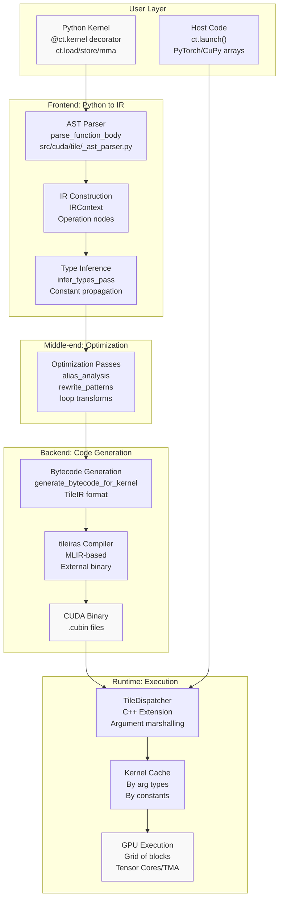

**Key Pipeline Stages:**

1. **Frontend Compilation**: Python AST is parsed into an Intermediate Representation (IR) consisting of typed operations organized in blocks. Type inference and constant propagation run as compiler passes.

2. **Middle-end Optimization**: Multiple optimization passes transform the IR, including alias analysis, pattern rewriting, and loop transformations.

3. **Backend Code Generation**: The optimized IR is converted to TileIR bytecode, which is fed to the external `tileiras` MLIR-based compiler to produce CUDA binaries.

4. **Runtime Execution**: The C++ extension layer (`TileDispatcher`) manages kernel launching, argument marshalling, caching, and stream management.

**Sources:** [src/cuda/tile/_ast_parser.py:1-1000](), [src/cuda/tile/_ir.py:1-500](), [src/cuda/tile/_compile.py:1-300]()

## Data Flow and Memory Hierarchy

The following diagram shows how data moves between different memory spaces and representations:

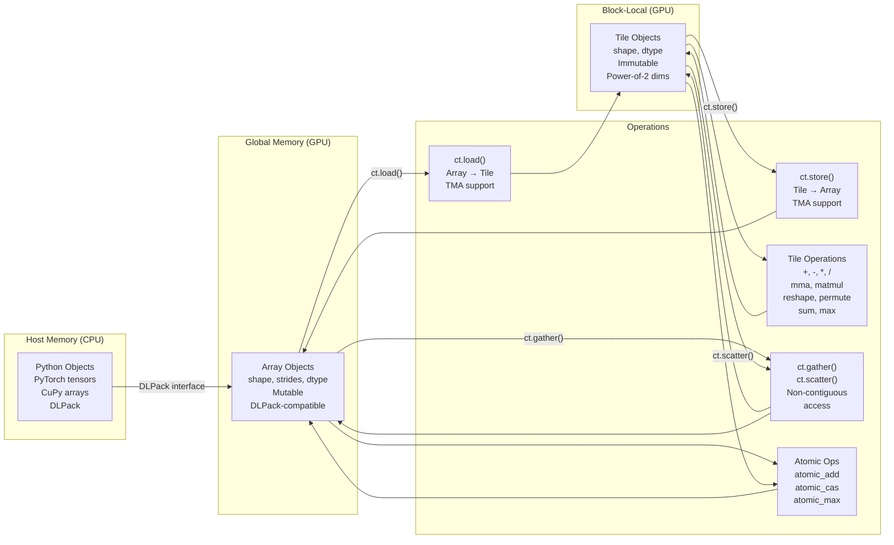

**Memory Operation Categories:**

| Operation Type | Functions | Purpose |
|----------------|-----------|---------|
| **Regular Access** | `ct.load()`, `ct.store()` | Tile-space partitioned access with optional TMA |
| **Indirect Access** | `ct.gather()`, `ct.scatter()` | Non-contiguous access via index tiles |
| **Atomic Access** | `ct.atomic_add()`, `ct.atomic_cas()`, etc. | Thread-safe concurrent updates |
| **Factory** | `ct.arange()`, `ct.full()`, `ct.zeros()`, `ct.ones()` | Create tiles from scratch |

**Sources:** [src/cuda/tile/_stub.py:134-669](), [src/cuda/tile/_array.py:1-200](), [src/cuda/tile/_tile_api.py:1-300]()

## Compilation Pipeline Details

### IR Structure

The Intermediate Representation is organized hierarchically:

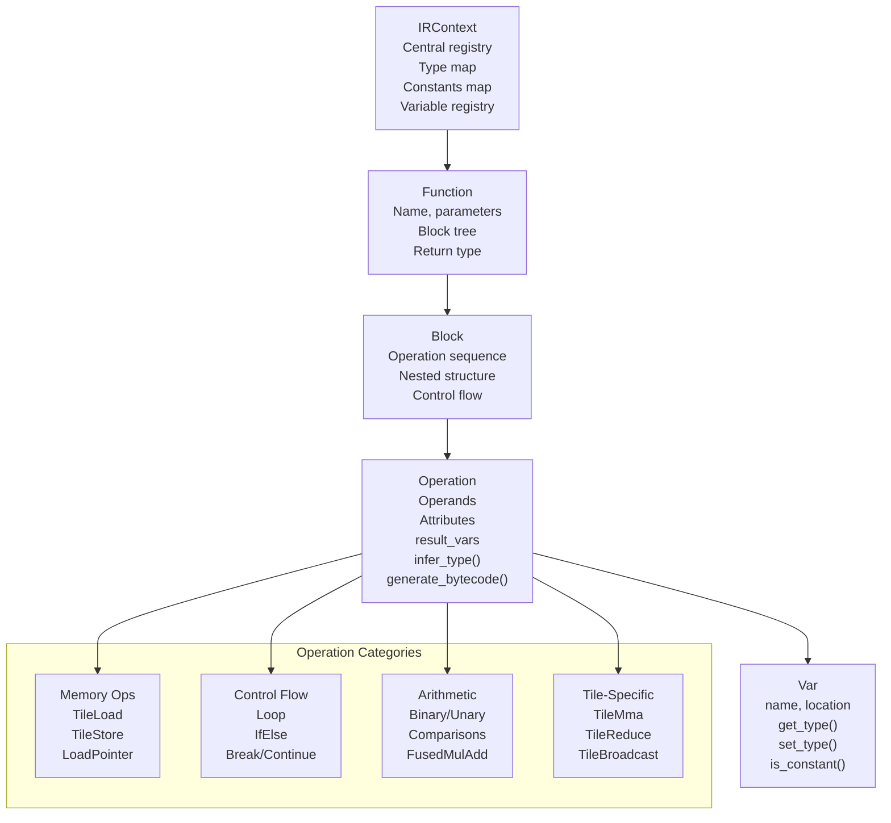

**Sources:** [src/cuda/tile/_ir.py:1-1000](), [src/cuda/tile/_ir_ops.py:1-2000]()

### Type Inference Process

Type inference operates in multiple stages:

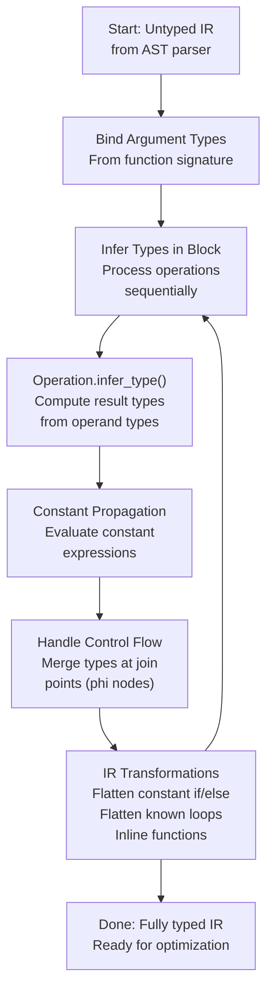

**Key Type Inference Components:**

| Component | Location | Purpose |
|-----------|----------|---------|
| `TypingContext` | [src/cuda/tile/_typeinfer.py]() | Wraps IRContext, tracks phi states |
| `infer_types_in_func` | [src/cuda/tile/_typeinfer.py]() | Main entry point for type inference |
| `Operation.infer_type()` | [src/cuda/tile/_ir_ops.py]() | Per-operation type rules |
| Constant propagation | [src/cuda/tile/_typeinfer.py]() | Evaluates constant expressions |

**Sources:** [src/cuda/tile/_typeinfer.py:1-800](), [src/cuda/tile/_ir_ops.py:1-2000]()

## Execution Model and Hardware Mapping

### Logical to Physical Mapping

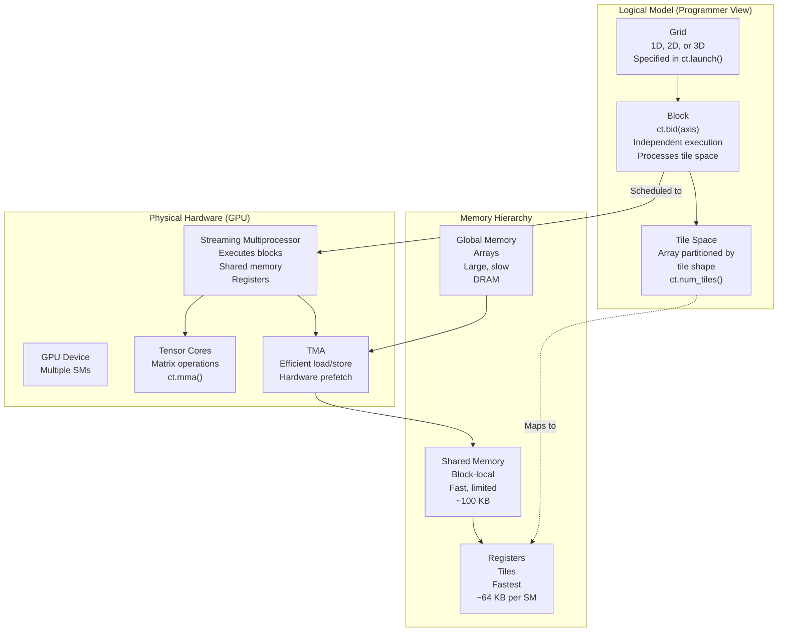

**Execution Characteristics:**

- **Block Parallelism**: Explicit, programmer-controlled via grid dimensions
- **Thread Parallelism**: Implicit, implementation-managed by compiler
- **Synchronization**: No intra-block synchronization primitives exposed
- **Memory Model**: Relaxed consistency, explicit atomic operations available

**Sources:** [docs/source/execution.rst:1-100](), [src/cuda/tile/_execution.py:1-300]()

## Key System Components

### Core API Layer

The main user-facing API is defined in these modules:

| Module | Purpose | Key Exports |
|--------|---------|-------------|
| `_stub.py` | API stubs and type hints | `Array`, `Tile`, all operations |
| `_execution.py` | Kernel decorator and launch | `@kernel`, `launch()` |
| `_array.py` | Array implementation | Array class, DLPack interface |
| `_datatype.py` | Type system | `DType`, type promotion rules |
| `_memory_model.py` | Memory semantics | `MemoryOrder`, `MemoryScope` |

**Sources:** [src/cuda/tile/_stub.py:1-1237](), [src/cuda/tile/_execution.py:1-400](), [src/cuda/tile/_array.py:1-300]()

### Compiler Infrastructure

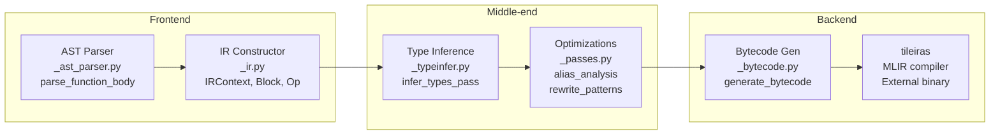

**Sources:** [src/cuda/tile/_ast_parser.py:1-1000](), [src/cuda/tile/_ir.py:1-1000](), [src/cuda/tile/_typeinfer.py:1-800](), [src/cuda/tile/_bytecode.py:1-500]()

### Runtime Execution Layer

The C++ extension provides the runtime infrastructure:

| Component | Purpose | Implementation |
|-----------|---------|----------------|
| `TileDispatcher` | Kernel launching and caching | C++ extension in `cpp_ext/` |
| Argument marshalling | Convert Python objects to GPU pointers | `TileDispatcher::marshal_args()` |
| Kernel cache | Cache compiled kernels by signature | Multi-level: by type, constants, arch |
| Stream management | Manage CUDA streams and events | Per-context stream pools |

**Sources:** [cpp_ext/tile_dispatcher.cpp:1-500](), [cpp_ext/kernel_cache.cpp:1-300]()

## Performance Optimization System

### Multi-Level Optimization Strategy

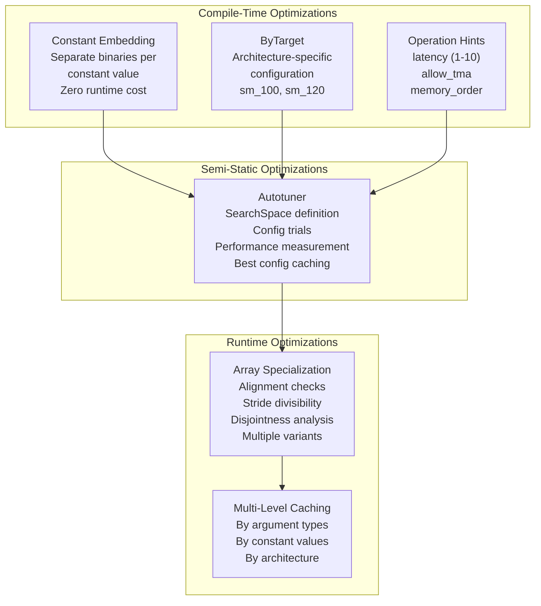

**Optimization Features:**

- **Constant Embedding**: Compile separate kernel variants for different constant parameter values, enabling aggressive optimization
- **Autotuning**: Automatically search configuration space and cache best-performing configurations
- **Architecture Specialization**: Use `ByTarget` to specify different values for different GPU architectures (e.g., sm_100 vs sm_120)
- **Array Specialization**: Generate optimized kernel variants based on array properties like alignment and stride patterns

**Sources:** [src/cuda/tile/_autotuner.py:1-400](), [src/cuda/tile/_by_target.py:1-200](), [cpp_ext/array_specialization.cpp:1-300]()

## Error Handling and Debugging

cuda.tile provides structured error types for different failure modes:

| Exception Type | When Raised | Location |
|---------------|-------------|----------|
| `TileSyntaxError` | Invalid Python syntax in kernel | AST parsing phase |
| `TileTypeError` | Type mismatch or invalid operation | Type inference pass |
| `TileValueError` | Invalid parameter values | Various validation points |
| `TileCompilerExecutionError` | `tileiras` compiler failure | Backend compilation |
| `TileCompilerTimeoutError` | Compiler timeout exceeded | Backend compilation |

**Debugging Environment Variables:**

- `CUDA_TILE_LOGS=CUTILEIR`: Print IR during compilation
- `CUDA_TILE_ENABLE_CRASH_DUMP=1`: Enable crash dump archives
- `CUDA_TILE_DUMP_BYTECODE=1`: Dump TileIR bytecode
- `CUDA_TILE_DUMP_MLIR=1`: Dump MLIR text
- `CUDA_TILE_COMPILER_TIMEOUT_SEC`: Set compiler timeout

**Sources:** [docs/source/debugging.rst:1-41](), [src/cuda/tile/_exceptions.py:1-100]()

## Project Structure

The codebase is organized as follows:

```
cutile-python/
├── src/cuda/tile/          # Main Python package
│   ├── _stub.py            # API stubs and type hints
│   ├── _execution.py       # Kernel decorator, launch
│   ├── _array.py           # Array implementation
│   ├── _ast_parser.py      # Python AST → IR
│   ├── _ir.py              # IR core structures
│   ├── _ir_ops.py          # Operation definitions
│   ├── _typeinfer.py       # Type inference pass
│   ├── _bytecode.py        # Bytecode generation
│   ├── _autotuner.py       # Autotuning system
│   └── _by_target.py       # Architecture config
├── cpp_ext/                # C++ extension
│   ├── tile_dispatcher.cpp # Kernel launching
│   ├── kernel_cache.cpp    # Caching infrastructure
│   └── array_marshal.cpp   # Argument marshalling
├── test/                   # Test suite
│   ├── util.py             # Test utilities
│   ├── test_*.py           # Test cases
│   └── kernels/            # Example kernels
└── docs/                   # Documentation
    └── source/             # Sphinx docs
```

**Sources:** [src/cuda/tile/](), [cpp_ext/](), [test/]()

---

# Page: Quick Start

# Quick Start

<details>
<summary>Relevant source files</summary>

The following files were used as context for generating this wiki page:

- [LICENSE.md](LICENSE.md)
- [README.md](README.md)
- [docs/source/debugging.rst](docs/source/debugging.rst)
- [docs/source/index.rst](docs/source/index.rst)
- [docs/source/release_notes.rst](docs/source/release_notes.rst)
- [test/requirements.txt](test/requirements.txt)
- [test/test_frontpage_example.py](test/test_frontpage_example.py)
- [test/test_readme_example.py](test/test_readme_example.py)

</details>


This page provides a minimal working example to get started with cuTile Python. It covers installation, a complete vector addition kernel, and a step-by-step explanation of the key components. For deeper understanding of the execution model and data abstractions, see [Core Concepts](#2). For detailed API documentation, see [API Reference](#3).

---

## Prerequisites

cuTile Python requires the following components:

| Component | Requirement | Notes |
|-----------|------------|-------|
| **NVIDIA Driver** | r580 or later | Required for Tile IR execution |
| **CUDA Toolkit** | 13.1 or later | Includes `tileiras` compiler |
| **GPU Architecture** | Blackwell | 13.1 release limitation (will be lifted in future versions) |
| **Python** | 3.10 or later | With development headers |
| **Array Library** | CuPy or PyTorch | For GPU array management |

The driver requirement is due to cuTile generating kernels based on Tile IR, which requires recent driver support. See [README.md:58-65]() for the complete list of requirements.

---

## Installation

Install cuTile Python from PyPI:

```bash
pip install cuda-tile
```

Install the CUDA Toolkit 13.1+ separately. On Debian-based systems:

```bash
sudo apt-get install cuda-tileiras-13.1 cuda-compiler-13.1
```

For the examples in this guide, install CuPy:

```bash
pip install cupy-cuda13x
```

Alternatively, PyTorch can be used as the array library. See [test/requirements.txt:14-18]() for the exact versions used in testing.

**Sources:** [README.md:68-78](), [README.md:89](), [test/requirements.txt:14-16]()

---

## Complete Working Example

The following example implements vector addition on the GPU using cuTile:

```python
import cuda.tile as ct
import cupy

TILE_SIZE = 16

# cuTile kernel for adding two dense vectors. It runs in parallel on the GPU.
@ct.kernel
def vector_add_kernel(a, b, result):
    block_id = ct.bid(0)
    a_tile = ct.load(a, index=(block_id,), shape=(TILE_SIZE,))
    b_tile = ct.load(b, index=(block_id,), shape=(TILE_SIZE,))
    result_tile = a_tile + b_tile
    ct.store(result, index=(block_id,), tile=result_tile)

# Host-side function that launches the above kernel.
def vector_add(a: cupy.ndarray, b: cupy.ndarray, result: cupy.ndarray):
    assert a.shape == b.shape == result.shape
    grid = (ct.cdiv(a.shape[0], TILE_SIZE), 1, 1)
    ct.launch(cupy.cuda.get_current_stream(), grid, vector_add_kernel, (a, b, result))


# Test the implementation
import numpy as np

a = cupy.random.uniform(-5, 5, 128)
b = cupy.random.uniform(-5, 5, 128)
result = cupy.zeros_like(a)

vector_add(a, b, result)

a_np = cupy.asnumpy(a)
b_np = cupy.asnumpy(b)
result_np = cupy.asnumpy(result)

expected = a_np + b_np
np.testing.assert_array_almost_equal(result_np, expected)
```

This complete example can be found in [test/test_frontpage_example.py:7-44]() and [README.md:14-56]().

**Sources:** [test/test_frontpage_example.py:7-44](), [README.md:14-56](), [docs/source/index.rst:18-22]()

---

## Understanding the Example

### System Architecture Overview

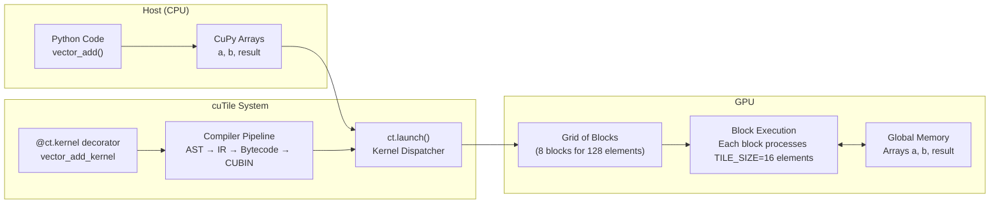

**Sources:** [test/test_frontpage_example.py:14-26](), [docs/source/index.rst:13-16]()

---

### Kernel Function Components

#### The `@ct.kernel` Decorator

```python
@ct.kernel
def vector_add_kernel(a, b, result):
    ...
```

The `@ct.kernel` decorator marks `vector_add_kernel` as a GPU kernel entry point. This function:
- Cannot be called directly from Python
- Must be launched via `ct.launch()`
- Executes in parallel across a grid of blocks

See [Execution Model](#2.2) for details on execution spaces and [docs/source/index.rst:14]().

#### Block Identification

```python
block_id = ct.bid(0)
```

`ct.bid(0)` returns the block index along dimension 0. Each block in the grid has a unique ID that determines which portion of the data it processes. For 128 elements with `TILE_SIZE=16`, blocks 0-7 each process 16 elements.

#### Loading Data into Tiles

```python
a_tile = ct.load(a, index=(block_id,), shape=(TILE_SIZE,))
b_tile = ct.load(b, index=(block_id,), shape=(TILE_SIZE,))
```

`ct.load()` transfers data from a global memory `Array` into a kernel-local `Tile`:
- **`a`**: The source array (CuPy ndarray passed as kernel argument)
- **`index=(block_id,)`**: Starting position in element space (multidimensional index)
- **`shape=(TILE_SIZE,)`**: The tile shape (must be compile-time constant, power-of-2)

The tile dimensions (16 in this case) must be known at compile time and must be powers of two. See [Data Model](#2.1) for the Array/Tile distinction.

#### Tile Operations

```python
result_tile = a_tile + b_tile
```

Tiles support various operations including arithmetic, matrix multiplication, and reductions. Here, element-wise addition is performed entirely in kernel-local storage (registers/shared memory). Tiles are immutable—operations produce new tiles rather than modifying existing ones.

See [API Reference](#3) for all supported tile operations.

#### Storing Results

```python
ct.store(result, index=(block_id,), tile=result_tile)
```

`ct.store()` writes the tile back to global memory:
- **`result`**: The destination array
- **`index=(block_id,)`**: Starting position in element space
- **`tile=result_tile`**: The tile to write

**Sources:** [test/test_frontpage_example.py:14-20](), [docs/source/index.rst:24-39]()

---

### Host-Side Wrapper Function

```python
def vector_add(a: cupy.ndarray, b: cupy.ndarray, result: cupy.ndarray):
    assert a.shape == b.shape == result.shape
    grid = (ct.cdiv(a.shape[0], TILE_SIZE), 1, 1)
    ct.launch(cupy.cuda.get_current_stream(), grid, vector_add_kernel, (a, b, result))
```

This host-side function:
1. **Validates inputs**: Ensures all arrays have the same shape
2. **Calculates grid dimensions**: Uses `ct.cdiv(N, TILE_SIZE)` to compute ceiling division, determining how many blocks are needed
3. **Launches the kernel**: Calls `ct.launch()` with the CUDA stream, grid dimensions, kernel function, and arguments

#### Grid Calculation

For 128 elements with `TILE_SIZE=16`:
```
grid = (ct.cdiv(128, 16), 1, 1) = (8, 1, 1)
```

This creates 8 blocks along dimension 0, each processing 16 elements. The grid is 3-dimensional `(x, y, z)` though only the x-dimension is used here.

**Sources:** [test/test_frontpage_example.py:23-26]()

---

### Data Flow Diagram

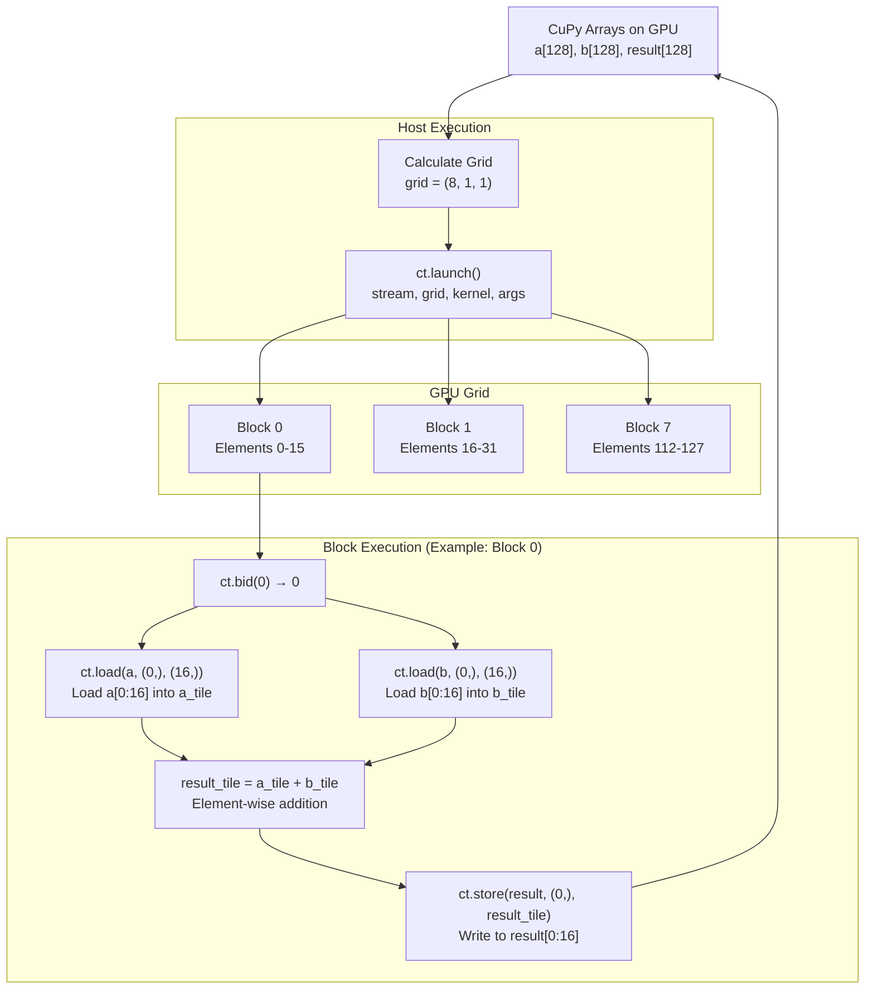

**Sources:** [test/test_frontpage_example.py:14-26]()

---

### Compilation and Execution Flow

```mermaid
flowchart LR
    subgraph "First Launch (Compilation)"
        Source["Python Source<br/>@ct.kernel def vector_add_kernel(...)"]
        AST["Parse AST<br/>Extract function body"]
        IR["Generate IR<br/>IRContext, Operations, Blocks"]
        TypeInfer["Type Inference Pass<br/>Bind argument types<br/>Infer operation types"]
        Bytecode["Generate Bytecode<br/>TileIR bytecode"]
        Tileiras["tileiras Compiler<br/>Bytecode → CUBIN"]
        CachedCubin["Cached CUBIN<br/>Stored in TileLibrary"]
    end
    
    subgraph "Subsequent Launches (Cached)"
        Lookup["Lookup cached CUBIN<br/>by kernel function + arg types"]
        Execute["Launch GPU Kernel<br/>Using cached binary"]
    end
    
    Launch["ct.launch() called"]
    
    Launch --> Source
    Source --> AST
    AST --> IR
    IR --> TypeInfer
    TypeInfer --> Bytecode
    Bytecode --> Tileiras
    Tileiras --> CachedCubin
    
    Launch --> Lookup
    Lookup --> Execute
    CachedCubin -.-> Lookup
```

On the first call to `ct.launch()` for a given kernel and argument types, the compilation pipeline executes. Subsequent calls reuse the cached CUBIN. See [Compilation System](#4) for detailed pipeline documentation.

**Sources:** [docs/source/index.rst:13-16]()

---

## Verification

The test code validates correctness by comparing GPU results with CPU computation:

```python
import numpy as np

# Compute on GPU
vector_add(a, b, result)

# Transfer to CPU
a_np = cupy.asnumpy(a)
b_np = cupy.asnumpy(b)
result_np = cupy.asnumpy(result)

# Verify
expected = a_np + b_np
np.testing.assert_array_almost_equal(result_np, expected)
```

This pattern is used throughout the test suite. See [Testing Infrastructure](#8.1) for utilities like `assert_close()` that simplify validation.

**Sources:** [test/test_frontpage_example.py:30-44]()

---

## Key Concepts Reference

| Concept | Description | Learn More |
|---------|-------------|------------|
| **Array** | Mutable tensor in global GPU memory with strided layout | [Data Model](#2.1) |
| **Tile** | Immutable, kernel-local tensor with power-of-2 dimensions | [Data Model](#2.1) |
| **Block** | Unit of parallel execution; each block has a unique ID | [Execution Model](#2.2) |
| **Grid** | 3D array of blocks that execute the kernel in parallel | [Execution Model](#2.2) |
| **Element Space** | Logical indexing space for arrays (e.g., `index=(block_id,)`) | [Memory Model](#2.4) |
| **Tile Space** | Partitioned indexing where each tile covers a region | [Memory Model](#2.4) |
| **`@ct.kernel`** | Decorator marking a function as a GPU kernel | [docs/source/index.rst:14]() |
| **`ct.load()`** | Transfer data from Array to Tile | [Memory Operations](#3.2) |
| **`ct.store()`** | Transfer data from Tile to Array | [Memory Operations](#3.2) |
| **`ct.launch()`** | Queue kernel for execution on GPU | [docs/source/index.rst:16]() |

**Sources:** [docs/source/index.rst:24-40]()

---

## Next Steps

- **[Core Concepts](#2)**: Understand the data model, execution model, and type system in depth
- **[API Reference](#3)**: Explore all operations available on arrays and tiles
- **[Examples and Patterns](#6)**: Study complete implementations of MatMul, FMHA, and LayerNorm
- **[Performance Optimization](#5)**: Learn about the autotuner and performance tuning strategies
- **[Debugging](#4.4)**: Familiarize yourself with error types and debugging tools

For PyTorch integration and building autograd-compatible kernels, see [PyTorch Integration](#6.4).

**Sources:** [docs/source/index.rst:41-56]()

---

# Page: Core Concepts

# Core Concepts

<details>
<summary>Relevant source files</summary>

The following files were used as context for generating this wiki page:

- [docs/source/debugging.rst](docs/source/debugging.rst)
- [docs/source/index.rst](docs/source/index.rst)
- [docs/source/release_notes.rst](docs/source/release_notes.rst)
- [src/cuda/tile/_stub.py](src/cuda/tile/_stub.py)

</details>


## Overview

`cuda.tile` is built on four fundamental abstractions that work together to enable efficient GPU programming. This page provides a high-level introduction to these concepts. For detailed information, see the child pages:

- **[Data Model (2.1)](#2.1)** - `Array` and `Tile` classes, `DType` system, element space vs tile space
- **[Execution Model (2.2)](#2.2)** - `@ct.kernel` decorator, `ct.launch()`, grid/block hierarchy, execution spaces
- **[Type System (2.3)](#2.3)** - Loosely-typed vs strictly-typed constants, type promotion, type inference
- **[Memory Model (2.4)](#2.4)** - Memory hierarchy, data movement operations, synchronization primitives

## The Four Core Abstractions
</thinking>

The `cuda.tile` programming model consists of four interconnected systems:

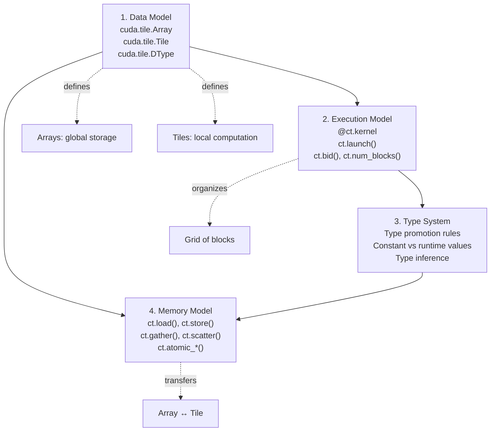

**Sources:** [src/cuda/tile/_stub.py:1-2147](), [docs/source/index.rst:1-57]()

## Fundamental Abstractions

`cuda.tile` is built on four core abstractions that work together to enable efficient GPU programming:

### 1. Data Model: Arrays and Tiles

#### Dual Data Representation

`cuda.tile` separates **storage** from **computation** through two distinct classes:

| Class | Storage | Mutability | Dimensions | Accessibility | Purpose |
|-------|---------|-----------|------------|---------------|---------|
| `cuda.tile.Array` | Global GPU memory | Mutable | Arbitrary shape/stride | Host + tile code | Data storage and transfer |
| `cuda.tile.Tile` | Registers/shared mem | Immutable | Power-of-2 only | Tile code only | Computation |

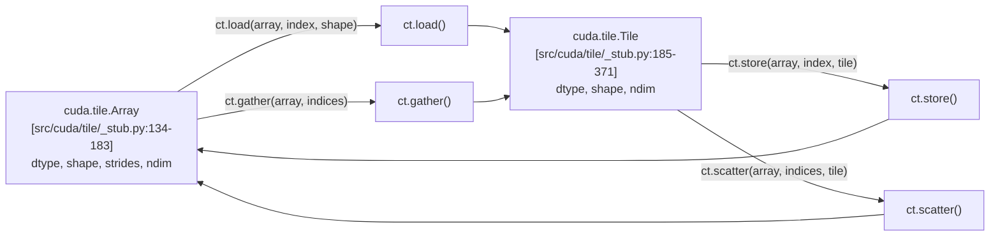

**Sources:** [src/cuda/tile/_stub.py:134-183](), [src/cuda/tile/_stub.py:185-371](), [src/cuda/tile/_stub.py:472-668]()

- **`cuda.tile.Array`** provides properties `dtype`, `shape`, `strides`, `ndim`. Arrays interoperate with PyTorch tensors and CuPy arrays via DLPack.
- **`cuda.tile.Tile`** provides properties `dtype`, `shape`, `ndim` and methods for shape manipulation (`reshape`, `permute`, `transpose`, `astype`).

Data transfer operations bridge these representations:
- `ct.load(array, index, shape)` - Loads a tile from array at tile-space index
- `ct.store(array, index, tile)` - Stores a tile to array at tile-space index  
- `ct.gather(array, indices)` - Irregular reads via index tiles
- `ct.scatter(array, indices, value)` - Irregular writes via index tiles

See [Data Model (2.1)](#2.1) for element space vs tile space, `DType` system, and detailed semantics.

### 2. Execution Model: Blocks and Grids

#### Block-Parallel Execution

Kernels execute as a **grid** of **blocks**. The programmer specifies block-level parallelism; thread-level parallelism is implicit.

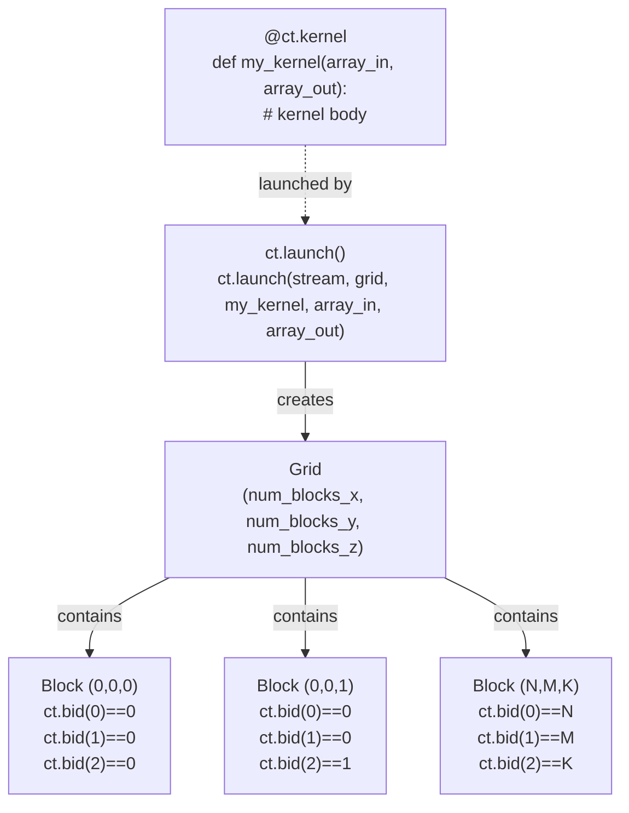

**Sources:** [src/cuda/tile/_stub.py:408-441](), [docs/source/execution.rst:8-36]()

Key execution primitives:
- `@ct.kernel` - Decorator marking a function as a kernel entry point
- `ct.launch(stream, grid, kernel, *args)` - Launches kernel on GPU with specified grid dimensions
- `ct.bid(axis)` - Returns current block's index along axis (0, 1, or 2) [src/cuda/tile/_stub.py:408-423]()
- `ct.num_blocks(axis)` - Returns total number of blocks along axis [src/cuda/tile/_stub.py:426-441]()

Each block executes the kernel body independently. Blocks cannot communicate except through global memory. The compiler manages threads within each block automatically.

See [Execution Model (2.2)](#2.2) for execution spaces, Python subset restrictions, and detailed semantics.

### 3. Type System: Constants and Promotion

#### Data Types and Type Inference

The type system centers on `cuda.tile.DType` and automatic type inference:

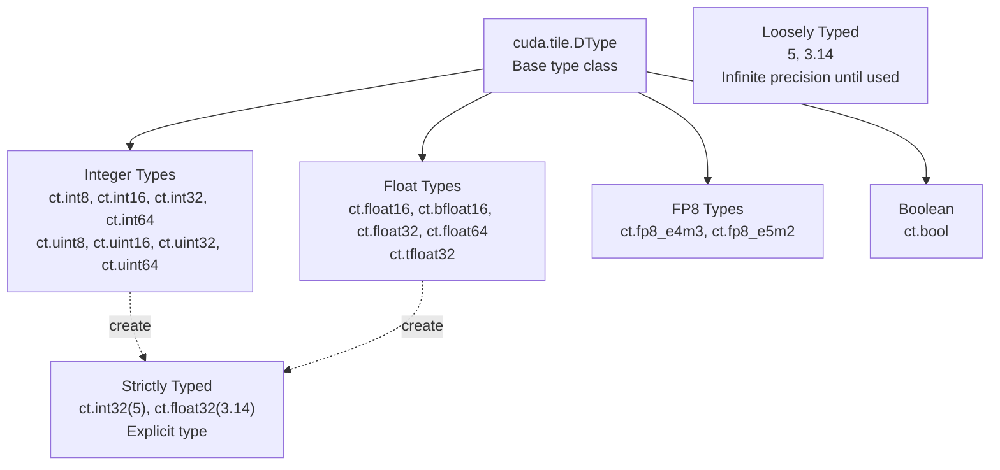

**Sources:** [src/cuda/tile/_datatype.py](), [src/cuda/tile/_stub.py:134-225](), [docs/source/execution.rst:144-156]()

Key concepts:
- **Loosely typed constants**: Literals like `5` or `3.14` have unspecified type until used in a typed context
- **Strictly typed constants**: Created via `ct.int32(5)` or `ct.float32(3.14)`, have explicit types
- **Type promotion**: When types differ, operands promote to a common type following specific rules
- **Type inference**: The compilation system infers types throughout the IR automatically

Example type promotion:
```python
# Loosely typed: 5 has no specific integer width yet
tile = ct.full((4, 4), 5, dtype=ct.int32)  # 5 promotes to int32

# Strictly typed: explicit type from construction
x = ct.int16(5)
y = ct.int32(7)
z = x + y  # Result is int32 (wider type)
```

See [Type System (2.3)](#2.3) for complete promotion rules, constant embedding with `Constant[T]` annotation, and type inference details.

### 4. Memory Model: Data Movement and Synchronization

#### Memory Operations

Data moves between global memory (`Array`) and local computation (`Tile`) through explicit operations:

| Operation | Direction | Pattern | Function |
|-----------|-----------|---------|----------|
| **Load** | Array → Tile | Contiguous block | `ct.load(array, index, shape)` |
| **Store** | Tile → Array | Contiguous block | `ct.store(array, index, tile)` |
| **Gather** | Array → Tile | Irregular indices | `ct.gather(array, indices)` |
| **Scatter** | Tile → Array | Irregular indices | `ct.scatter(array, indices, value)` |
| **Atomic** | Tile ↔ Array | Concurrent access | `ct.atomic_add`, `ct.atomic_cas`, etc. |

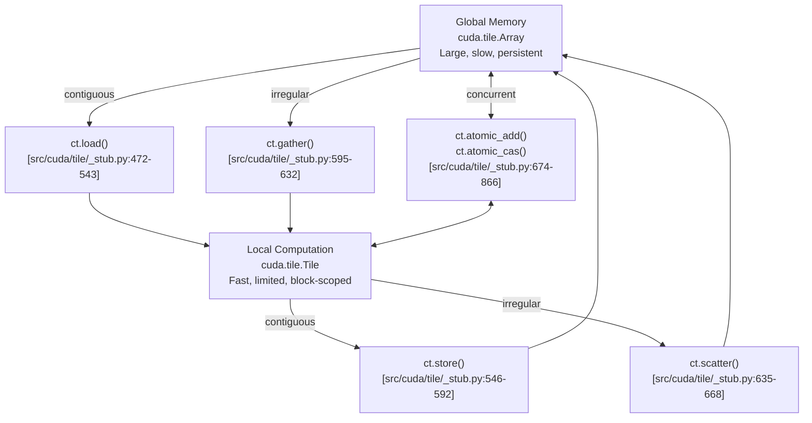

**Sources:** [src/cuda/tile/_stub.py:472-866]()

Atomic operations support memory ordering and scope parameters:
- `memory_order`: `RELAXED`, `ACQUIRE`, `RELEASE`, `ACQ_REL` [src/cuda/tile/_memory_model.py]()
- `memory_scope`: `BLOCK`, `DEVICE`, `SYSTEM` [src/cuda/tile/_memory_model.py]()

See [Memory Model (2.4)](#2.4) for memory hierarchy, padding modes, synchronization semantics, and detailed operation specifications.

## Typical Kernel Pattern

Most `cuda.tile` kernels follow this structure:

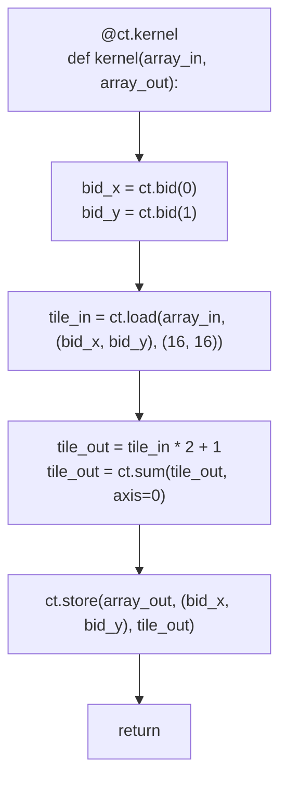

**Sources:** [docs/source/index.rst:18-22](), [docs/source/execution.rst:8-36]()

Each block:
1. Identifies its position in the grid using `ct.bid(axis)`
2. Loads tiles from global arrays using `ct.load()`
3. Performs computations on tiles (arithmetic, `ct.mma`, reductions)
4. Stores results using `ct.store()`

## Code Entity Reference

### Primary Classes and Decorators

| Entity | Location | Purpose |
|--------|----------|---------|
| `cuda.tile.Array` | [src/cuda/tile/_stub.py:134-183]() | Global memory container with `dtype`, `shape`, `strides`, `ndim` |
| `cuda.tile.Tile` | [src/cuda/tile/_stub.py:185-371]() | Immutable block-local computation with `dtype`, `shape`, `ndim` |
| `cuda.tile.DType` | [src/cuda/tile/_datatype.py]() | Type system base class |
| `@ct.kernel` | [src/cuda/tile/_execution.py]() | Marks function as kernel entry point |
| `ct.launch()` | [src/cuda/tile/_execution.py]() | Launches kernel on GPU with grid specification |

### Core Operations

| Category | Functions | Location |
|----------|-----------|----------|
| **Data Movement** | `ct.load()`, `ct.store()`, `ct.gather()`, `ct.scatter()` | [src/cuda/tile/_stub.py:472-668]() |
| **Block Info** | `ct.bid()`, `ct.num_blocks()`, `ct.num_tiles()` | [src/cuda/tile/_stub.py:408-469]() |
| **Atomics** | `ct.atomic_add()`, `ct.atomic_cas()`, `ct.atomic_xchg()` | [src/cuda/tile/_stub.py:674-866]() |
| **Factory** | `ct.full()`, `ct.zeros()`, `ct.ones()`, `ct.arange()` | [src/cuda/tile/_stub.py:872-938]() |
| **Matrix** | `ct.mma()`, `ct.matmul()` | [src/cuda/tile/_stub.py:943-1020]() |
| **Shape** | `ct.reshape()`, `ct.permute()`, `ct.transpose()`, `ct.cat()` | [src/cuda/tile/_stub.py:1022-1178]() |
| **Type Conversion** | `ct.astype()`, `ct.bitcast()` | [src/cuda/tile/_stub.py:1181-1218]() |
| **Arithmetic** | `ct.add()`, `ct.mul()`, `ct.div()`, `ct.pow()` | [src/cuda/tile/_stub.py:1422-1516]() |
| **Reduction** | `ct.sum()`, `ct.max()`, `ct.min()`, `ct.argmax()` | [src/cuda/tile/_stub.py:1275-1310]() |
| **Comparison** | `ct.equal()`, `ct.greater()`, `ct.less()` | [src/cuda/tile/_stub.py:1555-1646]() |

**Sources:** [src/cuda/tile/_stub.py:1-2147]()

## Immutability and Constraints

### Object Mutability

| Object Type | Mutability in Tile Code | Creation Context |
|------------|-------------------------|------------------|
| `Array` | Mutable (writeable via `ct.store`, atomics) | Host code only |
| `Tile` | Immutable (all operations return new tiles) | Tile code |
| Scalar | Immutable | Any context |
| Tuple | Immutable | Any context |

**Sources:** [docs/source/execution.rst:90-104]()

Operations like `tile.reshape(new_shape)` create and return new `Tile` objects rather than modifying in place. This immutability enables aggressive compiler optimizations.

### Shape Constraints

| Constraint | Array | Tile |
|-----------|-------|------|
| **Dimensions** | Arbitrary positive integers | Must be powers of 2 |
| **Rank** | Any non-negative integer | Any non-negative integer |
| **Layout** | Arbitrary strides | Implicit (implementation-managed) |

**Sources:** [src/cuda/tile/_stub.py:134-225]()

Tile shape constraints enable efficient hardware utilization. Use `ct.load()` with appropriate `shape` parameter to load power-of-2 sized tiles from arbitrarily shaped arrays.

## Execution Spaces Overview

Three distinct execution contexts determine what code can run where:

| Space | Decorator | Runtime | Thread Model | Typical Use |
|-------|-----------|---------|--------------|-------------|
| **Host** | None | CPython | Single-threaded Python | Array creation, kernel launch, post-processing |
| **Tile** | `@ct.kernel` | GPU (no Python runtime) | Block-parallel (implicit threads) | Main computation kernels |
| **SIMT** | `@ct.function(target='simt')` | GPU (no Python runtime) | Thread-parallel | Advanced use cases only |

**Sources:** [docs/source/execution.rst:42-90]()

Most programming uses **host** space for orchestration and **tile** space for computation. Arrays exist in both spaces; Tiles exist only in tile space.

## Summary

The `cuda.tile` programming model centers on four key concepts:

1. **Dual Data Model**: Arrays for storage, Tiles for computation
2. **Block-Parallel Execution**: Explicit block parallelism, implicit thread parallelism
3. **Execution Spaces**: Host code for orchestration, tile code for computation
4. **Immutable Computation**: All tile objects are immutable, enabling optimization

This design provides high-level abstractions that map efficiently to GPU hardware while maintaining programmer control over block-level parallelism. The following sections provide detailed documentation on each aspect of this model.

---

# Page: Data Model

# Data Model

<details>
<summary>Relevant source files</summary>

The following files were used as context for generating this wiki page:

- [docs/source/data.rst](docs/source/data.rst)
- [src/cuda/tile/_stub.py](src/cuda/tile/_stub.py)

</details>


## Purpose and Scope

This page describes the fundamental data structures and type system in cuda.tile. It covers:

- **Arrays** and **Tiles**: The two primary data structures for storing multidimensional data
- **DTypes**: The type system for representing numeric data
- **Scalars**: Single-value data and their typing rules
- **Element Space and Tile Space**: The dual indexing model for array partitioning
- **Type Promotion and Broadcasting**: Rules for combining values of different types and shapes

For information about how these data structures are used during kernel execution, see [Execution Model](#2.2). For details on memory ordering and atomic operations, see [Memory Model](#2.4). For the complete API reference of operations on these data structures, see [API Reference](#3).

**Sources:** [docs/source/data.rst:1-173](), [src/cuda/tile/_stub.py:1-1901]()

---

## Overview: Dual Data Model

cuda.tile uses a dual data model that separates **storage** from **computation**:

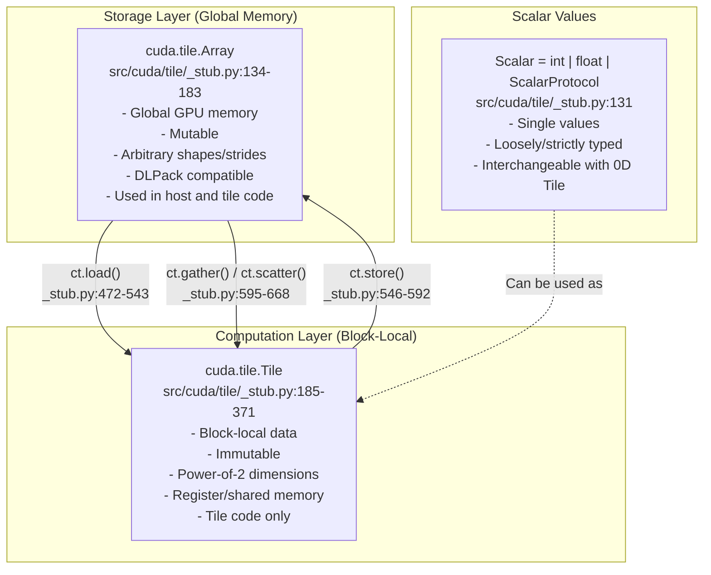

**Sources:** [src/cuda/tile/_stub.py:134-371](), Diagram 2 from high-level architecture

---

## Arrays

### Definition

An **Array** (also called a **global array**) is a container of objects stored in a logical multidimensional space in GPU global memory.

**Sources:** [src/cuda/tile/_stub.py:134-146]()

### Key Properties

| Property | Type | Description |
|----------|------|-------------|
| `dtype` | `DType` (constant) | The data type of the array's elements |
| `shape` | `tuple[int, ...]` | Number of elements in each dimension |
| `strides` | `tuple[int, ...]` | Number of elements to step in each dimension |
| `ndim` | `int` (constant) | Number of dimensions |

**Sources:** [src/cuda/tile/_stub.py:148-182]()

### Characteristics

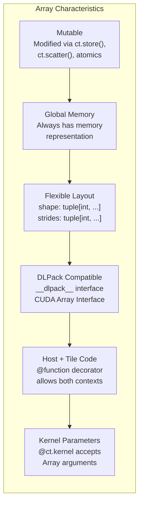

- **Mutable**: Array contents can be modified via `ct.store()`, `ct.scatter()`, or atomic operations
- **Stored in memory**: Always have a memory representation in GPU global memory
- **Arbitrary shapes**: No power-of-2 constraints on dimensions
- **DLPack compatible**: Any object implementing DLPack or CUDA Array Interface can be used as an Array
- **Cross-space usage**: Can be accessed from both host code (CPU) and tile code (GPU kernels)
- **Kernel parameters**: Can be passed as arguments to `@ct.kernel` decorated functions

**Sources:** [src/cuda/tile/_stub.py:134-183](), [docs/source/data.rst:23-37]()

### Array in Code

```python
# Arrays can be created from PyTorch tensors, CuPy arrays, etc.
import torch
import cuda.tile as ct

# Create array from PyTorch tensor
array = torch.zeros((128, 256), dtype=torch.float32, device='cuda')

# Access array properties in tile code
@ct.kernel
def example_kernel(arr: ct.Array):
    dtype = arr.dtype      # DType (constant)
    shape = arr.shape      # tuple[int32, int32]
    strides = arr.strides  # tuple[int32, int32]
    ndim = arr.ndim        # int (constant = 2)
```

**Sources:** [src/cuda/tile/_stub.py:134-183]()

---

## Tiles

### Definition

A **Tile** (also called a **tile array**) is an immutable multidimensional collection of values that is local to a block. Tiles represent the fundamental unit of computation in cuda.tile.

**Sources:** [src/cuda/tile/_stub.py:185-197]()

### Key Properties

| Property | Type | Description |
|----------|------|-------------|
| `dtype` | `DType` (constant) | The data type of the tile's elements |
| `shape` | `tuple[const int, ...]` | Number of elements in each dimension (compile-time constant) |
| `ndim` | `int` (constant) | Number of dimensions (compile-time constant) |

**Sources:** [src/cuda/tile/_stub.py:199-224]()

### Characteristics

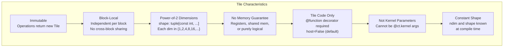

- **Immutable**: Once created, tile contents cannot be changed; operations produce new tiles
- **Block-local**: Each block has its own independent copy of tile data
- **Power-of-2 constraint**: Each dimension must be a power of 2 (1, 2, 4, 8, 16, ...)
- **No memory guarantee**: Tiles may reside in registers, shared memory, or be purely logical
- **Tile code only**: Cannot be used in host code or passed as kernel parameters
- **Constant shape**: Shape and ndim must be known at compile time

**Sources:** [src/cuda/tile/_stub.py:185-224](), [docs/source/data.rst:39-53]()

### Tile Creation Methods

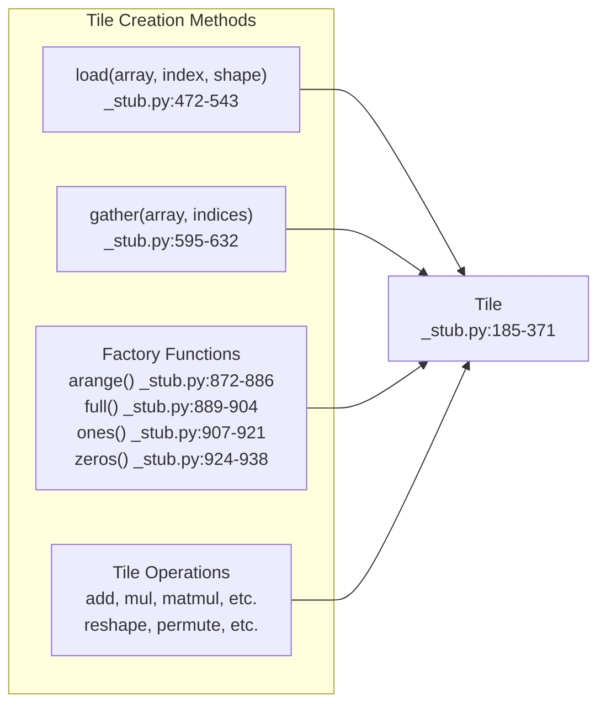

**Sources:** [src/cuda/tile/_stub.py:472-543, 872-938]()

### Tile Methods

The `Tile` class provides several methods for manipulation:

| Method | Description | Reference |
|--------|-------------|-----------|
| `item()` | Extract scalar from single-element tile | [src/cuda/tile/_stub.py:226-239]() |
| `extract(index, shape)` | Extract smaller tile from larger tile | [src/cuda/tile/_stub.py:241-243]() |
| `reshape(shape)` | Change tile shape | [src/cuda/tile/_stub.py:245-247]() |
| `permute(axes)` | Permute tile axes | [src/cuda/tile/_stub.py:249-251]() |
| `transpose(axis0, axis1)` | Transpose two axes | [src/cuda/tile/_stub.py:253-255]() |
| `astype(dtype)` | Convert tile data type | [src/cuda/tile/_stub.py:257-259]() |

**Sources:** [src/cuda/tile/_stub.py:226-259]()

---

## Scalars

### Definition

A **Scalar** is a single immutable value of a specific data type. Scalars bridge between Python values and GPU computation.

**Sources:** [src/cuda/tile/_stub.py:131](), [docs/source/data.rst:139-152]()

### Scalar Types and Equivalence

```mermaid
graph TB
    subgraph ScalarTypes["Scalar Types"]
        PythonScalar["Python Scalars<br/>int, float, bool<br/>(literal values)"]
        TypedScalar["Strictly Typed Scalars<br/>Explicit DType<br/>(from operations)"]
        LooseScalar["Loosely Typed Constants<br/>LooselyTypedScalar in IR<br/>Infinite precision ints<br/>Double precision floats"]
        ZeroDTile["0D Tile<br/>shape = ()<br/>ndim = 0<br/>Tile.item() method"]
    end
    
    PythonScalar -->|"Default behavior"| LooseScalar
    LooseScalar <-.->|"Interchangeable in tile code"| ZeroDTile
    TypedScalar <-.->|"Interchangeable in tile code"| ZeroDTile
```

A scalar and a 0D tile can be used interchangeably in tile code. Both can also be kernel parameters.

**Sources:** [src/cuda/tile/_stub.py:21-131, 227-239](), [docs/source/data.rst:139-152]()

### Scalar Typing Rules

| Scalar Source | Typing Behavior |
|---------------|-----------------|
| Literal values (e.g., `2`, `3.14`) | Loosely typed by default |
| Constant properties (e.g., `Tile.ndim`, `Tile.shape[0]`) | Loosely typed |
| `Array.shape`, `Array.strides` | Strictly typed as `int32` (runtime values) |
| 0D Tile from operations | Strictly typed with operation's output dtype |

**Important:** `Array.shape` and `Array.strides` default to `int32` for performance. This limits the maximum representable dimension size but makes kernels more efficient.

**Sources:** [docs/source/data.rst:145-151]()

### Loosely Typed Constants

**Loosely typed numeric constants** have special properties:

- **Integral constants**: Infinite precision until used in typed context
- **Floating-point constants**: Double precision until used in typed context
- **Constant expressions**: Results of operations on loosely typed constants remain loosely typed

Example:
```python
# Loosely typed constants
x = 5 + 7        # Loosely typed int: 12
y = 5 + 3.0      # Loosely typed float: 8.0

# Used in typed context
tile = ct.full((4,), x, dtype=ct.float32)  # x promoted to float32
```

**Sources:** [docs/source/data.rst:115-118]()

---

## Data Types (DType)

### DType Hierarchy

```mermaid
graph TB
    DType["cuda.tile.DType<br/>src/cuda/tile/_datatype.py<br/>Base type for all data types"]
    
    DType --> Numeric["Numeric Types<br/>Represent numbers<br/>Used in math operations"]
    DType --> NonNumeric["Non-Numeric Types<br/>bool (boolean)<br/>TupleTy (tuples)"]
    
    Numeric --> Arithmetic["Arithmetic Types<br/>Support +, -, *, /<br/>General math operations"]
    Numeric --> NonArithmetic["Non-Arithmetic Numeric<br/>Limited operations<br/>Mainly for MMA inputs"]
    
    Arithmetic --> Float["Floating-Point<br/>float16 (f16)<br/>bfloat16 (bf16)<br/>float32 (f32)<br/>float64 (f64)<br/>tfloat32 (tf32)"]
    Arithmetic --> Int["Integer<br/>Signed: int8, int16, int32, int64<br/>Unsigned: uint8, uint16, uint32, uint64"]
    
    NonArithmetic --> FP8["FP8 Types<br/>f8e4m3fn<br/>f8e5m2<br/>(for MMA ops)"]
```

**Sources:** [docs/source/data.rst:96-108]()

### Available Data Types

| Category | Types |
|----------|-------|
| **Floating-Point** | `float16`, `bfloat16`, `float32`, `float64`, `tfloat32` |
| **Integer** | `int8`, `int16`, `int32`, `int64`, `uint8`, `uint16`, `uint32`, `uint64` |
| **FP8** | `f8e4m3fn`, `f8e5m2` |
| **Boolean** | `bool` |

**Sources:** [src/cuda/tile/_datatype.py]() (referenced in [src/cuda/tile/_stub.py:13]())

### Type Promotion Rules

When binary operations combine operands of different types, cuda.tile follows these promotion rules:

```mermaid
graph TB
    subgraph Categories["Type Categories (Ordered)"]
        Bool["Boolean Category<br/>bool<br/>(lowest priority)"]
        Integral["Integral Category<br/>int8, int16, int32, int64<br/>uint8, uint16, uint32, uint64<br/>(medium priority)"]
        Float["Floating-Point Category<br/>float16, bfloat16<br/>float32, float64, tfloat32<br/>(highest priority)"]
    end
    
    Bool -->|"Promoted to"| Integral
    Integral -->|"Promoted to"| Float
    
    subgraph Process["Promotion Algorithm"]
        Step1["1. Classify operands<br/>_ir/ops.py implements<br/>type inference logic"]
        Step2["2. Handle LooselyTypedScalar<br/>int literals → int32/int64/uint64<br/>float literals → float32"]
        Step3["3. Select higher category<br/>If categories differ,<br/>use higher category's dtype"]
        Step4["4. Same-category promotion<br/>Apply dtype-specific rules<br/>from promotion table"]
    end
    
    Step1 --> Step2
    Step2 --> Step3
    Step3 --> Step4
```

**Promotion Algorithm:**

1. **Classify operands**: Each operand is classified as boolean, integral, or floating-point
2. **Handle loosely typed constants**: 
   - Integral constants → `int32`, `int64`, or `uint64` (depending on value)
   - Floating-point constants → `float32`
3. **Category comparison**: If categories differ, choose the higher category's dtype
4. **Same category**: Apply dtype-specific promotion table (see documentation)

**Sources:** [docs/source/data.rst:110-137]()

### Type Promotion Examples

```python
# Category-based promotion
bool_tile + int_tile    # → int (integral > boolean)
int_tile + float_tile   # → float (floating-point > integral)

# Loosely typed constant promotion
tile_f32 + 5           # 5 treated as int32, promoted to float32
tile_f32 + 5.0         # 5.0 treated as float32

# Loosely typed expression
x = 5 + 7              # Loosely typed int
y = tile_f32 + x       # x promoted to float32
```

**Sources:** [docs/source/data.rst:115-133]()

---

## Element Space and Tile Space

cuda.tile uses a dual indexing model that separates the logical organization of array elements from the logical organization of tiles.

### Definitions

```mermaid
graph TB
    subgraph Spaces["Two Indexing Spaces"]
        direction TB
        ElementSpace["Element Space<br/>Physical memory layout<br/>array.shape = (M, N)<br/>array.strides = (stride0, stride1)<br/>Element index: (i, j) where 0≤i<M, 0≤j<N<br/>Memory offset: i*stride0 + j*stride1"]
        
        TileSpace["Tile Space<br/>Logical tile partitioning<br/>Tile shape: (H, W) (power-of-2)<br/>Tile space dims: (⌈M/H⌉, ⌈N/W⌉)<br/>Tile index: (ti, tj)<br/>Maps to elements: [ti*H:(ti+1)*H, tj*W:(tj+1)*W]"]
    end
    
    Array["cuda.tile.Array<br/>shape, strides, dtype"]
    Array --> ElementSpace
    Array --> TileSpace
    
    ElementSpace -->|"Direct memory access<br/>via pointer arithmetic"| Elements["Individual Elements<br/>scalar values"]
    TileSpace -->|"ct.load(array, index, shape)<br/>ct.store(array, index, tile)"| Tiles["cuda.tile.Tile objects<br/>Block-local data"]
```

**Sources:** [docs/source/data.rst:55-79]()

### Tile Space Partitioning

The **tile space** is created by partitioning an array using a fixed tile shape:

```mermaid
graph LR
    subgraph Partitioning["Array Partitioning Logic"]
        ArrayShape["array.shape<br/>(M, N)<br/>Runtime values"]
        TileShape["tile shape argument<br/>(H, W)<br/>Compile-time constants<br/>Must be power-of-2"]
        TileSpaceSize["Tile Space Size<br/>cdiv(M, H) × cdiv(N, W)<br/>Computed as (M-1)//H + 1"]
    end
    
    ArrayShape --> TileSpaceSize
    TileShape --> TileSpaceSize
    
    TileSpaceSize --> Mapping["Tile Index Mapping<br/>load(array, (ti, tj), (H, W))<br/>Accesses elements:<br/>array[ti*H:(ti+1)*H, tj*W:(tj+1)*W]"]
```

**Tile Space Size:** For an array of shape `(M, N)` and tile shape `(H, W)`, the tile space has size `(⌈M/H⌉, ⌈N/W⌉)` where ⌈⌉ denotes ceiling division.

**Index Mapping:** A tile index `(ti, tj)` refers to elements with indices in the range:
- Row: `ti * H` to `(ti + 1) * H - 1`
- Column: `tj * W` to `(tj + 1) * W - 1`

**Sources:** [docs/source/data.rst:70-79](), [src/cuda/tile/_stub.py:480-543]()

### Element Space vs Tile Space Example

Consider a 2D array of shape `(12, 16)`:

**With tile shape (4, 4):**
- Element space: 12 × 16 = 192 elements at indices `[0:12, 0:16]`
- Tile space: 3 × 4 = 12 tiles at indices `[0:3, 0:4]`
- Tile `(1, 2)` contains elements `[4:8, 8:12]`

**With tile shape (2, 8):**
- Element space: Still 12 × 16 = 192 elements
- Tile space: 6 × 2 = 12 tiles at indices `[0:6, 0:2]`
- Tile `(2, 1)` contains elements `[4:6, 8:16]`

**Sources:** [docs/source/data.rst:58-68]()

### Tile Space Operations

```mermaid
graph LR
    subgraph TileSpaceOps["Tile Space Operations"]
        Load["load(array, index, shape, order, padding_mode)<br/>_stub.py:472-543<br/>Returns: Tile<br/>Element space → Block-local tile"]
        Store["store(array, index, tile, order)<br/>_stub.py:546-592<br/>Returns: None<br/>Block-local tile → Element space"]
        NumTiles["num_tiles(array, axis, shape, order)<br/>_stub.py:444-469<br/>Returns: int32<br/>Query tile space dimensions"]
    end
    
    Array["cuda.tile.Array<br/>Global memory"] -->|"Read operation"| Load
    Load --> Tile["cuda.tile.Tile<br/>Block-local"]
    Tile -->|"Write operation"| Store
    Store --> Array
    Array -.->|"Query operation"| NumTiles
    NumTiles -.-> Result["int32 value<br/>cdiv(array.shape[axis], shape[axis])"]
```

**Key Operations:**

- **`ct.load(array, index, shape)`**: Loads a tile from the array's tile space
  - `index`: Tile coordinates in tile space
  - `shape`: Tile dimensions defining the partitioning
  - Returns: Tile containing elements from the specified tile region

- **`ct.store(array, index, tile)`**: Stores a tile to the array's tile space
  - `index`: Tile coordinates in tile space
  - `tile`: Tile to store (shape defines partitioning)

- **`ct.num_tiles(array, axis, shape)`**: Returns the number of tiles along an axis
  - Computed as `⌈array.shape[axis] / shape[axis]⌉`

**Sources:** [src/cuda/tile/_stub.py:444-592]()

### Memory Layout and Order Parameter

The `order` parameter in `ct.load()` and `ct.store()` controls how tile axes map to array axes:

```mermaid
graph TB
    subgraph OrderModes["Order Parameter Values"]
        OrderC["order='C'<br/>Literal string 'C'<br/>Row-major layout<br/>Axes: (0, 1, 2, ...)<br/>No permutation applied"]
        OrderF["order='F'<br/>Literal string 'F'<br/>Column-major layout<br/>Axes: (..., 2, 1, 0)<br/>Reverses all axes"]
        OrderCustom["order=(axis0, axis1, ...)<br/>tuple[const int, ...]<br/>Custom axis permutation<br/>Example: (0, 2, 1)<br/>Swaps last two dimensions"]
    end
    
    subgraph Semantics["Order Semantics"]
        TileAxis["Tile Axis i"]
        ArrayAxis["Array Axis order[i]"]
        Mapping["Element mapping:<br/>tile[coords_in_tile_space] =<br/>array[coords_permuted_by_order]"]
    end
    
    OrderC --> Mapping
    OrderF --> Mapping
    OrderCustom --> Mapping
    TileAxis --> Mapping
    ArrayAxis --> Mapping
```

**Example:**
```python
# Load with transpose
tile = ct.load(array, (i, j), shape=(4, 8), order='F')
# Equivalent to: tile[y, x] = array[i*4 + x, j*8 + y]

# Load with custom permutation (swap last two axes)
tile = ct.load(array3d, (i, j, k), shape=(8, 4, 2), order=(0, 2, 1))
```

**Sources:** [src/cuda/tile/_stub.py:497-542]()

---

## Shape Broadcasting

Shape broadcasting allows tiles of different shapes to be combined in arithmetic operations without explicit reshaping.

### Broadcasting Rules

```mermaid
graph TB
    subgraph Rules["NumPy Broadcasting Rules"]
        Rule1["1. Align by trailing dimensions<br/>Compare shapes right-to-left<br/>Example: (4,8) vs (8,)<br/>Becomes: (4,8) vs (1,8)"]
        Rule2["2. Dimension compatibility<br/>For each dimension pair:<br/>- Sizes equal, OR<br/>- One size is 1<br/>Otherwise: error"]
        Rule3["3. Shape padding<br/>Shorter shape padded left with 1<br/>Example: (8,) → (1,8)<br/>Before comparing with (4,8)"]
        Rule4["4. Result shape<br/>Max size in each dimension<br/>Example: (4,1,8) + (1,4,8)<br/>Result: (4,4,8)"]
    end
    
    Rule1 --> Rule2
    Rule2 --> Rule3
    Rule3 --> Rule4
    
    subgraph Implementation["Implementation"]
        IRBroadcast["Broadcast logic in<br/>_ir/ops.py<br/>Operation.infer_type()<br/>methods"]
    end
    
    Rule4 --> IRBroadcast
```

**Broadcasting follows NumPy semantics:**

1. **Alignment**: Shapes are aligned by their trailing (rightmost) dimensions
2. **Compatibility**: For each dimension pair:
   - Sizes are equal, OR
   - One size is 1
3. **Padding**: If one shape has fewer dimensions, pad with 1s on the left

**Sources:** [docs/source/data.rst:81-93]()

### Broadcasting Examples

```python
# Basic broadcasting
tile_4x8 = ct.full((4, 8), 1.0, dtype=ct.float32)
tile_8 = ct.full((8,), 2.0, dtype=ct.float32)
result = tile_4x8 + tile_8  # Shape: (4, 8)
# Broadcasting: (4, 8) + (1, 8) → (4, 8)

# Multi-dimensional broadcasting
tile_4x1x8 = ct.full((4, 1, 8), 1.0, dtype=ct.float32)
tile_4x8 = ct.full((4, 8), 2.0, dtype=ct.float32)
result = tile_4x1x8 + tile_4x8  # Shape: (4, 4, 8)
# Broadcasting: (4, 1, 8) + (1, 4, 8) → (4, 4, 8)

# Scalar broadcasting
tile = ct.full((4, 8), 1.0, dtype=ct.float32)
result = tile + 5.0  # Shape: (4, 8)
# Scalar broadcasts to all elements
```

**Sources:** [docs/source/data.rst:81-93]()

---

## Mapping to Code Entities

### Core Classes and Their Locations

```mermaid
graph TB
    subgraph API["Public API Layer"]
        StubFile["src/cuda/tile/_stub.py<br/>Lines 1-1901<br/>All user-facing definitions"]
    end
    
    subgraph Classes["Data Structure Classes"]
        ArrayClass["class Array<br/>Lines 134-183<br/>Properties: dtype, shape, strides, ndim"]
        TileClass["class Tile<br/>Lines 185-371<br/>Properties: dtype, shape, ndim<br/>Methods: item, extract, reshape,<br/>permute, transpose, astype<br/>Operators: arithmetic, comparison"]
        ScalarProtocol["class ScalarProtocol<br/>Lines 21-129<br/>Protocol for scalar operations"]
        ScalarType["Scalar = int | float | ScalarProtocol<br/>Line 131<br/>Type alias"]
    end
    
    subgraph Operations["Data Movement Operations"]
        LoadFunc["@function<br/>def load(array, index, shape, ...)<br/>Lines 472-543<br/>Returns: Tile"]
        StoreFunc["@function<br/>def store(array, index, tile, ...)<br/>Lines 546-592<br/>Returns: None"]
        GatherFunc["@function<br/>def gather(array, indices, ...)<br/>Lines 595-632<br/>Returns: Tile"]
        ScatterFunc["@function<br/>def scatter(array, indices, value, ...)<br/>Lines 635-668<br/>Returns: None"]
    end
    
    subgraph Factory["Factory Functions"]
        ArangeFunc["@function<br/>def arange(size, dtype)<br/>Lines 872-886"]
        FullFunc["@function<br/>def full(shape, fill_value, dtype)<br/>Lines 889-904"]
        OnesFunc["@function<br/>def ones(shape, dtype)<br/>Lines 907-921"]
        ZerosFunc["@function<br/>def zeros(shape, dtype)<br/>Lines 924-938"]
    end
    
    subgraph Utilities["Utility Functions"]
        BidFunc["@function<br/>def bid(axis)<br/>Lines 408-423"]
        NumBlocksFunc["@function<br/>def num_blocks(axis)<br/>Lines 426-441"]
        NumTilesFunc["@function<br/>def num_tiles(array, axis, shape, order)<br/>Lines 444-469"]
    end
    
    subgraph Types["Type System Imports"]
        DTypeImport["from cuda.tile._datatype import DType<br/>Line 13"]
        PaddingModeImport["from cuda.tile._numeric_semantics<br/>import RoundingMode, PaddingMode<br/>Line 14"]
        MemoryImport["from cuda.tile._memory_model<br/>import MemoryOrder, MemoryScope<br/>Line 11"]
    end
    
    StubFile --> Classes
    StubFile --> Operations
    StubFile --> Factory
    StubFile --> Utilities
    StubFile --> Types
```

**Sources:** [src/cuda/tile/_stub.py:1-1901]()

### Type System and Supporting Enums

```mermaid
graph TB
    subgraph CoreTypes["Core Type System"]
        DTypeClass["class DType<br/>src/cuda/tile/_datatype.py<br/>Represents all numeric types<br/>float16, float32, int32, etc."]
    end
    
    subgraph Enums["Supporting Enumerations"]
        PaddingModeEnum["class PaddingMode<br/>src/cuda/tile/_numeric_semantics.py<br/>UNDETERMINED (default)<br/>NAN (for float types)<br/>ZERO (pad with zeros)"]
        
        RoundingModeEnum["class RoundingMode<br/>src/cuda/tile/_numeric_semantics.py<br/>RN (round to nearest even)<br/>RZ (round toward zero)<br/>RP (round toward positive infinity)<br/>RM (round toward negative infinity)"]
        
        MemoryOrder["class MemoryOrder<br/>src/cuda/tile/_memory_model.py<br/>RELAXED, ACQUIRE, RELEASE,<br/>ACQ_REL, SEQ_CST"]
        
        MemoryScope["class MemoryScope<br/>src/cuda/tile/_memory_model.py<br/>DEVICE, SYSTEM<br/>Defines atomic operation scope"]
    end
    
    subgraph Usage["Usage in Operations"]
        LoadOp["ct.load(array, index, shape,<br/>padding_mode=PaddingMode.UNDETERMINED)<br/>Controls out-of-bounds behavior"]
        
        MathOps["Math operations:<br/>ct.add(), ct.mul(), ct.sum(), etc.<br/>rounding_mode: Optional[RoundingMode]<br/>flush_to_zero: bool"]
        
        AtomicOps["Atomic operations:<br/>ct.atomic_add(), ct.atomic_cas(), etc.<br/>memory_order: MemoryOrder<br/>memory_scope: MemoryScope"]
    end
    
    DTypeClass --> LoadOp
    DTypeClass --> MathOps
    DTypeClass --> AtomicOps
    PaddingModeEnum --> LoadOp
    RoundingModeEnum --> MathOps
    MemoryOrder --> AtomicOps
    MemoryScope --> AtomicOps
```

**Sources:** [src/cuda/tile/_stub.py:11-14]()

### Properties and Methods Map

| Entity | Location | Type | Description |
|--------|----------|------|-------------|
| `Array.dtype` | [src/cuda/tile/_stub.py:148-155]() | Property | Returns DType (constant) |
| `Array.shape` | [src/cuda/tile/_stub.py:157-164]() | Property | Returns tuple[int, ...] |
| `Array.strides` | [src/cuda/tile/_stub.py:166-173]() | Property | Returns tuple[int, ...] |
| `Array.ndim` | [src/cuda/tile/_stub.py:175-182]() | Property | Returns int (constant) |
| `Tile.dtype` | [src/cuda/tile/_stub.py:199-206]() | Property | Returns DType (constant) |
| `Tile.shape` | [src/cuda/tile/_stub.py:208-215]() | Property | Returns tuple[const int, ...] |
| `Tile.ndim` | [src/cuda/tile/_stub.py:217-224]() | Property | Returns int (constant) |
| `Tile.item()` | [src/cuda/tile/_stub.py:226-239]() | Method | Extract scalar from single-element tile |
| `Tile.extract()` | [src/cuda/tile/_stub.py:241-243]() | Method | Extract smaller tile |
| `Tile.reshape()` | [src/cuda/tile/_stub.py:245-247]() | Method | Change tile shape |
| `Tile.permute()` | [src/cuda/tile/_stub.py:249-251]() | Method | Permute axes |
| `Tile.transpose()` | [src/cuda/tile/_stub.py:253-255]() | Method | Transpose two axes |
| `Tile.astype()` | [src/cuda/tile/_stub.py:257-259]() | Method | Convert data type |

**Sources:** [src/cuda/tile/_stub.py:134-371]()

---

## Summary

The cuda.tile data model provides:

1. **Dual data structures**: Arrays for storage, Tiles for computation
2. **Strong type system**: DType with clear promotion rules
3. **Flexible scalars**: Loosely and strictly typed values
4. **Dual indexing**: Element space for memory layout, tile space for partitioning
5. **Broadcasting semantics**: NumPy-compatible shape broadcasting

This model enables high-performance GPU programming while maintaining Python-like expressiveness.

**Sources:** [docs/source/data.rst:1-173](), [src/cuda/tile/_stub.py:1-1901](), Diagrams 1-2 from high-level architecture

---

# Page: Execution Model

# Execution Model

<details>
<summary>Relevant source files</summary>

The following files were used as context for generating this wiki page:

- [docs/source/debugging.rst](docs/source/debugging.rst)
- [docs/source/execution.rst](docs/source/execution.rst)
- [docs/source/index.rst](docs/source/index.rst)
- [docs/source/release_notes.rst](docs/source/release_notes.rst)

</details>


## Purpose and Scope

This document describes cuTile's execution model: how kernels are organized into grids and blocks, the three execution spaces (Host, SIMT, and Tile), and the programming constraints imposed by the tile abstraction. This includes the abstract machine model, kernel launch mechanics, the Python language subset supported in tile code, and constantness semantics.

For information about data structures (Arrays and Tiles), see [Data Model](#2.1). For type inference and promotion rules, see [Type System](#2.3). For memory hierarchy and data movement, see [Memory Model](#2.4).

---

## Abstract Machine

### Grid and Block Organization

A **tile kernel** is executed by logical thread **blocks** that are organized in a 1D, 2D, or 3D **grid**. Each block executes the body of the kernel independently.

```mermaid
graph TB
    subgraph Grid["Grid (1D, 2D, or 3D)"]
        Block0["Block (0,0,0)"]
        Block1["Block (1,0,0)"]
        Block2["Block (0,1,0)"]
        BlockN["Block (m,n,p)"]
    end
    
    subgraph BlockExecution["Block Execution Model"]
        ScalarOps["Scalar Operations<br/>Executed serially<br/>by single thread"]
        ArrayOps["Array Operations<br/>Executed in parallel<br/>by all threads"]
    end
    
    Kernel["@ct.kernel decorated function"]
    Launch["ct.launch(stream, grid, kernel, args)"]
    
    Launch --> Grid
    Grid --> Block0
    Grid --> Block1
    Grid --> Block2
    Grid --> BlockN
    
    Block0 --> Kernel
    Block1 --> Kernel
    Block2 --> Kernel
    BlockN --> Kernel
    
    Kernel --> BlockExecution
    BlockExecution --> ScalarOps
    BlockExecution --> ArrayOps
```

**Grid and Block Execution Model**

Key properties:
- Each block is executed by a subset of GPU resources (decided by implementation, not programmer)
- Scalar operations within a block execute serially by a single thread
- Array operations execute collectively in parallel by all threads of the block
- Tile programs describe **block-level parallelism**, not thread-level parallelism
- Threads cannot be explicitly identified or manipulated in tile programs

**Important Distinction**: Do not confuse **blocks** (units of execution) with **tiles** (units of data). A block may work with multiple tiles with different shapes originating from different global arrays.

Sources: [docs/source/execution.rst:8-36]()

### Synchronization Model

| Synchronization Type | Within Block | Between Blocks |
|---------------------|--------------|----------------|
| Explicit synchronization | Not permitted | Allowed |
| Explicit communication | Not permitted | Allowed |

The tile programming model does not permit explicit synchronization or communication within a block. However, synchronization and communication between different blocks is allowed through global memory operations.

Sources: [docs/source/execution.rst:29-30]()

---

## Execution Spaces

cuTile code executes on one or more **targets**, which are distinct execution environments distinguished by different hardware resources or programming models. A construct's **execution space** is the set of targets where it can be used.

### Three Execution Spaces

```mermaid
graph LR
    subgraph HostSpace["Host Execution Space"]
        HostCode["Host Code<br/>Python interpreter<br/>CPU execution"]
        LaunchAPI["ct.launch()<br/>Kernel dispatch"]
        ArrayCreation["Array creation<br/>Tensor preparation"]
    end
    
    subgraph SIMTSpace["SIMT Execution Space"]
        SIMTCode["SIMT Code<br/>CUDA device code<br/>Thread-level parallelism"]
        DeviceFunctions["@ct.function<br/>Device functions"]
    end
    
    subgraph TileSpace["Tile Execution Space"]
        TileCode["Tile Code<br/>Block-level parallelism<br/>Tile operations"]
        KernelBody["@ct.kernel<br/>Kernel body"]
        TileOps["ct.load, ct.store<br/>ct.matmul, ct.mma<br/>Tile operations"]
    end
    
    HostCode -->|"Launches"| KernelBody
    LaunchAPI -->|"Queues execution"| TileCode
    TileCode -.->|"May call"| DeviceFunctions
    
    style HostSpace fill:#f9f9f9
    style TileSpace fill:#f9f9f9
```

**Execution Space Classification**

| Execution Space | Description | Hardware Target |
|----------------|-------------|-----------------|
| **Host code** | Python code running on CPU | All CPU targets |
| **SIMT code** | CUDA device code with thread-level control | All CUDA SIMT targets |
| **Tile code** | Tile kernel code with block-level parallelism | All CUDA tile targets |

A function, type, or object is **usable** in an execution space if:
- Functions can be called
- Type or object attributes are accessible (read and written)
- Methods are callable

Sources: [docs/source/execution.rst:42-62]()

---

## Kernel and Function Decorators

### Kernel Definition and Launch

```mermaid
flowchart TD
    UserCode["User Python Code"]
    
    subgraph Definition["Kernel Definition"]
        DecoratorApply["Apply @ct.kernel decorator"]
        KernelFunc["def my_kernel(arrays, tiles, constants):<br/>    # Tile code body"]
    end
    
    subgraph HostPrep["Host Preparation"]
        CreateArrays["Create Arrays<br/>torch.Tensor, cupy.ndarray"]
        CalculateGrid["Calculate grid dimensions<br/>grid = (blocks_x, blocks_y, blocks_z)"]
        GetStream["Get CUDA stream"]
    end
    
    subgraph LaunchPhase["Launch Phase"]
        LaunchCall["ct.launch(stream, grid, my_kernel, args)"]
        CompileKernel["Compile if not cached<br/>Python AST → IR → Bytecode → CUBIN"]
        QueueExecution["Queue kernel on GPU"]
    end
    
    subgraph GPUExec["GPU Execution"]
        GridOfBlocks["Grid of blocks executes"]
        EachBlock["Each block runs kernel body"]
        TileOps["Tile operations:<br/>ct.load, ct.store, ct.matmul, etc."]
    end
    
    UserCode --> DecoratorApply
    DecoratorApply --> KernelFunc
    KernelFunc --> CreateArrays
    CreateArrays --> CalculateGrid
    CalculateGrid --> GetStream
    GetStream --> LaunchCall
    
    LaunchCall --> CompileKernel
    CompileKernel --> QueueExecution
    QueueExecution --> GridOfBlocks
    GridOfBlocks --> EachBlock
    EachBlock --> TileOps
```

**Kernel Compilation and Launch Flow**

### Code Decorators

| Decorator | Purpose | Execution Space | Callable From |
|-----------|---------|----------------|---------------|
| `@ct.kernel` | Marks kernel entry point | Tile code | Host code via `ct.launch()` |
| `@ct.function` | Marks tile function | Tile code | Tile code only |

The `@ct.kernel` decorator marks a Python function as a kernel's entry point. Kernels:
- Cannot be called directly from host code
- Must be launched via `ct.launch()`
- Execute in the tile execution space
- Accept arrays, tiles, and constants as parameters

The `@ct.function` decorator marks a function usable within tile code. These functions can be called from kernels or other tile functions.

Sources: [docs/source/execution.rst:67-79](), [docs/source/index.rst:13-16]()

### Launch Function

The `ct.launch()` function queues a kernel for execution on the GPU:

```python
ct.launch(stream, grid, kernel, *args)
```

Parameters:
- `stream`: CUDA stream for execution
- `grid`: Tuple of (blocks_x, blocks_y, blocks_z) defining grid dimensions
- `kernel`: Function decorated with `@ct.kernel`
- `*args`: Arguments passed to kernel (arrays, tiles, constants)

The caller must ensure:
- No arrays passed to the kernel alias one another
- All passed arrays remain valid until kernel execution completes

Sources: [docs/source/execution.rst:79](), [docs/source/execution.rst:101-104]()

---

## Python Subset in Tile Code

Tile code supports a **subset** of the Python language. Within tile code, there is no Python runtime. Only Python features explicitly enumerated in this documentation are supported.

### Unsupported Features

Many Python features are **not supported** in tile code, including:
- Lambdas
- Exceptions
- Coroutines
- Dynamic attribute addition
- Classes (beyond built-in tile types)

Sources: [docs/source/execution.rst:81-88]()

### Object Model and Lifetimes

```mermaid
graph TB
    subgraph TileCodeObjects["Objects in Tile Code"]
        ImmutableObjects["Immutable Objects<br/>Created within tile code<br/>Tiles, scalars, tuples"]
        MutableArrays["Mutable Arrays<br/>Passed as kernel parameters<br/>Global memory storage"]
    end
    
    subgraph ObjectBehavior["Object Behavior"]
        ModifyImmutable["Operation on immutable object<br/>Returns new object"]
        ModifyArray["Operation on array<br/>ct.store() writes to global memory"]
    end
    
    KernelParams["Kernel Parameters"]
    
    KernelParams --> MutableArrays
    TileCode["Tile Code Execution"] --> ImmutableObjects
    
    ImmutableObjects --> ModifyImmutable
    MutableArrays --> ModifyArray
    
    Note["Note: Attributes cannot be<br/>dynamically added to objects"]
```

**Object Mutability in Tile Code**

Key properties:
- **All objects created within tile code are immutable**
- Any operation that conceptually modifies an object creates and returns a **new object**
- **Attributes cannot be dynamically added** to objects
- **Arrays are the only mutable objects** and must be passed as kernel parameters
- Arrays are stored in global memory and can be modified via `ct.store()`

Sources: [docs/source/execution.rst:90-99]()

### Control Flow Support

Tile code supports standard Python control flow statements:
- `if`, `elif`, `else`
- `for` loops
- `while` loops
- These can be arbitrarily nested

#### Current Limitations

| Constraint | Description | Example |
|-----------|-------------|---------|
| Positive step only | `range()` step must be strictly positive | `range(10, 0, -1)` is **not supported** |
| Step sign | Passing negative step indirectly may cause undefined behavior | Variables with negative values as step |

Sources: [docs/source/execution.rst:106-122]()

---

## Tile Parallelism

When a block executes a function that takes tiles as parameters, it may **parallelize the evaluation** of the function across the block's execution resources.

Unless otherwise specified:
- The execution shall **complete before the function returns**
- No explicit synchronization is required by the programmer
- The runtime manages parallelization automatically

This is a key property of the tile abstraction: operations on tiles are automatically parallelized across the threads of a block without explicit thread management.

Sources: [docs/source/execution.rst:123-128]()

---

## Constantness

### Constant Expressions and Objects

Some operations require parameters that are **known statically at compilation time**. These are called **constant expressions**, which produce **constant objects**.

```mermaid
graph TB
    subgraph ConstantExprs["Constant Expressions"]
        Literal["Literal objects<br/>42, 3.14, True"]
        IntArith["Integer arithmetic<br/>with literal operands<br/>2 + 3 * 4"]
        LocalAssign["Local variable assigned<br/>from literal or constant expr<br/>x = 10; y = x + 5"]
        GlobalDef["Global object defined<br/>at compilation/launch time"]
    end
    
    subgraph ConstantTypes["Constant Type Categories"]
        LooselyTyped["Loosely Typed Constants<br/>Infinite precision integers<br/>IEEE 754 double floats"]
        StrictlyTyped["Strictly Typed Constants<br/>ct.int16(5)<br/>ct.float32(3.14)"]
    end
    
    subgraph TypeCombination["Type Combination Rules"]
        LooseStrict["Loosely + Strictly<br/>→ Strictly typed"]
        StrictStrict["Strictly + Strictly<br/>→ Strictly typed<br/>(type promotion rules apply)"]
    end
    
    ConstantExprs --> LooselyTyped
    ConstantExprs --> StrictlyTyped
    
    LooselyTyped --> LooseStrict
    StrictlyTyped --> LooseStrict
    StrictlyTyped --> StrictStrict
```

**Constant Type System**

#### Constant Expressions Include:
1. **Literal objects**: `42`, `3.14`, `True`
2. **Integer arithmetic** where all operands are literals: `2 + 3 * 4`
3. **Local variables** assigned from literals or constant expressions
4. **Global objects** defined at compilation or launch time

#### Type Semantics:

**Loosely Typed Constants** (default):
- Integer constants have **infinite precision** until used in a context requiring specific width
- Floating-point constants stored in **IEEE 754 double precision**

**Strictly Typed Constants**:
- Created by calling dtype as constructor: `ct.int16(5)`
- When combined with loosely typed constant, result is strictly typed: `ct.int16(5) + 2` → `int16(7)`
- When two strictly typed constants combine, type promotion rules apply: `ct.int16(5) + ct.int32(7)` → `int32(12)`

Sources: [docs/source/execution.rst:130-156]()

### Constant Embedding

```mermaid
flowchart LR
    subgraph KernelDef["Kernel Definition"]
        ParamDecl["def kernel(arr, size: Constant[int]):"]
        ParamUse["    for i in range(size):<br/>        # size treated as literal"]
    end
    
    subgraph Compilation["Compilation Behavior"]
        DistinctCompile["Each unique value of 'size'<br/>triggers separate compilation"]
        ZeroSize["Machine representation<br/>of parameter is 0 bytes"]
        LiteralReplace["All uses replaced by<br/>literal value"]
    end
    
    subgraph LaunchScenario["Launch Scenarios"]
        Launch1["ct.launch(..., kernel, arr, 128)<br/>→ Compiles version for size=128"]
        Launch2["ct.launch(..., kernel, arr, 256)<br/>→ Compiles version for size=256"]
        CacheHit["ct.launch(..., kernel, arr, 128)<br/>→ Uses cached version"]
    end
    
    ParamDecl --> DistinctCompile
    ParamUse --> LiteralReplace
    DistinctCompile --> ZeroSize
    
    DistinctCompile --> Launch1
    DistinctCompile --> Launch2
    Launch1 --> CacheHit
```

**Constant Embedding Compilation Flow**

If a kernel parameter is **constant embedded** (using `Constant[T]` type hint):

1. **All uses act as if replaced by the literal value** of the parameter
2. **Distinct machine representation** exists for each different value
3. **Parameter size is 0 bytes** in machine representation
4. **Separate compilation** occurs for each unique value (even with JIT caching enabled)

This enables aggressive compiler optimizations, such as:
- Loop unrolling when bounds are constant
- Constant propagation through control flow
- Dead code elimination based on constant conditions

### Constant Type Hints

The `Constant[T]` type hint annotation marks a parameter for constant embedding:

```python
from cuda.tile import Constant

@ct.kernel
def my_kernel(array: Array, tile_size: Constant[int]):
    # tile_size is constant embedded
    # All uses are replaced with literal value
    for i in range(tile_size):  # Loop bounds known at compile time
        ...
```

The `ConstantAnnotation` class and `Constant` type alias are provided for this purpose.

Sources: [docs/source/execution.rst:158-184]()

---

## Summary Table

| Concept | Key Properties | Code Reference |
|---------|---------------|----------------|
| Grid | 1D/2D/3D organization of blocks | [docs/source/execution.rst:13-14]() |
| Block | Unit of execution; runs kernel body | [docs/source/execution.rst:18-20]() |
| Host code | CPU execution space | [docs/source/execution.rst:59]() |
| SIMT code | CUDA device code execution space | [docs/source/execution.rst:60-61]() |
| Tile code | Tile kernel execution space | [docs/source/execution.rst:62]() |
| `@ct.kernel` | Kernel entry point decorator | [docs/source/execution.rst:74-77]() |
| `@ct.function` | Tile function decorator | [docs/source/execution.rst:68-70]() |
| `ct.launch()` | Kernel launch function | [docs/source/execution.rst:79]() |
| Immutability | All tile code objects are immutable | [docs/source/execution.rst:93-95]() |
| Arrays | Only mutable objects in tile code | [docs/source/execution.rst:98-99]() |
| Constant embedding | Parameter becomes compile-time literal | [docs/source/execution.rst:161-165]() |

Sources: [docs/source/execution.rst:1-185](), [docs/source/index.rst:13-40]()

---

# Page: Type System

# Type System

<details>
<summary>Relevant source files</summary>

The following files were used as context for generating this wiki page:

- [src/cuda/tile/_ir/ir.py](src/cuda/tile/_ir/ir.py)
- [src/cuda/tile/_ir/ops.py](src/cuda/tile/_ir/ops.py)
- [src/cuda/tile/_ir/typing_support.py](src/cuda/tile/_ir/typing_support.py)
- [src/cuda/tile/_passes/typeinfer.py](src/cuda/tile/_passes/typeinfer.py)
- [test/test_cat.py](test/test_cat.py)
- [test/test_typeinfer.py](test/test_typeinfer.py)

</details>


## Purpose and Scope

This page describes the type system used in cuda.tile, covering how data types (DTypes) are represented, how type promotion works in operations, and the distinction between loosely-typed and strictly-typed values. The type system is central to compilation, enabling both type safety and performance optimizations through constant embedding.

For information about the memory model and synchronization semantics, see [Memory Model](#2.4). For details on how Arrays and Tiles use these types, see [Data Model](#2.1).

**Sources**: [docs/source/data.rst:95-173]()

---

## DType Hierarchy

cuda.tile supports a comprehensive set of numeric data types organized into categories. The type system distinguishes between boolean, integral, and floating-point types, with further subdivisions for specialized formats.

### DType Categories

```mermaid
graph TB
    DType["DType<br/>Base Type"]
    
    Boolean["Boolean<br/>bool_"]
    
    Integral["Integral Types"]
    SignedInt["Signed Integers<br/>int8, int16, int32, int64"]
    UnsignedInt["Unsigned Integers<br/>uint8, uint16, uint32, uint64"]
    
    Float["Floating-Point Types"]
    StandardFloat["Standard Floats<br/>float16, float32, float64"]
    RestrictedFloat["Restricted Floats<br/>bfloat16, tfloat32<br/>float8_e4m3fn, float8_e5m2"]
    
    DType --> Boolean
    DType --> Integral
    DType --> Float
    
    Integral --> SignedInt
    Integral --> UnsignedInt
    
    Float --> StandardFloat
    Float --> RestrictedFloat
```

**Numeric Type Categories** (from strongest to weakest):
1. **Floating-Point**: `float64`, `float32`, `float16`, `bfloat16`, `tfloat32`, `float8_e4m3fn`, `float8_e5m2`
2. **Integral**: `int64`, `int32`, `int16`, `int8`, `uint64`, `uint32`, `uint16`, `uint8`
3. **Boolean**: `bool_`

The category hierarchy determines type promotion behavior: floating-point types always dominate integral types, which dominate boolean types.

**Sources**: [docs/source/data.rst:95-110](), [src/cuda/tile/_ir/ops_utils.py:20-21]()

---

## Type Representation in IR

The type system is implemented through several interconnected components in the IR layer.

### Core Type Structures

```mermaid
graph LR
    IRContext["IRContext"]
    Var["Var"]
    
    TypeMap["typemap: Dict[str, Type]<br/>Concrete types for variables"]
    LooseTypeMap["_loose_typemap: Dict[str, Type]<br/>Loosely-typed representations"]
    ConstantsMap["constants: Dict[str, Any]<br/>Constant values"]
    
    IRContext --> TypeMap
    IRContext --> LooseTypeMap
    IRContext --> ConstantsMap
    
    Var -->|"get_type()"| TypeMap
    Var -->|"get_loose_type()"| LooseTypeMap
    Var -->|"get_constant()"| ConstantsMap
    
    Var -->|"set_type()"| TypeMap
    Var -->|"set_loose_type()"| LooseTypeMap
    Var -->|"set_constant()"| ConstantsMap
```

**Key Classes:**

| Class | Purpose | Key Methods |
|-------|---------|-------------|
| `IRContext` | Central registry for type information | Maintains `typemap`, `constants`, `_loose_typemap` |
| `Var` | Variable representation | `get_type()`, `set_type()`, `get_loose_type()`, `is_constant()` |
| `Type` | Base type representation | `TileTy`, `DType`, `LooselyTypedScalar`, `ArrayTy` |

Each `Var` object references an `IRContext` and uses its variable name as a key to look up type information. This indirection allows multiple variables to share type information and enables efficient type updates during inference.

**Sources**: [src/cuda/tile/_ir/ir.py:40-76](), [src/cuda/tile/_ir/ir.py:78-138]()

---

## Loosely Typed vs Strictly Typed

cuda.tile employs a dual typing system that distinguishes between loosely-typed constants and strictly-typed values. This system enables both flexibility in constant expressions and type safety in operations.

### Dual Typing Model

```mermaid
graph TB
    subgraph "Loosely Typed Constants"
        IntLiteral["Integer Literal: 5<br/>Infinite precision until materialized"]
        FloatLiteral["Float Literal: 3.14<br/>Double precision until materialized"]
        LooseOp["5 + 7 = 12<br/>Result is also loosely typed"]
    end
    
    subgraph "Strictly Typed Values"
        Tile["Tile[float32, (4,4)]<br/>Fixed type from creation"]
        Array["Array[int32, (?,?)]<br/>Fixed type from creation"]
        Materialized["Materialized: int32(5)<br/>Concrete type assigned"]
    end
    
    subgraph "Type Materialization"
        BinOp["Binary Operation<br/>tile + 5"]
        Promotion["Type Promotion<br/>loosely_typed(5) -> float32"]
        Result["Result: Tile[float32, (4,4)]"]
    end
    
    IntLiteral --> LooseOp
    
    IntLiteral -.->|"materialized to"| Materialized
    Tile --> BinOp
    IntLiteral --> BinOp
    BinOp --> Promotion
    Promotion --> Result
```

### Loosely Typed Constants

**Properties:**
- Integer constants have infinite precision (within int64/uint64 limits)
- Floating-point constants use double precision
- Remain loosely typed through constant expression evaluation
- Type is materialized when combined with strictly-typed values

**Example: Constant Expression**
```python
# Both operands are loosely typed, result is loosely typed
result = 5 + 7  # loosely typed integral constant 12

# Mixed typed and loosely typed
tile = ct.full((4, 4), 1.0, dtype=ct.float32)
result = tile + 5  # 5 is promoted to float32, result is Tile[float32, (4,4)]
```

**Sources**: [docs/source/data.rst:115-118](), [src/cuda/tile/_ir/type.py (via ops_utils.py references)]()

### Strictly Typed Values

**Strictly typed from creation:**
- Tiles created with factory functions (`ct.full`, `ct.arange`)
- Arrays loaded from memory
- Results of operations on strictly-typed values
- Kernel parameters (non-constant)

**Type Assignment:**
- Integer kernel parameters default to `int32`
- Array properties (`Array.shape`, `Array.stride`) default to `int32`
- Constant properties (`Tile.ndim`, `Tile.shape`) remain loosely typed

**Sources**: [docs/source/data.rst:145-151](), [src/cuda/tile/_ir/typing_support.py:128-152]()

---

## Type Promotion Rules

When binary operations combine values of different types, cuda.tile applies type promotion to determine a common type. The promotion rules balance type safety with flexibility.

### Promotion Algorithm

```mermaid
graph TB
    Start["Binary Operation<br/>operand1, operand2"]
    
    BothLoose{"Both loosely<br/>typed?"}
    LooseResult["Result is loosely typed<br/>Follow Python semantics"]
    
    ClassifyOps["Classify operands<br/>by category"]
    Categories["Categories:<br/>Boolean < Integral < Floating-Point"]
    
    HasLoose{"Any operand<br/>loosely typed?"}
    MaterializeLoose["Materialize loosely typed:<br/>int constants → int32/int64/uint64<br/>float constants → float32"]
    
    SameCategory{"Same<br/>category?"}
    HigherCategory["Use dtype of higher category operand"]
    
    LooseInCategory{"One operand<br/>loosely typed?"}
    UseOther["Use other operand's dtype"]
    
    PromotionTable["Apply promotion table<br/>for two concrete dtypes"]
    
    Start --> BothLoose
    BothLoose -->|Yes| LooseResult
    BothLoose -->|No| ClassifyOps
    
    ClassifyOps --> Categories
    Categories --> HasLoose
    
    HasLoose -->|Yes| MaterializeLoose
    HasLoose -->|No| SameCategory
    MaterializeLoose --> SameCategory
    
    SameCategory -->|No| HigherCategory
    SameCategory -->|Yes| LooseInCategory
    
    LooseInCategory -->|Yes| UseOther
    LooseInCategory -->|No| PromotionTable
```

### Type Promotion Table

When both operands are strictly typed and in the same category, the promotion table determines the common type:

| Type 1 | Type 2 | Result |
|--------|--------|--------|
| `int32` | `int64` | `int64` |
| `int32` | `uint32` | `int64` |
| `float16` | `float32` | `float32` |
| `float32` | `float64` | `float64` |
| `bfloat16` | `float32` | `float32` |

**Complete table**: [docs/source/data.rst:134-137]()

### Promotion with Loosely Typed Constants

**Special behavior for loosely typed operands:**

1. **Both loosely typed**: Result is loosely typed
   ```python
   5 + 7        # → loosely typed integral 12
   5 + 3.0      # → loosely typed float 8.0
   ```

2. **One loosely typed, same category**: Use the concrete type
   ```python
   ct.int32(5) + 7    # → int32 (7 promoted to int32)
   ```

3. **One loosely typed, different category**: Use higher category
   ```python
   ct.int32(5) + 3.0  # → float32 (3.0 materialized as float32)
   ```

4. **Range checking for integers**: Loosely typed integral constants must fit in target type
   ```python
   ct.int32(5) + 2147483648  # ERROR: constant out of int32 range
   ```

**Sources**: [docs/source/data.rst:110-136](), [src/cuda/tile/_ir/ops_utils.py:233-277]()

---

## Implicit Casting Rules

cuda.tile performs implicit casts in certain contexts, but enforces strict rules to prevent unintended precision loss or truncation.

### Implicit Cast Validation

```mermaid
graph TB
    CastRequest["Implicit Cast Request<br/>src_type → target_type"]
    
    IsLoose{"Source is<br/>loosely typed?"}
    
    CheckLooseCategory["Check category compatibility"]
    BoolTarget{"Target is<br/>boolean?"}
    CheckBoolValue["Value must be 0 or 1"]
    
    HigherCategory{"Source category<br/>> target?"}
    CastError1["Error: Cannot cast higher<br/>category to lower"]
    
    SameIntCategory{"Both integral<br/>category?"}
    CheckRange["Check value fits<br/>in target range"]
    RangeError["Error: Value out of range"]
    
    IsStrictCastOK{"Promotion rule<br/>allows cast?"}
    CastError2["Error: Cannot implicitly cast"]
    Success["Cast succeeds"]
    
    CastRequest --> IsLoose
    
    IsLoose -->|Yes| CheckLooseCategory
    IsLoose -->|No| IsStrictCastOK
    
    CheckLooseCategory --> BoolTarget
    BoolTarget -->|Yes| CheckBoolValue
    BoolTarget -->|No| HigherCategory
    CheckBoolValue -->|Not 0/1| CastError1
    CheckBoolValue -->|0 or 1| Success
    
    HigherCategory -->|Yes| CastError1
    HigherCategory -->|No| SameIntCategory
    
    SameIntCategory -->|Yes| CheckRange
    SameIntCategory -->|No| Success
    
    CheckRange -->|Out of range| RangeError
    CheckRange -->|In range| Success
    
    IsStrictCastOK -->|No| CastError2
    IsStrictCastOK -->|Yes| Success
```

### Implicit Cast Examples

**Valid Casts:**
```python
# Loosely typed constant fits in target
ct.scatter(int32_array, index, 42)  # 42 fits in int32

# Same-category promotion
ct.scatter(int64_array, index, ct.int32(5))  # int32 → int64

# Lower to higher category
ct.scatter(float32_array, index, ct.int32(5))  # int32 → float32
```

**Invalid Casts:**
```python
# Loosely typed constant out of range
ct.scatter(int32_array, index, 2**31)  # ERROR: out of int32 range

# Higher to lower category
ct.scatter(int32_array, index, 3.14)  # ERROR: float → int

# Incompatible boolean value
ct.scatter(bool_array, index, 5)  # ERROR: not 0 or 1
```

**Sources**: [src/cuda/tile/_ir/ops_utils.py:298-324](), [test/test_typeinfer.py:324-353]()

---

## Constant Propagation and Embedding

Constants flow through the compilation pipeline, enabling both type inference optimizations and performance improvements through constant embedding.

### Constant Flow Through Compilation

```mermaid
graph TB
    subgraph "Python Source"
        PyConstArg["Kernel Argument<br/>n: ct.Constant[int] = 128"]
        PyLiteral["Literal<br/>TILE_SIZE = 64"]
    end
    
    subgraph "Type Inference"
        ConstMap["IRContext.constants<br/>Dict[str, Any]"]
        LooseConst["Loosely Typed Constant<br/>LooselyTypedScalar(value)"]
        PropagateConst["Constant Propagation<br/>Through operations"]
        FlattenControl["Flatten constant<br/>if/else, loops"]
    end
    
    subgraph "Constant Embedding"
        MultipleVariants["Multiple Kernel Variants<br/>One per constant value"]
        Specialization["Aggressive Optimization<br/>Loop unrolling, dead code elim"]
        ZeroCost["Zero Runtime Cost<br/>No parameter passing"]
    end
    
    subgraph "Runtime"
        Cache["Kernel Cache<br/>Key: (arg_types, const_values)"]
        SelectVariant["Select cached variant<br/>based on constant args"]
    end
    
    PyConstArg --> ConstMap
    PyLiteral --> LooseConst
    
    ConstMap --> PropagateConst
    LooseConst --> PropagateConst
    PropagateConst --> FlattenControl
    
    FlattenControl --> MultipleVariants
    MultipleVariants --> Specialization
    Specialization --> ZeroCost
    
    MultipleVariants --> Cache
    Cache --> SelectVariant
```

### Constant Argument Types

**Three types of constants:**

1. **Kernel Constant Arguments** (`ct.Constant[T]`)
   - Specified via type annotation
   - Trigger separate compilation per value
   - Enable aggressive optimization
   ```python
   @ct.kernel
   def kernel(x, TILE_SIZE: ct.Constant[int]):
       tile = ct.full((TILE_SIZE, TILE_SIZE), 0, dtype=ct.float32)
   ```

2. **Constant Literals**
   - Python literals in kernel code
   - Remain loosely typed until materialized
   - Propagated through operations
   ```python
   offset = ct.arange(128, dtype=ct.int32)  # 128 is loosely typed constant
   ```

3. **Constant Properties**
   - Static properties like `Tile.shape`, `Tile.ndim`
   - Known at compile time
   - Enable shape-dependent optimizations
   ```python
   if tile.ndim == 2:  # Condition known at compile time
       ...
   ```

**Sources**: [docs/source/data.rst:145-151](), [src/cuda/tile/_ir/ir.py:45-48]()

### Constant Propagation in Type Inference

The type inference pass tracks constants and performs optimizations:

```mermaid
graph TB
    InferType["infer_types_in_func"]
    
    BindArgs["Bind kernel arguments<br/>Mark constants in ConstMap"]
    
    InferBlock["infer_types_in_block<br/>Process each operation"]
    
    IsConstIf{"If/Else with<br/>constant condition?"}
    FlattenIf["_flatten_if_else<br/>Remove dead branch"]
    
    IsConstLoop{"Loop with<br/>constant bounds?"}
    FlattenLoop["_flatten_loop<br/>Unroll if possible"]
    
    IsCall{"Call or<br/>Const op?"}
    ReplaceCall["_replace_call_or_const<br/>Inline/evaluate"]
    
    NormalInfer["Normal type inference<br/>Operation.infer_type()"]
    
    InferType --> BindArgs
    BindArgs --> InferBlock
    
    InferBlock --> IsConstIf
    IsConstIf -->|Yes| FlattenIf
    IsConstIf -->|No| IsConstLoop
    FlattenIf --> InferBlock
    
    IsConstLoop -->|Yes| FlattenLoop
    IsConstLoop -->|No| IsCall
    FlattenLoop --> InferBlock
    
    IsCall -->|Yes| ReplaceCall
    IsCall -->|No| NormalInfer
    ReplaceCall --> InferBlock
    
    NormalInfer --> InferBlock
```

**Key Optimizations:**

| Optimization | Trigger | Effect |
|--------------|---------|--------|
| Constant if/else flattening | Condition is constant | Dead branch removed, living branch inlined |
| Loop flattening | Loop with known `break` condition | Loop body inlined once |
| Constant call replacement | Call to operation with constant args | Result computed at compile time |

**Sources**: [src/cuda/tile/_passes/typeinfer.py:141-160](), [src/cuda/tile/_passes/typeinfer.py:162-184](), [src/cuda/tile/_passes/typeinfer.py:224-290]()

---

## Type Inference Process

Type inference is a multi-pass process that resolves types bottom-up through the IR, handling control flow and propagating constants.

### Type Inference Pipeline

```mermaid
graph TB
    Start["infer_types_pass<br/>Entry point"]
    
    CreateContext["Create TypingContext<br/>Wraps IRContext"]
    
    BindArgs["Bind kernel arguments<br/>Initialize typemap for parameters"]
    
    subgraph "Per-Block Inference"
        IterOps["Iterate operations in block"]
        
        IsTyped{"Already<br/>TypedOperation?"}
        Skip["Skip (type known)"]
        
        TryFlatten{"Can flatten<br/>constant control?"}
        DoFlatten["Flatten and restart"]
        
        IsCallConst{"Call or<br/>Const op?"}
        InlineReplace["Inline/replace with result"]
        
        InferOp["Operation.infer_type()<br/>Compute result types"]
        SetTypes["Set types for result_vars"]
        
        NestedBlocks{"Has nested<br/>blocks?"}
        RecurseBlocks["Recursively infer<br/>nested blocks"]
    end
    
    Complete["Type inference complete"]
    
    Start --> CreateContext
    CreateContext --> BindArgs
    BindArgs --> IterOps
    
    IterOps --> IsTyped
    IsTyped -->|Yes| Skip
    IsTyped -->|No| TryFlatten
    Skip --> IterOps
    
    TryFlatten -->|Yes| DoFlatten
    TryFlatten -->|No| IsCallConst
    DoFlatten --> IterOps
    
    IsCallConst -->|Yes| InlineReplace
    IsCallConst -->|No| InferOp
    InlineReplace --> IterOps
    
    InferOp --> SetTypes
    SetTypes --> NestedBlocks
    
    NestedBlocks -->|Yes| RecurseBlocks
    NestedBlocks -->|No| IterOps
    RecurseBlocks --> IterOps
    
    IterOps -->|Complete| Complete
```

### TypingContext

The `TypingContext` wraps the `IRContext` and provides additional state tracking for type inference:

```python
class TypingContext:
    ir_ctx: IRContext              # Core IR context
    phis: Dict[str, PhiState]      # Phi node state for control flow
    
    # Delegated properties:
    typemap -> ir_ctx.typemap
    constants -> ir_ctx.constants
    range_infos -> ir_ctx.range_infos
```

**Key Methods:**

| Method | Purpose |
|--------|---------|
| `get_constant(var)` | Retrieve constant value, raise if not constant |
| `is_constant(var)` | Check if variable has constant value |
| `get_type(var)` | Get concrete type for variable |
| `set_type(var, ty)` | Assign type to variable |

**Sources**: [src/cuda/tile/_passes/typeinfer.py:49-105]()

### Operation Type Inference

Each operation implements `infer_type()` to compute result types from operand types:

**Example: Binary Arithmetic Operation**
```python
def infer_type(self, typing_context: TypingContext) -> Type:
    # Get operand types (may be loosely typed)
    lhs_ty = self.lhs.get_loose_type()
    rhs_ty = self.rhs.get_loose_type()
    
    # Apply type promotion
    result_ty = promote_types(lhs_ty, rhs_ty)
    
    return result_ty
```

**Example: Load Operation**
```python
def infer_type(self, typing_context: TypingContext) -> Type:
    # Get array dtype
    array_ty = self.array.get_type()
    assert isinstance(array_ty, ArrayTy)
    
    # Get tile shape (must be constant)
    shape = typing_context.get_constant(self.shape)
    
    # Return tile type
    return TileTy(array_ty.dtype, shape)
```

**Sources**: [src/cuda/tile/_passes/typeinfer.py:127-139](), [src/cuda/tile/_passes/typeinfer.py:362-375]()

### Control Flow and Phi Nodes

Type inference handles control flow by tracking types through branches:

**Phi State Tracking:**
- Each variable that crosses control flow has a `PhiState`
- `PhiState` tracks whether the variable is constant and its value
- If different branches assign different values, marked as non-constant
- If all branches assign the same value, remains constant

**Example: If/Else with Constant Condition**
```python
# Before inference
if const_condition:
    x = 5
else:
    x = 10

# After inference (const_condition is True)
x = 5  # Dead branch removed, x is constant
```

**Sources**: [src/cuda/tile/_passes/typeinfer.py:27-47](), [src/cuda/tile/_passes/typeinfer.py:94-105]()

---

## Integration with External Frameworks

cuda.tile seamlessly integrates with NumPy and PyTorch by registering type handlers for their data types and arrays.

### Framework Type Registration

```mermaid
graph TB
    subgraph "Type Registry System"
        Registry["dtype_registry<br/>Maps external types to DType"]
        TypeHandler["_type_handler<br/>Maps Python types to Type"]
    end
    
    subgraph "NumPy Integration"
        NPDtype["np.float32, np.int64, etc.<br/>NumPy dtype types"]
        NPDtypeObj["np.dtype('float32')<br/>NumPy dtype objects"]
        NPArray["np.ndarray<br/>NumPy arrays"]
    end
    
    subgraph "PyTorch Integration"
        TorchDtype["torch.float32, torch.int64<br/>PyTorch dtype types"]
        TorchTensor["torch.Tensor<br/>PyTorch tensors"]
        TorchSpecial["torch.bfloat16, torch.float8_*<br/>Special PyTorch dtypes"]
    end
    
    subgraph "cuda.tile Types"
        CTDtype["ct.float32, ct.int32, etc.<br/>Native DType objects"]
        ArrayTy["ArrayTy[dtype, shape, strides]<br/>Array type representation"]
    end
    
    NPDtype --> Registry
    NPDtypeObj --> Registry
    TorchDtype --> Registry
    TorchSpecial --> Registry
    CTDtype --> Registry
    
    NPArray --> TypeHandler
    TorchTensor --> TypeHandler
    
    Registry --> CTDtype
    TypeHandler --> ArrayTy
```

### DType Registration

External framework dtypes are registered to map to cuda.tile `DType` objects:

**NumPy Registration:**
```python
register_dtypes({
    np.float32: datatype.float32,
    np.int64: datatype.int64,
    # ... etc
}, usable_as_constructor=True)
```

**PyTorch Registration:**
```python
register_dtypes({
    torch.float32: datatype.float32,
    torch.bfloat16: datatype.bfloat16,
    torch.float8_e4m3fn: datatype.float8_e4m3fn,
    # ... etc
})
```

**Sources**: [src/cuda/tile/_ir/typing_support.py:17-24](), [src/cuda/tile/_ir/typing_support.py:247-277](), [src/cuda/tile/_ir/typing_support.py:291-307]()

### Array Type Handlers

Framework-specific arrays are converted to `ArrayTy` with shape and stride information:

**PyTorch Tensor Handler:**
- Extracts `dtype`, `shape`, and `stride` from tensor
- Computes array specialization properties (alignment, disjointness)
- Creates `ArrayTy` with dynamic shape/stride information
- Uses `ArraySpecialization` to determine which strides are compile-time constants

**CUDA Array Interface Handler:**
- Supports any object with `__cuda_array_interface__`
- Extracts dtype from typestr, shape/strides from interface
- Computes element strides from byte strides
- Enables interop with CuPy, Numba, and other CUDA libraries

**Sources**: [src/cuda/tile/_ir/typing_support.py:309-330](), [src/cuda/tile/_ir/typing_support.py:350-378]()

---

## Type Error Handling

The type system provides detailed error messages for type mismatches and invalid operations.

### Type Error Categories

| Error Type | Trigger | Example |
|------------|---------|---------|
| `TileTypeError` | Type mismatch in operation | Binary op on incompatible types |
| `TileValueError` | Value out of valid range | Constant exceeds dtype range |
| Invalid implicit cast | Precision loss or truncation | Casting float to int |
| Invalid constant | Non-constant where constant required | Runtime value for shape parameter |
| Category mismatch | Operation requires specific category | Arithmetic on boolean |

### Common Type Errors

**Invalid Shape Type:**
```python
ct.load(x, (0, 0), shape=(2, 2.0))
# TileTypeError: Expected a tuple of integers, but element #1 has type float32
```

**Constant Out of Range:**
```python
ct.scatter(int32_array, index, 2**31)
# TileValueError: Integer constant 2147483648 is out of range of int32
```

**Invalid Implicit Cast:**
```python
ct.atomic_add(int32_array, index, 3.14)
# TileTypeError: cannot implicitly cast float32 to int32
```

**Non-Constant Shape:**
```python
def kernel(x, size):
    ct.full((size, size), 0, dtype=ct.float32)  # size must be constant
# TileTypeError: Expected a constant integer tuple, but given value is not constant
```

**Sources**: [test/test_typeinfer.py:26-95](), [test/test_atomic.py:137-143]()

---

## Summary

The cuda.tile type system provides:

1. **Rich DType Support**: Comprehensive numeric types including specialized formats
2. **Dual Typing Model**: Loosely-typed constants for flexibility, strictly-typed values for safety
3. **Smart Type Promotion**: Category-based promotion with special handling for constants
4. **Constant Propagation**: Compile-time constant evaluation and optimization
5. **Type Safety**: Strict implicit casting rules prevent precision loss
6. **Framework Integration**: Seamless interop with NumPy and PyTorch

The type system is central to cuda.tile's compilation pipeline, enabling both type safety through the inference pass and performance optimization through constant embedding and specialization.

**Sources**: [docs/source/data.rst:95-173](), [src/cuda/tile/_passes/typeinfer.py:1-376](), [src/cuda/tile/_ir/ops_utils.py:233-342]()

---

# Page: Memory Model

# Memory Model

<details>
<summary>Relevant source files</summary>

The following files were used as context for generating this wiki page:

- [src/cuda/tile/_ir/ops.py](src/cuda/tile/_ir/ops.py)
- [src/cuda/tile/_stub.py](src/cuda/tile/_stub.py)
- [test/test_cat.py](test/test_cat.py)

</details>


This page describes the memory model in cuTile Python, including the memory hierarchy, data types that exist at different memory levels, and operations for moving data between memory spaces.

For information about the abstract execution model and how blocks and threads are organized, see [Execution Model](#2.2). For information about the type system and how types are inferred, see [Type System](#2.3).

## Purpose and Scope

The memory model defines:
- The distinction between **global arrays** (stored in device memory) and **local tiles** (stored in registers/shared memory)
- How data moves between memory spaces using load, store, gather, and scatter operations
- Memory ordering semantics for atomic operations
- Padding behavior when accessing data outside array bounds

## Memory Hierarchy Overview

cuTile operates on a two-level memory abstraction:

```mermaid
graph TB
    subgraph "Host Memory (CPU)"
        HostTensor["Host Tensors<br/>torch.Tensor (cpu)<br/>numpy.ndarray"]
    end
    
    subgraph "GPU Global Memory"
        GlobalArray["cuda.tile.Array<br/>• Mutable storage<br/>• Arbitrary shapes<br/>• Strided layout<br/>• dtype, shape, strides"]
    end
    
    subgraph "Kernel Execution Space"
        LocalTile["cuda.tile.Tile<br/>• Immutable values<br/>• Power-of-2 dimensions<br/>• Register/shared memory<br/>• dtype, shape (no strides)"]
    end
    
    HostTensor -->|"Passed as kernel args"| GlobalArray
    GlobalArray -->|"ct.load()<br/>ct.gather()"| LocalTile
    LocalTile -->|"ct.store()<br/>ct.scatter()"| GlobalArray
```

**Sources:** [_stub.py:134-183](), [_stub.py:185-372](), high-level diagram 5

## Global Arrays

A **global array** (`cuda.tile.Array`) is a container stored in GPU global memory that can be accessed from both host code and kernel code.

### Characteristics

| Property | Description |
|----------|-------------|
| **Mutability** | Mutable - can be written to via `ct.store()` |
| **Shape** | Arbitrary dimensions and sizes |
| **Layout** | Strided - supports non-contiguous layouts |
| **Storage** | Device global memory (DRAM) |
| **Lifetime** | Managed externally (e.g., by PyTorch/CuPy) |

### Array Properties

Arrays expose the following properties accessible in kernel code:

```python
@property
def dtype(self) -> DType:
    """The data type of array elements (constant)"""

@property
def shape(self) -> tuple[int, ...]:
    """Element counts in each dimension (runtime values)"""

@property
def strides(self) -> tuple[int, ...]:
    """Element strides for traversing the array"""

@property
def ndim(self) -> int:
    """Number of dimensions (constant)"""
```

### Compatibility

Any object implementing the **DLPack** format or **CUDA Array Interface** can be used as a global array:
- PyTorch tensors (`torch.Tensor`)
- CuPy arrays (`cupy.ndarray`)
- NumPy arrays automatically transferred to device

**Sources:** [_stub.py:134-183](), [_ir/ops.py:3599-3653]()

## Local Tiles

A **local tile** (`cuda.tile.Tile`) represents an immutable collection of values local to a block's execution space. Tiles do not necessarily have a concrete memory representation - they may exist only in registers or as compiler abstractions.

### Characteristics

| Property | Description |
|----------|-------------|
| **Mutability** | Immutable - operations create new tiles |
| **Shape** | All dimensions must be powers of 2 |
| **Layout** | No explicit layout - logical abstraction |
| **Storage** | Registers, shared memory, or optimized away |
| **Lifetime** | Scoped to the kernel execution |

### Tile Properties

```python
@property
def dtype(self) -> DType:
    """The data type of tile elements (constant)"""

@property
def shape(self) -> tuple[int, ...]:
    """Element counts in each dimension (all constant, powers of 2)"""

@property
def ndim(self) -> int:
    """Number of dimensions (constant)"""
```

### Power-of-Two Constraint

All tile dimensions must be powers of 2. This constraint enables efficient hardware operations:

```python
# Valid tile shapes
ct.full((1,), 0, ct.int32)      # 1D tile
ct.full((4, 8), 0, ct.int32)    # 2D tile  
ct.full((2, 4, 8), 0, ct.int32) # 3D tile

# Invalid - will raise TileTypeError
ct.full((3, 5), 0, ct.int32)    # Not powers of 2
```

**Sources:** [_stub.py:185-372](), [_ir/ops.py:1703-1749](), [test/test_cat.py:44-47]()

## Tile Space Partitioning

Arrays are logically partitioned into a **tile space** - a regular grid where each cell corresponds to a tile of fixed shape.

```mermaid
graph LR
    subgraph "Array Shape: (32, 16)"
        Array["Global Array<br/>(32, 16)"]
    end
    
    subgraph "Tile Space: (8, 2)"
        TileGrid["Partitioned into<br/>tiles of shape (4, 8)<br/><br/>Tile space dims:<br/>cdiv(32,4) × cdiv(16,8)<br/>= 8 × 2"]
    end
    
    subgraph "Individual Tile"
        OneTile["Load at index (i, j)<br/>returns tile (4, 8)"]
    end
    
    Array -->|"Partition by<br/>shape=(4,8)"| TileGrid
    TileGrid -->|"Index (i, j)"| OneTile
```

The tile space has dimensions:
```
tile_space[d] = cdiv(array.shape[d], tile_shape[d])
```

where `cdiv(a, b)` computes ceiling division: `(a - 1) // b + 1`.

**Sources:** [_stub.py:472-543](), [_ir/ops.py:1856-1906]()

## Data Movement Operations

### Load Operation

`ct.load()` reads a tile from an array at a specified index in the tile space:

```python
def load(array: Array, /,
         index: Shape,
         shape: Constant[Shape], *,
         order: Constant[Order] = "C",
         padding_mode: PaddingMode = PaddingMode.UNDETERMINED,
         latency: Optional[int] = None,
         allow_tma: Optional[bool] = None) -> Tile
```

#### Load Semantics

For a 2D example with array shape `(M, N)`, tile shape `(tm, tn)`, and index `(i, j)`:

```
result[x, y] = array[i * tm + x, j * tn + y]
```

for all `0 <= x < tm` and `0 <= y < tn`.

#### Axis Ordering

The `order` parameter controls axis permutation before partitioning:

| Order | Meaning | Example |
|-------|---------|---------|
| `"C"` | No permutation `(0, 1, 2, ...)` | Default row-major |
| `"F"` | Reverse axes `(..., 2, 1, 0)` | Fortran/column-major |
| `(1, 0)` | Custom permutation | Transpose last two axes |

#### Performance Hints

- `latency`: Integer 1-10 indicating expected DRAM traffic (1=low, 10=high)
- `allow_tma`: Set to `False` to disable Tensor Memory Accelerator usage

**Sources:** [_stub.py:472-543](), [_ir/ops.py:1856-1968]()

### Store Operation

`ct.store()` writes a tile to an array at a specified index in the tile space:

```python
def store(array: Array, /,
          index: Shape,
          tile: TileOrScalar, *,
          order: Constant[Order] = "C",
          latency: Optional[int] = None,
          allow_tma: Optional[bool] = None) -> None
```

#### Store Semantics

For a tile `t` of shape `(tm, tn)` stored at index `(i, j)`:

```
array[i * tm + x, j * tn + y] = t[x, y]
```

Out-of-bounds writes are silently ignored.

#### Scalar Storage

Scalars and 0D tiles can be stored and will be broadcast:

```python
ct.store(array, (0, 0), tile=42)  # Store scalar
ct.store(array, (0, 0), tile=ct.full((), 42, ct.int32))  # Store 0D tile
```

**Sources:** [_stub.py:546-592](), [_ir/ops.py:1970-2049]()

### Gather Operation

`ct.gather()` performs irregular reads using index tiles:

```python
def gather(array, indices, /, *, 
           padding_value=0, 
           check_bounds=True, 
           latency=None) -> Tile
```

#### Gather Semantics

For a 2D array with index tiles `ind0` of shape `(M, N, 1)` and `ind1` of shape `(M, 1, K)`:

```python
result = ct.gather(array, (ind0, ind1))
# result.shape == (M, N, K) - broadcasted shape

# Computed as:
# result[i, j, k] = array[ind0[i,j,0], ind1[i,0,k]]
```

#### Bounds Checking

- When `check_bounds=True` (default): out-of-bounds indices return `padding_value`
- When `check_bounds=False`: out-of-bounds access has undefined behavior
- Negative indices are treated as out of bounds (no Python-style wraparound)

**Sources:** [_stub.py:595-632](), [_ir/ops.py:2051-2163]()

### Scatter Operation

`ct.scatter()` performs irregular writes using index tiles:

```python
def scatter(array, indices, value, /, *, 
            check_bounds=True, 
            latency=None)
```

#### Scatter Semantics

For a 2D array with indices `(ind0, ind1)` and value tile:

```python
ct.scatter(array, (ind0, ind1), value)
# Performs:
# array[ind0[i,j,k], ind1[i,j,k]] = value[i,j,k]
```

Out-of-bounds writes are silently ignored when `check_bounds=True`.

**Sources:** [_stub.py:635-668](), [_ir/ops.py:2165-2289]()

## Padding Modes

When `ct.load()` accesses data outside array bounds, the `padding_mode` parameter determines the returned values:

```mermaid
graph TD
    LoadOp["ct.load(array, index, shape,<br/>padding_mode=...)"]
    
    CheckBounds{"Access within<br/>array bounds?"}
    
    ReturnData["Return actual<br/>array data"]
    
    CheckMode{"padding_mode?"}
    
    Undetermined["UNDETERMINED<br/>→ Undefined value"]
    Zero["ZERO<br/>→ Return 0"]
    NegInf["NEG_INF<br/>→ Return -inf"]
    
    LoadOp --> CheckBounds
    CheckBounds -->|"Yes"| ReturnData
    CheckBounds -->|"No"| CheckMode
    
    CheckMode --> Undetermined
    CheckMode --> Zero
    CheckMode --> NegInf
```

### PaddingMode Enum

| Mode | Description | Use Case |
|------|-------------|----------|
| `UNDETERMINED` | Undefined value (default) | Maximum performance when bounds guaranteed |
| `ZERO` | Pad with zero | Standard padding for convolutions |
| `NEG_INF` | Pad with negative infinity | Softmax masking in attention |

Example usage:

```python
# Attention masking with -inf padding
tile = ct.load(array, (i, j), shape=(16, 16), 
               padding_mode=ct.PaddingMode.NEG_INF)

# Safe zero-padding for edge cases
tile = ct.load(array, (i, j), shape=(16, 16),
               padding_mode=ct.PaddingMode.ZERO)
```

**Sources:** [_stub.py:472-543](), [_ir/ops.py:1856-1906](), [_numeric_semantics.py]()

## Atomic Operations

Atomic operations provide thread-safe read-modify-write operations on array elements accessed via indices.

```mermaid
graph LR
    subgraph "Atomic Operation Pattern"
        ReadOld["Read old value<br/>from array[idx]"]
        Compute["Compute new value<br/>(operation-specific)"]
        WriteNew["Write new value<br/>to array[idx]"]
        ReturnOld["Return old value"]
    end
    
    ReadOld --> Compute
    Compute --> WriteNew
    WriteNew --> ReturnOld
    
    Note["Operations are atomic<br/>per element, but not<br/>across multiple elements"]
```

### Atomic Operation Types

All atomic operations follow the gather/scatter indexing convention:

#### Compare-and-Swap

```python
old = ct.atomic_cas(array, indices, expected, desired, 
                    memory_order=MemoryOrder.ACQ_REL,
                    memory_scope=MemoryScope.DEVICE)
# If array[indices] == expected, set to desired
# Return original value
```

#### Read-Modify-Write Operations

```python
# Addition
old = ct.atomic_add(array, indices, update)
# array[indices] += update, return old value

# Exchange
old = ct.atomic_xchg(array, indices, update)
# array[indices] = update, return old value

# Min/Max
old = ct.atomic_min(array, indices, update)
old = ct.atomic_max(array, indices, update)
# array[indices] = min/max(array[indices], update)

# Bitwise operations
old = ct.atomic_and(array, indices, update)
old = ct.atomic_or(array, indices, update)
old = ct.atomic_xor(array, indices, update)
```

### Memory Ordering

The `memory_order` parameter controls synchronization semantics:

| Order | Description |
|-------|-------------|
| `MemoryOrder.RELAXED` | No ordering guarantees |
| `MemoryOrder.ACQUIRE` | Subsequent loads/stores cannot move before |
| `MemoryOrder.RELEASE` | Previous loads/stores cannot move after |
| `MemoryOrder.ACQ_REL` | Both acquire and release (default) |
| `MemoryOrder.SEQ_CST` | Sequentially consistent ordering |

### Memory Scope

The `memory_scope` parameter controls visibility:

| Scope | Description |
|-------|-------------|
| `MemoryScope.CTA` | Visible within thread block |
| `MemoryScope.CLUSTER` | Visible within thread cluster |
| `MemoryScope.DEVICE` | Visible across device (default) |
| `MemoryScope.SYSTEM` | Visible system-wide |

**Sources:** [_stub.py:674-866](), [_ir/ops.py:2565-2749](), [_memory_model.py]()

## Memory Coherence and Fencing

### Token-Based Ordering

Operations can return tokens to establish dependencies:

```python
token = ct.make_token()  # Create ordering token

# Load/store operations accept tokens for ordering
tile = ct.load(array, (i, j), shape=(4, 4), token=token)
ct.store(array, (i, j), tile, token=token)
```

### Fence Operations

```python
ct.fence(memory_order=MemoryOrder.ACQ_REL,
         memory_scope=MemoryScope.DEVICE)
```

Fences ensure memory operations are visible according to the specified order and scope.

**Sources:** [_ir/ops.py:3916-3980](), [_stub.py]()

## Implementation Details

### Load/Store Code Generation

The load and store operations are implemented with special lowering logic:

```mermaid
graph TD
    IRLoad["TileLoad operation<br/>in IR"]
    
    CheckHints{"Check latency<br/>and TMA hints"}
    
    GenTMA["Generate TMA<br/>instructions"]
    
    GenStandard["Generate standard<br/>load instructions"]
    
    Bytecode["Emit bytecode:<br/>LoadViewTkoOp or<br/>LoadTileOp"]
    
    IRLoad --> CheckHints
    CheckHints -->|"TMA allowed<br/>& beneficial"| GenTMA
    CheckHints -->|"Standard path"| GenStandard
    GenTMA --> Bytecode
    GenStandard --> Bytecode
```

The implementation uses specialized bytecode generation in [_ir/load_store_impl.py]() with functions:
- `tile_load_generate_bytecode()` for load operations
- `tile_store_generate_bytecode()` for store operations
- `check_load_store_hints()` for validating hint parameters

**Sources:** [_ir/ops.py:1-67](), [_ir/load_store_impl.py:26-30]()

### Type System Integration

Load and store operations interact with the type system:

1. **Array Type**: `ArrayTy(dtype, ndim)` represents the array parameter
2. **Tile Type**: `TileTy(dtype, shape)` represents the loaded/stored tile
3. **Type Inference**: Shape constants must be known at compile time for tile type inference

The tile shape must be a compile-time constant to determine the result type:

```python
# Valid - shape is constant
shape = (4, 8)
tile = ct.load(array, (i, j), shape=shape)

# Invalid - shape must be constant
shape = (array.shape[0], 8)  # Runtime dependent
tile = ct.load(array, (i, j), shape=shape)  # TypeError
```

**Sources:** [_ir/ops.py:1856-1968](), [_ir/type.py:50-52]()

---

# Page: API Reference

# API Reference

<details>
<summary>Relevant source files</summary>

The following files were used as context for generating this wiki page:

- [src/cuda/tile/_ir/ops.py](src/cuda/tile/_ir/ops.py)
- [src/cuda/tile/_stub.py](src/cuda/tile/_stub.py)
- [test/test_cat.py](test/test_cat.py)

</details>


This document provides a comprehensive reference for all operations and classes available in the `cuda.tile` API. It serves as an entry point to detailed documentation on individual operation categories.

For information about the conceptual data model and type system, see [Data Model](#2.1) and [Type System](#2.3). For details on compilation and execution, see [Compilation System](#4).

**Sources:** [src/cuda/tile/_stub.py:1-1901]()

---

## API Organization

The `cuda.tile` API is organized into the following categories, each documented in detail in subsequent sections:

```mermaid
graph TB
    API["cuda.tile API<br/>(ct)"]
    
    subgraph "Core Types"
        Array["Array<br/>Global GPU Memory"]
        Tile["Tile<br/>Block-local Data"]
        DType["DType<br/>Data Types"]
        Scalar["Scalar<br/>int | float | ScalarProtocol"]
    end
    
    subgraph "Memory Operations"
        Load["load()"]
        Store["store()"]
        Gather["gather()"]
        Scatter["scatter()"]
    end
    
    subgraph "Factory Operations"
        Arange["arange()"]
        Full["full()"]
        Ones["ones()"]
        Zeros["zeros()"]
    end
    
    subgraph "Mathematical Operations"
        Binary["add, sub, mul, truediv<br/>floordiv, mod, pow"]
        Comparison["greater, less, equal<br/>greater_equal, less_equal, not_equal"]
        Unary["exp, log, sqrt, sin, cos<br/>floor, ceil, negative"]
        Reduction["sum, max, min, prod<br/>argmax, argmin"]
        Scan["cumsum, cumprod"]
        Bitwise["bitwise_and, bitwise_or<br/>bitwise_xor, bitwise_not<br/>bitwise_lshift, bitwise_rshift"]
        MinMax["minimum, maximum"]
    end
    
    subgraph "Matrix Operations"
        MMA["mma()"]
        MatMul["matmul()"]
    end
    
    subgraph "Shape Operations"
        Reshape["reshape()"]
        Permute["permute()"]
        Transpose["transpose()"]
        ExpandDims["expand_dims()"]
        Cat["cat()"]
        BroadcastTo["broadcast_to()"]
        Extract["extract()"]
    end
    
    subgraph "Type Operations"
        AsType["astype()"]
        Bitcast["bitcast()"]
    end
    
    subgraph "Atomic Operations"
        AtomicCAS["atomic_cas()"]
        AtomicXchg["atomic_xchg()"]
        AtomicAdd["atomic_add()"]
        AtomicMax["atomic_max()"]
        AtomicMin["atomic_min()"]
        AtomicAnd["atomic_and()"]
        AtomicOr["atomic_or()"]
        AtomicXor["atomic_xor()"]
    end
    
    subgraph "Utility Operations"
        BlockInfo["bid(), num_blocks()<br/>num_tiles()"]
        Debug["printf(), assert_()"]
        Select["where()"]
        Util["cdiv()"]
    end
    
    API --> Array
    API --> Tile
    API --> DType
    API --> Scalar
    
    API --> Load
    API --> Store
    API --> Gather
    API --> Scatter
    
    API --> Arange
    API --> Full
    API --> Ones
    API --> Zeros
    
    API --> Binary
    API --> Comparison
    API --> Unary
    API --> Reduction
    API --> Scan
    API --> Bitwise
    API --> MinMax
    
    API --> MMA
    API --> MatMul
    
    API --> Reshape
    API --> Permute
    API --> Transpose
    API --> ExpandDims
    API --> Cat
    API --> BroadcastTo
    API --> Extract
    
    API --> AsType
    API --> Bitcast
    
    API --> AtomicCAS
    API --> AtomicXchg
    API --> AtomicAdd
    API --> AtomicMax
    API --> AtomicMin
    API --> AtomicAnd
    API --> AtomicOr
    API --> AtomicXor
    
    API --> BlockInfo
    API --> Debug
    API --> Select
    API --> Util
```

**Figure: cuda.tile API Organization**

**Sources:** [src/cuda/tile/_stub.py:134-1901]()

---

## Core Data Types

The API operates on three primary data types defined in [src/cuda/tile/_stub.py:134-377]():

### Array

The `Array` class ([src/cuda/tile/_stub.py:134-183]()) represents global GPU memory. Arrays are mutable, support arbitrary shapes and strides, and can be accessed from both host and tile code. Any object implementing the DLPack format or CUDA Array Interface can be used as an `Array` (e.g., PyTorch tensors, CuPy arrays).

**Key Properties:**
- `dtype` ([src/cuda/tile/_stub.py:149-155]()): Data type of elements (returns `DType`, constant)
- `shape` ([src/cuda/tile/_stub.py:157-164]()): Tuple of dimension sizes (returns `tuple[int, ...]`)
- `strides` ([src/cuda/tile/_stub.py:166-173]()): Number of elements to step in each dimension (returns `tuple[int, ...]`)
- `ndim` ([src/cuda/tile/_stub.py:175-182]()): Number of dimensions (returns `int`, constant)

**See:** [Array and Tile Classes](#3.1)

### Tile

The `Tile` class ([src/cuda/tile/_stub.py:185-372]()) represents block-local, immutable data. Tiles are constrained to power-of-2 dimensions and exist only during kernel execution. The contents of a tile do not necessarily have a representation in memory.

**Key Properties:**
- `dtype` ([src/cuda/tile/_stub.py:200-206]()): Data type of elements (returns `DType`, constant)
- `shape` ([src/cuda/tile/_stub.py:208-216]()): Tuple of dimension sizes, all power-of-2 (returns `tuple[const int, ...]`)
- `ndim` ([src/cuda/tile/_stub.py:217-224]()): Number of dimensions (returns `int`, constant)

**Key Methods:**
- `item()` ([src/cuda/tile/_stub.py:226-239]()): Extract scalar (0D Tile) from a single element tile
- `extract(index, shape)` ([src/cuda/tile/_stub.py:241-243]()): Extract sub-tile
- `reshape(shape)` ([src/cuda/tile/_stub.py:245-247]()): Reshape tile
- `permute(axes)` ([src/cuda/tile/_stub.py:249-251]()): Permute axes
- `transpose(axis0, axis1)` ([src/cuda/tile/_stub.py:253-255]()): Transpose two axes
- `astype(dtype)` ([src/cuda/tile/_stub.py:257-259]()): Convert data type
- `__getitem__(index)` ([src/cuda/tile/_stub.py:265-267]()): Syntax sugar for expand_dims

**See:** [Array and Tile Classes](#3.1)

### Scalar

Scalars ([src/cuda/tile/_stub.py:131]()) represent single values and can be Python `int`, `float`, or objects implementing `ScalarProtocol` ([src/cuda/tile/_stub.py:21-129]()). Scalars are interchangeable with 0D tiles in most contexts.

**Sources:** [src/cuda/tile/_stub.py:21-129, 131, 134-372]()

---

## Operation Categories Overview

The following table provides a comprehensive overview of all cuda.tile operations organized by category:

| Category | Operations | Description | Section |
|----------|-----------|-------------|---------|
| **Memory** | `load`, `store`, `gather`, `scatter` | Transfer data between global arrays and tiles | [3.2](#3.2) |
| **Factory** | `arange`, `full`, `ones`, `zeros` | Create new tiles with specific patterns | [3.3](#3.3) |
| **Arithmetic** | `add`, `sub`, `mul`, `truediv`, `floordiv`, `mod`, `pow` | Element-wise arithmetic operations | [3.4](#3.4) |
| **Comparison** | `greater`, `greater_equal`, `less`, `less_equal`, `equal`, `not_equal` | Element-wise comparison operations | [3.4](#3.4) |
| **Unary Math** | `exp`, `exp2`, `log`, `log2`, `sqrt`, `rsqrt`, `sin`, `cos`, `tan`, `sinh`, `cosh`, `tanh`, `floor`, `ceil`, `negative` | Element-wise mathematical functions | [3.4](#3.4) |
| **Reduction** | `sum`, `max`, `min`, `prod`, `argmax`, `argmin` | Reduce along specified axes | [3.4](#3.4) |
| **Scan** | `cumsum`, `cumprod` | Cumulative operations along axes | [3.4](#3.4) |
| **Bitwise** | `bitwise_and`, `bitwise_or`, `bitwise_xor`, `bitwise_not`, `bitwise_lshift`, `bitwise_rshift` | Bitwise operations on integer types | [3.4](#3.4) |
| **Min/Max** | `minimum`, `maximum` | Element-wise min/max operations | [3.4](#3.4) |
| **Matrix** | `mma`, `matmul` | Matrix multiplication operations | [3.5](#3.5) |
| **Shape** | `reshape`, `permute`, `transpose`, `expand_dims`, `cat`, `broadcast_to`, `extract` | Manipulate tile shapes and layouts | [3.6](#3.6) |
| **Type Conversion** | `astype`, `bitcast` | Convert between data types | [3.7](#3.7) |
| **Atomic** | `atomic_cas`, `atomic_xchg`, `atomic_add`, `atomic_max`, `atomic_min`, `atomic_and`, `atomic_or`, `atomic_xor` | Atomic operations on array elements | [3.8](#3.8) |
| **Block Info** | `bid`, `num_blocks`, `num_tiles` | Query block and tile space information | [3.9](#3.9) |
| **Debug** | `printf`, `assert_` | Runtime debugging utilities | [3.9](#3.9) |
| **Selection** | `where` | Conditional element selection | [3.9](#3.9) |
| **Utility** | `cdiv` | Ceiling division utility | [3.9](#3.9) |

**Sources:** [src/cuda/tile/_stub.py:408-1901]()

---

## Type Annotations and Parameter Types

The API uses several type annotations and custom types for parameter specification:

```mermaid
graph LR
    subgraph "Type Annotations"
        Constant["Constant[T]<br/>Annotated[T, ConstantAnnotation()]"]
        Shape["Shape<br/>int | tuple[int, ...]"]
        Order["Order<br/>'C' | 'F' | tuple[int, ...]"]
        TileOrScalar["TileOrScalar<br/>Tile | Scalar"]
    end
    
    subgraph "Memory Model Types"
        MemOrder["MemoryOrder<br/>RELAXED, ACQUIRE,<br/>RELEASE, ACQ_REL, SEQ_CST"]
        MemScope["MemoryScope<br/>THREAD, BLOCK,<br/>DEVICE, SYSTEM"]
    end
    
    subgraph "Numeric Semantics"
        RoundMode["RoundingMode<br/>RN, RZ, RP,<br/>RM, RD"]
        PadMode["PaddingMode<br/>UNDETERMINED, ZERO,<br/>MIN, MAX, CLAMP"]
    end
    
    Constant -.->|"Indicates constant<br/>embedding requirement"| Shape
    Constant -.->|"Indicates constant<br/>embedding requirement"| Order
    
    MemOrder -.->|"Used in"| AtomicOps["Atomic Operations"]
    MemScope -.->|"Used in"| AtomicOps
    
    RoundMode -.->|"Used in"| MathOps["Math Operations"]
    PadMode -.->|"Used in"| LoadOp["load()"]
```

**Figure: Type Annotations and Parameter Types**

### Constant Annotation

The `Constant` type annotation ([src/cuda/tile/_stub.py:384-401]()) indicates that a parameter must be constant-embedded at compile time. This is implemented using `typing.Annotated` with `ConstantAnnotation()` ([src/cuda/tile/_stub.py:384-393]()) metadata.

**Usage Example:**
```python
@ct.kernel
def my_kernel(array: ct.Array, tile_size: Constant[int]):
    tile = ct.load(array, (0,), shape=(tile_size,))
```

**See:** [Constant Embedding](#5.3)

### Shape Type

The `Shape` type ([src/cuda/tile/_stub.py:374]()) represents tile or array dimensions and can be:
- A single `int` for 1D shapes
- A `tuple[int, ...]` for multi-dimensional shapes

### Order Type

The `Order` type ([src/cuda/tile/_stub.py:375]()) specifies axis permutation for memory operations:
- `"C"`: C-order (row-major), equivalent to `(0, 1, 2, ...)`
- `"F"`: Fortran-order (column-major), equivalent to `(..., 2, 1, 0)`
- `tuple[int, ...]`: Explicit axis permutation

**Sources:** [src/cuda/tile/_stub.py:374-401](), [src/cuda/tile/_memory_model.py](), [src/cuda/tile/_numeric_semantics.py]()

---

## Memory Operation Parameters

Memory operations (`load`, `store`, `gather`, `scatter`, and atomic operations) support several performance and correctness parameters:

| Parameter | Type | Operations | Description |
|-----------|------|------------|-------------|
| `latency` | `Optional[int]` | `load`, `store`, `gather`, `scatter` | Hint for DRAM traffic intensity (1=low, 10=high) |
| `allow_tma` | `Optional[bool]` | `load`, `store` | Enable/disable Tensor Memory Accelerator usage |
| `padding_mode` | `PaddingMode` | `load`, `gather` | Value used for out-of-bounds access |
| `check_bounds` | `bool` | `gather`, `scatter`, atomic ops | Enable/disable bounds checking |
| `memory_order` | `MemoryOrder` | Atomic ops | Memory ordering semantics |
| `memory_scope` | `MemoryScope` | Atomic ops | Scope of memory synchronization |

### PaddingMode Enumeration

- `UNDETERMINED`: Padding value is undefined (default for `load`)
- `ZERO`: Pad with zero
- `MIN`: Pad with minimum value for dtype
- `MAX`: Pad with maximum value for dtype
- `CLAMP`: Clamp indices to valid range

### MemoryOrder Enumeration

- `RELAXED`: No synchronization guarantees
- `ACQUIRE`: Synchronize with prior writes
- `RELEASE`: Synchronize with subsequent reads
- `ACQ_REL`: Combine acquire and release
- `SEQ_CST`: Sequential consistency

### MemoryScope Enumeration

- `THREAD`: Thread-local scope
- `BLOCK`: Block-local scope
- `DEVICE`: Device-wide scope
- `SYSTEM`: System-wide scope (includes host)

**See:** [Memory Operations](#3.2), [Atomic Operations](#3.8), [Memory Model](#2.4)

**Sources:** [src/cuda/tile/_stub.py:472-593, 595-867](), [src/cuda/tile/_memory_model.py](), [src/cuda/tile/_numeric_semantics.py]()

---

## Mathematical Operation Parameters

Several mathematical operations support precision and rounding control:

| Parameter | Type | Operations | Description |
|-----------|------|------------|-------------|
| `rounding_mode` | `Optional[RoundingMode]` | `sum`, `prod`, `cumsum`, `cumprod`, `add`, `sub`, `mul`, `truediv`, `sqrt` | Rounding mode for floating-point operations |
| `flush_to_zero` | `bool` | Many math ops | Flush subnormal inputs/results to zero |

### RoundingMode Enumeration

- `RN`: Round to nearest even (default)
- `RZ`: Round toward zero
- `RP`: Round toward positive infinity
- `RM`: Round toward negative infinity
- `RD`: Round down (same as RM for most operations)

**Sources:** [src/cuda/tile/_stub.py:1221-1358, 1422-1778](), [src/cuda/tile/_numeric_semantics.py]()

---

## Operation Signature Patterns

The cuda.tile API follows consistent signature patterns across operation categories:

```mermaid
graph TB
    subgraph "Memory Operations Pattern"
        MemOp["load(array, index, shape, *, order, ...)<br/>store(array, index, tile, *, order, ...)<br/>gather(array, indices, *, ...)<br/>scatter(array, indices, value, *, ...)"]
    end
    
    subgraph "Factory Operations Pattern"
        FactOp["arange(size, *, dtype)<br/>full(shape, fill_value, dtype)<br/>ones(shape, dtype)<br/>zeros(shape, dtype)"]
    end
    
    subgraph "Binary Operations Pattern"
        BinOp["add(x, y, /, *, rounding_mode, flush_to_zero)<br/>mul(x, y, /, *, rounding_mode, flush_to_zero)<br/>Also: +, -, *, /, //, %, **, &, |, ^"]
    end
    
    subgraph "Unary Operations Pattern"
        UnaryOp["exp(x, /)<br/>sqrt(x, /, *, rounding_mode, flush_to_zero)<br/>Also: log, sin, cos, floor, ceil, etc."]
    end
    
    subgraph "Reduction Operations Pattern"
        ReduceOp["sum(x, /, axis, *, keepdims, rounding_mode, ...)<br/>max(x, /, axis, *, keepdims, ...)<br/>Also: min, prod, argmax, argmin"]
    end
    
    subgraph "Shape Operations Pattern"
        ShapeOp["reshape(x, /, shape)<br/>permute(x, /, axes)<br/>transpose(x, /, axis0, axis1)<br/>broadcast_to(x, /, shape)"]
    end
    
    subgraph "Atomic Operations Pattern"
        AtomicOp["atomic_add(array, indices, update, /, *,<br/>  check_bounds, memory_order, memory_scope)<br/>Similar: atomic_max, atomic_min, etc."]
    end
    
    subgraph "Matrix Operations Pattern"
        MatOp["mma(x, y, /, acc)<br/>matmul(x, y, /)<br/>Also: x @ y"]
    end
```

**Figure: Operation Signature Patterns by Category**

### Common Patterns

1. **Positional-only parameters** (before `/`): Core operands that must be passed positionally
2. **Keyword-only parameters** (after `*`): Optional configuration and hints
3. **Type promotion**: Binary operations promote operand types to a common type
4. **Broadcasting**: Operations support NumPy-style broadcasting rules
5. **Operator overloading**: Many operations have corresponding Python operators (`+`, `-`, `*`, etc.)

**Sources:** [src/cuda/tile/_stub.py:408-1901]()

---

## Data Type Support Matrix

Different operations support different data type combinations:

| Operation Category | Supported Input DTypes | Output DType | Notes |
|-------------------|----------------------|--------------|-------|
| **Arithmetic** | All numeric types | Promoted common type | Type promotion follows NumPy rules |
| **Comparison** | All numeric types | `bool` | Inputs promoted to common type |
| **Bitwise** | Integer and bool types | Same as input | Both operands must have same dtype |
| **Bitwise Shift** | Integer types | Same as input | Both operands must be integers |
| **Math Unary** | Depends on operation | Same as input | Most require floating-point input |
| **Matrix (mma)** | `f16`, `bf16`, `f32`, `f64`, `tf32`, `f8e4m3fn`, `f8e5m2`, `i8`, `u8` | Same as accumulator | See mma dtype table ([src/cuda/tile/_stub.py:956-976]()) |
| **Matrix (matmul)** | `f16`, `bf16`, `f32`, `f64`, `tf32`, `f8e4m3fn`, `f8e5m2`, `i8`, `u8` | Promoted common type | Inputs promoted before multiplication |
| **Reduction** | All numeric types | Same as input | Preserves input dtype |
| **Scan** | All numeric types | Same as input | Preserves input dtype |
| **Atomic** | Integer and floating-point types | Same as array dtype | Operation-specific support |

**See:** [Type System](#2.3) for detailed type promotion rules.

**Sources:** [src/cuda/tile/_stub.py:943-1019](), [src/cuda/tile/_datatype.py](), [src/cuda/tile/_ir/ops.py:796-898]()

---

## Operator Overloading

The `Tile` ([src/cuda/tile/_stub.py:266-371]()) and `Scalar` ([src/cuda/tile/_stub.py:21-129]()) types support Python operator overloading for convenient syntax:

| Python Operator | cuda.tile Function | Tile Method | Description |
|----------------|-------------------|-------------|-------------|
| `x + y` | `add(x, y)` | `__add__`, `__radd__` | Addition |
| `x - y` | `sub(x, y)` | `__sub__`, `__rsub__` | Subtraction |
| `x * y` | `mul(x, y)` | `__mul__`, `__rmul__` | Multiplication |
| `x / y` | `truediv(x, y)` | `__truediv__`, `__rtruediv__` | True division |
| `x // y` | `floordiv(x, y)` | `__floordiv__`, `__rfloordiv__` | Floor division |
| `x % y` | `mod(x, y)` | `__mod__`, `__rmod__` | Modulo |
| `x ** y` | `pow(x, y)` | `__pow__`, `__rpow__` | Power |
| `x & y` | `bitwise_and(x, y)` | `__and__`, `__rand__` | Bitwise AND |
| `x \| y` | `bitwise_or(x, y)` | `__or__`, `__ror__` | Bitwise OR |
| `x ^ y` | `bitwise_xor(x, y)` | `__xor__`, `__rxor__` | Bitwise XOR |
| `x << y` | `bitwise_lshift(x, y)` | N/A | Left shift |
| `x >> y` | `bitwise_rshift(x, y)` | N/A | Right shift |
| `~x` | `bitwise_not(x)` | N/A | Bitwise NOT |
| `-x` | `negative(x)` | N/A | Negation |
| `x > y` | `greater(x, y)` | `__gt__` | Greater than |
| `x >= y` | `greater_equal(x, y)` | `__ge__` | Greater or equal |
| `x < y` | `less(x, y)` | `__lt__` | Less than |
| `x <= y` | `less_equal(x, y)` | `__le__` | Less or equal |
| `x == y` | `equal(x, y)` | `__eq__` | Equal |
| `x != y` | `not_equal(x, y)` | `__ne__` | Not equal |
| `x @ y` | `matmul(x, y)` | N/A | Matrix multiplication |
| `x[None, :]` | `expand_dims(x, 0)` | `__getitem__` | Add dimension |

**Sources:** [src/cuda/tile/_stub.py:21-129, 266-371]()

---

## Tile Space and Index Mapping

Memory operations use the concept of *tile space* to partition arrays into tiles:

```mermaid
graph TB
    subgraph "Array to Tile Space Mapping"
        Array["Array<br/>shape: (M, N)<br/>dtype: float32"]
        
        TileSpace["Tile Space<br/>num_tiles: (cdiv(M, tm), cdiv(N, tn))"]
        
        LoadOp["load(array, (i, j), shape=(tm, tn))<br/>→ Tile of shape (tm, tn)"]
        
        Computation["Element Mapping:<br/>tile[x, y] = array[i * tm + x, j * tn + y]<br/>for 0 ≤ x < tm, 0 ≤ y < tn"]
    end
    
    Array -->|"Partition by<br/>tile shape (tm, tn)"| TileSpace
    TileSpace -->|"Index (i, j)<br/>into tile space"| LoadOp
    LoadOp -->|"Produces tile<br/>with element mapping"| Computation
    
    subgraph "Order Parameter Effect"
        OrderC["order='C' (default)<br/>tile axis 0 → array axis 0<br/>tile axis 1 → array axis 1"]
        
        OrderF["order='F'<br/>tile axis 0 → array axis 1<br/>tile axis 1 → array axis 0"]
        
        OrderCustom["order=(1, 0)<br/>Custom permutation<br/>before tiling"]
    end
```

**Figure: Tile Space Indexing and Order Parameter**

The `order` parameter in `load` and `store` specifies how tile axes map to array axes:
- `"C"`: Standard row-major mapping (default)
- `"F"`: Transposed column-major mapping
- Tuple: Custom axis permutation

**See:** [Memory Operations](#3.2)

**Sources:** [src/cuda/tile/_stub.py:472-593]()

---

## Quick Reference: Common Operation Patterns

### Loading and Storing Data

```python
# Basic load/store (ct.load: line 472-543, ct.store: line 546-592)
tile = ct.load(array, (bid_x, bid_y), shape=(16, 16))
ct.store(array, (bid_x, bid_y), tile)

# Transposed load (order parameter: line 512-517)
tile = ct.load(array, (bid_x, bid_y), shape=(16, 16), order='F')

# With padding (padding_mode parameter: line 519-521)
tile = ct.load(array, (bid_x, bid_y), shape=(16, 16), 
               padding_mode=ct.PaddingMode.ZERO)

# Non-contiguous access (ct.gather: line 595-632, ct.scatter: line 635-668)
indices_x = ct.arange(32, dtype=ct.int32)
indices_y = ct.full((32,), 5, dtype=ct.int32)
tile = ct.gather(array, (indices_x, indices_y))
ct.scatter(array, (indices_x, indices_y), tile)
```

### Creating Tiles

```python
# Range of values (ct.arange: line 872-886)
tile = ct.arange(32, dtype=ct.float32)

# Constant values (ct.full: line 889-904)
tile = ct.full((16, 16), 3.14, dtype=ct.float32)
tile = ct.ones((8, 8), dtype=ct.int32)  # ct.ones: line 907-921
tile = ct.zeros((4, 4), dtype=ct.float16)  # ct.zeros: line 924-938
```

### Mathematical Operations

```python
# Arithmetic (operator overloading or explicit functions)
result = x + y  # uses Tile.__add__ (line 270)
result = ct.add(x, y, rounding_mode=ct.RoundingMode.RZ)  # ct.add: line 1422-1426

# Reductions (ct.sum: line 1277-1279, ct.max: line 1283-1285)
result = ct.sum(tile, axis=1, keepdims=True)
result = ct.max(tile, axis=0)

# Unary math (ct.exp: line 1674-1676, ct.sqrt: line 1698-1701)
result = ct.exp(tile)
result = ct.sqrt(tile)
```

### Shape Manipulation

```python
# Reshape and transpose (Tile.reshape: line 245-247, Tile.transpose: line 253-255)
reshaped = tile.reshape((32, 8))
transposed = tile.transpose()  # ct.transpose: line 1153-1178
permuted = ct.permute(tile, (2, 0, 1))  # ct.permute: line 1133-1150

# Broadcasting (ct.broadcast_to: line 1078-1098)
broadcasted = ct.broadcast_to(tile, (16, 32))

# Concatenation (ct.cat: line 1050-1075)
concatenated = ct.cat((tile1, tile2), axis=0)
```

### Matrix Operations

```python
# Matrix multiplication (ct.matmul: line 994-1019, operator @)
result = x @ y
result = ct.matmul(x, y)

# Matrix multiply-accumulate (ct.mma: line 943-991)
result = ct.mma(x, y, acc)
```

### Atomic Operations

```python
# Atomic add (ct.atomic_add: line 781-791)
old_value = ct.atomic_add(array, indices, update,
                          memory_order=ct.MemoryOrder.ACQ_REL,
                          memory_scope=ct.MemoryScope.DEVICE)

# Compare-and-swap (ct.atomic_cas: line 674-730)
old_value = ct.atomic_cas(array, indices, expected, desired)
```

**Sources:** [src/cuda/tile/_stub.py:472-867, 872-1019, 1050-1178, 1277-1285, 1422-1701]()

---

## Function Availability: Host vs Tile Code

Most cuda.tile operations are available only in *tile code* (inside `@ct.kernel` decorated functions). A few operations can also be used in *host code*:

| Function | Tile Code | Host Code | Decorator | Notes |
|----------|-----------|-----------|-----------|-------|
| `cdiv` | ✓ | ✓ | `@function(host=True)` ([src/cuda/tile/_stub.py:1532]()) | Ceiling division utility |
| All other operations | ✓ | ✗ | `@function` | Tile code only |

The `@function` decorator ([src/cuda/tile/_execution.py:15-84]()) marks operations for compilation. Operations marked `@function(host=True)` can execute on both CPU and GPU. Operations used in host code execute on the CPU, while operations in tile code are compiled for GPU execution.

**See:** [Execution Model](#2.2) for details on execution spaces.

**Sources:** [src/cuda/tile/_stub.py:1532-1552](), [src/cuda/tile/_execution.py:15-84]()

---

## Detailed API Documentation

For comprehensive documentation on each operation category, see the following sections:

- **[Array and Tile Classes](#3.1)**: Properties and methods of `Array` and `Tile` classes
- **[Memory Operations](#3.2)**: `load`, `store`, `gather`, `scatter` with tile space indexing
- **[Factory Operations](#3.3)**: Tile creation with `arange`, `full`, `ones`, `zeros`
- **[Mathematical Operations](#3.4)**: Arithmetic, comparison, unary, reduction, and scan operations
- **[Matrix Operations](#3.5)**: `mma` and `matmul` for matrix multiplication
- **[Shape Manipulation](#3.6)**: `reshape`, `permute`, `transpose`, `broadcast_to`, and related operations
- **[Type Conversion](#3.7)**: `astype` and `bitcast` for data type conversion
- **[Atomic Operations](#3.8)**: Atomic memory operations with memory model parameters
- **[Utility Operations](#3.9)**: Block information, debugging, and helper utilities

**Sources:** [src/cuda/tile/_stub.py:1-1901]()

---

# Page: Array and Tile Classes

# Array and Tile Classes

<details>
<summary>Relevant source files</summary>

The following files were used as context for generating this wiki page:

- [src/cuda/tile/_stub.py](src/cuda/tile/_stub.py)

</details>


This page documents the `Array` and `Tile` classes, which are the fundamental data structures in cuda.tile. These classes represent multidimensional collections of values with distinct characteristics and use cases.

**Scope**: This page covers the class definitions, properties, methods, and usage patterns of `Array` and `Tile`. For conceptual information about the data model including element space, tile space, and type promotion, see [Data Model](#2.1). For memory operations on these classes (load, store, gather, scatter), see [Memory Operations](#3.2).

---

## Class Overview

The following diagram shows the relationship between the core data structure classes:

```mermaid
graph TB
    Array["Array<br/>Global GPU Memory<br/>Host + Tile Code"]
    Tile["Tile<br/>Block-local Data<br/>Tile Code Only"]
    Scalar["Scalar<br/>int | float | ScalarProtocol<br/>Interchangeable with 0D Tile"]
    
    Array -->|"ct.load()"| Tile
    Tile -->|"ct.store()"| Array
    Array -->|"ct.gather()"| Tile
    Tile -->|"ct.scatter()"| Array
    
    Tile -.->|"0D Tile equivalent"| Scalar
    
    subgraph Properties
        DType["dtype: DType"]
        Shape["shape: tuple[int,...]"]
        Ndim["ndim: int"]
    end
    
    Array --> DType
    Array --> Shape
    Array --> Ndim
    Tile --> DType
    Tile --> Shape
    Tile --> Ndim
```

**Sources**: [src/cuda/tile/_stub.py:134-225]()

---

## Array Class

The `Array` class represents a **global array** stored in GPU memory. Arrays are accessible from both host code and tile code, and can be passed as kernel parameters.

### Definition and Characteristics

```mermaid
classDiagram
    class Array {
        +dtype : DType
        +shape : tuple[int, ...]
        +strides : tuple[int, ...]
        +ndim : int
    }
    
    note for Array "- Mutable storage in global GPU memory\n- Arbitrary shapes and strides\n- DLPack/CUDA Array Interface compatible\n- Accessible in host and tile code\n- Can be kernel parameters"
```

**Key Characteristics**:
- **Storage Location**: Global GPU memory (device memory)
- **Mutability**: Arrays are mutable containers (though the Array object itself acts as a reference)
- **Accessibility**: Can be used in both host code and tile code
- **Layout**: Supports arbitrary shapes, strides, and memory layouts
- **Interoperability**: Compatible with DLPack and CUDA Array Interface (works with PyTorch, CuPy, NumPy, etc.)
- **Copy Semantics**: Copying an Array does not copy the underlying data; it creates a new reference

**Sources**: [src/cuda/tile/_stub.py:134-184](), [docs/source/data.rst:23-37]()

### Properties

| Property | Type | Constness | Description |
|----------|------|-----------|-------------|
| `dtype` | `DType` | constant | The data type of the array's elements |
| `shape` | `tuple[int, ...]` | runtime | The number of elements in each dimension |
| `strides` | `tuple[int, ...]` | runtime | Element steps in each dimension for traversal |
| `ndim` | `int` | constant | The number of dimensions in the array |

**Important Notes**:
- `shape` and `strides` are runtime values (typically `int32`) by default, not compile-time constants
- `dtype` and `ndim` are compile-time constants that can be queried during type inference
- These properties can be accessed in both host code and tile code

**Sources**: [src/cuda/tile/_stub.py:148-183]()

### Usage Example

```python
import cuda.tile as ct
import torch

# Arrays can be created from PyTorch tensors, CuPy arrays, etc.
array = torch.zeros((32, 64), dtype=torch.float32, device='cuda')

# Access properties in host code
print(array.shape)    # (32, 64)
print(array.dtype)    # float32

# Use in kernel as parameter
@ct.kernel
def my_kernel(arr: ct.Array):
    # Access properties in tile code
    rows = arr.shape[0]    # runtime int32
    cols = arr.shape[1]    # runtime int32
    elem_type = arr.dtype  # constant DType
```

**Sources**: [src/cuda/tile/_stub.py:134-184]()

---

## Tile Class

The `Tile` class represents a **tile array** - an immutable, block-local multidimensional collection of values. Tiles exist only within kernel execution and are optimized for computation.

### Definition and Characteristics

```mermaid
classDiagram
    class Tile {
        +dtype : DType
        +shape : tuple[int, ...]
        +ndim : int
        +item() Tile
        +extract(index, shape) Tile
        +reshape(shape) Tile
        +permute(axes) Tile
        +transpose(axis0, axis1) Tile
        +astype(dtype) Tile
        +__getitem__(index) Tile
        +__add__(other) Tile
        +__sub__(other) Tile
        +__mul__(other) Tile
        ... arithmetic operators ...
        +__eq__(other) Tile
        +__ne__(other) Tile
        ... comparison operators ...
    }
    
    note for Tile "- Immutable block-local data\n- Power-of-2 dimension constraint\n- No memory representation\n- Tile code only (not host code)\n- Cannot be kernel parameters\n- Rich operation support"
```

**Key Characteristics**:
- **Storage Location**: Block-local (registers, shared memory - implementation-managed)
- **Mutability**: Tiles are immutable; operations return new tiles
- **Accessibility**: Can only be used in tile code (within `@ct.kernel` functions)
- **Shape Constraint**: Each dimension must be a power of 2
- **Memory**: Contents do not necessarily have a memory representation
- **Operations**: Support arithmetic, comparison, shape manipulation, and more

**Sources**: [src/cuda/tile/_stub.py:185-372](), [docs/source/data.rst:39-53]()

### Properties

| Property | Type | Constness | Description |
|----------|------|-----------|-------------|
| `dtype` | `DType` | constant | The data type of the tile's elements |
| `shape` | `tuple[int, ...]` | constant | The number of elements in each dimension (all powers of 2) |
| `ndim` | `int` | constant | The number of dimensions in the tile |

**Important Notes**:
- All Tile properties are compile-time constants
- `shape` elements must be powers of 2 (e.g., 1, 2, 4, 8, 16, 32, 64, 128, ...)
- These properties enable aggressive compile-time optimizations

**Sources**: [src/cuda/tile/_stub.py:199-224]()

### Methods

#### Core Methods

```mermaid
graph LR
    subgraph "Tile Methods"
        item["item()<br/>Extract 0D scalar"]
        extract["extract(index, shape)<br/>Extract subtile"]
        reshape["reshape(shape)<br/>Change shape"]
        permute["permute(axes)<br/>Reorder axes"]
        transpose["transpose(axis0, axis1)<br/>Swap two axes"]
        astype["astype(dtype)<br/>Convert type"]
        getitem["__getitem__(index)<br/>Expand dimensions"]
    end
```

| Method | Signature | Description |
|--------|-----------|-------------|
| `item()` | `() -> Tile` | Extract scalar (0D Tile) from single-element tile |
| `extract(index, shape)` | `(Shape, Shape) -> Tile` | Extract smaller tile from input tile (see [extract](#3.9)) |
| `reshape(shape)` | `(Shape) -> Tile` | Reshape tile to specified shape (see [reshape](#3.6)) |
| `permute(axes)` | `(tuple[int,...]) -> Tile` | Permute tile axes (see [permute](#3.6)) |
| `transpose(axis0, axis1)` | `(int, int) -> Tile` | Transpose two axes (see [transpose](#3.6)) |
| `astype(dtype)` | `(DType) -> Tile` | Convert to different data type (see [astype](#3.7)) |
| `__getitem__(index)` | `(index) -> Tile` | Syntax sugar for `expand_dims` using NumPy-style indexing |

**Sources**: [src/cuda/tile/_stub.py:226-268]()

#### Arithmetic Operators

Tiles support the full range of Python arithmetic operators:

| Category | Operators | Methods |
|----------|-----------|---------|
| Binary Arithmetic | `+`, `-`, `*`, `/`, `//`, `%`, `**` | `__add__`, `__sub__`, `__mul__`, `__truediv__`, `__floordiv__`, `__mod__`, `__pow__` |
| Bitwise | `&`, `\|`, `^` | `__and__`, `__or__`, `__xor__` |
| Comparison | `==`, `!=`, `<`, `<=`, `>`, `>=` | `__eq__`, `__ne__`, `__lt__`, `__le__`, `__gt__`, `__ge__` |
| Reverse Operations | `r+`, `r-`, `r*`, etc. | `__radd__`, `__rsub__`, `__rmul__`, etc. |

All arithmetic operations:
- Support broadcasting (see [Data Model](#2.1))
- Promote types according to promotion rules (see [Type System](#2.3))
- Return new Tile objects (tiles are immutable)

**Sources**: [src/cuda/tile/_stub.py:265-372]()

### Usage Example

```python
import cuda.tile as ct

@ct.kernel
def compute_kernel(array_in: ct.Array, array_out: ct.Array):
    # Load tile from array (creates Tile)
    tile = ct.load(array_in, (0, 0), shape=(32, 64))
    
    # Tiles are immutable - operations return new tiles
    tile = tile * 2.0
    tile = tile + 1.0
    
    # Access properties (all constant)
    rows = tile.shape[0]      # 32 (constant)
    cols = tile.shape[1]      # 64 (constant)
    n_dims = tile.ndim        # 2 (constant)
    data_type = tile.dtype    # float32 (constant)
    
    # Shape operations
    reshaped = tile.reshape((64, 32))
    transposed = tile.transpose()
    
    # Extract single element as scalar
    single_tile = ct.full((1,), 5, dtype=ct.int32)
    scalar = single_tile.item()
    
    # Store back to array
    ct.store(array_out, (0, 0), tile)
```

**Sources**: [src/cuda/tile/_stub.py:185-372]()

---

## Array vs Tile Comparison

The following table highlights the key differences between Arrays and Tiles:

| Aspect | Array | Tile |
|--------|-------|------|
| **Storage** | Global GPU memory | Block-local (registers/shared memory) |
| **Memory Representation** | Always has memory representation | May not have memory representation |
| **Mutability** | Mutable storage (copy by reference) | Immutable (operations return new tiles) |
| **Shape Constraints** | Arbitrary shapes and strides | All dimensions must be powers of 2 |
| **Accessibility** | Host code + Tile code | Tile code only |
| **Kernel Parameters** | ✓ Can be kernel parameters | ✗ Cannot be kernel parameters |
| **Property Constness** | `shape`, `strides` are runtime values | All properties are compile-time constants |
| **Interoperability** | DLPack/CUDA Array Interface compatible | Internal representation only |
| **Operations** | Limited (used for storage) | Rich operation set (arithmetic, shape, etc.) |
| **Lifetime** | Persists across kernel launches | Exists only during kernel execution |
| **Creation** | Created outside kernels (PyTorch, etc.) | Created via load/factory operations |

**Sources**: [src/cuda/tile/_stub.py:134-372](), [docs/source/data.rst:23-53]()

---

## Scalar Protocol and Types

### Scalar Definition

A scalar in cuda.tile can be one of:
- Python `int`
- Python `float`
- An object implementing `ScalarProtocol` (including 0D tiles)

```mermaid
graph TB
    Scalar["Scalar Type<br/>int | float | ScalarProtocol"]
    
    PythonInt["Python int<br/>Loosely typed by default"]
    PythonFloat["Python float<br/>Loosely typed by default"]
    ScalarProto["ScalarProtocol<br/>Supports arithmetic/comparison"]
    ZeroD["0D Tile<br/>Single-element tile"]
    
    Scalar --> PythonInt
    Scalar --> PythonFloat
    Scalar --> ScalarProto
    ScalarProto -.->|"implements"| ZeroD
```

**Sources**: [src/cuda/tile/_stub.py:21-132]()

### ScalarProtocol

The `ScalarProtocol` defines the interface that scalar-like objects must implement:

| Operation Category | Methods |
|-------------------|---------|
| **Index Support** | `__index__()` - allows use in `range()` |
| **Arithmetic** | `__add__`, `__sub__`, `__mul__`, `__truediv__`, `__floordiv__`, `__mod__`, `__pow__` |
| **Bitwise** | `__and__`, `__or__`, `__xor__` |
| **Reverse Ops** | `__radd__`, `__rsub__`, etc. |
| **Comparison** | `__eq__`, `__ne__`, `__lt__`, `__le__`, `__gt__`, `__ge__` |

**Key Points**:
- 0D Tiles automatically satisfy `ScalarProtocol`
- Scalars can be used anywhere a Tile is expected (implicit broadcast)
- Type `TileOrScalar = Union[Tile, Scalar]` is used for operations that accept both

**Sources**: [src/cuda/tile/_stub.py:21-132]()

### Scalar-Tile Interchangeability

```python
import cuda.tile as ct

@ct.kernel
def example_kernel(array: ct.Array):
    # Create 0D tile
    zero_d = ct.full((), 42, dtype=ct.int32)
    
    # Use .item() to extract scalar from single-element tile
    single_elem = ct.full((1,), 5, dtype=ct.int32)
    scalar = single_elem.item()
    
    # Scalars can be used in tile operations (broadcasting)
    tile = ct.full((32, 64), 1.0, dtype=ct.float32)
    result = tile * 2.0  # scalar broadcasts to tile shape
    
    # 0D tile can be used as scalar
    offset_tile = ct.full((), 10, dtype=ct.int32)
    indexed_tile = ct.load(array, (offset_tile, 0), shape=(4, 4))
```

**Sources**: [src/cuda/tile/_stub.py:21-132](), [src/cuda/tile/_stub.py:226-240]()

---

## Type Annotations and Helpers

The cuda.tile module provides several type annotations and helper types for working with Arrays and Tiles:

### Shape and Order Types

```python
# Shape can be a single int or tuple of ints
Shape = Union[int, tuple[int, ...]]

# Order for memory layout in load/store operations
Order = Union[tuple[int, ...], Literal['C'], Literal['F']]

# TileOrScalar for operations accepting both
TileOrScalar = Union[Tile, Scalar]
```

**Usage**:
- `Shape`: Used in `load()`, `store()`, factory functions, reshape operations
- `Order`: Specifies axis permutation in `load()`/`store()` operations
  - `"C"`: C-order (row-major), equivalent to `(0, 1, 2, ...)`
  - `"F"`: Fortran-order (column-major), equivalent to `(..., 2, 1, 0)`
  - `tuple[int, ...]`: Custom axis permutation
- `TileOrScalar`: Return type for operations that can produce tiles or scalars

**Sources**: [src/cuda/tile/_stub.py:374-378]()

### Constant Annotation

```python
from typing import Annotated

# Indicate that a parameter should be constant-embedded
Constant = Annotated[T, ConstantAnnotation()]

# Example usage in function signature
def load(array: Array, /,
         index: Shape,
         shape: Constant[Shape], *,
         order: Constant[Order] = "C",
         ...) -> Tile:
    ...
```

The `Constant` annotation indicates that a parameter should be constant-embedded during compilation, enabling aggressive optimizations. See [Constant Embedding](#5.4) for details.

**Sources**: [src/cuda/tile/_stub.py:384-402]()

---

## Property Access Patterns

### Accessing Properties in Different Contexts

```mermaid
graph TB
    subgraph "Host Code Context"
        H1["Array properties accessible<br/>shape, strides, dtype, ndim"]
        H2["Tile properties NOT accessible<br/>Tiles don't exist in host code"]
    end
    
    subgraph "Tile Code Context"
        T1["Array properties accessible<br/>shape, strides, dtype, ndim"]
        T2["Tile properties accessible<br/>shape, dtype, ndim"]
    end
    
    subgraph "Constness"
        C1["Array: shape/strides are runtime<br/>dtype/ndim are constant"]
        C2["Tile: all properties are constant"]
    end
```

**Host Code**:
```python
import cuda.tile as ct
import torch

# Create array in host code
array = torch.zeros((32, 64), dtype=torch.float32, device='cuda')

# Access array properties in host code
print(array.shape)    # Works: (32, 64)
print(array.dtype)    # Works: float32

# Tiles don't exist in host code
# tile = ct.full((32, 64), 1.0, dtype=ct.float32)  # ERROR!
```

**Tile Code**:
```python
@ct.kernel
def kernel(arr: ct.Array):
    # Array properties in tile code
    m = arr.shape[0]       # Runtime int32 value
    n = arr.shape[1]       # Runtime int32 value
    d = arr.dtype          # Constant DType
    
    # Create and use tiles in tile code
    tile = ct.full((32, 64), 1.0, dtype=ct.float32)
    rows = tile.shape[0]   # Constant 32
    cols = tile.shape[1]   # Constant 64
    dims = tile.ndim       # Constant 2
```

**Sources**: [src/cuda/tile/_stub.py:134-225](), [docs/source/data.rst:23-53]()

---

## Summary Diagram: Class Relationships and Data Flow

```mermaid
graph TB
    subgraph "Host Code Execution Space"
        HostArray["Array Objects<br/>PyTorch tensors, CuPy arrays<br/>DLPack compatible"]
        KernelCall["ct.launch(kernel, array)<br/>Kernel invocation"]
    end
    
    subgraph "Tile Code Execution Space"
        KernelParam["Kernel Parameters<br/>Array references"]
        LoadOp["ct.load(array, index, shape)<br/>Array → Tile"]
        TileOps["Tile Operations<br/>Arithmetic, Shape, etc."]
        StoreOp["ct.store(array, index, tile)<br/>Tile → Array"]
        FactoryOps["Factory Operations<br/>ct.full, ct.arange, etc.<br/>→ Tile"]
    end
    
    subgraph "GPU Memory Hierarchy"
        GlobalMem["Global Memory<br/>Array Storage"]
        LocalMem["Block-Local<br/>Tile Storage"]
    end
    
    HostArray --> KernelCall
    KernelCall --> KernelParam
    KernelParam --> LoadOp
    LoadOp --> TileOps
    FactoryOps --> TileOps
    TileOps --> StoreOp
    StoreOp --> KernelParam
    
    KernelParam -.->|"references"| GlobalMem
    LoadOp -.->|"reads from"| GlobalMem
    StoreOp -.->|"writes to"| GlobalMem
    TileOps -.->|"operates on"| LocalMem
```

**Key Takeaways**:
1. **Arrays** are references to global GPU memory, accessible in both host and tile code
2. **Tiles** are block-local data structures that exist only in tile code
3. **Data flows** from Arrays to Tiles via `load`, and from Tiles to Arrays via `store`
4. **Tiles** are created via memory operations or factory functions, never directly instantiated
5. **All tile properties** are compile-time constants enabling aggressive optimization
6. **Array shapes/strides** are runtime values, but dtype and ndim are constant

**Sources**: [src/cuda/tile/_stub.py:134-372](), [docs/source/data.rst:1-173]()

---

# Page: Memory Operations

# Memory Operations

<details>
<summary>Relevant source files</summary>

The following files were used as context for generating this wiki page:

- [src/cuda/tile/_ir/ops.py](src/cuda/tile/_ir/ops.py)
- [src/cuda/tile/_stub.py](src/cuda/tile/_stub.py)
- [test/test_cat.py](test/test_cat.py)

</details>


This page documents the memory operations provided by `cuda.tile` for transferring data between global memory (Arrays) and block-local memory (Tiles). Memory operations are the primary mechanism for moving data in tile kernels.

For mathematical operations on tiles, see [Mathematical Operations](#3.4). For shape manipulation operations, see [Shape Manipulation](#3.6). For atomic memory operations with specific memory ordering semantics, see [Atomic Operations](#3.8).

## Overview

Memory operations in `cuda.tile` fall into four categories:

1. **Structured load/store** (`ct.load`, `ct.store`) - Transfer rectangular tiles between arrays and tile space using regular grid indexing
2. **Indexed load/store** (`ct.gather`, `ct.scatter`) - Transfer data using arbitrary index tiles for non-contiguous access patterns
3. **Atomic operations** (`ct.atomic_*`) - Read-modify-write operations with memory ordering guarantees
4. **Low-level pointer operations** (internal) - Direct pointer-based load/store used to implement gather/scatter

All memory operations operate on Arrays (global GPU memory) and produce or consume Tiles (block-local data).

**Sources:** [src/cuda/tile/_stub.py:472-868](), [src/cuda/tile/_ir/ops.py:1856-2400]()

## Tile Space and Indexing

### Tile Space Concept

The `load` and `store` operations work with a **tile space** - a logical grid created by partitioning an array into equal-sized tiles. Given an array of shape `(M, N)` and a tile shape `(tm, tn)`, the tile space has dimensions `(cdiv(M, tm), cdiv(N, tn))`.

```mermaid
graph LR
    subgraph "Array Space"
        Array["Array<br/>shape: (M, N)<br/>Global memory"]
    end
    
    subgraph "Tile Space Partition"
        TileSpace["Tile Space<br/>dimensions: (cdiv(M, tm), cdiv(N, tn))<br/>Logical grid"]
    end
    
    subgraph "Individual Tile"
        Tile["Tile<br/>shape: (tm, tn)<br/>Block-local"]
    end
    
    Array -->|"partition by<br/>tile shape"| TileSpace
    TileSpace -->|"index (i, j)"| Tile
    
    style Array fill:#fff4e1
    style Tile fill:#e1f5ff
```

**Diagram: Tile Space Partitioning** - An array is logically partitioned into a grid of tiles, creating a tile space that can be indexed.

The relationship between tile space index `(i, j)` and element space is:

```
tile[x, y] = array[i * tm + x, j * tn + y]  (for 0 <= x < tm, 0 <= y < tn)
```

**Sources:** [src/cuda/tile/_stub.py:481-494](), [src/cuda/tile/_ir/ops.py:1877-1882]()

### Order Parameter

The `order` parameter controls how tile axes map to array axes before partitioning. It enables loading transposed or permuted tiles without additional reshape operations.

| Order Value | Meaning | Example (2D) |
|-------------|---------|--------------|
| `"C"` | Default C-order, no permutation | `(0, 1)` |
| `"F"` | Fortran-order, reverse all axes | `(1, 0)` |
| `(0, 2, 1)` | Custom permutation (3D) | Swaps last two axes |

With `order=(1, 0)`, the load relationship becomes:
```
tile[y, x] = array[i * tm + x, j * tn + y]
```

**Sources:** [src/cuda/tile/_stub.py:512-517](), [src/cuda/tile/_ir/ops.py:1862-1869]()

## Load Operation

```python
ct.load(array: Array, /,
        index: Shape,
        shape: Constant[Shape], *,
        order: Constant[Order] = "C",
        padding_mode: PaddingMode = PaddingMode.UNDETERMINED,
        latency: Optional[int] = None,
        allow_tma: Optional[bool] = None) -> Tile
```

Loads a tile from an array using tile space indexing.

### Parameters

| Parameter | Type | Description |
|-----------|------|-------------|
| `array` | `Array` | Source array in global memory |
| `index` | `tuple[int,...]` | Index into the tile space |
| `shape` | `tuple[const int,...]` | Shape of the tile to load (constant) |
| `order` | `"C"`, `"F"`, or `tuple[const int,...]` | Axis permutation (constant) |
| `padding_mode` | `PaddingMode` | Value for out-of-bounds access |
| `latency` | `Optional[int]` | Hint for DRAM traffic intensity (1-10) |
| `allow_tma` | `Optional[bool]` | Whether to allow Tensor Memory Accelerator |

### Padding Modes

When a tile extends beyond array boundaries, `padding_mode` determines the value for out-of-bounds elements:

- `PaddingMode.UNDETERMINED` (default) - Undefined value (fastest)
- `PaddingMode.ZERO` - Pad with zeros
- `PaddingMode.NAN` - Pad with NaN (float types only)

### Performance Hints

```mermaid
graph TB
    subgraph "Load Path Selection"
        Load["ct.load()<br/>operation"]
        
        Hints["Hints:<br/>latency (1-10)<br/>allow_tma (bool)"]
        
        TMA["TMA Path<br/>Hardware-accelerated<br/>Efficient for large tiles"]
        
        Regular["Regular Load Path<br/>Thread-parallel<br/>Flexible"]
        
        Load --> Hints
        Hints -->|"allow_tma=True<br/>large tile"| TMA
        Hints -->|"allow_tma=False<br/>or small tile"| Regular
    end
    
    style Load fill:#e1f5ff
```

**Diagram: Load Operation Path Selection** - The compiler selects between TMA and regular load based on hints and tile characteristics.

- **latency**: Integer 1-10 indicating expected DRAM traffic intensity. Higher values suggest more aggressive prefetching.
- **allow_tma**: When `False`, disables Tensor Memory Accelerator. Useful for debugging or when TMA is not beneficial.

**Sources:** [src/cuda/tile/_stub.py:472-543](), [src/cuda/tile/_ir/ops.py:1856-1904](), [src/cuda/tile/_ir/load_store_impl.py:26-28]()

### IR Representation

```mermaid
graph LR
    subgraph "AST Level"
        Call["Call to ct.load"]
    end
    
    subgraph "IR Level"
        TileLoad["TileLoad Operation"]
        Operands["operands:<br/>array, index"]
        Attrs["attributes:<br/>order, padding_mode<br/>latency, allow_tma"]
    end
    
    subgraph "Bytecode Level"
        LoadOp["LoadViewTkoOp<br/>or LoadTileOp"]
    end
    
    Call --> TileLoad
    TileLoad --> Operands
    TileLoad --> Attrs
    TileLoad --> LoadOp
```

**Diagram: Load Operation Compilation Pipeline** - From Python API to bytecode instruction.

The `TileLoad` IR operation [src/cuda/tile/_ir/ops.py:1856-1874]() represents load operations during compilation. It stores:
- Array and index operands
- Order tuple for axis mapping
- Padding mode, latency, and TMA hints as attributes

**Sources:** [src/cuda/tile/_ir/ops.py:1856-1904](), [src/cuda/tile/_ir/load_store_impl.py:1-102]()

## Store Operation

```python
ct.store(array: Array, /,
         index: Shape,
         tile: TileOrScalar, *,
         order: Constant[Order] = "C",
         latency: Optional[int] = None,
         allow_tma: Optional[bool] = None) -> None
```

Stores a tile value into an array using tile space indexing.

### Parameters

| Parameter | Type | Description |
|-----------|------|-------------|
| `array` | `Array` | Destination array in global memory |
| `index` | `tuple[int,...]` | Index into the tile space |
| `tile` | `Tile` or scalar | Value to store |
| `order` | `"C"`, `"F"`, or `tuple[const int,...]` | Axis permutation (constant) |
| `latency` | `Optional[int]` | Hint for DRAM traffic intensity (1-10) |
| `allow_tma` | `Optional[bool]` | Whether to allow Tensor Memory Accelerator |

### Type Compatibility

The `tile` parameter undergoes implicit type casting to match the array's dtype:

```python
# Implicit cast from int32 to float32
array = torch.zeros((16, 16), dtype=torch.float32, device='cuda')
tile = ct.full((4, 4), 42, dtype=ct.int32)
ct.store(array, (0, 0), tile)  # tile implicitly cast to float32
```

The implementation checks implicit cast validity [src/cuda/tile/_ir/ops.py:1957-1965]() before generating the store operation.

### Out-of-Bounds Behavior

Store operations that fall outside array boundaries are silently ignored (no error, no undefined behavior).

**Sources:** [src/cuda/tile/_stub.py:546-592](), [src/cuda/tile/_ir/ops.py:1928-1985]()

### IR Representation

The `TileStore` IR operation [src/cuda/tile/_ir/ops.py:1928-1944]() is marked with `@has_side_effects` to prevent elimination during optimization passes. It stores:
- Array, index, and tile operands
- Order, latency, and TMA hints as attributes

**Sources:** [src/cuda/tile/_ir/ops.py:1928-1985](), [src/cuda/tile/_ir/load_store_impl.py:104-177]()

## Gather and Scatter Operations

Gather and scatter provide non-contiguous memory access using arbitrary index tiles. Unlike load/store which use regular grid indexing, gather/scatter allow loading/storing individual elements at any location.

```mermaid
graph TB
    subgraph "Contiguous: Load/Store"
        LoadStore["ct.load/ct.store<br/>Regular grid indexing<br/>Rectangular tiles"]
    end
    
    subgraph "Non-contiguous: Gather/Scatter"
        GatherScatter["ct.gather/ct.scatter<br/>Arbitrary index tiles<br/>Irregular access patterns"]
    end
    
    subgraph "Implementation"
        Pointer["Pointer offset calculation<br/>from array base + indices"]
        LoadPtr["LoadPointer/<br/>StorePointer operations"]
        Mask["Optional bounds checking<br/>mask generation"]
    end
    
    GatherScatter --> Pointer
    Pointer --> Mask
    Mask --> LoadPtr
```

**Diagram: Gather/Scatter Implementation Strategy** - Non-contiguous access is implemented via pointer arithmetic and masking.

**Sources:** [src/cuda/tile/_ir/ops.py:2149-2290]()

### Gather Operation

```python
ct.gather(array, indices, /, *,
          padding_value=0,
          check_bounds=True,
          latency=None) -> Tile
```

Loads array elements at arbitrary indices.

#### Index Specification

The `indices` parameter must be:
- A tuple of length equal to array rank, OR
- A single tile/scalar for 1D arrays (convenience notation)

Each element of the tuple must be an integer tile or scalar. All index tiles are broadcasted to a common shape, which becomes the result shape.

**Example: 2D Array Gather**
```python
# Array shape: (M, N)
# ind0 shape: (8, 4, 1)
# ind1 shape: (8, 1, 4)
result = ct.gather(array, (ind0, ind1))  # result shape: (8, 4, 4)

# Equivalent to:
# result[i, j, k] = array[ind0[i, j, 0], ind1[i, 0, k]]
```

#### Bounds Checking

When `check_bounds=True` (default):
- Indices are checked against array dimensions
- Out-of-bounds accesses return `padding_value`
- Negative indices are treated as out-of-bounds (not Python-style negative indexing)

When `check_bounds=False`:
- No bounds checking is performed
- Out-of-bounds access has undefined behavior
- Slightly faster, but requires caller to guarantee valid indices

**Sources:** [src/cuda/tile/_stub.py:595-633](), [src/cuda/tile/_ir/ops.py:2149-2171]()

### Scatter Operation

```python
ct.scatter(array, indices, value, /, *,
           check_bounds=True,
           latency=None)
```

Stores values into array elements at arbitrary indices.

#### Parameters

| Parameter | Type | Description |
|-----------|------|-------------|
| `array` | `Array` | Destination array |
| `indices` | `tuple[Tile,...]` or `Tile` | Index tiles (must be integers) |
| `value` | `Tile` or scalar | Values to store |
| `check_bounds` | `bool` | Enable bounds checking |
| `latency` | `Optional[int]` | DRAM traffic hint (1-10) |

The `value` shape must be broadcastable to the common index shape. Type casting rules are the same as for `store`.

**Example: Histogram Scatter**
```python
# Count occurrences (assuming indices in valid range)
indices = ct.arange(32, dtype=ct.int32) % 16  # Map to 16 bins
ones = ct.ones((32,), dtype=ct.int32)
ct.scatter(histogram_array, indices, ones, check_bounds=False)
```

**Sources:** [src/cuda/tile/_stub.py:636-668](), [src/cuda/tile/_ir/ops.py:2173-2188]()

### Implementation via Pointer Operations

```mermaid
graph TB
    subgraph "Gather/Scatter Lowering"
        Input["ct.gather or ct.scatter"]
        
        BasePtrOp["GetArrayBasePtr<br/>Extract base pointer"]
        
        OffsetCalc["Calculate offset:<br/>sum(index[i] * stride[i])"]
        
        BoundsCheck["Generate mask:<br/>0 <= index[i] < shape[i]"]
        
        PtrOffset["PointerOffset<br/>base_ptr + offset"]
        
        LoadStore["LoadPointer or<br/>StorePointer"]
        
        Input --> BasePtrOp
        BasePtrOp --> OffsetCalc
        Input -->|"if check_bounds"| BoundsCheck
        OffsetCalc --> PtrOffset
        PtrOffset --> LoadStore
        BoundsCheck --> LoadStore
    end
```

**Diagram: Gather/Scatter Lowering to Pointer Operations** - High-level gather/scatter operations are lowered to pointer arithmetic.

The implementation [src/cuda/tile/_ir/ops.py:2205-2290]() performs:

1. Extract array base pointer via `GetArrayBasePtr` [src/cuda/tile/_ir/ops.py:1597-1610]()
2. Calculate flat offset from multi-dimensional indices using array strides
3. Generate boolean mask for bounds checking (if enabled)
4. Compute pointer offsets via `PointerOffset` [src/cuda/tile/_ir/ops.py:2118-2146]()
5. Issue `LoadPointer` [src/cuda/tile/_ir/ops.py:2004-2062]() or `StorePointer` [src/cuda/tile/_ir/ops.py:2064-2116]() operations

**Sources:** [src/cuda/tile/_ir/ops.py:2004-2290](), [src/cuda/tile/_ir/load_store_impl.py:179-287]()

## Token-Ordered Memory Operations

All memory operations have token-ordered variants that participate in explicit memory ordering:

| Standard Operation | Token-Ordered Variant |
|-------------------|----------------------|
| `TileLoad` | `TileLoadTokenOrdered` [src/cuda/tile/_ir/ops.py:1906-1926]() |
| `TileStore` | `TileStoreTokenOrdered` [src/cuda/tile/_ir/ops.py:1987-2002]() |
| `LoadPointer` | `LoadPointerTokenOrdered` [src/cuda/tile/_ir/ops.py:2028-2053]() |
| `StorePointer` | `StorePointerTokenOrdered` [src/cuda/tile/_ir/ops.py:2088-2111]() |

Token-ordered operations accept an input token operand and produce an output token result, allowing explicit control over memory operation ordering. This is primarily used for advanced optimization passes.

**Sources:** [src/cuda/tile/_ir/ops.py:1906-2111]()

## Implementation Summary

### Key IR Operations

| IR Operation | Purpose | File Location |
|--------------|---------|---------------|
| `TileLoad` | Structured array-to-tile load | [src/cuda/tile/_ir/ops.py:1856-1874]() |
| `TileStore` | Structured tile-to-array store | [src/cuda/tile/_ir/ops.py:1928-1944]() |
| `GetArrayBasePtr` | Extract array base pointer | [src/cuda/tile/_ir/ops.py:1597-1610]() |
| `PointerOffset` | Compute pointer with offset | [src/cuda/tile/_ir/ops.py:2118-2146]() |
| `LoadPointer` | Load from pointer tile | [src/cuda/tile/_ir/ops.py:2004-2026]() |
| `StorePointer` | Store to pointer tile | [src/cuda/tile/_ir/ops.py:2064-2086]() |

### Bytecode Generation

Memory operations are lowered to TileIR bytecode instructions:

- `LoadViewTkoOp` - TMA-based load with token ordering
- `LoadTileOp` - Regular tile load
- `StoreViewTkoOp` - TMA-based store with token ordering
- `StoreTileOp` - Regular tile store

The bytecode generation is handled by functions in [src/cuda/tile/_ir/load_store_impl.py]():
- `tile_load_generate_bytecode` [src/cuda/tile/_ir/load_store_impl.py:30-102]()
- `tile_store_generate_bytecode` [src/cuda/tile/_ir/load_store_impl.py:104-177]()
- `load_pointer_lowering` [src/cuda/tile/_ir/load_store_impl.py:179-235]()
- `store_pointer_lowering` [src/cuda/tile/_ir/load_store_impl.py:237-287]()

**Sources:** [src/cuda/tile/_ir/ops.py:1856-2290](), [src/cuda/tile/_ir/load_store_impl.py:1-287]()

---

# Page: Factory Operations

# Factory Operations

<details>
<summary>Relevant source files</summary>

The following files were used as context for generating this wiki page:

- [src/cuda/tile/_ir/ops.py](src/cuda/tile/_ir/ops.py)
- [src/cuda/tile/_stub.py](src/cuda/tile/_stub.py)
- [test/test_cat.py](test/test_cat.py)

</details>


Factory operations create tiles from scratch by generating values programmatically, without loading from external memory. These operations are fundamental building blocks for tile-based computation, providing ways to initialize tiles with sequential values, constants, or special patterns.

For operations that load tiles from arrays, see [Memory Operations](#3.2). For operations that manipulate existing tiles, see [Mathematical Operations](#3.4) and [Shape Manipulation](#3.6).

## Overview of Factory Operations

The `cuda.tile` API provides four factory operations that create tiles:

| Operation | Purpose | Shape | Value Pattern |
|-----------|---------|-------|---------------|
| `arange` | Sequential integers | 1D only | 0, 1, 2, ..., size-1 |
| `full` | Constant value | Any shape | User-specified value |
| `ones` | All ones | Any shape | 1 |
| `zeros` | All zeros | Any shape | 0 |

All factory operations:
- Execute in **tile code only** (not available in host code)
- Require explicit `dtype` specification
- Produce immutable `Tile` objects
- Satisfy power-of-2 dimension constraints for all dimensions
- Support constant propagation during compilation

Sources: [src/cuda/tile/_stub.py:869-938]()

## Operation Details

### arange

```python
ct.arange(size, /, *, dtype) -> Tile
```

Creates a 1D tile containing sequential integer values from 0 to `size - 1`.

**Parameters:**
- `size` (const int): The number of elements in the resulting tile. Must be a power of 2.
- `dtype` (DType): The data type of the tile elements.

**Constraints:**
- `size` must be a compile-time constant
- `size` must be a power of 2 (e.g., 1, 2, 4, 8, 16, 32, 64, ...)
- Result is always 1D

**Example Usage:**
```python
# Create a tile with values [0, 1, 2, ..., 15]
indices = ct.arange(16, dtype=ct.int32)

# Use for indexing
offset = ct.bid(0) * 64
tile_indices = ct.arange(64, dtype=ct.int32) + offset
```

Sources: [src/cuda/tile/_stub.py:872-886]()

### full

```python
ct.full(shape, fill_value, dtype) -> Tile
```

Creates a tile of specified shape filled with a constant value.

**Parameters:**
- `shape` (tuple[const int, ...]): The shape of the tile. Each dimension must be a power of 2.
- `fill_value` (int | float | bool): The value to fill the tile with.
- `dtype` (DType): The data type of the tile elements.

**Constraints:**
- `shape` must be a compile-time constant tuple
- Each dimension in `shape` must be a power of 2
- `fill_value` must be compatible with `dtype`

**Example Usage:**
```python
# Create a 2D tile filled with 3.14
tile = ct.full((16, 32), 3.14, dtype=ct.float32)

# Initialize accumulator for matrix multiply
acc = ct.full((64, 64), 0.0, dtype=ct.float32)

# Create boolean mask
mask = ct.full((128,), True, dtype=ct.bool_)
```

Sources: [src/cuda/tile/_stub.py:889-904]()

### ones

```python
ct.ones(shape, dtype) -> Tile
```

Creates a tile filled with ones. This is a convenience function equivalent to `ct.full(shape, 1, dtype)`.

**Parameters:**
- `shape` (tuple[const int, ...]): The shape of the tile. Each dimension must be a power of 2.
- `dtype` (DType): The data type of the tile elements.

**Example Usage:**
```python
# Create a tile of ones
tile = ct.ones((32, 32), dtype=ct.float16)

# Equivalent to:
# tile = ct.full((32, 32), 1, dtype=ct.float16)
```

Sources: [src/cuda/tile/_stub.py:907-921]()

### zeros

```python
ct.zeros(shape, dtype) -> Tile
```

Creates a tile filled with zeros. This is a convenience function equivalent to `ct.full(shape, 0, dtype)`.

**Parameters:**
- `shape` (tuple[const int, ...]): The shape of the tile. Each dimension must be a power of 2.
- `dtype` (DType): The data type of the tile elements.

**Example Usage:**
```python
# Initialize accumulator
acc = ct.zeros((64, 64), dtype=ct.float32)

# Equivalent to:
# acc = ct.full((64, 64), 0, dtype=ct.float32)
```

Sources: [src/cuda/tile/_stub.py:924-938]()

## Factory Operations in the Compilation Pipeline

Factory operations follow the standard compilation pipeline from Python AST to TileIR bytecode:

```mermaid
graph TB
    subgraph "Python Source"
        PyCall["Python Call<br/>ct.arange(16, dtype=ct.int32)"]
    end
    
    subgraph "AST Parsing"
        CallOp["Call Operation<br/>func=ct.arange<br/>args=(16,)<br/>kwargs={'dtype': int32}"]
    end
    
    subgraph "Type Inference"
        TypeInfer["infer_types_pass<br/>Result type: Tile[int32, (16,)]<br/>Constant propagation"]
    end
    
    subgraph "IR Operations"
        TileArange["TileArange<br/>size: 16<br/>dtype: int32<br/>result_var: Var"]
        TileFull["TileFull<br/>shape: (M, N)<br/>value: const<br/>dtype: DType<br/>result_var: Var"]
    end
    
    subgraph "Bytecode Generation"
        BytecodeOp["Operation.generate_bytecode()<br/>Emit TileIR instructions"]
    end
    
    subgraph "TileIR Bytecode"
        ArangeBytecode["ArangeOp<br/>type_id, size"]
        FullBytecode["SplatOp<br/>type_id, value"]
    end
    
    PyCall --> CallOp
    CallOp --> TypeInfer
    TypeInfer --> TileArange
    TypeInfer --> TileFull
    TileArange --> BytecodeOp
    TileFull --> BytecodeOp
    BytecodeOp --> ArangeBytecode
    BytecodeOp --> FullBytecode
```

**Diagram: Factory Operation Compilation Flow**

The compilation process involves:
1. **AST Parsing**: Python function calls are parsed into `Call` operations
2. **Type Inference**: The result type is determined (TileTy with shape and dtype)
3. **IR Construction**: Factory-specific IR operations are created
4. **Bytecode Generation**: IR operations emit TileIR bytecode instructions

Sources: [src/cuda/tile/_ir/ops.py:98-123]()

## IR Operation Classes

Factory operations are implemented as typed IR operations that generate bytecode:

```mermaid
graph LR
    subgraph "IR Base Classes"
        Operation["Operation<br/>- operands<br/>- attributes<br/>- result_vars"]
        TypedOperation["TypedOperation<br/>+ generate_bytecode()"]
    end
    
    subgraph "Factory IR Operations"
        TileArange["TileArange<br/>- size: int<br/>- dtype: DType<br/>+ generate_bytecode()"]
        TileFull["TileFull<br/>- shape: tuple<br/>- value: Any<br/>- dtype: DType<br/>+ generate_bytecode()"]
    end
    
    subgraph "Implementation Functions"
        ImplArange["arange_impl()<br/>@impl(ct.arange)"]
        ImplFull["full_impl()<br/>@impl(ct.full)"]
        ImplOnes["ones_impl()<br/>@impl(ct.ones)"]
        ImplZeros["zeros_impl()<br/>@impl(ct.zeros)"]
    end
    
    Operation --> TypedOperation
    TypedOperation --> TileArange
    TypedOperation --> TileFull
    
    ImplArange --> TileArange
    ImplFull --> TileFull
    ImplOnes --> TileFull
    ImplZeros --> TileFull
```

**Diagram: Factory Operation Class Hierarchy**

Each factory operation has:
- An **implementation function** decorated with `@impl` that validates parameters and creates IR operations
- An **IR operation class** that stores operation metadata and generates bytecode
- A **bytecode generation method** that emits TileIR instructions

Sources: [src/cuda/tile/_ir/ops.py:1-67](), [src/cuda/tile/_ir/ir.py:22-24]()

## Type Requirements and Validation

### Shape Constraints

All tile shapes must satisfy power-of-2 requirements:

```mermaid
graph TB
    Input["User Input<br/>shape=(32, 64)"]
    
    Validate["Shape Validation<br/>require_constant_shape()"]
    
    PowerOf2Check{"Each dim<br/>power of 2?"}
    
    TileType["TileTy(dtype, shape)<br/>Result type created"]
    
    Error["TileTypeError:<br/>'Shape dimension must be power of 2'"]
    
    Input --> Validate
    Validate --> PowerOf2Check
    PowerOf2Check -->|Yes| TileType
    PowerOf2Check -->|No| Error
```

**Diagram: Shape Validation Flow**

Valid shapes: `(1,)`, `(2,)`, `(4,)`, `(16, 32)`, `(1, 1, 64)`

Invalid shapes: `(3,)`, `(10,)`, `(16, 30)`, `(5, 8, 16)`

Sources: [src/cuda/tile/_ir/ops.py:31-40]()

### Data Type Constraints

Factory operations require explicit dtype specification:

| Operation | dtype Parameter | Value Parameter | Type Checking |
|-----------|----------------|-----------------|---------------|
| `arange` | Required | N/A (sequential) | Integer types only |
| `full` | Required | Required | Value must be compatible with dtype |
| `ones` | Required | Implicit (1) | Any numeric type |
| `zeros` | Required | Implicit (0) | Any numeric type |

The `dtype` parameter must be:
- A `DType` constant from `cuda.tile` (e.g., `ct.float32`, `ct.int32`)
- Specified at compile time (cannot be a runtime variable)
- Compatible with the target GPU architecture

Sources: [src/cuda/tile/_datatype.py:1-56](), [src/cuda/tile/_stub.py:869-938]()

## Constant Propagation

Factory operations participate in constant propagation during type inference:

```mermaid
graph TB
    subgraph "Compile Time"
        Factory["Factory Operation<br/>ct.full((4,), 42, ct.int32)"]
        ConstValue["Constant Value Known<br/>value = 42<br/>shape = (4,)"]
        Propagate["Constant Propagation<br/>Var.set_constant(42)"]
    end
    
    subgraph "Optimization"
        FoldOp["Constant Folding<br/>tx = ct.full((4,), 2)<br/>ty = tx * 3<br/>→ ty = full((4,), 6)"]
        DCE["Dead Code Elimination<br/>Unused constants removed"]
    end
    
    subgraph "Runtime"
        Bytecode["TileIR Bytecode<br/>SplatOp or ArangeOp emitted"]
        Execution["GPU Execution<br/>Tile materialized in registers"]
    end
    
    Factory --> ConstValue
    ConstValue --> Propagate
    Propagate --> FoldOp
    FoldOp --> DCE
    DCE --> Bytecode
    Bytecode --> Execution
```

**Diagram: Constant Propagation for Factory Operations**

When factory operations produce constant values:
1. The IR system marks the result `Var` as constant
2. Subsequent operations on constants may be folded at compile time
3. Unused constants may be eliminated via dead code elimination
4. Only necessary operations emit bytecode

Sources: [src/cuda/tile/_ir/ops.py:571-625](), [src/cuda/tile/_passes/typeinfer.py:64-66]()

## Common Usage Patterns

### Pattern 1: Index Generation with arange

```python
@ct.kernel
def indexed_load_kernel(input: ct.Array, output: ct.Array):
    block_idx = ct.bid(0)
    
    # Generate local indices
    local_indices = ct.arange(64, dtype=ct.int32)
    
    # Compute global indices
    global_indices = block_idx * 64 + local_indices
    
    # Use for gather operation
    tile = ct.gather(input, global_indices, padding_value=0)
    ct.store(output, (block_idx,), tile)
```

### Pattern 2: Accumulator Initialization

```python
@ct.kernel
def matmul_kernel(A: ct.Array, B: ct.Array, C: ct.Array):
    # Initialize accumulator with zeros
    acc = ct.zeros((64, 64), dtype=ct.float32)
    
    # Accumulate matrix products
    for k in range(num_k_tiles):
        tile_a = ct.load(A, (bi, k), shape=(64, 32))
        tile_b = ct.load(B, (k, bj), shape=(32, 64))
        acc = ct.mma(tile_a, tile_b, acc)
    
    ct.store(C, (bi, bj), acc)
```

### Pattern 3: Broadcasting with full

```python
@ct.kernel
def scale_and_shift_kernel(input: ct.Array, output: ct.Array, 
                            scale: float, shift: float):
    tile = ct.load(input, (ct.bid(0),), shape=(128,))
    
    # Create broadcast tiles for scale and shift
    scale_tile = ct.full((128,), scale, dtype=ct.float32)
    shift_tile = ct.full((128,), shift, dtype=ct.float32)
    
    result = tile * scale_tile + shift_tile
    ct.store(output, (ct.bid(0),), result)
```

### Pattern 4: Masking with zeros/ones

```python
@ct.kernel
def masked_operation_kernel(input: ct.Array, mask: ct.Array, output: ct.Array):
    tile = ct.load(input, (ct.bid(0),), shape=(64,))
    mask_tile = ct.load(mask, (ct.bid(0),), shape=(64,))
    
    # Create tiles for masked values
    zero_tile = ct.zeros((64,), dtype=ct.float32)
    
    # Apply mask
    result = ct.where(mask_tile, tile, zero_tile)
    ct.store(output, (ct.bid(0),), result)
```

Sources: [src/cuda/tile/_stub.py:869-938]()

## Interaction with Type System

Factory operations integrate with the type system through:

### Type Construction

```mermaid
graph LR
    subgraph "Factory Call"
        Input["ct.arange(16, dtype=ct.int32)"]
    end
    
    subgraph "Type Components"
        DType["DType: int32"]
        Shape["Shape: (16,)"]
    end
    
    subgraph "Type Construction"
        MakeTileTy["make_tile_ty(dtype, shape)"]
        TileTy["TileTy(dtype=int32, shape=(16,))"]
    end
    
    subgraph "Var Creation"
        ResultVar["Var(name='%123', type=TileTy)"]
    end
    
    Input --> DType
    Input --> Shape
    DType --> MakeTileTy
    Shape --> MakeTileTy
    MakeTileTy --> TileTy
    TileTy --> ResultVar
```

**Diagram: Type Construction for Factory Operations**

Sources: [src/cuda/tile/_ir/ops.py:49-53]()

### Loosely Typed Constants

Factory operations producing compile-time constants may have both strict and loose types:

```python
# Strictly typed: TileTy(int32, (4,))
tile = ct.full((4,), 42, dtype=ct.int32)

# Loosely typed: LooselyTypedScalar with infinite precision
scalar_const = 42  # Represented as LooselyTypedScalar in IR

# Type promotion when combined
result = tile + scalar_const  # scalar_const promoted to int32
```

Sources: [src/cuda/tile/_ir/type.py:49-52](), [src/cuda/tile/_ir/ops.py:607-625]()

## Implementation Considerations

### Memory Efficiency

Factory operations generate tiles without memory loads:
- `arange` uses index-based computation (each lane computes its own index)
- `full` uses broadcast/splat instructions (single value replicated)
- No DRAM bandwidth consumed
- Values materialize directly in registers or shared memory

### Optimization Opportunities

The compiler can optimize factory operations through:

1. **Constant Folding**: Operations on factory-generated constants may fold at compile time
2. **Dead Code Elimination**: Unused factory operations may be removed
3. **Instruction Selection**: Specialized hardware instructions for splat/broadcast
4. **Strength Reduction**: Complex operations on known patterns simplified

Sources: [src/cuda/tile/_ir/ops.py:1-67]()

## Comparison with Memory Operations

| Aspect | Factory Operations | Memory Operations |
|--------|-------------------|-------------------|
| Source | Programmatic generation | Array memory |
| Bandwidth | Zero DRAM bandwidth | Consumes DRAM bandwidth |
| Latency | Low (no memory access) | High (memory latency) |
| Use case | Indices, constants, initialization | Loading data |
| Examples | `arange`, `full`, `ones`, `zeros` | `load`, `store`, `gather`, `scatter` |

Factory operations complement memory operations:
- Use factory operations for indices, masks, and constant initialization
- Use memory operations to load actual data from arrays
- Combine both for efficient computation patterns

Sources: [src/cuda/tile/_stub.py:472-669](), [src/cuda/tile/_stub.py:869-938]()

---

# Page: Mathematical Operations

# Mathematical Operations

<details>
<summary>Relevant source files</summary>

The following files were used as context for generating this wiki page:

- [src/cuda/tile/_ir/ops.py](src/cuda/tile/_ir/ops.py)
- [src/cuda/tile/_stub.py](src/cuda/tile/_stub.py)
- [test/test_cat.py](test/test_cat.py)

</details>


This page documents mathematical operations that can be performed on Tiles and scalars in `cuda.tile`. These include arithmetic operations, comparisons, bitwise operations, unary functions, and reductions. All operations perform element-wise computation on Tiles, with automatic type promotion and shape broadcasting.

For matrix multiplication operations, see [Matrix Operations](#3.5). For type conversion operations, see [Type Conversion](#3.7). For atomic operations on arrays, see [Atomic Operations](#3.8).

**Sources:** [src/cuda/tile/_ir/ops.py:1-3177](), [src/cuda/tile/_stub.py:1-1654](), [src/cuda/tile/_ir/ops_utils.py:1-342]()

## Operation Categories

Mathematical operations in `cuda.tile` are organized into several categories, each implemented by specific IR operation classes.

```mermaid
graph TB
    MathOps["Mathematical Operations"]
    
    MathOps --> Binary["Binary Operations"]
    MathOps --> Unary["Unary Operations"]
    MathOps --> Reduce["Reduction Operations"]
    MathOps --> Scan["Scan Operations"]
    
    Binary --> Arith["Arithmetic<br/>RawBinaryArithmeticOperation"]
    Binary --> Compare["Comparison<br/>RawComparisonOperation"]
    Binary --> Bitwise["Bitwise<br/>RawBinaryBitwiseOperation"]
    Binary --> Shift["Bitwise Shift<br/>RawBitwiseShiftOperation"]
    
    Arith --> ArithOps["add, sub, mul<br/>truediv, floordiv, cdiv<br/>mod, pow, min, max"]
    Compare --> CompOps["eq, ne, lt, le, gt, ge"]
    Bitwise --> BitOps["and, or, xor"]
    Shift --> ShiftOps["lshift, rshift"]
    
    Unary --> UnaryOp["UnaryOperation"]
    UnaryOp --> UnaryOps["abs, neg, exp, log, sqrt<br/>sin, cos, tan, floor, ceil<br/>sinh, cosh, tanh, rsqrt<br/>exp2, log2, invert, not"]
    
    Reduce --> ReduceOp["TileReduce"]
    ReduceOp --> ReduceOps["sum, max, min, prod<br/>all, any, argmax, argmin"]
    
    Scan --> ScanOp["TileScan"]
    ScanOp --> ScanOps["cumsum, cumprod"]
```

**Sources:** [src/cuda/tile/_ir/ops.py:901-1063](), [src/cuda/tile/_ir/ops.py:1065-1324](), [src/cuda/tile/_ir/ops_utils.py:34-101]()

## Arithmetic Operations

Arithmetic operations perform element-wise computation on Tiles and scalars. They support type promotion and broadcasting.

### Binary Arithmetic

Binary arithmetic operations are available through both Python operators and explicit functions:

| Operation | Operator | Function | Description |
|-----------|----------|----------|-------------|
| Addition | `a + b` | `ct.add(a, b)` | Element-wise addition |
| Subtraction | `a - b` | `ct.subtract(a, b)` | Element-wise subtraction |
| Multiplication | `a * b` | `ct.multiply(a, b)` | Element-wise multiplication |
| True Division | `a / b` | `ct.divide(a, b)` | Element-wise division (float result) |
| Floor Division | `a // b` | `ct.floor_divide(a, b)` | Element-wise division rounded down |
| Ceiling Division | - | `ct.cdiv(a, b)` | Element-wise division rounded up |
| Modulo | `a % b` | `ct.mod(a, b)` | Element-wise remainder |
| Power | `a ** b` | `ct.power(a, b)` | Element-wise exponentiation |
| Minimum | - | `ct.minimum(a, b)` | Element-wise minimum |
| Maximum | - | `ct.maximum(a, b)` | Element-wise maximum |

All binary arithmetic operations are implemented through the `RawBinaryArithmeticOperation` class after type promotion and broadcasting.

**Implementation Flow:**

```mermaid
graph LR
    Input["Input Tiles/Scalars<br/>x, y"]
    TypeCheck["Type Check<br/>require_tile_or_scalar_maybe_loose_type"]
    Promote["Type Promotion<br/>promote_types"]
    Broadcast["Broadcasting<br/>_promote_and_broadcast_to"]
    ConstFold["Constant Folding<br/>_binop_propagate_constant"]
    RawOp["RawBinaryArithmeticOperation"]
    Bytecode["Bytecode Generation<br/>AddIOp, MulFOp, etc."]
    
    Input --> TypeCheck
    TypeCheck --> Promote
    Promote --> Broadcast
    Broadcast --> ConstFold
    ConstFold -.->|constants| Promote
    ConstFold -.->|variables| RawOp
    RawOp --> Bytecode
```

**Sources:** [src/cuda/tile/_ir/ops.py:901-1004](), [src/cuda/tile/_ir/ops.py:1005-1007](), [src/cuda/tile/_stub.py:270-335]()

### Precision Control

Floating-point arithmetic operations support optional precision control through two parameters:

- **`rounding_mode`** (RoundingMode): Controls rounding behavior for floating-point operations
- **`flush_to_zero`** (bool): If `True`, flush denormal values to zero (float32 only)

**Supported Rounding Modes:**

| Mode | Description | Operations |
|------|-------------|------------|
| `RoundingMode.RN` | Round to nearest even (default) | add, sub, mul, truediv, sqrt |
| `RoundingMode.RZ` | Round toward zero | add, sub, mul, truediv, sqrt |
| `RoundingMode.RM` | Round toward negative infinity | add, sub, mul, truediv, sqrt |
| `RoundingMode.RP` | Round toward positive infinity | add, sub, mul, truediv, sqrt |
| `RoundingMode.FULL` | Full precision (float32 only) | truediv |
| `RoundingMode.APPROX` | Approximate (float32 only) | truediv, sqrt |
| `RoundingMode.RZI` | Round to nearest integer toward zero | - |

Rounding mode and flush-to-zero are validated by `check_rd_and_ftz()` to ensure they are only used with supported operations and data types.

**Sources:** [src/cuda/tile/_ir/ops_utils.py:104-163](), [src/cuda/tile/_ir/ops.py:628-651](), [src/cuda/tile/_numeric_semantics.py:1-36]()

### Fused Multiply-Add

The `ct.fma(x, y, acc)` operation computes `x * y + acc` as a single fused operation, which can be more accurate and efficient than separate multiply and add:

- Preserves full precision of intermediate product
- Single rounding step instead of two
- Implemented via `FusedMulAddOperation` class

**Sources:** [src/cuda/tile/_ir/ops.py:628-651](), [src/cuda/tile/_stub.py:1434-1448]()

## Comparison Operations

Comparison operations perform element-wise comparison and return boolean Tiles.

### Comparison Operators

| Operator | Function | Description |
|----------|----------|-------------|
| `a == b` | `ct.equal(a, b)` | Element-wise equality |
| `a != b` | `ct.not_equal(a, b)` | Element-wise inequality |
| `a < b` | `ct.less(a, b)` | Element-wise less than |
| `a <= b` | `ct.less_equal(a, b)` | Element-wise less than or equal |
| `a > b` | `ct.greater(a, b)` | Element-wise greater than |
| `a >= b` | `ct.greater_equal(a, b)` | Element-wise greater than or equal |

Comparison operations:
1. Promote operands to a common type
2. Broadcast shapes to match
3. Perform element-wise comparison
4. Return a boolean Tile (or scalar) with the same shape

The `is` operator is special: it only supports comparison with `None` and returns a scalar boolean constant.

**Sources:** [src/cuda/tile/_ir/ops.py:705-758](), [src/cuda/tile/_stub.py:350-371]()

### Implementation

Comparisons are implemented through `RawComparisonOperation`, which generates the appropriate bytecode comparison operation based on the data type (signed, unsigned, or floating-point).

```mermaid
graph LR
    Compare["Comparison<br/>a == b, a < b, etc."]
    TypePromotion["Type Promotion<br/>promote_types"]
    Broadcast["Broadcasting<br/>broadcast_to"]
    RawCmp["RawComparisonOperation<br/>fn: eq, lt, gt, etc."]
    Bytecode["Bytecode<br/>encode_comparison"]
    BoolTile["Boolean Tile<br/>dtype=bool"]
    
    Compare --> TypePromotion
    TypePromotion --> Broadcast
    Broadcast --> RawCmp
    RawCmp --> Bytecode
    Bytecode --> BoolTile
```

**Sources:** [src/cuda/tile/_ir/ops.py:654-681](), [src/cuda/tile/_ir2bytecode.py:1069-1109]()

## Bitwise Operations

Bitwise operations operate on the binary representation of integer and boolean values.

### Bitwise Logical Operations

| Operator | Function | Description |
|----------|----------|-------------|
| `a & b` | `ct.bitwise_and(a, b)` | Bitwise AND |
| `a \| b` | `ct.bitwise_or(a, b)` | Bitwise OR |
| `a ^ b` | `ct.bitwise_xor(a, b)` | Bitwise XOR |

**Requirements:**
- Both operands must be integers or booleans
- Operands must have the same data type (no automatic promotion for bitwise ops)
- Explicit `ct.bitcast()` required for non-integer types
- Special restriction: `bool` and `int8` cannot be mixed

**Sources:** [src/cuda/tile/_ir/ops.py:796-834]()

### Bitwise Shift Operations

| Operator | Function | Description |
|----------|----------|-------------|
| `a << b` | `ct.bitwise_lshift(a, b)` | Left shift |
| `a >> b` | `ct.bitwise_rshift(a, b)` | Right shift (arithmetic for signed, logical for unsigned) |

**Requirements:**
- Both operands must be integers
- Right shift behavior depends on signedness of left operand

**Sources:** [src/cuda/tile/_ir/ops.py:869-897]()

### Implementation

Bitwise operations are implemented through specialized operation classes that ensure type safety:

```mermaid
graph TB
    BitwiseOp["Bitwise Operation<br/>a & b, a << b"]
    TypeCheck["Type Check<br/>require integer or boolean"]
    SameType["Check Same Type<br/>lhs_dtype == rhs_dtype"]
    Broadcast["Broadcasting"]
    RawBitwise["RawBinaryBitwiseOperation<br/>or RawBitwiseShiftOperation"]
    Bytecode["Bytecode<br/>AndIOp, ShLIOp, etc."]
    
    BitwiseOp --> TypeCheck
    TypeCheck --> SameType
    SameType -->|same| Broadcast
    SameType -->|different| Error["TileTypeError"]
    Broadcast --> RawBitwise
    RawBitwise --> Bytecode
```

**Sources:** [src/cuda/tile/_ir/ops.py:767-897]()

## Unary Operations

Unary operations apply a function element-wise to a single Tile or scalar.

### Available Unary Operations

| Function | Description | Supported Types |
|----------|-------------|-----------------|
| `ct.abs(x)` | Absolute value | All numeric types |
| `ct.negative(x)` | Negation (-x) | All numeric types |
| `ct.exp(x)` | Exponential (e^x) | Float types |
| `ct.exp2(x)` | Base-2 exponential (2^x) | Float types |
| `ct.log(x)` | Natural logarithm | Float types |
| `ct.log2(x)` | Base-2 logarithm | Float types |
| `ct.sqrt(x)` | Square root | Float types |
| `ct.rsqrt(x)` | Reciprocal square root (1/√x) | Float types |
| `ct.sin(x)` | Sine | Float types |
| `ct.cos(x)` | Cosine | Float types |
| `ct.tan(x)` | Tangent | Float types |
| `ct.sinh(x)` | Hyperbolic sine | Float types |
| `ct.cosh(x)` | Hyperbolic cosine | Float types |
| `ct.tanh(x)` | Hyperbolic tangent | Float types |
| `ct.floor(x)` | Floor (round down) | Float types |
| `ct.ceil(x)` | Ceiling (round up) | Float types |
| `ct.invert(x)` | Bitwise NOT (~x) | Integer and boolean types |
| `ct.logical_not(x)` | Logical NOT | Boolean type |

Some operations support rounding modes and flush-to-zero:
- `sqrt`: supports `RN`, `RZ`, `RM`, `RP`, `APPROX`
- `exp2`, `rsqrt`: support flush-to-zero

**Sources:** [src/cuda/tile/_ir/ops.py:1009-1063](), [src/cuda/tile/_stub.py:1084-1285](), [src/cuda/tile/_ir/ops_utils.py:79-101]()

### Implementation

Unary operations are implemented by the `UnaryOperation` class, which performs constant folding when possible:

```mermaid
graph LR
    Input["Input Tile/Scalar<br/>x"]
    TypeCheck["Type Check<br/>require_tile_or_scalar_maybe_loose_type"]
    IsConstant{"Is Constant?"}
    ConstFold["Constant Folding<br/>_unaryop_propagate_constant"]
    UnaryOp["UnaryOperation<br/>fn: abs, exp, sin, etc."]
    Bytecode["Bytecode Generation<br/>AbsOp, ExpOp, SinOp, etc."]
    
    Input --> TypeCheck
    TypeCheck --> IsConstant
    IsConstant -->|Yes| ConstFold
    IsConstant -->|No| UnaryOp
    UnaryOp --> Bytecode
```

**Sources:** [src/cuda/tile/_ir/ops.py:1009-1063]()

## Reduction Operations

Reduction operations aggregate values along specified axes, reducing the dimensionality of a Tile.

### Available Reductions

| Function | Description | Return Type |
|----------|-------------|-------------|
| `ct.sum(x, axis)` | Sum of elements | Same as input |
| `ct.max(x, axis)` | Maximum value | Same as input |
| `ct.min(x, axis)` | Minimum value | Same as input |
| `ct.prod(x, axis)` | Product of elements | Same as input |
| `ct.all(x, axis)` | Logical AND (all True) | bool |
| `ct.any(x, axis)` | Logical OR (any True) | bool |
| `ct.argmax(x, axis)` | Index of maximum | int32 |
| `ct.argmin(x, axis)` | Index of minimum | int32 |

### Reduction Axes

```mermaid
graph TB
    subgraph "Reduction Along Axis"
        Input["Input Tile<br/>shape=(8, 16, 32)<br/>3D Tile"]
        
        Axis0["axis=0<br/>reduce first dimension"]
        Axis1["axis=1<br/>reduce second dimension"]
        Axis2["axis=2<br/>reduce third dimension"]
        AxisNone["axis=None<br/>reduce all dimensions"]
        
        Out0["Output shape=(16, 32)<br/>2D Tile"]
        Out1["Output shape=(8, 32)<br/>2D Tile"]
        Out2["Output shape=(8, 16)<br/>2D Tile"]
        OutNone["Output shape=()<br/>0D Tile (scalar)"]
        
        Input --> Axis0 --> Out0
        Input --> Axis1 --> Out1
        Input --> Axis2 --> Out2
        Input --> AxisNone --> OutNone
    end
```

### Parameters

- **`axis`** (optional int): Axis along which to reduce. If `None`, reduces all axes to a scalar.
- **`keepdims`** (optional bool): If `True`, keeps reduced dimensions with size 1. Default is `False`.

### Implementation

Reductions are implemented by the `TileReduce` class, which lowers to different bytecode operations depending on the reduction type:

```mermaid
graph TB
    Reduce["ct.sum, ct.max, etc."]
    TileReduce["TileReduce Operation<br/>fn: sum, max, min, prod"]
    Lower["lower_reduce<br/>bytecode generation"]
    Bytecode["ReduceOp bytecode"]
    
    ArgReduce["ct.argmax, ct.argmin"]
    TileReduceArg["TileReduce Operation<br/>fn: argmax, argmin"]
    LowerArg["lower_reduce_argmax_argmin<br/>bytecode generation"]
    BytecodeArg["ArgMax/ArgMin bytecode"]
    
    Reduce --> TileReduce
    TileReduce --> Lower
    Lower --> Bytecode
    
    ArgReduce --> TileReduceArg
    TileReduceArg --> LowerArg
    LowerArg --> BytecodeArg
```

**Sources:** [src/cuda/tile/_ir/ops.py:1065-1234](), [src/cuda/tile/_ir2bytecode.py:631-726](), [src/cuda/tile/_stub.py:1287-1389]()

## Scan Operations

Scan operations (also called prefix operations) compute cumulative results along a specified axis.

### Available Scans

| Function | Description |
|----------|-------------|
| `ct.cumsum(x, axis)` | Cumulative sum |
| `ct.cumprod(x, axis)` | Cumulative product |

### Behavior

For an input tile `x` along axis `k`:
- `cumsum(x, axis=k)[..., i, ...]` = sum of `x[..., :i+1, ...]`
- `cumprod(x, axis=k)[..., i, ...]` = product of `x[..., :i+1, ...]`

The output has the same shape as the input.

### Implementation

Scan operations are implemented by the `TileScan` class:

```mermaid
graph LR
    ScanOp["ct.cumsum, ct.cumprod"]
    TileScan["TileScan Operation<br/>fn: cumsum, cumprod"]
    Lower["lower_scan<br/>bytecode generation"]
    Bytecode["ScanOp bytecode<br/>with associative function"]
    
    ScanOp --> TileScan
    TileScan --> Lower
    Lower --> Bytecode
```

**Sources:** [src/cuda/tile/_ir/ops.py:1240-1324](), [src/cuda/tile/_ir2bytecode.py:728-806](), [src/cuda/tile/_stub.py:1391-1432]()

## Type Promotion and Broadcasting

Mathematical operations automatically promote types and broadcast shapes to make operands compatible.

### Type Promotion Rules

Type promotion follows a hierarchy based on numeric categories:

```mermaid
graph TB
    subgraph "Type Promotion Hierarchy"
        Boolean["Boolean<br/>bool"]
        Integral["Integral<br/>int8, int16, int32, int64<br/>uint8, uint16, uint32, uint64"]
        RestrictedFloat["Restricted Float<br/>float16, bfloat16<br/>tfloat32, float8 variants"]
        Float["Float<br/>float32, float64"]
        
        Boolean -->|promotes to| Integral
        Integral -->|promotes to| RestrictedFloat
        RestrictedFloat -->|promotes to| Float
    end
    
    subgraph "Loosely Typed Constants"
        LooseInt["Loosely Typed Integer<br/>Infinite precision"]
        LooseFloat["Loosely Typed Float<br/>Double precision"]
        
        LooseInt -.->|adapts to| Integral
        LooseInt -.->|or promotes to| Float
        LooseFloat -.->|adapts to| Float
    end
```

**Promotion Logic:**
1. Within the same category, the wider type wins (e.g., `int32` + `int64` → `int64`)
2. Across categories, the higher category wins (e.g., `int32` + `float32` → `float32`)
3. Loosely typed constants adapt to the concrete type or promote minimally
4. Signed/unsigned mixing within integers promotes to the signed type

**Sources:** [src/cuda/tile/_ir/ops_utils.py:233-295](), [src/cuda/tile/_datatype.py:215-313]()

### Broadcasting Rules

Broadcasting follows NumPy semantics:

```mermaid
graph TB
    subgraph "Broadcasting Examples"
        Ex1["Shape (8, 1, 32)<br/>+ Shape (16, 1)<br/>→ Shape (8, 16, 32)"]
        
        Ex2["Shape (4, 8)<br/>+ Scalar<br/>→ Shape (4, 8)"]
        
        Ex3["Shape (1, 16)<br/>+ Shape (16,)<br/>→ Shape (1, 16)"]
        
        Ex4["Shape (8, 4)<br/>+ Shape (8, 1)<br/>→ Shape (8, 4)"]
    end
    
    Rules["Broadcasting Rules:<br/>1. Align shapes from right<br/>2. Dimensions must match or be 1<br/>3. Missing dimensions are 1"]
    
    Rules --> Ex1
    Rules --> Ex2
    Rules --> Ex3
    Rules --> Ex4
```

Broadcasting is performed by `broadcast_shapes2()`, which:
1. Aligns dimensions from the rightmost axis
2. For each dimension, requires sizes to match or one to be 1
3. The result dimension is the maximum of the two sizes

**Sources:** [src/cuda/tile/_ir/ops_utils.py:331-342](), [src/cuda/tile/_ir/ops.py:760-764]()

### Implicit Casting

Some operations require implicit casting validation:

- **Comparisons**: Operands must be implicitly castable to a common type
- **Atomic operations**: Update value must be implicitly castable to array dtype
- **Reductions**: Input type must support the reduction operation

Implicit casting is checked by `check_implicit_cast()`, which validates that type promotion would result in the target type.

**Sources:** [src/cuda/tile/_ir/ops_utils.py:298-324]()

## Operation Registration

Mathematical operations are registered in dictionaries that map operation names to their metadata and implementations:

**Binary Operations Registry (`BINOP_REGISTRY`):**
- Maps operation names (e.g., `"add"`, `"mul"`) to `MathOpDef` objects
- `MathOpDef` contains Python fallback implementation, supported rounding modes, and flush-to-zero support
- Used for constant folding and validation

**Unary Operations Registry (`UNARYOP_REGISTRY`):**
- Maps operation names (e.g., `"exp"`, `"sin"`) to `MathOpDef` objects
- Similar structure to binary operations

These registries enable:
1. Constant folding: evaluating operations on compile-time constants
2. Validation: checking rounding mode and flush-to-zero compatibility
3. Bytecode generation: mapping high-level ops to low-level instructions

**Sources:** [src/cuda/tile/_ir/ops_utils.py:34-101](), [src/cuda/tile/_ir/ops.py:694-703]()

## Error Handling

Mathematical operations validate inputs and raise specific errors:

| Error Type | Condition | Example |
|------------|-----------|---------|
| `TileTypeError` | Type mismatch or incompatible types | Bitwise op on float, rounding mode on integer |
| `TileValueError` | Invalid value | Integer constant out of range for target type |
| `BroadcastError` | Incompatible shapes | Shapes `(8, 4)` and `(16, 2)` cannot broadcast |

Validation occurs during:
1. Type inference pass: `infer_type()` methods check operand types
2. Constant folding: Python operations may raise exceptions
3. Bytecode generation: Final validation before emission

**Sources:** [src/cuda/tile/_ir/ops.py:559-569](), [src/cuda/tile/_ir/ops.py:684-692](), [src/cuda/tile/_ir/ops_utils.py:326-327]()

---

# Page: Matrix Operations

# Matrix Operations

<details>
<summary>Relevant source files</summary>

The following files were used as context for generating this wiki page:

- [src/cuda/tile/_ir/ops.py](src/cuda/tile/_ir/ops.py)
- [src/cuda/tile/_stub.py](src/cuda/tile/_stub.py)
- [test/test_cast.py](test/test_cast.py)
- [test/test_cat.py](test/test_cat.py)
- [test/test_mma.py](test/test_mma.py)
- [test/util.py](test/util.py)

</details>


This page documents the matrix multiplication operations in cuda.tile: `ct.mma` and `ct.matmul`. These operations perform matrix multiplication on tile data structures, with different characteristics regarding type handling and accumulation.

For element-wise arithmetic operations on tiles, see page 3.4. For operations that change tile shape, see page 3.6.

---

## Operations Overview

cuda.tile provides two matrix multiplication operations with distinct behaviors:

| Operation | Full Name | Accumulator | Type Promotion | Primary Use Case |
|-----------|-----------|-------------|----------------|------------------|
| `ct.mma` | Matrix Multiply-Accumulate | Required | None (inputs must match) | Fused multiply-add with explicit accumulator control |
| `ct.matmul` | Matrix Multiply | Implicit (zero) | Automatic | General matrix multiplication with type flexibility |

**Sources:** [src/cuda/tile/_stub.py:943-1019](), [src/cuda/tile/_ir/ops.py:1969-2305]()
</thinking>

<old_str>
**Sources:** [src/cuda/tile/_stub.py:956-976](), [test/test_mma.py:66-97](), [src/cuda/tile/_ir/ops.py:1998-2048]()
</old_str>

<new_str>
**Sources:** [src/cuda/tile/_stub.py:943-991](), [src/cuda/tile/_ir/ops.py:1969-2153]()

### Parameters

- **x** (`Tile`): Left-hand side operand, must be 2D or 3D tile
- **y** (`Tile`): Right-hand side operand, must be 2D or 3D tile
- **acc** (`Tile`): Accumulator tile that determines output dtype

---

## Matrix Multiply-Accumulate (`mma`)

### Function Signature

```python
ct.mma(x, y, /, acc) -> Tile
```

Computes `(x @ y) + acc` as a single fused operation, where `@` denotes matrix multiplication. The result preserves the dtype of the accumulator.

**Sources:** [src/cuda/tile/_stub.py:943-991]()

### Parameters

- **x** (`Tile`): Left-hand side operand, must be 2D or 3D
- **y** (`Tile`): Right-hand side operand, must be 2D or 3D  
- **acc** (`Tile`): Accumulator tile that determines output dtype

### Supported Data Types

The following table shows valid combinations of input and accumulator dtypes:

| Input Dtype(s) | Accumulator/Output Dtype(s) |
|----------------|----------------------------|
| `float16` | `float16` or `float32` |
| `bfloat16` | `float32` |
| `float32` | `float32` |
| `float64` | `float64` |
| `tfloat32` | `float32` |
| `float8_e4m3fn` | `float16` or `float32` |
| `float8_e5m2` | `float16` or `float32` |
| `int8` or `uint8` | `int32` |

**Note:** If `x` and `y` have different dtypes, they will **not** be promoted to a common dtype. For integer types, `int8` and `uint8` can be mixed.

**Sources:** [src/cuda/tile/_stub.py:956-976](), [test/test_mma.py:66-97]()

### Broadcasting Behavior

```mermaid
graph LR
    subgraph "2D Matrix Multiply-Accumulate"
        X2D["x: (M, K)"]
        Y2D["y: (K, N)"]
        Acc2D["acc: (M, N)"]
        Result2D["result: (M, N)"]
        
        X2D --> MM2D["Matrix Multiply"]
        Y2D --> MM2D
        MM2D --> Add2D["Add"]
        Acc2D --> Add2D
        Add2D --> Result2D
    end
    
    subgraph "3D Batched MMA"
        X3D["x: (M, K)<br/>or (B, M, K)"]
        Y3D["y: (B, K, N)"]
        Acc3D["acc: (B, M, N)"]
        Result3D["result: (B, M, N)"]
        
        X3D --> MM3D["Batched<br/>Matrix Multiply"]
        Y3D --> MM3D
        MM3D --> Add3D["Add"]
        Acc3D --> Add3D
        Add3D --> Result3D
    end
```

**Diagram: mma Broadcasting Behavior**

Shape broadcasting applies to dimensions before the last two axes. The last two dimensions follow standard matrix multiplication rules: `(M, K) @ (K, N) -> (M, N)`.

**Sources:** [src/cuda/tile/_stub.py:979-980](), [test/test_mma.py:173-196](), [src/cuda/tile/_ir/ops.py:2067-2087]()

### Usage Examples

#### Basic 2D Matrix Multiply-Accumulate

```python
@ct.kernel
def mma_kernel(A, B, C, tm, tn, tk):
    # Load tiles from global arrays
    tx = ct.load(A, index=(0, 0), shape=(tm, tk))
    ty = ct.load(B, index=(0, 0), shape=(tk, tn))
    acc = ct.load(C, index=(0, 0), shape=(tm, tn))
    
    # Perform fused multiply-accumulate
    result = ct.mma(tx, ty, acc)
    
    # Store result back to global memory
    ct.store(C, index=(0, 0), tile=result)
```

**Sources:** [test/test_mma.py:17-26]()

#### Float16 with Float32 Accumulator

```python
@ct.kernel
def mixed_precision_mma(A, B, C, m, n, k):
    # Inputs are float16
    tx = ct.load(A, index=(0, 0), shape=(m, k))  # float16
    ty = ct.load(B, index=(0, 0), shape=(k, n))  # float16
    
    # Accumulator is float32
    acc = ct.load(C, index=(0, 0), shape=(m, n))  # float32
    
    # Result will be float32 (determined by acc)
    result = ct.mma(tx, ty, acc)
    ct.store(C, index=(0, 0), tile=result)
```

**Sources:** [test/test_mma.py:81-111]()

#### TensorFloat32 (TF32) Mode

```python
@ct.kernel  
def mma_tf32_kernel(A, B, C, tm, tn, tk):
    # Cast float32 inputs to tfloat32
    tx = ct.load(A, index=(0, 0), shape=(tm, tk)).astype(ct.tfloat32)
    ty = ct.load(B, index=(0, 0), shape=(tk, tn)).astype(ct.tfloat32)
    
    # Accumulator remains float32
    acc = ct.load(C, index=(0, 0), shape=(tm, tn))
    
    # Compute with TF32 precision
    acc = ct.mma(tx, ty, acc)
    ct.store(C, index=(0, 0), tile=acc)
```

**Sources:** [test/test_mma.py:29-38]()

#### Batched Matrix Multiply-Accumulate

```python
@ct.kernel
def mma_batch_kernel(A, B, C, tb, tm, tn, tk):
    # 2D tile multiplied by 3D batch
    tx = ct.load(A, index=(0, 0), shape=(tm, tk))
    ty = ct.load(B, index=(0, 0, 0), shape=(tb, tk, tn))
    acc = ct.load(C, index=(0, 0, 0), shape=(tb, tm, tn))
    
    # Broadcasting: (tm, tk) @ (tb, tk, tn) -> (tb, tm, tn)
    acc = ct.mma(tx, ty, acc)
    ct.store(C, index=(0, 0, 0), tile=acc)
```

**Sources:** [test/test_mma.py:173-183]()

---

## Matrix Multiply (`matmul`)

### Function Signature

```python
ct.matmul(x, y, /) -> Tile
```

Performs matrix multiplication on the given tiles. Unlike `mma`, this operation has an implicit zero accumulator and automatically promotes input types.

The operator `@` can be used as syntactic sugar: `x @ y` is equivalent to `ct.matmul(x, y)`.

**Sources:** [src/cuda/tile/_stub.py:994-1019](), [src/cuda/tile/_ir/ops.py:2156-2305]()

### Parameters

- **x** (`Tile`): Left-hand side operand, can be 1D, 2D, or 3D tile
- **y** (`Tile`): Right-hand side operand, can be 1D, 2D, or 3D tile

### Supported Data Types

Input dtypes: `float16`, `bfloat16`, `float32`, `float64`, `tfloat32`, `float8_e4m3fn`, `float8_e5m2`, `int8`, `uint8`

**Type Promotion Rules:**
- If `x` and `y` have different dtypes, they are promoted to a common dtype using standard promotion rules
- The result dtype matches the promoted input dtype
- Some promotions are **not supported** and will raise `TileTypeError`:
  - `float16 ↔ bfloat16`
  - `uint8 ↔ int8`
  - `float8_e4m3fn ↔ float16` or `float8_e5m2 ↔ float16`

**Sources:** [src/cuda/tile/_stub.py:1002-1006](), [test/test_mma.py:239-261](), [src/cuda/tile/_ir/ops.py:2188-2235]()

### N-Dimensional Support

```mermaid
graph TB
    subgraph "1D Operations"
        V1V1["(K,) @ (K,)"] --> S["Scalar (0D)<br/>Dot Product"]
        V1M2["(K,) @ (K, N)"] --> V1R["(N,)<br/>Vector"]
        V1M3["(K,) @ (B, K, N)"] --> M2R["(B, N)<br/>Matrix"]
    end
    
    subgraph "2D Operations"
        M2M2["(M, K) @ (K, N)"] --> M2R2["(M, N)<br/>Matrix"]
        M2M3["(M, K) @ (B, K, N)"] --> M3R["(B, M, N)<br/>3D Tensor"]
    end
    
    subgraph "3D Operations"
        M3M3["(B, M, K) @ (B, K, N)"] --> M3R2["(B, M, N)<br/>Batched Result"]
    end
    
    style S fill:#f9f9f9
    style V1R fill:#f9f9f9
    style M2R fill:#f9f9f9
    style M2R2 fill:#f9f9f9
    style M3R fill:#f9f9f9
    style M3R2 fill:#f9f9f9
```

**Diagram: matmul N-Dimensional Broadcasting**

**Sources:** [test/test_mma.py:318-388]()

### Type Promotion Flow

```mermaid
graph TD
    Input["matmul(x, y)"]
    
    Input --> CheckSame{"x.dtype == y.dtype?"}
    
    CheckSame -->|Yes| NoPromo["Use common dtype"]
    CheckSame -->|No| CheckAllowed{"Promotion allowed?"}
    
    CheckAllowed -->|Yes| Promote["Promote to common dtype"]
    CheckAllowed -->|No| Error["TileTypeError:<br/>Unsupported promotion"]
    
    NoPromo --> Compute["Perform matrix multiply"]
    Promote --> Compute
    
    Compute --> Result["Result with promoted dtype"]
    
    subgraph "Unsupported Promotions"
        UP1["float16 ↔ bfloat16"]
        UP2["uint8 ↔ int8"]
        UP3["float8 ↔ float16"]
    end
    
    Error -.-> UP1
    Error -.-> UP2
    Error -.-> UP3
```

**Diagram: matmul Type Promotion Logic**

**Sources:** [src/cuda/tile/_stub.py:1004-1006](), [test/test_mma.py:298-315](), [src/cuda/tile/_ir/ops.py:2188-2235]()

### Usage Examples

#### Basic Matrix Multiply

```python
@ct.kernel
def matmul_kernel(A, B, C, tm, tn, tk):
    tx = ct.load(A, index=(0, 0), shape=(tm, tk))
    ty = ct.load(B, index=(0, 0), shape=(tk, tn))
    
    # No explicit accumulator needed
    result = ct.matmul(tx, ty)
    
    ct.store(C, index=(0, 0), tile=result)
```

**Sources:** [test/test_mma.py:228-236]()

#### Using the @ Operator

```python
@ct.kernel
def matmul_operator_kernel(A, B, C, tm, tn, tk):
    tx = ct.load(A, index=(0, 0), shape=(tm, tk))
    ty = ct.load(B, index=(0, 0), shape=(tk, tn))
    
    # Equivalent to ct.matmul(tx, ty)
    result = tx @ ty
    
    ct.store(C, index=(0, 0), tile=result)
```

**Sources:** [src/cuda/tile/_stub.py:1017-1018]()

#### Mixed Precision with Automatic Promotion

```python
@ct.kernel
def mixed_precision_matmul(A, B, C, m, n, k):
    # A is float16, B is float32
    tx = ct.load(A, index=(0, 0), shape=(m, k))  # float16
    ty = ct.load(B, index=(0, 0), shape=(k, n))  # float32
    
    # Both promoted to float32, result is float32
    result = ct.matmul(tx, ty)
    
    ct.store(C, index=(0, 0), tile=result)
```

**Sources:** [test/test_mma.py:242-260]()

#### 1D Vector Operations

```python
@ct.kernel
def vector_dot_product(A, B, C, k):
    # 1D @ 1D produces scalar (0D tile)
    tx = ct.load(A, index=(0,), shape=(k,))
    ty = ct.load(B, index=(0,), shape=(k,))
    
    result = ct.matmul(tx, ty)  # Scalar result
    
    ct.store(C, index=(0,), tile=result)
```

**Sources:** [test/test_mma.py:325-329]()

#### Vector-Matrix Multiplication

```python
@ct.kernel
def vector_matrix_multiply(A, B, C, k, n):
    # (K,) @ (K, N) -> (N,)
    tx = ct.load(A, index=(0,), shape=(k,))
    ty = ct.load(B, index=(0, 0), shape=(k, n))
    
    result = ct.matmul(tx, ty)  # 1D result
    
    ct.store(C, index=(0,), tile=result)
```

**Sources:** [test/test_mma.py:330-334]()

---

## Key Differences Between `mma` and `matmul`

```mermaid
graph LR
    subgraph "ct.mma"
        MMA_Input["x, y, acc"]
        MMA_TypeCheck["Type Check:<br/>x.dtype == y.dtype<br/>acc.dtype matches table"]
        MMA_Compute["(x @ y) + acc"]
        MMA_Output["result.dtype = acc.dtype"]
        
        MMA_Input --> MMA_TypeCheck
        MMA_TypeCheck --> MMA_Compute
        MMA_Compute --> MMA_Output
    end
    
    subgraph "ct.matmul"
        MM_Input["x, y"]
        MM_Promote["Promote Types:<br/>Auto-promote if different"]
        MM_Compute["x @ y<br/>(implicit zero acc)"]
        MM_Output["result.dtype = promoted dtype"]
        
        MM_Input --> MM_Promote
        MM_Promote --> MM_Compute
        MM_Compute --> MM_Output
    end
```

**Diagram: Operation Flow Comparison**

| Aspect | `mma` | `matmul` |
|--------|-------|----------|
| **Accumulator** | Explicit (required parameter) | Implicit (zero) |
| **Type Promotion** | None (inputs must match) | Automatic when allowed |
| **Output Dtype** | Determined by accumulator | Same as promoted input |
| **Supported Ranks** | 2D or 3D only | 1D, 2D, or 3D |
| **Use Case** | Fine-grained accumulator control, iterative algorithms | General matrix multiplication, simpler API |
| **Operator Overload** | No | Yes (`@`) |

**Sources:** [src/cuda/tile/_stub.py:943-1019](), [src/cuda/tile/_ir/ops.py:1969-2305]()

---

## Implementation Details

### IR Operations

Both `mma` and `matmul` are implemented as IR operations in the compilation pipeline:

- **`MmaOperation`**: Represents the `ct.mma` operation in the IR, defined in [src/cuda/tile/_ir/ops.py:1969-2153]()
- **`MatMulOperation`**: Represents the `ct.matmul` operation in the IR, defined in [src/cuda/tile/_ir/ops.py:2156-2305]()

These operations implement:
- `infer_type()`: Type inference and validation logic that checks dtype compatibility and determines output types
- `generate_bytecode()`: Bytecode generation that translates to TileIR instructions

### Type Inference

Type inference for matrix operations occurs during the compilation pass:

1. Extract dtypes and shapes from input tiles
2. Validate dtype combinations according to supported configurations
3. Perform shape inference following matrix multiplication rules
4. Set the output tile type

For `mma`, the accumulator dtype is preserved as the output dtype. For `matmul`, type promotion is applied if inputs have different dtypes.

**Sources:** [src/cuda/tile/_ir/ops.py:1998-2048](), [src/cuda/tile/_ir/ops.py:2188-2235]()

---

## Common Error Conditions

### Unsupported Type Combinations for `mma`

```python
# ERROR: x and y have different dtypes
tx = ct.full((2, 4), 3, dtype=ct.float16)
ty = ct.full((4, 8), 4, dtype=ct.bfloat16)
acc = ct.full((2, 8), 0, dtype=ct.float32)
result = ct.mma(tx, ty, acc)  # TileTypeError: x and y must have the same dtype
```

```python
# ERROR: Accumulator dtype not supported for input dtype
tx = ct.full((2, 4), 3, dtype=ct.bfloat16)
ty = ct.full((4, 8), 4, dtype=ct.bfloat16)
acc = ct.full((2, 8), 0, dtype=ct.float16)
result = ct.mma(tx, ty, acc)  # TileTypeError: Unsupported acc dtype
```

**Sources:** [test/test_mma.py:207-223]()

### Unsupported Type Promotions for `matmul`

```python
# ERROR: float16 and bfloat16 promotion not allowed
tx = ct.full((2, 4), 3, dtype=ct.float16)
ty = ct.full((4, 8), 4, dtype=ct.bfloat16)
result = ct.matmul(tx, ty)  # TileTypeError: Implicit promotion not supported
```

```python
# ERROR: uint8 and int8 promotion not allowed
tx = ct.full((2, 4), 3, dtype=ct.uint8)
ty = ct.full((4, 8), 4, dtype=ct.int8)
result = ct.matmul(tx, ty)  # TileTypeError: Implicit promotion not supported
```

**Sources:** [test/test_mma.py:298-315]()

### Unsupported Input Dtypes

```python
# ERROR: int16 not supported
tx = ct.full((2, 4), 3, dtype=ct.int16)
ty = ct.full((4, 8), 4, dtype=ct.int16)
result = ct.matmul(tx, ty)  # TileTypeError: Unsupported input dtype
```

**Sources:** [test/test_mma.py:302-315]()

---

## Performance Considerations

### Tensor Core Utilization

Both `mma` and `matmul` can utilize GPU Tensor Cores for accelerated matrix multiplication when:
- Input dtypes are supported by hardware (float16, bfloat16, float8, tfloat32, int8)
- Tile dimensions are appropriately sized (typically multiples of 8 or 16)
- The GPU architecture supports Tensor Cores (Volta and later)

**Sources:** [src/cuda/tile/_stub.py:956-976](), [src/cuda/tile/_ir/ops.py:1998-2048]()

### Choosing Between `mma` and `matmul`

Use `ct.mma` when:
- You need explicit control over the accumulator dtype
- Implementing iterative algorithms (e.g., blocked GEMM) where accumulation happens across multiple operations
- You want to ensure no implicit type conversions occur

Use `ct.matmul` when:
- Performing standalone matrix multiplication
- Working with mixed precision and automatic promotion is acceptable
- You want simpler, more readable code with the `@` operator
- Working with 1D vectors (dot products)

**Sources:** [src/cuda/tile/_stub.py:943-1019](), [test/test_mma.py:1-388]()

---

# Page: Shape Manipulation

# Shape Manipulation

<details>
<summary>Relevant source files</summary>

The following files were used as context for generating this wiki page:

- [src/cuda/tile/_ir/ops.py](src/cuda/tile/_ir/ops.py)
- [src/cuda/tile/_stub.py](src/cuda/tile/_stub.py)
- [test/test_cat.py](test/test_cat.py)

</details>


Shape manipulation operations transform the dimensional structure of tiles without modifying their underlying data. These operations enable reshaping, reordering, and combining tiles to prepare data for computation. All shape manipulation operations preserve the data type of the input tile and operate at compile-time where possible to enable optimization.

For operations that change data types, see [Type Conversion](#3.7). For operations that extract subregions, see [Utility Operations](#3.9).

---

## Overview of Shape Operations

Shape manipulation operations fall into three categories:

| Category | Operations | Purpose |
|----------|-----------|---------|
| **Dimensional transforms** | `reshape`, `expand_dims` | Change number or size of dimensions |
| **Axis reordering** | `permute`, `transpose` | Reorder axes without changing data layout |
| **Tile combination** | `cat` | Concatenate tiles along an axis |
| **Broadcasting** | `broadcast_to` | Expand dimensions to match a target shape |

All operations maintain the tile's total element count (except `cat` which combines multiple tiles). Tile dimensions must remain powers of 2 after shape operations due to hardware alignment requirements.

**Sources:** [src/cuda/tile/_stub.py:1022-1178]()

---

## Shape Operation Pipeline

```mermaid
graph TB
    Input["Input Tile(s)<br/>shape, dtype"]
    
    subgraph "Shape Transformation Layer"
        Reshape["reshape()<br/>Change dimension sizes"]
        ExpandDims["expand_dims()<br/>Add singleton dimensions"]
        Permute["permute()<br/>Reorder all axes"]
        Transpose["transpose()<br/>Swap two axes"]
    end
    
    subgraph "Combination Layer"
        Cat["cat()<br/>Concatenate tiles"]
        Broadcast["broadcast_to()<br/>Expand dimensions"]
    end
    
    subgraph "IR Operations"
        TileReshape["TileReshape"]
        TileBroadcast["TileBroadcast"]
        TilePermute["TilePermute"]
        TileTranspose["TileTranspose"]
        TileCat["TileCat"]
        TileExtract["TileExtract"]
    end
    
    subgraph "Validation & Bytecode"
        TypeCheck["Type Inference<br/>Shape validation<br/>Power-of-2 checks"]
        BytecodeGen["Bytecode Generation<br/>encode_ReshapeOp<br/>encode_BroadcastOp<br/>encode_TransposeOp"]
    end
    
    Input --> Reshape
    Input --> ExpandDims
    Input --> Permute
    Input --> Transpose
    Input --> Cat
    Input --> Broadcast
    
    Reshape --> TileReshape
    ExpandDims --> TileReshape
    Permute --> TilePermute
    Transpose --> TileTranspose
    Cat --> TileCat
    Broadcast --> TileBroadcast
    
    TileReshape --> TypeCheck
    TileBroadcast --> TypeCheck
    TilePermute --> TypeCheck
    TileTranspose --> TypeCheck
    TileCat --> TypeCheck
    
    TypeCheck --> BytecodeGen
    BytecodeGen --> Output["Output Tile<br/>new shape, same dtype"]
```

**Sources:** [src/cuda/tile/_ir/ops.py:1-70](), [src/cuda/tile/_stub.py:1022-1178]()

---

## reshape

**Function:** `ct.reshape(x, shape)` or `x.reshape(shape)`

Reshapes a tile to the specified shape while preserving the total number of elements. One dimension may be specified as `-1` to be inferred automatically based on the total element count.

### Parameters

- **x** (`Tile`): Input tile to reshape
- **shape** (`tuple[const int, ...]`): Target shape. One element may be `-1` for automatic inference.

### Returns

`Tile`: Reshaped tile with the same dtype as input

### Behavior

The reshape operation validates that:
1. Total element count is preserved: `prod(input_shape) == prod(output_shape)`
2. All dimensions are powers of 2 (or can be inferred to be powers of 2)
3. At most one dimension is specified as `-1`

If a dimension is `-1`, it is computed as `total_elements / prod(other_dimensions)`.

### Examples

```python
# Basic reshape
tx = ct.arange(8, dtype=ct.int32)  # shape: (8,)
ty = ct.reshape(tx, (2, 4))         # shape: (2, 4)

# Inferred dimension
tz = ct.reshape(tx, (2, -1))        # shape: (2, 4), inferred from 8 / 2 = 4

# Method syntax
tw = tx.reshape((4, 2))             # shape: (4, 2)

# Flatten to 1D
tv = ct.reshape(ty, (8,))           # shape: (8,)

# Reshape to 0D (scalar tile)
t0d = ct.reshape(ct.full((1,), 42, dtype=ct.int32), ())  # shape: ()
```

### Implementation Details

```mermaid
graph LR
    Input["Input Tile<br/>shape: S1 x S2 x ... x Sn<br/>elements: N"]
    
    ValidateShape["Validate Shape<br/>- Check power-of-2<br/>- Resolve -1<br/>- Check element count"]
    
    InferDim["Infer -1 dimension<br/>dim = N / prod(other_dims)"]
    
    TileReshapeOp["TileReshape Operation<br/>- Create new TileTy<br/>- Same dtype<br/>- New shape"]
    
    BytecodeGen["encode_ReshapeOp<br/>- Convert shape<br/>- Generate instruction"]
    
    Output["Output Tile<br/>shape: T1 x T2 x ... x Tm<br/>elements: N"]
    
    Input --> ValidateShape
    ValidateShape --> InferDim
    InferDim --> TileReshapeOp
    TileReshapeOp --> BytecodeGen
    BytecodeGen --> Output
```

**Sources:** [src/cuda/tile/_stub.py:1101-1130](), [src/cuda/tile/_ir/ops.py:3863-3938]()

---

## permute

**Function:** `ct.permute(x, axes)` or `x.permute(axes)`

Permutes the axes of a tile according to the specified order. This reorders dimensions without changing the data layout in memory.

### Parameters

- **x** (`Tile`): Input tile to permute
- **axes** (`tuple[const int, ...]`): Desired order of axes. Must be a permutation of `(0, 1, ..., ndim-1)`.

### Returns

`Tile`: Tile with axes reordered according to `axes`

### Behavior

The `axes` parameter specifies the new order of dimensions. The value at `axes[i]` indicates which input dimension becomes output dimension `i`.

For example, `permute(x, (2, 0, 1))` creates a tile where:
- Output dimension 0 is input dimension 2
- Output dimension 1 is input dimension 0  
- Output dimension 2 is input dimension 1

### Examples

```python
# 3D permutation
tx = ct.full((2, 4, 8), 3.14, dtype=ct.float32)  # shape: (2, 4, 8)
ty = ct.permute(tx, (0, 2, 1))                    # shape: (2, 8, 4)

# Reverse all axes
tz = ct.permute(tx, (2, 1, 0))                    # shape: (8, 4, 2)

# Method syntax
tw = tx.permute((1, 2, 0))                        # shape: (4, 8, 2)

# Identity permutation (no-op)
tv = ct.permute(tx, (0, 1, 2))                    # shape: (2, 4, 8)
```

### Implementation Details

The permute operation validates that `axes` is a valid permutation (contains each index 0 to ndim-1 exactly once) and creates a new tile type with reordered dimensions.

**Sources:** [src/cuda/tile/_stub.py:1133-1150](), [src/cuda/tile/_ir/ops.py:4069-4140]()

---

## transpose

**Function:** `ct.transpose(x, axis0=None, axis1=None)` or `x.transpose(axis0, axis1)`

Transposes two axes of a tile. For 2D tiles, defaults to swapping the two dimensions if axes are not specified.

### Parameters

- **x** (`Tile`): Input tile with at least 2 dimensions
- **axis0** (`const int`, optional): First axis to transpose
- **axis1** (`const int`, optional): Second axis to transpose

### Returns

`Tile`: Tile with specified axes transposed

### Behavior

For 2D tiles, `transpose()` without arguments swaps the two dimensions. For higher-dimensional tiles, `axis0` and `axis1` must be explicitly specified.

### Examples

```python
# 2D transpose (implicit)
tx = ct.full((4, 8), 1.0, dtype=ct.float32)  # shape: (4, 8)
ty = ct.transpose(tx)                         # shape: (8, 4)

# 3D transpose (explicit axes)
tx = ct.full((2, 4, 8), 1.0, dtype=ct.float32)  # shape: (2, 4, 8)
ty = ct.transpose(tx, axis0=0, axis1=2)         # shape: (8, 4, 2)

# Method syntax
tw = tx.transpose(1, 2)                          # shape: (2, 8, 4)

# Equivalent to permute for 2D
ty = ct.permute(tx, (1, 0))  # Same as transpose for 2D
```

### Implementation Details

Transpose is implemented as a special case of permute. For 2D tiles, it generates the permutation `(1, 0)`. For higher dimensions, it constructs a permutation that swaps the specified axes while keeping others in their original positions.

**Sources:** [src/cuda/tile/_stub.py:1153-1178](), [src/cuda/tile/_ir/ops.py:4142-4189]()

---

## expand_dims

**Function:** `ct.expand_dims(x, axis)` or NumPy-style `x[None, ...]`

Inserts a new axis of size 1 at the specified position, increasing the tile's dimensionality.

### Parameters

- **x** (`Tile`): Input tile
- **axis** (`const int`): Position where the new axis is inserted. Negative indices count from the end.

### Returns

`Tile`: Tile with an additional dimension of size 1

### Behavior

The `axis` parameter indicates where to insert the new dimension:
- Positive indices: Insert before the specified position
- Negative indices: Insert counting from the end
- Supports multiple expansions via NumPy-style indexing with `None` or `np.newaxis`

### Examples

```python
# Expand at end
tx = ct.arange(16, dtype=ct.float32)  # shape: (16,)
ty = ct.expand_dims(tx, 1)             # shape: (16, 1)

# Expand at beginning
tz = ct.expand_dims(tx, 0)             # shape: (1, 16)

# NumPy-style syntax (preferred)
tw = tx[None, ...]                     # shape: (1, 16)
tv = tx[:, None]                       # shape: (16, 1)
tu = tx[None, ..., None, None]        # shape: (1, 16, 1, 1)

# Multiple new axes with ellipsis
tx2d = ct.full((4, 8), 1.0, dtype=ct.float32)  # shape: (4, 8)
ty = tx2d[None, :, None, :]                     # shape: (1, 4, 1, 8)
```

### Implementation Details

The NumPy-style indexing syntax (`x[None, :]`) is handled by the `tile_getitem` function [src/cuda/tile/_ir/ops.py:2235-2246](), which processes the index tuple and calls `tile_expand_dims` [src/cuda/tile/_ir/ops.py:2204-2232](). The function validates the index tuple, identifies where `None` values appear, and calls `reshape` to insert singleton dimensions.

**Sources:** [src/cuda/tile/_stub.py:1023-1047](), [src/cuda/tile/_ir/ops.py:2204-2246]()

---

## broadcast_to

**Function:** `ct.broadcast_to(x, shape)`

Broadcasts a tile to a target shape following NumPy broadcasting rules. This expands dimensions of size 1 to match the target shape without copying data.

### Parameters

- **x** (`Tile`): Input tile to broadcast
- **shape** (`tuple[const int, ...]`): Target shape

### Returns

`Tile`: Broadcasted tile with the target shape

### Behavior

Broadcasting follows these rules:
1. If ranks differ, prepend dimensions of size 1 to the smaller-rank tile
2. For each dimension pair:
   - If both dimensions are equal, no change needed
   - If one dimension is 1, expand it to match the other
   - Otherwise, shapes are incompatible (error)

### Examples

```python
# Broadcast 1D to 2D
tx = ct.arange(4, dtype=ct.float32)    # shape: (4,)
ty = ct.broadcast_to(tx, (2, 4))       # shape: (2, 4)

# Broadcast with leading dimensions
tx = ct.arange(4, dtype=ct.float32)    # shape: (4,)
ty = ct.broadcast_to(tx, (8, 2, 4))    # shape: (8, 2, 4)

# Broadcast singleton dimension
tx = ct.full((4, 1), 1.0, dtype=ct.float32)  # shape: (4, 1)
ty = ct.broadcast_to(tx, (4, 8))              # shape: (4, 8)

# No-op broadcast (already correct shape)
tx = ct.full((4, 8), 1.0, dtype=ct.float32)
ty = ct.broadcast_to(tx, (4, 8))  # shape: (4, 8), no change
```

### Broadcasting Rules Diagram

```mermaid
graph TB
    Input["Input Tile<br/>shape: (A1, A2, ..., An)"]
    Target["Target Shape<br/>(B1, B2, ..., Bm)"]
    
    CompareRank{"Rank<br/>comparison"}
    
    PrependOnes["Prepend 1s to<br/>shorter shape"]
    
    CheckDims["For each dimension pair:<br/>(Ai, Bi)"]
    
    DimEqual{"Ai == Bi?"}
    DimOne{"Ai == 1?"}
    
    KeepDim["Keep dimension"]
    ExpandDim["Expand dimension<br/>from 1 to Bi"]
    Error["BroadcastError:<br/>Incompatible shapes"]
    
    Output["Output Tile<br/>shape: (B1, B2, ..., Bm)"]
    
    Input --> CompareRank
    Target --> CompareRank
    CompareRank --> PrependOnes
    PrependOnes --> CheckDims
    
    CheckDims --> DimEqual
    DimEqual -->|Yes| KeepDim
    DimEqual -->|No| DimOne
    DimOne -->|Yes| ExpandDim
    DimOne -->|No| Error
    
    KeepDim --> Output
    ExpandDim --> Output
```

**Sources:** [src/cuda/tile/_stub.py:1078-1098](), [src/cuda/tile/_ir/ops.py:3690-3770]()

---

## cat

**Function:** `ct.cat(tiles, axis)`

Concatenates two tiles along a specified axis. Due to power-of-2 constraints, both input tiles must have identical shapes.

### Parameters

- **tiles** (`tuple[Tile, Tile]`): A pair of tiles to concatenate
- **axis** (`const int`): Axis along which to concatenate

### Returns

`Tile`: Concatenated tile with doubled size along the specified axis

### Behavior

The concatenation operation:
1. Validates that both tiles have identical shapes
2. Doubles the size along the specified axis
3. Maintains power-of-2 dimension requirements

The result shape is identical to the input shapes except at the concatenation axis, where the size is doubled.

### Examples

```python
# Concatenate along first axis
tx = ct.full((2, 4), 3.0, dtype=ct.float32)  # shape: (2, 4)
ty = ct.full((2, 4), 4.0, dtype=ct.float32)  # shape: (2, 4)
tz = ct.cat((tx, ty), axis=0)                 # shape: (4, 4)

# Concatenate along second axis
tz = ct.cat((tx, ty), axis=1)                 # shape: (2, 8)

# Concatenate 1D tiles
tx = ct.arange(8, dtype=ct.int32)            # shape: (8,)
ty = ct.arange(8, dtype=ct.int32)            # shape: (8,)
tz = ct.cat((tx, ty), 0)                      # shape: (16,)
```

### Power-of-2 Constraint

Due to the requirement that all tile dimensions be powers of 2, `cat` can only concatenate tiles of identical shape. This ensures the result dimension remains a power of 2 (doubled from the input).

### Implementation Details

```mermaid
graph LR
    Tiles["Two Input Tiles<br/>Same shape: S"]
    
    Validate["Validate:<br/>- Same shape<br/>- Valid axis<br/>- Same dtype"]
    
    TileCatOp["TileCat Operation<br/>- Double axis dimension<br/>- Create new TileTy"]
    
    Bytecode["encode_CatOp<br/>- Combine tiles<br/>- Generate instruction"]
    
    Output["Output Tile<br/>shape: S with<br/>axis doubled"]
    
    Tiles --> Validate
    Validate --> TileCatOp
    TileCatOp --> Bytecode
    Bytecode --> Output
```

**Sources:** [src/cuda/tile/_stub.py:1051-1075](), [src/cuda/tile/_ir/ops.py:4191-4266]()

---

## Shape Constraints and Power-of-2 Requirements

All tile dimensions must be powers of 2 (1, 2, 4, 8, 16, ...). This constraint enables efficient hardware utilization and memory alignment.

### Valid and Invalid Shapes

| Shape | Valid? | Reason |
|-------|--------|--------|
| `(8,)` | ✓ | Single power-of-2 dimension |
| `(4, 16)` | ✓ | Both dimensions are powers of 2 |
| `(1, 8, 32)` | ✓ | All dimensions are powers of 2 |
| `(6, 8)` | ✗ | 6 is not a power of 2 |
| `(16, 24)` | ✗ | 24 is not a power of 2 |
| `()` | ✓ | 0D tile (scalar) is valid |

### Shape Operation Validation

```mermaid
graph TB
    ShapeOp["Shape Operation<br/>reshape, permute, etc."]
    
    CheckPow2{"All dimensions<br/>power of 2?"}
    
    CheckElements{"Element count<br/>preserved?"}
    
    CheckValid{"Shape<br/>semantically<br/>valid?"}
    
    CreateTile["Create new TileTy<br/>with validated shape"]
    
    Error1["TileTypeError:<br/>Dimension not power of 2"]
    Error2["TileTypeError:<br/>Element count mismatch"]
    Error3["TileTypeError:<br/>Invalid shape parameters"]
    
    Success["Operation Success"]
    
    ShapeOp --> CheckPow2
    CheckPow2 -->|No| Error1
    CheckPow2 -->|Yes| CheckElements
    CheckElements -->|No| Error2
    CheckElements -->|Yes| CheckValid
    CheckValid -->|No| Error3
    CheckValid -->|Yes| CreateTile
    CreateTile --> Success
```

**Sources:** [src/cuda/tile/_ir/ops.py:3863-3938](), [src/cuda/tile/_ir/type.py]()

---

## Common Usage Patterns

### Preparing Tiles for Matrix Operations

```python
# Reshape 1D tile to 2D for matrix multiplication
tx = ct.arange(32, dtype=ct.float32)  # shape: (32,)
tx_2d = ct.reshape(tx, (4, 8))        # shape: (4, 8)

# Transpose for correct matrix orientation
ty = ct.arange(64, dtype=ct.float32)  # shape: (64,)
ty_2d = ct.reshape(ty, (8, 8))        # shape: (8, 8)
ty_t = ct.transpose(ty_2d)            # shape: (8, 8) transposed

# Matrix multiply
result = tx_2d @ ty_t                 # shape: (4, 8)
```

### Broadcasting for Element-wise Operations

```python
# Broadcast scalar to tile shape
bias = ct.full((1,), 0.5, dtype=ct.float32)     # shape: (1,)
tile = ct.arange(16, dtype=ct.float32)          # shape: (16,)
bias_bc = ct.broadcast_to(bias, (16,))          # shape: (16,)
result = tile + bias_bc                          # shape: (16,)

# Broadcast for 2D addition
row_vector = ct.arange(8, dtype=ct.float32)     # shape: (8,)
matrix = ct.full((4, 8), 1.0, dtype=ct.float32) # shape: (4, 8)
row_bc = ct.broadcast_to(row_vector, (4, 8))   # shape: (4, 8)
result = matrix + row_bc                         # shape: (4, 8)
```

### Axis Reordering for Memory Layout

```python
# Change from (batch, height, width) to (batch, width, height)
tile_bhw = ct.full((2, 4, 8), 1.0, dtype=ct.float32)  # (batch=2, h=4, w=8)
tile_bwh = ct.permute(tile_bhw, (0, 2, 1))             # (batch=2, w=8, h=4)

# Prepare for transposed convolution
tile_hwc = ct.full((8, 8, 4), 1.0, dtype=ct.float32)  # (h=8, w=8, c=4)
tile_chw = ct.permute(tile_hwc, (2, 0, 1))             # (c=4, h=8, w=8)
```

**Sources:** [src/cuda/tile/_stub.py:1022-1178](), examples from documentation

---

## Type Inference and Constant Propagation

Shape operations perform compile-time type inference to determine output shapes. When all shape parameters are constants, the compiler computes the output shape during compilation.

### Compile-Time Shape Resolution

```mermaid
graph LR
    Input["Operation:<br/>reshape(x, (4, -1))"]
    
    InferType["Type Inference:<br/>- Get input shape<br/>- Resolve -1<br/>- Validate power-of-2"]
    
    ConstShape["Output Shape:<br/>Constant (4, 8)<br/>if input was (32,)"]
    
    CreateType["Create TileTy:<br/>shape=(4, 8)<br/>dtype=input.dtype"]
    
    Input --> InferType
    InferType --> ConstShape
    ConstShape --> CreateType
```

The type inference system [src/cuda/tile/_passes/typeinfer.py]() propagates shape information through the IR, enabling optimizations based on known shapes.

**Sources:** [src/cuda/tile/_ir/ops.py:3863-4266](), [src/cuda/tile/_passes/typeinfer.py:1-66]()

---

## Error Handling

Shape manipulation operations validate inputs and raise specific errors:

| Error Type | Condition | Example |
|------------|-----------|---------|
| `TileTypeError` | Non-power-of-2 dimension | `reshape(x, (3, 8))` where 3 is invalid |
| `TileTypeError` | Element count mismatch | `reshape((16,), (4, 8))` incorrect count |
| `TileTypeError` | Invalid permutation | `permute(x, (0, 2))` missing axis 1 |
| `TileTypeError` | Incompatible broadcast | `broadcast_to((4, 8), (4, 7))` |
| `TileTypeError` | Cat shape mismatch | `cat((4, 8), (4, 16))` different shapes |

All validation occurs during compilation, not at runtime, ensuring errors are caught early.

**Sources:** [src/cuda/tile/_ir/ops.py:3863-4266](), [src/cuda/tile/_exception.py]()

---

# Page: Type Conversion

# Type Conversion

<details>
<summary>Relevant source files</summary>

The following files were used as context for generating this wiki page:

- [src/cuda/tile/_stub.py](src/cuda/tile/_stub.py)
- [test/test_cast.py](test/test_cast.py)
- [test/test_mma.py](test/test_mma.py)
- [test/util.py](test/util.py)

</details>


Type conversion operations transform tile data between different data types. This page documents the two type conversion operations available in cuda.tile: `astype` for value-preserving conversions and `bitcast` for bit-level reinterpretation.

For information about the type system and type promotion rules, see [Type System](#2.3). For information about available data types, see [Array and Tile Classes](#3.1).

## Overview

cuda.tile provides two distinct type conversion operations:

| Operation | Purpose | Requirement | Semantic |
|-----------|---------|-------------|----------|
| `astype` | Convert values to a different type | None | Value-preserving conversion with truncation/rounding |
| `bitcast` | Reinterpret bit pattern as a different type | Same byte size | Bit-level reinterpretation without conversion |

Both operations work on tiles and scalars. The `astype` operation can be invoked as either a function `ct.astype(x, dtype)` or a method `x.astype(dtype)`. The `bitcast` operation is only available as a function.

**Sources:** [src/cuda/tile/_stub.py:1182-1218]()

## Conversion Operations Diagram

```mermaid
graph TB
    subgraph "Input Types"
        TileIn["Tile Input<br/>dtype: T1<br/>shape: S"]
        ScalarIn["Scalar Input<br/>int | float | bool"]
    end
    
    subgraph "Type Conversion Operations"
        Astype["ct.astype(x, dtype)<br/>or x.astype(dtype)<br/><br/>Value-preserving<br/>conversion"]
        Bitcast["ct.bitcast(x, dtype)<br/><br/>Bit pattern<br/>reinterpretation"]
    end
    
    subgraph "Output Types"
        TileOut["Tile Output<br/>dtype: T2<br/>shape: S"]
        ScalarOut["Scalar Output<br/>typed value"]
    end
    
    subgraph "Constraints"
        AstypeRule["astype:<br/>Any type → Any type<br/>Truncation/rounding applied"]
        BitcastRule["bitcast:<br/>sizeof(T1) == sizeof(T2)<br/>Required"]
    end
    
    TileIn --> Astype
    TileIn --> Bitcast
    ScalarIn --> Astype
    
    Astype --> TileOut
    Astype --> ScalarOut
    Bitcast --> TileOut
    
    Astype -.-> AstypeRule
    Bitcast -.-> BitcastRule
```

**Sources:** [src/cuda/tile/_stub.py:1182-1218](), [test/test_cast.py:1-167]()

## The `astype` Operation

### Function Signature

```python
ct.astype(x, dtype, /) -> Tile
```

Or as a method:

```python
x.astype(dtype) -> Tile
```

Converts a tile to the specified data type. The operation preserves the value as closely as possible, applying truncation for narrowing conversions and appropriate rounding modes for floating-point conversions.

**Parameters:**
- `x` (Tile or Scalar): Input tile or scalar to convert
- `dtype` (DType): Target data type

**Returns:**
- Tile with the same shape as input but with the new dtype

### Usage Examples

#### Basic Array Conversion

```python
@ct.kernel
def convert_int_to_float(x, y, TILE: ct.Constant[int]):
    bid = ct.bid(0)
    tx = ct.load(x, index=(bid,), shape=(TILE,))
    ty = ct.astype(tx, ct.float32)  # Function syntax
    # Or: ty = tx.astype(ct.float32)  # Method syntax
    ct.store(y, index=(bid,), tile=ty)
```

#### Scalar Conversion

```python
@ct.kernel
def convert_scalar(scalar, array_out):
    x = ct.astype(scalar, array_out.dtype)
    ct.store(array_out, (0,), x)
```

**Sources:** [src/cuda/tile/_stub.py:1182-1198](), [test/test_cast.py:28-46](), [test/test_cast.py:132-143]()

### Supported Type Conversions

The `astype` operation supports conversions between all cuda.tile data types:

| From ↓ / To → | float16 | float32 | float64 | bfloat16 | int8 | int32 | int64 | uint8 | bool |
|---------------|---------|---------|---------|----------|------|-------|-------|-------|------|
| **float16**   | ✓ | ✓ | ✓ | ✓ | ✓ | ✓ | ✓ | ✓ | ✓ |
| **float32**   | ✓ | ✓ | ✓ | ✓ | ✓ | ✓ | ✓ | ✓ | ✓ |
| **float64**   | ✓ | ✓ | ✓ | ✓ | ✓ | ✓ | ✓ | ✓ | ✓ |
| **bfloat16**  | ✓ | ✓ | ✓ | ✓ | ✓ | ✓ | ✓ | ✓ | ✓ |
| **int8**      | ✓ | ✓ | ✓ | ✓ | ✓ | ✓ | ✓ | ✓ | ✓ |
| **int32**     | ✓ | ✓ | ✓ | ✓ | ✓ | ✓ | ✓ | ✓ | ✓ |
| **int64**     | ✓ | ✓ | ✓ | ✓ | ✓ | ✓ | ✓ | ✓ | ✓ |
| **uint8**     | ✓ | ✓ | ✓ | ✓ | ✓ | ✓ | ✓ | ✓ | ✓ |
| **bool**      | ✓ | ✓ | ✓ | ✓ | ✓ | ✓ | ✓ | ✓ | ✓ |

**Conversion Semantics:**
- **Float to Int:** Truncates towards zero (fractional part discarded)
- **Int to Float:** May lose precision for large integers
- **Bool to Numeric:** `True` → 1, `False` → 0
- **Numeric to Bool:** Non-zero → `True`, zero → `False`
- **Narrowing conversions:** Values outside target range produce undefined results

**Sources:** [test/test_cast.py:155-166]()

### TensorFloat32 (tfloat32) Conversion

The special `ct.tfloat32` type represents TensorFloat32, a reduced-precision format used for accelerating matrix operations. Converting to `tfloat32` rounds a float32 value to 10 bits of mantissa precision (from 23 bits).

```python
@ct.kernel
def convert_to_tf32(x, y, TILE: ct.Constant[int]):
    bid = ct.bid(0)
    tx = ct.load(x, index=(bid,), shape=(TILE,))
    # Convert to tfloat32 (reduces precision)
    ty = ct.astype(tx, ct.tfloat32)
    # Convert back to original dtype
    ty = ct.astype(ty, y.dtype)
    ct.store(y, index=(bid,), tile=ty)
```

**Key Properties:**
- TensorFloat32 has the same range as float32 (8-bit exponent)
- Mantissa is reduced from 23 bits to 10 bits
- Used for `ct.mma` operations with `tfloat32` inputs
- Conversion to `tfloat32` applies RNE (round to nearest even) rounding

**Sources:** [test/test_cast.py:58-79](), [test/test_mma.py:30-38](), [test/util.py:89-111]()

### Method vs Function Syntax

The `astype` operation supports both function and method call syntax:

```python
# Function syntax
result = ct.astype(tile, ct.float32)

# Method syntax (equivalent)
result = tile.astype(ct.float32)
```

Both forms produce identical results. The method syntax is provided for convenience and familiarity with NumPy/PyTorch conventions.

**Sources:** [src/cuda/tile/_stub.py:258-259](), [test/test_cast.py:29-36]()

## The `bitcast` Operation

### Function Signature

```python
ct.bitcast(x, /, dtype) -> Tile
```

Reinterprets a tile's bit pattern as a different data type without performing any conversion. This is analogous to C++ `reinterpret_cast` or viewing a memory buffer as a different type.

**Parameters:**
- `x` (Tile): Input tile to reinterpret
- `dtype` (DType): Target data type (must have same byte size as input)

**Returns:**
- Tile with reinterpreted bits

**Constraint:** The source and target types must have the same size in bytes. Attempting to bitcast between types of different sizes raises a `TileTypeError`.

### Bitcast Type Compatibility

```mermaid
graph LR
    subgraph "1-byte Types"
        int8["int8"]
        uint8["uint8"]
        bool8["bool"]
    end
    
    subgraph "2-byte Types"
        int16["int16"]
        float16["float16"]
        bfloat16["bfloat16"]
    end
    
    subgraph "4-byte Types"
        int32["int32"]
        uint32["uint32"]
        float32["float32"]
    end
    
    subgraph "8-byte Types"
        int64["int64"]
        uint64["uint64"]
        float64["float64"]
    end
    
    int8 <-.-> uint8
    int8 <-.-> bool8
    uint8 <-.-> bool8
    
    int16 <-.-> float16
    int16 <-.-> bfloat16
    float16 <-.-> bfloat16
    
    int32 <-.-> uint32
    int32 <-.-> float32
    uint32 <-.-> float32
    
    int64 <-.-> uint64
    int64 <-.-> float64
    uint64 <-.-> float64
```

Within each size group, bitcast operations are allowed. Across size groups, bitcast operations will raise `TileTypeError`.

**Sources:** [test/test_cast.py:82-114]()

### Usage Example

```python
@ct.kernel
def reinterpret_bits(x, y, TILE: ct.Constant[int]):
    bid = ct.bid(0)
    tx = ct.load(x, index=(bid,), shape=(TILE,))
    # Reinterpret float32 bits as int32
    ty = ct.bitcast(tx, ct.int32)
    ct.store(y, index=(bid,), tile=ty)
```

**Common Use Cases:**
- Inspecting floating-point bit patterns
- Implementing custom numeric types
- Low-level bit manipulation algorithms
- Type punning for specific optimizations

**Sources:** [src/cuda/tile/_stub.py:1201-1218](), [test/test_cast.py:49-114]()

## Type Conversion in the IR

```mermaid
graph TB
    subgraph "Python Layer"
        UserCall["ct.astype(tile, dtype)<br/>or<br/>tile.astype(dtype)"]
        UserBitcast["ct.bitcast(tile, dtype)"]
    end
    
    subgraph "AST to IR"
        ParseCall["Parse method/function call"]
        CreateOp["Create IR Operation"]
    end
    
    subgraph "IR Operations"
        CastOp["Cast Operation<br/>source_type → target_type<br/>Value conversion"]
        BitcastOp["Bitcast Operation<br/>source_type → target_type<br/>Bit reinterpretation"]
    end
    
    subgraph "Type Inference"
        InferType["infer_type()<br/>Validate conversion<br/>Set result type"]
        CheckSize["Check byte size<br/>for bitcast"]
    end
    
    subgraph "Bytecode Generation"
        EmitCast["Emit cast instruction<br/>with rounding mode"]
        EmitBitcast["Emit bitcast instruction"]
    end
    
    UserCall --> ParseCall
    UserBitcast --> ParseCall
    
    ParseCall --> CreateOp
    CreateOp --> CastOp
    CreateOp --> BitcastOp
    
    CastOp --> InferType
    BitcastOp --> CheckSize
    
    InferType --> EmitCast
    CheckSize --> EmitBitcast
```

**Sources:** [src/cuda/tile/_stub.py:1182-1218]()

## Conversion Semantics and Edge Cases

### Truncation Behavior

When converting from wider to narrower types, truncation occurs:

```python
# Integer truncation
x = ct.full((4,), 256, dtype=ct.int32)
y = ct.astype(x, ct.int8)  # Result: 0 (256 & 0xFF = 0)

# Float to int truncation
x = ct.full((4,), 3.7, dtype=ct.float32)
y = ct.astype(x, ct.int32)  # Result: 3 (fractional part discarded)
```

### Boolean Conversion

```python
# Bool to numeric: True → 1, False → 0
x = ct.full((4,), True, dtype=ct.bool_)
y = ct.astype(x, ct.float32)  # Result: 1.0

# Numeric to bool: 0 → False, non-zero → True
x = ct.full((4,), 5, dtype=ct.int32)
y = ct.astype(x, ct.bool_)  # Result: True
```

**Sources:** [test/test_cast.py:117-128](), [test/test_cast.py:157-160]()

### Scalar Type Conversion

Both `astype` and scalar inputs work together:

```python
@ct.kernel
def convert_scalar(scalar, array_out):
    # scalar is a Python int/float
    x = ct.astype(scalar, array_out.dtype)
    ct.store(array_out, (0,), x)
```

This enables conversion of loosely-typed Python constants to strictly-typed tile values.

**Sources:** [test/test_cast.py:132-143]()

## Error Conditions

### Bitcast Size Mismatch

Attempting to bitcast between types of different sizes raises `TileTypeError`:

```python
x = ct.full((4,), 1.0, dtype=ct.float32)  # 4 bytes
y = ct.bitcast(x, ct.int64)  # Error: 4 bytes → 8 bytes
```

**Error Message:** `TileTypeError: Bitcast requires source and target types to have the same size`

**Sources:** [test/test_cast.py:108-110]()

### Invalid Type Combinations

While `astype` supports conversions between all types, the implementation may raise errors for unsupported combinations in specific contexts. Always consult the type promotion rules in [Type System](#2.3) for implicit conversions vs. explicit casts.

## Summary

| Aspect | `astype` | `bitcast` |
|--------|----------|-----------|
| **Operation** | Value-preserving conversion | Bit-level reinterpretation |
| **Syntax** | Function or method | Function only |
| **Constraint** | None | Same byte size required |
| **Precision loss** | Possible (truncation/rounding) | No conversion, exact bits |
| **Use case** | Type conversion | Bit manipulation, type punning |
| **Inputs** | Tiles and scalars | Tiles only |

**Sources:** [src/cuda/tile/_stub.py:1182-1218](), [test/test_cast.py:1-167]()

---

# Page: Atomic Operations

# Atomic Operations

<details>
<summary>Relevant source files</summary>

The following files were used as context for generating this wiki page:

- [src/cuda/tile/_ir/ops.py](src/cuda/tile/_ir/ops.py)
- [src/cuda/tile/_stub.py](src/cuda/tile/_stub.py)
- [test/test_cat.py](test/test_cat.py)

</details>


Atomic operations in cuTile provide thread-safe read-modify-write access to array elements in global memory. They enable safe concurrent updates from multiple threads in a tile block or across different blocks, ensuring that each individual element operation completes atomically without interference from other threads.

For general memory operations without atomicity guarantees, see [Memory Operations](#3.2). For details on memory ordering semantics, see [Memory Model](#2.4).

## Purpose and Scope

Atomic operations allow multiple threads to safely update shared array elements by performing read-modify-write sequences atomically. Each operation:

- Reads the current value from a specified array element
- Performs a computation (add, exchange, compare-and-swap, etc.)
- Writes the result back to the same location
- Returns the original value before the update

The atomicity guarantee applies **per element**: each individual element's operation is atomic, but operations across multiple elements occur in an unspecified order and are not atomic as a group.

Sources: [src/cuda/tile/_stub.py:671-866]()

## Available Atomic Operations

### Atomic Operation Types

```mermaid
graph TB
    subgraph "Atomic Operations API (_stub.py)"
        AtomicCAS["atomic_cas()<br/>Compare-and-Swap<br/>Lines 675-730"]
        AtomicXchg["atomic_xchg()<br/>Exchange<br/>Lines 768-777"]
        AtomicAdd["atomic_add()<br/>Addition<br/>Lines 782-791"]
        AtomicMax["atomic_max()<br/>Maximum<br/>Lines 796-806"]
        AtomicMin["atomic_min()<br/>Minimum<br/>Lines 811-821"]
        AtomicAnd["atomic_and()<br/>Bitwise AND<br/>Lines 826-836"]
        AtomicOr["atomic_or()<br/>Bitwise OR<br/>Lines 841-851"]
        AtomicXor["atomic_xor()<br/>Bitwise XOR<br/>Lines 856-866"]
    end
    
    subgraph "Common Behavior"
        Indices["indices parameter<br/>Tile or tuple of tiles"]
        BoundsCheck["check_bounds parameter<br/>Default: True"]
        MemOrder["memory_order parameter<br/>Default: ACQ_REL"]
        MemScope["memory_scope parameter<br/>Default: DEVICE"]
        ReturnVal["Returns old value<br/>before update"]
    end
    
    AtomicCAS -.-> Indices
    AtomicXchg -.-> Indices
    AtomicAdd -.-> Indices
    AtomicMax -.-> Indices
    AtomicMin -.-> Indices
    AtomicAnd -.-> Indices
    AtomicOr -.-> Indices
    AtomicXor -.-> Indices
    
    Indices --> BoundsCheck
    BoundsCheck --> MemOrder
    MemOrder --> MemScope
    MemScope --> ReturnVal
```

| Operation | Description | Updates Element To |
|-----------|-------------|-------------------|
| `atomic_cas` | Compare-and-swap | `desired` if element equals `expected`, else unchanged |
| `atomic_xchg` | Exchange | `update` |
| `atomic_add` | Addition | `element + update` |
| `atomic_max` | Maximum | `max(element, update)` |
| `atomic_min` | Minimum | `min(element, update)` |
| `atomic_and` | Bitwise AND | `element & update` |
| `atomic_or` | Bitwise OR | `element | update` |
| `atomic_xor` | Bitwise XOR | `element ^ update` |

Sources: [src/cuda/tile/_stub.py:674-866]()

## Common Parameters

All atomic operations share a common parameter structure following the same convention as `gather()` and `scatter()`:

### Required Parameters

**`array`** (Array): The global array to perform atomic operations on.

**`indices`**: Index specification for target elements. Must be:
- A tuple whose length equals the array rank, OR
- A single tile (shorthand for 1D arrays, equivalent to a tuple of length 1)

Each element of the indices tuple must be an integer tile or scalar. Multiple indices with different shapes are broadcast to a common shape.

**Operation-specific parameters**:
- `atomic_cas`: `expected` and `desired` values
- `atomic_xchg`: `update` value
- `atomic_add`, `atomic_max`, `atomic_min`, `atomic_and`, `atomic_or`, `atomic_xor`: `update` value

The `update`, `expected`, and `desired` parameters must be scalars or tiles whose shapes are broadcastable to the common shape of indices.

### Optional Parameters

**`check_bounds`** (const bool, default: True): 
- If True, indices are checked against array bounds
- Out-of-bounds indices: no operation performed, implementation-defined value returned (for `atomic_cas`, returns `expected`)
- If False, caller must ensure all indices are valid; out-of-bounds access is undefined behavior

**`memory_order`** (MemoryOrder, default: ACQ_REL):
- Specifies memory ordering semantics for the atomic operation
- See `MemoryOrder` enum in [src/cuda/tile/_memory_model.py]()

**`memory_scope`** (MemoryScope, default: DEVICE):
- Specifies the scope of memory synchronization
- See `MemoryScope` enum in [src/cuda/tile/_memory_model.py]()

Sources: [src/cuda/tile/_stub.py:675-866]()

## Atomic Compare-and-Swap (CAS)

### Signature and Behavior

```python
atomic_cas(array, indices, expected, desired, /, *,
           check_bounds=True,
           memory_order=MemoryOrder.ACQ_REL,
           memory_scope=MemoryScope.DEVICE) -> Tile
```

`atomic_cas()` performs a conditional update: for each specified index, it compares the array element to the `expected` value. If they match, the element is overwritten with `desired`; otherwise, no update occurs. The original value is returned in both cases.

### Operation Semantics

For 2D array with indices `(ind0, ind1)` of shapes `(M, N, 1)` and `(M, 1, K)`:

```python
# Pseudocode behavior
in parallel, for all (i, j, k) where 0<=i<M, 0<=j<N, 0<=k<K:
    if check_bounds and (ind0[i, j, 0] < 0 or ind0[i, j, 0] >= array.shape[0]
                         or ind1[i, 0, k] < 0 or ind1[i, 0, k] >= array.shape[1]):
        result[i, j, k] = expected[j, k]
    else:
        do atomically:
            actual = array[ind0[i, j, 0], ind1[i, 0, k]]
            if actual == expected[j, k]:
                array[ind0[i, j, 0], ind1[i, 0, k]] = desired[j, k]
            result[i, j, k] = actual
```

### Example

```python
indices = ct.arange(32, dtype=ct.int32)
expected = ct.full((32,), 1, dtype=ct.int32)
desired = ct.arange(32, dtype=ct.int32)
old_value = ct.atomic_cas(array, indices, expected, desired)
```

Sources: [src/cuda/tile/_stub.py:675-730]()

## Read-Modify-Write Atomic Operations

### Atomic Exchange

```python
atomic_xchg(array, indices, update, /, *,
            check_bounds=True,
            memory_order=MemoryOrder.ACQ_REL,
            memory_scope=MemoryScope.DEVICE) -> Tile
```

Unconditionally stores `update` to the specified array elements and returns the original values.

### Arithmetic Operations

**`atomic_add(array, indices, update, ...)`**: Atomically adds `update` to array elements.

```python
# Pseudocode
atomically:
    old = array[index]
    array[index] = old + update
    return old
```

**`atomic_max(array, indices, update, ...)`**: Atomically computes maximum.

```python
# Pseudocode
atomically:
    old = array[index]
    array[index] = max(old, update)
    return old
```

**`atomic_min(array, indices, update, ...)`**: Atomically computes minimum.

```python
# Pseudocode
atomically:
    old = array[index]
    array[index] = min(old, update)
    return old
```

### Bitwise Operations

**`atomic_and(array, indices, update, ...)`**: Atomically performs bitwise AND.

**`atomic_or(array, indices, update, ...)`**: Atomically performs bitwise OR.

**`atomic_xor(array, indices, update, ...)`**: Atomically performs bitwise XOR.

### Example

```python
indices = ct.arange(32, dtype=ct.int32)
update = ct.arange(32, dtype=ct.int32)
old_value = ct.atomic_add(array, indices, update)
```

Sources: [src/cuda/tile/_stub.py:768-866]()

## Implementation Architecture

### Compilation Flow

```mermaid
graph TB
    UserCall["User calls ct.atomic_add()"]
    StubAPI["API stub in _stub.py<br/>Lines 782-791"]
    Impl["@impl decorator routes to<br/>atomic_operation() in ops.py"]
    OpClass["AtomicOperation class<br/>ops.py lines ~2500-2600"]
    TypeInfer["infer_type() validates:<br/>- Array type<br/>- Index types<br/>- Update type<br/>- Broadcasting"]
    BytecodeGen["generate_bytecode()<br/>Produces bc.encode_AtomicOp()"]
    TileIR["TileIR bytecode<br/>Atomic instructions"]
    CUBIN["CUDA binary<br/>PTX atomic instructions"]
    
    UserCall --> StubAPI
    StubAPI --> Impl
    Impl --> OpClass
    OpClass --> TypeInfer
    TypeInfer --> BytecodeGen
    BytecodeGen --> TileIR
    TileIR --> CUBIN
```

Sources: [src/cuda/tile/_stub.py:674-866](), [src/cuda/tile/_ir/ops.py]()

### IR Operation Structure

The implementation follows the standard operation pattern:

1. **Operation Definition**: `AtomicOperation` class extends `TypedOperation` in [src/cuda/tile/_ir/ops.py]()
2. **Type Inference**: Validates array, indices, and update parameters; checks broadcasting compatibility
3. **Bytecode Generation**: Emits atomic instructions with appropriate memory ordering and scope attributes

All atomic operations share common validation logic:
- Array must be of `ArrayTy` type
- Indices must be integer tiles or scalars
- Broadcasting rules apply to indices and update values
- Bounds checking is optional but enabled by default

Sources: [src/cuda/tile/_ir/ops.py:1-100]()

## Memory Ordering and Scope

### MemoryOrder Enumeration

The `memory_order` parameter controls synchronization guarantees:

- **`RELAXED`**: No synchronization ordering constraints
- **`ACQUIRE`**: Prevents subsequent reads/writes from moving before the atomic
- **`RELEASE`**: Prevents prior reads/writes from moving after the atomic
- **`ACQ_REL`**: Combines ACQUIRE and RELEASE (default)
- **`SEQ_CST`**: Sequential consistency, strongest ordering

### MemoryScope Enumeration

The `memory_scope` parameter defines visibility:

- **`DEVICE`**: Synchronizes across all threads on the device (default)
- **`BLOCK`**: Synchronizes only within the current block
- **`SYSTEM`**: Synchronizes across the entire system (multi-GPU)

### Usage Considerations

```mermaid
graph LR
    subgraph "Memory Scope Selection"
        IntraBlock["Same block only<br/>Use BLOCK scope"]
        InterBlock["Cross-block sharing<br/>Use DEVICE scope"]
        MultiGPU["Multi-GPU access<br/>Use SYSTEM scope"]
    end
    
    subgraph "Memory Order Selection"
        NoSync["No synchronization needed<br/>Use RELAXED"]
        DataDep["Data dependencies<br/>Use ACQ_REL"]
        Strict["Strict ordering required<br/>Use SEQ_CST"]
    end
```

**Performance Note**: Stronger ordering and wider scope have performance costs. Use the weakest ordering and narrowest scope that satisfies correctness requirements.

Sources: [src/cuda/tile/_memory_model.py](), [src/cuda/tile/_stub.py:675-866]()

## Type Support and Constraints

### Supported Data Types

Atomic operations support a subset of cuTile's data types, depending on the operation:

| Operation | Supported Types |
|-----------|----------------|
| `atomic_cas` | Integer types (int32, int64, uint32, uint64) |
| `atomic_xchg` | Integer types, float types |
| `atomic_add` | Integer types, float types (with hardware support) |
| `atomic_max/min` | Integer types, float types |
| `atomic_and/or/xor` | Integer types only |

### Broadcasting Rules

Index tiles and update values follow NumPy-style broadcasting:

```python
# Example: Different index shapes broadcast
ind0 = ct.full((4, 1, 8), 0, dtype=ct.int32)    # Shape: (4, 1, 8)
ind1 = ct.full((1, 16, 8), 0, dtype=ct.int32)   # Shape: (1, 16, 8)
update = ct.full((16, 1), 1.0, dtype=ct.float32) # Shape: (16, 1)

# Broadcast to common shape: (4, 16, 8)
result = ct.atomic_add(array_2d, (ind0, ind1), update)
# result.shape == (4, 16, 8)
```

### Index Type Requirements

- Indices must be integer types (`int32`, `int64`, etc.)
- Negative indices are treated as out-of-bounds (not Python-style negative indexing)
- Each index tile dimension must be a power of 2 (standard tile constraint)

Sources: [src/cuda/tile/_stub.py:674-866](), [src/cuda/tile/_ir/ops.py]()

## Usage Patterns

### Pattern 1: Histogram Accumulation

```python
@ct.kernel
def histogram_kernel(data, histogram, num_bins: ct.Constant[int]):
    bid = ct.bid(0)
    values = ct.load(data, (bid,), shape=(64,))
    
    # Compute bin indices
    bins = ct.astype(values * num_bins, ct.int32)
    
    # Atomic increment for each bin
    ones = ct.ones((64,), dtype=ct.int32)
    ct.atomic_add(histogram, bins, ones)
```

### Pattern 2: Global Reduction with Atomics

```python
@ct.kernel
def reduce_sum_atomic(data, result):
    bid = ct.bid(0)
    tile = ct.load(data, (bid,), shape=(256,))
    
    # Local reduction within tile
    local_sum = ct.sum(tile, axis=None, keepdims=True)
    
    # Atomic accumulation to global result
    ct.atomic_add(result, (0,), local_sum.item())
```

### Pattern 3: Lock-Free Update

```python
@ct.kernel
def conditional_update(array, indices, new_values, threshold):
    # Load current values
    current = ct.gather(array, indices)
    
    # Decide which elements to update
    mask = current < threshold
    expected = ct.where(mask, current, ct.full(current.shape, -1, ct.int32))
    desired = ct.where(mask, new_values, current)
    
    # Attempt atomic update
    old = ct.atomic_cas(array, indices, expected, desired)
```

Sources: [src/cuda/tile/_stub.py:674-866]()

## Performance Considerations

### Atomic Operation Costs

```mermaid
graph TD
    AtomicOp["Atomic Operation Overhead"]
    
    AtomicOp --> Serialization["Thread Serialization<br/>Multiple threads on same address serialize"]
    AtomicOp --> MemTraffic["Memory Traffic<br/>Global memory round-trip required"]
    AtomicOp --> CacheBehavior["Cache Behavior<br/>L1/L2 cache effects"]
    
    Serialization --> Contention["High contention = poor performance<br/>Consider algorithmic alternatives"]
    MemTraffic --> Ordering["Memory ordering adds overhead<br/>Use RELAXED when possible"]
    CacheBehavior --> Scope["Wider scope = more overhead<br/>Use narrowest scope needed"]
```

### Optimization Strategies

1. **Reduce Contention**: 
   - Use local reductions before atomic accumulation
   - Distribute updates across multiple array elements

2. **Batch Operations**:
   - Process multiple elements per atomic call using tile operations
   - Leverage hardware support for bulk atomics

3. **Memory Ordering**:
   - Use `RELAXED` ordering when no synchronization is needed
   - Use narrower scopes (`BLOCK` vs `DEVICE`) when possible

4. **Bounds Checking**:
   - Set `check_bounds=False` when indices are guaranteed valid
   - Significant performance benefit in tight loops

Sources: [src/cuda/tile/_stub.py:674-866]()

## Relationship to Other Operations

### Atomic vs Non-Atomic Memory Operations

```mermaid
graph TB
    subgraph "Non-Atomic Memory Ops"
        Load["ct.load()<br/>Read from array"]
        Store["ct.store()<br/>Write to array"]
        Gather["ct.gather()<br/>Indexed read"]
        Scatter["ct.scatter()<br/>Indexed write"]
    end
    
    subgraph "Atomic Memory Ops"
        AtomicRMW["Atomic RMW ops<br/>Read-Modify-Write<br/>Thread-safe"]
    end
    
    subgraph "Use Cases"
        NoRace["No concurrent access<br/>Use non-atomic"]
        RaceWrites["Concurrent writes<br/>Use atomic"]
        RaceRMW["Read-modify-write races<br/>Use atomic"]
    end
    
    Load --> NoRace
    Store --> NoRace
    Scatter --> RaceWrites
    AtomicRMW --> RaceRMW
```

**Key Differences**:
- `scatter()`: Non-atomic write; race conditions possible with concurrent writers
- `atomic_*()`: Atomic read-modify-write; safe for concurrent access
- Atomics return the old value; `scatter()` does not return a value

Sources: [src/cuda/tile/_stub.py:595-669](), [src/cuda/tile/_stub.py:674-866]()

## Error Handling

### Type Errors

Common type-related errors:

- **Non-integer indices**: Indices must be integer types
- **Type mismatch**: Update value type must match array element type
- **Non-broadcastable shapes**: Indices and update must be broadcastable

### Bounds Checking

When `check_bounds=True` (default):
- Out-of-bounds access is safe but returns implementation-defined values
- No exception is raised from the kernel

When `check_bounds=False`:
- Out-of-bounds access results in undefined behavior
- May cause memory corruption or program crash
- Use only when indices are guaranteed valid

Sources: [src/cuda/tile/_stub.py:674-866]()

---

# Page: Utility Operations

# Utility Operations

<details>
<summary>Relevant source files</summary>

The following files were used as context for generating this wiki page:

- [src/cuda/tile/_ir/ops.py](src/cuda/tile/_ir/ops.py)
- [src/cuda/tile/_stub.py](src/cuda/tile/_stub.py)
- [test/test_cat.py](test/test_cat.py)

</details>


This page documents utility operations that provide essential runtime information and debugging capabilities in `cuda.tile`. These operations fall into three categories:

1. **Block Information Operations**: Query the grid configuration and tile space dimensions (`bid`, `num_blocks`, `num_tiles`)
2. **Conditional Selection**: Select values based on boolean conditions (`where`)
3. **Debugging Operations**: Runtime printing and assertions (`printf`, `assert_`)

For memory operations like `load` and `store`, see [Memory Operations](#3.2). For mathematical operations, see [Mathematical Operations](#3.4).

---

## Block Information Operations

Block information operations provide access to the execution grid structure. These operations return runtime values that identify the current block and query grid dimensions.

### System Architecture

```mermaid
graph TB
    subgraph "User API Layer"
        bid_api["ct.bid(axis)<br/>Get block index"]
        num_blocks_api["ct.num_blocks(axis)<br/>Get grid size"]
        num_tiles_api["ct.num_tiles(array, axis, shape, order)<br/>Get tile space size"]
    end
    
    subgraph "IR Operations"
        TileBid["TileBid<br/>axis: int<br/>result: int32"]
        TileNumBlocks["TileNumBlocks<br/>axis: int<br/>result: int32"]
        TileNumTiles["TileNumTiles<br/>array, axis, tile_shape, order<br/>result: int32"]
    end
    
    subgraph "Bytecode Generation"
        GetBlockIdOp["encode_GetTileBlockIdOp<br/>Returns (x, y, z) block IDs"]
        GetNumBlocksOp["encode_GetNumTileBlocksOp<br/>Returns (nx, ny, nz) grid dims"]
        ComputeTileSpace["Compute tile space dimensions<br/>cdiv(array_size, tile_size)"]
    end
    
    subgraph "Runtime Execution"
        HWBlockId["Hardware Block ID<br/>blockIdx.x/y/z"]
        HWGridDim["Hardware Grid Dim<br/>gridDim.x/y/z"]
    end
    
    bid_api --> TileBid
    num_blocks_api --> TileNumBlocks
    num_tiles_api --> TileNumTiles
    
    TileBid --> GetBlockIdOp
    TileNumBlocks --> GetNumBlocksOp
    TileNumTiles --> ComputeTileSpace
    
    GetBlockIdOp --> HWBlockId
    GetNumBlocksOp --> HWGridDim
    
    style TileBid fill:#e1f5ff
    style TileNumBlocks fill:#e1f5ff
    style TileNumTiles fill:#e1f5ff
```

**Sources:** [src/cuda/tile/_stub.py:408-469](), [src/cuda/tile/_ir/ops.py:1807-1853](), [src/cuda/tile/_ir/ops.py:2995-3035]()

### bid()

Returns the index of the current block along the specified axis. This operation maps directly to CUDA's `blockIdx` intrinsic.

**API Signature:**
```python
def bid(axis: int) -> int32
```

**Parameters:**
- `axis` (const int): Axis index (0, 1, or 2) corresponding to x, y, or z dimensions

**Returns:**
- `int32`: Block index along the specified axis

**Implementation Flow:**

| Layer | Component | File Reference |
|-------|-----------|----------------|
| User API | `ct.bid(axis)` | [src/cuda/tile/_stub.py:409-423]() |
| IR Frontend | `bid_impl()` validates axis, calls `bid()` | [src/cuda/tile/_ir/ops.py:1826-1829]() |
| IR Operation | `TileBid(axis, result_var, loc)` | [src/cuda/tile/_ir/ops.py:1807-1818]() |
| Bytecode | `encode_GetTileBlockIdOp()` returns tuple | [src/cuda/tile/_ir/ops.py:1817]() |
| Runtime | Extracts appropriate component from result tuple | [src/cuda/tile/_ir/ops.py:1817]() |

**Example Usage:**
```python
@ct.kernel
def my_kernel(array: ct.Array):
    block_x = ct.bid(0)  # Get x-axis block index
    block_y = ct.bid(1)  # Get y-axis block index
    block_z = ct.bid(2)  # Get z-axis block index
```

**IR Representation:**

The `TileBid` operation is a `TypedOperation` that stores the axis as an attribute and generates bytecode by calling `encode_GetTileBlockIdOp`, which returns a 3-tuple. The operation extracts the appropriate element based on the axis.

**Sources:** [src/cuda/tile/_stub.py:409-423](), [src/cuda/tile/_ir/ops.py:1807-1829]()

### num_blocks()

Returns the total number of blocks in the grid along the specified axis. This operation maps to CUDA's `gridDim` intrinsic.

**API Signature:**
```python
def num_blocks(axis: int) -> int32
```

**Parameters:**
- `axis` (const int): Axis index (0, 1, or 2) corresponding to x, y, or z dimensions

**Returns:**
- `int32`: Number of blocks along the specified axis

**Implementation Flow:**

| Layer | Component | File Reference |
|-------|-----------|----------------|
| User API | `ct.num_blocks(axis)` | [src/cuda/tile/_stub.py:427-441]() |
| IR Frontend | `num_blocks()` validates axis | [src/cuda/tile/_ir/ops.py:1848-1853]() |
| IR Operation | `TileNumBlocks(axis, result_var, loc)` | [src/cuda/tile/_ir/ops.py:1832-1841]() |
| Bytecode | `encode_GetNumTileBlocksOp()` returns tuple | [src/cuda/tile/_ir/ops.py:1845]() |
| Runtime | Extracts appropriate component from result tuple | [src/cuda/tile/_ir/ops.py:1845]() |

**Example Usage:**
```python
@ct.kernel
def my_kernel(array: ct.Array):
    total_blocks_x = ct.num_blocks(0)
    total_blocks_y = ct.num_blocks(1)
    total_blocks_z = ct.num_blocks(2)
```

**Sources:** [src/cuda/tile/_stub.py:427-441](), [src/cuda/tile/_ir/ops.py:1832-1853]()

### num_tiles()

Computes the number of tiles in the array's tile space along the specified axis. The tile space is created by partitioning the array into tiles of the given shape.

**API Signature:**
```python
def num_tiles(array: Array, axis: int, shape: Constant[Shape], 
              order: Constant[Order] = "C") -> int32
```

**Parameters:**
- `array` (Array): The array to partition
- `axis` (const int): The axis of the tile partition space
- `shape` (const int | tuple[const int,...]): The shape of tiles used for partitioning
- `order` (const Order): Axis mapping order ("C", "F", or tuple)

**Returns:**
- `int32`: Number of tiles along the specified axis, computed as `cdiv(array_dim, tile_dim)`

**Tile Space Computation:**

```mermaid
graph LR
    subgraph "Array Space"
        Array["Array<br/>shape=(M, N)<br/>e.g., (100, 80)"]
    end
    
    subgraph "Partitioning"
        TileShape["Tile Shape<br/>(tm, tn)<br/>e.g., (16, 16)"]
    end
    
    subgraph "Tile Space"
        TileGrid["Tile Grid<br/>(cdiv(M,tm), cdiv(N,tn))<br/>e.g., (7, 5)"]
    end
    
    subgraph "Query"
        NumTiles0["num_tiles(array, 0, shape)<br/>returns 7"]
        NumTiles1["num_tiles(array, 1, shape)<br/>returns 5"]
    end
    
    Array --> TileShape
    TileShape --> TileGrid
    TileGrid --> NumTiles0
    TileGrid --> NumTiles1
```

**Implementation Details:**

The `TileNumTiles` operation performs compile-time computation when array shape is statically known, otherwise generates runtime division. The operation:

1. Extracts array shape (static or dynamic)
2. Applies axis order permutation
3. Computes `cdiv(array_shape[axis], tile_shape[axis])`

**Example Usage:**
```python
@ct.kernel
def my_kernel(array: ct.Array):
    # Array shape is (128, 256), tile shape is (16, 16)
    num_x = ct.num_tiles(array, 0, shape=(16, 16))  # Returns 8
    num_y = ct.num_tiles(array, 1, shape=(16, 16))  # Returns 16
    
    # Common pattern: iterate over tile space
    bid_x = ct.bid(0)
    if bid_x < num_x:
        tile = ct.load(array, (bid_x, 0), shape=(16, 16))
```

**Sources:** [src/cuda/tile/_stub.py:445-469](), [src/cuda/tile/_ir/ops.py:2995-3035]()

---

## Conditional Selection

### where()

The `where()` operation performs element-wise conditional selection between two tiles based on a boolean condition tile.

**API Signature:**
```python
def where(cond: Tile, x: Tile, y: Tile) -> Tile
```

**Parameters:**
- `cond` (Tile): Boolean tile of shape S
- `x` (Tile): Tile of shape S, selected when condition is True
- `y` (Tile): Tile of shape S, selected when condition is False

**Returns:**
- `Tile`: Result tile of shape S with elements from `x` or `y` based on `cond`

**Type and Shape Requirements:**

| Requirement | Description |
|-------------|-------------|
| Condition Type | `cond` must have dtype `bool` |
| Shape Compatibility | All three tiles must have broadcastable shapes |
| Type Promotion | `x` and `y` are promoted to a common dtype |
| Result Type | Result has the promoted common dtype of `x` and `y` |

**Operation Flow:**

```mermaid
graph TB
    subgraph "Input Validation"
        ValidateCond["Validate cond is bool type"]
        ValidateShapes["Broadcast shapes to common shape"]
        PromoteTypes["Promote x, y to common dtype"]
    end
    
    subgraph "IR Operation"
        WhereOp["Where(cond, x, y)<br/>TypedOperation"]
    end
    
    subgraph "Bytecode Generation"
        SelectOp["encode_SelectOp<br/>ternary select instruction"]
    end
    
    subgraph "Runtime Execution"
        ElementWise["For each element:<br/>result[i] = cond[i] ? x[i] : y[i]"]
    end
    
    ValidateCond --> ValidateShapes
    ValidateShapes --> PromoteTypes
    PromoteTypes --> WhereOp
    WhereOp --> SelectOp
    SelectOp --> ElementWise
    
    style WhereOp fill:#e1f5ff
```

**Implementation Components:**

| Component | File Reference | Description |
|-----------|----------------|-------------|
| User API | [src/cuda/tile/_stub.py:1783-1807]() | Public interface with documentation |
| IR Frontend | [src/cuda/tile/_ir/ops.py:2765-2800]() | `where_impl()` validation and type promotion |
| IR Operation | [src/cuda/tile/_ir/ops.py:2765-2791]() | `Where` class (TypedOperation) |
| Bytecode | [src/cuda/tile/_ir/ops.py:2793-2800]() | Uses `encode_SelectOp` |

**Example Usage:**
```python
@ct.kernel
def threshold_kernel(array: ct.Array, output: ct.Array):
    tile = ct.load(array, (ct.bid(0),), shape=(32,))
    
    # Clamp negative values to zero
    result = ct.where(tile < 0, 0.0, tile)
    
    # Select between two tiles
    mask = tile > 0.5
    ones = ct.ones((32,), dtype=ct.float32)
    zeros = ct.zeros((32,), dtype=ct.float32)
    binary = ct.where(mask, ones, zeros)
    
    ct.store(output, (ct.bid(0),), binary)
```

**Broadcasting Behavior:**

The `where()` operation follows NumPy broadcasting rules:
- Scalar values are broadcast to tile shapes
- Tiles with compatible shapes are broadcast to common shape
- Broadcasting rules are the same as arithmetic operations

**Sources:** [src/cuda/tile/_stub.py:1783-1807](), [src/cuda/tile/_ir/ops.py:2765-2800]()

---

## Debugging Operations

Debugging operations provide runtime introspection capabilities. These operations have significant performance overhead and should be used only during development.

### printf()

The `printf()` operation prints values from the GPU at runtime using C-style format strings.

**API Signature:**
```python
def printf(format: str, *args: Tile) -> None
```

**Parameters:**
- `format` (const str): C printf-style format string with specifiers `[diuoxXeEfFgGaA]`
- `*args` (Tile...): Tiles to print; only tile arguments are supported

**Format String Syntax:**

The format string follows C printf conventions: `%[flags][width][.precision][length]specifier`

| Specifier Category | Supported Specifiers | Notes |
|-------------------|---------------------|-------|
| Integer | `d`, `i`, `u`, `o`, `x`, `X` | Signed/unsigned integers, hex, octal |
| Float | `e`, `E`, `f`, `F`, `g`, `G`, `a`, `A` | Scientific, fixed, general, hex float |

**Implementation Architecture:**

```mermaid
graph TB
    subgraph "Frontend Processing"
        ParseFormat["Parse format string<br/>Extract specifiers"]
        ValidateArgs["Validate argument count<br/>matches specifiers"]
        CreatePrintfOp["Printf(format, args)"]
    end
    
    subgraph "Format String Validation"
        PrintfValidator["PrintfValidator<br/>Regex-based parser"]
        CountSpecifiers["Count format specifiers<br/>Must match arg count"]
        CheckTypes["Verify tile dtypes<br/>compatible with specifiers"]
    end
    
    subgraph "Bytecode Generation"
        FlattenTiles["Flatten each tile<br/>to scalar elements"]
        GeneratePrintCalls["Generate PrintOp<br/>for each element"]
        EncodeFormat["Encode format string<br/>in bytecode"]
    end
    
    subgraph "Runtime Execution"
        DevicePrint["Device-side printf<br/>Per-element output"]
        Interleaved["Warning: Outputs<br/>from multiple blocks<br/>are interleaved"]
    end
    
    ParseFormat --> ValidateArgs
    ValidateArgs --> PrintfValidator
    PrintfValidator --> CountSpecifiers
    CountSpecifiers --> CheckTypes
    CheckTypes --> CreatePrintfOp
    CreatePrintfOp --> FlattenTiles
    FlattenTiles --> GeneratePrintCalls
    GeneratePrintCalls --> DevicePrint
    DevicePrint --> Interleaved
    
    style CreatePrintfOp fill:#e1f5ff
    style PrintfValidator fill:#fff4e1
```

**Implementation Components:**

| Component | File Reference | Description |
|-----------|----------------|-------------|
| User API | [src/cuda/tile/_stub.py:1837-1868]() | Public interface with format documentation |
| Format Validation | [src/cuda/tile/_ir/op_impl.py]() | `PrintfValidator` class parses format strings |
| IR Operation | [src/cuda/tile/_ir/ops.py:2850-2890]() | `Printf` class stores format and args |
| Bytecode | [src/cuda/tile/_ir/ops.py:2893-2915]() | Flattens tiles and emits PrintOp instructions |

**Example Usage:**
```python
@ct.kernel
def debug_kernel(array: ct.Array):
    tile = ct.load(array, (ct.bid(0),), shape=(4,))
    
    # Print single tile with integer format
    ct.printf("Tile values: %d\n", tile)
    
    # Print multiple tiles with mixed formats
    float_tile = ct.astype(tile, ct.float32)
    ct.printf("Int: %d, Float: %f\n", tile, float_tile)
    
    # Print with format modifiers
    ct.printf("Hex: %#x, Scientific: %e\n", tile, float_tile)
```

**Output Behavior:**

- **Element-wise printing**: Each element of a tile is printed separately
- **Interleaved output**: When multiple blocks execute concurrently, outputs are interleaved
- **Workaround for ordered output**: Set `opt_level=0` to serialize execution:

```python
@ct.kernel(opt_level=0)
def serial_print_kernel():
    ct.printf("Block %d\n", ct.bid(0))
```

**Performance Considerations:**

- **Significant overhead**: printf operations synchronize device execution
- **Use sparingly**: Only enable during debugging
- **Consider alternatives**: Use store operations to save data for post-processing

**Sources:** [src/cuda/tile/_stub.py:1837-1868](), [src/cuda/tile/_ir/ops.py:2850-2915]()

### assert_()

The `assert_()` operation verifies that all elements of a boolean tile are True, terminating execution with an error message if any element is False.

**API Signature:**
```python
def assert_(cond: Tile, message: Optional[str] = None) -> None
```

**Parameters:**
- `cond` (Tile): Boolean tile; assertion fails if any element is False
- `message` (const str, optional): Error message to display on assertion failure

**Assertion Semantics:**

| Aspect | Behavior |
|--------|----------|
| Success Condition | All elements of `cond` must be True |
| Failure Behavior | Terminates kernel execution with error |
| Element-wise Check | Each element is validated individually |
| Message Display | Optional custom message included in error output |

**Implementation Flow:**

```mermaid
graph TB
    subgraph "Input Validation"
        ValidateBool["Validate cond has<br/>dtype bool"]
        CheckMessage["Check message<br/>is constant string"]
    end
    
    subgraph "IR Operation"
        AssertOp["Assert(cond, message)<br/>Operation with side effects"]
    end
    
    subgraph "Bytecode Generation"
        FlattenCond["Flatten bool tile<br/>to scalar elements"]
        GenerateAsserts["Generate AssertOp<br/>for each element"]
        EncodeMessage["Encode error message<br/>in bytecode"]
    end
    
    subgraph "Runtime Execution"
        CheckEach["For each element:<br/>if !cond[i], abort"]
        PrintError["Print error message<br/>and location"]
        Terminate["Terminate kernel<br/>execution"]
    end
    
    ValidateBool --> CheckMessage
    CheckMessage --> AssertOp
    AssertOp --> FlattenCond
    FlattenCond --> GenerateAsserts
    GenerateAsserts --> CheckEach
    CheckEach --> PrintError
    PrintError --> Terminate
    
    style AssertOp fill:#e1f5ff
```

**Implementation Components:**

| Component | File Reference | Description |
|-----------|----------------|-------------|
| User API | [src/cuda/tile/_stub.py:1871-1889]() | Public interface with usage documentation |
| IR Frontend | [src/cuda/tile/_ir/ops.py:2918-2960]() | `assert_impl()` validation |
| IR Operation | [src/cuda/tile/_ir/ops.py:2918-2943]() | `Assert` class (marked with `@has_side_effects`) |
| Bytecode | [src/cuda/tile/_ir/ops.py:2945-2960]() | Flattens condition and emits AssertOp |

**Example Usage:**
```python
@ct.kernel
def validated_kernel(array: ct.Array, output: ct.Array):
    tile = ct.load(array, (ct.bid(0),), shape=(32,))
    
    # Assert all values are positive
    ct.assert_(tile > 0)
    
    # Assert with custom message
    ct.assert_(tile < 100, "Values must be less than 100")
    
    # Assert complex conditions
    valid = (tile > 0) & (tile < 100)
    ct.assert_(valid, "Values must be in range (0, 100)")
    
    result = ct.sqrt(tile)  # Safe to call sqrt after assertion
    ct.store(output, (ct.bid(0),), result)
```

**Assertion Failure Output:**

When an assertion fails, the runtime prints:
1. The assertion failure message (if provided)
2. Source location information (file, line number)
3. Kernel execution is aborted

**Performance Considerations:**

- **Significant overhead**: Each element check adds synchronization cost
- **Debug builds only**: Disable assertions in production by conditionally removing calls
- **Early termination**: Kernel stops at first failing element
- **Alternative validation**: Consider storing validation flags for post-kernel inspection

**Sources:** [src/cuda/tile/_stub.py:1871-1889](), [src/cuda/tile/_ir/ops.py:2918-2960]()

---

## Operation Summary

The following table summarizes all utility operations:

| Operation | Category | Return Type | Side Effects | Constant-Time |
|-----------|----------|-------------|--------------|---------------|
| `bid(axis)` | Block Info | int32 | No | No (runtime query) |
| `num_blocks(axis)` | Block Info | int32 | No | No (runtime query) |
| `num_tiles(array, axis, shape, order)` | Block Info | int32 | No | Sometimes (if array shape known) |
| `where(cond, x, y)` | Selection | Tile | No | Yes |
| `printf(format, *args)` | Debug | None | Yes (I/O) | No |
| `assert_(cond, message)` | Debug | None | Yes (may abort) | No |

**Common Usage Patterns:**

```mermaid
graph LR
    subgraph "Grid Iteration Pattern"
        GetBid["bid_x = ct.bid(0)<br/>bid_y = ct.bid(1)"]
        GetGrid["nx = ct.num_blocks(0)<br/>ny = ct.num_blocks(1)"]
        ComputeGlobal["global_x = bid_x * TILE_SIZE<br/>global_y = bid_y * TILE_SIZE"]
    end
    
    subgraph "Bounds Checking Pattern"
        CheckBounds["valid = ct.num_tiles(array, 0, shape)"]
        Conditional["if bid_x < valid:<br/>    process()"]
    end
    
    subgraph "Validation Pattern"
        AssertInput["ct.assert_(input > 0)"]
        Compute["result = ct.sqrt(input)"]
        AssertOutput["ct.assert_(result.isfinite())"]
    end
    
    subgraph "Conditional Processing"
        Mask["mask = values > threshold"]
        Select["result = ct.where(mask, a, b)"]
    end
    
    GetBid --> GetGrid
    GetGrid --> ComputeGlobal
    CheckBounds --> Conditional
    AssertInput --> Compute
    Compute --> AssertOutput
    Mask --> Select
```

**Sources:** [src/cuda/tile/_stub.py:408-1889](), [src/cuda/tile/_ir/ops.py:1807-2960]()

---

# Page: Compilation System

# Compilation System

<details>
<summary>Relevant source files</summary>

The following files were used as context for generating this wiki page:

- [src/cuda/tile/_compile.py](src/cuda/tile/_compile.py)
- [src/cuda/tile/_ir/ops.py](src/cuda/tile/_ir/ops.py)
- [src/cuda/tile/_passes/eliminate_assign_ops.py](src/cuda/tile/_passes/eliminate_assign_ops.py)
- [test/test_cat.py](test/test_cat.py)
- [test/test_fma.py](test/test_fma.py)

</details>


## Purpose and Scope

This page provides a high-level overview of how cuTile compiles Python kernel functions into executable GPU binaries. The compilation system consists of multiple stages that transform Python code through intermediate representations, apply optimizations, and generate optimized CUDA binaries.

This overview focuses on architecture and key components. For detailed information:
- [Compilation Pipeline](#4.1): End-to-end compilation flow and pass ordering
- [Intermediate Representation](#4.2): IR structure (IRContext, Var, Operation, Block, Function)
- [Type Inference Pass](#4.3): Type inference, constant propagation, control flow flattening
- [Error Handling and Debugging](#4.4): Error types, debugging flags, crash dumps

## System Overview

The compilation system has two major phases:

**Phase 1: Frontend (Python → TileIR Bytecode)**
- Python AST parsing → IR construction
- Type inference with constant propagation
- Optimization passes (DCE, alias analysis, loop transforms)
- Bytecode serialization

**Phase 2: Backend (TileIR Bytecode → CUBIN)**
- External `tileiras` compiler (MLIR-based)
- MLIR optimizations and code generation
- Target-specific CUDA binary output

This separation allows high-level Python abstractions in the frontend while leveraging MLIR infrastructure for low-level optimizations and code generation.

## System Architecture

### Main Entry Point: compile_tile()

The `compile_tile()` function in [src/cuda/tile/_compile.py:147-215]() orchestrates the entire compilation process. It accepts a Python function and returns a `TileLibrary` object containing the compiled binary and metadata.

**Function signature:**
```python
def compile_tile(pyfunc, args, compiler_options: CompilerOptions, 
                 context: TileContext = default_tile_context) -> TileLibrary
```

### Component Architecture

```mermaid
graph TB
    subgraph "Entry Points"
        compile_tile["compile_tile()<br/>[_compile.py:147-215]"]
        CompileCallback["CompileCallback<br/>[_compile.py:218-226]"]
    end
    
    subgraph "Frontend: Python to IR"
        get_function_ir["get_function_ir()<br/>[_ast2ir.py]<br/>AST parsing"]
        _get_final_ir["_get_final_ir()<br/>[_compile.py:74-94]<br/>IR transformation pipeline"]
        bind_arguments["func_ir.bind_arguments()<br/>[_ir/ir.py]<br/>Bind argument types"]
    end
    
    subgraph "Type System"
        infer_types_pass["infer_types_pass()<br/>[_passes/typeinfer.py]<br/>Type inference, constant propagation"]
        Operation_infer_type["Operation.infer_type()<br/>[_ir/ops.py]<br/>Per-operation type inference"]
        TypingContext["TypingContext<br/>[_passes/typeinfer.py]<br/>Type state management"]
    end
    
    subgraph "Optimization Passes"
        eliminate_assign_ops["eliminate_assign_ops()<br/>[_passes/eliminate_assign_ops.py]"]
        dead_code_elimination_pass["dead_code_elimination_pass()<br/>[_passes/dce.py]"]
        alias_analysis_pass["alias_analysis_pass()<br/>[_passes/alias_analysis.py]"]
        token_order_pass["token_order_pass()<br/>[_passes/token_order.py]"]
        hoist_loop_invariants["hoist_loop_invariants()<br/>[_passes/code_motion.py]"]
        split_loops["split_loops()<br/>[_passes/loop_split.py]"]
    end
    
    subgraph "Bytecode Generation"
        generate_bytecode_for_kernel["generate_bytecode_for_kernel()<br/>[_ir2bytecode.py]"]
        write_bytecode["bc.write_bytecode()<br/>[_bytecode.py]<br/>Serialization"]
    end
    
    subgraph "Backend Compilation"
        compile_cubin["compile_cubin()<br/>[_compile.py:334-375]"]
        _find_compiler_bin["_find_compiler_bin()<br/>[_compile.py:246-282]"]
        tileiras["tileiras binary<br/>MLIR compiler"]
    end
    
    subgraph "Output"
        TileLibrary["TileLibrary<br/>[_compile.py:54-59]<br/>func_name, fname_cubin,<br/>bytecode, final_ir"]
    end
    
    compile_tile --> _get_final_ir
    _get_final_ir --> get_function_ir
    _get_final_ir --> bind_arguments
    _get_final_ir --> infer_types_pass
    _get_final_ir --> eliminate_assign_ops
    _get_final_ir --> dead_code_elimination_pass
    _get_final_ir --> alias_analysis_pass
    _get_final_ir --> token_order_pass
    _get_final_ir --> hoist_loop_invariants
    _get_final_ir --> split_loops
    
    infer_types_pass --> TypingContext
    infer_types_pass --> Operation_infer_type
    
    compile_tile --> generate_bytecode_for_kernel
    generate_bytecode_for_kernel --> write_bytecode
    
    compile_tile --> compile_cubin
    compile_cubin --> _find_compiler_bin
    compile_cubin --> tileiras
    
    tileiras --> TileLibrary
    compile_tile --> TileLibrary
    
    CompileCallback --> compile_tile
```

Sources: [src/cuda/tile/_compile.py:54-375](), [src/cuda/tile/_ir/ops.py:1-100]()

## Compilation Pipeline Overview

The compilation process executes in a fixed sequence of stages. The `_get_final_ir()` function in [src/cuda/tile/_compile.py:74-94]() implements the frontend pipeline, while `compile_tile()` orchestrates both frontend and backend.

### High-Level Pipeline

```mermaid
graph LR
    Python["Python<br/>@ct.kernel function"]
    AST["AST<br/>Python syntax tree"]
    IR["IR<br/>ir.Function"]
    OptimizedIR["Optimized IR<br/>Type-checked, transformed"]
    Bytecode["TileIR Bytecode<br/>.bytecode file"]
    CUBIN["CUDA Binary<br/>.cubin file"]
    
    Python --> AST
    AST --> IR
    IR --> OptimizedIR
    OptimizedIR --> Bytecode
    Bytecode --> CUBIN
    
    subgraph "Frontend: _get_final_ir()"
        AST
        IR
        OptimizedIR
    end
    
    subgraph "Backend: compile_cubin()"
        Bytecode
        CUBIN
    end
```

### Pass Execution Order

The `_get_final_ir()` function applies passes in this order:

| Order | Pass Function | File | Purpose |
|-------|--------------|------|---------|
| 1 | `get_function_ir()` | [_ast2ir.py]() | Parse Python AST into IR |
| 2 | `func_ir.bind_arguments()` | [_ir/ir.py]() | Bind argument types from call site |
| 3 | `infer_types_pass()` | [_passes/typeinfer.py]() | Type inference, constant propagation, control flow flattening |
| 4 | `eliminate_assign_ops()` | [_passes/eliminate_assign_ops.py]() | Remove assignment operations |
| 5 | `dead_code_elimination_pass()` | [_passes/dce.py]() | Remove unused operations |
| 6 | `alias_analysis_pass()` | [_passes/alias_analysis.py]() | Analyze memory access patterns |
| 7 | `token_order_pass()` | [_passes/token_order.py]() | Order memory operations |
| 8 | `rewrite_patterns()` | [_passes/rewrite_patterns.py]() | Apply pattern-based rewrites |
| 9 | `hoist_loop_invariants()` | [_passes/code_motion.py]() | Move loop-invariant code |
| 10 | `split_loops()` | [_passes/loop_split.py]() | Split loop structures |
| 11 | `dead_code_elimination_pass()` | [_passes/dce.py]() | Final cleanup |

**Pass Dependencies:**
- Type inference must run first (all optimizations require type information)
- Token ordering requires alias analysis results
- Loop invariant hoisting must run after token ordering to avoid incorrectly hoisting memory operations
- Dead code elimination runs twice: after assignment elimination and as final cleanup

See [Compilation Pipeline](#4.1) for detailed information about each pass.

Sources: [src/cuda/tile/_compile.py:74-94]()

## Backend: External Compiler Integration

The frontend produces TileIR bytecode, which the external `tileiras` compiler (MLIR-based) transforms into optimized CUDA binaries.

### Compiler Discovery: _find_compiler_bin()

The `_find_compiler_bin()` function in [src/cuda/tile/_compile.py:246-282]() searches for the `tileiras` binary:

**Search order:**
1. `cuda/tile/_deps/bin` - Local package dependencies
2. `PATH` - System-wide installation
3. `CUDA_HOME/bin` or `CUDA_PATH/bin` - CUDA Toolkit
4. Default CUDA Toolkit paths:
   - Linux: `/usr/local/cuda-XX/bin`
   - Windows: `C:\Program Files\NVIDIA GPU Computing Toolkit\CUDA\vXX\bin`

**Returns:** `(tileiras_path, bin_path, ld_library_path)`

If not found, raises `FileNotFoundError` with instructions to set `CUDA_HOME` or `CUDA_PATH`.

### Compiler Invocation: compile_cubin()

The `compile_cubin()` function in [src/cuda/tile/_compile.py:334-375]() invokes `tileiras`:

**Command structure:**
```bash
tileiras <input.bytecode> -o <output.cubin> --gpu-name sm_XX -O<level> --lineinfo
```

**Parameters:**

| Flag | Value | Source |
|------|-------|--------|
| `<input>` | Temporary `.bytecode` file | Generated by frontend |
| `-o` | `.cubin` output file | Same basename as input |
| `--gpu-name` | `sm_XX` (e.g., `sm_90`) | `get_sm_arch()` from GPU query |
| `-O` | `0`, `1`, `2`, or `3` | `compiler_options.opt_level` |
| `--lineinfo` | Always present | Line info for profiling |

**Environment:**
- `PATH`: Extended with compiler bin directory
- `LD_LIBRARY_PATH` (Linux): Extended with compiler lib directory

**Timeout:** Configurable via `context.config.compiler_timeout_sec`. If exceeded, raises `TileCompilerTimeoutError`.

**Error handling:** If `tileiras` returns non-zero exit code, raises `TileCompilerExecutionError` with stderr output. See [Error Handling and Debugging](#4.4).

Sources: [src/cuda/tile/_compile.py:246-282](), [src/cuda/tile/_compile.py:334-375]()

## Key Data Structures

### TileLibrary

The `TileLibrary` class in [src/cuda/tile/_compile.py:54-59]() encapsulates compilation output:

| Attribute | Type | Description |
|-----------|------|-------------|
| `func_name` | `str` | Qualified kernel function name (e.g., `"my_module.my_kernel"`) |
| `fname_cubin` | `Path` | Path to compiled `.cubin` file |
| `bytecode` | `bytes` | TileIR bytecode buffer |
| `final_ir` | `ir.Function` | Final IR after all optimization passes |

This object is returned by `compile_tile()` and consumed by the kernel launch system.

### CompileCallback

The `CompileCallback` class in [src/cuda/tile/_compile.py:218-226]() adapts `compile_tile()` for use by the kernel dispatcher:

```python
@dataclass
class CompileCallback:
    pyfunc: Callable                    # Python kernel function
    compiler_options: CompilerOptions   # Compilation settings
    
    def __call__(self, pyfunc_args, tile_context):
        lib = compile_tile(self.pyfunc, pyfunc_args, 
                          self.compiler_options, tile_context)
        return str(lib.fname_cubin), lib.func_name
```

When `TileDispatcher` needs to compile a kernel for a specific argument signature, it invokes this callback. See the kernel launch system for details.

### Thread Safety

The `_compiler_lock` (reentrant lock) in [src/cuda/tile/_compile.py:62-71]() protects compilation from race conditions:

```python
_compiler_lock = threading.RLock()

@global_compiler_lock
def compile_tile(...):
    # Protected by global lock
```

This ensures thread-safe compilation when multiple threads launch kernels concurrently.

Sources: [src/cuda/tile/_compile.py:54-71](), [src/cuda/tile/_compile.py:218-226]()

## Intermediate Representation Structure

The IR is the central data structure transformed by the compilation system. All operations, types, and control flow are represented in this form.

### Core IR Classes

```mermaid
graph TB
    IRContext["IRContext<br/>[_ir/ir.py]<br/>Global state container"]
    Function["Function<br/>[_ir/ir.py]<br/>Top-level function container"]
    Block["Block<br/>[_ir/ir.py]<br/>Sequence of operations"]
    Operation["Operation<br/>[_ir/ops.py]<br/>Base operation class"]
    Var["Var<br/>[_ir/ir.py]<br/>SSA variable"]
    
    IRContext --> Function
    Function --> Block
    Block --> Operation
    Operation --> Var
    
    subgraph "Operation Subclasses"
        Call["Call"]
        Loop["Loop"]
        IfElse["IfElse"]
        Load["Load"]
        Store["Store"]
        TileLoad["TileLoad"]
        TileStore["TileStore"]
        BinaryOp["Binary Operations"]
    end
    
    Operation --> Call
    Operation --> Loop
    Operation --> IfElse
    Operation --> Load
    Operation --> Store
    Operation --> TileLoad
    Operation --> TileStore
    Operation --> BinaryOp
```

**Key IR classes:**
- `IRContext`: Global context managing variables, types, constants, range information
- `Function`: Top-level function with parameters and root block
- `Block`: Linear sequence of operations, may contain nested blocks
- `Operation`: Base class for all operations (150+ subclasses in [_ir/ops.py]())
- `Var`: SSA (Static Single Assignment) variable with type and optional constant value

See [Intermediate Representation](#4.2) for detailed IR structure documentation.

Sources: [src/cuda/tile/_ir/ir.py](), [src/cuda/tile/_ir/ops.py:1-100]()

## Type Inference System

Type inference is the most complex compilation pass. Each `Operation` implements `infer_type()` to compute result types from operand types.

### Type Inference Flow

```mermaid
graph TB
    infer_types_pass["infer_types_pass()<br/>[_passes/typeinfer.py]"]
    TypingContext["TypingContext<br/>Manages type state,<br/>constant propagation"]
    Operation_infer_type["Operation.infer_type()<br/>Per-operation logic<br/>[_ir/ops.py]"]
    
    typeof_pyval["typeof_pyval()<br/>Python value → IR type"]
    promote_types["promote_types()<br/>Type promotion rules"]
    broadcast_shapes["broadcast_shapes()<br/>Broadcasting logic"]
    
    infer_types_pass --> TypingContext
    TypingContext --> Operation_infer_type
    
    Operation_infer_type --> typeof_pyval
    Operation_infer_type --> promote_types
    Operation_infer_type --> broadcast_shapes
    
    subgraph "Type Propagation"
        LooselyTypedScalar["LooselyTypedScalar<br/>Unspecialized constants"]
        StrictType["DType, TileTy, ArrayTy<br/>Fully specified types"]
        
        LooselyTypedScalar --> StrictType
    end
```

**Key functions:**
- `infer_types_pass()`: Main entry point, orchestrates type inference
- `TypingContext`: Manages type state and constant propagation across control flow
- `Operation.infer_type()`: Each operation implements type inference logic
- `typeof_pyval()`: Converts Python values to IR types
- `promote_types()`: Resolves type promotion for mixed-type operations

See [Type Inference Pass](#4.3) for detailed information.

Sources: [src/cuda/tile/_passes/typeinfer.py](), [src/cuda/tile/_ir/ops.py:700-800]()

## Debugging and Diagnostics

### Debug Environment Variables

| Variable | Effect |
|----------|--------|
| `CUDA_TILE_DUMP_BYTECODE=<dir>` | Dump TileIR bytecode to directory |
| `CUDA_TILE_DUMP_TILEIR=<dir>` | Dump MLIR textual representation |
| `CUDA_TILE_TESTING_DISABLE_TOKEN_ORDER=1` | Disable token ordering (testing only) |

### Verbose Logging

Set `TileContext.config.log_keys`:
- `'CUTILEIR'`: Print CuTile IR after optimization passes
- `'TILEIR'`: Print MLIR module text from tileiras

### Crash Dump Generation

When `tileiras` compilation fails and `context.config.enable_crash_dump` is enabled, `_compiler_crash_dump()` generates:

**File:** `crash_dump_{funcname}_{timestamp}.zip`

**Contents:**
1. `{funcname}.bytecode` - TileIR bytecode (anonymized)
2. `{funcname}.cutileir` - Human-readable IR
3. `debug_info.txt` - Error message, compiler flags, versions

See [Error Handling and Debugging](#4.4) for comprehensive debugging guide.

Sources: [src/cuda/tile/_compile.py:36-40](), [src/cuda/tile/_compile.py:114-144](), [src/cuda/tile/_compile.py:153-195]()

## Target Architecture

The `get_sm_arch()` function in [src/cuda/tile/_compile.py:328-331]() queries GPU compute capability:

```python
@cache
def get_sm_arch() -> str:
    major, minor = get_compute_capability()
    return f'sm_{major}{minor}'
```

**Usage:**
- Passed to `tileiras` via `--gpu-name sm_XX`
- Used by `compiler_options.specialize_for_target(sm_arch)` to resolve architecture-specific values

**Examples:** `sm_80` (Ampere), `sm_90` (Hopper), `sm_100` (Blackwell)

Sources: [src/cuda/tile/_compile.py:328-331]()

## Summary

The cuda.tile compilation system transforms Python kernel functions into optimized GPU binaries through a multi-stage pipeline:

1. **Frontend**: Python AST → IR → Type Inference → Optimization Passes → TileIR Bytecode
2. **Backend**: TileIR Bytecode → `tileiras` (MLIR compiler) → CUDA Binary (`.cubin`)

Key design principles include:
- **Separation of concerns**: Frontend handles Python-level transformations; backend handles low-level code generation
- **Multiple optimization passes**: Each pass has clear responsibilities and dependencies
- **Robust error handling**: Detailed error reporting with source locations and crash dumps
- **Flexible compiler discovery**: Searches multiple locations for `tileiras` binary
- **Thread-safe compilation**: Global lock prevents race conditions

For implementation details of each subsystem, refer to the child pages: [Compilation Pipeline](#4.1), [Intermediate Representation](#4.2), [Type Inference Pass](#4.3), and [Error Handling and Debugging](#4.4).

---

# Page: Compilation Pipeline

# Compilation Pipeline

<details>
<summary>Relevant source files</summary>

The following files were used as context for generating this wiki page:

- [src/cuda/tile/_compile.py](src/cuda/tile/_compile.py)
- [src/cuda/tile/_ir/ops.py](src/cuda/tile/_ir/ops.py)
- [src/cuda/tile/_passes/eliminate_assign_ops.py](src/cuda/tile/_passes/eliminate_assign_ops.py)
- [test/test_cat.py](test/test_cat.py)
- [test/test_fma.py](test/test_fma.py)

</details>


## Purpose and Scope

This page describes the end-to-end compilation pipeline that transforms Python kernel functions into executable GPU binaries. The pipeline consists of three major phases: converting Python AST to an intermediate representation (IR), applying optimization passes to the IR, and generating bytecode that is compiled to CUBIN format by the `tileiras` compiler.

For details about the IR structure itself, see [Intermediate Representation](#4.2). For an in-depth explanation of the type inference algorithm, see [Type Inference Pass](#4.3). For debugging and error handling mechanisms, see [Error Handling and Debugging](#4.4).

**Sources**: [src/cuda/tile/_compile.py:1-376]()

---

## Pipeline Overview

The compilation pipeline is orchestrated by the `compile_tile()` function in [src/cuda/tile/_compile.py:147-215](). The process can be divided into three main phases:

### High-Level Compilation Flow

```mermaid
flowchart TD
    Input["Python Kernel Function<br/>@ct.kernel decorator"]
    
    subgraph Frontend["Frontend Phase"]
        AST["Parse Python AST<br/>_ast2ir.get_function_ir()"]
        BindArgs["Bind Arguments<br/>func_ir.bind_arguments()"]
    end
    
    subgraph Passes["IR Optimization Passes"]
        TypeInfer["Type Inference<br/>infer_types_pass()"]
        EliminateAssign["Eliminate Assignments<br/>eliminate_assign_ops()"]
        DCE1["Dead Code Elimination<br/>dead_code_elimination_pass()"]
        AliasAnalysis["Alias Analysis<br/>alias_analysis_pass()"]
        TokenOrder["Token Ordering<br/>token_order_pass()"]
        Rewrite["Pattern Rewriting<br/>rewrite_patterns()"]
        LoopHoist["Loop Invariant Hoisting<br/>hoist_loop_invariants()"]
        LoopSplit["Loop Splitting<br/>split_loops()"]
        DCE2["Dead Code Elimination<br/>dead_code_elimination_pass()"]
    end
    
    subgraph Backend["Backend Phase"]
        GenBytecode["Generate TileIR Bytecode<br/>generate_bytecode_for_kernel()"]
        InvokeTileiras["Invoke tileiras Compiler<br/>compile_cubin()"]
        Binary["CUBIN Binary Output<br/>.cubin file"]
    end
    
    Result["TileLibrary Object<br/>func_name, fname_cubin,<br/>bytecode, final_ir"]
    
    Input --> AST
    AST --> BindArgs
    BindArgs --> TypeInfer
    TypeInfer --> EliminateAssign
    EliminateAssign --> DCE1
    DCE1 --> AliasAnalysis
    AliasAnalysis --> TokenOrder
    TokenOrder --> Rewrite
    Rewrite --> LoopHoist
    LoopHoist --> LoopSplit
    LoopSplit --> DCE2
    DCE2 --> GenBytecode
    GenBytecode --> InvokeTileiras
    InvokeTileiras --> Binary
    Binary --> Result
```

**Sources**: [src/cuda/tile/_compile.py:74-94](), [src/cuda/tile/_compile.py:147-215]()

---

## Frontend: Python to IR

The frontend phase converts Python kernel source code into the cuTile IR. This process is handled by the `_get_final_ir()` function.

### Step 1: AST Parsing and IR Construction

The `get_function_ir()` function in the `_ast2ir` module parses the Python AST and constructs an initial IR representation:

```mermaid
flowchart LR
    PyFunc["Python Function<br/>pyfunc"]
    IRCtx["IRContext<br/>Variable registry<br/>Type map"]
    GetFuncIR["get_function_ir()"]
    FuncIR["ir.Function<br/>Parameters<br/>Root block<br/>Operations"]
    
    PyFunc --> GetFuncIR
    IRCtx --> GetFuncIR
    GetFuncIR --> FuncIR
```

The IR context (`IRContext`) maintains:
- Variable registry mapping names to `Var` objects
- Type mappings for variables
- Constant value mappings
- Range information for loop induction variables

**Sources**: [src/cuda/tile/_compile.py:75-76]()

### Step 2: Argument Binding

The `bind_arguments()` method creates IR variables for function parameters and binds actual argument values:

```python
ir_args = func_ir.bind_arguments(args, get_constant_annotations(pyfunc))
```

This step:
1. Extracts `Constant[T]` type hints from the function signature
2. Converts Python values to IR types using `typeof_pyval()`
3. Creates parameter variables in the IR
4. Embeds constant arguments directly into the IR

**Sources**: [src/cuda/tile/_compile.py:77](), [src/cuda/tile/_const_utils.py]()

---

## IR Optimization Passes

After the initial IR is constructed, a series of optimization passes transform and refine it. The passes are applied in a specific order to maximize optimization opportunities.

### Pass Execution Order

| Pass Name | Function | Purpose |
|-----------|----------|---------|
| Type Inference | `infer_types_pass()` | Infers types for all variables, propagates constants, flattens control flow |
| Eliminate Assignments | `eliminate_assign_ops()` | Removes redundant assignment operations |
| Dead Code Elimination | `dead_code_elimination_pass()` | Removes unused operations (first pass) |
| Alias Analysis | `alias_analysis_pass()` | Analyzes memory dependencies |
| Token Ordering | `token_order_pass()` | Orders memory operations for correct synchronization |
| Pattern Rewriting | `rewrite_patterns()` | Applies pattern-based optimizations |
| Loop Invariant Hoisting | `hoist_loop_invariants()` | Moves loop-invariant code outside loops |
| Loop Splitting | `split_loops()` | Splits loops for better optimization |
| Dead Code Elimination | `dead_code_elimination_pass()` | Removes unused operations (second pass) |

**Sources**: [src/cuda/tile/_compile.py:78-93]()

### Type Inference Pass

The type inference pass is the most complex optimization stage. It performs multiple tasks:

1. **Type Propagation**: Assigns types to all variables by analyzing operations
2. **Constant Folding**: Evaluates constant expressions at compile time
3. **Control Flow Flattening**: Simplifies control flow when conditions are constant

Every operation implements its own `infer_type()` method that defines how types flow through it. See [Type Inference Pass](#4.3) for detailed information.

**Sources**: [src/cuda/tile/_compile.py:78](), [src/cuda/tile/_passes/typeinfer.py]()

### Assignment Elimination

The `eliminate_assign_ops()` pass removes intermediate assignment operations by directly substituting variable references. This simplification makes subsequent passes more effective.

**Code Reference**: [src/cuda/tile/_passes/eliminate_assign_ops.py:9-26]()

### Token Ordering Pass

The token ordering pass is crucial for correctness. It ensures that memory operations are properly synchronized by inserting token dependencies. This pass is skipped in testing when `CUDA_TILE_TESTING_DISABLE_TOKEN_ORDER` is set.

```python
if not CUDA_TILE_TESTING_DISABLE_TOKEN_ORDER:
    alias_result = alias_analysis_pass(func_ir)
    token_order_pass(func_ir, alias_result)
```

**Sources**: [src/cuda/tile/_compile.py:82-84]()

### Loop Optimization Passes

Two passes optimize loop structures:

1. **Loop Invariant Hoisting**: Moves computations that don't change inside loops to outside the loop body
2. **Loop Splitting**: Divides loops into smaller sections for better optimization opportunities

Note that loop invariant hoisting must run *after* token ordering to avoid incorrectly moving memory operations.

**Sources**: [src/cuda/tile/_compile.py:88-92]()

---

## Backend: Bytecode Generation and Compilation

The backend phase generates TileIR bytecode and invokes the `tileiras` compiler to produce GPU binaries.

### Bytecode Generation

The `generate_bytecode_for_kernel()` function traverses the optimized IR and emits TileIR bytecode:

```mermaid
flowchart TD
    FinalIR["Final Optimized IR<br/>ir.Function"]
    
    subgraph BytecodeGen["Bytecode Generation"]
        GenFunc["generate_bytecode_for_kernel()"]
        WriteBC["bc.write_bytecode()"]
        EncodeOps["Operation.generate_bytecode()<br/>For each operation"]
    end
    
    BytecodeBuf["Bytecode Buffer<br/>bytearray"]
    
    FinalIR --> GenFunc
    GenFunc --> WriteBC
    WriteBC --> EncodeOps
    EncodeOps --> BytecodeBuf
```

Each IR operation implements a `generate_bytecode()` method that emits the corresponding TileIR instructions. The bytecode context (`BytecodeContext`) manages:
- Type table for type serialization
- Value mappings for variables
- Builder for emitting instructions

**Sources**: [src/cuda/tile/_compile.py:161-166](), [src/cuda/tile/_ir2bytecode.py]()

### TileIR Bytecode Format

The bytecode is written to a buffer using the `bc.write_bytecode()` context manager:

```python
bytecode_buf = bytearray()
with bc.write_bytecode(num_functions=1, buf=bytecode_buf) as writer:
    bytecode_generator(writer, anonymize_debug_attr=False)
```

The bytecode can optionally be dumped to disk when `CUDA_TILE_DUMP_BYTECODE` is set.

**Sources**: [src/cuda/tile/_compile.py:164-179]()

### Invoking the tileiras Compiler

The `compile_cubin()` function invokes the `tileiras` compiler to transform bytecode into CUBIN:

```mermaid
flowchart LR
    BytecodeFile[".bytecode file"]
    FindCompiler["_find_compiler_bin()<br/>Locate tileiras executable"]
    InvokeCompiler["subprocess.run()<br/>tileiras compiler"]
    CubinFile[".cubin file"]
    
    BytecodeFile --> InvokeCompiler
    FindCompiler --> InvokeCompiler
    InvokeCompiler --> CubinFile
```

The compilation command includes:
- GPU architecture flag: `--gpu-name sm_XX`
- Optimization level: `-OX`
- Line information: `--lineinfo`

**Sources**: [src/cuda/tile/_compile.py:334-375]()

### Compiler Discovery

The system searches for the `tileiras` compiler in the following order:

1. Package-local dependencies: `cuda/tile/_deps/bin/`
2. System `PATH` environment variable
3. `CUDA_HOME/bin` or `CUDA_PATH/bin` (platform-dependent)
4. Default CUDA Toolkit installation paths

If the compiler is not found, a `FileNotFoundError` is raised.

**Sources**: [src/cuda/tile/_compile.py:246-283]()

---

## Compilation Context and Options

### CompilerOptions

The `CompilerOptions` class configures the compilation process:

```python
@dataclass
class CompilerOptions:
    opt_level: int  # Optimization level (0-3)
    # ... other fields
```

Options can be specialized for specific target architectures using `specialize_for_target()`.

**Sources**: [src/cuda/tile/_compile.py:341](), [src/cuda/tile/_compiler_options.py]()

### TileContext

The `TileContext` object provides runtime configuration:
- `config.log_keys`: Controls logging output (e.g., `'CUTILEIR'`, `'TILEIR'`)
- `config.temp_dir`: Directory for temporary files
- `config.compiler_timeout_sec`: Timeout for compiler invocation
- `config.enable_crash_dump`: Whether to generate crash dumps on errors

**Sources**: [src/cuda/tile/_compile.py:151-170]()

### Logging and Debugging Output

The pipeline supports multiple debugging outputs:

| Environment Variable | Output |
|---------------------|--------|
| Context `log_keys` includes `'CUTILEIR'` | Prints optimized IR to stderr |
| Context `log_keys` includes `'TILEIR'` | Prints TileIR MLIR module to stderr |
| `CUDA_TILE_DUMP_BYTECODE` | Writes bytecode to specified directory |
| `CUDA_TILE_DUMP_TILEIR` | Writes MLIR text to specified directory |

**Sources**: [src/cuda/tile/_compile.py:154-197]()

---

## Compilation Output

### TileLibrary Result

The compilation pipeline returns a `TileLibrary` object containing:

```python
class TileLibrary:
    func_name: str           # Qualified kernel name
    fname_cubin: str         # Path to CUBIN file
    bytecode: bytes          # TileIR bytecode
    final_ir: ir.Function    # Final optimized IR
```

This object is used by the kernel launch system to execute the compiled kernel on the GPU.

**Sources**: [src/cuda/tile/_compile.py:54-59](), [src/cuda/tile/_compile.py:215]()

### CompileCallback Adapter

The `CompileCallback` class adapts the `compile_tile()` function for use with the kernel dispatcher:

```python
@dataclass
class CompileCallback:
    pyfunc: Callable
    compiler_options: CompilerOptions
    
    def __call__(self, pyfunc_args, tile_context):
        lib = compile_tile(self.pyfunc, pyfunc_args, 
                          self.compiler_options, tile_context)
        return str(lib.fname_cubin), lib.func_name
```

**Sources**: [src/cuda/tile/_compile.py:219-226]()

---

## Thread Safety and Caching

### Global Compiler Lock

All compilation operations are protected by a global lock to ensure thread safety:

```python
_compiler_lock = threading.RLock()

@global_compiler_lock
def compile_tile(...):
    # compilation logic
```

This prevents race conditions when multiple threads attempt to compile kernels simultaneously.

**Sources**: [src/cuda/tile/_compile.py:63-71](), [src/cuda/tile/_compile.py:147]()

### Architecture Detection

The target GPU architecture is detected at runtime and cached:

```python
@cache
def get_sm_arch() -> str:
    major, minor = get_compute_capability()
    return f'sm_{major}{minor}'
```

**Sources**: [src/cuda/tile/_compile.py:328-331]()

---

## Error Handling and Crash Dumps

When compilation fails, the system can generate a crash dump containing:
- Error message and stack trace
- Compiler flags and version information
- Anonymized bytecode
- CuTile IR representation
- Debug information

Crash dumps are enabled when `context.config.enable_crash_dump` is `True`. The dump is written as a ZIP file with timestamp: `crash_dump_{func_name}_{timestamp}.zip`

**Sources**: [src/cuda/tile/_compile.py:115-145](), [src/cuda/tile/_compile.py:208-213]()

---

## Complete Compilation Sequence

```mermaid
sequenceDiagram
    participant User
    participant compile_tile
    participant _get_final_ir
    participant AST2IR
    participant Passes
    participant Bytecode
    participant tileiras
    
    User->>compile_tile: compile_tile(pyfunc, args)
    compile_tile->>_get_final_ir: _get_final_ir()
    
    _get_final_ir->>AST2IR: get_function_ir()
    AST2IR-->>_get_final_ir: ir.Function
    
    _get_final_ir->>_get_final_ir: bind_arguments()
    _get_final_ir->>Passes: infer_types_pass()
    _get_final_ir->>Passes: eliminate_assign_ops()
    _get_final_ir->>Passes: dead_code_elimination_pass()
    _get_final_ir->>Passes: alias_analysis_pass()
    _get_final_ir->>Passes: token_order_pass()
    _get_final_ir->>Passes: rewrite_patterns()
    _get_final_ir->>Passes: hoist_loop_invariants()
    _get_final_ir->>Passes: split_loops()
    _get_final_ir->>Passes: dead_code_elimination_pass()
    
    Passes-->>_get_final_ir: Optimized IR
    _get_final_ir-->>compile_tile: func_ir
    
    compile_tile->>Bytecode: generate_bytecode_for_kernel()
    Bytecode-->>compile_tile: bytecode_buf
    
    compile_tile->>compile_tile: Write bytecode to temp file
    compile_tile->>tileiras: compile_cubin()
    tileiras->>tileiras: subprocess.run(tileiras, ...)
    tileiras-->>compile_tile: cubin_file path
    
    compile_tile-->>User: TileLibrary(func_name, cubin, bytecode, ir)
```

**Sources**: [src/cuda/tile/_compile.py:74-215]()

---

# Page: Intermediate Representation

# Intermediate Representation

<details>
<summary>Relevant source files</summary>

The following files were used as context for generating this wiki page:

- [src/cuda/tile/_ir/ir.py](src/cuda/tile/_ir/ir.py)
- [src/cuda/tile/_ir/ops.py](src/cuda/tile/_ir/ops.py)
- [src/cuda/tile/_ir/typing_support.py](src/cuda/tile/_ir/typing_support.py)
- [src/cuda/tile/_passes/typeinfer.py](src/cuda/tile/_passes/typeinfer.py)
- [test/test_cat.py](test/test_cat.py)
- [test/test_typeinfer.py](test/test_typeinfer.py)

</details>


The Intermediate Representation (IR) is the core data structure used throughout the cuda.tile compilation pipeline. It provides a typed, Static Single Assignment (SSA)-like representation of the kernel code that sits between the Python AST and the final TileIR bytecode. The IR enables multiple transformation passes including type inference, constant propagation, control flow flattening, and optimization.

For information about how Python code is converted to IR, see [Compilation Pipeline](#4.1). For details on the type inference pass that operates on this IR, see [Type Inference Pass](#4.3). For bytecode generation from IR, see [Bytecode Generation](#7.4).

## Core Data Structures

The IR system is built around five primary data structures that work together to represent a compiled kernel:

### IRContext

`IRContext` is the central registry that manages all state for an IR function. It maintains:

- **Variable registry** (`_all_vars`): Tracks all variable names and ensures uniqueness
- **Type map** (`typemap`): Maps variable names to their inferred types
- **Constants map** (`constants`): Stores compile-time constant values
- **Loose type map** (`_loose_typemap`): Tracks loosely-typed scalar representations
- **Range information** (`range_infos`): Stores metadata about range iterators

```mermaid
graph TB
    IRContext["IRContext"]
    Vars["Variable Registry<br/>(_all_vars)"]
    Types["Type Map<br/>(typemap)"]
    Constants["Constants Map<br/>(constants)"]
    LooseTypes["Loose Type Map<br/>(_loose_typemap)"]
    RangeInfos["Range Infos<br/>(range_infos)"]
    
    IRContext --> Vars
    IRContext --> Types
    IRContext --> Constants
    IRContext --> LooseTypes
    IRContext --> RangeInfos
    
    Vars -.-> |"var_name → original_name"| Types
    Types -.-> |"var_name → Type"| Constants
    Constants -.-> |"var_name → value"| LooseTypes
```

**IRContext Responsibilities**

The `IRContext` provides methods for variable creation and management:
- `make_var(name, loc)`: Creates a unique variable name based on a given name [src/cuda/tile/_ir/ir.py:51-56]()
- `make_temp(loc)`: Creates a temporary variable with an auto-generated name [src/cuda/tile/_ir/ir.py:61-62]()
- `get_original_name(var_name)`: Retrieves the original name before uniquification [src/cuda/tile/_ir/ir.py:64-65]()
- `copy_type_information(src, dst)`: Copies type, constant, and range information between variables [src/cuda/tile/_ir/ir.py:67-76]()

**Sources:** [src/cuda/tile/_ir/ir.py:40-76]()

### Var

`Var` represents a variable in the IR, serving as a typed reference with location information. Each `Var` is immutable once created and uniquely identified by its name within an `IRContext`.

**Variable Properties:**
- `name`: Unique string identifier within the context
- `loc`: Source location (`Loc`) for error reporting
- `ctx`: Back-reference to the owning `IRContext`
- `_undefined`: Flag indicating if this represents an undefined value

**Type and Constant Information:**

Variables store and retrieve type information through their context:
- `get_type()` / `set_type(ty)`: Access strictly-typed information [src/cuda/tile/_ir/ir.py:88-99]()
- `get_loose_type()` / `set_loose_type(ty)`: Access loosely-typed scalar representations [src/cuda/tile/_ir/ir.py:111-118]()
- `is_constant()` / `get_constant()` / `set_constant(value)`: Query and set constant values [src/cuda/tile/_ir/ir.py:101-109]()

**Sources:** [src/cuda/tile/_ir/ir.py:78-138]()

### Block

`Block` is an ordered container of operations that represents a sequence of instructions. Blocks are the basic unit of control flow nesting.

**Block Structure:**
- `ctx`: Reference to the `IRContext`
- `_operations`: Ordered list of `Operation` instances

**Operations Management:**

Blocks provide list-like access to their operations:
- `append(op)` / `extend(ops)`: Add operations [src/cuda/tile/_ir/ir.py:477-484]()
- `__getitem__`, `__setitem__`, `__delitem__`: Index-based access [src/cuda/tile/_ir/ir.py:489-499]()
- `detach_all()`: Remove and return all operations [src/cuda/tile/_ir/ir.py:506-510]()

The block automatically maintains parent pointers, ensuring each operation knows which block contains it.

**Sources:** [src/cuda/tile/_ir/ir.py:472-554]()

### Operation

`Operation` is the base class for all IR operations. It represents a single computation or side effect with typed operands and results.

```mermaid
graph TB
    Operation["Operation<br/>(base class)"]
    
    Operands["operands:<br/>Dict[str, Var | Tuple[Var,...]]"]
    Results["result_vars:<br/>List[Var]"]
    Attrs["attributes:<br/>Dict[str, Any]"]
    Nested["nested_blocks:<br/>List[Block]"]
    
    Operation --> Operands
    Operation --> Results
    Operation --> Attrs
    Operation --> Nested
    
    Methods["Methods:<br/>- infer_type()<br/>- generate_bytecode()<br/>- clone()"]
    Operation --> Methods
```

**Operation Components:**

1. **Operands** (`operands`): Dictionary mapping parameter names to `Var` instances or tuples of `Var` [src/cuda/tile/_ir/ir.py:316-318]()
2. **Result variables** (`result_vars`): List of `Var` instances produced by this operation [src/cuda/tile/_ir/ir.py:275]()
3. **Attributes** (`attributes`): Dictionary of compile-time constant metadata [src/cuda/tile/_ir/ir.py:276]()
4. **Nested blocks** (`nested_blocks`): List of `Block` instances for control flow operations [src/cuda/tile/_ir/ir.py:277]()
5. **Location** (`loc`): Source location for error reporting [src/cuda/tile/_ir/ir.py:278]()

**Key Methods:**

- `infer_type(typing_context)`: Computes result types during type inference pass [src/cuda/tile/_ir/ir.py:364-365]()
- `generate_bytecode(ctx)`: Emits bytecode instructions [src/cuda/tile/_ir/ir.py:367-368]()
- `clone(mapper)`: Creates a deep copy with variable remapping [src/cuda/tile/_ir/ir.py:286-313]()

**Operation Markers:**

Operations can be decorated with special properties:
- `@terminator`: Marks operations that terminate a block (e.g., `Return`, `Break`) [src/cuda/tile/_ir/ir.py:143-145]()
- `@has_side_effects`: Marks operations with observable side effects [src/cuda/tile/_ir/ir.py:148-150]()

**Sources:** [src/cuda/tile/_ir/ir.py:262-441]()

### Function

`Function` is the top-level IR structure representing a kernel or helper function. It is immutable (using `@dataclass(frozen=True)`) and contains the complete IR for a callable.

**Function Components:**
- `qualname`: Fully qualified name of the function
- `root_block`: The top-level `Block` containing all operations
- `parameters`: Tuple of `Var` instances representing function parameters
- `return_value`: Optional `Var` for helper functions (kernels always return `None`)
- `loc`: Source location

**Argument Binding:**

The `bind_arguments(args, constant_args)` method converts Python values to typed `Argument` instances:
1. Determines which arguments are constants (from `constant_args` set)
2. Infers types using `typeof_pyval()`
3. Extracts constant values for compile-time specialization
4. Creates `Argument` instances with type and constant information

**Sources:** [src/cuda/tile/_ir/ir.py:556-616](), [src/cuda/tile/_ir/ir.py:619-654]()

## Operation Hierarchy

The IR defines three main operation categories that serve different roles in the compilation pipeline:

```mermaid
graph TD
    Operation["Operation<br/>(abstract base)"]
    
    AstOp["AstOperation<br/>(high-level AST ops)"]
    TypedOp["TypedOperation<br/>(pre-typed ops)"]
    ConcreteOp["Concrete Operations<br/>(runtime ops)"]
    
    Operation --> AstOp
    Operation --> TypedOp
    Operation --> ConcreteOp
    
    Store["Store<br/>Load<br/>Call"]
    AstOp --> Store
    
    Const["TypedConst"]
    TypedOp --> Const
    
    Control["Loop<br/>IfElse<br/>Continue<br/>Break<br/>Return"]
    Memory["TileLoad<br/>TileStore<br/>AtomicAdd<br/>..."]
    Arith["RawBinaryArithmeticOperation<br/>RawComparisonOperation<br/>FusedMulAddOperation"]
    Tile["TileMma<br/>TileReduce<br/>TileBroadcast<br/>..."]
    
    ConcreteOp --> Control
    ConcreteOp --> Memory
    ConcreteOp --> Arith
    ConcreteOp --> Tile
```

### AstOperation

`AstOperation` represents high-level operations directly from Python AST parsing. These operations are replaced during type inference with more specific operations.

**Key AST Operations:**
- **Store**: Assigns a value to a variable name [src/cuda/tile/_ir/ops.py:73-83]()
- **Load**: Reads a variable by name [src/cuda/tile/_ir/ops.py:86-95]()
- **Call**: Invokes a function or method [src/cuda/tile/_ir/ops.py:98-123]()
- **Const**: Represents a Python constant (replaced with `TypedConst` during inference) [src/cuda/tile/_ir/ops.py:571-588]()

These operations do not implement `infer_type()` or `generate_bytecode()` because they are eliminated before those phases.

**Sources:** [src/cuda/tile/_ir/ir.py:443-463](), [src/cuda/tile/_ir/ops.py:73-125](), [src/cuda/tile/_ir/ops.py:571-588]()

### TypedOperation

`TypedOperation` marks operations that are created with type information already set. The type inference pass skips these operations.

**Example: TypedConst**

The `TypedConst` operation replaces `Const` during type inference:
```python
class TypedConst(TypedOperation):
    def __init__(self, value: Any, result_var: Var, loc: Loc):
        super().__init__("typed_const", operands={}, result_vars=[result_var],
                         attributes={"value": value}, loc=loc)
```

It directly generates bytecode without further type inference [src/cuda/tile/_ir/ops.py:591-605]().

**Sources:** [src/cuda/tile/_ir/ir.py:465-470](), [src/cuda/tile/_ir/ops.py:591-625]()

### Concrete Operations by Category

The IR defines numerous concrete operation types, organized by function:

**Control Flow Operations:**

| Operation | Purpose | Terminator |
|-----------|---------|------------|
| `Loop` | For/while loop with carried variables | No |
| `IfElse` | Conditional branching | No |
| `Continue` | Continue to next loop iteration | Yes |
| `Break` | Exit loop early | Yes |
| `EndBranch` | Yield values from if/else branch | Yes |
| `Return` | Return from function | Yes |

All control flow operations contain nested `Block` instances and manage variable flow through control flow boundaries [src/cuda/tile/_ir/ops.py:128-556]().

**Memory Operations:**

Memory operations handle data movement between arrays and tiles:
- `TileLoad` / `TileStore`: Load/store tiles from/to arrays [src/cuda/tile/_ir/ops.py:1277-1421]()
- `LoadPointer` / `StorePointer`: Scalar pointer operations [src/cuda/tile/_ir/ops.py:1423-1500]()
- Atomic operations: `AtomicAdd`, `AtomicMax`, `AtomicCAS`, etc. [src/cuda/tile/_ir/ops.py:2546-2748]()

**Arithmetic Operations:**

These operations implement element-wise computation:
- `RawBinaryArithmeticOperation`: Add, subtract, multiply, divide [src/cuda/tile/_ir/ops.py:901-960]()
- `RawComparisonOperation`: Equality, less-than, etc. [src/cuda/tile/_ir/ops.py:654-672]()
- `RawBinaryBitwiseOperation`: AND, OR, XOR [src/cuda/tile/_ir/ops.py:767-788]()
- `FusedMulAddOperation`: Fused multiply-add (FMA) [src/cuda/tile/_ir/ops.py:628-651]()

**Tile Operations:**

Tile-specific operations for transformations and reductions:
- `TileMma`: Matrix multiply-accumulate [src/cuda/tile/_ir/ops.py:1756-1855]()
- `TileReduce`: Reductions (sum, max, min) [src/cuda/tile/_ir/ops.py:1921-2110]()
- `TileScan`: Prefix scans (cumsum) [src/cuda/tile/_ir/ops.py:2218-2297]()
- `TileReshape`, `TilePermute`, `TileBroadcast`: Shape manipulation [src/cuda/tile/_ir/ops.py:2299-2544]()

**Sources:** [src/cuda/tile/_ir/ops.py:128-3061]()

## Variable Management and SSA

The IR uses a Static Single Assignment (SSA)-like form where each variable is conceptually assigned exactly once. Variable uniquification and type tracking enable this model.

### Variable Naming and Uniquification

The `IRContext` ensures all variable names are unique using a counter-based system:

```mermaid
graph LR
    Original["Original name:<br/>'x'"]
    First["First use:<br/>'x'"]
    Second["Second use:<br/>'x.0'"]
    Third["Third use:<br/>'x.1'"]
    
    Original --> First
    Original --> Second
    Original --> Third
    
    Registry["_all_vars:<br/>{'x': 'x',<br/>'x.0': 'x',<br/>'x.1': 'x'}"]
    
    First -.-> Registry
    Second -.-> Registry
    Third -.-> Registry
```

When creating a variable with `make_var(name, loc)`:
1. Check if `name` already exists in `_all_vars`
2. If it does, append `.N` where N is from a per-name counter
3. Store the mapping from unique name to original name
4. Return a new `Var` with the unique name

This allows multiple assignments to the same Python variable to be represented as distinct SSA variables.

**Sources:** [src/cuda/tile/_ir/ir.py:51-56]()

### Type Information Flow

Type information flows through the IR in multiple stages:

**Stage 1: Type Inference**

The type inference pass (`infer_types_in_func`) walks the IR and calls `infer_type()` on each operation [src/cuda/tile/_passes/typeinfer.py:329-359]():

```mermaid
graph TB
    BindArgs["1. Bind Arguments<br/>Set types for parameters"]
    InferOps["2. Infer Operations<br/>Call op.infer_type()"]
    PropTypes["3. Propagate Types<br/>Set result_var types"]
    
    BindArgs --> InferOps
    InferOps --> PropTypes
    
    TypeMap["typemap updates:<br/>var_name → Type"]
    
    PropTypes --> TypeMap
```

**Stage 2: Constant Propagation**

During type inference, operations can propagate constant values:
- If all operands are constant, compute the result at compile time
- Store the result in `IRContext.constants`
- Enable constant folding and optimization

For example, `2 + 3` with constant operands becomes a `TypedConst` with value `5`.

**Stage 3: Type Queries**

After type inference, any code can query types via `Var.get_type()`, which looks up in `IRContext.typemap`.

**Sources:** [src/cuda/tile/_passes/typeinfer.py:127-139](), [src/cuda/tile/_passes/typeinfer.py:329-359]()

### Loose Types and Type Promotion

The IR maintains two parallel type systems:

1. **Strict types** (`typemap`): The actual runtime type (e.g., `int32`, `float32`)
2. **Loose types** (`_loose_typemap`): Represent infinite-precision constants for type promotion

For example, the Python integer literal `42` has:
- Strict type: `int32` (default integer type)
- Loose type: `LooselyTypedScalar(42)` (infinite precision)

This enables operations like `int32_var + 42` to avoid unnecessary type errors while still catching genuine mismatches.

**Sources:** [src/cuda/tile/_ir/type.py:243-258](), [src/cuda/tile/_ir/typing_support.py:208-214]()

## Control Flow Representation

Control flow in the IR is represented using nested blocks and special carried variable mechanisms for maintaining SSA properties across control flow edges.

### Loop Representation

The `Loop` operation represents both `for` and `while` loops using a single IR construct:

```mermaid
graph TB
    Loop["Loop Operation"]
    ForInfo["for_loop: ForLoopInfo?<br/>- induction_var<br/>- iterable"]
    Carried["carried_vars: CarriedVariables<br/>- initial: input values<br/>- body: phi values<br/>- results: output values"]
    Body["body: Block<br/>(loop body operations)"]
    
    Loop --> ForInfo
    Loop --> Carried
    Loop --> Body
    
    Init["Initial Values<br/>(loop inputs)"]
    BodyVars["Body Variables<br/>(SSA phi nodes)"]
    ResultVars["Result Variables<br/>(loop outputs)"]
    
    Carried --> Init
    Carried --> BodyVars
    Carried --> ResultVars
```

**Carried Variables:**

The `CarriedVariables` structure implements phi nodes for SSA:
- `initial`: Variables holding values before the loop
- `body`: Variables representing the phi nodes at loop start (same values as `initial` on first iteration)
- `results`: Variables holding values after the loop exits

Each iteration of the loop:
1. Reads from `body` variables
2. Computes new values
3. Passes them via `Continue` operation
4. They become the new `body` values for the next iteration

**For Loop Specifics:**

When `for_loop` is set, the loop includes:
- `induction_var`: The loop counter variable
- `iterable`: A `Var` of type `RangeIterType` providing start, stop, step

**Sources:** [src/cuda/tile/_ir/ops.py:132-176](), [src/cuda/tile/_ir/ops.py:158-289]()

### IfElse Representation

The `IfElse` operation represents conditional branching with two blocks:

```mermaid
graph TB
    IfElse["IfElse Operation"]
    Cond["cond: Var<br/>(boolean condition)"]
    Then["then_block: Block"]
    Else["else_block: Block"]
    Results["results: IfElseResults?<br/>- vars: output variables"]
    
    IfElse --> Cond
    IfElse --> Then
    IfElse --> Else
    IfElse --> Results
    
    ThenEnd["EndBranch<br/>(yields then values)"]
    ElseEnd["EndBranch<br/>(yields else values)"]
    
    Then --> ThenEnd
    Else --> ElseEnd
    
    ThenEnd -.-> Results
    ElseEnd -.-> Results
```

**Result Variables:**

If the if/else produces values, the `results` field contains:
- `names`: Original variable names
- `vars`: SSA variables to receive the phi-merged values

Each branch must end with an `EndBranch` operation that specifies which values to yield. The type inference pass ensures both branches yield compatible types.

**Constant Folding:**

If the condition is a compile-time constant, the type inference pass flattens the if/else by replacing it with the taken branch's operations [src/cuda/tile/_passes/typeinfer.py:141-159]().

**Sources:** [src/cuda/tile/_ir/ops.py:292-374]()

### Terminators

Terminator operations end a block and transfer control:

| Terminator | Usage | Operands |
|------------|-------|----------|
| `Continue` | Continue loop iteration | `next_vars`: values for next iteration |
| `Break` | Exit loop | `output_vars`: final loop values |
| `EndBranch` | End if/else branch | `outputs`: branch result values |
| `Return` | Return from function | `value`: return value (must be `None` for kernels) |

All terminators are marked with the `@terminator` decorator, and blocks are expected to end with exactly one terminator.

**Sources:** [src/cuda/tile/_ir/ops.py:378-556]()

## IR Construction with Builder

The `Builder` class provides a context manager for constructing IR operations in a controlled way.

```mermaid
graph TB
    Builder["Builder<br/>(context manager)"]
    Context["_ctx: IRContext"]
    Location["_loc: Loc<br/>(current location)"]
    Ops["_ops: List[Operation]<br/>(accumulated operations)"]
    
    Builder --> Context
    Builder --> Location
    Builder --> Ops
    
    Enter["__enter__()<br/>Set as current builder"]
    Exit["__exit__()<br/>Restore previous builder"]
    
    Builder --> Enter
    Builder --> Exit
    
    ThreadLocal["_current_builder<br/>(thread-local)"]
    
    Enter -.-> ThreadLocal
    Exit -.-> ThreadLocal
```

### Builder Usage Pattern

Code constructing IR operations uses the builder as a context manager:

```python
with ir.Builder(ctx, loc) as builder:
    # Operations created here are automatically added to builder._ops
    var1 = add_operation(SomeOp, result_type, ...)
    var2 = add_operation(AnotherOp, result_type, ...)
    
# Access accumulated operations
new_ops = builder.ops
```

The `add_operation()` helper:
1. Gets the current builder via `Builder.get_current()`
2. Creates a temporary result variable
3. Sets its type if provided
4. Creates the operation with the result variable
5. Appends the operation to the builder's list
6. Returns the result variable

**Sources:** [src/cuda/tile/_ir/ir.py:208-253](), [src/cuda/tile/_ir/ir.py:187-205]()

### Location Tracking

Builders track source locations for error reporting. The `change_loc()` context manager temporarily changes the location:

```python
with builder.change_loc(op.loc):
    # Operations created here use op.loc
    ...
# Location restored
```

This ensures all operations have accurate source locations even when inlined from other functions.

**Sources:** [src/cuda/tile/_ir/ir.py:232-239]()

## Cloning and Transformation

IR operations and blocks can be cloned to support inlining, loop unrolling, and other transformations. The `Mapper` class manages variable remapping during cloning.

### Mapper

The `Mapper` maintains mappings between old and new variables (and other objects) during cloning:

```mermaid
graph LR
    Mapper["Mapper"]
    VarMap["_var_map:<br/>old_name → new Var"]
    ObjMap["_object_map:<br/>old_object → new_object"]
    PreserveVars["_preserve_vars:<br/>bool"]
    
    Mapper --> VarMap
    Mapper --> ObjMap
    Mapper --> PreserveVars
    
    CloneVar["clone_var(var)<br/>Create new unique var"]
    GetVar["get_var(var)<br/>Look up mapped var"]
    SetVar["set_var(old, new)<br/>Register mapping"]
    
    Mapper --> CloneVar
    Mapper --> GetVar
    Mapper --> SetVar
```

**Variable Remapping:**

When `_preserve_vars` is `False` (default):
- `clone_var(var)` creates a new unique variable via `IRContext.make_var_like()`
- Copies type information from the old variable to the new one
- Registers the mapping in `_var_map`

When `_preserve_vars` is `True`:
- `clone_var(var)` returns the original variable unchanged
- Used when replacing operations in-place without creating new variables

**Object Remapping:**

For non-variable objects (e.g., `CarriedVariables`, `IfElseResults`):
- `set_object(old, new)` registers a mapping
- `get_object(old)` retrieves the new object

**Sources:** [src/cuda/tile/_ir/ir.py:153-185]()

### Operation Cloning

The `Operation.clone(mapper)` method creates a deep copy with variable remapping:

**Cloning Process:**

1. Clone result variables via `mapper.clone_vars()`
2. Call `_clone_impl(mapper, result_vars)`:
   - Clone nested blocks recursively
   - Remap all operand variables via `mapper.get_var()`
   - Copy attributes
   - Create new operation instance
3. Handle special state (e.g., `Loop.carried_vars`, `IfElse.results`)

**Example: Loop Cloning**

The `Loop` operation overrides `clone()` to handle carried variables:
```python
def clone(self, mapper: Mapper) -> Operation:
    if self.carried_vars is not None:
        new_carried_vars = CarriedVariables(
            names=self.carried_vars.names,
            initial=tuple(mapper.get_var(v) for v in self.carried_vars.initial),
            body=mapper.clone_vars(self.carried_vars.body),
            results=mapper.clone_vars(self.carried_vars.results),
        )
        mapper.set_object(self.carried_vars, new_carried_vars)
    # ... continue cloning
```

This ensures carried variables are properly remapped in both the loop and its terminators (`Continue`, `Break`).

**Sources:** [src/cuda/tile/_ir/ir.py:286-313](), [src/cuda/tile/_ir/ops.py:180-202]()

### Block Cloning

Blocks are cloned by creating a new block and cloning all operations:

```python
new_block = Block(old_block.ctx)
for old_op in old_block:
    new_block.append(old_op.clone(mapper))
```

Nested blocks in operations are cloned as part of the operation's `_clone_impl()` method.

**Sources:** [src/cuda/tile/_ir/ir.py:291-297]()

## Type Information Storage

The IR stores type information at multiple levels to support type inference, constant propagation, and bytecode generation.

### Type Storage Architecture

```mermaid
graph TB
    IRContext["IRContext"]
    
    TypeMap["typemap:<br/>Dict[str, Type]<br/>(strict runtime types)"]
    ConstMap["constants:<br/>Dict[str, Any]<br/>(compile-time values)"]
    LooseMap["_loose_typemap:<br/>Dict[str, Type]<br/>(infinite-precision types)"]
    RangeMap["range_infos:<br/>Dict[str, RangeInfo]<br/>(range iterator metadata)"]
    
    IRContext --> TypeMap
    IRContext --> ConstMap
    IRContext --> LooseMap
    IRContext --> RangeMap
    
    Var1["Var: x"]
    Var2["Var: y"]
    
    Var1 -.-> |"get_type()"| TypeMap
    Var2 -.-> |"is_constant()"| ConstMap
    Var1 -.-> |"get_loose_type()"| LooseMap
```

### Strict vs Loose Types

**Strict Types** (`typemap`): The actual runtime type used for code generation
- Example: `int32`, `Tile[float32, (16, 16)]`
- Set by type inference based on operations and arguments
- Used for bytecode generation

**Loose Types** (`_loose_typemap`): Extended type for compile-time constants
- Example: `LooselyTypedScalar(42)` for integer literals
- Represents infinite-precision constants
- Enables type promotion without errors
- Falls back to strict type if not set

**Example:**

```python
# Python code: x + 5
# Strict type of '5': int32 (default integer type)
# Loose type of '5': LooselyTypedScalar(5) (infinite precision)

# If x is int16:
#   5 is implicitly cast to int16 (from loose type)
# If x is int64:
#   5 is implicitly cast to int64 (from loose type)
```

**Sources:** [src/cuda/tile/_ir/ir.py:45-48](), [src/cuda/tile/_ir/ir.py:111-118](), [src/cuda/tile/_ir/type.py:243-258]()

### Constant Propagation

During type inference, constant values are tracked and propagated:

**Constant Storage:**

When an operation has all constant operands:
1. Compute the result at compile time
2. Store in `IRContext.constants[var.name]`
3. Create a `TypedConst` operation with the value

**Phi State Tracking:**

For control flow, the `TypingContext` tracks constant state through branches:
- `PhiState.UNSET`: No branches seen yet
- `PhiState.MAY_BE_CONSTANT`: All branches produce the same constant
- `PhiState.NONCONSTANT`: Branches produce different values or non-constants

**Example: If/Else Constants**

```python
if condition:
    x = 5
else:
    x = 5
# x is constant with value 5
```

```python
if condition:
    x = 5
else:
    x = 10
# x is nonconstant
```

**Sources:** [src/cuda/tile/_passes/typeinfer.py:27-105](), [src/cuda/tile/_ir/ops.py:694-703]()

### Range Information

For range iterators, the IR stores `RangeInfo` metadata:

```python
@dataclass
class RangeInfo:
    known_step: int  # The step value if known at compile time
```

This enables optimizations like loop unrolling when the step is constant.

**Sources:** [src/cuda/tile/_ir/ir.py:35-37]()

## Complete IR Structure Example

Here's how a simple kernel is represented in IR:

**Python Code:**
```python
@ct.kernel
def add_kernel(x, y, out):
    idx = ct.bid(0)
    tile_x = ct.load(x, idx, shape=(16,))
    tile_y = ct.load(y, idx, shape=(16,))
    result = tile_x + tile_y
    ct.store(out, idx, result)
```

**IR Representation (Simplified):**

```mermaid
graph TB
    Func["Function: add_kernel<br/>parameters: [x, y, out]"]
    RootBlock["Block: root"]
    
    Op1["Call ct.bid → idx"]
    Op2["Call ct.load → tile_x"]
    Op3["Call ct.load → tile_y"]
    Op4["Call add → result"]
    Op5["Call ct.store → None"]
    Op6["Return None"]
    
    Func --> RootBlock
    RootBlock --> Op1
    Op1 --> Op2
    Op2 --> Op3
    Op3 --> Op4
    Op4 --> Op5
    Op5 --> Op6
    
    TypeMap["typemap:<br/>x: Array[float32]<br/>y: Array[float32]<br/>out: Array[float32]<br/>idx: int32<br/>tile_x: Tile[float32,(16,)]<br/>tile_y: Tile[float32,(16,)]<br/>result: Tile[float32,(16,)]"]
    
    RootBlock -.-> TypeMap
```

**Sources:** [src/cuda/tile/_ir/ir.py:556-616](), [src/cuda/tile/_passes/typeinfer.py:329-359]()

---

# Page: Type Inference Pass

# Type Inference Pass

<details>
<summary>Relevant source files</summary>

The following files were used as context for generating this wiki page:

- [src/cuda/tile/_ir/ir.py](src/cuda/tile/_ir/ir.py)
- [src/cuda/tile/_ir/ops.py](src/cuda/tile/_ir/ops.py)
- [src/cuda/tile/_ir/typing_support.py](src/cuda/tile/_ir/typing_support.py)
- [src/cuda/tile/_passes/typeinfer.py](src/cuda/tile/_passes/typeinfer.py)
- [test/test_cat.py](test/test_cat.py)
- [test/test_typeinfer.py](test/test_typeinfer.py)

</details>


The type inference pass is a critical compilation phase that determines the types of all variables in the Intermediate Representation (IR), validates type compatibility, propagates constant values, and performs IR transformations that simplify the code before bytecode generation. This pass bridges the gap between untyped Python AST operations and fully-typed IR operations ready for compilation.

For information about the IR structures that the type inference pass operates on, see [Intermediate Representation](#4.2). For details on compilation errors raised during type inference, see [Error Handling and Debugging](#4.4).

## Overview

The type inference pass performs multiple tasks in a single traversal of the IR:

1. **Type Inference**: Determines the concrete type of every variable by calling `infer_type()` on each operation
2. **Constant Propagation**: Tracks which variables have known constant values and propagates them through control flow
3. **IR Transformations**: Simplifies the IR by flattening constant conditionals, unrolling known loops, and inlining function calls
4. **Type Validation**: Ensures type compatibility for operations, implicit casts, and function arguments
5. **Constant Embedding**: Replaces constant parameters with their actual values to enable specialization

Sources: [src/cuda/tile/_passes/typeinfer.py:362-376]()

## Core Data Structures

### TypingContext Class

```mermaid
graph TB
    subgraph "TypingContext"
        TC["TypingContext"]
        TC_IRCtx["ir_ctx: IRContext"]
        TC_Phis["phis: Dict[str, PhiState]"]
    end
    
    subgraph "IRContext (wrapped)"
        IRC["IRContext"]
        TypeMap["typemap: Dict[str, Type]"]
        Constants["constants: Dict[str, Any]"]
        LooseTypeMap["_loose_typemap: Dict[str, Type]"]
        RangeInfos["range_infos: Dict[str, RangeInfo]"]
    end
    
    subgraph "PhiState"
        PS["PhiState"]
        PS_State["constant_state: ConstantState"]
        PS_Value["constant_value: Any"]
    end
    
    TC --> TC_IRCtx
    TC --> TC_Phis
    TC_IRCtx --> IRC
    IRC --> TypeMap
    IRC --> Constants
    IRC --> LooseTypeMap
    IRC --> RangeInfos
    TC_Phis --> PS
```

**TypingContext**

The `TypingContext` class wraps an `IRContext` and extends it with additional state needed for type inference, particularly for tracking phi nodes in control flow. It provides convenience methods for accessing type maps and constant values.

Key methods:
- `get_type(var)` / `set_type(var, type)` - Access variable types
- `get_constant(var)` / `set_constant(var, value)` - Access constant values
- `is_constant(var)` - Check if a variable has a known constant value
- `phi_propagate_constant(src, dst)` - Track constants through control flow branches
- `phi_finalize_constant(dst)` - Finalize constant value after all branches converge

Sources: [src/cuda/tile/_passes/typeinfer.py:49-105]()

### PhiState for Control Flow

```mermaid
stateDiagram-v2
    [*] --> UNSET: Variable created
    UNSET --> MAY_BE_CONSTANT: First branch sets constant
    MAY_BE_CONSTANT --> MAY_BE_CONSTANT: Same value in another branch
    MAY_BE_CONSTANT --> NONCONSTANT: Different value in another branch
    UNSET --> NONCONSTANT: Variable not constant in branch
    MAY_BE_CONSTANT --> NONCONSTANT: Variable not constant in branch
    MAY_BE_CONSTANT --> [*]: Finalized as constant
    NONCONSTANT --> [*]: Not constant
```

**PhiState Tracking**

Phi states track whether a variable that flows through multiple control flow paths (e.g., if/else branches, loop iterations) has a consistent constant value. The three states are:

- `UNSET`: No information yet
- `MAY_BE_CONSTANT`: Has the same constant value in all branches seen so far
- `NONCONSTANT`: Has different values in different branches, or is not constant in at least one branch

Sources: [src/cuda/tile/_passes/typeinfer.py:27-47]()

### Type Maps in IRContext

The `IRContext` maintains several mappings to track type information:

| Map Name | Type | Purpose |
|----------|------|---------|
| `typemap` | `Dict[str, Type]` | Concrete types of variables (e.g., `Tile[float32,(4,4)]`) |
| `constants` | `Dict[str, Any]` | Constant values known at compile time |
| `_loose_typemap` | `Dict[str, Type]` | Loosely typed scalars before materialization |
| `range_infos` | `Dict[str, RangeInfo]` | Step information for loop iteration variables |

Variables use these maps through accessor methods like `Var.get_type()`, `Var.set_type()`, `Var.is_constant()`, etc.

Sources: [src/cuda/tile/_ir/ir.py:40-76](), [src/cuda/tile/_ir/ir.py:78-138]()

## Type Inference Pipeline

### Entry Point: infer_types_pass

```mermaid
graph TB
    Entry["infer_types_pass(func, args, pyfunc, tile_context)"]
    CreateCtx["Create TypingContext(func.root_block.ctx)"]
    InferFunc["infer_types_in_func(context, func, args)"]
    Return["Return typed Function"]
    Error["Exception handler<br/>Log IR if CUTILEIR in log_keys"]
    
    Entry --> CreateCtx
    CreateCtx --> InferFunc
    InferFunc --> Return
    InferFunc -.exception.-> Error
    Error --> Raise["Re-raise exception"]
```

The `infer_types_pass()` function is the main entry point called by the compilation pipeline. It:

1. Creates a `TypingContext` wrapping the function's IR context
2. Calls `infer_types_in_func()` to process the function
3. Returns the updated function with type information
4. On error, optionally dumps the partial IR for debugging

Sources: [src/cuda/tile/_passes/typeinfer.py:362-376]()

### Function-Level: infer_types_in_func

```mermaid
graph TB
    Start["infer_types_in_func(context, func, args)"]
    ValidateArgs["Validate argument count"]
    CreateMapper["Create Mapper for parameter substitution"]
    ProcessParams["For each parameter:"]
    CheckConst{"Is argument<br/>const?"}
    CreateUnusedParam["Create unused parameter<br/>(for signature)"]
    InsertConst["Insert loosely_typed_const(value)"]
    MapVar["Map const var to param var"]
    SetType["Set parameter type directly"]
    CloneOps["Clone mapper operations into block"]
    InferBlock["infer_types_in_block(context, func.root_block)"]
    UpdateParams["Return func with updated parameters"]
    
    Start --> ValidateArgs
    ValidateArgs --> CreateMapper
    CreateMapper --> ProcessParams
    ProcessParams --> CheckConst
    CheckConst -->|Yes| CreateUnusedParam
    CreateUnusedParam --> InsertConst
    InsertConst --> MapVar
    CheckConst -->|No| SetType
    MapVar --> Next{"More params?"}
    SetType --> Next
    Next -->|Yes| ProcessParams
    Next -->|No| CloneOps
    CloneOps --> InferBlock
    InferBlock --> UpdateParams
```

This function processes function parameters and initializes type information:

**Constant Parameters**: When an argument is marked as constant (via `ct.Constant` annotation):
1. Creates an unused parameter variable for the function signature
2. Inserts a `loosely_typed_const` operation with the constant value
3. Maps the constant to the parameter variable using a `Mapper`
4. This allows constant embedding while preserving function signature

**Regular Parameters**: Sets the type directly from the argument.

Sources: [src/cuda/tile/_passes/typeinfer.py:329-360]()

### Block-Level: infer_types_in_block

The `infer_types_in_block()` function iterates through operations in a block:

```python
def infer_types_in_block(context: TypingContext, block: Block) -> None:
    i = 0
    while i < len(block):
        op = block[i]
        if isinstance(op, TypedOperation):
            i += 1
            continue
        
        with op.loc:
            try:
                i += infer_types_for_op(context, block, i)
            except TileError:
                raise
            except Exception as e:
                raise TileInternalError(str(e)) from e
```

Key behaviors:
- Skips `TypedOperation` instances (already have types)
- Uses `with op.loc` to set location context for error reporting
- Calls `infer_types_for_op()` which returns the increment (0 if operation was replaced)

Sources: [src/cuda/tile/_passes/typeinfer.py:312-327]()

### Operation-Level: infer_types_for_op

```mermaid
graph TB
    Start["infer_types_for_op(context, block, i)"]
    FlattenLoop{"Try _flatten_loop?"}
    FlattenIfElse{"Is IfElse with<br/>constant condition?"}
    IsCall{"Is Call or Const?"}
    InferType["infer_type(op, context)"]
    Return0["Return 0<br/>(operation replaced)"]
    Return1["Return 1<br/>(move to next op)"]
    
    Start --> FlattenLoop
    FlattenLoop -->|Flattened| Return0
    FlattenLoop -->|Not applicable| FlattenIfElse
    FlattenIfElse -->|Yes| CallFlattenIfElse["_flatten_if_else(block, i)"]
    CallFlattenIfElse --> Return0
    FlattenIfElse -->|No| IsCall
    IsCall -->|Yes| CallReplace["_replace_call_or_const(block, i)"]
    CallReplace --> Return0
    IsCall -->|No| InferType
    InferType --> Return1
```

This function determines how to handle each operation:

1. **Loop Flattening**: If the loop is a trivial while loop that executes once, flatten it
2. **Constant If/Else**: If condition is constant, flatten to the taken branch
3. **Call/Const Replacement**: Inline function calls or replace constant operations
4. **Normal Type Inference**: Call the operation's `infer_type()` method

Returns 0 if the operation was replaced (restart at same index), or 1 to advance.

Sources: [src/cuda/tile/_passes/typeinfer.py:292-310]()

## IR Transformations

### Constant If/Else Flattening

```mermaid
graph LR
    subgraph "Before"
        Before_IfElse["IfElse(cond=const True)"]
        Before_Then["then_block:<br/>  op1<br/>  op2<br/>  EndBranch(x, y)"]
        Before_Else["else_block:<br/>  op3<br/>  op4<br/>  EndBranch(a, b)"]
        Before_IfElse --> Before_Then
        Before_IfElse --> Before_Else
    end
    
    subgraph "After"
        After_Ops["op1<br/>op2<br/>result_var[0] = assign(x)<br/>result_var[1] = assign(y)"]
    end
    
    Before --> Transform["_flatten_if_else"] --> After
```

When an `IfElse` operation has a constant condition, the type inference pass replaces it with the operations from the taken branch. This eliminates dead code and simplifies control flow.

**Process**:
1. Determine which branch to take based on constant condition
2. Detach operations from the taken branch
3. Replace `EndBranch` operation with `assign` operations mapping outputs to result variables
4. Replace the `IfElse` operation with the branch's operations
5. If branch contains early terminator (`Break`, `Continue`), delete subsequent operations

Sources: [src/cuda/tile/_passes/typeinfer.py:141-160]()

### Loop Flattening

```mermaid
graph TB
    CanFlatten{"Can flatten loop?"}
    IsLoop["Is Loop operation"]
    NotForLoop["Not a for-loop<br/>(while loop)"]
    EndsWithBreak["Ends with Break"]
    NoInnerBreakContinue["No Break/Continue<br/>in body"]
    
    subgraph "Before"
        Before_Loop["Loop(carried_vars)"]
        Before_Body["body:<br/>  op1<br/>  op2<br/>  Break(x, y)"]
    end
    
    subgraph "After"
        After_Init["init_var[0] = assign(body_var[0])<br/>init_var[1] = assign(body_var[1])"]
        After_Body["op1<br/>op2"]
        After_Result["result_var[0] = assign(break_out[0])<br/>result_var[1] = assign(break_out[1])"]
    end
    
    IsLoop --> NotForLoop
    NotForLoop --> EndsWithBreak
    EndsWithBreak --> NoInnerBreakContinue
    NoInnerBreakContinue --> CanFlatten
    CanFlatten -->|Yes| Transform["_flatten_loop"]
    
    Before_Loop --> Before_Body
    Transform --> After_Init
    After_Init --> After_Body
    After_Body --> After_Result
```

The type inference pass can flatten trivial while loops that execute exactly once. This optimization eliminates loop overhead for simple patterns.

**Conditions for flattening**:
- Must be a `Loop` operation (not marked as a for-loop)
- Body must end with an unconditional `Break`
- Body must not contain any other `Break` or `Continue` operations

Sources: [src/cuda/tile/_passes/typeinfer.py:162-195]()

### Function Call Inlining

```mermaid
graph TB
    IsCall["Call operation"]
    GetCallee["Determine callee:<br/>- FunctionTy → func<br/>- BoundMethodTy → func + self<br/>- DTypeConstructor → dtype"]
    IsOpImpl{"Is in<br/>op_implementations?"}
    CallOpImpl["Call implementation function<br/>with bound arguments"]
    CheckResult{"Result produced<br/>by new ops?"}
    InsertAssign["Insert assign(result, op.result_var)"]
    GetFuncIR["get_function_ir(callee)"]
    CheckRecursive["_check_recursive_call"]
    AssignParams["Insert assign(arg, param)<br/>for each parameter"]
    CloneBody["Clone function body operations"]
    MapResult["Map return_value to result_var"]
    
    IsCall --> GetCallee
    GetCallee --> IsOpImpl
    IsOpImpl -->|Yes| CallOpImpl
    CallOpImpl --> CheckResult
    CheckResult -->|No| InsertAssign
    IsOpImpl -->|No| GetFuncIR
    GetFuncIR --> CheckRecursive
    CheckRecursive --> AssignParams
    AssignParams --> CloneBody
    CloneBody --> MapResult
```

**Built-in Operation Implementations**: Operations in `op_implementations` (e.g., `ct.load`, `ct.store`, `ct.mma`) are implemented as Python functions that generate IR operations. The type inference pass:
1. Binds arguments to parameters
2. Calls the implementation function
3. Inserts generated operations into the IR
4. Maps the result to the call's result variable

**User-Defined Functions**: For functions not in `op_implementations`:
1. Checks for recursive calls (not supported)
2. Obtains the function's IR via `get_function_ir()`
3. Inserts `assign` operations to pass arguments to parameters
4. Clones the function body into the call site
5. Maps the return value to the call's result variable

This enables full function inlining, allowing the compiler to optimize across function boundaries.

Sources: [src/cuda/tile/_passes/typeinfer.py:224-290](), [src/cuda/tile/_passes/typeinfer.py:197-215](), [src/cuda/tile/_passes/typeinfer.py:217-222]()

## Type Promotion and Implicit Casting

### Type Promotion Rules

```mermaid
graph TB
    subgraph "Type Promotion"
        Input["Two types:<br/>t1, t2"]
        ExtractDType["Extract dtypes:<br/>get_dtype(t1), get_dtype(t2)"]
        PromoteDType["promote_dtypes(dtype1, dtype2)"]
        BroadcastShape{"Both are<br/>Tiles?"}
        BroadcastOp["broadcast_shapes2(shape1, shape2)"]
        Result["Result:<br/>TileTy or DType"]
        
        Input --> ExtractDType
        ExtractDType --> PromoteDType
        PromoteDType --> BroadcastShape
        BroadcastShape -->|Yes| BroadcastOp
        BroadcastOp --> MakeTileTy["make_tile_ty(promoted_dtype, broadcast_shape)"]
        MakeTileTy --> Result
        BroadcastShape -->|No| ReturnDType["Return promoted_dtype"]
        ReturnDType --> Result
    end
```

**Type promotion** determines the result type when combining two values of different types. The process:

1. Extract the dtype from each type (handles `TileTy`, `DType`, and `LooselyTypedScalar`)
2. Promote the dtypes using dtype promotion rules
3. If either input is a `Tile`, compute the broadcasted shape
4. Return either a `TileTy` or a scalar `DType`

**DType Promotion Categories**:

| Category | DTypes | Rank |
|----------|---------|------|
| Boolean | `bool_` | 0 |
| Integral | `int8`, `int16`, `int32`, `int64`, `uint8`, `uint16`, `uint32`, `uint64` | 1 |
| RestrictedFloat | `bfloat16`, `float16`, `float8_e4m3fn`, `float8_e5m2`, `tfloat32` | 2 |
| Float | `float32`, `float64` | 3 |

Promotion rules:
- Within same category: larger type wins
- Across categories: higher rank wins
- Special handling for loosely typed constants (see below)

Sources: [src/cuda/tile/_ir/ops_utils.py:261-296]()

### Loosely Typed Scalar Promotion

```mermaid
graph TB
    Input["Promote loosely typed<br/>constant with concrete type"]
    DetermineCategories["Determine categories:<br/>loose_cat vs concrete_cat"]
    SameCategory{"Same<br/>category?"}
    CheckRange{"Integral and<br/>in range?"}
    UseConcreteType["Use concrete type"]
    CompareRank{"loose_cat ><br/>concrete_cat?"}
    UseLooseType["Use loosely typed dtype"]
    Result["Result dtype"]
    
    Input --> DetermineCategories
    DetermineCategories --> SameCategory
    SameCategory -->|Yes| CheckRange
    CheckRange -->|Yes| UseConcreteType
    CheckRange -->|No| RaiseError["TileValueError:<br/>Out of range"]
    SameCategory -->|No| CompareRank
    CompareRank -->|loose_cat > concrete_cat| UseLooseType
    CompareRank -->|concrete_cat >= loose_cat| UseConcreteType
    UseConcreteType --> Result
    UseLooseType --> Result
```

**Loosely typed scalars** are Python literal values (integers, floats, booleans) that haven't been assigned a concrete type yet. They represent "infinite precision" intermediate values in constant expressions.

Special promotion rules:
- **Same category**: Use the concrete type, but validate range for integers
  - Example: `5` + `int8(x)` → `int8` (if 5 fits in int8)
- **Different category**: Higher category wins
  - Example: `5.0` + `int32(x)` → `float64` (float > integral)
- **Force float mode**: Some operations force float promotion for integer constants
  - Example: Division promotes integer constants to float

This allows expressions like `x * 2` to work naturally without explicit type annotations, while preventing accidental overflow.

Sources: [src/cuda/tile/_ir/ops_utils.py:233-259](), [src/cuda/tile/_ir/type.py]() (LooselyTypedScalar definition)

### Implicit Cast Validation

Implicit casting is allowed when the source type can be promoted to the target type without data loss:

```python
def check_implicit_cast(src_ty, target_dtype):
    src_dtype = get_dtype(src_ty)
    if isinstance(src_ty, LooselyTypedScalar):
        # Special handling for loosely typed constants
        # Check category compatibility and range
    else:
        # Regular types: check if promotion yields target
        if promote_dtypes(src_dtype, target_dtype) != target_dtype:
            raise TileTypeError(...)
```

**Examples**:
- `int16` → `int32`: ✓ (widening integer conversion)
- `int32` → `int16`: ✗ (narrowing, potential data loss)
- `float32` → `float64`: ✓ (widening float conversion)
- `int32` → `float32`: ✗ (different category, requires explicit cast)
- `5` (loosely typed) → `int8`: ✓ (if 5 fits in int8 range)
- `300` (loosely typed) → `int8`: ✗ (out of range [-128, 127])

Sources: [src/cuda/tile/_ir/ops_utils.py:306-324]()

## Constant Propagation

### Constant Value Tracking

The type inference pass tracks constant values through the IR to enable:
- Compile-time evaluation of constant expressions
- Constant folding optimizations
- Validation of compile-time-required parameters (shapes, order, etc.)
- Constant embedding for specialization

**Constant Sources**:
1. **Python literals**: `5`, `3.14`, `True`, `None`, `"hello"`
2. **DType constructors**: `ct.float32`, `torch.int64`
3. **Constant parameters**: Function arguments marked with `ct.Constant` annotation
4. **Computed constants**: Results of operations on constants

**Extracting Constants**:

```python
def get_constant_value(val: Any) -> Any:
    # Primitives and special values
    if val is None or isinstance(val, (int, float, bool, ModuleType, 
                                       FunctionType, type, Enum)):
        return val
    # DType objects
    if is_dtype(val):
        return to_dtype(val)
    # Tuples (but not nested)
    if isinstance(val, tuple) and not any(isinstance(x, tuple) for x in val):
        return tuple(get_constant_value(x) for x in val)
    # Otherwise: error
    raise TileTypeError(...)
```

Sources: [src/cuda/tile/_ir/typing_support.py:217-228](), [src/cuda/tile/_ir/ir.py:101-109]()

### Phi State Propagation Through Control Flow

```mermaid
graph TB
    subgraph "If/Else with Variable"
        Entry["Variable x: may be constant"]
        Then["then branch:<br/>x assigned value A"]
        Else["else branch:<br/>x assigned value B"]
        PhiPropagate["phi_propagate_constant<br/>from each branch"]
        PhiFinalize{"All branches<br/>agree?"}
        SetConstant["phi_finalize_constant<br/>x is constant"]
        NonConstant["x is not constant"]
        
        Entry --> IfElse["IfElse operation"]
        IfElse --> Then
        IfElse --> Else
        Then --> PhiPropagate
        Else --> PhiPropagate
        PhiPropagate --> PhiFinalize
        PhiFinalize -->|Yes, same value| SetConstant
        PhiFinalize -->|No, different values| NonConstant
    end
```

**Phi State Transitions**:

1. **First branch**: `UNSET` → `MAY_BE_CONSTANT(value_A)`
2. **Second branch with same value**: `MAY_BE_CONSTANT(value_A)` → `MAY_BE_CONSTANT(value_A)`
3. **Second branch with different value**: `MAY_BE_CONSTANT(value_A)` → `NONCONSTANT`
4. **Branch with non-constant**: any state → `NONCONSTANT`

After all branches are processed, if state is `MAY_BE_CONSTANT`, the variable is marked as constant.

**Example**:

```python
# Both branches assign same constant → constant
if condition:
    x = 5
else:
    x = 5
# x is constant with value 5

# Branches assign different values → not constant
if condition:
    x = 5
else:
    x = 10
# x is not constant

# One branch uses non-constant → not constant  
if condition:
    x = 5
else:
    x = some_variable
# x is not constant
```

Sources: [src/cuda/tile/_passes/typeinfer.py:94-105](), [src/cuda/tile/_passes/typeinfer.py:34-47]()

## Type Inference for Operations

### Operation Type Inference Contract

Each `Operation` subclass must implement:

```python
def infer_type(self, typing_context: TypingContext) -> TypeResult:
    # Examine operand types
    # Validate constraints
    # Compute and return result type(s)
    # May set result types directly or return them
```

Return value can be:
- A single `Type` for operations with one result
- A `List[Type]` for operations with multiple results
- Types are automatically assigned to `result_vars` by the framework

Sources: [src/cuda/tile/_ir/ir.py:364-366](), [src/cuda/tile/_passes/typeinfer.py:127-139]()

### Type Inference Example: Binary Operations

```mermaid
graph TB
    GetTypes["Get operand types:<br/>lhs_ty, rhs_ty"]
    CheckConstants{"Both operands<br/>constant?"}
    Evaluate["Evaluate at compile-time:<br/>result = op(lhs_const, rhs_const)"]
    SetConstant["Set result as constant"]
    GetDTypes["Extract dtypes"]
    PromoteTypes["promote_types(lhs_ty, rhs_ty,<br/>force_float=is_div_op)"]
    ValidateOp["Validate operation support<br/>for promoted type"]
    CheckRounding{"Has rounding_mode<br/>or flush_to_zero?"}
    ValidateRdFtz["check_rd_and_ftz()"]
    ReturnType["Return promoted type"]
    
    GetTypes --> CheckConstants
    CheckConstants -->|Yes| Evaluate
    Evaluate --> SetConstant
    SetConstant --> Continue
    CheckConstants -->|No| Continue["Continue type inference"]
    Continue --> GetDTypes
    GetDTypes --> PromoteTypes
    PromoteTypes --> ValidateOp
    ValidateOp --> CheckRounding
    CheckRounding -->|Yes| ValidateRdFtz
    ValidateRdFtz --> ReturnType
    CheckRounding -->|No| ReturnType
```

Binary arithmetic operations follow a standard type inference pattern:

1. **Constant evaluation**: If both operands are constant, evaluate at compile time
2. **Type promotion**: Determine the common type using promotion rules
3. **Validation**: Check operation is supported for the promoted type
4. **Rounding/FTZ**: Validate rounding mode and flush-to-zero flags if present
5. **Result**: Return the promoted type

Sources: [src/cuda/tile/_ir/ops_utils.py:137-163]() (validation), Binary operation implementations in op_impl.py

### Type Inference Example: Load Operation

```python
def infer_type(self, typing_context: TypingContext) -> Type:
    # 1. Validate array type
    array_ty = self.array.get_type()
    if not isinstance(array_ty, ArrayTy):
        raise TileTypeError(...)
    
    # 2. Get and validate shape constant
    shape_const = typing_context.get_constant(self.shape_var)
    validate_tile_shape(shape_const)
    
    # 3. Validate index rank matches array rank
    index_ty = self.index.get_type()
    if index_ty.rank != array_ty.rank:
        raise TileTypeError(...)
    
    # 4. Validate padding mode
    padding_mode = typing_context.get_constant(self.padding_mode_var)
    if padding_mode != PaddingMode.UNDETERMINED:
        validate_padding_mode(padding_mode, array_ty.dtype)
    
    # 5. Return TileTy with array's dtype and specified shape
    return TileTy(array_ty.dtype, tuple(shape_const))
```

Load operations demonstrate validation of multiple constraints:
- Array type compatibility
- Constant shape requirement
- Index rank validation
- Padding mode compatibility with dtype

Sources: Load operation implementation in [src/cuda/tile/_ir/op_impl.py]()

### Type Inference for Control Flow

**IfElse Operations**:
- Condition must be boolean or integer type
- Result types are unified across both branches
- Phi states track constant propagation through branches

**Loop Operations**:
- Carried variables must have compatible types across iterations
- For-loops validate iteration count is a constant integer
- Range variables get `RangeInfo` with step information

**Break/Continue/Return**:
- Break carries output values from loop
- Return sets the function's return value type
- These operations are terminators (mark end of basic block)

Sources: Control flow operation implementations in op_impl.py, [src/cuda/tile/_ir/ir.py:143-145]()

## Error Handling in Type Inference

### Common Type Errors

The type inference pass raises `TileTypeError` for various violations:

| Error Category | Example Message | Cause |
|----------------|-----------------|-------|
| Shape validation | "Expected shape length to be 2, got 3" | Index rank doesn't match array rank |
| Type mismatch | "cannot implicitly cast float32 to int32" | Incompatible types in assignment |
| Constant required | "Expected a constant integer tuple" | Non-constant value used where constant required |
| Invalid value | "Dimension #0 of shape (0, 4) is not positive" | Shape dimension is zero or negative |
| Unsupported operation | "Binary arithmetic op `add` does not support bool" | Operation not defined for type |
| Recursive call | "Recursive function call detected" | Function calls itself directly or indirectly |

### Error Location Tracking

Operations carry location information (`op.loc`) that traces back to the original Python source:

```python
# Using context manager for error location
with op.loc:
    try:
        i += infer_types_for_op(context, block, i)
    except TileError:
        raise  # Preserve original error
    except Exception as e:
        raise TileInternalError(str(e)) from e
```

When an error occurs, the exception includes the `Loc` which can print:
- Python source file and line number
- Call stack through inlined functions
- Specific operation in the IR

Sources: [src/cuda/tile/_passes/typeinfer.py:320-326](), [src/cuda/tile/_exception.py]() (Loc class)

### Debug Output

When type inference fails, setting `CUTILEIR` in log_keys causes the pass to dump the partial IR:

```python
if 'CUTILEIR' in tile_context.config.log_keys:
    highlight_loc = e.loc if hasattr(e, 'loc') else None
    code = (f"====Partial CuTile IR for {func}==== \n\n"
            f"{func.to_string(highlight_loc=highlight_loc)}\n\n")
    print(f'\n{code}', file=sys.stderr)
```

This shows:
- All operations processed so far
- Highlighted operation where error occurred (in red if terminal supports color)
- Variable types inferred up to the error point
- Which operations remain untyped

Sources: [src/cuda/tile/_passes/typeinfer.py:370-375]()

## Summary

The type inference pass is a multi-faceted transformation that:

1. **Infers types** for all variables by calling `infer_type()` on operations
2. **Propagates constants** through the IR, tracking values across control flow with phi states
3. **Transforms IR** by flattening constant conditionals, unrolling known loops, and inlining functions
4. **Validates types** including promotion rules, implicit casts, and operation support
5. **Enables specialization** by embedding constant parameter values

This pass converts the untyped AST-level IR into a fully-typed, simplified IR ready for optimization passes and bytecode generation.

Sources: [src/cuda/tile/_passes/typeinfer.py](), [src/cuda/tile/_ir/ir.py](), [src/cuda/tile/_ir/ops_utils.py](), [src/cuda/tile/_ir/typing_support.py]()

---

# Page: Error Handling and Debugging

# Error Handling and Debugging

<details>
<summary>Relevant source files</summary>

The following files were used as context for generating this wiki page:

- [docs/source/debugging.rst](docs/source/debugging.rst)
- [docs/source/index.rst](docs/source/index.rst)
- [docs/source/release_notes.rst](docs/source/release_notes.rst)
- [src/cuda/tile/_compile.py](src/cuda/tile/_compile.py)
- [src/cuda/tile/_passes/eliminate_assign_ops.py](src/cuda/tile/_passes/eliminate_assign_ops.py)
- [test/test_fma.py](test/test_fma.py)

</details>


This page documents the error handling and debugging infrastructure in cuda.tile, including exception types, error location tracking, debugging environment variables, and crash dump generation. For information about testing and validation methods, see [Testing Infrastructure](#8.1). For advanced debugging techniques including bytecode inspection and MLIR dumps, see [Debugging Techniques](#8.2).

## Exception Hierarchy

cuda.tile defines a structured exception hierarchy that categorizes errors by their source and nature. All exceptions inherit from `TileError`, which provides location tracking and formatted error messages.

```mermaid
graph TB
    TileError["TileError<br/>Base exception with Loc tracking"]
    
    TileSyntaxError["TileSyntaxError<br/>Unsupported Python syntax"]
    TileTypeError["TileTypeError<br/>Type or dtype mismatch"]
    TileValueError["TileValueError<br/>Unexpected Python value"]
    TileInternalError["TileInternalError<br/>Internal compiler issues"]
    
    TileCompilerError["TileCompilerError<br/>Base for compiler errors"]
    TileCompilerExecutionError["TileCompilerExecutionError<br/>tileiras execution failure"]
    TileCompilerTimeoutError["TileCompilerTimeoutError<br/>tileiras timeout exceeded"]
    
    ConstFoldNotImplementedError["ConstFoldNotImplementedError<br/>Constant folding limitation"]
    ConstantNotFoundError["ConstantNotFoundError<br/>Missing constant value"]
    
    TileError --> TileSyntaxError
    TileError --> TileTypeError
    TileError --> TileValueError
    TileError --> TileInternalError
    
    TileInternalError --> TileCompilerError
    TileCompilerError --> TileCompilerExecutionError
    TileCompilerError --> TileCompilerTimeoutError
    
    Exception --> ConstFoldNotImplementedError
    Exception --> ConstantNotFoundError
```

**Exception Categories**

| Exception Type | Purpose | When Raised |
|---------------|---------|-------------|
| `TileSyntaxError` | Unsupported Python syntax | Python constructs not supported by cuda.tile |
| `TileTypeError` | Type mismatches | Incorrect types or dtype usage |
| `TileValueError` | Invalid values | Unexpected Python values or constants |
| `TileInternalError` | Internal errors | Compiler bugs or unimplemented features |
| `TileCompilerExecutionError` | Compiler failures | `tileiras` returns non-zero exit code |
| `TileCompilerTimeoutError` | Compiler timeouts | `tileiras` exceeds configured timeout |
| `ConstFoldNotImplementedError` | Folding limitation | Constant expression cannot be folded |
| `ConstantNotFoundError` | Missing constant | Required constant value not available |

Sources: [src/cuda/tile/_exception.py:87-193]()

## Error Location Tracking

The `Loc` class tracks source code locations for errors, providing file name, line number, column number, and optional end positions. Location information flows through the compilation pipeline via context managers.

```mermaid
graph LR
    subgraph "Loc Class"
        LocFields["Loc<br/>- line: int<br/>- col: int<br/>- filename: Optional[str]<br/>- last_line: Optional[int]<br/>- end_col: Optional[int]<br/>- function: Optional[Callable]<br/>- call_site: Optional[Loc]"]
    end
    
    subgraph "Location Tracking"
        ASTParser["AST Parser<br/>Captures Loc from AST nodes"]
        ContextManager["Loc.__enter__/__exit__<br/>Automatic loc attachment"]
        FormatLocation["format_location()<br/>Pretty-printed error with carets"]
    end
    
    subgraph "Error Display"
        ErrorOutput["Error Output<br/>File, line, col<br/>Source line<br/>^^^^ carets"]
    end
    
    ASTParser --> ContextManager
    ContextManager --> LocFields
    LocFields --> FormatLocation
    FormatLocation --> ErrorOutput
```

**Location Context Manager Pattern**

[src/cuda/tile/_exception.py:34-41]() implements a context manager pattern that automatically attaches location information to exceptions:

```python
with loc:
    # Any TileError raised here gets loc attached if it has Loc.unknown()
    operation_that_may_fail()
```

**Formatted Error Output**

The `format_location()` function [src/cuda/tile/_exception.py:51-84]() produces formatted error messages with:
- File path and line/column range
- Source code line from file
- Caret markers (^) showing exact error position
- Support for multi-byte characters (using `east_asian_width`)

Sources: [src/cuda/tile/_exception.py:12-84]()

## Debugging Environment Variables

cuda.tile provides several environment variables for debugging and inspection during development.

```mermaid
graph TB
    subgraph "Compilation Logging"
        CUTILEIR["CUDA_TILE_LOGS=CUTILEIR<br/>Print CuTile IR to stderr"]
        TILEIR_LOG["CUDA_TILE_LOGS=TILEIR<br/>Print TileIR MLIR to stderr"]
    end
    
    subgraph "Artifact Dumping"
        DUMP_BYTECODE["CUDA_TILE_DUMP_BYTECODE=<dir><br/>Save bytecode to directory"]
        DUMP_TILEIR["CUDA_TILE_DUMP_TILEIR=<dir><br/>Save MLIR text to directory"]
    end
    
    subgraph "Error Handling"
        CRASH_DUMP["CUDA_TILE_ENABLE_CRASH_DUMP=1<br/>Generate crash dumps"]
        TIMEOUT["CUDA_TILE_COMPILER_TIMEOUT_SEC=<sec><br/>Limit compiler time"]
    end
    
    subgraph "Configuration"
        TEMP_DIR["CUDA_TILE_TEMP_DIR=<dir><br/>Configure temp directory"]
    end
    
    subgraph "Testing"
        DISABLE_TOKEN["CUDA_TILE_TESTING_DISABLE_TOKEN_ORDER<br/>Skip token ordering pass"]
    end
    
    CompilePhase["compile_tile()"]
    
    CompilePhase --> CUTILEIR
    CompilePhase --> TILEIR_LOG
    CompilePhase --> DUMP_BYTECODE
    CompilePhase --> DUMP_TILEIR
    CompilePhase --> CRASH_DUMP
    CompilePhase --> TIMEOUT
    CompilePhase --> TEMP_DIR
    CompilePhase --> DISABLE_TOKEN
```

**Environment Variable Reference**

| Variable | Purpose | Value Format | Location in Code |
|----------|---------|--------------|------------------|
| `CUDA_TILE_LOGS` | Print IR during compilation | `CUTILEIR` or `TILEIR` (comma-separated) | [src/cuda/tile/_compile.py:153-168]() |
| `CUDA_TILE_DUMP_BYTECODE` | Save TileIR bytecode | Directory path | [src/cuda/tile/_compile.py:170-178]() |
| `CUDA_TILE_DUMP_TILEIR` | Save MLIR text | Directory path | [src/cuda/tile/_compile.py:181-195]() |
| `CUDA_TILE_ENABLE_CRASH_DUMP` | Enable crash dump generation | `1` to enable | [src/cuda/tile/_compile.py:207-209]() |
| `CUDA_TILE_COMPILER_TIMEOUT_SEC` | Compiler timeout limit | Seconds (integer) | [src/cuda/tile/_compile.py:363]() |
| `CUDA_TILE_TEMP_DIR` | Temporary file directory | Directory path | [src/cuda/tile/_compile.py:199]() |
| `CUDA_TILE_TESTING_DISABLE_TOKEN_ORDER` | Skip token ordering pass | Any value to disable | [src/cuda/tile/_compile.py:82]() |

**Usage Examples**

Print CuTile IR during compilation:
```bash
CUDA_TILE_LOGS=CUTILEIR python my_kernel.py
```

Save bytecode and MLIR for inspection:
```bash
CUDA_TILE_DUMP_BYTECODE=/tmp/bytecode \
CUDA_TILE_DUMP_TILEIR=/tmp/mlir \
python my_kernel.py
```

Enable crash dumps and set timeout:
```bash
CUDA_TILE_ENABLE_CRASH_DUMP=1 \
CUDA_TILE_COMPILER_TIMEOUT_SEC=300 \
python my_kernel.py
```

Sources: [src/cuda/tile/_compile.py:153-209](), [src/cuda/tile/_debug.py:36-40](), [docs/source/debugging.rst:20-41]()

## Crash Dump Generation

When a compiler error occurs and crash dumps are enabled, cuda.tile generates a ZIP archive containing diagnostic information for bug reports.

```mermaid
graph TB
    subgraph "Crash Dump Trigger"
        CompilerError["TileCompilerError raised<br/>during compile_cubin()"]
        CheckDump["Check enable_crash_dump<br/>in TileContext.config"]
    end
    
    subgraph "Artifact Collection"
        Bytecode["Anonymized Bytecode<br/>anonymize_debug_attr=True"]
        CuTileIR["CuTile IR Text<br/>func_ir.to_string()"]
        DebugInfo["Debug Info<br/>- Error message<br/>- Compiler flags<br/>- Compiler version<br/>- cuTile version"]
    end
    
    subgraph "Crash Dump Output"
        ZipFile["crash_dump_{qualname}_{timestamp}.zip<br/>Contains all artifacts"]
    end
    
    CompilerError --> CheckDump
    CheckDump --> |"if enabled"| Bytecode
    CheckDump --> |"if enabled"| CuTileIR
    CheckDump --> |"if enabled"| DebugInfo
    
    Bytecode --> ZipFile
    CuTileIR --> ZipFile
    DebugInfo --> ZipFile
```

**Crash Dump Contents**

The `_compiler_crash_dump()` function [src/cuda/tile/_compile.py:114-143]() generates a ZIP file with:

1. **{qualname}.bytecode** - Anonymized TileIR bytecode (debug attributes removed for privacy)
2. **{qualname}.cutileir** - Human-readable CuTile IR representation
3. **debug_info.txt** - Metadata including:
   - Error message
   - Compiler flags used
   - Compiler version (if available)
   - cuTile version

**File Naming**

Crash dumps are named: `crash_dump_{func_name}_{unix_timestamp}.zip`

Example: `crash_dump_my_kernel_1704067200.123.zip`

**Debug Attribute Anonymization**

When generating crash dumps, debug attributes are anonymized [src/cuda/tile/_compile.py:129]() to remove potentially sensitive information like file paths and source code snippets while preserving structural information needed for debugging.

Sources: [src/cuda/tile/_compile.py:114-143]()

## Compiler Error Handling

cuda.tile handles errors from the external `tileiras` MLIR-based compiler, parsing stderr output to extract error messages and locations.

```mermaid
graph TB
    subgraph "Compilation Process"
        InvokeCompiler["subprocess.run()<br/>Execute tileiras"]
        MonitorExecution["Monitor execution<br/>- Capture stdout/stderr<br/>- Check timeout<br/>- Check return code"]
    end
    
    subgraph "Error Scenarios"
        NonZeroExit["CalledProcessError<br/>Non-zero return code"]
        Timeout["TimeoutExpired<br/>Exceeded timeout limit"]
    end
    
    subgraph "Error Parsing"
        ParseStderr["_parse_tileir_stderr()<br/>Extract error and location"]
        LocRegexSimple["LOC_RE_SIMPLE<br/>loc(\"file\":line:col): error: ..."]
        LocRegexFused["LOC_RE_FUSED<br/>loc(fused<...>[\"file\":line:col]): error: ..."]
        ErrorRegex["ERROR_RE<br/>error: ..."]
    end
    
    subgraph "Exception Creation"
        CompilerExecutionError["TileCompilerExecutionError<br/>- return_code<br/>- message<br/>- loc<br/>- compiler_flags<br/>- compiler_version"]
        CompilerTimeoutError["TileCompilerTimeoutError<br/>- message<br/>- compiler_flags<br/>- compiler_version"]
    end
    
    InvokeCompiler --> MonitorExecution
    MonitorExecution --> NonZeroExit
    MonitorExecution --> Timeout
    
    NonZeroExit --> ParseStderr
    ParseStderr --> LocRegexSimple
    ParseStderr --> LocRegexFused
    ParseStderr --> ErrorRegex
    ParseStderr --> CompilerExecutionError
    
    Timeout --> CompilerTimeoutError
```

**Compiler Error Parsing**

The `_parse_tileir_stderr()` function [src/cuda/tile/_exception.py:139-158]() parses `tileiras` stderr output using three regex patterns:

1. **LOC_RE_SIMPLE** [src/cuda/tile/_exception.py:124-127]() - Matches simple location format:
   ```
   loc("file":line:col): error: message
   ```

2. **LOC_RE_FUSED** [src/cuda/tile/_exception.py:130-133]() - Matches fused/debug location format:
   ```
   loc(fused<...>["file":line:col]): error: message
   ```

3. **ERROR_RE** [src/cuda/tile/_exception.py:136]() - Matches generic error prefix:
   ```
   error: message
   ```

**Subprocess Execution**

The `compile_cubin()` function [src/cuda/tile/_compile.py:332-373]() invokes `tileiras`:

```python
subprocess.run(command + flags, env=env, check=True, 
               capture_output=True, timeout=timeout_sec)
```

**Error Handling**

[src/cuda/tile/_compile.py:364-371]() catches two error conditions:

- `subprocess.CalledProcessError` → `TileCompilerExecutionError` (includes return code, stderr, flags, version)
- `subprocess.TimeoutExpired` → `TileCompilerTimeoutError` (suggests using smaller tile sizes)

Sources: [src/cuda/tile/_exception.py:124-193](), [src/cuda/tile/_compile.py:332-373]()

## Compilation Pipeline Error Flow

The following diagram shows how errors propagate through the compilation pipeline and how debugging hooks are triggered.

```mermaid
graph TB
    subgraph "Frontend Compilation"
        GetFunctionIR["get_function_ir()<br/>Python AST → IR"]
        InferTypes["infer_types_pass()<br/>Type inference + transforms"]
        OptPasses["Optimization Passes<br/>- eliminate_assign_ops<br/>- dead_code_elimination<br/>- token_order<br/>- rewrite_patterns<br/>- hoist_loop_invariants"]
    end
    
    subgraph "Backend Compilation"
        GenerateBytecode["generate_bytecode_for_kernel()<br/>IR → TileIR bytecode"]
        CompileCubin["compile_cubin()<br/>Bytecode → cubin via tileiras"]
    end
    
    subgraph "Error Handling Points"
        FrontendErrors["TileSyntaxError<br/>TileTypeError<br/>TileValueError"]
        CompilerErrors["TileCompilerExecutionError<br/>TileCompilerTimeoutError"]
        CrashDumpCheck["Check enable_crash_dump"]
    end
    
    subgraph "Debug Hooks"
        LogCutileIR["CUDA_TILE_LOGS=CUTILEIR<br/>Print IR to stderr"]
        LogTileIR["CUDA_TILE_LOGS=TILEIR<br/>Print MLIR to stderr"]
        DumpBytecode["CUDA_TILE_DUMP_BYTECODE<br/>Save bytecode file"]
        DumpTileIR["CUDA_TILE_DUMP_TILEIR<br/>Save MLIR file"]
        GenerateDump["_compiler_crash_dump()<br/>Create ZIP archive"]
    end
    
    GetFunctionIR --> |"success"| InferTypes
    InferTypes --> |"success"| OptPasses
    OptPasses --> |"success"| GenerateBytecode
    GenerateBytecode --> |"success"| CompileCubin
    
    GetFunctionIR --> |"error"| FrontendErrors
    InferTypes --> |"error"| FrontendErrors
    OptPasses --> |"error"| FrontendErrors
    
    OptPasses --> |"if enabled"| LogCutileIR
    GenerateBytecode --> |"if enabled"| LogTileIR
    GenerateBytecode --> |"if enabled"| DumpBytecode
    GenerateBytecode --> |"if enabled"| DumpTileIR
    
    CompileCubin --> |"error"| CompilerErrors
    CompilerErrors --> CrashDumpCheck
    CrashDumpCheck --> |"if enabled"| GenerateDump
```

**Error Propagation**

Errors raised during the frontend compilation [src/cuda/tile/_compile.py:74-94]() propagate directly to the caller. These include:
- `TileSyntaxError` from unsupported Python constructs
- `TileTypeError` from type inference failures
- `TileValueError` from invalid constant values

Errors during backend compilation [src/cuda/tile/_compile.py:198-212]() are caught and optionally trigger crash dump generation before re-raising.

**Debug Hook Integration**

Debug hooks are checked at specific points in the pipeline:
- After type inference and optimization passes [src/cuda/tile/_compile.py:153-156]()
- After bytecode generation [src/cuda/tile/_compile.py:167-178]()
- After MLIR conversion [src/cuda/tile/_compile.py:181-195]()

Sources: [src/cuda/tile/_compile.py:74-213]()

## Debugging Workflow

A typical debugging workflow when encountering compilation errors:

```mermaid
graph TB
    Error["Encounter Error"]
    
    CheckType{"Error Type?"}
    
    SyntaxError["TileSyntaxError"]
    TypeError["TileTypeError"]
    ValueError["TileValueError"]
    CompilerError["TileCompilerExecutionError/<br/>TileCompilerTimeoutError"]
    
    ViewSource["Review source location<br/>from error message"]
    EnableCutileIR["Set CUDA_TILE_LOGS=CUTILEIR<br/>to inspect IR"]
    ReviewIR["Review IR representation<br/>Check type annotations"]
    
    EnableTileIR["Set CUDA_TILE_LOGS=TILEIR<br/>to inspect MLIR"]
    DumpArtifacts["Set CUDA_TILE_DUMP_BYTECODE<br/>and CUDA_TILE_DUMP_TILEIR"]
    EnableCrashDump["Set CUDA_TILE_ENABLE_CRASH_DUMP=1"]
    FileBugReport["File bug report with<br/>crash dump ZIP"]
    
    ReduceTimeout{"Timeout?"}
    IncreaseTimeout["Set CUDA_TILE_COMPILER_TIMEOUT_SEC<br/>or reduce tile size"]
    
    Error --> CheckType
    CheckType --> SyntaxError
    CheckType --> TypeError
    CheckType --> ValueError
    CheckType --> CompilerError
    
    SyntaxError --> ViewSource
    TypeError --> ViewSource
    ValueError --> ViewSource
    
    ViewSource --> EnableCutileIR
    EnableCutileIR --> ReviewIR
    
    CompilerError --> ReduceTimeout
    ReduceTimeout --> |"yes"| IncreaseTimeout
    ReduceTimeout --> |"no"| EnableTileIR
    
    EnableTileIR --> DumpArtifacts
    DumpArtifacts --> EnableCrashDump
    EnableCrashDump --> FileBugReport
```

**Recommended Debugging Steps**

1. **For Frontend Errors** (`TileSyntaxError`, `TileTypeError`, `TileValueError`):
   - Review the source location in the error message
   - Check Python syntax compatibility with cuda.tile restrictions
   - Enable `CUDA_TILE_LOGS=CUTILEIR` to inspect IR
   - Verify type annotations and constant values

2. **For Compiler Errors** (`TileCompilerExecutionError`):
   - Check if timeout-related; if yes, increase `CUDA_TILE_COMPILER_TIMEOUT_SEC` or reduce tile size
   - Enable `CUDA_TILE_LOGS=TILEIR` to inspect MLIR
   - Set `CUDA_TILE_DUMP_BYTECODE` and `CUDA_TILE_DUMP_TILEIR` to save artifacts
   - Enable `CUDA_TILE_ENABLE_CRASH_DUMP=1` for comprehensive diagnostics
   - Submit crash dump ZIP file when filing bug reports

3. **For Compiler Timeouts** (`TileCompilerTimeoutError`):
   - Reduce tile sizes (e.g., `TILE_M`, `TILE_N`, `TILE_K`)
   - Increase `CUDA_TILE_COMPILER_TIMEOUT_SEC` if reduction not feasible
   - Consider simplifying kernel logic

Sources: [docs/source/debugging.rst:1-41](), [src/cuda/tile/_compile.py:146-213]()

## Compiler Discovery and Logging

cuda.tile searches for the `tileiras` compiler in multiple locations and logs detailed information for troubleshooting.

**Compiler Search Order**

The `_find_compiler_bin()` function [src/cuda/tile/_compile.py:244-280]() searches in this order:

1. `cuda/tile/_deps/bin` directory (bundled compiler)
2. System `PATH` environment variable
3. `CUDA_HOME/bin` (or `CUDA_PATH/bin` on Windows)
4. Default CUDA Toolkit paths:
   - Linux: `/usr/local/cuda-*` (sorted by version, highest first)
   - Windows: `C:\Program Files\NVIDIA GPU Computing Toolkit\CUDA\v*`

**Compiler Version Detection**

The `_try_get_compiler_version()` function [src/cuda/tile/_compile.py:317-323]() executes `tileiras --version` to capture version information, which is included in error messages and crash dumps.

**Logging**

Compiler invocation details are logged [src/cuda/tile/_compile.py:355-357]():
```python
logger.debug(f"Invoke tile compiler: {' '.join(command + flags)}\n"
             f"LD_LIBRARY_PATH:{ld_path}\n"
             f"PATH:{bin_path}")
```

Sources: [src/cuda/tile/_compile.py:244-329]()

---

# Page: Performance Optimization

# Performance Optimization

<details>
<summary>Relevant source files</summary>

The following files were used as context for generating this wiki page:

- [samples/MatMul.py](samples/MatMul.py)
- [samples/templates/MatMul.py](samples/templates/MatMul.py)
- [samples/utils/autotuner.py](samples/utils/autotuner.py)
- [test/autotuner/autotuner.py](test/autotuner/autotuner.py)
- [test/bench_matmul.py](test/bench_matmul.py)
- [test/kernels/rms_norm.py](test/kernels/rms_norm.py)
- [test/test_autotuner.py](test/test_autotuner.py)

</details>


This page provides an overview of the performance optimization system in `cuda.tile`. It introduces the key concepts and components that enable users to write high-performance GPU kernels through both manual tuning and automatic optimization.

For detailed information on specific optimization techniques, see:
- **[Performance Tuning Basics](#5.1)** - Operation-level hints and manual tuning
- **[Architecture-Specific Configuration](#5.2)** - Using `ByTarget` for GPU-specific settings
- **[Autotuner](#5.3)** - Automatic configuration search and selection
- **[Constant Embedding](#5.4)** - Compile-time specialization for zero-cost parameters

---

## Optimization Layers

The `cuda.tile` performance optimization system operates at multiple layers, providing both automatic and manual control over kernel performance:

```mermaid
graph TB
    User["User Code<br/>@ct.kernel decorated"]
    
    subgraph Static["Static Optimization<br/>(Compile-time)"]
        ByTarget["ByTarget<br/>Architecture-specific values"]
        ConstEmbed["Constant Embedding<br/>Separate binaries per value"]
        Hints["Operation Hints<br/>latency, allow_tma"]
    end
    
    subgraph SemiStatic["Semi-Static Optimization<br/>(First-run + Cache)"]
        Autotuner["Autotuner<br/>Config search & timing"]
        Cache["Configuration Cache<br/>Best config per workload"]
    end
    
    subgraph Runtime["Runtime Optimization<br/>(Per-launch)"]
        KernelCache["Kernel Cache<br/>By arg types & constants"]
        ArraySpec["Array Specialization<br/>Alignment, strides, disjointness"]
        StreamBuf["Stream Buffers<br/>Async H2D transfers"]
    end
    
    User --> ByTarget
    User --> ConstEmbed
    User --> Hints
    User --> Autotuner
    
    ByTarget --> KernelCache
    ConstEmbed --> KernelCache
    Hints --> KernelCache
    
    Autotuner --> Cache
    Cache --> KernelCache
    
    KernelCache --> ArraySpec
    ArraySpec --> StreamBuf
    StreamBuf --> GPU["GPU Execution"]
    
    style Static fill:#f9f9f9
    style SemiStatic fill:#f9f9f9
    style Runtime fill:#f9f9f9
```

**Diagram: Multi-layered optimization pipeline from user code to GPU execution**

Sources: [samples/utils/autotuner.py:1-347](), [src/cuda/tile/_by_target.py:1-73](), [test/test_load_store.py:1-200]()

---

## Configuration Space

The performance of `cuda.tile` kernels is determined by a configuration space consisting of kernel-level parameters, architecture-specific values, and operation-level hints.

### Kernel Parameters

Three primary parameters control kernel compilation and execution:

| Parameter | Type | Purpose | Example |
|-----------|------|---------|---------|
| `num_ctas` | `int` or `ByTarget[int]` | Number of cooperative thread arrays per SM | `num_ctas=4` |
| `occupancy` | `int` or `ByTarget[int]` | Target occupancy level | `occupancy=2` |
| `opt_level` | `int` (0-3) or `ByTarget[int]` | Optimization level | `opt_level=3` |

These parameters can be specified when decorating a kernel:

```python
@ct.kernel(num_ctas=8, occupancy=2, opt_level=3)
def my_kernel(x, y):
    ...
```

### Architecture-Specific Configuration: ByTarget

The `ByTarget` class allows specifying different parameter values for different GPU architectures:

```mermaid
graph LR
    ByTarget["ByTarget"]
    
    Config["Config Object<br/>sm_100=8<br/>sm_120=4<br/>default=2"]
    
    Runtime["Runtime<br/>Detect SM version"]
    
    Resolve["Resolve to value<br/>SM 10.0 → 8<br/>SM 12.0 → 4<br/>SM 8.9 → 2"]
    
    Compile["Compile with<br/>resolved value"]
    
    ByTarget --> Config
    Config --> Runtime
    Runtime --> Resolve
    Resolve --> Compile
```

**Diagram: ByTarget resolution flow at runtime**

The `ByTarget` class is defined in [src/cuda/tile/_by_target.py:19-73]() and supports initialization with keyword arguments for specific architectures:

```python
# Different num_ctas for different architectures
@ct.kernel(num_ctas=ByTarget(sm_100=8, sm_120=4, default=2))
def kernel_fn(x):
    ...
```

Valid architecture names follow the pattern `"sm_<major><minor>"` (e.g., `"sm_100"`, `"sm_120"`). The `default` parameter provides a fallback value for unlisted architectures.

Sources: [src/cuda/tile/_by_target.py:19-73]()

### Operation-Level Hints

Individual memory operations (`ct.load`, `ct.store`, `ct.gather`, `ct.scatter`) accept performance hints:

| Hint | Type | Purpose | Range |
|------|------|---------|-------|
| `latency` | `int` or `None` | DRAM traffic intensity | 1 (low) to 10 (high) |
| `allow_tma` | `bool` or `None` | Allow Tensor Memory Accelerator usage | `True` (default) or `False` |

Example from [test/test_load_store.py:21-37]():

```python
@ct.kernel
def load_store_with_hints_kernel(x, y):
    bid = ct.bid(0)
    tx = ct.load(
        x,
        index=(bid,),
        shape=(TILE_SIZE,),
        latency=8,        # high-latency DRAM load
    )
    ct.store(
        y,
        index=(bid,),
        tile=tx,
        latency=2,        # cheaper write
        allow_tma=False,  # disallow TMA
    )
```

These hints influence code generation decisions without changing kernel semantics. See **[Performance Tuning Basics](#5.1)** for detailed usage.

Sources: [test/test_load_store.py:21-37](), [docs/source/performance.rst:28-46]()

---

## Autotuning System

The autotuner provides automatic search and selection of optimal kernel configurations. It is particularly useful when the best configuration depends on runtime properties (e.g., input shapes, hardware characteristics).

### Core Components

```mermaid
graph TB
    subgraph Definition["Definition Phase"]
        Config["Config<br/>num_ctas, occupancy, opt_level<br/>+ custom kwargs (TILE_SIZE, etc)"]
        SearchSpace["SearchSpace<br/>List of Config objects<br/>Optional predicate_fn"]
        Autotuner["Autotuner<br/>Initialized with SearchSpace"]
    end
    
    subgraph Tuning["Tuning Phase"]
        Sample["Sample configs<br/>Apply predicate filter"]
        Compile["Compile kernel variant<br/>ct.kernel with Config params"]
        Time["Time execution<br/>warmup + repetitions"]
        Select["Select best config<br/>Minimum time_ms"]
        Cache["Cache result<br/>key → (config, grid, kernel)"]
    end
    
    subgraph Execution["Execution Phase"]
        Lookup["Lookup cached result<br/>or run tuning"]
        Launch["ct.launch with<br/>best config"]
    end
    
    Config --> SearchSpace
    SearchSpace --> Autotuner
    
    Autotuner --> Sample
    Sample --> Compile
    Compile --> Time
    Time --> Select
    Select --> Cache
    
    Cache --> Lookup
    Lookup --> Launch
```

**Diagram: Autotuner workflow from definition to execution**

Sources: [samples/utils/autotuner.py:25-330]()

### Config Class

The `Config` class represents a single kernel configuration variant [samples/utils/autotuner.py:25-46]():

```python
class Config:
    def __init__(self, *, num_ctas=None, occupancy=None, opt_level=3, **kwargs):
        self.kwargs = dict(kwargs)  # Custom parameters (e.g., TILE_SIZE)
        self.num_ctas = num_ctas
        self.occupancy = occupancy
        self.opt_level = opt_level
```

Custom parameters in `kwargs` are typically tile sizes or other meta-parameters that require separate compilation:

```python
configs = [
    Config(TILE_SIZE=64, num_ctas=4),
    Config(TILE_SIZE=128, num_ctas=8),
    Config(TILE_SIZE=256, num_ctas=16),
]
```

### SearchSpace Class

The `SearchSpace` class encapsulates multiple configurations and an optional filtering predicate [samples/utils/autotuner.py:48-80]():

```python
class SearchSpace:
    def __init__(self, configs: list[Config], predicate_fn: Callable | None = None):
        # Validates all configs have same kwargs keys
        self.configs = configs
        self.predicate_fn = predicate_fn
    
    def filter(self, named_args: dict[str, Any], cfg: Config) -> bool:
        # Returns True if config is valid for given runtime args
        ...
```

The `predicate_fn` allows runtime filtering of configurations based on input properties:

```python
def predicate(named_args, cfg):
    # Only use TILE_SIZE=256 for large arrays
    if cfg.TILE_SIZE == 256:
        return named_args["x"].shape[0] >= 1024
    return True

search_space = SearchSpace(configs, predicate_fn=predicate)
```

Sources: [samples/utils/autotuner.py:48-80](), [test/test_autotuner.py:42-53]()

### Autotuner Class

The `Autotuner` class manages the search process and caching [samples/utils/autotuner.py:195-330]():

```python
class Autotuner:
    def __init__(self, search_space: SearchSpace | Sequence[Config]):
        self._search_space = _normalize_search_space(search_space)
        self._cache = {}  # key → (best_idx, best_grid, best_kernel)
```

The `__call__` method performs tuning and returns a `TunedResult`:

```python
tuned_result = autotuner(
    stream=torch.cuda.current_stream(),
    grid_fn=lambda named_args, cfg: (ceil(named_args["x"].shape[0] / cfg.TILE_SIZE), 1, 1),
    kernel=my_kernel,
    args_fn=lambda cfg: (x, y, cfg.TILE_SIZE),
    max_iter=60,                     # Max configs to try
    compiler_time_limit_sec=10,      # Per-config timeout
)
```

Key arguments:

| Argument | Type | Purpose |
|----------|------|---------|
| `stream` | CUDA stream | Stream for kernel launches |
| `grid_fn` | `Callable[[dict, Config], tuple]` | Computes grid dimensions from args and config |
| `kernel` | `TileDispatcher` | Kernel to tune |
| `args_fn` | `Callable[[Config], tuple]` | Generates runtime arguments from config |
| `transforms` | `dict[str, Callable]` | Optional per-argument transforms for tuning runs |
| `key_fn` | `Callable` | Cache key function (default: based on arg shapes/dtypes) |
| `max_iter` | `int` | Maximum configs to sample (default: 60) |
| `compiler_time_limit_sec` | `int` | Compilation timeout per config (default: 10) |
| `force_retune` | `bool` | Ignore cached result and re-tune (default: False) |

The autotuner uses [samples/utils/autotuner.py:96-110]() to generate a default cache key from kernel name and argument properties (shape, dtype, stride).

Sources: [samples/utils/autotuner.py:195-330](), [test/test_autotuner.py:1-322]()

### Timing and Selection

The autotuner measures execution time for each valid configuration [samples/utils/autotuner.py:113-130]():

1. **Warmup**: Runs the kernel `warmup` times (default: 2) to stabilize GPU state
2. **Timed runs**: Executes `rep` times (default: 10) using CUDA events
3. **Average**: Computes mean time per run

The configuration with minimum average time is selected and cached. Subsequent calls with the same cache key reuse the cached configuration.

### Usage Patterns

**Direct usage:**

```python
tuner = Autotuner(search_space)
result = tuner(stream, grid_fn, kernel, args_fn)
# Access tuned parameters
print(f"Best TILE_SIZE: {result.TILE_SIZE}")
print(f"Best grid: {result.grid}")
```

**Decorator pattern** [samples/utils/autotuner.py:333-346]():

```python
@autotune(search_space=SearchSpace(configs))
def my_function(stream, x, autotuner: Autotuner):
    result = autotuner(
        stream=stream,
        grid_fn=grid_fn,
        kernel=my_kernel,
        args_fn=lambda cfg: (x, cfg.TILE_SIZE),
    )
    return result
```

The `@autotune` decorator injects the `Autotuner` instance into the function's keyword arguments.

Sources: [samples/utils/autotuner.py:333-346](), [test/test_autotuner.py:302-321]()

---

## Compilation and Runtime Optimization

Beyond configuration selection, `cuda.tile` performs several automatic optimizations at compilation and runtime.

### Constant Embedding

Parameters marked with `ct.Constant[T]` are embedded at compile time, generating separate kernel binaries for different constant values. This enables aggressive compiler optimizations (loop unrolling, constant propagation) at zero runtime cost.

Example:
```python
@ct.kernel
def my_kernel(x, y, TILE_SIZE: ct.Constant[int]):
    # Separate binary compiled for each TILE_SIZE value
    for i in range(TILE_SIZE):  # Fully unrolled at compile time
        ...
```

See **[Constant Embedding](#5.4)** for detailed information.

### Kernel Caching

Compiled kernels are cached based on:
- Argument types
- Constant parameter values
- Target architecture (SM version)

This multi-level caching ensures that compilation occurs only once per unique configuration.

### Array Specialization

The compiler analyzes array properties at launch time and may select specialized kernel variants based on:
- **Alignment**: Whether array base addresses are aligned to specific boundaries
- **Stride divisibility**: Whether strides are divisible by power-of-2 values
- **Disjointness**: Whether input and output arrays overlap

See **[Array Specialization](#7.2)** for details.

Sources: Referenced from Diagram 5 in high-level architecture overview

---

## Performance Optimization Workflow

```mermaid
graph TD
    Start["Write initial kernel"]
    
    AddHints["Add operation hints<br/>latency, allow_tma"]
    
    ByTargetQ{"Multiple GPU<br/>architectures?"}
    UseByTarget["Use ByTarget for<br/>architecture-specific values"]
    
    AutotuneQ{"Optimal config<br/>unknown?"}
    DefineSpace["Define SearchSpace<br/>with Config variants"]
    RunAutotune["Run Autotuner<br/>Cache best config"]
    
    ConstQ{"Parameter varies<br/>between launches?"}
    UseConst["Mark as ct.Constant<br/>for compile-time embedding"]
    
    Profile["Profile and iterate"]
    
    Start --> AddHints
    AddHints --> ByTargetQ
    ByTargetQ -->|Yes| UseByTarget
    ByTargetQ -->|No| AutotuneQ
    UseByTarget --> AutotuneQ
    
    AutotuneQ -->|Yes| DefineSpace
    AutotuneQ -->|No| ConstQ
    DefineSpace --> RunAutotune
    RunAutotune --> ConstQ
    
    ConstQ -->|No| UseConst
    ConstQ -->|Yes| Profile
    UseConst --> Profile
```

**Diagram: Recommended workflow for optimizing cuda.tile kernels**

This workflow guides users through the available optimization techniques:

1. **Start with hints**: Add `latency` and `allow_tma` hints to critical memory operations
2. **Architecture adaptation**: Use `ByTarget` if different GPUs need different parameters
3. **Autotuning**: Use `Autotuner` when optimal configuration is workload-dependent
4. **Constant embedding**: Mark compile-time parameters with `ct.Constant` for zero-cost specialization
5. **Profile**: Measure and iterate on performance

---

## Summary

The `cuda.tile` performance optimization system provides multiple mechanisms for achieving high performance:

- **Manual control** through kernel parameters, `ByTarget`, and operation hints
- **Automatic optimization** through the autotuner with caching
- **Compile-time specialization** through constant embedding
- **Runtime adaptation** through array specialization and kernel caching

These techniques work together to enable both ease of use (automatic optimization) and expert control (manual tuning) for high-performance GPU kernels.

For implementation details, see:
- **[Performance Tuning Basics](#5.1)** - Detailed information on hints and manual tuning
- **[Architecture-Specific Configuration](#5.2)** - `ByTarget` usage and examples
- **[Autotuner](#5.3)** - Complete autotuner API reference and patterns
- **[Constant Embedding](#5.4)** - Constant embedding semantics and use cases

Sources: [samples/utils/autotuner.py:1-347](), [src/cuda/tile/_by_target.py:1-73](), [test/test_load_store.py:1-200](), [docs/source/performance.rst:1-53]()

---

# Page: Performance Tuning Basics

# Performance Tuning Basics

<details>
<summary>Relevant source files</summary>

The following files were used as context for generating this wiki page:

- [samples/MatMul.py](samples/MatMul.py)
- [samples/templates/MatMul.py](samples/templates/MatMul.py)
- [samples/utils/autotuner.py](samples/utils/autotuner.py)
- [test/autotuner/autotuner.py](test/autotuner/autotuner.py)
- [test/bench_matmul.py](test/bench_matmul.py)
- [test/kernels/rms_norm.py](test/kernels/rms_norm.py)
- [test/test_autotuner.py](test/test_autotuner.py)

</details>


## Purpose and Scope

This page covers fundamental performance tuning strategies for cuTile kernels, focusing on three key areas:

1. **Tile Size Selection** - Choosing optimal dimensions for data processing tiles
2. **Grid Configuration and Occupancy** - Determining how many blocks to launch
3. **Data Type and Hardware Utilization** - Leveraging Tensor Cores and appropriate numeric types

These concepts form the foundation for kernel optimization. For advanced topics, see:
- [Autotuner System](#5.2) - Automatically searching for optimal configurations
- [Constant Embedding](#5.3) - Compile-time specialization for compile-time parameters
</thinking>

## Overview

cuTile kernel performance depends on several interrelated factors:

```mermaid
graph TB
    TileSize["Tile Dimensions<br/>(tm, tn, tk)"]
    Grid["Grid Configuration<br/>(grid_x, grid_y, grid_z)"]
    Occupancy["Occupancy<br/>(blocks per SM)"]
    DType["Data Type<br/>(fp16, fp32, etc)"]
    Hardware["Hardware Features<br/>(Tensor Cores, Shared Memory)"]
    
    TileSize --> SharedMem["Shared Memory Usage"]
    TileSize --> RegUsage["Register Usage"]
    TileSize --> Hardware
    
    SharedMem --> Occupancy
    RegUsage --> Occupancy
    
    Grid --> Occupancy
    DType --> Hardware
    DType --> TileSize
    
    Occupancy --> Performance["Kernel Performance"]
    Hardware --> Performance
    
    Note["Larger tiles = More compute per block<br/>Smaller tiles = Better occupancy<br/>Optimal choice depends on problem size"]
    
    Performance --> Note
```

**Diagram: Factors Affecting cuTile Kernel Performance**

The primary tuning parameters are:
- **Tile dimensions**: `tm` (M dimension), `tn` (N dimension), `tk` (K dimension)
- **Grid size**: Number of blocks launched
- **Data types**: Choosing types that enable hardware acceleration

**Sources:** [samples/MatMul.py:210-218](), [samples/MatMul.py:230-238]()
</thinking>

## Tile Size Selection

### What Are Tiles?

In cuTile, each CUDA block processes one or more **tiles** of data. The tile dimensions determine:
- How much data each block loads from global memory
- How much shared memory and registers are consumed
- Whether Tensor Cores can be utilized efficiently

### Hardware Constraints

Tile size selection must consider GPU hardware limitations:

| Constraint | Typical Limit | Impact |
|------------|---------------|--------|
| Shared memory per block | 48-164 KB | Limits tile size for cached data |
| Registers per block | 65536 | Affects occupancy with large tiles |
| Tensor Core requirements | Dimensions divisible by 8/16 | Dictates minimum tile sizes |
| TMA alignment | Power-of-2 dimensions preferred | Better memory coalescing |

**Sources:** [samples/MatMul.py:210-218]()

### Data Type Dependent Sizing

cuTile kernels typically choose tile sizes based on input data type:

```mermaid
graph LR
    DTypeCheck["Check Input dtype"]
    
    DTypeCheck --> FP16["dtype.itemsize == 2<br/>(fp16, bf16)"]
    DTypeCheck --> FP32["dtype.itemsize == 4<br/>(fp32)"]
    
    FP16 --> LargeTiles["Larger Tiles<br/>tm=128, tn=256, tk=64"]
    FP32 --> SmallTiles["Smaller Tiles<br/>tm=32, tn=32, tk=32"]
    
    LargeTiles --> Reason1["Tensor Cores efficient<br/>for fp16 operations"]
    SmallTiles --> Reason2["Higher register pressure<br/>for fp32 accumulation"]
```

**Diagram: Data Type Influences Tile Size Selection**

From [samples/MatMul.py:210-218]():

```python
if A.dtype.itemsize == 2:  # Likely torch.float16 or torch.bfloat16
    tm, tn, tk = 128, 256, 64  # Larger tiles for Tensor Core friendly types
else:  # Likely torch.float32 or other
    tm, tn, tk = 32, 32, 32   # Smaller, more general tiles
```

**Rationale:**
- **fp16/bf16**: Tensor Cores provide high throughput, justifying larger tiles despite higher shared memory usage
- **fp32**: Higher register and memory pressure makes smaller tiles more practical

**Sources:** [samples/MatMul.py:210-218]()

### Matrix Multiplication Tile Sizing Example

For matrix multiplication `C = A @ B`, the tile dimensions have specific meanings:

```mermaid
graph TB
    subgraph "Matrix A (M x K)"
        TileA["Tile: tm x tk"]
    end
    
    subgraph "Matrix B (K x N)"
        TileB["Tile: tk x tn"]
    end
    
    subgraph "Matrix C (M x N)"
        TileC["Output Tile: tm x tn"]
    end
    
    TileA --> MMA["ct.mma(a, b, acc)"]
    TileB --> MMA
    MMA --> TileC
    
    Note["tm: rows of output tile<br/>tn: columns of output tile<br/>tk: inner dimension chunk<br/>Loop over K dimension in chunks of tk"]
    
    TileC --> Note
```

**Diagram: Tile Dimensions in Matrix Multiplication**

The kernel loops over the K dimension, loading `tm × tk` tiles from A and `tk × tn` tiles from B:

[samples/MatMul.py:80-93]()
```python
for k in range(num_tiles_k):
    # Load tm x tk tile from A
    a = ct.load(A, index=(bidx, k), shape=(tm, tk), padding_mode=zero_pad)
    
    # Load tk x tn tile from B
    b = ct.load(B, index=(k, bidy), shape=(tk, tn), padding_mode=zero_pad)
    
    # Accumulate: (tm x tk) @ (tk x tn) -> (tm x tn)
    accumulator = ct.mma(a, b, accumulator)
```

**Sources:** [samples/MatMul.py:66-93]()

### Common Tile Size Patterns

| Pattern | Tile Sizes | Use Case |
|---------|------------|----------|
| Square tiles | tm=tn=tk=32 or 64 | General purpose, simple tuning |
| Tensor Core optimized | tm=128, tn=256, tk=64 | fp16/bf16 with Tensor Cores |
| K-dimension heavy | tm=32, tn=32, tk=256 | Large inner dimension, reduce loop iterations |
| Output-focused | tm=128, tn=128, tk=32 | Maximize output tile, minimize K-loop iterations |

**Sources:** [samples/MatMul.py:210-218](), [test/bench_matmul.py:95-98]()

## Grid Configuration and Occupancy

### Calculating Grid Dimensions

The grid size determines how many CUDA blocks are launched. Each block processes one tile of the output:

```mermaid
graph TB
    Problem["Problem Size<br/>M x N matrix"]
    TileSize["Tile Size<br/>tm x tn"]
    
    Problem --> CalcX["grid_x = ceil(M / tm)"]
    Problem --> CalcY["grid_y = ceil(N / tn)"]
    TileSize --> CalcX
    TileSize --> CalcY
    
    CalcX --> Grid["grid = (grid_x * grid_y, 1, 1)"]
    CalcY --> Grid
    
    Grid --> Launch["ct.launch(stream, grid, kernel, args)"]
    
    Note["Uses ceiling division to handle<br/>dimensions not evenly divisible by tile size"]
    
    Grid --> Note
```

**Diagram: Grid Size Calculation**

From [samples/MatMul.py:225-232]():

```python
from math import ceil

m, k_a = A.shape
k_b, n = B.shape

grid_x = ceil(m / tm)  # Number of blocks along M dimension
grid_y = ceil(n / tn)  # Number of blocks along N dimension
grid_size = grid_x * grid_y
grid = (grid_size, 1, 1)
```

**Important:** Using `ceil` ensures coverage even when dimensions aren't perfect multiples of tile sizes. cuTile's `PaddingMode.ZERO` handles out-of-bounds access.

**Sources:** [samples/MatMul.py:225-232]()

### The num_ctas Hint

The `@ct.kernel` decorator accepts a `num_ctas` parameter that controls how many blocks are launched per streaming multiprocessor (SM):

```mermaid
graph LR
    Kernel["@ct.kernel(num_ctas=...)"]
    
    Kernel --> Default["num_ctas=1<br/>(default)"]
    Kernel --> Manual["num_ctas=2 or 4<br/>(manual specification)"]
    Kernel --> ByTarget["num_ctas=ct.ByTarget(...)<br/>(per-architecture)"]
    
    Default --> Behavior1["One block per SM at a time<br/>Good for simple kernels"]
    Manual --> Behavior2["Multiple blocks per SM<br/>Better occupancy, shared resource use"]
    ByTarget --> Behavior3["Different values per GPU arch<br/>sm_100=2, sm_90=4, etc."]
```

**Diagram: num_ctas Configuration Options**

Example from [samples/MatMul.py:33]():

```python
@ct.kernel(num_ctas=ct.ByTarget(sm_100=2))
def matmul_kernel(A, B, C, tm: ConstInt, tn: ConstInt, tk: ConstInt):
    # kernel implementation
```

This specifies that on SM 10.0 (Blackwell architecture), 2 blocks should be scheduled per SM, improving occupancy.

**Sources:** [samples/MatMul.py:33]()

### Persistent Kernels

Traditional kernels launch one block per output tile. **Persistent kernels** launch fewer blocks (typically matching the number of SMs), with each block processing multiple tiles:

```mermaid
graph TB
    subgraph "Traditional Kernel"
        TraditionalLaunch["Launch grid_x * grid_y blocks<br/>Each block processes 1 tile"]
        TraditionalMap["Block N → Tile N<br/>(1:1 mapping)"]
        TraditionalLaunch --> TraditionalMap
    end
    
    subgraph "Persistent Kernel"
        PersistentLaunch["Launch NUM_SMS blocks<br/>(or fewer)"]
        PersistentLoop["Each block loops over<br/>multiple tiles"]
        PersistentMap["Block B → Tiles B, B+NUM_SMS,<br/>B+2*NUM_SMS, ...<br/>(strided mapping)"]
        PersistentLaunch --> PersistentLoop
        PersistentLoop --> PersistentMap
    end
    
    Benefits["Benefits:<br/>- Reduced launch overhead<br/>- Better SM utilization<br/>- Improved L2 cache locality"]
    
    PersistentMap --> Benefits
```

**Diagram: Traditional vs Persistent Kernel Patterns**

From [samples/MatMul.py:148-154]():

```python
# Calculate total number of output tiles
num_bid_m = ct.cdiv(M, tm)
num_bid_n = ct.cdiv(N, tn)
upper_bound = num_bid_m * num_bid_n

# Static persistent loop: each block processes multiple tiles
num_tile_blocks = ct.num_blocks(0)
for current_bid in range(bid, upper_bound, num_tile_blocks):
    # process tile at current_bid
```

And the grid is sized to match available SMs [samples/MatMul.py:233-237]():

```python
if persistent:
    NUM_SMS = torch.cuda.get_device_properties("cuda").multi_processor_count
    grid_size = min(NUM_SMS, grid_size)
grid = (grid_size, 1, 1)
```

**When to use persistent kernels:**
- Large problem sizes with many output tiles
- When tile processing time is relatively uniform
- To improve L2 cache utilization through block-level data reuse

**Sources:** [samples/MatMul.py:104-177](), [samples/MatMul.py:233-237]()

### Block Swizzling

Block swizzling improves cache locality by reordering how blocks are mapped to output tiles:

```mermaid
graph LR
    LinearOrder["Linear Block Order<br/>bid=0→(0,0), bid=1→(0,1), ..."]
    SwizzledOrder["Swizzled Block Order<br/>Groups of blocks process<br/>nearby tiles together"]
    
    LinearOrder --> Problem1["Poor L2 cache locality<br/>Blocks far apart access<br/>different data"]
    SwizzledOrder --> Benefit1["Better L2 cache locality<br/>Grouped blocks share data<br/>in cache"]
    
    Note["swizzle_2d() maps linear bid<br/>to 2D (bidx, bidy) with<br/>GROUP_SIZE_M parameter"]
    
    SwizzledOrder --> Note
```

**Diagram: Block Swizzling for Cache Locality**

From [samples/MatMul.py:14-30]():

```python
def swizzle_2d(M, N, tm, tn, GROUP_SIZE_M):
    bid = ct.bid(0)  # 1D block ID
    num_bid_m = ct.cdiv(M, tm)
    num_bid_n = ct.cdiv(N, tn)
    num_bid_in_group = GROUP_SIZE_M * num_bid_n
    group_id = bid // num_bid_in_group
    first_bid_m = group_id * GROUP_SIZE_M
    group_size_m = min(num_bid_m - first_bid_m, GROUP_SIZE_M)
    bid_m = first_bid_m + (bid % group_size_m)
    bid_n = (bid % num_bid_in_group) // group_size_m
    return bid_m, bid_n
```

**Sources:** [samples/MatMul.py:14-30](), [samples/MatMul.py:56-59]()

## Data Type Selection and Hardware Utilization

### Tensor Core Requirements

Modern NVIDIA GPUs have specialized Tensor Core units for matrix operations. To utilize them effectively:

| Data Type | Tensor Core Support | Recommended Tile Constraints |
|-----------|---------------------|------------------------------|
| `float16`, `bfloat16` | Yes | Dimensions divisible by 8 or 16 |
| `float32` | Via TF32 conversion | Dimensions divisible by 8 |
| `float8_e4m3fn`, `float8_e5m2` | Yes (Hopper+) | Dimensions divisible by 16 |
| `int8` | Yes | Dimensions divisible by 16 |

**Sources:** [samples/MatMul.py:74-75]()

### TF32 Conversion

For `float32` inputs, cuTile can automatically convert to TF32 (TensorFloat-32) format to use Tensor Cores:

```mermaid
graph LR
    FP32Input["fp32 Input Tile"]
    Check["Check dtype"]
    
    FP32Input --> Check
    
    Check --> IsFP32["dtype == ct.float32"]
    Check --> NotFP32["dtype != ct.float32"]
    
    IsFP32 --> Convert["dtype = ct.tfloat32"]
    NotFP32 --> NoConvert["dtype = A.dtype"]
    
    Convert --> AsType["a = ct.load(...).astype(dtype)"]
    NoConvert --> AsType
    
    AsType --> MMA["ct.mma(a, b, accumulator)"]
```

**Diagram: TF32 Conversion for Tensor Core Utilization**

From [samples/MatMul.py:74-84]():

```python
# Convert fp32 to tf32 to use tensorcore
dtype = ct.tfloat32 if A.dtype == ct.float32 else A.dtype

for k in range(num_tiles_k):
    a = ct.load(A, index=(bidx, k), shape=(tm, tk), padding_mode=zero_pad).astype(dtype)
    b = ct.load(B, index=(k, bidy), shape=(tk, tn), padding_mode=zero_pad).astype(dtype)
    accumulator = ct.mma(a, b, accumulator)
```

**Benefits of TF32:**
- Maintains fp32 dynamic range
- Reduces mantissa precision to 10 bits (vs 23 for fp32)
- Enables Tensor Core usage for fp32-like operations
- Minimal accuracy loss for most ML workloads

**Sources:** [samples/MatMul.py:74-84]()

### Accumulator Precision

It's common practice to use higher precision for accumulators than for input data:

```mermaid
graph TB
    Input["Input Tiles<br/>(fp16 or bf16)"]
    Accumulator["Accumulator<br/>(fp32)"]
    Output["Output<br/>(fp16 or bf16)"]
    
    Input --> MMA["ct.mma(a, b, accumulator)"]
    Accumulator --> MMA
    MMA --> Accumulator
    
    Accumulator --> Cast["ct.astype(accumulator, C.dtype)"]
    Cast --> Output
    
    Note["Higher precision accumulator<br/>prevents error accumulation<br/>in long reduction loops"]
    
    Accumulator --> Note
```

**Diagram: Mixed Precision Pattern**

From [samples/MatMul.py:69-97]():

```python
# Initialize accumulator with float32 for higher precision
accumulator = ct.full((tm, tn), 0, dtype=ct.float32)

for k in range(num_tiles_k):
    a = ct.load(A, index=(bidx, k), shape=(tm, tk), ...).astype(dtype)
    b = ct.load(B, index=(k, bidy), shape=(tk, tn), ...).astype(dtype)
    # Accumulate in fp32
    accumulator = ct.mma(a, b, accumulator)

# Convert back to output dtype
accumulator = ct.astype(accumulator, C.dtype)
```

**Sources:** [samples/MatMul.py:69-97]()

## Basic Optimization Patterns

### Pattern: Zero Padding for Boundary Handling

When matrix dimensions aren't exact multiples of tile sizes, use `PaddingMode.ZERO`:

```python
zero_pad = ct.PaddingMode.ZERO
a = ct.load(A, index=(bidx, k), shape=(tm, tk), padding_mode=zero_pad)
```

This returns zeros for out-of-bounds accesses, eliminating the need for explicit boundary checks.

**Sources:** [samples/MatMul.py:72](), [samples/MatMul.py:84-89]()

### Pattern: Constant Integer Parameters

Declare tile sizes as `Constant[int]` to enable compile-time specialization:

```python
ConstInt = ct.Constant[int]

@ct.kernel
def matmul_kernel(A, B, C,
                  tm: ConstInt,
                  tn: ConstInt,
                  tk: ConstInt):
    # Compiler knows these values at compile time
```

This allows the compiler to:
- Unroll loops based on tile dimensions
- Optimize shared memory allocation
- Generate specialized code per configuration

**Sources:** [samples/MatMul.py:11](), [samples/MatMul.py:34-37]()

### Pattern: Grid Size Calculation Helper

Use `ct.num_tiles()` to calculate the number of tiles along a dimension:

```python
# Calculate how many K-dimension tiles to loop over
num_tiles_k = ct.num_tiles(A, axis=1, shape=(tm, tk))

for k in range(num_tiles_k):
    # Process tile k
```

This is equivalent to `ct.cdiv(A.shape[1], tk)` but more readable.

**Sources:** [samples/MatMul.py:66]()

### Pattern: Architecture-Specific Tuning

Use `ct.ByTarget` to specify different parameters per GPU architecture:

```python
@ct.kernel(num_ctas=ct.ByTarget(sm_100=2, sm_90=4, default=1))
def my_kernel(...):
    pass
```

This enables optimal configurations for different hardware without maintaining separate kernel versions.

**Sources:** [samples/MatMul.py:33]()

## Performance Measurement and Iteration

### Benchmarking Approach

From [test/bench_matmul.py:24-46]():

```python
# Measure FLOP/s and memory bandwidth
flop_count = 2 * m * n * k  # Multiply-add operations
bytes_rw = sum([t.numel() * t.dtype.itemsize for t in (A, B, C)])

# Run warmup and timed iterations
warmup_rounds, iterations, rounds = estimate_bench_iter(backend, args)
benchmark.pedantic(backend, args, rounds=rounds, 
                  warmup_rounds=warmup_rounds, iterations=iterations)
```

**Sources:** [test/bench_matmul.py:24-46]()

### Correctness Validation

Always verify correctness against a reference implementation:

```python
with torch_use_tf32_matmul():
    backend(*args)
    torch.testing.assert_close(C, A @ B, atol=1e-3, rtol=1e-3)
```

**Sources:** [test/bench_matmul.py:32-34]()

### Tuning Workflow

```mermaid
graph TB
    Start["Start with conservative<br/>tile sizes (32x32x32)"]
    Measure["Measure performance"]
    Compare["Compare vs reference"]
    
    Start --> Measure
    Measure --> Compare
    
    Compare --> Good["Within 80% of<br/>reference performance?"]
    
    Good -->|No| Increase["Try larger tiles<br/>if occupancy is good"]
    Good -->|Yes| Done["Current config is adequate"]
    
    Increase --> Measure
    
    Good -->|No| Decrease["Try smaller tiles<br/>if occupancy is poor"]
    Decrease --> Measure
    
    Note["Use autotuner for<br/>systematic exploration<br/>of configuration space"]
    
    Done --> Note
```

**Diagram: Iterative Performance Tuning Workflow**

**Sources:** [samples/MatMul.py:210-218]()

## Summary

Key takeaways for performance tuning:

| Aspect | Guideline |
|--------|-----------|
| **Tile sizes** | Choose based on dtype: larger for fp16 (128×256×64), smaller for fp32 (32×32×32) |
| **Grid size** | Use `ceil(M/tm) * ceil(N/tn)` for traditional, `NUM_SMS` for persistent |
| **Occupancy** | Control with `num_ctas` hint, consider persistent pattern for large problems |
| **Data types** | Use fp16/bf16 for Tensor Cores, convert fp32 to tf32 |
| **Accumulators** | Use fp32 accumulation even with fp16 inputs |
| **Boundary handling** | Use `PaddingMode.ZERO` instead of explicit checks |
| **Specialization** | Declare tile sizes as `Constant[int]` parameters |

For systematic optimization, use the autotuner (page 5.2) to explore configuration spaces automatically.

**Sources:** [samples/MatMul.py:1-340](), [test/bench_matmul.py:1-217]()

## Overview of Performance Hints

cuda.tile provides two optional keyword arguments for memory operations that influence compilation and execution:

| Hint | Type | Purpose | Applies To |
|------|------|---------|------------|
| `latency` | `Optional[int]` | Indicates expected DRAM traffic intensity (1=low, 10=high) | `load`, `store`, `gather`, `scatter` |
| `allow_tma` | `Optional[bool]` | Controls whether Tensor Memory Accelerator may be used | `load`, `store` |

These hints are **optional**: kernels compile and execute correctly without them. However, providing appropriate hints helps the compiler make better scheduling and lowering decisions for specific memory access patterns.

**Sources:** [src/cuda/tile/_stub.py:472-593](), [docs/source/performance.rst:28-46]()

## Performance Hint Flow

```mermaid
graph TB
    UserCode["User Code<br/>@ct.kernel<br/>def my_kernel(...)"]
    LoadStore["Memory Operations<br/>ct.load(..., latency=8, allow_tma=False)<br/>ct.store(..., latency=2)"]
    AST["AST Parser<br/>Parse hint parameters"]
    IR["IR Operations<br/>TileLoad/TileStore<br/>with optimization_hints"]
    Bytecode["TileIR Bytecode<br/>optimization_hints {<br/>  latency = 8<br/>  allow_tma = false<br/>}"]
    Compiler["tileiras Compiler<br/>MLIR-based backend"]
    CodeGen["Code Generation<br/>- Memory instruction selection<br/>- TMA vs non-TMA paths<br/>- Scheduling decisions"]
    Binary["CUDA Binary (.cubin)<br/>Optimized instructions"]
    
    UserCode --> LoadStore
    LoadStore --> AST
    AST --> IR
    IR --> Bytecode
    Bytecode --> Compiler
    Compiler --> CodeGen
    CodeGen --> Binary
    
    style IR fill:#f9f9f9
    style Bytecode fill:#f9f9f9
    style CodeGen fill:#f9f9f9
```

**Diagram: How Performance Hints Flow Through Compilation Pipeline**

The hints specified in user code are preserved through AST parsing, IR representation, and bytecode generation, ultimately influencing the MLIR-based compiler's code generation decisions.

**Sources:** [src/cuda/tile/_stub.py:472-593](), [test/test_load_store.py:82-102]()

## Latency Hint

### Purpose

The `latency` parameter hints at the expected intensity of DRAM traffic for a memory operation. It accepts integer values from **1** (low latency/light traffic) to **10** (high latency/heavy traffic).

### Compiler Behavior

- **Low latency (1-3)**: Suggests the operation accesses cached or frequently-used data. Compiler may optimize for throughput over latency hiding.
- **High latency (7-10)**: Indicates expensive DRAM access. Compiler may insert prefetch instructions, schedule operations differently, or allocate more resources for latency hiding.
- **Default (None)**: Compiler infers appropriate latency based on access patterns and array properties.

### Usage Example

```mermaid
graph LR
    subgraph "Without Hints"
        Load1["ct.load(array, index, shape)"]
        Store1["ct.store(array, index, tile)"]
    end
    
    subgraph "With Latency Hints"
        Load2["ct.load(array, index, shape,<br/>latency=8)"]
        Store2["ct.store(array, index, tile,<br/>latency=2)"]
    end
    
    subgraph "Compilation Result"
        Code1["Default scheduling"]
        Code2["Heavy load optimizations<br/>Light store optimizations"]
    end
    
    Load1 --> Code1
    Store1 --> Code1
    Load2 --> Code2
    Store2 --> Code2
```

**Diagram: Impact of Latency Hints on Compilation**

Here's a practical example from a kernel that performs memory-intensive operations:

[test/test_load_store.py:21-37]() demonstrates using different latency values for loads and stores:

```python
@ct.kernel
def load_store_with_hints_kernel(x, y):
    bid = ct.bid(0)
    tx = ct.load(
        x,
        index=(bid,),
        shape=(TILE_SIZE,),
        latency=8,        # high-latency DRAM load
    )
    ct.store(
        y,
        index=(bid,),
        tile=tx,
        latency=2,        # cheaper write
        allow_tma=False,  # disallow TMA
    )
```

**Sources:** [src/cuda/tile/_stub.py:478,521,551,577](), [test/test_load_store.py:21-37](), [docs/source/performance.rst:34-37]()

### When to Use Latency Hints

| Scenario | Recommended Latency | Rationale |
|----------|-------------------|-----------|
| Loading small, frequently-accessed arrays | 1-3 | Data likely in cache |
| Loading large arrays or irregular patterns | 7-10 | Expect cache misses, heavy DRAM traffic |
| Storing final results | 2-4 | Writes are typically buffered |
| Storing intermediate values used by other blocks | 5-7 | May require synchronization overhead |
| Gather/scatter with sparse indices | 7-10 | Random access patterns are expensive |

**Sources:** [docs/source/performance.rst:34-37]()

## TMA Control (allow_tma)

### What is TMA?

The **Tensor Memory Accelerator (TMA)** is a hardware feature on recent NVIDIA GPUs (starting with Hopper architecture) that provides efficient multidimensional data transfers between global memory and shared memory.

### The allow_tma Parameter

The `allow_tma` parameter controls whether the compiler may lower a `load` or `store` operation to use TMA:

- **`allow_tma=True` (default)**: Compiler may use TMA if the target architecture supports it and the access pattern is suitable.
- **`allow_tma=False`**: Compiler will not use TMA for this operation, using traditional load/store instructions instead.
- **`allow_tma=None`**: Same as `True` (default behavior).

### When to Disable TMA

While TMA generally provides better performance for multidimensional transfers, there are cases where disabling it may be beneficial:

```mermaid
graph TD
    AccessPattern["Memory Access Pattern"]
    
    AccessPattern --> MultiDim["Multidimensional<br/>contiguous access?"]
    AccessPattern --> SmallTransfer["Very small transfer?<br/>(< 32 bytes)"]
    AccessPattern --> SpecialPattern["Special access pattern<br/>(e.g., strided, broadcast)"]
    
    MultiDim -->|Yes| UseTMA["Use TMA<br/>allow_tma=True (default)"]
    MultiDim -->|No| NoTMA["Disable TMA<br/>allow_tma=False"]
    
    SmallTransfer -->|Yes| NoTMA
    SmallTransfer -->|No| ConsiderTMA["Consider TMA"]
    
    SpecialPattern -->|Yes| Benchmark["Benchmark both<br/>to determine best"]
    SpecialPattern -->|No| ConsiderTMA
    
    ConsiderTMA --> UseTMA
    Benchmark --> UseTMA
    Benchmark --> NoTMA
```

**Diagram: Decision Tree for TMA Usage**

**Common scenarios for disabling TMA:**

1. **Very small tiles**: TMA overhead may exceed benefits for tiny transfers
2. **Irregular access patterns**: Traditional loads may be more efficient for sparse or pointer-chasing patterns
3. **Architecture compatibility**: When targeting older architectures that don't support TMA
4. **Mixed workloads**: When combining with operations that don't benefit from TMA

**Sources:** [src/cuda/tile/_stub.py:478,523,578](), [docs/source/performance.rst:38-41]()

## Operations Accepting Hints

```mermaid
graph TB
    subgraph "Memory Operations with Hints"
        Load["ct.load<br/>latency: Optional[int]<br/>allow_tma: Optional[bool]"]
        Store["ct.store<br/>latency: Optional[int]<br/>allow_tma: Optional[bool]"]
        Gather["ct.gather<br/>latency: Optional[int]"]
        Scatter["ct.scatter<br/>latency: Optional[int]"]
    end
    
    subgraph "Hint Support"
        LatencyHint["latency hint<br/>Values: 1-10 or None<br/>Purpose: DRAM traffic intensity"]
        TMAHint["allow_tma hint<br/>Values: bool or None<br/>Purpose: TMA enablement"]
    end
    
    Load --> LatencyHint
    Load --> TMAHint
    Store --> LatencyHint
    Store --> TMAHint
    Gather --> LatencyHint
    Scatter --> LatencyHint
    
    subgraph "Note"
        Note["gather/scatter only support latency<br/>TMA not applicable to pointer-based access"]
    end
    
    Gather -.-> Note
    Scatter -.-> Note
```

**Diagram: Operations Supporting Performance Hints**

The table below summarizes which operations accept which hints:

| Operation | `latency` | `allow_tma` | Notes |
|-----------|-----------|-------------|-------|
| `ct.load()` | ✓ | ✓ | Full hint support for array-based loads |
| `ct.store()` | ✓ | ✓ | Full hint support for array-based stores |
| `ct.gather()` | ✓ | ✗ | TMA not applicable to indirect access |
| `ct.scatter()` | ✓ | ✗ | TMA not applicable to indirect access |

**Sources:** [src/cuda/tile/_stub.py:472-669]()

## Verifying Hint Usage in Bytecode

You can verify that hints are properly encoded in the generated bytecode using the test utilities. The hints appear as `optimization_hints` attributes in the TileIR:

[test/test_load_store.py:82-102]() shows how to check for hints in bytecode:

```python
def _create_check_directive(allow_tma: bool | None,
                            latency: int | None,
                            load_op: str,
                            store_op: str) -> str:
    wildcard = "{{.*}}"
    check_directives = ["// CHECK: div_by<16>"]
    if allow_tma is None and latency is None:
        # no optimization hints
        check_directives.append(f"// CHECK-NOT: {load_op} {wildcard} optimization_hints")
        check_directives.append(f"// CHECK-NOT: {store_op} {wildcard} optimization_hints")
    else:
        allow_tma_hint = [f"allow_tma = {str(allow_tma).lower()}"] if allow_tma is not None else []
        latency_hint = [f"latency = {latency}"] if latency is not None else []
        hints = ", ".join(allow_tma_hint + latency_hint)
        check_directives.append(
            f"// CHECK: {load_op} {wildcard} optimization_hints{wildcard}{hints}"
        )
        check_directives.append(
            f"// CHECK: {store_op} {wildcard} optimization_hints{wildcard}{hints}"
        )
    return "\n".join(check_directives)
```

The test verifies that operations like `load_view_tko` (for `ct.load`) and `store_view_tko` (for `ct.store`) contain the expected `optimization_hints` attributes in the MLIR representation.

**Sources:** [test/test_load_store.py:82-143]()

## Practical Example: Matrix Multiplication

Here's a complete example showing how to use hints in a matrix multiplication kernel:

[test/test_load_store.py:48-64]() demonstrates hint usage in a real kernel:

```python
def make_ct_matmul_kernel(latency: int | None, allow_tma: bool | None):
    def kernel(A, B, C,
               tm: ct.Constant[int],
               tn: ct.Constant[int],
               tk: ct.Constant[int]):
        bidx = ct.bid(0)
        bidy = ct.bid(1)
        num_tiles = ct.num_tiles(A, axis=1, shape=(tm, tk))
        sum = ct.full((tm, tn), 0, dtype=np.float32)

        for k in range(num_tiles):
            a = ct.load(A, index=(bidx, k), shape=(tm, tk), 
                       latency=latency, allow_tma=allow_tma)
            b = ct.load(B, index=(k, bidy), shape=(tk, tn), 
                       latency=latency, allow_tma=allow_tma)
            sum = ct.mma(a, b, sum)
            sum = ct.astype(sum, C.dtype)
            ct.store(C, index=(bidx, bidy), tile=sum, 
                    latency=latency, allow_tma=allow_tma)
    return kernel
```

In this example:
- **Loads from A and B**: Both use the same `latency` and `allow_tma` settings since they have similar access patterns
- **Store to C**: Uses the same hints for consistency, though writes typically have different characteristics than reads
- **Flexibility**: The kernel is parameterized so different hint values can be tested

**Sources:** [test/test_load_store.py:48-64]()

## Best Practices

### General Guidelines

1. **Start without hints**: Let the compiler infer appropriate settings first. Only add hints if profiling reveals opportunities.

2. **Profile before tuning**: Use CUDA profiling tools (NSight Compute, nvprof) to identify memory bottlenecks before adding hints.

3. **Be consistent within loops**: If a kernel has multiple similar loads in a loop, use consistent hint values unless there's a specific reason for differences.

4. **Test both TMA paths**: For kernels targeting Hopper+ architectures, benchmark with and without TMA to determine optimal settings.

### Common Patterns

```mermaid
graph TB
    Pattern1["Pattern: Sequential Array Processing"]
    Pattern2["Pattern: Random Access / Gather-Scatter"]
    Pattern3["Pattern: Reduction Operations"]
    Pattern4["Pattern: Fused Operations"]
    
    Pattern1 --> Hint1["latency=3-5<br/>allow_tma=True<br/>Good spatial locality"]
    Pattern2 --> Hint2["latency=8-10<br/>allow_tma=False<br/>Poor cache behavior"]
    Pattern3 --> Hint3["latency=5-7<br/>allow_tma=True<br/>Mix of reads and atomics"]
    Pattern4 --> Hint4["Load: latency=6-8<br/>Store: latency=2-4<br/>Heavy compute, light output"]
```

**Diagram: Common Kernel Patterns and Recommended Hints**

### Hint Value Selection Strategy

| Access Pattern | Suggested `latency` | Suggested `allow_tma` |
|----------------|--------------------|-----------------------|
| Small tile from large array | 6-8 | True |
| Full array scan | 3-5 | True |
| Sparse/indirect access | 8-10 | False (or use gather/scatter) |
| Broadcast from scalar | 1-2 | False |
| Multiple reuse of same tile | 2-4 | True |
| Write-only (no reuse) | 2-3 | Don't specify (default) |

### Debugging Hints

When performance doesn't match expectations:

1. **Check bytecode**: Use `get_bytecode()` and `filecheck()` to verify hints are encoded correctly
2. **Compare variants**: Create multiple kernel versions with different hint combinations
3. **Use CUDA_TILE_LOGS**: Enable logging to see compilation decisions
4. **Profile memory operations**: Use NSight Compute's memory workload analysis

**Sources:** [test/test_load_store.py:105-143](), [docs/source/performance.rst:28-53]()

## Interaction with Other Optimization Features

Performance hints work in conjunction with other cuda.tile optimization mechanisms:

```mermaid
graph LR
    Hints["Operation-Level Hints<br/>latency, allow_tma"]
    ByTarget["Architecture Config<br/>ByTarget"]
    Autotuner["Autotuner<br/>Search space exploration"]
    ConstEmbed["Constant Embedding<br/>Compile-time specialization"]
    ArraySpec["Array Specialization<br/>Runtime properties"]
    
    Hints --> Compilation["Final Compiled Kernel"]
    ByTarget --> Compilation
    Autotuner --> ByTarget
    Autotuner --> ConstEmbed
    ConstEmbed --> Compilation
    ArraySpec --> Compilation
    
    Note["Hints affect individual operations<br/>ByTarget affects kernel-wide settings<br/>Autotuner explores combinations<br/>Constant Embedding enables specialization<br/>Array Specialization optimizes at launch"]
    
    Compilation --> Note
```

**Diagram: How Performance Hints Integrate with Other Optimization Systems**

- **ByTarget ([#5.2](#5.2))**: Can use different hint values for different architectures
- **Autotuner ([#5.3](#5.3))**: Can search over different hint combinations along with other parameters
- **Constant Embedding ([#5.4](#5.4))**: Hints are always compile-time constants, enabling aggressive optimization
- **Array Specialization ([#7.2](#7.2))**: Runtime array properties (alignment, strides) combine with hints for optimal code selection

**Sources:** [src/cuda/tile/_stub.py:472-593](), [src/cuda/tile/_by_target.py:19-73]()

## Summary

Performance hints provide fine-grained control over individual memory operations:

- **`latency`**: Integer 1-10 indicating DRAM traffic intensity, guides scheduling and prefetch decisions
- **`allow_tma`**: Boolean controlling TMA usage, useful for specialized access patterns
- **Optional**: Kernels work without hints; use them for targeted optimization
- **Verifiable**: Appear in bytecode as `optimization_hints` attributes
- **Composable**: Work alongside architecture configs, autotuning, and other optimization features

Start with default compiler inference, add hints based on profiling data, and verify with bytecode inspection.

**Sources:** [src/cuda/tile/_stub.py:472-593](), [test/test_load_store.py:1-200](), [docs/source/performance.rst:1-53]()

---

# Page: Autotuner System

# Autotuner System

<details>
<summary>Relevant source files</summary>

The following files were used as context for generating this wiki page:

- [samples/utils/autotuner.py](samples/utils/autotuner.py)
- [test/autotuner/autotuner.py](test/autotuner/autotuner.py)
- [test/test_autotuner.py](test/test_autotuner.py)

</details>


## Purpose and Scope

The Autotuner system provides automatic performance optimization for `cuda.tile` kernels by searching through a space of kernel configurations, timing their execution, and caching the best configuration for future use. The system is implemented as a function-based API centered around `autotune_launch()`.

For understanding how constant parameters affect compilation, see page 5.3 (Constant Embedding).

**Sources:** [samples/utils/autotuner.py:1-343](), [test/autotuner/autotuner.py:1-343]()

---

## Overview

The autotuner addresses a fundamental challenge in GPU kernel optimization: finding optimal meta-parameters (tile sizes, thread block counts, occupancy hints) varies across different input shapes, hardware architectures, and workloads. Rather than manually selecting these parameters, the autotuner automatically:

1. Samples configurations from a search space
2. Compiles kernel variants with different constant parameters
3. Times each variant's execution with representative inputs
4. Caches the fastest configuration indexed by kernel and argument characteristics
5. Reuses cached results for matching inputs in future runs

```mermaid
graph TB
    User["User Code<br/>ct.kernel decorated function"]
    SearchSpace["search_space<br/>Iterable of config objects"]
    
    subgraph "autotune_launch Function"
        CacheLookup["Cache Lookup<br/>_autotuned_cache<br/>[kernel._pyfunc][arg_key]"]
        
        subgraph "Tuning Process (Cache Miss)"
            Sample["Reservoir Sample<br/>_reservoir_sample()<br/>Up to max_iter configs"]
            Shuffle["Random Shuffle<br/>rng.shuffle(indices)"]
            Loop["For each config"]
            GridCalc["grid_fn(cfg)"]
            HintsCalc["hints_fn(cfg)"]
            Compile["ct.kernel(pyfunc, **hints)"]
            TimeBench["_time_ms()<br/>warmup=2, rep=10"]
            UpdateBest["Update best if faster"]
        end
        
        CacheHit["Retrieve cached entry<br/>_CacheEntry"]
    end
    
    Result["TunedResult<br/>.tuned_config<br/>.grid<br/>.kernel<br/>.cache_hit"]
    Launch["ct.launch(stream, grid, kernel, args)"]
    
    User --> SearchSpace
    SearchSpace --> CacheLookup
    CacheLookup -->|"Cache Miss"| Sample
    Sample --> Shuffle
    Shuffle --> Loop
    Loop --> GridCalc
    GridCalc --> HintsCalc
    HintsCalc --> Compile
    Compile --> TimeBench
    TimeBench --> UpdateBest
    UpdateBest -->|"Try Next"| Loop
    UpdateBest -->|"All Tested"| Result
    CacheLookup -->|"Cache Hit"| CacheHit
    CacheHit --> Result
    Result --> Launch
```

**Workflow:**
- **First invocation**: Sample and shuffle search space, compile and time each config, cache best
- **Subsequent invocations**: Lookup cached best configuration using two-level cache
- **Final launch**: Execute kernel with best configuration and return `TunedResult`

**Sources:** [samples/utils/autotuner.py:170-342](), [test/test_autotuner.py:46-223]()

---

## Core Function: autotune_launch

The `autotune_launch()` function is the primary entry point for autotuning. It performs configuration search, timing, caching, and kernel launch in a single call.

```mermaid
graph TB
    Function["autotune_launch()"]
    
    subgraph "Parameters"
        Stream["stream: CUDA stream"]
        GridFn["grid_fn(cfg) → tuple"]
        Kernel["kernel: TileDispatcher"]
        ArgsFn["args_fn(cfg) → tuple"]
        LaunchArgsFn["launch_args_fn(cfg) → tuple"]
        HintsFn["hints_fn(cfg) → dict"]
        SearchSpace["search_space: Iterable[Any]"]
        Key["key: Any | None"]
        MaxIter["max_iter: int = 60"]
        Timeout["compiler_time_limit_sec: int = 10"]
        Seed["seed: int | None"]
        ForceRetune["force_retune: bool = False"]
    end
    
    subgraph "Returns"
        TunedResult["TunedResult<br/>.tuned_config<br/>.grid<br/>.kernel<br/>.tuning_record<br/>.cache_hit"]
    end
    
    Stream --> Function
    GridFn --> Function
    Kernel --> Function
    ArgsFn --> Function
    LaunchArgsFn --> Function
    HintsFn --> Function
    SearchSpace --> Function
    Key --> Function
    MaxIter --> Function
    Timeout --> Function
    Seed --> Function
    ForceRetune --> Function
    Function --> TunedResult
```

### Function Signature

[samples/utils/autotuner.py:170-180]()

```python
def autotune_launch(stream, grid_fn, kernel,
                    args_fn: Callable[[Any], tuple[Any, ...]],
                    launch_args_fn: Callable[[Any], tuple[Any, ...]] | None = None,
                    hints_fn: Callable[[Any], dict[str, Any]] | None = None,
                    *,
                    search_space: Iterable[Any] | Callable[[], Iterable[Any]],
                    key: Any | None = None,
                    max_iter: int = 60,
                    compiler_time_limit_sec: int = 10,
                    seed: int | None = None,
                    force_retune: bool = False) -> TunedResult
```

### Parameter Reference

| Parameter | Type | Default | Description |
|-----------|------|---------|-------------|
| `stream` | CUDA stream | Required | CUDA stream for all kernel launches during tuning and final run |
| `grid_fn` | `Callable[[Any], tuple]` | Required | Takes config object, returns grid dimensions tuple |
| `kernel` | `TileDispatcher` | Required | The `@ct.kernel` decorated function to autotune |
| `args_fn` | `Callable[[Any], tuple]` | Required | Takes config object, returns tuple of runtime arguments for tuning |
| `launch_args_fn` | `Callable[[Any], tuple] \| None` | `None` | Optional separate args for final launch (defaults to `args_fn`) |
| `hints_fn` | `Callable[[Any], dict] \| None` | `None` | Takes config object, returns dict of hints for `ct.kernel()` |
| `search_space` | `Iterable[Any] \| Callable` | Required | Iterable of config objects or callable returning iterable |
| `key` | `Any \| None` | `None` | Optional hashable cache key (defaults to arg shapes/dtypes/strides) |
| `max_iter` | `int` | `60` | Maximum number of valid configurations to sample |
| `compiler_time_limit_sec` | `int` | `10` | Compilation timeout per configuration in seconds |
| `seed` | `int \| None` | `None` | Optional random seed for reproducible config sampling |
| `force_retune` | `bool` | `False` | If True, ignore cache and re-run search |

**Sources:** [samples/utils/autotuner.py:170-247]()

## Data Structures

### TunedResult Dataclass

The `TunedResult` dataclass packages the results returned by `autotune_launch()`.

```mermaid
classDiagram
    class TunedResult {
        +tuned_config: Any
        +grid: tuple[int, ...]
        +kernel: TileDispatcher
        +tuning_record: Sequence[tuple[Any, float]]
        +cache_hit: bool
    }
    
    note for TunedResult "Returned by autotune_launch()\nContains best config and launch parameters"
```

| Field | Type | Description |
|-------|------|-------------|
| `tuned_config` | `Any` | The best configuration object from the search space |
| `grid` | `tuple[int, ...]` | Grid dimensions computed by `grid_fn(tuned_config)` |
| `kernel` | `TileDispatcher` | Updated kernel compiled with best hints |
| `tuning_record` | `Sequence[tuple[Any, float]]` | List of (config, time_ms) pairs from tuning run |
| `cache_hit` | `bool` | True if result came from cache, False if newly tuned |

**Sources:** [samples/utils/autotuner.py:74-86]()

### _CacheEntry Dataclass (Internal)

The internal `_CacheEntry` dataclass stores cached tuning results.

```mermaid
classDiagram
    class _CacheEntry {
        +best_cfg: Any
        +best_grid: tuple[int, ...]
        +best_kernel: TileDispatcher
        +tuning_record: Sequence[tuple[Any, float]]
    }
    
    note for _CacheEntry "Internal cache storage\nNot exposed to users"
```

**Sources:** [samples/utils/autotuner.py:88-94]()

---

## Cache System

The autotuner maintains a two-level global cache to reuse optimal configurations across kernel invocations.

### Cache Architecture

```mermaid
graph TB
    GlobalCache["_autotuned_cache<br/>dict[kernel_key, dict[arg_key, _CacheEntry]]"]
    
    subgraph "Level 1: Kernel Key"
        KernelKey["kernel._pyfunc<br/>Python function object"]
    end
    
    subgraph "Level 2: Argument Key"
        DefaultKey["Default: _default_key(args)<br/>(shape, dtype, stride) tuples"]
        CustomKey["Custom: user-provided key"]
    end
    
    subgraph "Cached Value"
        Entry["_CacheEntry<br/>best_cfg<br/>best_grid<br/>best_kernel<br/>tuning_record"]
    end
    
    GlobalCache --> KernelKey
    KernelKey --> DefaultKey
    KernelKey --> CustomKey
    DefaultKey --> Entry
    CustomKey --> Entry
```

**Cache Structure:** [samples/utils/autotuner.py:96-99]()

```python
_autotuned_cache: dict[Any, dict[Any, _CacheEntry]] = {}
```

The cache uses a two-level mapping:
- **Outer level**: Indexed by `kernel._pyfunc` (the Python function object)
- **Inner level**: Indexed by argument key (default or user-provided)

This structure allows:
- Multiple kernels to be cached independently
- Same kernel to have different cached configs for different argument patterns
- Efficient lookup without recomputing signatures

**Sources:** [samples/utils/autotuner.py:96-99]()

### Default Cache Key

The default key function `_default_key()` creates a cache key from runtime arguments.

[samples/utils/autotuner.py:38-51]()

```python
def _default_key(args: tuple[Any, ...]):
    """Default cache key for autotune.
    The key(for now) is:
    - a tuple of (shape, dtype, stride) for each argument in the runtime argument (tensor),
    - or its type name for each argument in the runtime argument (other types).
    """
    tinfo = []
    for arg in args:
        if hasattr(arg, "shape") and hasattr(arg, "dtype"):
            shape, dtype, stride = _shape_dtype_stride(arg)
            tinfo.append((shape, dtype, stride))
        else:
            tinfo.append(type(arg).__name__)
    return tuple(tinfo)
```

**Key Components:**
- For tensor arguments: `(shape, dtype, stride)` tuple
- For other arguments: Type name string
- Result is a hashable tuple

**Rationale:** This default key captures the primary factors affecting kernel performance (data layout and size) while remaining hashable for dictionary lookup.

**Sources:** [samples/utils/autotuner.py:24-51]()

### clear_cache Function

The `clear_cache()` function provides cache management capabilities.

```mermaid
graph TB
    ClearCache["clear_cache(kernel, key)"]
    
    subgraph "Clear All"
        AllKernels["kernel=None, key=None<br/>_autotuned_cache.clear()"]
    end
    
    subgraph "Clear All Keys for One Kernel"
        OneKernel["kernel=X, key=None<br/>per_kernel.clear()"]
    end
    
    subgraph "Clear One Key for One Kernel"
        OneKey["kernel=X, key=Y<br/>per_kernel.pop(key)"]
    end
    
    subgraph "Clear One Key Across All Kernels"
        KeyAllKernels["kernel=None, key=Y<br/>for per_kernel: pop(key)"]
    end
    
    ClearCache --> AllKernels
    ClearCache --> OneKernel
    ClearCache --> OneKey
    ClearCache --> KeyAllKernels
```

[samples/utils/autotuner.py:102-131]()

| Parameters | Effect |
|------------|--------|
| `kernel=None, key=None` | Clear entire cache for all kernels |
| `kernel=X, key=None` | Clear all keys for kernel X |
| `kernel=X, key=Y` | Clear specific key Y for kernel X |
| `kernel=None, key=Y` | Clear key Y across all kernels |

**Example Usage:**
```python
# Clear entire cache
clear_cache()

# Clear cache for specific kernel
clear_cache(kernel=my_kernel)

# Clear specific key for specific kernel
clear_cache(kernel=my_kernel, key=custom_key)
```

**Sources:** [samples/utils/autotuner.py:102-131](), [test/test_autotuner.py:46-122]()

## Configuration Sampling

The autotuner uses reservoir sampling to uniformly sample configurations from potentially large or infinite iterables.

### Reservoir Sampling Algorithm

```mermaid
graph TB
    Start["Input: iterable, k, rng, max_items"]
    Init["reservoir = []<br/>n_seen = 0"]
    Loop["For each item in iterable"]
    IncCount["n_seen += 1"]
    CheckMax{"n_seen > max_items?"}
    CheckSize{"len(reservoir) < k?"}
    Append["reservoir.append(item)"]
    Rand["j = rng.randint(0, n_seen-1)"]
    CheckJ{"j < k?"}
    Replace["reservoir[j] = item"]
    Continue["Continue loop"]
    Return["return reservoir"]
    
    Start --> Init
    Init --> Loop
    Loop --> IncCount
    IncCount --> CheckMax
    CheckMax -->|"Yes"| Return
    CheckMax -->|"No"| CheckSize
    CheckSize -->|"Yes"| Append
    CheckSize -->|"No"| Rand
    Append --> Continue
    Rand --> CheckJ
    CheckJ -->|"Yes"| Replace
    CheckJ -->|"No"| Continue
    Replace --> Continue
    Continue --> Loop
```

[samples/utils/autotuner.py:143-167]()

**Algorithm Properties:**
- **Uniform sampling**: Each item has equal probability of selection
- **Memory efficient**: Only stores up to `k` items regardless of iterable size
- **Handles infinite streams**: Limited by `max_items` safety cap
- **Single pass**: Only iterates through iterable once

**Parameters:**
- `k`: Number of items to sample (typically `max_iter`)
- `max_items`: Safety cap (default: 10,000) to prevent infinite iteration
- `rng`: `random.Random` instance for reproducibility

**Sources:** [samples/utils/autotuner.py:143-167]()

### Search Space Shuffling

After sampling, configurations are shuffled randomly to avoid ordering bias.

[samples/utils/autotuner.py:251-280]()

```python
rng = random.Random(seed)
search_space = _reservoir_sample(search_space, k=max_iter, rng=rng, max_items=_MAX_SEARCH_ITEMS)
indices = list(range(len(search_space)))
rng.shuffle(indices)
```

**Process:**
1. Create `random.Random` instance with optional seed
2. Reservoir sample up to `max_iter` configurations
3. Create index list `[0, 1, 2, ..., len(search_space)-1]`
4. Shuffle indices randomly
5. Iterate through configs in shuffled order

**Benefits:**
- Avoids bias from user-provided ordering
- With `seed` parameter, provides reproducible tuning runs
- Ensures fair evaluation across different config characteristics

**Sources:** [samples/utils/autotuner.py:251-280]()

## Usage Patterns

### Basic Usage

The typical pattern involves calling `autotune_launch()` with a search space and callback functions.

```mermaid
sequenceDiagram
    participant User as User Code
    participant AutotuneLaunch as autotune_launch()
    participant Cache as _autotuned_cache
    participant Compile as ct.kernel()
    participant Time as _time_ms()
    participant Launch as ct.launch()
    
    User->>AutotuneLaunch: Call with stream, grid_fn, kernel, args_fn, search_space
    AutotuneLaunch->>Cache: Lookup kernel._pyfunc[arg_key]
    
    alt Cache Miss
        loop For each sampled config
            AutotuneLaunch->>Compile: ct.kernel(pyfunc, **hints_fn(cfg))
            Compile-->>AutotuneLaunch: Compiled kernel variant
            AutotuneLaunch->>Time: Benchmark with args_fn(cfg)
            Time-->>AutotuneLaunch: Execution time
            AutotuneLaunch->>AutotuneLaunch: Update best if faster
        end
        AutotuneLaunch->>Cache: Store _CacheEntry(best_cfg, best_grid, best_kernel)
    else Cache Hit
        Cache-->>AutotuneLaunch: Retrieve _CacheEntry
    end
    
    AutotuneLaunch->>Launch: ct.launch(stream, best_grid, best_kernel, best_args)
    AutotuneLaunch-->>User: TunedResult(tuned_config, grid, kernel, tuning_record, cache_hit)
```

**Example:**
```python
import cuda.tile as ct
import torch
import math
from test.autotuner.autotuner import autotune_launch

@ct.kernel
def my_kernel(x, TILE_SIZE: ct.Constant[int]):
    bid = ct.bid(0)
    tile = ct.load(x, index=(bid,), shape=(TILE_SIZE,))
    result = tile + 1
    ct.store(x, index=(bid,), tile=result)

# Define search space (simple list of tile sizes)
search_space = [64, 128, 256]

# Use autotuner
x = torch.randn(1024, device='cuda')
result = autotune_launch(
    stream=torch.cuda.current_stream(),
    grid_fn=lambda cfg: (math.ceil(x.shape[0] / cfg),),
    kernel=my_kernel,
    args_fn=lambda cfg: (x, cfg),
    search_space=search_space,
)

# Access tuned configuration
print(f"Best TILE_SIZE: {result.tuned_config}")
print(f"Cache hit: {result.cache_hit}")
```

**Sources:** [test/test_autotuner.py:18-27](), [test/test_autotuner.py:46-62]()

### Custom Cache Keys

By default, the cache key is computed from argument shapes, dtypes, and strides. Custom keys enable more precise cache control.

**Example: Cache by Scalar Parameter**
```python
# Define custom key based on scalar parameter
custom_key = (scalar_value,)

result = autotune_launch(
    stream=torch.cuda.current_stream(),
    grid_fn=lambda cfg: (math.ceil(x.shape[0] / cfg),),
    kernel=my_kernel,
    args_fn=lambda cfg: (x, scalar_value, cfg),
    search_space=search_space,
    key=custom_key,  # Use custom key instead of default
)
```

**When to Use Custom Keys:**
- When scalar parameters significantly affect performance
- When you want to force separate tuning for different workload types
- When default key (shape/dtype/stride) is too coarse or too fine

**Sources:** [test/test_autotuner.py:125-173]()

### Separate Tuning and Launch Arguments

The `launch_args_fn` parameter allows using different arguments for benchmarking vs. final launch.

**Use Case: In-Place Operations**
```python
@ct.kernel
def inplace_kernel(x, TILE_SIZE: ct.Constant[int]):
    bid = ct.bid(0)
    tx = ct.load(x, index=(bid,), shape=(TILE_SIZE,))
    tx_updated = tx + 1
    ct.store(x, index=(bid,), tile=tx_updated)

x = torch.empty((1024,), device="cuda")

result = autotune_launch(
    stream=torch.cuda.current_stream(),
    grid_fn=lambda cfg: (math.ceil(x.shape[0] / cfg),),
    kernel=inplace_kernel,
    args_fn=lambda cfg: (x.clone(), cfg),        # Clone for benchmarking
    launch_args_fn=lambda cfg: (x, cfg),         # Original for final launch
    search_space=[64, 128],
)
```

**Mechanism:**
- During tuning: `args_fn(cfg)` generates arguments (potentially with clones or scratch buffers)
- Final launch: `launch_args_fn(cfg)` generates arguments (typically the original data)
- If `launch_args_fn` is `None`, final launch uses `args_fn(cfg)`

**Sources:** [test/test_autotuner.py:226-267](), [test/test_autotuner.py:449-477]()

### Dynamic Hints

The `hints_fn` parameter allows passing different compilation hints for each configuration.

**Example: Varying num_ctas**
```python
# Search space with configuration objects
from dataclasses import dataclass

@dataclass
class Config:
    tile_size: int
    num_ctas: int

search_space = [
    Config(tile_size=64, num_ctas=1),
    Config(tile_size=128, num_ctas=2),
    Config(tile_size=256, num_ctas=4),
]

result = autotune_launch(
    stream=torch.cuda.current_stream(),
    grid_fn=lambda cfg: (math.ceil(x.shape[0] / cfg.tile_size),),
    kernel=my_kernel,
    args_fn=lambda cfg: (x, cfg.tile_size),
    hints_fn=lambda cfg: {"num_ctas": cfg.num_ctas},  # Pass hints to ct.kernel()
    search_space=search_space,
)
```

**Compilation:** Each config creates a new kernel via:
```python
updated_kernel = ct.kernel(kernel._pyfunc, **hints_fn(cfg))
```

**Sources:** [samples/utils/autotuner.py:286-291]()

### Search Space as Callable

The `search_space` parameter accepts either an iterable or a callable returning an iterable.

**Example: Lazy Search Space Generation**
```python
def generate_search_space():
    # Generate configurations on-demand
    for tile_m in [64, 128, 256]:
        for tile_n in [64, 128, 256]:
            yield {"TILE_M": tile_m, "TILE_N": tile_n}

result = autotune_launch(
    stream=torch.cuda.current_stream(),
    grid_fn=lambda cfg: (math.ceil(M / cfg["TILE_M"]), math.ceil(N / cfg["TILE_N"])),
    kernel=matmul_kernel,
    args_fn=lambda cfg: (A, B, C, cfg["TILE_M"], cfg["TILE_N"]),
    search_space=generate_search_space,  # Callable, not iterable
)
```

**Mechanism:** If `callable(search_space)` returns `True`, the function is called to obtain the iterable.

**Sources:** [samples/utils/autotuner.py:248-249](), [test/test_autotuner.py:313-326]()

---

## Timing and Benchmarking

The `_time_ms()` function uses CUDA events to measure kernel execution time accurately.

```mermaid
graph TB
    Start["_time_ms(run_once, get_args, stream, warmup, rep)"]
    Sync1["stream.synchronize()"]
    
    subgraph "Warmup Phase"
        WarmupLoop["for _ in range(warmup=2)"]
        WarmupRun["run_once(get_args())"]
    end
    
    PrepArgs["args_per_run = [get_args() for _ in range(rep=10)]"]
    Sync2["stream.synchronize()"]
    
    subgraph "Timing Phase"
        CreateEvents["start = torch.cuda.Event(enable_timing=True)<br/>end = torch.cuda.Event(enable_timing=True)"]
        StartRecord["start.record(stream)"]
        TimedLoop["for i in range(rep):<br/>    run_once(args_per_run[i])"]
        EndRecord["end.record(stream)"]
        EndSync["end.synchronize()"]
    end
    
    Calc["ms = start.elapsed_time(end)<br/>return ms / max(1, rep)"]
    
    Start --> Sync1
    Sync1 --> WarmupLoop
    WarmupLoop --> WarmupRun
    WarmupRun --> PrepArgs
    PrepArgs --> Sync2
    Sync2 --> CreateEvents
    CreateEvents --> StartRecord
    StartRecord --> TimedLoop
    TimedLoop --> EndRecord
    EndRecord --> EndSync
    EndSync --> Calc
```

[samples/utils/autotuner.py:54-71]()

### Benchmarking Process

| Phase | Description |
|-------|-------------|
| **Initial Sync** | `stream.synchronize()` ensures all previous GPU work completes |
| **Warmup** | Execute kernel `warmup` times (default: 2) to warm caches and eliminate cold-start effects |
| **Argument Prep** | Pre-generate arguments for all repetitions to exclude generation time from measurement |
| **Sync Again** | Ensure warmup completes before timing begins |
| **Timed Execution** | Record CUDA event, run `rep` iterations (default: 10), record end event |
| **Synchronization** | `end.synchronize()` blocks until all timed work completes |
| **Calculate Average** | `start.elapsed_time(end) / rep` returns average time per run in milliseconds |

### Parameters

| Parameter | Default | Description |
|-----------|---------|-------------|
| `run_once` | Required | Callable that executes one kernel launch |
| `get_args` | Required | Callable that generates fresh arguments for each run |
| `stream` | Required | CUDA stream for execution |
| `warmup` | `2` | Number of warmup iterations (discarded) |
| `rep` | `10` | Number of timed repetitions |

**Why Pre-generate Arguments:** The `args_per_run` list is created before timing to exclude argument generation overhead from measurements. This is especially important when `get_args()` involves cloning tensors or other expensive operations.

**Sources:** [samples/utils/autotuner.py:54-71]()

---

## Tuning Algorithm

The core tuning loop in `autotune_launch()` performs random sampling, compilation, timing, and best-config tracking.

```mermaid
graph TB
    Start["Sample and shuffle configs"]
    Init["best_time_ms = inf<br/>best_cfg = None<br/>best_kernel = None"]
    
    subgraph "Main Loop: For each config in shuffled order"
        GetCfg["cfg = search_space[cfg_idx]"]
        Grid["grid = grid_fn(cfg)"]
        Hints["hints = hints_fn(cfg) if hints_fn else {}"]
        Compile["updated_kernel = ct.kernel(kernel._pyfunc, **hints)"]
        
        subgraph "Timing with Timeout"
            Timeout["with compiler_timeout(compiler_time_limit_sec)"]
            Time["time_ms = _time_ms(run_once, get_args, stream)"]
        end
        
        Compare{"time_ms < best_time_ms?"}
        Update["best_time_ms = time_ms<br/>best_cfg = cfg<br/>best_grid = grid<br/>best_kernel = updated_kernel"]
        Record["tuning_entries.append((cfg, time_ms))"]
    end
    
    CheckValid{"best_cfg is None?"}
    RaiseError["raise ValueError('No valid config found')"]
    SaveCache["per_kernel[arg_key] = _CacheEntry(...)"]
    FinalLaunch["ct.launch(stream, best_grid, best_kernel, best_args)"]
    Return["return TunedResult(...)"]
    
    Start --> Init
    Init --> GetCfg
    GetCfg --> Grid
    Grid --> Hints
    Hints --> Compile
    Compile --> Timeout
    Timeout --> Time
    Time -->|"Success"| Compare
    Time -->|"TileCompilerTimeoutError"| Record
    Time -->|"TileCompilerExecutionError"| Record
    Compare -->|"Yes"| Update
    Compare -->|"No"| Record
    Update --> Record
    Record -->|"More configs"| GetCfg
    Record -->|"Done"| CheckValid
    CheckValid -->|"Yes"| RaiseError
    CheckValid -->|"No"| SaveCache
    SaveCache --> FinalLaunch
    FinalLaunch --> Return
```

[samples/utils/autotuner.py:279-322]()

### Algorithm Steps

1. **Initialization**: Set `best_time_ms = inf`, initialize tracking variables
2. **Index Shuffling**: Randomize config order to avoid ordering bias
3. **Per-Config Loop**:
   - Compute grid dimensions: `grid = grid_fn(cfg)`
   - Get compilation hints: `hints = hints_fn(cfg)` (if provided)
   - Compile kernel variant: `ct.kernel(kernel._pyfunc, **hints)`
   - Benchmark execution: `_time_ms()` with timeout protection
   - Handle exceptions: Skip config on timeout or compilation error
   - Update best if faster: Track best config, grid, kernel, and time
   - Record result: Append `(cfg, time_ms)` to tuning record
4. **Validation**: Raise `ValueError` if no valid config found
5. **Cache Update**: Store `_CacheEntry` with best config details
6. **Final Launch**: Execute kernel with best config and actual launch args
7. **Return**: Package results in `TunedResult`

**Sources:** [samples/utils/autotuner.py:279-334]()

---

## Error Handling

The autotuner gracefully handles compilation failures and timeouts during the configuration search.

### Compiler Timeout Protection

The `compiler_timeout` context manager temporarily modifies the global compiler timeout for each configuration.

```mermaid
graph TB
    Enter["Enter compiler_timeout context"]
    SaveOld["old_timeout = default_tile_context.config.compiler_timeout_sec"]
    SetNew["default_tile_context.config.compiler_timeout_sec = timeout_sec"]
    
    subgraph "Protected Operation"
        Compile["Compile kernel variant<br/>ct.kernel(...)"]
        Time["Benchmark execution<br/>_time_ms(...)"]
    end
    
    Finally["Finally block"]
    Restore["default_tile_context.config.compiler_timeout_sec = old_timeout"]
    
    Enter --> SaveOld
    SaveOld --> SetNew
    SetNew --> Compile
    Compile --> Time
    Time --> Finally
    Finally --> Restore
    
    TimeoutExc["TileCompilerTimeoutError"]
    Compile -.->|"Timeout"| TimeoutExc
    TimeoutExc -.-> Finally
```

[samples/utils/autotuner.py:133-141]()

```python
@contextmanager
def compiler_timeout(timeout_sec: int):
    old_timeout = default_tile_context.config.compiler_timeout_sec
    default_tile_context.config.compiler_timeout_sec = timeout_sec
    try:
        yield
    finally:
        default_tile_context.config.compiler_timeout_sec = old_timeout
```

**Usage in autotune_launch:**
```python
try:
    with compiler_timeout(compiler_time_limit_sec):
        time_ms = _time_ms(run_once, get_args=lambda: args_fn(cfg), stream=stream)
except TileCompilerTimeoutError as e:
    logger.debug(f"{cfg} compilation timeout: {e}")
    continue  # Skip this config
```

**Behavior:**
- Each config gets `compiler_time_limit_sec` (default: 10 seconds) to compile
- On timeout, `TileCompilerTimeoutError` is caught and logged
- Config is skipped and search continues with next config
- Timeout is always restored in `finally` block

**Sources:** [samples/utils/autotuner.py:133-141](), [samples/utils/autotuner.py:296-305](), [test/test_autotuner.py:270-310]()

### Compilation Errors

Compilation failures (type errors, invalid operations, etc.) are caught separately.

[samples/utils/autotuner.py:306-308]()

```python
except TileCompilerExecutionError as e:
    logger.debug(f"{cfg} compilation error: {e}")
    continue  # Skip this config
```

**Exception:** `TileCompilerExecutionError` is caught when:
- Kernel contains type errors
- Invalid IR operations
- Bytecode generation fails
- Any other compilation-time error

**Behavior:** Config is logged and skipped, search continues.

**Sources:** [samples/utils/autotuner.py:306-308](), [test/test_autotuner.py:416-446]()

### No Valid Configuration

If all configurations fail (timeout, compilation error, or zero configs), the autotuner raises `ValueError`.

[samples/utils/autotuner.py:320-321]()

```python
if best_cfg is None:
    raise ValueError("No valid config found")
```

**Causes:**
- All configs timed out during compilation
- All configs failed to compile
- Search space was empty
- All configs were filtered by reservoir sampling

**Sources:** [samples/utils/autotuner.py:258-259](), [samples/utils/autotuner.py:320-321](), [test/test_autotuner.py:296-307]()

---

## Integration with cuda.tile

### Kernel Compilation

For each configuration, the autotuner creates a new kernel variant using `ct.kernel()` with hints from `hints_fn()`.

[samples/utils/autotuner.py:288-291]()

```python
hints = hints_fn(cfg) if hints_fn else {}
updated_kernel = ct.kernel(
    kernel._pyfunc,
    **hints
)
```

**Hints Dictionary:** The `hints_fn()` callback can return any parameters accepted by `ct.kernel()`:
- `num_ctas`: Number of cooperative thread arrays
- `occupancy`: Target occupancy percentage
- `opt_level`: Optimization level (0-3)
- Any other compilation hints

**Example:**
```python
def hints_fn(cfg):
    return {
        "num_ctas": cfg.num_ctas,
        "occupancy": cfg.occupancy,
    }
```

Each configuration gets a freshly compiled `TileDispatcher` instance, allowing independent specialization.

**Sources:** [samples/utils/autotuner.py:288-291]()

### Kernel Launch

Kernel execution uses the standard `ct.launch()` API during both benchmarking and final execution.

[samples/utils/autotuner.py:293-294]()

```python
def run_once(args):
    ct.launch(stream, grid, updated_kernel, args)
```

**Benchmarking Loop:** This closure is passed to `_time_ms()` which calls it multiple times with fresh arguments.

**Final Launch:** After tuning, the best configuration is used for one final launch with `launch_args_fn()` arguments (or `args_fn()` if `launch_args_fn` is not provided).

[samples/utils/autotuner.py:328-333]()

```python
best_args = (
    launch_args_fn(cache_entry.best_cfg)
    if launch_args_fn
    else args_fn(cache_entry.best_cfg)
)
ct.launch(stream, cache_entry.best_grid, cache_entry.best_kernel, best_args)
```

**Sources:** [samples/utils/autotuner.py:293-294](), [samples/utils/autotuner.py:328-333]()

### Relationship to Constant Embedding

The autotuner naturally works with constant-embedded parameters (see page 5.3).

**Example: Tuning Constant TILE_SIZE**
```python
@ct.kernel
def kernel(x, TILE_SIZE: ct.Constant[int]):
    # Compiler optimizes for specific TILE_SIZE value
    bid = ct.bid(0)
    tile = ct.load(x, index=(bid,), shape=(TILE_SIZE,))
    result = tile + 1
    ct.store(x, index=(bid,), tile=result)

# Each config compiles a specialized kernel
search_space = [64, 128, 256]  # Different TILE_SIZE values

result = autotune_launch(
    stream=stream,
    grid_fn=lambda cfg: (math.ceil(x.shape[0] / cfg),),
    kernel=kernel,
    args_fn=lambda cfg: (x, cfg),  # cfg is the TILE_SIZE value
    search_space=search_space,
)
```

**Benefit:** Each configuration gets aggressive constant folding, loop unrolling, and other optimizations specific to that constant value.

**Sources:** [test/test_autotuner.py:18-26](), [test/test_autotuner.py:449-458]()

---

## Best Practices

### Designing Search Spaces

**1. Start small, expand gradually:**
```python
# Initial search
configs_small = [Config(TILE_SIZE=ts) for ts in [64, 128, 256]]

# After finding promising range, refine
configs_refined = [Config(TILE_SIZE=ts) for ts in [96, 128, 160, 192]]
```

**2. Use predicates to prune invalid configs:**
```python
def valid_tiles(named_args, cfg):
    M, N, K = named_args['a'].shape[0], named_args['b'].shape[1], named_args['a'].shape[1]
    return (cfg.TILE_M <= M and cfg.TILE_N <= N and cfg.TILE_K <= K)
```

**3. Combine with architecture-specific hints:**
```python
configs = [
    Config(
        TILE_SIZE=ByTarget(sm_100=64, sm_120=128, default=64),
        num_ctas=ByTarget(sm_100=1, sm_120=2, default=1),
    ),
    # ... more configs ...
]
```

### Managing Cache

**1. Clear cache when code changes:**
```python
# After modifying kernel implementation
tuner.clear_cache()
```

**2. Use custom keys for important parameters:**
```python
def cache_key(kernel, args):
    # Include important scalar parameters in key
    matrix, threshold = args[0], args[1]
    return (kernel._pyfunc.__name__, matrix.shape, matrix.dtype, threshold)
```

**3. Use `force_retune` for benchmarking:**
```python
# Re-benchmark without cache interference
result = tuner(..., force_retune=True)
```

### Limiting Search Time

**1. Set reasonable `max_iter`:**
```python
# Quick search: try up to 10 configs
tuner(..., max_iter=10)

# Thorough search: try up to 100 configs
tuner(..., max_iter=100)
```

**2. Set compilation timeouts:**
```python
# Limit per-config compilation to 30 seconds
tuner(..., compiler_time_limit_sec=30)
```

**3. Use transforms to avoid expensive preprocessing:**
```python
# Don't recompute expensive preprocessing in args_fn
def args_fn(cfg):
    # Expensive: recalculated for each config
    preprocessed = expensive_preprocess(x)
    return (preprocessed, cfg.TILE_SIZE)

# Better: compute once, use transforms if needed
preprocessed = expensive_preprocess(x)
def args_fn(cfg):
    return (preprocessed, cfg.TILE_SIZE)
```

**Sources:** [samples/utils/autotuner.py:206-331](), [test/test_autotuner.py:1-322]()

---

# Page: Constant Embedding

# Constant Embedding

<details>
<summary>Relevant source files</summary>

The following files were used as context for generating this wiki page:

- [docs/source/execution.rst](docs/source/execution.rst)
- [src/cuda/tile/_ir/ir.py](src/cuda/tile/_ir/ir.py)
- [src/cuda/tile/_ir/typing_support.py](src/cuda/tile/_ir/typing_support.py)
- [src/cuda/tile/_passes/typeinfer.py](src/cuda/tile/_passes/typeinfer.py)
- [test/test_typeinfer.py](test/test_typeinfer.py)

</details>


This page describes **constant embedding**, a performance optimization technique that enables compile-time specialization of kernel parameters. For general performance tuning, see [Performance Tuning Basics](#5.1). For architecture-specific optimizations, see [Architecture-Specific Configuration](#5.2).

## Purpose and Scope

Constant embedding allows kernel parameters to be compiled directly into the kernel binary as literal values, eliminating runtime memory overhead and enabling aggressive compiler optimizations. When a parameter is marked as constant embedded, the compiler generates separate kernel binaries for each distinct parameter value, treating the parameter as a compile-time constant throughout the kernel.

This technique is particularly useful for:
- Tile dimensions (e.g., `TILE_M`, `TILE_N`, `TILE_K`)
- Algorithm selection flags
- Loop bounds and unrolling factors
- Any parameter that remains constant across multiple kernel launches

## Constant Embedding Semantics

When a parameter is constant embedded, three guarantees apply:

1. **Value Propagation**: All uses of the parameter behave as if replaced by the literal value
2. **Multiple Binaries**: A distinct kernel binary exists for each unique parameter value
3. **Zero Runtime Cost**: The parameter occupies 0 bytes in the kernel's argument memory

These semantics are defined in [docs/source/execution.rst:158-166]().

**Key Insight**: Constant embedded parameters are resolved during compilation, not at launch time. Each unique value triggers a new kernel compilation, which is then cached for future use.

Sources: [docs/source/execution.rst:158-166]()

## Usage: Marking Parameters as Constant

### Using ConstantAnnotation

Parameters are marked for constant embedding using the `ConstantAnnotation` type hint:

```python
from cuda.tile import ConstantAnnotation

@ct.kernel
def my_kernel(
    data: ct.Array,
    TILE_SIZE: ConstantAnnotation[int]  # Constant embedded
):
    # TILE_SIZE is treated as a compile-time constant
    tile = ct.arange(TILE_SIZE, dtype=ct.int32)
```

### Using the Constant Alias

For convenience, `cuda.tile.Constant` provides a shorter alias:

```python
from cuda.tile import Constant

@ct.kernel  
def my_kernel(
    data: ct.Array,
    TILE_SIZE: Constant[int]  # Equivalent to ConstantAnnotation[int]
):
    pass
```

Example code is shown in [docs/source/execution.rst:170-184]().

Sources: [docs/source/execution.rst:167-184](), [src/cuda/tile/_cext.pyi:1-32]()

## Implementation Architecture

### Constant Embedding Pipeline

The following diagram illustrates how constant embedding flows through the compilation and execution pipeline:

```mermaid
graph TB
    subgraph "Kernel Definition"
        KernelFunc["@ct.kernel function<br/>with Constant[T] parameters"]
        ConstFlags["constant_arg_flags: Vec&lt;bool&gt;<br/>Per-parameter flags"]
    end
    
    subgraph "Launch Time"
        PyArgs["Python Arguments<br/>(data, TILE_SIZE=64)"]
        Dispatcher["TileDispatcher<br/>constant_arg_flags<br/>compile_func"]
        ExtractArgs["extract_cuda_args()<br/>Separate constants from cuargs"]
    end
    
    subgraph "Constant Extraction"
        CuArgs["cuargs: Vec&lt;Word&gt;<br/>Runtime kernel args<br/>Dummy 0 for constants"]
        Constants["constants: Vec&lt;int64_t&gt;<br/>Actual constant values<br/>Used as cache key"]
    end
    
    subgraph "Kernel Family"
        Family["KernelFamily<br/>kernels_by_constants:<br/>HashMap&lt;Vec&lt;int64&gt;, TileKernel&gt;"]
        Lookup["Cache Lookup<br/>constants → TileKernel"]
        Compile["Compile New Kernel<br/>if cache miss"]
    end
    
    subgraph "Execution"
        CuKernel["CUkernel<br/>Specialized binary<br/>with inlined constants"]
        Launch["cuLaunchKernel<br/>with cuargs only"]
    end
    
    KernelFunc --> ConstFlags
    ConstFlags --> Dispatcher
    PyArgs --> Dispatcher
    Dispatcher --> ExtractArgs
    
    ExtractArgs --> CuArgs
    ExtractArgs --> Constants
    
    Constants --> Lookup
    Lookup --> Family
    Lookup -->|"cache miss"| Compile
    Compile --> Family
    Family --> CuKernel
    
    CuArgs --> Launch
    CuKernel --> Launch
```

**Diagram: Constant Embedding Flow**

The pipeline separates constant parameters from runtime arguments early in the launch process. Constants become part of the cache key for kernel lookup, while runtime arguments receive dummy placeholder values.

Sources: [cext/tile_kernel.cpp:746-901](), [cext/tile_kernel.cpp:1160-1228]()

### TileDispatcher Structure

The `TileDispatcher` manages constant embedding at the C++ extension level:

| Component | Type | Purpose |
|-----------|------|---------|
| `constant_arg_flags` | `Vec<bool>` | Per-parameter flags indicating which arguments are constant embedded |
| `compile_func` | `PyPtr` | Python callback to compile new kernel variants |
| `default_context_dispatcher` | `TileContextDispatcher` | Manages kernel families and argument profiles |

Each `TileContextDispatcher` contains:

| Component | Type | Purpose |
|-----------|------|---------|
| `kernel_families` | `HashMap<Vec<ParameterKind>, RefPtr<KernelFamily>>` | Maps parameter type signatures to kernel families |
| `arg_profiles` | `ProfileMap` | Caches argument classification by Python type |

Each `KernelFamily` maintains:

| Component | Type | Purpose |
|-----------|------|---------|
| `kernels_by_constants` | `HashMap<Vec<int64_t>, TileKernel>` | Maps constant value vectors to compiled kernel binaries |

Sources: [cext/tile_kernel.cpp:931-935](), [cext/tile_kernel.cpp:924-928](), [cext/tile_kernel.cpp:173-177]()

## Constant Extraction Process

### Code Entity Mapping

The following diagram maps the extraction process to specific code functions:

```mermaid
graph LR
    subgraph "extract_cuda_args"
        Input["pyargs: PyObject**<br/>arg_kinds: Vec&lt;PythonArgKind&gt;<br/>constant_arg_flags: Vec&lt;bool&gt;"]
        Loop["for each argument i"]
        CheckConst["is_constant =<br/>constant_arg_flags[i]"]
    end
    
    subgraph "extract_py_long"
        LongCheck{"is_constant?"}
        RuntimePath["cuargs.push({.i32 = value})<br/>No constant vector entry"]
        ConstPath["cuargs.push({.i32 = 0})<br/>dummy placeholder"]
        ExtractVal["PyLong_AsLongLongAndOverflow<br/>constants.push(overflow)<br/>constants.push(value)"]
    end
    
    subgraph "extract_py_float"
        FloatRuntime["cuargs.push({.f32 = value})"]
        FloatConst["+ constants.push(i64_bits)"]
    end
    
    subgraph "Array Arguments"
        ExtractArray["extract_array&lt;F&gt;()<br/>Always added to cuargs"]
        ArrayConsts["extract_array_specialization_constants()<br/>dtype, ndim, alignment, etc."]
    end
    
    Input --> Loop
    Loop --> CheckConst
    CheckConst --> LongCheck
    CheckConst --> FloatRuntime
    CheckConst --> ExtractArray
    
    LongCheck -->|"false"| RuntimePath
    LongCheck -->|"true"| ConstPath
    ConstPath --> ExtractVal
    
    FloatRuntime -->|"is_constant"| FloatConst
    
    ExtractArray --> ArrayConsts
```

**Diagram: Argument Extraction Logic**

Sources: [cext/tile_kernel.cpp:862-901](), [cext/tile_kernel.cpp:746-770](), [cext/tile_kernel.cpp:772-781]()

### Integer Constant Extraction

When extracting a constant integer parameter:

1. **Dummy Runtime Value**: A zero is pushed to `cuargs` as a placeholder ([cext/tile_kernel.cpp:749]())
2. **Overflow Handling**: The value is extracted with overflow detection ([cext/tile_kernel.cpp:752]())
3. **Constant Storage**: 
   - If no overflow: `constants.push(0)`, `constants.push(value)` ([cext/tile_kernel.cpp:761-762]())
   - If overflow: `constants.push(1)`, `constants.push(unsigned_value)` ([cext/tile_kernel.cpp:756-758]())

This design supports arbitrarily large constant integers while maintaining a consistent vector structure for cache key generation.

Sources: [cext/tile_kernel.cpp:746-770]()

### Float Constant Extraction

Float constants follow a simpler pattern:

1. **Runtime Value**: The float value is always pushed to `cuargs` as `float32` ([cext/tile_kernel.cpp:774]())
2. **Constant Storage**: If constant, the bit pattern is reinterpreted as `int64_t` and pushed to `constants` ([cext/tile_kernel.cpp:776-779]())

This ensures consistent binary representation across cache lookups.

Sources: [cext/tile_kernel.cpp:772-781]()

## Kernel Family and Caching

### Multi-Level Caching Strategy

```mermaid
graph TB
    subgraph "Level 1: Argument Type Profile"
        PyTypes["pyarg_types: Vec&lt;PyTypeObject*&gt;<br/>Python types of arguments"]
        ProfileCache["arg_profiles:<br/>HashMap&lt;Vec&lt;PyPtr&gt;, PythonArgProfile&gt;"]
        Profile["PythonArgProfile:<br/>- family: RefPtr&lt;KernelFamily&gt;<br/>- arg_kinds: Vec&lt;PythonArgKind&gt;"]
    end
    
    subgraph "Level 2: Parameter Kind"
        ParamKinds["param_kinds: Vec&lt;ParameterKind&gt;<br/>Array, Integer, Float, List"]
        FamilyCache["kernel_families:<br/>HashMap&lt;Vec&lt;ParameterKind&gt;, KernelFamily&gt;"]
        Family["KernelFamily:<br/>kernels_by_constants"]
    end
    
    subgraph "Level 3: Constant Values"
        ConstVec["constants: Vec&lt;int64_t&gt;<br/>Extracted constant values"]
        KernelCache["kernels_by_constants:<br/>HashMap&lt;Vec&lt;int64&gt;, TileKernel&gt;"]
        Kernel["TileKernel:<br/>CudaKernel (lib + kernel)"]
    end
    
    PyTypes -->|"lookup"| ProfileCache
    ProfileCache -->|"cache hit"| Profile
    Profile --> Family
    
    PyTypes -->|"cache miss:<br/>classify_arg()"| ParamKinds
    ParamKinds -->|"lookup"| FamilyCache
    FamilyCache -->|"cache hit"| Family
    FamilyCache -->|"cache miss:<br/>new KernelFamily()"| Family
    
    ConstVec -->|"lookup"| KernelCache
    KernelCache -->|"cache hit"| Kernel
    KernelCache -->|"cache miss:<br/>compile()"| Kernel
```

**Diagram: Three-Level Kernel Cache**

The caching hierarchy optimizes for common cases:
- **Level 1** avoids repeated Python type classification
- **Level 2** groups kernels by parameter structure
- **Level 3** specializes kernels by constant values

Sources: [cext/tile_kernel.cpp:1177-1228](), [cext/tile_kernel.cpp:903-918](), [cext/tile_kernel.cpp:924-928]()

### Cache Key Construction

The `constants` vector serves as the cache key for kernel lookups. For a kernel with parameters `(Array, int, float, int)` where the two integers are constant embedded:

| Argument | Type | Contribution to `constants` |
|----------|------|----------------------------|
| `arr` | Array | `pack_array_type(dtype, ndim)`, `specialization_bits` |
| `x` | int (constant) | `overflow_flag`, `value` |
| `y` | float (runtime) | _(none)_ |
| `z` | int (constant) | `overflow_flag`, `value` |

The resulting `constants` vector uniquely identifies this kernel variant. Two launches with the same constant values (but potentially different runtime values) will share the same kernel binary.

Sources: [cext/tile_kernel.cpp:447-471](), [cext/tile_kernel.cpp:1220-1228]()

## Array Specialization Constants

Even non-constant array parameters contribute to the cache key through **array specialization**:

```mermaid
graph LR
    subgraph "Array Properties"
        BasePtr["base_ptr alignment"]
        Dtype["dtype + ndim"]
        Stride["stride divisibility"]
        Shape["shape divisibility"]
        Disjoint["elements disjoint"]
    end
    
    subgraph "Specialization Bits"
        Bits["ArraySpecializationBits:<br/>- baseptr_16byte_aligned<br/>- disjoint_elements<br/>- stride_16byte_divisible[5]<br/>- stride_one[5]<br/>- shape_divisible_by_16[5]"]
    end
    
    subgraph "Constants Vector"
        PackType["pack_array_type(dtype, ndim)"]
        PackBits["specialization_bits.u64"]
    end
    
    BasePtr --> Bits
    Dtype --> Bits
    Stride --> Bits
    Shape --> Bits
    Disjoint --> Bits
    
    Bits --> PackBits
    Dtype --> PackType
    
    PackType --> Constants["constants vector"]
    PackBits --> Constants
```

**Diagram: Array Specialization Constant Generation**

This allows the compiler to generate optimized variants based on array properties. For example, a kernel may have separate binaries for 16-byte aligned vs. unaligned arrays, enabling the use of vectorized load instructions. See [Array Specialization](#7.2) for details.

Sources: [cext/tile_kernel.cpp:385-471](), [cext/tile_kernel.cpp:71-92]()

## Compilation on Cache Miss

When a kernel variant does not exist in the cache:

1. **Compile Function Call**: The Python `compile_func` is invoked with the original arguments ([cext/tile_kernel.cpp:945-957]())
2. **Bytecode Generation**: The compiler generates specialized TileIR bytecode with constants inlined
3. **MLIR Compilation**: The `tileiras` compiler produces a `.cubin` file
4. **Kernel Loading**: The kernel is loaded via `cuLibraryLoadFromFile` and `cuLibraryGetKernel` ([cext/tile_kernel.cpp:124-151]())
5. **Cache Insertion**: The `TileKernel` is inserted into `kernels_by_constants` ([cext/tile_kernel.cpp:1227]())

Subsequent launches with the same constant values will skip compilation and use the cached kernel.

Sources: [cext/tile_kernel.cpp:945-987](), [cext/tile_kernel.cpp:124-151](), [cext/tile_kernel.cpp:1220-1228]()

## Performance Implications

### When to Use Constant Embedding

**Use constant embedding when:**

| Scenario | Benefit |
|----------|---------|
| Tile dimensions (e.g., 64, 128, 256) | Enables loop unrolling, bounds check elimination |
| Algorithm variants (e.g., 0=naive, 1=tiled, 2=fused) | Enables dead code elimination |
| Small sets of discrete values | Compilation overhead amortized over many launches |
| Known at kernel definition time | No runtime cost, maximum optimization |

**Avoid constant embedding when:**

| Scenario | Reason |
|----------|--------|
| High cardinality parameters | Each value triggers compilation; cache memory grows |
| Frequently changing values | Compilation overhead dominates |
| Large numeric ranges | Defeats caching benefit |
| Values unknown until runtime | Cannot leverage constant semantics |

### Zero Runtime Cost Guarantee

Constant embedded parameters impose **zero bytes** of argument memory ([docs/source/execution.rst:166]()). Consider a kernel:

```python
@ct.kernel
def kernel(arr: ct.Array, size: Constant[int]):
    pass
```

**Without constant embedding:**
- Argument memory: `sizeof(void*) + sizeof(int32) + 2*ndim*sizeof(int32)` ≈ 8 + 4 + ... bytes

**With constant embedding:**
- Argument memory: `sizeof(void*) + 2*ndim*sizeof(int32)` bytes (no space for `size`)
- `size` exists only as an immediate value in the instruction stream

The dummy value pushed to `cuargs` ([cext/tile_kernel.cpp:749]()) is a placeholder and is not actually read by the kernel.

Sources: [docs/source/execution.rst:158-166](), [cext/tile_kernel.cpp:746-770]()

### Compilation Overhead

Each unique constant value incurs:
- **One-time cost**: Compilation (Python → IR → bytecode → MLIR → cubin)
- **Amortized cost**: Kernel cache lookup (hash map lookup on `Vec<int64_t>`)

For example, if a kernel is launched 1000 times with `TILE_SIZE=64` and 500 times with `TILE_SIZE=128`:
- Two compilations occur (first launch of each size)
- Remaining 1498 launches use cached kernels

If `TILE_SIZE` varies across 1000 different values, 1000 compilations occur, likely exceeding the runtime benefit.

Sources: [cext/tile_kernel.cpp:1220-1228](), [cext/tile_kernel.cpp:945-987]()

## Integration with Autotuner

Constant embedding works seamlessly with the autotuner (see [Autotuner](#5.3)). The autotuner explores different constant values and automatically benefits from kernel caching:

```python
space = ct.SearchSpace()
space.add_config(ct.Config(meta={'TILE_M': 64}))
space.add_config(ct.Config(meta={'TILE_M': 128}))

@ct.autotune(space)
@ct.kernel
def kernel(arr: ct.Array, TILE_M: Constant[int]):
    pass
```

The autotuner will:
1. Compile and time the kernel with `TILE_M=64`
2. Compile and time the kernel with `TILE_M=128`
3. Cache both variants
4. Select the best configuration
5. Use the cached winner for subsequent launches

Sources: [docs/source/execution.rst:158-184]()

## Summary

Constant embedding provides:
- **Aggressive Optimization**: Constants enable loop unrolling, bounds elimination, and dead code removal
- **Zero Runtime Cost**: Parameters occupy 0 bytes in kernel arguments
- **Automatic Caching**: Multiple binaries are cached by constant values
- **Seamless Integration**: Works with autotuner and array specialization

The implementation uses a three-level cache (type profile → parameter kind → constant values) to minimize compilation overhead while maintaining flexibility.

Key code entities:
- `TileDispatcher.constant_arg_flags` tracks which parameters are constant
- `KernelFamily.kernels_by_constants` caches compiled variants
- `extract_cuda_args` separates constants from runtime arguments
- `LaunchHelper.constants` serves as the cache key

Sources: [cext/tile_kernel.cpp:746-1228](), [docs/source/execution.rst:158-184]()

---

# Page: Examples and Patterns

# Examples and Patterns

<details>
<summary>Relevant source files</summary>

The following files were used as context for generating this wiki page:

- [.pre-commit-config.yaml](.pre-commit-config.yaml)
- [samples/LayerNorm.py](samples/LayerNorm.py)
- [samples/MatMul.py](samples/MatMul.py)
- [samples/templates/MatMul.py](samples/templates/MatMul.py)
- [test/bench_matmul.py](test/bench_matmul.py)
- [test/kernels/layer_norm.py](test/kernels/layer_norm.py)
- [test/kernels/rms_norm.py](test/kernels/rms_norm.py)

</details>


This page provides an overview of common programming patterns used when writing cuTile kernels. It demonstrates the recurring structures, idioms, and best practices found across the sample implementations in the codebase. These patterns form the building blocks for writing efficient GPU kernels.

For detailed explanations of specific kernel implementations, see:
- Matrix multiplication: [Matrix Multiplication](#6.1)
- Fused multi-head attention: [Fused Multi-Head Attention](#6.2)  
- Layer normalization: [Layer Normalization](#6.3)
- PyTorch integration techniques: [PyTorch Integration](#6.4)

For API documentation of individual operations, see [API Reference](#3).

## Kernel Structure Pattern

Every cuTile kernel follows a consistent structure. The fundamental pattern consists of:

1. **Kernel decoration** with `@ct.kernel` decorator
2. **Parameter declaration** with type hints for constants
3. **Block ID retrieval** to determine which tile this block computes
4. **Tile iteration** to process data in chunks
5. **Data movement** via `ct.load` and `ct.store`
6. **Computation** using tile operations

```mermaid
graph TB
    Decorator["@ct.kernel decorator<br/>Marks function for compilation"]
    Params["Function signature<br/>Array params + ConstInt params"]
    BlockID["ct.bid(axis)<br/>Determines tile position"]
    NumTiles["ct.num_tiles(array, axis, shape)<br/>Calculate iteration count"]
    Loop["for loop over tiles<br/>Process chunks of data"]
    Load["ct.load(array, index, shape)<br/>Load tile from global memory"]
    Compute["Tile operations<br/>Arithmetic, MMA, reductions"]
    Store["ct.store(array, index, tile)<br/>Write result to global memory"]
    
    Decorator --> Params
    Params --> BlockID
    BlockID --> NumTiles
    NumTiles --> Loop
    Loop --> Load
    Load --> Compute
    Compute --> Store
    Store --> Loop
    
    style Decorator fill:#f9f9f9
    style BlockID fill:#f9f9f9
    style Load fill:#f9f9f9
    style Store fill:#f9f9f9
```

**Example: Basic kernel skeleton**

[samples/MatMul.py:33-101]()

Sources: [samples/MatMul.py](), [samples/LayerNorm.py](), [test/kernels/rms_norm.py]()

## Constant Parameters Pattern

Tile dimensions must be compile-time constants for optimal code generation. The `ct.Constant[int]` type hint signals that a parameter value will be embedded in the compiled binary.

| Pattern | Type Hint | Usage |
|---------|-----------|-------|
| Runtime parameter | No type hint or Python type | Array references, epsilon values |
| Compile-time constant | `ct.Constant[int]` | Tile dimensions (tm, tn, tk) |
| Alternative syntax | `ConstInt = ct.Constant[int]` | Common abbreviation |

**Example: Constant parameter declaration**

[samples/MatMul.py:11]() defines `ConstInt = ct.Constant[int]`

[samples/MatMul.py:34-37]() uses `ConstInt` type hints for `tm`, `tn`, `tk`

[samples/LayerNorm.py:18]() uses `TILE_N: ConstInt` for tile size

For more details on constant embedding and its performance implications, see [Constant Embedding](#5.3).

Sources: [samples/MatMul.py](), [samples/LayerNorm.py](), [test/kernels/layer_norm.py]()

## Block ID and Grid Mapping Pattern

Each CUDA block processes a specific tile of the output. The block ID determines which tile to compute.

```mermaid
graph LR
    Grid["Launch Grid<br/>(grid_x * grid_y, 1, 1)"]
    BID["ct.bid(0)<br/>1D block ID"]
    Swizzle["swizzle_2d()<br/>Convert to 2D coordinates"]
    BIDx["bidx: M-dimension index"]
    BIDy["bidy: N-dimension index"]
    LoadA["Load tile from A[bidx, k]"]
    LoadB["Load tile from B[k, bidy]"]
    StoreC["Store result to C[bidx, bidy]"]
    
    Grid --> BID
    BID --> Swizzle
    Swizzle --> BIDx
    Swizzle --> BIDy
    BIDx --> LoadA
    BIDy --> LoadB
    BIDx --> StoreC
    BIDy --> StoreC
```

**Pattern 1: Direct block ID usage**

[samples/LayerNorm.py:32]() - Simple 1D mapping: `bid_m = ct.bid(0)`

**Pattern 2: Block swizzling for 2D grids**

[samples/MatMul.py:14-24]() - `swizzle_2d_from_bid()` converts 1D grid to 2D coordinates

[samples/MatMul.py:27-30]() - `swizzle_2d()` wrapper using current block ID

[samples/MatMul.py:59]() - Usage: `bidx, bidy = swizzle_2d(M, N, tm, tn, GROUP_SIZE_M)`

Block swizzling improves cache locality by grouping spatially adjacent tiles. The `GROUP_SIZE_M` parameter (typically 8) controls how many M-dimension blocks are processed before moving to the next N-dimension block.

Sources: [samples/MatMul.py]()

## Tile Iteration Pattern

Kernels iterate over tiles along reduction dimensions (e.g., K-dimension in matmul) or feature dimensions (e.g., N-dimension in layer norm).

```mermaid
graph TB
    NumTiles["ct.num_tiles(array, axis, shape)<br/>Calculate number of tiles"]
    RangeLoop["for k in range(num_tiles_k)"]
    LoadTile["ct.load(A, index=(bidx, k), shape=(tm, tk))"]
    Process["Process tile<br/>Accumulate, reduce, transform"]
    NextIter["Next iteration"]
    
    NumTiles --> RangeLoop
    RangeLoop --> LoadTile
    LoadTile --> Process
    Process --> NextIter
    NextIter --> RangeLoop
    
    style NumTiles fill:#f9f9f9
```

**Pattern: K-dimension reduction in matrix multiplication**

[samples/MatMul.py:66]() - Calculate tiles: `num_tiles_k = ct.num_tiles(A, axis=1, shape=(tm, tk))`

[samples/MatMul.py:80-93]() - Iterate and accumulate:
```python
for k in range(num_tiles_k):
    a = ct.load(A, index=(bidx, k), shape=(tm, tk), padding_mode=zero_pad)
    b = ct.load(B, index=(k, bidy), shape=(tk, tn), padding_mode=zero_pad)
    accumulator = ct.mma(a, b, accumulator)
```

**Pattern: N-dimension iteration in layer norm**

[samples/LayerNorm.py:33]() - Calculate tiles: `num_tiles = ct.num_tiles(X, axis=1, shape=(1, TILE_N))`

[samples/LayerNorm.py:37-40]() - Iterate for mean computation:
```python
for j in range(num_tiles):
    tx = ct.load(X, index=(bid_m, j), shape=(1, TILE_N), padding_mode=PAD_ZERO)
    mean += tx
```

Sources: [samples/MatMul.py](), [samples/LayerNorm.py](), [test/kernels/layer_norm.py]()

## Data Movement Patterns

### Load Pattern

`ct.load` transfers data from global memory Arrays to local Tiles. Key aspects:

| Parameter | Purpose | Common Values |
|-----------|---------|---------------|
| `array` | Source array | Input matrices A, B, X, W |
| `index` | Tile index (tuple) | `(bidx, k)`, `(bid_m, j)` |
| `shape` | Tile dimensions | `(tm, tk)`, `(1, TILE_N)` |
| `padding_mode` | Boundary handling | `ct.PaddingMode.ZERO` |

```mermaid
graph LR
    Array["Global Memory Array<br/>Shape: (M, K)"]
    Index["Tile Index<br/>(bidx, k)"]
    Shape["Tile Shape<br/>(tm, tk)"]
    Load["ct.load()"]
    Tile["Local Tile<br/>Shape: (tm, tk)"]
    
    Array --> Load
    Index --> Load
    Shape --> Load
    Load --> Tile
    
    style Array fill:#f9f9f9
    style Tile fill:#f9f9f9
```

**Examples:**

[samples/MatMul.py:84]() - Load with zero padding:
```python
a = ct.load(A, index=(bidx, k), shape=(tm, tk), padding_mode=zero_pad)
```

[samples/LayerNorm.py:58]() - 1D tile load:
```python
tw = ct.load(W, index=(j,), shape=(TILE_N,), padding_mode=PAD_ZERO)
```

### Store Pattern

`ct.store` writes Tiles back to global memory Arrays.

[samples/MatMul.py:101]() - Store result tile:
```python
ct.store(C, index=(bidx, bidy), tile=accumulator)
```

[samples/LayerNorm.py:42]() - Store scalar value:
```python
ct.store(Mean, index=(bid_m,), tile=mean)
```

[samples/LayerNorm.py:62]() - Store with type conversion:
```python
ct.store(Y, index=(bid_m, j), tile=ty.astype(Y.dtype))
```

### Padding Modes

When tile boundaries extend beyond array bounds, padding modes control behavior:

- `ct.PaddingMode.ZERO` - Pad out-of-bounds regions with zeros (most common)
- Allows processing non-multiple dimensions without explicit bounds checking

[samples/MatMul.py:72]() - Define padding: `zero_pad = ct.PaddingMode.ZERO`

[samples/LayerNorm.py:14]() - Module-level constant: `PAD_ZERO = ct.PaddingMode.ZERO`

Sources: [samples/MatMul.py](), [samples/LayerNorm.py]()

## Accumulation and Reduction Patterns

### Accumulator Initialization Pattern

Matrix multiplication and normalization kernels initialize accumulators before iterating:

```mermaid
graph LR
    Init["ct.full(shape, value, dtype)<br/>or ct.zeros(shape, dtype)"]
    Loop["for k in range(...)"]
    Update["accumulator = op(accumulator, tile)"]
    Final["Final reduction or store"]
    
    Init --> Loop
    Loop --> Update
    Update --> Loop
    Loop --> Final
```

**Matrix multiplication accumulator:**

[samples/MatMul.py:71]() - Initialize to zeros:
```python
accumulator = ct.full((tm, tn), 0, dtype=ct.float32)
```

[samples/MatMul.py:93]() - Accumulate products:
```python
accumulator = ct.mma(a, b, accumulator)
```

**Layer norm mean accumulator:**

[samples/LayerNorm.py:36]() - Initialize mean accumulator:
```python
mean = ct.full((1, TILE_N), 0, dtype=ct.float32)
```

[samples/LayerNorm.py:40]() - Accumulate values:
```python
mean += tx
```

### Reduction Pattern

After accumulation, reduce along axes to produce final values:

[samples/LayerNorm.py:41]() - Reduce and normalize:
```python
mean = ct.sum(mean, axis=1) / N
```

[samples/LayerNorm.py:51]() - Variance reduction:
```python
var = ct.sum(var, axis=1) / N
```

[test/kernels/layer_norm.py:152-153]() - Multi-axis reduction:
```python
sum_dw = ct.sum(dw, axis=0)
sum_db = ct.sum(db, axis=0)
```

Sources: [samples/MatMul.py](), [samples/LayerNorm.py](), [test/kernels/layer_norm.py]()

## Type Conversion Patterns

### Precision Management

High-precision accumulation with lower-precision I/O is a common pattern:

**Pattern: FP32 accumulation with FP16 I/O**

[samples/MatMul.py:71]() - Accumulate in FP32:
```python
accumulator = ct.full((tm, tn), 0, dtype=ct.float32)
```

[samples/MatMul.py:97]() - Convert to output dtype:
```python
accumulator = ct.astype(accumulator, C.dtype)
```

**Pattern: TF32 conversion for Tensor Cores**

[samples/MatMul.py:75]() - Conditional TF32 conversion:
```python
dtype = ct.tfloat32 if A.dtype == ct.float32 else A.dtype
```

[samples/MatMul.py:84]() - Apply conversion:
```python
a = ct.load(A, index=(bidx, k), shape=(tm, tk), padding_mode=zero_pad).astype(dtype)
```

This pattern enables FP32 matmul to use Tensor Cores by converting to TF32 format.

Sources: [samples/MatMul.py]()

## Grid Calculation Pattern

The host-side wrapper function calculates grid dimensions based on problem size and tile size:

```mermaid
graph TB
    ProblemSize["Problem Dimensions<br/>M, N, K from input shapes"]
    TileSize["Tile Dimensions<br/>tm, tn, tk (compile-time)"]
    GridCalc["Grid Calculation<br/>ceil(M / tm) * ceil(N / tn)"]
    GridDim["Grid Tuple<br/>(grid_size, 1, 1)"]
    Launch["ct.launch(stream, grid, kernel, args)"]
    
    ProblemSize --> GridCalc
    TileSize --> GridCalc
    GridCalc --> GridDim
    GridDim --> Launch
```

**Standard grid calculation:**

[samples/MatMul.py:230-232]() - Compute grid dimensions:
```python
grid_x = ceil(m / tm)  # Number of blocks along M dimension
grid_y = ceil(n / tn)  # Number of blocks along N dimension
grid_size = grid_x * grid_y
```

**Layer norm grid calculation:**

[samples/LayerNorm.py:200]() - 1D grid for row-wise operations:
```python
ct.launch(torch.cuda.current_stream(), (M,), layer_norm_fwd, ...)
```

[samples/LayerNorm.py:248]() - Grid for reduction:
```python
ct.launch(torch.cuda.current_stream(), (math.ceil(N / TILE_N),), layer_norm_bwd_dwdb, ...)
```

Sources: [samples/MatMul.py](), [samples/LayerNorm.py](), [samples/templates/MatMul.py]()

## Kernel Launch Pattern

The `ct.launch` function dispatches kernels to the GPU. The standard pattern:

```python
ct.launch(stream, grid, kernel_function, (args_tuple))
```

**Key components:**

| Component | Type | Purpose |
|-----------|------|---------|
| `stream` | CUDA stream | `torch.cuda.current_stream()` for PyTorch integration |
| `grid` | Tuple (x, y, z) | Number of blocks in each dimension |
| `kernel_function` | Decorated function | The `@ct.kernel` function to execute |
| `args_tuple` | Tuple | Arrays and constants passed to kernel |

```mermaid
graph LR
    Stream["torch.cuda.current_stream()"]
    Grid["Grid dimensions<br/>(grid_x, grid_y, grid_z)"]
    Kernel["Kernel function<br/>@ct.kernel decorated"]
    Args["Arguments tuple<br/>(Arrays, constants)"]
    Launch["ct.launch()"]
    GPU["GPU Execution"]
    
    Stream --> Launch
    Grid --> Launch
    Kernel --> Launch
    Args --> Launch
    Launch --> GPU
    
    style Launch fill:#f9f9f9
```

**Examples:**

[samples/MatMul.py:249]() - Matmul launch:
```python
ct.launch(torch.cuda.current_stream(), grid, kernel, (A, B, C, tm, tn, tk))
```

[samples/LayerNorm.py:200-201]() - Forward launch:
```python
ct.launch(torch.cuda.current_stream(), (M,), layer_norm_fwd,
          (x, weight, bias, y, mean, rstd, eps, TILE_N))
```

[samples/LayerNorm.py:240-241]() - Backward launch with locks:
```python
ct.launch(torch.cuda.current_stream(), (M,), layer_norm_bwd_dx_partial_dwdb,
          (dx, dy, dw, db, x, weight, mean, rstd, locks, TILE_N))
```

Sources: [samples/MatMul.py](), [samples/LayerNorm.py](), [test/bench_matmul.py]()

## Persistent Kernel Pattern

Persistent kernels launch fewer blocks than output tiles, with each block processing multiple tiles:

```mermaid
graph TB
    NumSMs["Get SM count<br/>torch.cuda.get_device_properties()"]
    CalcGrid["Grid size = min(NUM_SMS, total_tiles)"]
    PersistLoop["for current_bid in range(bid, upper_bound, num_tile_blocks)"]
    ProcessTile["Process tile at current_bid"]
    NextTile["Stride by num_tile_blocks"]
    
    NumSMs --> CalcGrid
    CalcGrid --> PersistLoop
    PersistLoop --> ProcessTile
    ProcessTile --> NextTile
    NextTile --> PersistLoop
    
    style PersistLoop fill:#f9f9f9
```

**Host-side grid calculation:**

[samples/MatMul.py:234-237]() - Limit grid to SM count:
```python
NUM_SMS = torch.cuda.get_device_properties("cuda").multi_processor_count
grid_size = min(NUM_SMS, grid_size)
```

**Kernel-side persistent loop:**

[samples/MatMul.py:148-149]() - Iterate with stride:
```python
num_tile_blocks = ct.num_blocks(0)
for current_bid in range(bid, upper_bound, num_tile_blocks):
```

[samples/MatMul.py:154]() - Convert to 2D indices:
```python
bidx, bidy = swizzle_2d_from_bid(M, N, tm, tn, GROUP_SIZE_M, current_bid)
```

This pattern reduces kernel launch overhead and improves occupancy for small problem sizes.

Sources: [samples/MatMul.py](), [test/bench_matmul.py](), [test/kernels/rms_norm.py]()

## Atomic Synchronization Pattern

When multiple blocks need to accumulate into shared memory locations, atomic operations ensure correctness:

```mermaid
graph TB
    Acquire["ct.atomic_cas(Locks, idx, 0, 1, ACQUIRE)<br/>Spin until lock acquired"]
    Critical["Critical section:<br/>Load-modify-store operations"]
    Release["ct.atomic_xchg(Locks, idx, 0, RELEASE)<br/>Release lock"]
    
    Acquire --> Critical
    Critical --> Release
    
    style Acquire fill:#f9f9f9
    style Release fill:#f9f9f9
```

**Acquire-release pattern:**

[samples/LayerNorm.py:124-125]() - Spin until lock acquired:
```python
while ct.atomic_cas(Locks, group_bid_m, 0, 1, memory_order=ct.MemoryOrder.ACQUIRE) == 1:
    pass
```

[samples/LayerNorm.py:128-131]() - Critical section:
```python
partial_dw += ct.load(DW, index=(group_bid_m, j), shape=(1, TILE_N), padding_mode=PAD_ZERO)
partial_db += ct.load(DB, index=(group_bid_m, j), shape=(1, TILE_N), padding_mode=PAD_ZERO)
ct.store(DW, index=(group_bid_m, j), tile=partial_dw)
ct.store(DB, index=(group_bid_m, j), tile=partial_db)
```

[samples/LayerNorm.py:133]() - Release lock:
```python
ct.atomic_xchg(Locks, group_bid_m, 0, memory_order=ct.MemoryOrder.RELEASE)
```

**Lock allocation:**

[samples/LayerNorm.py:237]() - Allocate lock array:
```python
locks = torch.zeros(GROUP_SIZE_M, dtype=torch.int32, device=weight.device)
```

This pattern enables parallel gradient accumulation in backward passes.

Sources: [samples/LayerNorm.py](), [test/kernels/layer_norm.py]()

## PyTorch Integration Pattern

cuTile kernels integrate with PyTorch via `torch.autograd.Function`:

```mermaid
graph TB
    AutogradFunc["torch.autograd.Function<br/>CuTileLayerNorm"]
    Forward["@staticmethod forward(ctx, ...)<br/>ctx.save_for_backward()"]
    Backward["@staticmethod backward(ctx, grad_output)<br/>ctx.saved_tensors"]
    Apply["CuTileLayerNorm.apply(x, weight, bias, eps)"]
    LaunchFwd["ct.launch(..., fwd_kernel, ...)"]
    LaunchBwd["ct.launch(..., bwd_kernel, ...)"]
    
    AutogradFunc --> Forward
    AutogradFunc --> Backward
    Forward --> LaunchFwd
    Backward --> LaunchBwd
    Apply --> Forward
    
    style AutogradFunc fill:#f9f9f9
```

**Class definition:**

[samples/LayerNorm.py:167-172]() - Define autograd function:
```python
class CuTileLayerNorm(torch.autograd.Function):
    """
    A PyTorch Autograd Function wrapper for the cuTile LayerNorm kernel.
    """
```

**Forward method:**

[samples/LayerNorm.py:174-207]() - Forward implementation:
- Flatten input tensors
- Launch forward kernel
- Save tensors for backward via `ctx.save_for_backward()`
- Return reshaped output

**Backward method:**

[samples/LayerNorm.py:209-251]() - Backward implementation:
- Retrieve saved tensors via `ctx.saved_tensors`
- Launch backward kernels (potentially multiple passes)
- Return gradients for each input

**Usage wrapper:**

[samples/LayerNorm.py:254-255]() - Convenience function:
```python
def cutile_layer_norm(x, weight, bias, eps):
    return CuTileLayerNorm.apply(x, weight, bias, eps)
```

This pattern enables automatic differentiation and seamless integration with PyTorch training loops.

For detailed PyTorch integration examples, see [PyTorch Integration](#6.4).

Sources: [samples/LayerNorm.py]()

## Masking Pattern

When tile dimensions don't evenly divide problem dimensions, masking prevents invalid memory access:

[samples/LayerNorm.py:48-49]() - Compute mask and apply:
```python
mask = (j * TILE_N + ct.arange(TILE_N, dtype=ct.int32)) < N
centered_tx = ct.where(mask, tx - mean, 0)
```

[test/kernels/layer_norm.py:66-68]() - Mask in backward helper:
```python
mask = j * TILE_N + ct.arange(TILE_N, dtype=ct.int32) < N
xhat = ct.where(mask, xhat, 0)
wdy = ct.where(mask, wdy, 0)
```

The mask sets out-of-bounds elements to zero, preventing them from affecting reductions while maintaining correct computation for valid elements.

Sources: [samples/LayerNorm.py](), [test/kernels/layer_norm.py]()

## Tile Size Selection Pattern

Choosing appropriate tile sizes impacts performance significantly:

**Half-precision (float16, bfloat16) - Tensor Core optimized:**

[samples/MatMul.py:216]() - Larger tiles for FP16:
```python
tm, tn, tk = 128, 256, 64  # Larger tiles for Tensor Core friendly types
```

**Single-precision (float32) - General purpose:**

[samples/MatMul.py:218]() - Smaller tiles for FP32:
```python
tm, tn, tk = 32, 32, 32   # Smaller, more general tiles
```

**Normalization kernels:**

[samples/LayerNorm.py:198]() - Large feature dimension tiles:
```python
TILE_N = 1024
```

General guidelines:
- Half-precision: Use larger tiles (128-256) to maximize Tensor Core utilization
- Single-precision: Use moderate tiles (32-64) for register efficiency
- Row-wise operations: Tile along feature dimension with large sizes (1024+)
- Matrix multiply: Balance M/N/K dimensions based on memory hierarchy

Sources: [samples/MatMul.py](), [samples/LayerNorm.py]()

## Two-Pass Reduction Pattern

Complex reductions may require multiple kernel launches:

```mermaid
graph TB
    Pass1["Pass 1: Partial Reductions<br/>layer_norm_bwd_dx_partial_dwdb"]
    PartialBuf["Partial Buffers<br/>DW[GROUP_SIZE_M, N]<br/>DB[GROUP_SIZE_M, N]"]
    Pass2["Pass 2: Final Reduction<br/>layer_norm_bwd_dwdb"]
    FinalGrad["Final Gradients<br/>FINAL_DW[N]<br/>FINAL_DB[N]"]
    
    Pass1 --> PartialBuf
    PartialBuf --> Pass2
    Pass2 --> FinalGrad
    
    style Pass1 fill:#f9f9f9
    style Pass2 fill:#f9f9f9
```

**First pass - partial accumulation:**

[samples/LayerNorm.py:235-241]() - Launch first kernel:
```python
dw = torch.zeros((GROUP_SIZE_M, N), dtype=torch.float32, device=weight.device)
db = torch.zeros((GROUP_SIZE_M, N), dtype=torch.float32, device=bias.device)
locks = torch.zeros(GROUP_SIZE_M, dtype=torch.int32, device=weight.device)

ct.launch(torch.cuda.current_stream(), (M,), layer_norm_bwd_dx_partial_dwdb,
          (dx, dy, dw, db, x, weight, mean, rstd, locks, TILE_N))
```

**Second pass - final reduction:**

[samples/LayerNorm.py:243-249]() - Launch reduction kernel:
```python
final_dw = torch.empty((N,), dtype=weight.dtype, device=weight.device)
final_db = torch.empty((N,), dtype=bias.dtype, device=bias.device)
TILE_M = 32

ct.launch(torch.cuda.current_stream(), (math.ceil(N / TILE_N),), layer_norm_bwd_dwdb,
          (dw, db, final_dw, final_db, TILE_M, TILE_N))
```

This pattern avoids atomic operations on the final output by performing local accumulation in pass 1 and reduction in pass 2.

Sources: [samples/LayerNorm.py](), [test/kernels/layer_norm.py]()

---

# Page: Matrix Multiplication

# Matrix Multiplication

<details>
<summary>Relevant source files</summary>

The following files were used as context for generating this wiki page:

- [samples/MatMul.py](samples/MatMul.py)
- [samples/templates/MatMul.py](samples/templates/MatMul.py)
- [test/bench_matmul.py](test/bench_matmul.py)
- [test/kernels/rms_norm.py](test/kernels/rms_norm.py)

</details>


This page explains the matrix multiplication kernel implementations in cuTile, focusing on the tiled approach, block swizzling optimization, and persistent kernel variants. These implementations demonstrate fundamental patterns for writing high-performance GPU matrix multiplication kernels using cuTile's tile-based programming model.

For information about the matrix multiplication API operations (`ct.mma`, `ct.matmul`), see [Matrix Operations](#3.5). For autotuning matrix multiplication kernels, see [Autotuner System](#5.2).

## Purpose and Scope

This document covers two matrix multiplication kernel implementations:
- **`matmul_kernel`**: Standard tiled matrix multiplication with 2D block swizzling for cache locality
- **`persistent_matmul_kernel`**: Persistent kernel variant where each thread block processes multiple output tiles

Both kernels implement the operation `C = A @ B` where `A` is `M×K`, `B` is `K×N`, and `C` is `M×N`.

**Sources**: [samples/MatMul.py:1-340]()

---

## Tiled Matrix Multiplication Overview

Matrix multiplication using tiles decomposes the computation into smaller blocks that fit in fast memory (registers and shared memory). Each thread block computes one output tile of size `tm×tn` by iterating over the K-dimension in chunks of size `tk`.

### Computation Pattern

```mermaid
graph TB
    subgraph "Matrix A (M×K)"
        A["A[bidx, k]<br/>tile shape: tm×tk"]
    end
    
    subgraph "Matrix B (K×N)"
        B["B[k, bidy]<br/>tile shape: tk×tn"]
    end
    
    subgraph "Matrix C (M×N)"
        C["C[bidx, bidy]<br/>tile shape: tm×tn"]
    end
    
    subgraph "Computation Loop"
        Init["accumulator = full((tm, tn), 0, float32)"]
        Loop["for k in range(num_tiles_k)"]
        LoadA["a = load(A, (bidx, k), (tm, tk))"]
        LoadB["b = load(B, (k, bidy), (tk, tn))"]
        MMA["accumulator = mma(a, b, accumulator)"]
        Store["store(C, (bidx, bidy), accumulator)"]
    end
    
    Init --> Loop
    Loop --> LoadA
    LoadA --> LoadB
    LoadB --> MMA
    MMA --> Loop
    Loop --> Store
    
    A -.->|"loads"| LoadA
    B -.->|"loads"| LoadB
    Store -.->|"stores"| C
```

**Diagram: Tiled Matrix Multiplication Data Flow**

The kernel loads tiles from A and B, performs matrix multiplication using `ct.mma()`, accumulates results in higher precision (float32), then stores the final output tile to C.

**Sources**: [samples/MatMul.py:34-101](), [samples/MatMul.py:105-177]()

---

## Block Swizzling for Cache Locality

Block swizzling reorganizes the 2D grid of thread blocks into a 1D grid with improved cache locality. Instead of processing output tiles in row-major order, blocks are grouped to keep neighboring blocks processing adjacent data.

### Swizzling Algorithm

```mermaid
graph LR
    subgraph "1D Block ID"
        BID["bid = ct.bid(0)"]
    end
    
    subgraph "Swizzling Function"
        CalcGroup["group_id = bid // num_bid_in_group<br/>num_bid_in_group = GROUP_SIZE_M × num_bid_n"]
        CalcM["bid_m = first_bid_m + (bid % group_size_m)<br/>first_bid_m = group_id × GROUP_SIZE_M"]
        CalcN["bid_n = (bid % num_bid_in_group) // group_size_m"]
    end
    
    subgraph "2D Block Indices"
        Result["(bid_m, bid_n)"]
    end
    
    BID --> CalcGroup
    CalcGroup --> CalcM
    CalcGroup --> CalcN
    CalcM --> Result
    CalcN --> Result
```

**Diagram: Block Swizzling Logic**

The `swizzle_2d()` function maps 1D block IDs to 2D tile coordinates, grouping `GROUP_SIZE_M` blocks along the M-dimension to improve cache reuse.

**Sources**: [samples/MatMul.py:14-30]()

### Swizzling Implementation

| Function | Purpose | Parameters |
|----------|---------|------------|
| `swizzle_2d_from_bid` | Maps a given 1D block ID to 2D tile coordinates | `M, N, tm, tn, GROUP_SIZE_M, bid` |
| `swizzle_2d` | Maps current block's ID to 2D tile coordinates | `M, N, tm, tn, GROUP_SIZE_M` |

The swizzling groups blocks into clusters of size `GROUP_SIZE_M` (typically 8) along the M-dimension. Within each group, blocks are assigned sequentially along the M-axis, then the N-axis is incremented.

**Key code constructs**:
- `num_bid_m = ct.cdiv(M, tm)` - Number of blocks along M-dimension
- `num_bid_n = ct.cdiv(N, tn)` - Number of blocks along N-dimension  
- `group_id = bid // num_bid_in_group` - Which group this block belongs to
- `bid_m = first_bid_m + (bid % group_size_m)` - M-coordinate within group

**Sources**: [samples/MatMul.py:14-30]()

---

## Standard Matrix Multiplication Kernel

The `matmul_kernel` uses the `@ct.kernel` decorator with configurable CTA count and takes three tile size constants: `tm`, `tn`, and `tk`.

### Kernel Signature and Parameters

```python
@ct.kernel(num_ctas=ct.ByTarget(sm_100=2))
def matmul_kernel(A, B, C,
                  tm: ConstInt,  # Tile M dimension
                  tn: ConstInt,  # Tile N dimension  
                  tk: ConstInt): # Tile K dimension
```

| Parameter | Type | Description |
|-----------|------|-------------|
| `A` | Array | Input matrix (M×K) |
| `B` | Array | Input matrix (K×N) |
| `C` | Array | Output matrix (M×N) |
| `tm` | `Constant[int]` | Height of output tile (rows) |
| `tn` | `Constant[int]` | Width of output tile (columns) |
| `tk` | `Constant[int]` | K-dimension chunk size |

**Sources**: [samples/MatMul.py:33-55]()

### Kernel Implementation Details

```mermaid
flowchart TD
    Start["Kernel Start"]
    
    GetDims["M = A.shape[0]<br/>N = B.shape[1]"]
    
    Swizzle["bidx, bidy = swizzle_2d(M, N, tm, tn, GROUP_SIZE_M)"]
    
    CalcTiles["num_tiles_k = ct.num_tiles(A, axis=1, shape=(tm, tk))"]
    
    InitAcc["accumulator = ct.full((tm, tn), 0, dtype=ct.float32)"]
    
    DTypeConv["dtype = ct.tfloat32 if A.dtype == ct.float32 else A.dtype"]
    
    LoopStart{"for k in range(num_tiles_k)"}
    
    LoadA["a = ct.load(A, index=(bidx, k), shape=(tm, tk),<br/>padding_mode=zero_pad).astype(dtype)"]
    
    LoadB["b = ct.load(B, index=(k, bidy), shape=(tk, tn),<br/>padding_mode=zero_pad).astype(dtype)"]
    
    MMA["accumulator = ct.mma(a, b, accumulator)"]
    
    LoopEnd["Next k"]
    
    Cast["accumulator = ct.astype(accumulator, C.dtype)"]
    
    Store["ct.store(C, index=(bidx, bidy), tile=accumulator)"]
    
    End["Kernel End"]
    
    Start --> GetDims
    GetDims --> Swizzle
    Swizzle --> CalcTiles
    CalcTiles --> InitAcc
    InitAcc --> DTypeConv
    DTypeConv --> LoopStart
    LoopStart -->|"k < num_tiles_k"| LoadA
    LoadA --> LoadB
    LoadB --> MMA
    MMA --> LoopEnd
    LoopEnd --> LoopStart
    LoopStart -->|"k >= num_tiles_k"| Cast
    Cast --> Store
    Store --> End
```

**Diagram: matmul_kernel Execution Flow**

**Key implementation details**:

1. **Block Swizzling** [samples/MatMul.py:59](): Uses `swizzle_2d()` to map 1D block ID to 2D tile coordinates
2. **Tile Count Calculation** [samples/MatMul.py:66](): `ct.num_tiles(A, axis=1, shape=(tm, tk))` determines K-dimension iterations
3. **Accumulator Precision** [samples/MatMul.py:71](): Uses `float32` accumulation for numerical stability even with `float16` inputs
4. **TF32 Conversion** [samples/MatMul.py:75](): Converts `float32` inputs to `tfloat32` for Tensor Core utilization
5. **Zero Padding** [samples/MatMul.py:72](): Handles cases where dimensions aren't multiples of tile sizes
6. **MMA Operation** [samples/MatMul.py:93](): `ct.mma(a, b, accumulator)` performs fused multiply-accumulate

**Sources**: [samples/MatMul.py:34-101]()

---

## Persistent Matrix Multiplication Kernel

The `persistent_matmul_kernel` launches fewer thread blocks than output tiles, with each block processing multiple tiles in a loop. This approach can improve performance by reducing scheduling overhead and improving cache reuse.

### Persistent Kernel Structure

```mermaid
graph TB
    subgraph "Standard Kernel"
        StdGrid["Grid: (num_bid_m × num_bid_n, 1, 1)<br/>Each block processes 1 tile"]
        StdMap["Block ID → Single output tile"]
    end
    
    subgraph "Persistent Kernel"
        PersGrid["Grid: (min(NUM_SMS, total_tiles), 1, 1)<br/>Fewer blocks than tiles"]
        PersLoop["Each block processes<br/>multiple tiles via loop"]
        PersMap["for current_bid in range(bid, upper_bound, num_tile_blocks)"]
    end
    
    StdGrid --> StdMap
    PersGrid --> PersLoop
    PersLoop --> PersMap
```

**Diagram: Standard vs Persistent Kernel Grid Configuration**

**Sources**: [samples/MatMul.py:105-177]()

### Implementation Differences

| Aspect | `matmul_kernel` | `persistent_matmul_kernel` |
|--------|-----------------|---------------------------|
| Grid size | `grid_x × grid_y` | `min(NUM_SMS, grid_x × grid_y)` |
| Tiles per block | 1 | Multiple via outer loop |
| Block ID mapping | Direct via `swizzle_2d()` | Loop over `range(bid, upper_bound, num_tile_blocks)` |
| Accumulator location | Outside K-loop | Inside persistent loop |

### Persistent Loop Structure

```python
# Calculate total tiles needed
num_bid_m = ct.cdiv(M, tm)
num_bid_n = ct.cdiv(N, tn)
upper_bound = num_bid_m * num_bid_n

# Each block processes multiple tiles
num_tile_blocks = ct.num_blocks(0)
for current_bid in range(bid, upper_bound, num_tile_blocks):
    # Initialize accumulator for this tile
    accumulator = ct.full((tm, tn), 0, dtype=ct.float32)
    
    # Get tile coordinates
    bidx, bidy = swizzle_2d_from_bid(M, N, tm, tn, GROUP_SIZE_M, current_bid)
    
    # K-dimension loop (same as standard kernel)
    for k in range(num_tiles_k):
        # Load, MMA, accumulate...
    
    # Store this tile's result
    ct.store(C, index=(bidx, bidy), tile=accumulator)
```

**Key differences from standard kernel**:
1. **Outer persistent loop** [samples/MatMul.py:149](): `for current_bid in range(bid, upper_bound, num_tile_blocks)`
2. **`ct.num_blocks(0)`** [samples/MatMul.py:148](): Gets the number of launched blocks
3. **`swizzle_2d_from_bid()`** [samples/MatMul.py:154](): Uses explicit block ID instead of `ct.bid(0)`
4. **Accumulator initialization** [samples/MatMul.py:153](): Inside persistent loop, not outside

**Sources**: [samples/MatMul.py:105-177]()

---

## Host-Side Wrapper Function

The `cutile_matmul()` wrapper handles input validation, tile size selection, grid calculation, and kernel launch.

### Function Flow

```mermaid
flowchart TD
    Input["cutile_matmul(A, B, persistent=False)"]
    
    Validate["Validate inputs:<br/>- Check K dimensions match<br/>- Check same device<br/>- Check CUDA device"]
    
    SelectTiles["Select tile sizes:<br/>if A.dtype.itemsize == 2:<br/>  tm, tn, tk = 128, 256, 64<br/>else:<br/>  tm, tn, tk = 32, 32, 32"]
    
    GetDims["m, k_a = A.shape<br/>k_b, n = B.shape"]
    
    CalcGrid["grid_x = ceil(m / tm)<br/>grid_y = ceil(n / tn)<br/>grid_size = grid_x × grid_y"]
    
    CheckPersistent{"persistent?"}
    
    LimitGrid["NUM_SMS = get_device_properties().multi_processor_count<br/>grid_size = min(NUM_SMS, grid_size)"]
    
    CreateOutput["C = torch.empty((m, n), device=A.device, dtype=A.dtype)"]
    
    SelectKernel["kernel = persistent_matmul_kernel if persistent<br/>         else matmul_kernel"]
    
    Launch["ct.launch(stream, grid, kernel, (A, B, C, tm, tn, tk))"]
    
    Return["return C"]
    
    Input --> Validate
    Validate --> SelectTiles
    SelectTiles --> GetDims
    GetDims --> CalcGrid
    CalcGrid --> CheckPersistent
    CheckPersistent -->|"True"| LimitGrid
    CheckPersistent -->|"False"| CreateOutput
    LimitGrid --> CreateOutput
    CreateOutput --> SelectKernel
    SelectKernel --> Launch
    Launch --> Return
```

**Diagram: cutile_matmul Wrapper Function Flow**

**Sources**: [samples/MatMul.py:179-251]()

### Tile Size Selection Strategy

The wrapper uses data type to determine optimal tile sizes:

```python
if A.dtype.itemsize == 2:  # float16, bfloat16
    tm, tn, tk = 128, 256, 64  # Larger tiles for Tensor Cores
else:  # float32 or other
    tm, tn, tk = 32, 32, 32    # Smaller general tiles
```

| Data Type | `itemsize` | Tile Sizes | Rationale |
|-----------|------------|------------|-----------|
| `float16`, `bfloat16` | 2 | 128×256×64 | Leverage Tensor Core throughput |
| `float32` | 4 | 32×32×32 | Standard configuration |

**Sources**: [samples/MatMul.py:210-218]()

### Grid Size Calculation

For standard kernel:
```python
grid_x = ceil(m / tm)  # Blocks along M-dimension
grid_y = ceil(n / tn)  # Blocks along N-dimension
grid_size = grid_x * grid_y
grid = (grid_size, 1, 1)  # 1D grid with swizzling
```

For persistent kernel:
```python
NUM_SMS = torch.cuda.get_device_properties("cuda").multi_processor_count
grid_size = min(NUM_SMS, grid_x * grid_y)  # Limit to SM count
grid = (grid_size, 1, 1)
```

**Key points**:
- Uses `ceil()` to handle non-multiple dimensions [samples/MatMul.py:230-231]()
- Persistent kernel limits grid to SM count [samples/MatMul.py:234-237]()
- Both use 1D grid; swizzling happens inside kernel [samples/MatMul.py:238]()

**Sources**: [samples/MatMul.py:225-238]()

---

## Usage Examples

### Basic Usage

```python
# Create input tensors
A = torch.randn(512, 768, dtype=torch.float16, device='cuda')
B = torch.randn(768, 512, dtype=torch.float16, device='cuda')

# Standard kernel
C = cutile_matmul(A, B, persistent=False)

# Persistent kernel
C_persistent = cutile_matmul(A, B, persistent=True)
```

**Sources**: [samples/MatMul.py:274-283]()

### Correctness Validation

```python
# Validate against PyTorch reference
torch.testing.assert_close(C, A @ B)
```

**Sources**: [samples/MatMul.py:283]()

### Handling Non-Multiple Dimensions

The kernel automatically handles cases where matrix dimensions aren't multiples of tile sizes using zero padding:

```python
# Dimensions not multiples of tile sizes
A = torch.randn(1000, 700, dtype=torch.float32, device='cuda')
B = torch.randn(700, 500, dtype=torch.float32, device='cuda')

# Works correctly with automatic padding
C = cutile_matmul(A, B)
```

**Sources**: [samples/MatMul.py:311-319]()

### TF32 Precision Mode

For `float32` inputs, the kernel automatically converts to `tfloat32` to use Tensor Cores:

```python
# Ensure consistent TF32 behavior
torch.set_float32_matmul_precision("high")

A = torch.randn(512, 768, dtype=torch.float32, device='cuda')
B = torch.randn(768, 512, dtype=torch.float32, device='cuda')
C = cutile_matmul(A, B)

# Validate with appropriate tolerances for TF32
torch.testing.assert_close(C, A @ B, atol=2e-5, rtol=1e-3)
```

**Sources**: [samples/MatMul.py:289-301]()

---

## Performance Considerations

### When to Use Persistent Kernel

| Scenario | Recommended Kernel | Reason |
|----------|-------------------|--------|
| Small matrices (fits in cache) | Persistent | Better cache reuse, less scheduling overhead |
| Large matrices | Standard | More parallelism, better load balancing |
| High SM occupancy needed | Standard | More blocks = more waves |
| Limited number of tiles | Persistent | Maximizes SM utilization |

**Sources**: [test/bench_matmul.py:195-217]()

### Tile Size Impact

- **Larger tiles** (128×256×64): Better for Tensor Core types, higher arithmetic intensity
- **Smaller tiles** (32×32×32): Better for general precision, lower register pressure
- **K-dimension tile** (`tk`): Balance between memory traffic and reuse

**Sources**: [samples/MatMul.py:215-218]()

### Block Swizzling Benefits

The `GROUP_SIZE_M = 8` parameter groups blocks to improve:
1. **L2 cache hit rate**: Adjacent blocks access nearby data
2. **TLB efficiency**: Grouped memory accesses reduce address translation overhead
3. **Load balancing**: Groups tend to complete at similar times

**Sources**: [samples/MatMul.py:56](), [samples/MatMul.py:126]()

---

## Benchmarking Interface

The test suite provides benchmarking utilities for comparing cuTile implementations against PyTorch:

```python
# From test/bench_matmul.py
def cutile_matmul(A, B, C):
    tm, tn, tk = 256, 256, 64
    m, n, _ = A.shape[0], B.shape[1], A.shape[1]
    grid = (ceil(m / tm) * ceil(n / tn), 1, 1)
    ct.launch(torch.cuda.current_stream(), grid, matmul_kernel, (A, B, C, tm, tn, tk))

def torch_matmul(A, B, C):
    torch.matmul(A, B, out=C)
```

Benchmarks measure:
- **FLOP count**: `2 × M × N × K`
- **Memory traffic**: `(A.numel() + B.numel() + C.numel()) × itemsize`
- **Time**: Multiple warmup and measurement rounds

**Sources**: [test/bench_matmul.py:94-104](), [test/bench_matmul.py:24-47]()

---

## Related Operations

For alternative matmul patterns and related operations:
- **Split-K reduction** [test/bench_matmul.py:117-135](): Partitions K-dimension across multiple blocks
- **Batch matmul** [test/bench_matmul.py:164-169](): Processes multiple independent matmuls
- **FP8 matmul** [test/bench_matmul.py:159-161](): Uses `torch.float8_e4m3fn` and `torch.float8_e5m2` types

**Sources**: [test/bench_matmul.py:1-217]()

---

# Page: Fused Multi-Head Attention

# Fused Multi-Head Attention

<details>
<summary>Relevant source files</summary>

The following files were used as context for generating this wiki page:

- [samples/AttentionFMHA.py](samples/AttentionFMHA.py)
- [samples/templates/AttentionFMHA.py](samples/templates/AttentionFMHA.py)

</details>


## Purpose and Scope

This page documents the Fused Multi-Head Attention (FMHA) kernel implementation in cuTile, which computes scaled dot-product attention in a memory-efficient, tiled manner. The implementation demonstrates advanced cuTile patterns including online softmax, causal masking, grouped query attention, and autotuning.

For general information about matrix operations, see [Matrix Operations](#3.5). For autotuning concepts, see [Autotuner System](#5.2). For PyTorch integration patterns, see [PyTorch Integration](#6.4).

---

## Overview

The FMHA kernel computes the attention operation:

```
Attention(Q, K, V) = softmax(Q * K^T / sqrt(d_k)) * V
```

The implementation uses **online softmax** (also known as streaming softmax or FlashAttention-style attention) to avoid materializing the full attention matrix. Instead, it processes the computation in tiles, maintaining running statistics and accumulating results incrementally.

**Sources:** [samples/AttentionFMHA.py:26-135]()

---

## Algorithm Structure

The FMHA kernel processes attention in a tiled manner, with each thread block responsible for computing output for one query tile (M dimension). The kernel loops over key/value tiles (N dimension), updating running statistics using the online softmax algorithm.

```mermaid
flowchart TD
    Start["fmha_kernel entry<br/>Block handles one M-tile"]
    
    Init["Initialize:<br/>• Load Q tile [TILE_M, TILE_D]<br/>• m_i = -inf (max tracker)<br/>• l_i = 0.0 (sum tracker)<br/>• acc = 0.0 (output accumulator)"]
    
    LoopStart["For each K,V tile j<br/>in N dimension"]
    
    LoadKV["Load K tile [TILE_D, TILE_N]<br/>Load V tile [TILE_N, TILE_D]"]
    
    ComputeQK["Compute QK = Q @ K<br/>Result: [TILE_M, TILE_N]"]
    
    ApplyMask["Apply masks:<br/>• Causal mask (if CAUSAL)<br/>• Boundary mask (if not EVEN_K)"]
    
    UpdateMax["Update max:<br/>m_ij = max(m_i, max(qk * qk_scale))"]
    
    ComputeP["Compute attention weights:<br/>p = exp2(qk * qk_scale - m_ij)"]
    
    UpdateStats["Update statistics:<br/>• alpha = exp2(m_i - m_ij)<br/>• l_i = l_i * alpha + sum(p)<br/>• acc = acc * alpha"]
    
    AccumPV["Accumulate:<br/>acc = mma(p, v, acc)"]
    
    UpdateMi["m_i = m_ij"]
    
    LoopEnd{"More K,V tiles?"}
    
    Finalize["Finalize:<br/>acc = acc / l_i"]
    
    Store["Store output tile<br/>to Out[batch, head, M-tile]"]
    
    End["Return"]
    
    Start --> Init
    Init --> LoopStart
    LoopStart --> LoadKV
    LoadKV --> ComputeQK
    ComputeQK --> ApplyMask
    ApplyMask --> UpdateMax
    UpdateMax --> ComputeP
    ComputeP --> UpdateStats
    UpdateStats --> AccumPV
    AccumPV --> UpdateMi
    UpdateMi --> LoopEnd
    LoopEnd -->|"Yes"| LoopStart
    LoopEnd -->|"No"| Finalize
    Finalize --> Store
    Store --> End
```

**Diagram: FMHA Kernel Execution Flow**

**Sources:** [samples/AttentionFMHA.py:26-135]()

---

## Kernel Implementation

### Kernel Signature

The `fmha_kernel` is defined with the following parameters:

| Parameter | Type | Description |
|-----------|------|-------------|
| `Q` | `Array` | Query tensor [Batch, Heads, SeqLen_Q, D_k] |
| `K` | `Array` | Key tensor [Batch, KV_Heads, SeqLen_KV, D_k] |
| `V` | `Array` | Value tensor [Batch, KV_Heads, SeqLen_KV, D_v] |
| `Out` | `Array` | Output tensor [Batch, Heads, SeqLen_Q, D_v] |
| `qk_scale` | `float` | Scaling factor (typically 1/sqrt(D_k)) |
| `input_pos` | `int` | Global position offset for causal masking |
| `TILE_D` | `ConstInt` | Head dimension (D_k = D_v) |
| `H` | `ConstInt` | Total number of query heads |
| `TILE_M` | `ConstInt` | Query sequence tile size |
| `TILE_N` | `ConstInt` | Key/value sequence tile size |
| `QUERY_GROUP_SIZE` | `ConstInt` | Number of query heads per KV head |
| `CAUSAL` | `ConstBool` | Whether to apply causal masking |
| `EVEN_K` | `ConstBool` | Whether SeqLen_KV is divisible by TILE_N |

The kernel is decorated with `@ct.kernel(occupancy=2)` to hint the compiler about target occupancy.

**Sources:** [samples/AttentionFMHA.py:26-36]()

---

### Block-to-Data Mapping

Each thread block processes one tile of the query sequence:

```python
# Block ID mapping
bid_x = ct.bid(0)  # M-tile index (query sequence)
bid_y = ct.bid(1)  # Combined batch*head index
batch_idx = bid_y // H
head_idx = bid_y % H
off_kv_h = head_idx // QUERY_GROUP_SIZE  # KV head for GQA
```

The grid dimensions are:
- `grid_x = ceil(SeqLen_Q / TILE_M)` - number of query tiles
- `grid_y = Batch * Heads` - one block per (batch, head) pair
- `grid_z = 1`

**Sources:** [samples/AttentionFMHA.py:42-46](), [samples/AttentionFMHA.py:191-193]()

---

### Initialization Phase

The kernel initializes online softmax accumulators and loads the query tile:

```python
# Initialize online softmax state in float32 for numerical stability
m_i = ct.full((TILE_M, 1), -np.inf, dtype=np.float32)  # Max tracker
l_i = ct.full((TILE_M, 1), 0.0, dtype=np.float32)      # Sum tracker
acc = ct.full((TILE_M, TILE_D), 0.0, dtype=np.float32) # Output accumulator

# Load query tile for this block
q = ct.load(
    Q, index=(batch_idx, head_idx, bid_x, 0), shape=(1, 1, TILE_M, TILE_D)
).reshape((TILE_M, TILE_D))  # [TILE_M, TILE_D]
```

The query tile is loaded once and reused across all key/value tiles. The online softmax state is maintained in `float32` for numerical stability, even when input data is `float16`.

**Sources:** [samples/AttentionFMHA.py:61-68]()

---

## Online Softmax Algorithm

The online softmax algorithm allows computing `softmax(QK^T) @ V` without materializing the full attention matrix. It processes tiles incrementally, maintaining running statistics.

### Mathematical Foundation

For a sequence of values `x_1, x_2, ..., x_n`, softmax is:

```
softmax(x_i) = exp(x_i) / sum_j(exp(x_j))
```

The online algorithm maintains:
- `m_i`: maximum value seen so far
- `l_i`: sum of `exp(x_j - m_i)` for all values seen so far
- `acc`: accumulated `softmax(x_j) * v_j` values

When processing a new tile with maximum `m_ij`:
1. Compute correction factor: `alpha = exp(m_i - m_ij)`
2. Update max: `m_i = max(m_i, m_ij)`
3. Update sum: `l_i = l_i * alpha + sum(exp(new_values - m_ij))`
4. Scale accumulator: `acc = acc * alpha`
5. Add new contribution: `acc += exp(new_values - m_ij) @ new_v`

### Implementation

```mermaid
graph TB
    subgraph "Online Softmax State"
        MaxTracker["m_i: [TILE_M, 1]<br/>Max of attention scores"]
        SumTracker["l_i: [TILE_M, 1]<br/>Sum of exp(scores - m_i)"]
        Accumulator["acc: [TILE_M, TILE_D]<br/>Accumulated weighted values"]
    end
    
    subgraph "Per-Tile Update (j-th tile)"
        ComputeQK["qk = Q @ K_j<br/>[TILE_M, TILE_N]"]
        
        NewMax["m_ij = max(m_i, max(qk))"]
        
        ComputeP["p = exp2(qk * scale - m_ij)"]
        
        Alpha["alpha = exp2(m_i - m_ij)"]
        
        UpdateL["l_i = l_i * alpha + sum(p)"]
        
        ScaleAcc["acc = acc * alpha"]
        
        AccumPV["acc = acc + p @ V_j"]
    end
    
    ComputeQK --> NewMax
    NewMax --> ComputeP
    ComputeP --> Alpha
    Alpha --> UpdateL
    Alpha --> ScaleAcc
    UpdateL --> AccumPV
    ScaleAcc --> AccumPV
    
    MaxTracker -.-> NewMax
    NewMax -.-> MaxTracker
    
    SumTracker -.-> UpdateL
    UpdateL -.-> SumTracker
    
    Accumulator -.-> ScaleAcc
    AccumPV -.-> Accumulator
```

**Diagram: Online Softmax State Management**

The kernel implementation:

```python
# Compute QK product
qk = ct.mma(q, k, qk)  # [TILE_M, TILE_N]

# Apply masks (causal, boundary)
if (CAUSAL or not EVEN_K) and j >= mask_start:
    # ... masking logic ...
    qk += mask

# Update max (delayed scale multiplication for performance)
m_ij = max(m_i, ct.max(qk, axis=-1, keepdims=True) * qk_scale)
qk = qk * qk_scale - m_ij

# Compute attention weights
p = ct.exp2(qk, flush_to_zero=True)  # [TILE_M, TILE_N]
l_ij = ct.sum(p, axis=-1, keepdims=True)  # [TILE_M, 1]

# Compute correction factor
alpha = ct.exp2(m_i - m_ij, flush_to_zero=True)  # [TILE_M, 1]

# Update statistics
l_i = l_i * alpha + l_ij
acc = acc * alpha

# Accumulate P @ V
acc = ct.mma(p, v, acc)
m_i = m_ij
```

**Note:** The implementation uses `exp2` (base-2 exponential) instead of `exp` for hardware efficiency. The `qk_scale` is pre-multiplied by `1/log(2)` to compensate.

**Sources:** [samples/AttentionFMHA.py:49](), [samples/AttentionFMHA.py:108-129]()

---

## Causal Masking

Causal masking ensures that queries at position `i` can only attend to keys at positions `≤ i`, which is necessary for autoregressive generation.

### Implementation Strategy

The kernel applies causal masking conditionally based on the `CAUSAL` parameter:

```python
if CAUSAL:
    # When KV position could exceed Q position
    mask_start = (input_pos + bid_x * TILE_M) // TILE_N
    # When KV position could exceed sequence length
    mask_start = min(mask_start, k_seqlen // TILE_N)
    Tc = ct.cdiv(min(m_end, k_seqlen), TILE_N)
else:
    Tc = ct.cdiv(k_seqlen, TILE_N)
    mask_start = k_seqlen // TILE_N
```

For tiles that may contain masked elements:

```python
if (CAUSAL or not EVEN_K) and j >= mask_start:
    offs_n = j * TILE_N + offs_n_tile
    mask = ct.full((TILE_M, TILE_N), True, dtype=np.bool)
    
    # Boundary mask (for non-even sequence lengths)
    if not EVEN_K:
        mask = mask & (offs_n < k_seqlen)
    
    # Causal mask
    if CAUSAL:
        mask = mask & (offs_m >= offs_n)  # Q_pos >= K_pos
    
    # Convert to additive mask
    mask = ct.where(mask, 0.0, -np.inf)
    qk += mask
```

The mask is applied additively to the QK scores, where valid positions get `0.0` and invalid positions get `-inf`, which becomes `0.0` after softmax.

**Sources:** [samples/AttentionFMHA.py:71-81](), [samples/AttentionFMHA.py:96-106]()

---

## Grouped Query Attention (GQA)

Grouped Query Attention reduces the number of key/value heads relative to query heads, enabling more efficient inference. Multi-Query Attention (MQA) is the special case where `QUERY_GROUP_SIZE = num_query_heads`.

### Head Mapping

The kernel computes the KV head index from the query head index:

```python
head_idx = bid_y % H  # Query head index
off_kv_h = head_idx // QUERY_GROUP_SIZE  # Corresponding KV head
```

Each KV head is shared by `QUERY_GROUP_SIZE` consecutive query heads.

### Memory Access Pattern

```mermaid
graph LR
    subgraph "Query Heads"
        Q0["Q[batch, 0, :, :]"]
        Q1["Q[batch, 1, :, :]"]
        Q2["Q[batch, 2, :, :]"]
        Q3["Q[batch, 3, :, :]"]
    end
    
    subgraph "KV Heads (GQA)"
        KV0["K,V[batch, 0, :, :]"]
        KV1["K,V[batch, 1, :, :]"]
    end
    
    Q0 --> KV0
    Q1 --> KV0
    Q2 --> KV1
    Q3 --> KV1
```

**Diagram: GQA Head Mapping with QUERY_GROUP_SIZE=2**

The K and V tensors are indexed using `off_kv_h` instead of `head_idx`:

```python
k = ct.load(
    K, index=(batch_idx, off_kv_h, 0, j), shape=(1, 1, TILE_D, TILE_N),
    order=(0, 1, 3, 2)
)

v = ct.load(
    V, index=(batch_idx, off_kv_h, j, 0), shape=(1, 1, TILE_N, TILE_D)
)
```

**Sources:** [samples/AttentionFMHA.py:46](), [samples/AttentionFMHA.py:86-91](), [samples/AttentionFMHA.py:123-126]()

---

## Data Movement and Memory Optimization

### K Matrix Transposition

The K matrix is loaded in transposed order to enable efficient matrix multiplication:

```python
k = ct.load(
    K, index=(batch_idx, off_kv_h, 0, j), shape=(1, 1, TILE_D, TILE_N),
    order=(0, 1, 3, 2),  # Transpose last two dimensions
    latency=2,
)
k = k.reshape((TILE_D, TILE_N))  # K^T shape for QK^T
```

The `order=(0, 1, 3, 2)` parameter transposes the last two dimensions during the load, avoiding a separate transpose operation.

### Latency Hints

The kernel provides latency hints to the compiler to help optimize memory access scheduling:

```python
k = ct.load(..., latency=2)  # K loads can have moderate latency
v = ct.load(..., latency=4)  # V loads can have higher latency
```

These hints allow the compiler to schedule other operations while waiting for memory loads.

**Sources:** [samples/AttentionFMHA.py:86-91](), [samples/AttentionFMHA.py:123-126]()

---

## Finalization

After processing all K,V tiles, the kernel normalizes the accumulator and stores the result:

```python
# Final normalization: divide by sum of weights
acc = ct.truediv(acc, l_i, flush_to_zero=True, rounding_mode=RMd.APPROX)

# Reshape and convert to output dtype
acc = acc.reshape((1, 1, TILE_M, TILE_D)).astype(Out.dtype)

# Store result
ct.store(Out, index=(batch_idx, head_idx, bid_x, 0), tile=acc)
```

The division uses `truediv` with approximate rounding mode for performance. The accumulator is converted from `float32` back to the output dtype (typically `float16`).

**Sources:** [samples/AttentionFMHA.py:131-134]()

---

## Wrapper Functions

### Direct Launch: `cutile_fmha`

The `cutile_fmha` function provides a simple interface for launching the FMHA kernel:

```python
def cutile_fmha(Q: torch.Tensor, K: torch.Tensor, V: torch.Tensor,
                qk_scale: float | None = None,
                input_pos: int = 0,
                tile_m: int = 128,
                tile_n: int = 128,
                query_group_size: int = 1,
                causal: bool = False) -> torch.Tensor
```

The function:
1. Validates input shapes and dtypes
2. Creates output tensor
3. Calculates grid dimensions
4. Launches the kernel with `ct.launch()`

**Sources:** [samples/AttentionFMHA.py:138-209]()

### Autotuned Launch: `cutile_autotune_fmha`

The `cutile_autotune_fmha` function uses the autotuner to find optimal configuration:

```python
def cutile_autotune_fmha(Q: torch.Tensor, K: torch.Tensor, V: torch.Tensor,
                         qk_scale: float,
                         input_pos: int = 0,
                         query_group_size: int = 1,
                         causal: bool = False) -> tuple[torch.Tensor, dict[str, int]]
```

The autotuner searches over a space of configurations:

| Configuration | TILE_M | TILE_N | num_ctas | occupancy |
|---------------|--------|--------|----------|-----------|
| Config 0 | 256 | 128 | 1 | 2 |
| Config 1 | 128 | 128 | 2 | 2 |
| Config 2 | 128 | 128 | 1 | 2 |
| Config 3 | 128 | 128 | 1 | 1 |
| Config 4 | 64 | 64 | 1 | 4 |
| Config 5 | 64 | 64 | 2 | 1 |
| Config 6 | 64 | 32 | 1 | 2 |
| Config 7 | 256 | 32 | 2 | 2 |
| Config 8 | 32 | 32 | 1 | 1 |

The autotuner benchmarks each configuration and caches the best result for future calls with similar shapes.

**Sources:** [samples/AttentionFMHA.py:213-268](), [samples/AttentionFMHA.py:255-265]()

---

## Code Organization

```mermaid
graph TB
    subgraph "samples/AttentionFMHA.py"
        Kernel["fmha_kernel<br/>@ct.kernel(occupancy=2)<br/>Lines 26-135"]
        
        DirectWrapper["cutile_fmha<br/>Direct launch wrapper<br/>Lines 138-209"]
        
        AutotunedWrapper["cutile_autotune_fmha<br/>Autotuned launch wrapper<br/>Lines 213-268"]
        
        TorchRef["torch_fmha<br/>PyTorch reference<br/>Lines 271-280"]
        
        Main["__main__ block<br/>Tests and benchmarks<br/>Lines 283-411"]
    end
    
    subgraph "External Dependencies"
        CuTile["cuda.tile module<br/>ct.kernel, ct.load, etc."]
        
        Autotuner["utils.autotuner<br/>autotune_launch"]
        
        Benchmark["utils.benchmark<br/>report_benchmark"]
        
        Torch["torch/PyTorch<br/>Tensor, SDPA"]
    end
    
    DirectWrapper --> Kernel
    AutotunedWrapper --> Kernel
    AutotunedWrapper --> Autotuner
    
    Kernel --> CuTile
    DirectWrapper --> Torch
    AutotunedWrapper --> Torch
    TorchRef --> Torch
    
    Main --> DirectWrapper
    Main --> AutotunedWrapper
    Main --> TorchRef
    Main --> Benchmark
```

**Diagram: FMHA Code Structure**

**Sources:** [samples/AttentionFMHA.py:1-412]()

---

## Usage Example

### Basic Usage

```python
import torch
import cuda.tile as ct
from samples.AttentionFMHA import cutile_fmha

# Create input tensors
Q = torch.randn(2, 8, 128, 64, dtype=torch.float16, device='cuda')
K = torch.randn(2, 8, 128, 64, dtype=torch.float16, device='cuda')
V = torch.randn(2, 8, 128, 64, dtype=torch.float16, device='cuda')

# Compute attention
output = cutile_fmha(Q, K, V, tile_m=128, tile_n=128, causal=False)
```

### Autotuned Usage

```python
from samples.AttentionFMHA import cutile_autotune_fmha
import math

# Compute attention with autotuning
output, config = cutile_autotune_fmha(
    Q, K, V,
    qk_scale=1.0 / math.sqrt(Q.shape[-1]),
    causal=True
)

print(f"Best configuration: {config}")
# Best configuration: {'TILE_M': 128, 'TILE_N': 128, 'num_ctas': 1, 'occupancy': 2}
```

**Sources:** [samples/AttentionFMHA.py:324-330](), [samples/AttentionFMHA.py:379-384]()

---

## Performance Characteristics

### Memory Efficiency

The online softmax algorithm provides:
- **Memory complexity:** O(TILE_M × TILE_D) instead of O(SeqLen_Q × SeqLen_KV)
- **No materialization** of the full attention matrix
- **Streaming computation** that processes tiles sequentially

### Computational Efficiency

Key optimizations:
1. **Tiled matrix multiplication** using `ct.mma` for hardware acceleration
2. **Base-2 exponentials** (`exp2`) for faster computation on GPU
3. **Delayed scaling** of QK product after max reduction
4. **Float32 accumulation** for numerical stability
5. **Latency hints** for memory access scheduling

### Autotuning Impact

The autotuner typically finds configurations that provide:
- **1.5-3x speedup** over naive configurations
- **Competitive performance** with PyTorch's native SDPA
- **Shape-specific optimization** for different problem sizes

**Sources:** [samples/AttentionFMHA.py:278-290]()

---

## Supported Features

| Feature | Supported | Notes |
|---------|-----------|-------|
| **Causal Masking** | ✓ | Via `CAUSAL` parameter |
| **Grouped Query Attention** | ✓ | Via `QUERY_GROUP_SIZE` |
| **Multi-Query Attention** | ✓ | Set `QUERY_GROUP_SIZE = num_heads` |
| **Arbitrary Sequence Lengths** | ✓ | Handled via `EVEN_K` parameter |
| **Mixed Precision** | ✓ | Float16/BFloat16 input, Float32 accumulation |
| **Dropout** | ✗ | Not implemented |
| **Attention Bias** | ✗ | Not implemented |
| **Backward Pass** | ✗ | Not implemented |

**Sources:** [samples/AttentionFMHA.py:26-135]()

---

## Comparison with PyTorch Reference

The implementation validates correctness against PyTorch's `scaled_dot_product_attention`:

```python
def torch_fmha(Q: torch.Tensor, K: torch.Tensor, V: torch.Tensor,
               is_causal: bool, enable_gqa: bool) -> torch.Tensor:
    backend = SDPBackend.CUDNN_ATTENTION \
            if (Q.shape[2] == K.shape[2]) \
            else SDPBackend.FLASH_ATTENTION
    with sdpa_kernel(backend):
        ret = scaled_dot_product_attention(Q, K, V,
                                           is_causal=is_causal,
                                           enable_gqa=enable_gqa)
    return ret
```

Validation uses tolerances of:
- **Non-causal:** `atol=1e-3, rtol=1e-3`
- **Causal:** `atol=1e-2, rtol=5e-2` (slightly relaxed for numerical differences)

**Sources:** [samples/AttentionFMHA.py:271-280](), [samples/AttentionFMHA.py:217](), [samples/AttentionFMHA.py:272]()

---

# Page: Layer Normalization

# Layer Normalization

<details>
<summary>Relevant source files</summary>

The following files were used as context for generating this wiki page:

- [.pre-commit-config.yaml](.pre-commit-config.yaml)
- [samples/LayerNorm.py](samples/LayerNorm.py)
- [test/kernels/layer_norm.py](test/kernels/layer_norm.py)

</details>


This page explains the Layer Normalization sample implementation in cuTile Python, demonstrating row-wise normalization with forward and backward passes. The implementation shows how to use atomic operations for gradient accumulation, two-phase reduction strategies, and PyTorch autograd integration.

For general PyTorch integration patterns, see [PyTorch Integration](#6.4). For other neural network layer examples, see [Fused Multi-Head Attention](#6.2).

Sources: [samples/LayerNorm.py:1-311]()

## Algorithm Overview

Layer normalization normalizes each row of the input tensor independently by computing per-row mean and variance, then applying an affine transformation. The mathematical formulation is:

```
mean = sum(x) / N
var = sum((x - mean)^2) / N
y = (x - mean) / sqrt(var + eps) * weight + bias
```

The implementation uses three kernels to compute forward and backward passes:

| Kernel | Purpose | Grid Dimensions |
|--------|---------|-----------------|
| `layer_norm_fwd` | Forward pass: compute mean, variance, normalize, and apply affine transform | `(M,)` - one block per row |
| `layer_norm_bwd_dx_partial_dwdb` | Backward pass part 1: compute dX and accumulate partial dW/dB | `(M,)` - one block per row |
| `layer_norm_bwd_dwdb` | Backward pass part 2: final reduction of partial dW/dB | `(ceil(N/TILE_N),)` - one block per tile column |

Sources: [samples/LayerNorm.py:18-163](), [test/kernels/layer_norm.py:12-157]()

### Overall Kernel Flow

```mermaid
graph TB
    Input["Input Tensor X (M, N)<br/>Weight W (N,)<br/>Bias B (N,)"]
    
    subgraph "Forward Pass"
        FwdKernel["layer_norm_fwd kernel<br/>Grid: (M,)<br/>1 block per row"]
        
        Pass1["Pass 1: Compute Mean<br/>Loop over N tiles<br/>mean = sum(X) / N"]
        Pass2["Pass 2: Compute Variance<br/>Loop over N tiles<br/>var = sum((X-mean)^2) / N"]
        Pass3["Pass 3: Normalize & Affine<br/>Loop over N tiles<br/>Y = (X-mean)*rstd*W + B"]
        
        FwdKernel --> Pass1
        Pass1 --> Pass2
        Pass2 --> Pass3
    end
    
    FwdOutput["Output Y (M, N)<br/>Mean (M,)<br/>Rstd (M,)"]
    
    GradInput["Gradient dY (M, N)"]
    
    subgraph "Backward Pass - Phase 1"
        BwdKernel1["layer_norm_bwd_dx_partial_dwdb<br/>Grid: (M,)<br/>1 block per row"]
        
        BwdPass1["Pass 1: Compute Reduction Terms<br/>c1 = sum(xhat * w * dy) / N<br/>c2 = sum(w * dy) / N"]
        BwdPass2["Pass 2: Compute dX & Partial dW/dB<br/>dX = (wdy - xhat*c1 - c2) * rstd<br/>Atomic accumulate partial_dw, partial_db"]
        
        BwdKernel1 --> BwdPass1
        BwdPass1 --> BwdPass2
    end
    
    PartialGrads["Partial Gradients<br/>DW (GROUP_SIZE_M, N)<br/>DB (GROUP_SIZE_M, N)"]
    
    subgraph "Backward Pass - Phase 2"
        BwdKernel2["layer_norm_bwd_dwdb<br/>Grid: (ceil(N/TILE_N),)<br/>1 block per tile column"]
        
        FinalReduce["Reduce across M dimension<br/>sum partial gradients"]
    end
    
    BwdOutput["Gradients<br/>dX (M, N)<br/>dW (N,)<br/>dB (N,)"]
    
    Input --> FwdKernel
    Pass3 --> FwdOutput
    
    FwdOutput --> BwdKernel1
    GradInput --> BwdKernel1
    BwdPass2 --> PartialGrads
    
    PartialGrads --> BwdKernel2
    BwdKernel2 --> FinalReduce
    FinalReduce --> BwdOutput
    
    style FwdKernel fill:#e1f5ff
    style BwdKernel1 fill:#fff4e1
    style BwdKernel2 fill:#fff4e1
```

Sources: [samples/LayerNorm.py:18-163]()

## Forward Kernel Implementation

The `layer_norm_fwd` kernel processes each row independently in three sequential passes over the N dimension. Each block handles one row of the input tensor.

### Forward Pass Structure

```mermaid
graph LR
    subgraph "Block bid_m Processing Row m"
        Init["Initialize accumulators<br/>mean = zeros(1, TILE_N)<br/>var = zeros(1, TILE_N)"]
        
        subgraph "Pass 1: Mean Computation"
            Loop1["For j in range(num_tiles)"]
            Load1["ct.load X[bid_m, j]<br/>shape=(1, TILE_N)<br/>padding_mode=ZERO"]
            Accum1["mean += tx"]
            Reduce1["mean = ct.sum(mean, axis=1) / N<br/>ct.store Mean[bid_m]"]
        end
        
        subgraph "Pass 2: Variance Computation"
            Loop2["For j in range(num_tiles)"]
            Load2["ct.load X[bid_m, j]"]
            Center["mask = (j*TILE_N + arange) < N<br/>centered = ct.where(mask, tx-mean, 0)"]
            Accum2["var += centered ** 2"]
            Reduce2["var = ct.sum(var, axis=1) / N<br/>rstd = 1 / sqrt(var + eps)<br/>ct.store Rstd[bid_m]"]
        end
        
        subgraph "Pass 3: Normalize & Affine"
            Loop3["For j in range(num_tiles)"]
            Load3["ct.load X[bid_m, j]<br/>ct.load W[j]<br/>ct.load B[j]"]
            Norm["ty = (tx - mean) * rstd<br/>ty = ty * tw + tb"]
            Store["ct.store Y[bid_m, j]<br/>tile=ty.astype(Y.dtype)"]
        end
        
        Init --> Loop1
        Loop1 --> Load1
        Load1 --> Accum1
        Accum1 --> Loop1
        Accum1 --> Reduce1
        
        Reduce1 --> Loop2
        Loop2 --> Load2
        Load2 --> Center
        Center --> Accum2
        Accum2 --> Loop2
        Accum2 --> Reduce2
        
        Reduce2 --> Loop3
        Loop3 --> Load3
        Load3 --> Norm
        Norm --> Store
        Store --> Loop3
    end
```

Sources: [samples/LayerNorm.py:18-63](), [test/kernels/layer_norm.py:12-57]()

### Key Implementation Details

The forward kernel is implemented in [samples/LayerNorm.py:18-63]():

**Pass 1: Mean Computation** [samples/LayerNorm.py:36-42]()
- Accumulates all values in the row using tiles of size `(1, TILE_N)`
- Uses `ct.PaddingMode.ZERO` to handle non-aligned dimensions
- Reduces the accumulated tile with `ct.sum(mean, axis=1)` and divides by total elements `N`
- Stores the scalar mean value to the `Mean` array

**Pass 2: Variance Computation** [samples/LayerNorm.py:44-53]()
- Computes centered values `(tx - mean)` for each tile
- Uses masking with `ct.where()` to zero out padding elements beyond `N`
- The mask is computed as `j * TILE_N + ct.arange(TILE_N, dtype=ct.int32) < N`
- Accumulates squared centered values and divides by `N`
- Computes reciprocal standard deviation `rstd = 1 / ct.sqrt(var + eps)`

**Pass 3: Normalization and Affine Transform** [samples/LayerNorm.py:55-62]()
- Loads input tile, weight tile, and bias tile for each position
- Normalizes: `ty = (tx - mean) * rstd`
- Applies affine transformation: `ty = ty * tw + tb`
- Casts result to output dtype with `ty.astype(Y.dtype)` before storing

Sources: [samples/LayerNorm.py:18-63]()

## Backward Pass - Phase 1: Computing dX and Partial Gradients

The first backward kernel computes the gradient with respect to the input (`dX`) and accumulates partial gradients for weights and biases. This kernel also processes one row per block.

### Backward Helper Function

The `bwd_helper` function [samples/LayerNorm.py:65-75]() encapsulates common data loading and computation:

```python
def bwd_helper(X, W, DY, bid_m, j, mean, rstd, TILE_N, N):
    tx = ct.load(X, index=(bid_m, j), shape=(1, TILE_N), padding_mode=PAD_ZERO)
    tw = ct.load(W, index=(j,), shape=(TILE_N,), padding_mode=PAD_ZERO)
    tdy = ct.load(DY, index=(bid_m, j), shape=(1, TILE_N), padding_mode=PAD_ZERO)
    xhat = (tx - mean) * rstd
    wdy = tw * tdy
    mask = j * TILE_N + ct.arange(TILE_N, dtype=ct.int32) < N
    xhat = ct.where(mask, xhat, 0)
    wdy = ct.where(mask, wdy, 0)
    return tdy, xhat, wdy
```

This helper computes normalized input `xhat` and weighted gradient `wdy`, applying masking to handle non-aligned dimensions.

Sources: [samples/LayerNorm.py:65-75](), [test/kernels/layer_norm.py:59-69]()

### Backward Phase 1 Structure

```mermaid
graph TB
    subgraph "layer_norm_bwd_dx_partial_dwdb"
        Setup["bid_m = ct.bid(0)<br/>group_bid_m = bid_m % GROUP_SIZE_M<br/>Load mean[bid_m], rstd[bid_m]"]
        
        subgraph "Pass 1: Compute Reduction Terms"
            Loop1["For j in range(num_tiles)"]
            Helper1["_, xhat, wdy = bwd_helper(...)"]
            Accum1["c1 += xhat * wdy<br/>c2 += wdy"]
            Reduce1["c1 = ct.sum(c1, axis=1) / N<br/>c2 = ct.sum(c2, axis=1) / N"]
        end
        
        subgraph "Pass 2: Compute Gradients"
            Loop2["For j in range(num_tiles)"]
            Helper2["tdy, xhat, wdy = bwd_helper(...)"]
            ComputeDX["tdx = (wdy - xhat*c1 - c2) * rstd<br/>ct.store DX[bid_m, j]"]
            ComputePartial["partial_dw = (tdy * xhat).astype(DW.dtype)<br/>partial_db = tdy.astype(DB.dtype)"]
            
            subgraph "Atomic Accumulation"
                Acquire["while ct.atomic_cas(Locks, group_bid_m,<br/>0, 1, ACQUIRE) == 1: pass"]
                LoadAdd["partial_dw += ct.load(DW[group_bid_m, j])<br/>partial_db += ct.load(DB[group_bid_m, j])"]
                Store["ct.store DW[group_bid_m, j], partial_dw<br/>ct.store DB[group_bid_m, j], partial_db"]
                Release["ct.atomic_xchg(Locks, group_bid_m,<br/>0, RELEASE)"]
                
                Acquire --> LoadAdd
                LoadAdd --> Store
                Store --> Release
            end
        end
        
        Setup --> Loop1
        Loop1 --> Helper1
        Helper1 --> Accum1
        Accum1 --> Loop1
        Accum1 --> Reduce1
        
        Reduce1 --> Loop2
        Loop2 --> Helper2
        Helper2 --> ComputeDX
        ComputeDX --> ComputePartial
        ComputePartial --> Acquire
        Release --> Loop2
    end
```

Sources: [samples/LayerNorm.py:79-134](), [test/kernels/layer_norm.py:73-128]()

### Gradient Computation Details

The backward kernel [samples/LayerNorm.py:79-134]() implements the gradient formulas:

**Reduction Terms** [samples/LayerNorm.py:105-113]()
- Computes `c1 = sum(xhat * wdy) / N` - term involving correlation between normalized input and weighted gradient
- Computes `c2 = sum(wdy) / N` - mean of weighted gradient
- These terms are used to compute the gradient with respect to the input

**Input Gradient dX** [samples/LayerNorm.py:118-119]()
- Formula: `tdx = (wdy - (xhat * c1 + c2)) * rstd`
- This accounts for how the mean and variance depend on the input
- Stores directly to the `DX` output array

**Partial Weight/Bias Gradients** [samples/LayerNorm.py:121-122]()
- `partial_dw = tdy * xhat` - gradient of loss w.r.t. weight for this row
- `partial_db = tdy` - gradient of loss w.r.t. bias for this row
- These need to be accumulated across all rows (M dimension)

Sources: [samples/LayerNorm.py:105-134]()

### Atomic Accumulation with Locks

Since multiple blocks need to accumulate gradients to the same memory locations, the kernel uses a lock-based synchronization pattern [samples/LayerNorm.py:124-133]():

```mermaid
graph LR
    Try["Attempt to acquire lock<br/>ct.atomic_cas(Locks, group_bid_m,<br/>compare=0, val=1, ACQUIRE)"]
    Spin["Lock held by another block<br/>Spin: retry atomic_cas"]
    Read["Lock acquired<br/>Load existing partial gradients<br/>from DW, DB"]
    Add["Add current thread's contribution<br/>partial_dw += existing_dw<br/>partial_db += existing_db"]
    Write["Store updated partial gradients<br/>to DW, DB"]
    Release["Release lock<br/>ct.atomic_xchg(Locks, group_bid_m,<br/>val=0, RELEASE)"]
    
    Try -->|"== 1"| Spin
    Spin --> Try
    Try -->|"== 0"| Read
    Read --> Add
    Add --> Write
    Write --> Release
```

**Lock Mechanism Details:**

| Operation | Purpose | Memory Order |
|-----------|---------|--------------|
| `ct.atomic_cas(Locks, group_bid_m, 0, 1, ACQUIRE)` | Attempt to acquire lock by setting from 0→1 | `ACQUIRE` ensures subsequent reads see other threads' writes |
| Spin while result == 1 | Wait until lock is free | N/A |
| Load and accumulate gradients | Add partial contribution | Reads are ordered after ACQUIRE |
| `ct.atomic_xchg(Locks, group_bid_m, 0, RELEASE)` | Release lock by setting to 0 | `RELEASE` ensures writes are visible to other threads |

The kernel groups blocks using `group_bid_m = bid_m % GROUP_SIZE_M` [samples/LayerNorm.py:100](). This reduces the number of lock contention points from `M` to `GROUP_SIZE_M`, improving performance while still allowing parallel accumulation.

Sources: [samples/LayerNorm.py:124-133](), [test/kernels/layer_norm.py:118-127]()

## Backward Pass - Phase 2: Final Reduction

The second backward kernel performs the final reduction of partial gradients across the M dimension to produce the final weight and bias gradients.

### Final Reduction Structure

```mermaid
graph TB
    subgraph "layer_norm_bwd_dwdb"
        Setup["bid_n = ct.bid(0)<br/>num_tiles = ct.num_tiles(DW,<br/>axis=0, shape=(TILE_M, TILE_N))"]
        
        Init["dw = ct.zeros((TILE_M, TILE_N), float32)<br/>db = ct.zeros((TILE_M, TILE_N), float32)"]
        
        subgraph "Reduction Loop"
            Loop["For i in range(num_tiles)"]
            LoadPartials["dw += ct.load(DW[i, bid_n],<br/>shape=(TILE_M, TILE_N), PAD_ZERO)<br/>db += ct.load(DB[i, bid_n],<br/>shape=(TILE_M, TILE_N), PAD_ZERO)"]
        end
        
        Reduce["sum_dw = ct.sum(dw, axis=0)<br/>sum_db = ct.sum(db, axis=0)"]
        
        Store["ct.store(FINAL_DW[bid_n],<br/>sum_dw.astype(FINAL_DW.dtype))<br/>ct.store(FINAL_DB[bid_n],<br/>sum_db.astype(FINAL_DB.dtype))"]
        
        Setup --> Init
        Init --> Loop
        Loop --> LoadPartials
        LoadPartials --> Loop
        LoadPartials --> Reduce
        Reduce --> Store
    end
```

Sources: [samples/LayerNorm.py:137-163](), [test/kernels/layer_norm.py:131-157]()

### Final Reduction Details

The kernel [samples/LayerNorm.py:137-163]() operates with a grid dimension of `(ceil(N / TILE_N),)`, where each block handles one column of tiles:

**Accumulation** [samples/LayerNorm.py:152-157]()
- Loads partial gradients from `DW` and `DB` arrays with shape `(GROUP_SIZE_M, N)`
- Accumulates along the M dimension using tiles of shape `(TILE_M, TILE_N)`
- Uses `ct.PaddingMode.ZERO` to handle non-aligned dimensions

**Final Output** [samples/LayerNorm.py:158-162]()
- Reduces the accumulated tile along axis 0: `ct.sum(dw, axis=0)`
- Produces final gradients with shape `(TILE_N,)` for this tile column
- Casts to output dtype before storing: `sum_dw.astype(FINAL_DW.dtype)`

The two-phase reduction strategy reduces atomic contention compared to a single-phase approach where all blocks would contend on the same `N` memory locations.

Sources: [samples/LayerNorm.py:137-163]()

## PyTorch Integration

The `CuTileLayerNorm` class [samples/LayerNorm.py:167-252]() wraps the cuTile kernels in a `torch.autograd.Function`, enabling automatic differentiation in PyTorch models.

### Autograd Function Structure

```mermaid
graph TB
    subgraph "CuTileLayerNorm.forward"
        FwdInput["Input: x (*, N)<br/>weight (N,)<br/>bias (N,)<br/>eps"]
        Reshape["Reshape input to (M, N)<br/>where M = prod(input.shape[:-1])"]
        Alloc["Allocate output y (M, N)<br/>Allocate mean (M,) float32<br/>Allocate rstd (M,) float32"]
        Launch["ct.launch(stream, (M,),<br/>layer_norm_fwd,<br/>(x, weight, bias, y, mean, rstd, eps, TILE_N))"]
        Save["ctx.save_for_backward(x, weight, bias, mean, rstd)<br/>ctx.TILE_N = TILE_N"]
        Return["Return y.reshape(*input.shape)"]
        
        FwdInput --> Reshape
        Reshape --> Alloc
        Alloc --> Launch
        Launch --> Save
        Save --> Return
    end
    
    subgraph "CuTileLayerNorm.backward"
        BwdInput["Input: grad_output (*, N)"]
        RestoreCtx["x, weight, bias, mean, rstd = ctx.saved_tensors<br/>TILE_N = ctx.TILE_N"]
        BwdReshape["Reshape grad_output to dy (M, N)<br/>Allocate dx (M, N)"]
        AllocPartial["GROUP_SIZE_M = 64<br/>Allocate dw (GROUP_SIZE_M, N) float32<br/>Allocate db (GROUP_SIZE_M, N) float32<br/>Allocate locks (GROUP_SIZE_M,) int32"]
        Launch1["ct.launch(stream, (M,),<br/>layer_norm_bwd_dx_partial_dwdb,<br/>(dx, dy, dw, db, x, weight, mean, rstd, locks, TILE_N))"]
        AllocFinal["Allocate final_dw (N,) weight.dtype<br/>Allocate final_db (N,) bias.dtype<br/>TILE_M = 32"]
        Launch2["ct.launch(stream, (ceil(N/TILE_N),),<br/>layer_norm_bwd_dwdb,<br/>(dw, db, final_dw, final_db, TILE_M, TILE_N))"]
        ReturnGrads["Return dx.reshape(*grad_output.shape),<br/>final_dw, final_db, None"]
        
        BwdInput --> RestoreCtx
        RestoreCtx --> BwdReshape
        BwdReshape --> AllocPartial
        AllocPartial --> Launch1
        Launch1 --> AllocFinal
        AllocFinal --> Launch2
        Launch2 --> ReturnGrads
    end
```

Sources: [samples/LayerNorm.py:167-252]()

### Forward Pass Implementation

The forward method [samples/LayerNorm.py:175-207]() follows this pattern:

**Tensor Preparation** [samples/LayerNorm.py:190-196]()
- Flattens input to `(M, N)` where `M` is the batch size
- Allocates output tensor `y` with same dtype as input
- Allocates `mean` and `rstd` tensors with `dtype=torch.float32`

**Kernel Launch** [samples/LayerNorm.py:198-201]()
- Uses `torch.cuda.current_stream()` to synchronize with PyTorch's stream
- Launches with grid dimension `(M,)` - one block per row
- Passes constant parameter `TILE_N = 1024` for type embedding

**Context Saving** [samples/LayerNorm.py:204-205]()
- Saves `x, weight, bias, mean, rstd` for backward pass
- Saves `TILE_N` parameter to use same configuration in backward

Sources: [samples/LayerNorm.py:175-207]()

### Backward Pass Implementation

The backward method [samples/LayerNorm.py:210-251]() orchestrates the two-phase gradient computation:

**Phase 1: Compute dX and Partial dW/dB** [samples/LayerNorm.py:225-241]()
- Sets `GROUP_SIZE_M = 64` to control lock granularity
- Allocates partial gradient buffers with shape `(GROUP_SIZE_M, N)`
- Allocates lock array with shape `(GROUP_SIZE_M,)` for atomic synchronization
- Launches `layer_norm_bwd_dx_partial_dwdb` with grid `(M,)`

**Phase 2: Final Reduction** [samples/LayerNorm.py:243-249]()
- Allocates final gradient tensors with original dtypes
- Sets `TILE_M = 32` for reduction tile size
- Launches `layer_norm_bwd_dwdb` with grid `(ceil(N / TILE_N),)`

**Return Values** [samples/LayerNorm.py:251]()
- Returns gradients for input, weight, and bias
- Returns `None` for `eps` gradient (not differentiable)

Sources: [samples/LayerNorm.py:210-251]()

## Key Implementation Patterns

### Constant Embedding

The kernel uses `ConstInt = ct.Constant[int]` type annotation [samples/LayerNorm.py:13]() to embed `TILE_N` as a compile-time constant:

```python
def layer_norm_fwd(X, W, B, Y, Mean, Rstd, eps, TILE_N: ConstInt):
```

This enables optimizations like loop unrolling and constant propagation during compilation. See [Constant Embedding](#5.3) for more details.

Sources: [samples/LayerNorm.py:13-18]()

### Padding Mode Usage

All `ct.load()` operations use `padding_mode=ct.PaddingMode.ZERO` [samples/LayerNorm.py:14]() to handle non-aligned dimensions:

```python
tx = ct.load(X, index=(bid_m, j), shape=(1, TILE_N), padding_mode=PAD_ZERO)
```

When `j * TILE_N + TILE_N > N`, the tile extends beyond the array boundary. Zero padding ensures these out-of-bounds elements don't affect the computation. The mask `j * TILE_N + ct.arange(TILE_N) < N` is used to explicitly zero out padded elements in variance and backward computations.

Sources: [samples/LayerNorm.py:14,39,48,58-59,67-69]()

### Memory Order Semantics

The atomic operations use explicit memory order semantics [samples/LayerNorm.py:124,133]():

| Memory Order | Operation | Purpose |
|--------------|-----------|---------|
| `ct.MemoryOrder.ACQUIRE` | `atomic_cas` acquiring lock | Ensures subsequent loads see writes from other threads |
| `ct.MemoryOrder.RELEASE` | `atomic_xchg` releasing lock | Ensures preceding stores are visible to other threads |

These memory orders establish the happens-before relationship necessary for correct synchronization across GPU threads executing in parallel.

Sources: [samples/LayerNorm.py:124,133]()

### Grid Dimension Strategy

The implementation uses different grid dimensions for each kernel:

**Forward and Backward Phase 1** - Grid `(M,)`:
- Each block processes one complete row independently
- Block `bid_m` processes row `m` of the input
- No inter-block communication needed during computation

**Backward Phase 2** - Grid `(ceil(N / TILE_N),)`:
- Each block processes one column tile of partial gradients
- Block `bid_n` processes columns `[bid_n * TILE_N, (bid_n+1) * TILE_N)`
- Reduces across the M dimension

This decomposition maximizes parallelism while minimizing synchronization overhead.

Sources: [samples/LayerNorm.py:32,96,149,200,240,248]()

### Usage Example

The wrapper function [samples/LayerNorm.py:254-255]() provides a simple interface:

```python
def cutile_layer_norm(x, weight, bias, eps):
    return CuTileLayerNorm.apply(x, weight, bias, eps)
```

Example usage [samples/LayerNorm.py:275-294]():

```python
# Create input tensors
shape = (1024, 2048)
weight = torch.randn(shape[-1], dtype=torch.bfloat16, device='cuda', requires_grad=True)
bias = torch.randn(shape[-1], dtype=torch.bfloat16, device='cuda', requires_grad=True)
x = torch.randn(shape, dtype=torch.bfloat16, device='cuda', requires_grad=True)

# Forward pass
y = cutile_layer_norm(x, weight, bias, eps=1e-5)

# Backward pass
dy = torch.randn_like(y)
y.backward(dy)

# Gradients available in x.grad, weight.grad, bias.grad
```

The implementation can be validated against PyTorch's native implementation using `torch.nn.functional.layer_norm` [samples/LayerNorm.py:296-306]().

Sources: [samples/LayerNorm.py:254-310]()

---

# Page: PyTorch Integration

# PyTorch Integration

<details>
<summary>Relevant source files</summary>

The following files were used as context for generating this wiki page:

- [.pre-commit-config.yaml](.pre-commit-config.yaml)
- [LICENSE.md](LICENSE.md)
- [README.md](README.md)
- [samples/LayerNorm.py](samples/LayerNorm.py)
- [test/kernels/layer_norm.py](test/kernels/layer_norm.py)
- [test/requirements.txt](test/requirements.txt)
- [test/test_frontpage_example.py](test/test_frontpage_example.py)
- [test/test_readme_example.py](test/test_readme_example.py)

</details>


This document explains how to integrate cuTile kernels with PyTorch, enabling automatic differentiation and seamless use within PyTorch workflows. For information about launching kernels with other array libraries like CuPy or NumPy, see [Data Model](#2.1). For autotuning kernel configurations, see [Autotuner System](#5.2).

---

## Overview

cuTile kernels can be integrated with PyTorch in two ways:

1. **Direct Launch**: Pass PyTorch tensors directly to `ct.launch()` for forward-only operations
2. **Autograd Integration**: Wrap kernels in `torch.autograd.Function` to support automatic differentiation

PyTorch tensors are automatically converted to cuTile `Array` objects when passed as kernel arguments. This allows cuTile kernels to read from and write to PyTorch's GPU memory without explicit data copying.

---

## Tensor Compatibility

### Supported Tensor Types

cuTile kernels accept PyTorch tensors with the following characteristics:

| Requirement | Description |
|-------------|-------------|
| **Device** | Must be CUDA tensors (`.device == 'cuda'`) |
| **Layout** | Must be contiguous or strided (no sparse/quantized formats) |
| **DType** | Standard numeric types: `float16`, `float32`, `bfloat16`, `int32`, `int64`, etc. |
| **Memory** | Tensors can be inputs (read-only) or outputs (writable) |

```mermaid
graph TB
    subgraph "PyTorch Space"
        PTTensor["torch.Tensor<br/>device='cuda'<br/>dtype=torch.float32<br/>shape=(M, N)"]
    end
    
    subgraph "cuTile Kernel Space"
        CTArray["ct.Array<br/>dtype=ct.float32<br/>shape=(M, N)<br/>strides calculated"]
        
        CTTile["ct.Tile<br/>Loaded from Array<br/>Operations performed"]
        
        CTStore["ct.store()<br/>Writes back to Array"]
    end
    
    PTTensor -->|"Automatic conversion<br/>at ct.launch()"| CTArray
    CTArray -->|"ct.load()"| CTTile
    CTTile -->|"operations"| CTTile
    CTTile --> CTStore
    CTStore -->|"Writes to same<br/>PyTorch memory"| PTTensor
```

**Diagram: PyTorch Tensor to cuTile Array Conversion Flow**

The type conversion happens automatically when calling `ct.launch()`. PyTorch tensor metadata (shape, strides, dtype, data pointer) is used to construct a cuTile `Array` view over the same GPU memory.

**Sources:** [samples/LayerNorm.py:189-201](), [test/test_frontpage_example.py:23-26](), [README.md:33-36]()

---

## Direct Kernel Launch

### Basic Pattern

The simplest integration pattern is to launch a cuTile kernel using PyTorch tensors and the current CUDA stream:

```python
import torch
import cuda.tile as ct

@ct.kernel
def my_kernel(input, output):
    # Kernel implementation
    pass

# Create PyTorch tensors
input = torch.randn(1024, dtype=torch.float32, device='cuda')
output = torch.empty_like(input)

# Launch kernel on current PyTorch stream
stream = torch.cuda.current_stream()
grid = (32, 1, 1)
ct.launch(stream, grid, my_kernel, (input, output))

# Results are immediately available in 'output' tensor
# on the same CUDA stream
```

### Stream Synchronization

cuTile kernels are launched on the specified CUDA stream and execute asynchronously. PyTorch's stream semantics apply:

- **Same Stream**: If the kernel is launched on the current stream, subsequent PyTorch operations on the same tensors automatically wait for the kernel to complete
- **Different Streams**: Use `torch.cuda.current_stream().wait_stream(other_stream)` or `torch.cuda.synchronize()` for explicit synchronization

```mermaid
graph LR
    subgraph "PyTorch Operations on Stream 0"
        OP1["torch.randn()"]
        OP2["torch.matmul()"]
    end
    
    subgraph "cuTile Kernel on Stream 0"
        Launch["ct.launch(stream, ...)"]
        Kernel["Kernel Execution"]
    end
    
    subgraph "PyTorch Operations on Stream 0"
        OP3["torch.sum()"]
        OP4["loss.backward()"]
    end
    
    OP1 --> OP2
    OP2 --> Launch
    Launch --> Kernel
    Kernel --> OP3
    OP3 --> OP4
```

**Diagram: Stream Execution Order with cuTile Kernels**

All operations on the same stream execute in order. PyTorch automatically inserts dependencies.

**Sources:** [samples/LayerNorm.py:200](), [samples/LayerNorm.py:240](), [test/test_frontpage_example.py:26]()

---

## Autograd Integration

### The torch.autograd.Function Pattern

To enable automatic differentiation through cuTile kernels, implement `torch.autograd.Function`:

```mermaid
graph TB
    subgraph "User Code"
        Call["result = custom_op(input, weight, bias)"]
    end
    
    subgraph "torch.autograd.Function"
        Forward["@staticmethod<br/>forward(ctx, input, weight, bias)<br/>• Launch forward kernel<br/>• Save tensors: ctx.save_for_backward()<br/>• Return output"]
        
        Backward["@staticmethod<br/>backward(ctx, grad_output)<br/>• Retrieve: ctx.saved_tensors<br/>• Launch backward kernel(s)<br/>• Return (grad_input, grad_weight, grad_bias)"]
    end
    
    subgraph "cuTile Kernels"
        FwdKernel["@ct.kernel<br/>forward_kernel(...)<br/>Compute output"]
        
        BwdKernel["@ct.kernel<br/>backward_kernel(...)<br/>Compute gradients"]
    end
    
    Call -->|"Forward pass"| Forward
    Forward --> FwdKernel
    FwdKernel --> Forward
    
    Call -.->|"Backward pass<br/>(auto-invoked)"| Backward
    Backward --> BwdKernel
    BwdKernel --> Backward
```

**Diagram: torch.autograd.Function Integration with cuTile Kernels**

**Sources:** [samples/LayerNorm.py:167-252]()

### Class Structure

```python
class CuTileOperation(torch.autograd.Function):
    @staticmethod
    def forward(ctx, input, *args):
        # 1. Prepare tensors
        # 2. Launch forward kernel(s)
        # 3. Save tensors needed for backward
        # 4. Return output(s)
        pass
    
    @staticmethod
    def backward(ctx, grad_output):
        # 1. Retrieve saved tensors
        # 2. Launch backward kernel(s)
        # 3. Return gradients (one per input to forward)
        pass
```

| Method | Purpose | Returns |
|--------|---------|---------|
| `forward(ctx, ...)` | Execute forward computation | Output tensor(s) |
| `backward(ctx, grad_output)` | Compute input gradients | Tuple of gradients, one per input (or `None` for non-differentiable inputs) |

**Sources:** [samples/LayerNorm.py:167-173](), [samples/LayerNorm.py:174-207](), [samples/LayerNorm.py:209-251]()

---

## Complete Example: Layer Normalization

The [samples/LayerNorm.py]() file demonstrates a complete PyTorch integration with forward and backward passes.

### Forward Pass Implementation

```mermaid
graph TB
    Forward["CuTileLayerNorm.forward(ctx, input, weight, bias, eps)"]
    
    subgraph "Tensor Preparation"
        Flatten["x = input.reshape(-1, input.shape[-1])<br/>Flatten to (M, N)"]
        Allocate["Allocate output y<br/>Allocate mean, rstd buffers"]
    end
    
    subgraph "Kernel Launch"
        Launch["ct.launch(torch.cuda.current_stream(), (M,),<br/>layer_norm_fwd,<br/>(x, weight, bias, y, mean, rstd, eps, TILE_N))"]
    end
    
    subgraph "Context Management"
        Save["ctx.save_for_backward(x, weight, bias, mean, rstd)<br/>ctx.TILE_N = TILE_N"]
    end
    
    Forward --> Flatten
    Flatten --> Allocate
    Allocate --> Launch
    Launch --> Save
    Save --> Return["return y.reshape(*input.shape)"]
```

**Diagram: LayerNorm Forward Pass Flow**

The forward pass in [samples/LayerNorm.py:174-207]():

1. **Reshape Input** [line 190](): Flatten input to 2D shape `(M, N)` where `N` is the normalized dimension
2. **Allocate Outputs** [lines 191-196](): Create output tensor `y` and temporary buffers `mean`, `rstd`
3. **Launch Kernel** [lines 200-201](): Call `layer_norm_fwd` kernel with a 1D grid of `M` blocks
4. **Save for Backward** [lines 204-205](): Store `x`, `weight`, `bias`, `mean`, `rstd` for gradient computation
5. **Reshape Output** [line 207](): Return output with original input shape

**Sources:** [samples/LayerNorm.py:174-207]()

### Forward Kernel Structure

The forward kernel [samples/LayerNorm.py:18-62]() computes:

1. **Mean** [lines 32-36](): Accumulate tiles, sum, divide by N
2. **Variance** [lines 38-47](): Accumulate squared deviations, compute `rstd = 1/sqrt(var + eps)`
3. **Normalize** [lines 49-56](): Apply `(x - mean) * rstd * weight + bias`

Each block processes one row (M dimension) and iterates over tiles in the N dimension.

**Sources:** [samples/LayerNorm.py:18-62](), [test/kernels/layer_norm.py:12-56]()

### Backward Pass Implementation

```mermaid
graph TB
    Backward["CuTileLayerNorm.backward(ctx, grad_output)"]
    
    subgraph "Context Retrieval"
        Load["x, weight, bias, mean, rstd = ctx.saved_tensors<br/>TILE_N = ctx.TILE_N"]
    end
    
    subgraph "Buffer Allocation"
        Buffers["dy = grad_output.reshape(-1, N)<br/>dx = torch.empty_like(dy)<br/>dw, db (partial, GROUP_SIZE_M × N)<br/>locks (GROUP_SIZE_M,)"]
    end
    
    subgraph "First Backward Kernel"
        Launch1["ct.launch(stream, (M,),<br/>layer_norm_bwd_dx_partial_dwdb,<br/>(dx, dy, dw, db, x, weight, mean, rstd, locks, TILE_N))<br/>Computes: dx and partial dw/db"]
    end
    
    subgraph "Second Backward Kernel"
        Launch2["ct.launch(stream, (ceil(N/TILE_N),),<br/>layer_norm_bwd_dwdb,<br/>(dw, db, final_dw, final_db, TILE_M, TILE_N))<br/>Reduces: partial dw/db → final dw/db"]
    end
    
    Backward --> Load
    Load --> Buffers
    Buffers --> Launch1
    Launch1 --> Launch2
    Launch2 --> Return["return (dx.reshape(*grad_output.shape),<br/>final_dw, final_db, None)"]
```

**Diagram: LayerNorm Backward Pass Flow**

The backward pass [samples/LayerNorm.py:209-251]() uses a two-kernel strategy:

1. **Kernel 1: `layer_norm_bwd_dx_partial_dwdb`** [samples/LayerNorm.py:79-133]()
   - Each block computes gradient for one row (dx)
   - Accumulates partial gradients for weight/bias (dw, db) using atomic operations
   - Uses locks to coordinate atomic accumulation across blocks

2. **Kernel 2: `layer_norm_bwd_dwdb`** [samples/LayerNorm.py:136-162]()
   - Reduces partial weight/bias gradients to final values
   - Each block processes one tile of the N dimension

**Why Two Kernels?**

Weight and bias gradients require reduction across the M dimension. The two-kernel approach:
- First kernel: Each block accumulates its contribution to a partial buffer
- Second kernel: Reduces partial buffers to final gradients

This avoids global atomics and enables better performance.

**Sources:** [samples/LayerNorm.py:209-251](), [samples/LayerNorm.py:79-133](), [samples/LayerNorm.py:136-162]()

### Atomic Operations for Gradient Accumulation

The backward kernel uses atomic compare-and-swap (CAS) for lock-based synchronization:

```python
# Acquire lock
while ct.atomic_cas(Locks, group_bid_m, 0, 1, 
                    memory_order=ct.MemoryOrder.ACQUIRE) == 1:
    pass

# Critical section: accumulate gradients
partial_dw += ct.load(DW, index=(group_bid_m, j), shape=(1, TILE_N))
ct.store(DW, index=(group_bid_m, j), tile=partial_dw)

# Release lock
ct.atomic_xchg(Locks, group_bid_m, 0, 
               memory_order=ct.MemoryOrder.RELEASE)
```

**Sources:** [samples/LayerNorm.py:124-133](), [test/kernels/layer_norm.py:118-127]()

### Usage Pattern

```python
# Wrapper function using .apply()
def cutile_layer_norm(x, weight, bias, eps):
    return CuTileLayerNorm.apply(x, weight, bias, eps)

# Use like any PyTorch operation
input = torch.randn(1024, 2048, dtype=torch.bfloat16, device='cuda')
weight = torch.randn(2048, dtype=torch.bfloat16, device='cuda')
bias = torch.randn(2048, dtype=torch.bfloat16, device='cuda')

input.requires_grad = True
weight.requires_grad = True
bias.requires_grad = True

# Forward pass
output = cutile_layer_norm(input, weight, bias, eps=1e-5)

# Backward pass (automatic)
loss = output.sum()
loss.backward()

# Gradients available
grad_input = input.grad
grad_weight = weight.grad
grad_bias = bias.grad
```

**Sources:** [samples/LayerNorm.py:254-255](), [samples/LayerNorm.py:277-294]()

---

## Return Value Conventions

### Forward Pass

The `forward()` method must return:
- Single tensor: `return output`
- Multiple tensors: `return (output1, output2, ...)`

Returned tensors become inputs to the backward pass.

### Backward Pass

The `backward()` method must return a tuple with one gradient per input to `forward()`:

```python
def forward(ctx, input, weight, bias, eps):
    # ... computation ...
    return output

def backward(ctx, grad_output):
    # Compute gradients
    grad_input = ...
    grad_weight = ...
    grad_bias = ...
    grad_eps = None  # eps is not differentiable
    
    return grad_input, grad_weight, grad_bias, grad_eps
```

| Input Type | Gradient |
|------------|----------|
| Differentiable tensor | Computed gradient tensor |
| Non-differentiable tensor | `None` |
| Scalar argument (e.g., `eps`) | `None` |

**Sources:** [samples/LayerNorm.py:251]()

---

## Context Object (`ctx`)

The `ctx` object passed to `forward()` provides methods for managing state between forward and backward passes:

| Method | Purpose | Example |
|--------|---------|---------|
| `ctx.save_for_backward(*tensors)` | Save tensors for backward pass | `ctx.save_for_backward(x, weight, mean, rstd)` |
| `ctx.saved_tensors` | Retrieve saved tensors | `x, weight, mean, rstd = ctx.saved_tensors` |
| `ctx.attribute = value` | Store non-tensor data | `ctx.TILE_N = 1024` |

### Tensor Saving Best Practices

1. **Save Only What's Needed**: Only save tensors required for gradient computation to minimize memory usage
2. **Avoid Saving Intermediates**: Recompute cheap operations in backward pass if possible
3. **Save Constants as Attributes**: Non-tensor values (e.g., tile sizes) should be stored as attributes, not in `save_for_backward()`

```python
# Good: Save only essential tensors
ctx.save_for_backward(x, weight, mean, rstd)
ctx.TILE_N = TILE_N  # Non-tensor attribute

# Avoid: Saving unnecessary intermediates
# ctx.save_for_backward(x, weight, mean, rstd, y, intermediate1, intermediate2)
```

**Sources:** [samples/LayerNorm.py:204-205](), [samples/LayerNorm.py:225-226]()

---

## Memory Layout Considerations

### Tensor Contiguity

cuTile kernels work most efficiently with contiguous tensors. If a tensor is not contiguous:

```python
# Check if contiguous
if not tensor.is_contiguous():
    tensor = tensor.contiguous()

# Or use memory_format parameter
tensor = tensor.contiguous(memory_format=torch.channels_last)
```

### Reshaping and Views

PyTorch's reshape operations may or may not create a copy:
- `view()`: Always returns a view (fails if tensor is not contiguous)
- `reshape()`: Returns a view if possible, otherwise copies

In [samples/LayerNorm.py:190](), `input.reshape()` is used to flatten inputs, which is safe and efficient.

**Sources:** [samples/LayerNorm.py:190](), [samples/LayerNorm.py:231]()

---

## Data Type Handling

### Type Promotion

cuTile kernels handle type promotion automatically for operations on tiles. However, when storing results back to PyTorch tensors, explicit casting may be required:

```python
# Cast tile to match output tensor dtype
ct.store(Y, index=(bid_m, j), tile=ty.astype(Y.dtype))
```

### Mixed Precision

Common pattern for mixed precision:
1. **Forward**: Compute in higher precision (float32), store in lower precision (bfloat16)
2. **Backward**: Compute gradients in float32 for numerical stability

```python
# Example from LayerNorm forward kernel
mean = ct.full((1, TILE_N), 0, dtype=ct.float32)  # Accumulate in float32
# ... computation ...
ct.store(Y, index=(bid_m, j), tile=ty.astype(Y.dtype))  # Store in input dtype
```

**Sources:** [samples/LayerNorm.py:30](), [samples/LayerNorm.py:62]()

---

## Testing and Validation

### Correctness Checking

Compare cuTile implementation against PyTorch reference:

```python
import torch

# cuTile implementation
output_cutile = cutile_layer_norm(x, weight, bias, eps)

# PyTorch reference
output_torch = torch.nn.functional.layer_norm(x, weight.shape, weight, bias, eps)

# Compare
torch.testing.assert_close(output_cutile, output_torch, atol=1e-2, rtol=1e-2)
```

### Gradient Checking

Verify backward pass by comparing gradients:

```python
# Forward pass
output_cutile = cutile_layer_norm(x, weight, bias, eps)
output_torch = torch.nn.functional.layer_norm(x, weight.shape, weight, bias, eps)

# Backward pass
grad_output = torch.randn_like(output_cutile)
output_cutile.backward(grad_output, retain_graph=True)
grad_cutile = x.grad.clone()
x.grad = None

output_torch.backward(grad_output, retain_graph=True)
grad_torch = x.grad.clone()

# Compare
torch.testing.assert_close(grad_cutile, grad_torch, atol=1e-2, rtol=1e-2)
```

**Sources:** [samples/LayerNorm.py:296-306]()

---

## Performance Considerations

### Kernel Fusion Opportunities

cuTile kernels can fuse multiple operations that would otherwise require separate PyTorch operations:

```python
# Unfused (multiple kernel launches)
centered = x - mean
scaled = centered * rstd
weighted = scaled * weight
output = weighted + bias

# Fused (single kernel)
output = (x - mean) * rstd * weight + bias
```

### Autotuning Integration

For optimal performance, combine PyTorch integration with autotuning:

```python
from cuda.tile.autotuner import autotune_launch

# Define search space for tile sizes
def layer_norm_config_space():
    return {'TILE_N': [256, 512, 1024, 2048]}

# Autotune and cache best configuration
output = autotune_launch(
    stream=torch.cuda.current_stream(),
    grid=(M,),
    kernel=layer_norm_fwd,
    args=(x, weight, bias, y, mean, rstd, eps),
    config_space=layer_norm_config_space(),
    key='layer_norm_fwd'
)
```

See [Autotuner System](#5.2) for details on configuration tuning.

**Sources:** [samples/LayerNorm.py:198]()

---

## Common Patterns

### Pattern 1: Single-Kernel Forward

```python
class SimpleOperation(torch.autograd.Function):
    @staticmethod
    def forward(ctx, input):
        output = torch.empty_like(input)
        ct.launch(torch.cuda.current_stream(), grid, kernel, (input, output))
        ctx.save_for_backward(input)
        return output
    
    @staticmethod
    def backward(ctx, grad_output):
        input, = ctx.saved_tensors
        grad_input = torch.empty_like(input)
        ct.launch(torch.cuda.current_stream(), grid, backward_kernel, 
                  (input, grad_output, grad_input))
        return grad_input
```

### Pattern 2: Multi-Kernel Backward

```python
class ComplexOperation(torch.autograd.Function):
    @staticmethod
    def backward(ctx, grad_output):
        # First kernel: compute partial results
        partial = torch.zeros(...)
        ct.launch(stream, grid1, kernel1, (grad_output, partial))
        
        # Second kernel: reduce partial results
        final = torch.empty(...)
        ct.launch(stream, grid2, kernel2, (partial, final))
        
        return final
```

### Pattern 3: Atomic Accumulation

```python
# Allocate locks for synchronization
locks = torch.zeros(num_groups, dtype=torch.int32, device='cuda')

# Launch kernel that uses atomic operations
ct.launch(stream, grid, kernel_with_atomics, (data, locks))

# In kernel:
# while ct.atomic_cas(Locks, idx, 0, 1, memory_order=ct.MemoryOrder.ACQUIRE) == 1:
#     pass
# # critical section
# ct.atomic_xchg(Locks, idx, 0, memory_order=ct.MemoryOrder.RELEASE)
```

**Sources:** [samples/LayerNorm.py:167-255]()

---

## Debugging Tips

### Verify Tensor Properties

```python
def debug_tensor(name, t):
    print(f"{name}:")
    print(f"  shape: {t.shape}")
    print(f"  dtype: {t.dtype}")
    print(f"  device: {t.device}")
    print(f"  is_contiguous: {t.is_contiguous()}")
    print(f"  requires_grad: {t.requires_grad}")
```

### Check Gradient Flow

```python
# Enable anomaly detection
torch.autograd.set_detect_anomaly(True)

# This will raise detailed errors if gradients are NaN or Inf
output = custom_op(input)
loss = output.sum()
loss.backward()
```

### Compare Intermediate Values

Save and compare intermediate values between cuTile and PyTorch implementations to identify where differences emerge.

**Sources:** [samples/LayerNorm.py:296-306]()

---

## Summary

Key points for PyTorch integration:

1. **Direct Launch**: PyTorch tensors automatically convert to cuTile Arrays at launch time
2. **Stream Management**: Use `torch.cuda.current_stream()` for proper synchronization
3. **Autograd**: Implement `torch.autograd.Function` with `forward()` and `backward()` methods
4. **Context**: Use `ctx.save_for_backward()` for tensors, attributes for non-tensors
5. **Return Values**: Backward must return one gradient per forward input (or `None`)
6. **Testing**: Compare against PyTorch reference implementations with appropriate tolerances

The [samples/LayerNorm.py]() file provides a complete, production-ready example demonstrating all these concepts.

**Sources:** [samples/LayerNorm.py](), [test/kernels/layer_norm.py](), [test/test_frontpage_example.py](), [README.md]()

---

# Page: Advanced Topics

# Advanced Topics

<details>
<summary>Relevant source files</summary>

The following files were used as context for generating this wiki page:

- [src/cuda/tile/_compile.py](src/cuda/tile/_compile.py)
- [src/cuda/tile/_ir/ops.py](src/cuda/tile/_ir/ops.py)
- [src/cuda/tile/_passes/eliminate_assign_ops.py](src/cuda/tile/_passes/eliminate_assign_ops.py)
- [test/test_cat.py](test/test_cat.py)
- [test/test_fma.py](test/test_fma.py)

</details>


## Purpose and Scope

This section covers advanced internal details of the cuTile Python compilation system. This material is intended for developers who need to:

- Extend cuTile with new operations or type systems
- Debug complex compilation failures or type errors
- Optimize kernel performance by understanding compilation internals
- Contribute to the cuTile compiler infrastructure

For general usage patterns and kernel development, see [Core Concepts](#2) and [Examples and Patterns](#6). For debugging kernel code (rather than compiler internals), see [Error Handling and Debugging](#4.4).

---

## Internal Architecture Overview

The cuTile compilation system transforms Python kernel code into GPU binaries through a multi-stage pipeline. Understanding this architecture is essential for extending the system or debugging complex issues.

### High-Level Compilation Flow

```mermaid
flowchart LR
    Python["Python Source<br/>@ct.kernel decorated"]
    AST["Python AST"]
    IR["Intermediate<br/>Representation"]
    TypedIR["Typed IR<br/>+ Constants"]
    OptIR["Optimized IR"]
    Bytecode["TileIR Bytecode"]
    CUBIN["GPU Binary"]
    
    Python --> AST
    AST --> IR
    IR --> TypedIR
    TypedIR --> OptIR
    OptIR --> Bytecode
    Bytecode --> CUBIN
    
    AST -.-|"_ast2ir.py"| IR
    IR -.-|"typeinfer.py"| TypedIR
    TypedIR -.-|"Passes"| OptIR
    OptIR -.-|"_ir2bytecode.py"| Bytecode
    Bytecode -.-|"tileiras"| CUBIN
```

**High-Level Compilation Flow**

Sources: [src/cuda/tile/_compile.py:74-94]()

### Core Components

The system is organized into several key layers:

| Layer | Primary Module | Responsibility |
|-------|---------------|----------------|
| **Python API** | `_stub.py` | User-facing operations and type stubs |
| **AST to IR** | `_ast2ir.py` | Parse Python AST and build initial IR |
| **IR Core** | `_ir/ir.py` | IR data structures: `IRContext`, `Var`, `Operation`, `Block` |
| **Operations** | `_ir/ops.py` | Operation definitions and type inference logic |
| **Type System** | `_ir/type.py`, `_ir/typing_support.py` | Type hierarchy and Python↔IR type conversion |
| **Compiler Passes** | `_passes/` | Type inference, optimization, alias analysis |
| **Bytecode Gen** | `_ir2bytecode.py` | IR to TileIR bytecode translation |
| **Backend** | `_compile.py` | Orchestration and `tileiras` compiler invocation |

Sources: [src/cuda/tile/_ir/ops.py:1-68](), [src/cuda/tile/_compile.py:1-48]()

---

## The Intermediate Representation Layer

### IR Data Structures

The IR is built on a small set of core abstractions defined in `_ir/ir.py`:

```mermaid
classDiagram
    class IRContext {
        +create_var(name, loc)
        +typemap: dict
        +constantmap: dict
        +range_info: dict
    }
    
    class Var {
        +name: str
        +loc: Loc
        +get_type()
        +set_type(ty)
        +get_constant()
        +set_constant(val)
    }
    
    class Operation {
        +operands: dict~str, Var~
        +result_vars: list~Var~
        +attributes: dict
        +nested_blocks: list~Block~
        +infer_type(ctx)
        +generate_bytecode(ctx)
    }
    
    class Block {
        +operations: list~Operation~
        +ctx: IRContext
    }
    
    class Function {
        +parameters: list~Var~
        +root_block: Block
        +qualname: str
    }
    
    IRContext "1" --> "*" Var : creates
    Block "1" --> "*" Operation : contains
    Operation "1" --> "*" Var : uses
    Operation "1" --> "*" Block : contains
    Function "1" --> "1" Block : root
```

**IR Core Data Structures**

Every IR construct is immutable after creation except for type and constant information, which is filled in by the type inference pass.

Sources: [src/cuda/tile/_ir/ir.py:22-24]()

### Operation Registry and Implementation

Operations are registered using the `@impl` decorator, which maps Python functions to IR operations:

```mermaid
flowchart TB
    UserCode["User Code:<br/>ct.load(arr, idx, shape)"]
    ImplDec["@impl decorator<br/>in ops.py"]
    OpClass["TileLoadOperation<br/>class"]
    InferType["infer_type()<br/>method"]
    GenBC["generate_bytecode()<br/>method"]
    
    UserCode -->|"function call"| ImplDec
    ImplDec -->|"creates"| OpClass
    OpClass --> InferType
    OpClass --> GenBC
    
    InferType -->|"validates types<br/>propagates constants"| TypedIR["Typed IR"]
    GenBC -->|"emits bytecode"| BCOutput["Bytecode"]
```

**Operation Implementation Flow**

Each operation class must implement two critical methods:
- `infer_type(typing_context)`: Determines result types and propagates constants
- `generate_bytecode(ctx)`: Emits TileIR bytecode instructions

Sources: [src/cuda/tile/_ir/ops.py:31-40](), [src/cuda/tile/_ir/ops.py:98-124]()

---

## Compilation Pipeline Stages

The `_compile.py` module orchestrates the complete compilation flow through several distinct stages:

### Stage 1: IR Construction

Python source is parsed into IR using `get_function_ir()`. This creates an untyped IR with variables and operations but without type information.

### Stage 2: Type Inference

The `infer_types_pass()` is the most complex compilation stage:

```mermaid
flowchart TD
    Start["Start:<br/>Untyped IR"]
    BindArgs["Bind Arguments<br/>Set parameter types"]
    PropTypes["Propagate Types<br/>Call op.infer_type()"]
    PropConst["Propagate Constants<br/>Constant folding"]
    CheckCF["Check Control Flow<br/>Flatten if possible"]
    
    Start --> BindArgs
    BindArgs --> PropTypes
    PropTypes --> PropConst
    PropConst --> CheckCF
    CheckCF -->|"repeat until<br/>convergence"| PropTypes
    CheckCF --> Done["Done:<br/>Fully Typed IR"]
```

**Type Inference Pass Structure**

The pass iterates until all types are resolved or an error occurs. Operations implement their own type checking and inference logic via the `infer_type()` method.

Sources: [src/cuda/tile/_compile.py:74-78](), [src/cuda/tile/_passes/typeinfer.py:64-66]()

### Stage 3: Optimization Passes

After type inference, several optimization passes transform the IR:

| Pass | Module | Purpose |
|------|--------|---------|
| `eliminate_assign_ops` | `_passes/eliminate_assign_ops.py` | Remove redundant SSA assignments |
| `dead_code_elimination_pass` | `_passes/dce.py` | Remove unused operations |
| `alias_analysis_pass` | `_passes/alias_analysis.py` | Track memory dependencies |
| `token_order_pass` | `_passes/token_order.py` | Order memory operations for correctness |
| `hoist_loop_invariants` | `_passes/code_motion.py` | Move loop-invariant code outside loops |
| `split_loops` | `_passes/loop_split.py` | Split loops for better optimization |

Sources: [src/cuda/tile/_compile.py:79-93]()

### Stage 4: Bytecode Generation

The `generate_bytecode_for_kernel()` function walks the typed IR and emits TileIR bytecode by calling each operation's `generate_bytecode()` method:

```mermaid
flowchart LR
    TypedIR["Typed IR<br/>Operations"]
    Walker["IR Walker"]
    OpBC["Operation.generate_bytecode()"]
    BCWriter["Bytecode Writer<br/>bc.encode_*()"]
    Buffer["Bytecode Buffer"]
    
    TypedIR --> Walker
    Walker -->|"for each op"| OpBC
    OpBC --> BCWriter
    BCWriter --> Buffer
    
    Buffer -->|"serialize"| File["Bytecode File"]
```

**Bytecode Generation Process**

Sources: [src/cuda/tile/_compile.py:161-166](), [src/cuda/tile/_ir2bytecode.py:58-60]()

### Stage 5: Backend Compilation

The final stage invokes the `tileiras` compiler to translate bytecode to CUBIN:

```mermaid
flowchart LR
    Bytecode["Bytecode File"]
    Tileiras["tileiras<br/>Compiler"]
    MLIR["TileIR MLIR"]
    LLVM["LLVM IR"]
    PTX["PTX Assembly"]
    CUBIN["CUBIN Binary"]
    
    Bytecode --> Tileiras
    Tileiras --> MLIR
    MLIR --> LLVM
    LLVM --> PTX
    PTX --> CUBIN
```

**Backend Compilation Pipeline**

The `compile_cubin()` function locates the `tileiras` binary and invokes it with appropriate flags for the target architecture.

Sources: [src/cuda/tile/_compile.py:334-375]()

---

## Key Internal Abstractions

### TypingContext

The `TypingContext` class wraps an `IRContext` and provides additional state for type inference:

- **Type Map**: Variable name → Type
- **Constant Map**: Variable name → Constant value
- **Phi State**: Tracks constant propagation across branches (UNSET → MAY_BE_CONSTANT → NONCONSTANT)

This context is passed to each operation's `infer_type()` method.

Sources: [src/cuda/tile/_passes/typeinfer.py:64-66]()

### BytecodeContext

The `BytecodeContext` manages bytecode generation:

- **Type Table**: Maps IR types to bytecode type IDs
- **Value Table**: Maps IR variables to bytecode values
- **Builder**: Constructs bytecode instructions via `bc.encode_*()` calls

This context is passed to each operation's `generate_bytecode()` method.

Sources: [src/cuda/tile/_ir2bytecode.py:58-60]()

### Operation Type Inference Protocol

Every operation must implement the type inference protocol:

```python
def infer_type(self, typing_context: TypingContext) -> TypeResult:
    # 1. Check operand types
    # 2. Perform type compatibility checks
    # 3. Compute result types
    # 4. Propagate constants if possible
    # 5. Handle broadcasting/promotion
    # 6. Return result types
```

This is where most of the type system logic lives. See [Operation Type Inference](#7.2) for details.

Sources: [src/cuda/tile/_ir/ops.py:98-227]()

---

## When You Need Advanced Knowledge

Understanding the compilation internals is necessary when:

### Extending the Type System

Adding new data types requires:
- Registering types in `dtype_registry` ([src/cuda/tile/_ir/typing_support.py:48]())
- Implementing type promotion rules in `promote_types()` ([src/cuda/tile/_ir/ops_utils.py:42-46]())
- Adding bytecode type mappings in `convert_dtype()` ([src/cuda/tile/_ir2bytecode.py:58-61]())

### Adding New Operations

Implementing a new operation requires:
1. Defining an `Operation` subclass in `_ir/ops.py`
2. Implementing `infer_type()` with complete type checking logic
3. Implementing `generate_bytecode()` to emit correct bytecode
4. Registering the operation with `@impl` decorator

See [Adding New Operations](#8.4) for a complete guide.

### Debugging Type Errors

When type inference fails, you need to understand:
- How types flow through operations
- Where constant propagation occurs
- How control flow affects types (phi nodes)
- Broadcasting and promotion rules

Enable `CUDA_TILE_LOGS=CUTILEIR` to dump the IR before type inference.

Sources: [src/cuda/tile/_compile.py:154-157]()

### Debugging Bytecode Issues

When bytecode generation fails or produces incorrect results:
- Use `CUDA_TILE_DUMP_BYTECODE` to save bytecode to disk
- Use `CUDA_TILE_DUMP_TILEIR` to save MLIR to disk (requires internal extension)
- Inspect the IR using `func_ir.to_string()`
- Check operation `generate_bytecode()` implementations

Sources: [src/cuda/tile/_compile.py:171-197]()

### Performance Investigation

To understand why a kernel performs poorly:
1. Examine the final IR to check for optimization opportunities
2. Verify that loop invariants were hoisted
3. Check if memory operations are properly ordered
4. Look for unnecessary type conversions or broadcasts

The optimization passes can be selectively disabled via environment variables for testing.

Sources: [src/cuda/tile/_compile.py:82-84]()

---

## Crash Dump System

When the `tileiras` compiler crashes, cuTile can generate a crash dump containing:
- Anonymized bytecode
- CuTile IR
- Compiler flags and version
- Error message

Enable with `tile_context.config.enable_crash_dump = True`.

Sources: [src/cuda/tile/_compile.py:115-145]()

---

## Relationship to Child Pages

This page provides an overview. For deeper details, see:

- [IR Operations System](#7.1): Deep dive into operation definitions and the `@impl` decorator
- [Operation Type Inference](#7.2): Detailed explanation of type inference, broadcasting, and constant folding
- [Bytecode Generation](#7.3): How IR is translated to TileIR bytecode

For practical examples of working with the IR, see:
- [Testing Infrastructure](#8.1): Using `get_bytecode()` and `filecheck()` to test operations
- [Debugging Techniques](#8.2): Using environment variables and crash dumps

Sources: [src/cuda/tile/_compile.py:74-216](), [src/cuda/tile/_ir/ops.py:1-1068](), [test/test_fma.py:59-87](), [test/test_cat.py:1-117](), [src/cuda/tile/_passes/eliminate_assign_ops.py:1-27]()

---

# Page: IR Operations System

# IR Operations System

<details>
<summary>Relevant source files</summary>

The following files were used as context for generating this wiki page:

- [src/cuda/tile/_ir/ops.py](src/cuda/tile/_ir/ops.py)
- [test/test_cat.py](test/test_cat.py)

</details>


## Purpose and Scope

The IR Operations System defines the fundamental building blocks of cuTile's Intermediate Representation (IR). Each operation represents a single computational step in the kernel, such as arithmetic, memory access, or control flow. This system provides:

1. The `Operation` class hierarchy that represents IR nodes
2. The `@impl` decorator mechanism for registering operation implementations
3. Type inference logic for each operation
4. Bytecode generation for compilation to GPU code

For information about the overall IR structure (contexts, variables, blocks, functions), see [Intermediate Representation](#4.2). For details on how type inference works across the IR, see [Type Inference Pass](#4.3) and [Operation Type Inference](#7.2). For bytecode generation details, see [Bytecode Generation](#7.3).

**Sources:** [src/cuda/tile/_ir/ops.py:1-100]()

---

## Operation Class Hierarchy

Operations form a class hierarchy that represents different stages of IR processing. The base `Operation` class is defined in `_ir/ir.py`, with concrete implementations in `_ir/ops.py`.

```mermaid
graph TB
    Operation["Operation<br/>(base class)"]
    AstOperation["AstOperation<br/>(AST parsing stage)"]
    TypedOperation["TypedOperation<br/>(after type inference)"]
    
    Operation --> AstOperation
    Operation --> TypedOperation
    
    AstOps["AST Operations:<br/>• Store (variable assignment)<br/>• Load (variable lookup)<br/>• Call (function calls)"]
    
    ControlFlow["Control Flow:<br/>• Loop (for/while loops)<br/>• IfElse (conditionals)<br/>• Continue/Break/Return<br/>• EndBranch (branch terminator)"]
    
    TypedOps["Typed Operations:<br/>• TypedConst (typed constants)<br/>• RawBinaryArithmeticOperation<br/>• RawComparisonOperation<br/>• Unary (unary operations)<br/>• TileLoad/TileStore<br/>• BuildTuple"]
    
    AstOperation --> AstOps
    Operation --> ControlFlow
    TypedOperation --> TypedOps
    
    style Operation fill:#fff,stroke:#333,stroke-width:2px
    style TypedOperation fill:#fff,stroke:#333,stroke-width:2px
    style AstOperation fill:#fff,stroke:#333,stroke-width:2px
```

**Operation Stages:**

| Stage | Class | Purpose | Example Operations |
|-------|-------|---------|-------------------|
| AST Parsing | `AstOperation` | Created during Python AST traversal | `Store`, `Load`, `Call` |
| Control Flow | `Operation` | Structured control flow constructs | `Loop`, `IfElse`, `Continue`, `Break` |
| Typed | `TypedOperation` | Operations with type information | `TileLoad`, `Unary`, `RawBinaryArithmeticOperation` |

**Key Operation Properties:**

Each `Operation` contains:
- **operands**: Dictionary mapping operand names to `Var` objects
- **attributes**: Dictionary of constant attributes (e.g., rounding mode, axis)
- **result_vars**: List of variables produced by this operation
- **nested_blocks**: Optional nested blocks for control flow
- **loc**: Source location for error reporting

**Sources:** [src/cuda/tile/_ir/ops.py:22-25](), [src/cuda/tile/_ir/ops.py:73-96](), [src/cuda/tile/_ir/ops.py:98-124]()

---

## The @impl Decorator System

The `@impl` decorator is the primary mechanism for registering operation implementations. It connects Python-level functions (from the `cuda.tile` API) to IR operation constructors.

### Decorator Usage Pattern

```mermaid
graph LR
    UserCode["User calls:<br/>ct.add(x, y)"]
    Decorator["@impl decorator<br/>registers mapping"]
    ImplFunc["Implementation function:<br/>binary_arithmetic_impl()"]
    IROperation["Creates IR operation:<br/>RawBinaryArithmeticOperation"]
    
    UserCode -->|"calls"| Decorator
    Decorator -->|"routes to"| ImplFunc
    ImplFunc -->|"constructs"| IROperation
    
    style Decorator fill:#fff,stroke:#333,stroke-width:2px
```

**Example Registration:**

[src/cuda/tile/_ir/ops.py:1021-1030]() shows a typical usage:

```python
@impl(operator.add, fixed_args=["add"])
@impl(operator.sub, fixed_args=["sub"])
@impl(operator.mul, fixed_args=["mul"])
def binary_arithmetic_impl(fn: str, x: Var, y: Var) -> Var:
    return binary_arithmetic(fn, x, y)
```

The `@impl` decorator:
1. Registers the decorated function as the implementation for the given Python function/operator
2. `fixed_args` injects constant arguments (like operation name) before user arguments
3. During kernel compilation, calls to `operator.add(x, y)` are routed to `binary_arithmetic_impl("add", x, y)`

### Implementation Helper Functions

The decorator system is supported by helper functions defined in `op_impl.py`:

| Helper | Purpose | Example |
|--------|---------|---------|
| `require_constant_int()` | Extract compile-time integer constants | Tile dimensions, axis indices |
| `require_tile_type()` | Validate and extract tile types | Shape operations |
| `require_dtype_spec()` | Extract data type specifications | Type conversions |
| `require_constant_enum()` | Extract enum values | `RoundingMode`, `PaddingMode` |
| `normalize_axis()` | Convert negative axis to positive | `axis=-1` → `axis=ndim-1` |

**Sources:** [src/cuda/tile/_ir/ops.py:31-40](), [src/cuda/tile/_ir/ops.py:705-758](), [src/cuda/tile/_ir/ops.py:1018-1030]()

---

## Operation Lifecycle

Every operation goes through three phases during compilation:

```mermaid
graph TD
    Creation["Phase 1: Creation<br/>add_operation() helper<br/>or direct constructor"]
    TypeInference["Phase 2: Type Inference<br/>op.infer_type(typing_context)<br/>determines result types"]
    BytecodeGen["Phase 3: Bytecode Generation<br/>op.generate_bytecode(ctx)<br/>emits TileIR bytecode"]
    
    Creation -->|"type inference pass"| TypeInference
    TypeInference -->|"bytecode generation"| BytecodeGen
    
    Creation --> CreationDetails["• Operands validated<br/>• Attributes stored<br/>• Result variables allocated"]
    TypeInference --> TypeDetails["• Check operand types<br/>• Infer result types<br/>• Propagate constants<br/>• Broadcast shapes"]
    BytecodeGen --> BytecodeDetails["• Flatten types to values<br/>• Emit bc.encode_* calls<br/>• Handle token ordering"]
    
    style Creation fill:#fff,stroke:#333,stroke-width:2px
    style TypeInference fill:#fff,stroke:#333,stroke-width:2px
    style BytecodeGen fill:#fff,stroke:#333,stroke-width:2px
```

### Phase 1: Creation

Operations are typically created using the `add_operation()` helper from `_ir/ir.py`:

[src/cuda/tile/_ir/ops.py:620-624]() shows a typical creation pattern:

```python
def strictly_typed_const(value: Any, ty: Type) -> Var:
    ret = add_operation(TypedConst, ty, value=value)
    if not isinstance(ty, TileTy):
        ret.set_constant(value)
    return ret
```

The `add_operation()` function:
1. Creates an `Operation` instance with the given arguments
2. Allocates result variables with the specified type
3. Appends the operation to the current block
4. Returns the result variable(s)

### Phase 2: Type Inference

Every operation implements `infer_type(typing_context: TypingContext) -> TypeResult`:

[src/cuda/tile/_ir/ops.py:204-226]() shows the `Loop` operation's type inference:

```python
def infer_type(self, typing_context: TypingContext) -> TypeResult:
    if self.for_loop is not None:
        # Assign type to induction_var
        iterable_type = typing_context.get_type(self.for_loop.iterable)
        typing_context.set_type(self.for_loop.induction_var, iterable_type.dtype)
    
    for initial_var, body_var in zip(self.carried_vars.initial, self.carried_vars.body):
        typing_context.set_type(body_var, typing_context.get_type(initial_var))
    
    for nested_block in self.nested_blocks:
        infer_types_in_block(typing_context, nested_block)
    
    return [typing_context.get_type(body_var) for body_var in self.carried_vars.body]
```

Type inference responsibilities:
- Validate operand types
- Compute result types (may involve broadcasting, promotion)
- Propagate constant values when possible
- Handle control flow merging (phi nodes)

### Phase 3: Bytecode Generation

Operations implement `generate_bytecode(ctx: BytecodeContext) -> tuple[tuple[bc.Value, ...], ...]`:

[src/cuda/tile/_ir/ops.py:913-983]() shows arithmetic bytecode generation:

```python
def generate_bytecode(self, ctx: BytecodeContext) -> bc.Value:
    result_ty = self.result_var.get_type()
    dtype = get_dtype(result_ty)
    kind = "float" if datatype.is_float(dtype) else "int"
    res_typeid = typeid(ctx.type_table, result_ty)
    lhs = ctx.get_value(self.lhs)
    rhs = ctx.get_value(self.rhs)
    
    match self.fn, kind:
        case "add", "int":
            return bc.encode_AddIOp(ctx.builder, res_typeid, lhs, rhs, ...)
        case "add", "float":
            return bc.encode_AddFOp(ctx.builder, res_typeid, lhs, rhs, ...)
        # ... more cases
```

Bytecode generation:
- Retrieves operand values from context
- Emits appropriate `bc.encode_*` bytecode instructions
- Returns tuple of result values (may be flattened for complex types)

**Sources:** [src/cuda/tile/_ir/ir.py:23-25](), [src/cuda/tile/_ir/ops.py:204-226](), [src/cuda/tile/_ir/ops.py:913-983]()

---

## Operation Categories

The IR operations system organizes operations into functional categories:

### Control Flow Operations

Control flow operations manage execution paths and loops:

| Operation | Purpose | Nested Blocks | Terminator |
|-----------|---------|---------------|------------|
| `Loop` | While loop or for loop | 1 (body) | No |
| `IfElse` | Conditional branching | 2 (then, else) | No |
| `Continue` | Continue to next iteration | 0 | Yes |
| `Break` | Exit loop early | 0 | Yes |
| `EndBranch` | Yield values from branch | 0 | Yes |
| `Return` | Return from function | 0 | Yes |

**Loop Operation Structure:**

[src/cuda/tile/_ir/ops.py:158-226]() defines `Loop` with:
- Optional `ForLoopInfo`: induction variable and iterable range
- Optional `CarriedVariables`: loop-carried state (initial values → body vars → results)
- Nested body block containing loop operations

```mermaid
graph TD
    LoopOp["Loop Operation"]
    ForLoop["ForLoopInfo:<br/>• induction_var: Var<br/>• iterable: Var"]
    CarriedVars["CarriedVariables:<br/>• initial: Sequence[Var]<br/>• body: Sequence[Var]<br/>• results: Sequence[Var]"]
    Body["Body Block:<br/>Operations executed<br/>each iteration"]
    
    LoopOp --> ForLoop
    LoopOp --> CarriedVars
    LoopOp --> Body
    
    CarriedVars --> Init["Initial values<br/>(from outside loop)"]
    CarriedVars --> BodyVars["Body variables<br/>(used inside loop)"]
    CarriedVars --> Results["Result variables<br/>(after loop exits)"]
```

**IfElse Operation Structure:**

[src/cuda/tile/_ir/ops.py:297-375]() defines `IfElse` with:
- Condition variable (boolean)
- Then block (executed if true)
- Else block (executed if false)
- Optional `IfElseResults` for values returned from branches

**Sources:** [src/cuda/tile/_ir/ops.py:128-557]()

### Arithmetic and Comparison Operations

These operations perform mathematical computations:

```mermaid
graph TB
    UserOp["User-level operation:<br/>x + y, x * y, x < y"]
    ImplFunc["Implementation function<br/>with broadcasting & promotion"]
    RawOp["Raw IR operation:<br/>no broadcasting,<br/>operands already same type"]
    Bytecode["Bytecode instruction:<br/>bc.encode_AddIOp,<br/>bc.encode_MulFOp, etc."]
    
    UserOp -->|"@impl decorator"| ImplFunc
    ImplFunc -->|"after type promotion<br/>and broadcasting"| RawOp
    RawOp -->|"generate_bytecode()"| Bytecode
```

**Key Operations:**

| IR Operation Class | Purpose | Generated Bytecode |
|--------------------|---------|-------------------|
| `RawBinaryArithmeticOperation` | Add, subtract, multiply, divide, min, max | `AddIOp`, `SubFOp`, `MulIOp`, `DivFOp`, `MinFOp`, `MaxIOp` |
| `RawComparisonOperation` | Equal, less than, greater than, etc. | `CmpIOp`, `CmpFOp` |
| `RawBinaryBitwiseOperation` | Bitwise AND, OR, XOR | `AndIOp`, `OrIOp`, `XOrIOp` |
| `RawBitwiseShiftOperation` | Left shift, right shift | `ShLIOp`, `ShRIOp` |
| `Unary` | Negation, abs, exp, sin, cos, sqrt, etc. | `NegFOp`, `AbsIOp`, `ExpOp`, `SinOp`, etc. |
| `FusedMulAddOperation` | Fused multiply-add (FMA) | `FmaOp` |

**Type Promotion and Broadcasting:**

[src/cuda/tile/_ir/ops.py:994-1015]() shows the pattern:

```python
def binary_arithmetic(fn: str, x: Var, y: Var, ...) -> Var:
    x_ty = require_tile_or_scalar_maybe_loose_type(x)
    y_ty = require_tile_or_scalar_maybe_loose_type(y)
    
    # Handle loosely-typed constants
    if isinstance(x_ty, LooselyTypedScalar) and isinstance(y_ty, LooselyTypedScalar):
        return _binop_propagate_constant(fn, x_ty.value, y_ty.value, None)
    
    # Promote types (int32 + int64 → int64)
    common_ty = promote_types(x_ty, y_ty)
    x = _promote_and_broadcast_to(x, common_ty)
    y = _promote_and_broadcast_to(y, common_ty)
    
    # Constant folding if both operands are constant
    if x.is_constant() and y.is_constant():
        return _binop_propagate_constant(fn, x.get_constant(), y.get_constant(), common_ty)
    
    return raw_binary_arithmetic(fn, x, y, ...)
```

**Sources:** [src/cuda/tile/_ir/ops.py:627-1089](), [src/cuda/tile/_ir/ops.py:654-727](), [src/cuda/tile/_ir/ops.py:901-983]()

### Memory Operations

Memory operations handle data movement between global memory and tile registers:

| Operation | Direction | Token-Ordered Variant | Purpose |
|-----------|-----------|----------------------|---------|
| `TileLoad` | Array → Tile | `TileLoadTokenOrdered` | Load tile from global memory |
| `TileStore` | Tile → Array | `TileStoreTokenOrdered` | Store tile to global memory |
| `LoadPointer` | Pointer → Tile | `LoadPointerTokenOrdered` | Load from pointer (for gather) |
| `StorePointer` | Tile → Pointer | `StorePointerTokenOrdered` | Store to pointer (for scatter) |
| `PointerOffset` | Pointer arithmetic | N/A | Compute pointer offsets |

**TileLoad Operation:**

[src/cuda/tile/_ir/ops.py:1856-1904]() defines `TileLoad` with:
- `array`: Source array to load from
- `index`: Starting index (scalar or tuple)
- `shape`: Tile shape to load
- `order`: Axis traversal order for memory access
- `padding_mode`: How to handle out-of-bounds access
- `latency`: Hint for scheduling
- `allow_tma`: Whether to use Tensor Memory Accelerator

**Token-Ordered Operations:**

Token-ordered variants accept a token operand and produce a result token, enabling explicit ordering of memory operations:

```mermaid
graph LR
    Token0["token0"]
    Load1["TileLoadTokenOrdered"]
    Token1["token1"]
    Store1["TileStoreTokenOrdered"]
    Token2["token2"]
    
    Token0 -->|"input token"| Load1
    Load1 -->|"output token"| Token1
    Token1 -->|"input token"| Store1
    Store1 -->|"output token"| Token2
```

**Gather/Scatter Implementation:**

[src/cuda/tile/_ir/ops.py:2149-2289]() implements gather and scatter using pointer operations:
1. `_gather_scatter_pointer_and_mask()`: Computes element pointers and bounds mask
2. `load_pointer()` or `store_pointer()`: Accesses individual elements
3. Broadcasting is applied to handle non-uniform access patterns

**Sources:** [src/cuda/tile/_ir/ops.py:1856-2290](), [src/cuda/tile/_ir/load_store_impl.py:26-30]()

### Type System Operations

Operations that manipulate types and constants:

| Operation | Purpose | Example |
|-----------|---------|---------|
| `Const` / `TypedConst` | Represent constant values | Literal integers, floats, shapes |
| `TupleItemOperation` | Extract item from tuple | `shape[0]` |
| `TupleSliceOperation` | Slice tuple | `shape[1:3]` |
| `BuildTuple` | Construct tuple | `(x, y, z)` |
| `Assign` | Variable assignment | `result = x + y` |

**Constant Operations:**

[src/cuda/tile/_ir/ops.py:571-625]() defines constant operations:
- `Const`: Untyped constant (used during AST parsing)
- `TypedConst`: Typed constant (after type inference)
- Constants may be "loosely typed" (e.g., literal `1` can be int32 or int64)

**Tuple Operations:**

[src/cuda/tile/_ir/ops.py:1100-1202]() defines tuple manipulation:
- `TupleItemOperation`: Extract single item by index
- `TupleSliceOperation`: Extract slice of items
- These are used for accessing array shapes, function arguments, etc.

**Sources:** [src/cuda/tile/_ir/ops.py:571-625](), [src/cuda/tile/_ir/ops.py:1100-1202](), [src/cuda/tile/_ir/ops.py:1349-1371]()

### Utility and Intrinsic Operations

Specialized operations for kernel intrinsics and utilities:

| Operation | Purpose | API Function |
|-----------|---------|--------------|
| `TileBid` | Get block ID | `ct.bid(axis)` |
| `TileNumBlocks` | Get grid dimension | `ct.num_blocks(axis)` |
| `Range` | Create iteration range | `range(start, stop, step)` |
| `GetArrayShape` | Extract array shape | `array.shape` |
| `GetArrayStrides` | Extract array strides | `array.strides` |
| `BindMethod` | Bind method to object | `tile.reshape` |
| Atomic operations | Atomic memory operations | `ct.atomic_add`, `ct.atomic_cas` |

**Atomic Operations:**

[src/cuda/tile/_ir/ops.py:2292-2573]() defines several atomic operation classes:
- `TileAtomicCAS`: Compare-and-swap
- `TileAtomicRMW`: Read-modify-write (add, min, max, etc.)
- Each has a token-ordered variant for explicit memory ordering

**Sources:** [src/cuda/tile/_ir/ops.py:1807-1854](), [src/cuda/tile/_ir/ops.py:2292-2573](), [src/cuda/tile/_ir/ops.py:1597-1679]()

---

## Operation Implementation Patterns

### Pattern 1: Simple Unary Operation

For operations that apply to a single operand with straightforward type rules:

[src/cuda/tile/_ir/ops.py:1456-1486]() shows the pattern:

```python
def unary(fn: str, behavior: _UnaryBehavior, x: Var, ...) -> Var:
    x_type = require_tile_or_scalar_maybe_loose_type(x)
    
    # Handle loosely-typed constants
    if isinstance(x_type, LooselyTypedScalar):
        res = _unary_propagate_constant(fn, x_type.value)
        return loosely_typed_const(res)
    
    # Apply type-specific handler (may promote type)
    input_dtype = get_dtype(x_type)
    if is_boolean(input_dtype):
        x = behavior.bool_handler(x)
    elif is_integral(input_dtype):
        x = behavior.int_handler(x)
    # ... etc.
    
    # Constant folding
    if x.is_constant():
        res = _unary_propagate_constant(fn, x.get_constant())
        return strictly_typed_const(res, ty)
    
    # Create IR operation
    return add_operation(Unary, ty, fn=fn, operand=x, ...)
```

### Pattern 2: Binary Operation with Broadcasting

For operations that combine two operands with type promotion and shape broadcasting:

[src/cuda/tile/_ir/ops.py:994-1015]() shows the pattern:

```python
def binary_arithmetic(fn: str, x: Var, y: Var, ...) -> Var:
    x_ty = require_tile_or_scalar_maybe_loose_type(x)
    y_ty = require_tile_or_scalar_maybe_loose_type(y)
    
    # Handle two loosely-typed constants
    if isinstance(x_ty, LooselyTypedScalar) and isinstance(y_ty, LooselyTypedScalar):
        return _binop_propagate_constant(fn, x_ty.value, y_ty.value, None)
    
    # Type promotion (e.g., int32 + int64 → int64)
    common_ty = promote_types(x_ty, y_ty)
    
    # Promote and broadcast both operands to common type
    x = _promote_and_broadcast_to(x, common_ty)
    y = _promote_and_broadcast_to(y, common_ty)
    
    # Constant folding
    if x.is_constant() and y.is_constant():
        return _binop_propagate_constant(fn, x.get_constant(), y.get_constant(), common_ty)
    
    return raw_binary_arithmetic(fn, x, y, ...)
```

### Pattern 3: Operation with Nested Blocks

For control flow operations that contain nested code blocks:

[src/cuda/tile/_ir/ops.py:297-375]() shows `IfElse`:

```python
class IfElse(Operation):
    def __init__(self, cond: Var, then_block: Block, else_block: Block, 
                 loc: Loc, results: Optional[IfElseResults] = None):
        super().__init__(
            "ifelse",
            operands={"cond": cond},
            result_vars=results.vars if results else [],
            nested_blocks=[then_block, else_block],  # Two nested blocks
            loc=loc,
        )
    
    def infer_type(self, typing_context: TypingContext) -> TypeResult:
        # Type-check condition
        cond_type = typing_context.get_type(self.cond)
        if not datatype.is_boolean(cond_type):
            raise TileTypeError('condition must be a bool')
        
        # Infer types in both branches
        for nested_block in self.nested_blocks:
            infer_types_in_block(typing_context, nested_block)
        
        # Finalize phi constants for results
        for var in self.results.vars:
            typing_context.phi_finalize_constant(var)
        
        return [typing_context.get_type(var) for var in self.results.vars]
```

### Pattern 4: Memory Operation

For operations that access global memory with optional token ordering:

[src/cuda/tile/_ir/ops.py:1856-1904]() shows `TileLoad`:

```python
@impl(ct.load)
def tile_load_impl(array: Var, index: Var, shape: Var, order: Var,
                   padding_mode: Var, latency: Var, allow_tma: Var) -> Var:
    # Validate operands
    array_ty = require_array_type(array)
    index_ty = require_index_or_index_tuple_type(index)
    
    # Extract constant attributes
    shape = require_constant_shape(shape, ...)
    order = require_constant_axis_order(order, array_ty.ndim)
    padding_mode = require_constant_enum(padding_mode, PaddingMode)
    latency = require_optional_constant_int(latency)
    allow_tma = require_optional_constant_bool(allow_tma)
    
    # Create operation
    result = tile_load(array, index, broadcasted_shape, order, 
                      padding_mode, latency, allow_tma)
    
    # Handle 0-D case
    return reshape(result, shape)
```

**Sources:** [src/cuda/tile/_ir/ops.py:994-1015](), [src/cuda/tile/_ir/ops.py:1456-1486](), [src/cuda/tile/_ir/ops.py:297-375](), [src/cuda/tile/_ir/ops.py:1856-1904]()

---

## Key Helper Functions

The operations system relies on several utility functions defined across multiple files:

### Type Requirements (op_impl.py)

| Function | Purpose | Returns | Exception |
|----------|---------|---------|-----------|
| `require_constant_int(v)` | Extract compile-time integer | `int` | `TileTypeError` |
| `require_tile_type(v)` | Validate tile type | `TileTy` | `TileTypeError` |
| `require_array_type(v)` | Validate array type | `ArrayTy` | `TileTypeError` |
| `require_dtype_spec(v)` | Extract dtype specification | `DType` | `TileTypeError` |
| `require_constant_enum(v, cls)` | Extract enum value | Enum instance | `TileTypeError` |
| `normalize_axis(axis, ndim)` | Convert negative axis | `int` | N/A |

### Type Manipulation (ops_utils.py)

| Function | Purpose | Example |
|----------|---------|---------|
| `promote_types(ty1, ty2)` | Compute common type | `int32, int64 → int64` |
| `promote_dtypes(dt1, dt2)` | Promote data types | `float16, float32 → float32` |
| `broadcast_shapes2(s1, s2)` | Broadcast two shapes | `(2,1), (1,3) → (2,3)` |
| `get_dtype(ty)` | Extract dtype from type | `TileTy(float32, (2,2)) → float32` |
| `change_dtype(ty, dtype)` | Change dtype of type | `TileTy(int32, (2,2)) → TileTy(float32, (2,2))` |

### Operation Construction (ir.py)

| Function | Purpose | Returns |
|----------|---------|---------|
| `add_operation(OpClass, result_type, **kwargs)` | Create and append operation | Result `Var` |
| `loosely_typed_const(value, ty=None)` | Create loosely-typed constant | `Var` with constant |
| `strictly_typed_const(value, ty)` | Create strictly-typed constant | `Var` with constant |

**Sources:** [src/cuda/tile/_ir/op_impl.py:31-40](), [src/cuda/tile/_ir/ops_utils.py:42-47](), [src/cuda/tile/_ir/ir.py:23-25]()

---

## Operation Registration Map

The following table shows how high-level API functions map to implementation functions and IR operations:

### Arithmetic Operations

| API Function | Implementation | IR Operation | Bytecode |
|--------------|----------------|--------------|----------|
| `operator.add(x, y)` | `binary_arithmetic_impl("add", ...)` | `RawBinaryArithmeticOperation` | `AddIOp` / `AddFOp` |
| `operator.mul(x, y)` | `binary_arithmetic_impl("mul", ...)` | `RawBinaryArithmeticOperation` | `MulIOp` / `MulFOp` |
| `ct.sqrt(x)` | `unary_impl("sqrt", ...)` | `Unary` | `SqrtOp` |
| `ct.exp(x)` | `unary_impl("exp", ...)` | `Unary` | `ExpOp` |

### Comparison Operations

| API Function | Implementation | IR Operation | Bytecode |
|--------------|----------------|--------------|----------|
| `operator.lt(x, y)` | `comparison_operator_impl("lt", ...)` | `RawComparisonOperation` | `CmpIOp` / `CmpFOp` |
| `ct.equal(x, y)` | `comparison("eq", ...)` | `RawComparisonOperation` | `CmpIOp` / `CmpFOp` |

### Memory Operations

| API Function | Implementation | IR Operation | Bytecode |
|--------------|----------------|--------------|----------|
| `ct.load(arr, idx, shape)` | `tile_load_impl(...)` | `TileLoad` | `LoadViewTkoOp` |
| `ct.store(arr, idx, tile)` | `tile_store_impl(...)` | `TileStore` | `StoreViewTkoOp` |
| `ct.gather(arr, indices)` | `gather_impl(...)` | `LoadPointer` | `LoadTkoOp` |
| `ct.scatter(arr, indices, val)` | `scatter_impl(...)` | `StorePointer` | `StoreTkoOp` |

### Shape Operations

| API Function | Implementation | IR Operation | Notes |
|--------------|----------------|--------------|-------|
| `ct.reshape(tile, shape)` | `reshape_impl(...)` | Multiple ops | Creates `TileReshape` or `BroadcastPartition` |
| `ct.permute(tile, order)` | `permute_impl(...)` | `TilePermute` | Transposes axes |
| `ct.cat(tiles, axis)` | `cat_impl(...)` | `TileCat` | Concatenates tiles |
| `ct.extract(tile, index)` | `extract_impl(...)` | `TileExtract` | Extracts sub-tile |

**Sources:** [src/cuda/tile/_ir/ops.py:1018-1030](), [src/cuda/tile/_ir/ops.py:1524-1541](), [src/cuda/tile/_ir/ops.py:1885-1904](), [src/cuda/tile/_ir/ops.py:1968-1985]()

---

## Summary

The IR Operations System provides:

1. **Extensible Architecture**: The `Operation` class hierarchy supports diverse operation types
2. **Type Safety**: Each operation implements type inference with validation
3. **Compilation Pipeline**: Operations bridge Python code to GPU bytecode
4. **Optimization Opportunities**: Operations can propagate constants and simplify expressions
5. **Registration Mechanism**: The `@impl` decorator cleanly separates API from implementation

The system is designed to be extended with new operations by:
1. Defining an `Operation` subclass
2. Implementing `infer_type()` and `generate_bytecode()` methods
3. Registering an implementation function with `@impl`
4. Adding necessary helper functions and type checking

For more details on implementing a new operation, see [Adding New Operations](#8.4).

**Sources:** [src/cuda/tile/_ir/ops.py:1-2900](), [src/cuda/tile/_ir/ir.py:22-25](), [src/cuda/tile/_ir/op_impl.py:31-40]()

---

# Page: Operation Type Inference

# Operation Type Inference

<details>
<summary>Relevant source files</summary>

The following files were used as context for generating this wiki page:

- [src/cuda/tile/_ir/ir.py](src/cuda/tile/_ir/ir.py)
- [src/cuda/tile/_ir/ops.py](src/cuda/tile/_ir/ops.py)
- [src/cuda/tile/_ir/typing_support.py](src/cuda/tile/_ir/typing_support.py)
- [src/cuda/tile/_passes/typeinfer.py](src/cuda/tile/_passes/typeinfer.py)
- [test/test_cat.py](test/test_cat.py)
- [test/test_typeinfer.py](test/test_typeinfer.py)

</details>


## Purpose and Scope

This page explains how cuTile operations implement type inference to determine result types, propagate constants, and validate type compatibility. Each operation in the IR must implement the `infer_type` method, which is called during the type inference pass to compute result types based on operand types.

For information about how operations are defined and registered, see [IR Operations System](#7.1). For information about the overall compilation pipeline, see [Compilation Pipeline](#4.1). For high-level concepts about the type system, see [Type System](#2.3).

**Sources:** [src/cuda/tile/_ir/ops.py:1-100](), [src/cuda/tile/_passes/typeinfer.py:1-50](), [src/cuda/tile/_ir/ir.py:364-368]()

## Type Inference Contract

### The `infer_type` Method

Every `Operation` subclass must implement the `infer_type` method with the following signature:

```python
def infer_type(self, typing_context: TypingContext) -> TypeResult
```

The method receives a `TypingContext` object that provides access to type information and constant values for all variables, and returns either:
- A single `Type` for operations with one result
- A `list[Type]` for operations with multiple results

The type inference framework automatically assigns these returned types to the operation's `result_vars`.

**Sources:** [src/cuda/tile/_ir/ir.py:364-368](), [src/cuda/tile/_passes/typeinfer.py:127-139]()

### TypingContext

The `TypingContext` class wraps an `IRContext` and provides additional functionality for type inference:

| Method | Purpose |
|--------|---------|
| `get_type(var: Var)` | Retrieve the type of a variable |
| `set_type(var: Var, typ: Type)` | Assign a type to a variable |
| `get_constant(var: Var)` | Retrieve a variable's constant value |
| `set_constant(var: Var, value: Any)` | Mark a variable as constant with a value |
| `is_constant(var: Var)` | Check if a variable has a constant value |
| `phi_propagate_constant(src: Var, dst: Var)` | Propagate constants through control flow |
| `phi_finalize_constant(dst: Var)` | Finalize constant state after control flow merge |

**Sources:** [src/cuda/tile/_passes/typeinfer.py:49-105]()

### PhiState for Control Flow

The `PhiState` class tracks constant values across control flow branches:

```mermaid
stateDiagram-v2
    [*] --> UNSET: Variable created
    UNSET --> MAY_BE_CONSTANT: First branch sets constant
    MAY_BE_CONSTANT --> MAY_BE_CONSTANT: Same constant value
    MAY_BE_CONSTANT --> NONCONSTANT: Different constant value
    UNSET --> NONCONSTANT: Non-constant value
    MAY_BE_CONSTANT --> [*]: Finalize as constant
    NONCONSTANT --> [*]: Finalize as non-constant
```

When multiple branches produce different constant values or a non-constant value, the variable becomes `NONCONSTANT`.

**Sources:** [src/cuda/tile/_passes/typeinfer.py:27-47]()

## Type Inference Pass Flow

### High-Level Flow

```mermaid
flowchart TD
    Start["infer_types_pass(func, args)"] --> CreateContext["Create TypingContext"]
    CreateContext --> BindArgs["Bind arguments with types"]
    BindArgs --> InitConsts["Initialize constants for const params"]
    InitConsts --> WalkBlock["infer_types_in_block(root_block)"]
    
    WalkBlock --> CheckOp{"Operation type?"}
    CheckOp -->|"TypedOperation"| Skip["Skip (already typed)"]
    CheckOp -->|"Call/Const"| Replace["Replace with implementation"]
    CheckOp -->|"IfElse with const cond"| Flatten["Flatten control flow"]
    CheckOp -->|"Loop that breaks"| FlattenLoop["Flatten loop to straight line"]
    CheckOp -->|"Other"| InferType["Call op.infer_type()"]
    
    Replace --> WalkBlock
    Flatten --> WalkBlock
    FlattenLoop --> WalkBlock
    InferType --> AssignTypes["Assign result types"]
    AssignTypes --> WalkBlock
    Skip --> WalkBlock
    
    WalkBlock --> Done{"More ops?"}
    Done -->|Yes| CheckOp
    Done -->|No| Return["Return typed function"]
```

**Sources:** [src/cuda/tile/_passes/typeinfer.py:292-327](), [src/cuda/tile/_passes/typeinfer.py:362-376]()

### Operation Replacement

The type inference pass replaces high-level operations with lower-level implementations:

#### Call Operation Replacement

When a `Call` operation is encountered, it is replaced with the actual implementation:

1. **Built-in operations**: Look up in `op_implementations` and execute the registered handler
2. **User-defined functions**: Inline the function's IR into the call site
3. **Bound methods**: Extract the self argument and call the method implementation

**Sources:** [src/cuda/tile/_passes/typeinfer.py:224-290]()

#### Const Operation Replacement

`Const` operations are replaced with `TypedConst` operations that have explicit types:

```python
# Before type inference
result = Const(value=42, ...)

# After type inference
result = TypedConst(value=42, type=int32, ...)
```

**Sources:** [src/cuda/tile/_ir/ops.py:571-625]()

### Control Flow Flattening

When control flow conditions are constant, the type inference pass flattens the control flow:

```mermaid
flowchart LR
    subgraph "Before Flattening"
        A1["if cond.constant == True"] --> B1["then_block ops"]
        A1 --> C1["else_block ops"]
    end
    
    subgraph "After Flattening"
        A2["then_block ops inlined"]
    end
    
    B1 -.->|"Constant folding"| A2
```

This optimization eliminates dead branches and simplifies the IR when conditions can be determined at compile time.

**Sources:** [src/cuda/tile/_passes/typeinfer.py:141-160](), [src/cuda/tile/_passes/typeinfer.py:162-184]()

## Constant Propagation

### Constant Folding in Operations

Operations perform constant folding when all operands are constant. Here's how binary arithmetic operations handle it:

```mermaid
flowchart TD
    Start["Binary operation (x, y)"] --> CheckTypes{"Both loosely<br/>typed scalars?"}
    CheckTypes -->|Yes| FoldLoose["_binop_propagate_constant<br/>Return loosely typed result"]
    CheckTypes -->|No| Promote["Promote and broadcast types"]
    
    Promote --> CheckConst{"Both operands<br/>constant?"}
    CheckConst -->|Yes| FoldTyped["_binop_propagate_constant<br/>Return strictly typed result"]
    CheckConst -->|No| EmitOp["Emit runtime operation"]
    
    FoldLoose --> Done["Return constant var"]
    FoldTyped --> Done
    EmitOp --> Done
```

**Example from comparison operations:**

[src/cuda/tile/_ir/ops.py:711-727]()

```python
def comparison(fn: str, x: Var, y: Var) -> Var:
    x_ty = require_tile_or_scalar_maybe_loose_type(x)
    y_ty = require_tile_or_scalar_maybe_loose_type(y)

    # If both are loosely typed scalars, fold immediately
    if isinstance(x_ty, LooselyTypedScalar) and isinstance(y_ty, LooselyTypedScalar):
        return _binop_propagate_constant(fn, x_ty.value, y_ty.value, None)

    # Otherwise promote types and check for constants
    common_ty = promote_types(x_ty, y_ty)
    x = _promote_and_broadcast_to(x, common_ty)
    y = _promote_and_broadcast_to(y, common_ty)

    if x.is_constant() and y.is_constant():
        res_ty = change_dtype(common_ty, datatype.bool_)
        return _binop_propagate_constant(fn, x.get_constant(), y.get_constant(), res_ty)

    return raw_comparison(fn, x, y)
```

**Sources:** [src/cuda/tile/_ir/ops.py:694-727](), [src/cuda/tile/_ir/ops.py:796-834]()

### Constant Propagation Through Control Flow

```mermaid
flowchart TD
    subgraph "Before Loop"
        Init["x = 5 (constant)"]
    end
    
    subgraph "Loop Body"
        Body["y = x + 1"]
        Continue["continue (y, ...)"]
    end
    
    subgraph "After Loop"
        Result["result_var"]
    end
    
    Init -->|"phi_propagate_constant"| Body
    Continue -->|"phi_propagate_constant"| Result
    Result -->|"phi_finalize_constant"| Final["Constant if all paths agree"]
    
    style Final fill:#f9f9f9
```

The `PhiState` mechanism tracks whether a variable remains constant across all control flow paths:

1. **Initial state**: `UNSET`
2. **First branch**: Sets state to `MAY_BE_CONSTANT` with the value
3. **Additional branches**: 
   - If same value → remains `MAY_BE_CONSTANT`
   - If different value or non-constant → becomes `NONCONSTANT`
4. **Finalization**: If `MAY_BE_CONSTANT`, mark variable as constant

**Sources:** [src/cuda/tile/_passes/typeinfer.py:34-47](), [src/cuda/tile/_passes/typeinfer.py:94-105](), [src/cuda/tile/_ir/ops.py:204-227]()

## Type Promotion and Broadcasting

### Type Promotion Rules

The `promote_types` function determines the common type for operations involving different types:

```mermaid
flowchart TD
    Start["promote_types(x_ty, y_ty)"] --> CheckLoose{"One or both<br/>loosely typed?"}
    CheckLoose -->|"Both loose"| PromoteLoose["Promote loose scalars<br/>using Python rules"]
    CheckLoose -->|"One loose"| CastLoose["Cast loose to strict type"]
    CheckLoose -->|"Neither loose"| CheckCompat{"Types compatible?"}
    
    PromoteLoose --> Done["Return promoted type"]
    CastLoose --> Done
    CheckCompat -->|Yes| Done
    CheckCompat -->|No| Error["TileTypeError"]
    
    style Error fill:#ffcccc
```

**Type promotion hierarchy for numeric types:**

1. **Integer promotion**: Smaller integer types promote to larger ones
2. **Float promotion**: Lower precision floats promote to higher precision
3. **Integer-to-float**: Integer types promote to float types when mixed
4. **Boolean handling**: Boolean cannot be directly promoted to numeric types

**Sources:** [src/cuda/tile/_ir/ops_utils.py:1-100]() (imports and utilities)

### Broadcasting Mechanics

The `broadcast_shapes2` function computes the result shape when broadcasting two tile shapes:

```mermaid
flowchart TD
    Start["broadcast_shapes2(shape1, shape2)"] --> Pad["Pad shorter shape with 1s"]
    Pad --> ZipDims["Zip dimensions pairwise"]
    
    ZipDims --> CheckDim{"For each dim pair"}
    CheckDim --> BothOne{"Both == 1?"}
    BothOne -->|Yes| Use1["Result dim = 1"]
    BothOne -->|No| OneIsOne{"One == 1?"}
    OneIsOne -->|Yes| UseOther["Result dim = other"]
    OneIsOne -->|No| BothEqual{"Both equal?"}
    BothEqual -->|Yes| UseEither["Result dim = value"]
    BothEqual -->|No| Error["BroadcastError"]
    
    Use1 --> NextDim
    UseOther --> NextDim
    UseEither --> NextDim
    NextDim --> MoreDims{"More dims?"}
    MoreDims -->|Yes| CheckDim
    MoreDims -->|No| Return["Return result shape"]
    
    style Error fill:#ffcccc
```

**Broadcasting rules:**
- Dimensions are aligned from the right
- A dimension of size 1 broadcasts to any size
- Dimensions must match exactly or one must be 1
- The result shape is the maximum along each dimension

**Sources:** [src/cuda/tile/_ir/ops_utils.py:1-200]() (broadcasting utilities)

### The `_promote_and_broadcast_to` Helper

This helper function combines type promotion and broadcasting:

[src/cuda/tile/_ir/ops.py:760-764]()

```python
def _promote_and_broadcast_to(x: Var, ty: TileTy | DType) -> Var:
    is_tile = isinstance(ty, TileTy)
    shape = ty.shape_value if is_tile else ()
    return broadcast_to(astype(x, get_dtype(ty)), shape, keep_scalar=not is_tile)
```

**Steps:**
1. Cast the operand to the target dtype using `astype`
2. Broadcast the result to the target shape using `broadcast_to`
3. If target is scalar, use `keep_scalar=True` to avoid creating a 0-d tile

**Sources:** [src/cuda/tile/_ir/ops.py:760-764]()

## Operation Type Inference Examples

### Binary Arithmetic Operations

Binary arithmetic operations follow a standard pattern:

```mermaid
flowchart TD
    Start["binary_arith(fn, x, y)"] --> CheckBool{"Operands are bool?"}
    CheckBool -->|Yes| ErrorBool["TileTypeError:<br/>bool not supported"]
    CheckBool -->|No| GetTypes["Get operand types<br/>(may be loose)"]
    
    GetTypes --> CheckLoose{"Both loosely typed?"}
    CheckLoose -->|Yes| FoldConstant["Fold constant:<br/>Python operation"]
    CheckLoose -->|No| PromoteTypes["promote_types(x_ty, y_ty)"]
    
    PromoteTypes --> PromoteBroadcast["_promote_and_broadcast_to<br/>for both operands"]
    PromoteBroadcast --> CheckConst{"Both constant?"}
    
    CheckConst -->|Yes| FoldTyped["Fold with type info"]
    CheckConst -->|No| EmitRawOp["Emit RawBinaryArithmeticOperation"]
    
    FoldConstant --> Return
    FoldTyped --> Return
    EmitRawOp --> Return["Return result var"]
    
    style ErrorBool fill:#ffcccc
```

**Example for addition:**

The implementation handles multiple cases:
1. **Loosely typed scalars**: Direct Python addition with loose result type
2. **Mixed types**: Promote to common type, then broadcast
3. **Constants**: Perform constant folding
4. **Runtime values**: Emit a `RawBinaryArithmeticOperation` for bytecode generation

**Sources:** [src/cuda/tile/_ir/ops.py:900-1000]() (binary arithmetic operations)

### Comparison Operations

Comparison operations have special handling for different operand types:

```mermaid
flowchart TD
    Start["comparison_operator_impl(fn, x, y)"] --> GetTypes["Get types of x and y"]
    GetTypes --> Match{"Match types"}
    
    Match -->|"Both DTypeSpec"| CompareDTypes["Compare dtypes directly<br/>(constant fold)"]
    Match -->|"Both StringTy"| CompareStrings["Compare strings<br/>(constant fold)"]
    Match -->|"Other"| CallGeneric["Call comparison(fn, x, y)<br/>(standard path)"]
    
    CompareDTypes --> Return["Return bool constant"]
    CompareStrings --> Return
    CallGeneric --> Return
```

This allows comparing types like `x.dtype == ct.float32` at compile time.

**Sources:** [src/cuda/tile/_ir/ops.py:741-758]()

### Load Operation Type Inference

The `tile_load` operation demonstrates type inference with arrays:

Key validation steps in `infer_type`:
1. **Array type check**: Verify first operand is `ArrayTy`
2. **Index validation**: Check index rank matches array rank
3. **Shape validation**: Verify shape is a constant tuple of positive powers of 2
4. **Order validation**: Check order parameter is valid (`'C'`, `'F'`, or tuple)
5. **Result type construction**: Create `TileTy` with array's dtype and requested shape

**Sources:** [src/cuda/tile/_ir/ops.py:1500-1700]() (approximate location for load operations)

### Control Flow Operations

Control flow operations have special type inference requirements:

#### Loop Operation

```mermaid
flowchart TD
    Start["Loop.infer_type()"] --> CheckForLoop{"Is for loop?"}
    CheckForLoop -->|Yes| InferInduction["Set induction var type<br/>from iterable (RangeIterType)"]
    CheckForLoop -->|No| SkipInduction["No induction variable"]
    
    InferInduction --> PropagateInitial["phi_propagate_constant<br/>from initial to result vars"]
    SkipInduction --> PropagateInitial
    
    PropagateInitial --> SetBodyTypes["Set body var types<br/>from initial var types"]
    SetBodyTypes --> InferBody["infer_types_in_block(body)"]
    InferBody --> Finalize["phi_finalize_constant<br/>on result vars"]
    Finalize --> Return["Return body var types"]
```

**Loop carried variables:**
- `initial`: Variables provided when entering the loop
- `body`: Variables used inside the loop body
- `results`: Variables after the loop completes

The type inference ensures that loop-carried variables have consistent types across iterations.

**Sources:** [src/cuda/tile/_ir/ops.py:204-227]()

#### IfElse Operation

```mermaid
flowchart TD
    Start["IfElse.infer_type()"] --> CheckCond["Verify condition is bool type"]
    CheckCond --> InferBranches["infer_types_in_block<br/>for both branches"]
    InferBranches --> Finalize["phi_finalize_constant<br/>on result vars"]
    Finalize --> GetTypes["Get types from result vars<br/>(set by EndBranch ops)"]
    GetTypes --> Return["Return result types"]
```

The `EndBranch` operations within each branch propagate types to the parent `IfElse` result variables.

**Sources:** [src/cuda/tile/_ir/ops.py:336-351]()

### Type Inference for Special Operations

#### Cat (Concatenation)

The `cat` operation validates that all input tiles have:
- Same dtype
- Same rank
- Same shape except along concatenation axis
- Result shape is power of 2

**Sources:** [test/test_cat.py:1-117]() (test examples showing validation)

#### Reduce Operations

Reduce operations handle `keepdims` parameter:
- If `keepdims=True`: Result tile has same rank with reduced dimension = 1
- If `keepdims=False`: Result tile has rank decreased by 1

The axis parameter must be a constant integer for type inference.

**Sources:** [src/cuda/tile/_ir/ops.py:2000-2200]() (approximate location for reduce operations)

## Error Handling During Type Inference

Common type errors caught during `infer_type`:

| Error Type | Cause | Example |
|------------|-------|---------|
| `TileTypeError` | Type mismatch or incompatibility | Comparing tiles of different shapes without broadcasting |
| `BroadcastError` | Shapes cannot be broadcast | Adding (2,4) and (3,4) tiles |
| `ConstantNotFoundError` | Required constant value not available | Using non-constant as shape parameter |
| Type mismatch in loops | Loop variable type changes across iterations | Initializing as int32, computing float32 |

All type errors include location information (`op.loc`) for debugging.

**Sources:** [src/cuda/tile/_exception.py:1-100]() (exception definitions), [src/cuda/tile/_passes/typeinfer.py:127-139]()

## Summary

The type inference system in cuTile coordinates between:
- **Operations**: Implement `infer_type` to compute result types
- **TypingContext**: Tracks types and constants across the IR
- **PhiState**: Manages constant propagation through control flow
- **Type promotion**: Ensures operands have compatible types
- **Broadcasting**: Computes result shapes for tile operations
- **Constant folding**: Evaluates operations with constant operands

This system enables compile-time type safety while supporting flexible programming patterns like type promotion and broadcasting.

**Sources:** [src/cuda/tile/_ir/ops.py:1-1000](), [src/cuda/tile/_passes/typeinfer.py:1-376](), [src/cuda/tile/_ir/ir.py:1-654]()

---

# Page: Bytecode Generation

# Bytecode Generation

<details>
<summary>Relevant source files</summary>

The following files were used as context for generating this wiki page:

- [src/cuda/tile/_compile.py](src/cuda/tile/_compile.py)
- [src/cuda/tile/_ir/ops.py](src/cuda/tile/_ir/ops.py)
- [src/cuda/tile/_passes/eliminate_assign_ops.py](src/cuda/tile/_passes/eliminate_assign_ops.py)
- [test/test_cat.py](test/test_cat.py)
- [test/test_fma.py](test/test_fma.py)

</details>


## Purpose and Scope

Bytecode generation is the final compilation stage that translates the optimized Intermediate Representation (IR) into TileIR bytecode, a serialized format consumed by the `tileiras` compiler to produce CUBIN executables. This page describes the bytecode generation architecture, the `BytecodeContext` that coordinates the process, and the patterns used by operations to emit bytecode.

For information about the IR structure before bytecode generation, see [Intermediate Representation](#4.2). For the overall compilation flow, see [Compilation Pipeline](#4.1). For how individual operations implement type inference before bytecode generation, see [Operation Type Inference](#7.2).

## Compilation Flow Context

Bytecode generation occurs after all IR optimization passes have completed. The compilation pipeline follows this sequence:

```mermaid
graph LR
    OptimizedIR["Optimized IR<br/>(ir.Function)"]
    BytecodeGen["generate_bytecode_for_kernel()"]
    BytecodeBuffer["Bytecode Buffer<br/>(bytearray)"]
    Tileiras["tileiras compiler"]
    CUBIN["CUBIN Binary"]
    
    OptimizedIR --> BytecodeGen
    BytecodeGen --> BytecodeBuffer
    BytecodeBuffer --> Tileiras
    Tileiras --> CUBIN
```

**Sources:** [src/cuda/tile/_compile.py:161-166]()

The main entry point is `generate_bytecode_for_kernel()` from the `_ir2bytecode` module, invoked as follows:

```python
bytecode_generator = functools.partial(generate_bytecode_for_kernel,
                                       func_ir, compiler_options, sm_arch)

bytecode_buf = bytearray()
with bc.write_bytecode(num_functions=1, buf=bytecode_buf) as writer:
    bytecode_generator(writer, anonymize_debug_attr=False)
```

**Sources:** [src/cuda/tile/_compile.py:46](), [src/cuda/tile/_compile.py:161-166]()

## The BytecodeContext

`BytecodeContext` is the central coordination object during bytecode generation. It maintains:

| Responsibility | Description |
|---------------|-------------|
| **Variable Mapping** | Maps IR `Var` objects to `bc.Value` bytecode values |
| **Type System** | Converts IR types to bytecode type IDs via `type_table` |
| **Builder** | Wraps the bytecode writer to emit operations |
| **Constants** | Generates constant values with `constant_tuple()` |
| **Type Casting** | Handles implicit type conversions with `cast()` |

```mermaid
graph TB
    subgraph "BytecodeContext Responsibilities"
        VarMap["Variable Mapping<br/>IR Var → bc.Value"]
        TypeMap["Type Conversion<br/>IR Type → Type ID"]
        ConstGen["Constant Generation<br/>constant_tuple()"]
        Cast["Type Casting<br/>cast()"]
        Builder["Bytecode Builder<br/>bc operations"]
    end
    
    IRVar["IR Var"] --> VarMap
    VarMap --> BCValue["bc.Value"]
    
    IRType["IR Type"] --> TypeMap
    TypeMap --> TypeID["Type ID"]
    
    ConstVal["Python Value"] --> ConstGen
    ConstGen --> BCValue
    
    BCValue --> Cast
    Cast --> CastValue["Casted bc.Value"]
    
    Builder --> BCOp["bc.encode_*Op()"]
```

**Sources:** [src/cuda/tile/_ir/ops.py:57-63]()

## Operation Bytecode Generation Pattern

Each `Operation` subclass implements the `generate_bytecode()` method following a standard pattern:

```mermaid
graph TB
    Operation["Operation.generate_bytecode(ctx)"]
    
    GetInputs["1. Get input values<br/>ctx.get_value(var)"]
    GetTypes["2. Get type information<br/>ctx.typeof(var)<br/>ctx.typeid_of(var)"]
    EmitBC["3. Emit bytecode<br/>bc.encode_*Op()"]
    ReturnVals["4. Return result values<br/>tuple of bc.Value"]
    
    Operation --> GetInputs
    GetInputs --> GetTypes
    GetTypes --> EmitBC
    EmitBC --> ReturnVals
```

**Pattern Steps:**

1. **Retrieve operand values** using `ctx.get_value(var)` or `ctx.get_value_tuple(var)`
2. **Get type information** using `ctx.typeof(var)` or `ctx.typeid_of(var)`
3. **Emit bytecode** by calling appropriate `bc.encode_*Op()` function
4. **Return result values** as a tuple of `bc.Value` objects

**Sources:** [src/cuda/tile/_ir/ops.py:229](), [src/cuda/tile/_ir/ops.py:354](), [src/cuda/tile/_ir/ops.py:597]()

### Example: TypedConst Operation

The `TypedConst` operation demonstrates the simplest case:

```python
@override
def generate_bytecode(self, ctx: BytecodeContext) -> list[tuple[bc.Value, ...]]:
    try:
        return [ctx.constant_tuple(self.value, ctx.typeof(self.result_var))]
    except ConstFoldNotImplementedError:
        return [()]
```

**Sources:** [src/cuda/tile/_ir/ops.py:597-604]()

### Example: Fused Multiply-Add Operation

The `FusedMulAddOperation` demonstrates type casting and arithmetic operation encoding:

```python
@override
def generate_bytecode(self, ctx: BytecodeContext) -> bc.Value:
    result_type = ctx.typeof(self.result_var)
    lhs = ctx.cast(ctx.get_value(self.lhs), ctx.typeof(self.lhs), result_type)
    rhs = ctx.cast(ctx.get_value(self.rhs), ctx.typeof(self.rhs), result_type)
    acc = ctx.cast(ctx.get_value(self.acc), ctx.typeof(self.acc), result_type)
    return bc.encode_FmaOp(ctx.builder,
                           ctx.typeid_of(self.result_var),
                           lhs, rhs, acc,
                           rounding_mode_to_bytecode[self.rounding_mode],
                           self.flush_to_zero)
```

**Sources:** [src/cuda/tile/_ir/ops.py:641-650]()

## Control Flow Bytecode Generation

Control flow operations create nested bytecode regions and manage block arguments.

### Loop Operation

The `Loop` operation handles both `while`-style loops and `for`-style loops with iteration variables:

```mermaid
graph TB
    LoopOp["Loop.generate_bytecode()"]
    
    CheckType["Check loop type:<br/>for-loop or while-loop?"]
    PrepareTypes["Prepare result types<br/>for carried variables"]
    EncodeLoop["Encode loop structure:<br/>bc.encode_LoopOp() or<br/>bc.encode_ForOp()"]
    
    NestedBlock["Create nested block<br/>with block arguments"]
    MapVars["Map iteration variable<br/>and carried variables<br/>to block arguments"]
    GenBody["Generate bytecode<br/>for loop body<br/>generate_bytecode_for_block()"]
    
    DoneOp["Call nested_builder.done()"]
    Unflatten["Unflatten result values<br/>unflatten_values()"]
    
    LoopOp --> CheckType
    CheckType --> PrepareTypes
    PrepareTypes --> EncodeLoop
    EncodeLoop --> NestedBlock
    NestedBlock --> MapVars
    MapVars --> GenBody
    GenBody --> DoneOp
    DoneOp --> Unflatten
```

**Key aspects:**

- **Initial values**: Carried variables' initial values are flattened and passed to the loop
- **Block arguments**: For-loops receive induction variable + carried variables as block args
- **Body generation**: `generate_bytecode_for_block()` processes nested operations
- **Result unflattening**: Results are unflattened to match IR type structure

**Sources:** [src/cuda/tile/_ir/ops.py:229-262]()

### If-Else Operation

The `IfElse` operation creates two nested regions for the then and else branches:

```python
@override
def generate_bytecode(self, ctx: BytecodeContext) -> tuple[tuple[bc.Value, ...]]:
    cond_val = ctx.get_value(self.cond)
    result_types = tuple(ctx.typeof(v) for v in self.results.vars)
    result_type_id_tuples = tuple(typeid_tuple(ctx.type_table, t) for t in result_types)
    result_type_ids = sum(result_type_id_tuples, ())
    nested_builder = bc.encode_IfOp(ctx.builder, result_type_ids, cond_val)

    for block in (self.then_block, self.else_block):
        with nested_builder.new_block(()):
            generate_bytecode_for_block(ctx, block)

    results = nested_builder.done()
    return unflatten_values(iter(results), result_types)
```

**Sources:** [src/cuda/tile/_ir/ops.py:354-366]()

### Terminator Operations

Terminator operations end control flow regions:

| Operation | Bytecode | Purpose |
|-----------|----------|---------|
| `Continue` | `bc.encode_ContinueOp()` | Continue loop iteration with updated carried variables |
| `Break` | `bc.encode_BreakOp()` | Exit loop with final values for carried variables |
| `EndBranch` | `bc.encode_YieldOp()` | Yield values from if/else branch |
| `Return` | `bc.encode_ReturnOp()` | Return from kernel (always returns empty tuple) |

**Sources:** [src/cuda/tile/_ir/ops.py:428-433](), [src/cuda/tile/_ir/ops.py:486-491](), [src/cuda/tile/_ir/ops.py:525-530](), [src/cuda/tile/_ir/ops.py:550-552]()

## Arithmetic and Logical Operations

Binary operations follow a consistent pattern, dispatching to different bytecode operations based on operand types.

### Binary Arithmetic Operation Structure

```mermaid
graph TB
    RawBinArith["RawBinaryArithmeticOperation"]
    
    GetResultType["Get result type and dtype"]
    DetermineKind["Determine kind:<br/>'int' or 'float'"]
    GetOperands["Get lhs and rhs values"]
    
    MatchOp["Match (fn, kind) pair"]
    
    IntOps["Integer Operations:<br/>bc.encode_AddIOp<br/>bc.encode_SubIOp<br/>bc.encode_MulIOp<br/>bc.encode_DivIOp"]
    
    FloatOps["Float Operations:<br/>bc.encode_AddFOp<br/>bc.encode_SubFOp<br/>bc.encode_MulFOp<br/>bc.encode_DivFOp<br/>bc.encode_PowOp"]
    
    RawBinArith --> GetResultType
    GetResultType --> DetermineKind
    DetermineKind --> GetOperands
    GetOperands --> MatchOp
    MatchOp --> IntOps
    MatchOp --> FloatOps
```

**Example: Addition**

```python
match self.fn, kind:
    case "add", "int":
        return bc.encode_AddIOp(ctx.builder, res_typeid, lhs, rhs,
                                overflow=bc.IntegerOverflow.NONE)
    case "add", "float":
        return bc.encode_AddFOp(ctx.builder, res_typeid, lhs, rhs,
                                rounding_mode=rounding_mode,
                                flush_to_zero=self.flush_to_zero)
```

**Sources:** [src/cuda/tile/_ir/ops.py:914-957]()

### Comparison Operations

Comparison operations use `encode_comparison()` helper:

```python
@override
def generate_bytecode(self, ctx: BytecodeContext):
    from .._ir2bytecode import encode_comparison
    lhs = ctx.get_value(self.lhs)
    rhs = ctx.get_value(self.rhs)
    dtype = get_dtype(self.lhs.get_type())
    result_typeid = ctx.typeid_of(self.result_var)
    return encode_comparison(ctx.builder, self.fn, lhs, rhs, dtype, result_typeid)
```

**Sources:** [src/cuda/tile/_ir/ops.py:665-671]()

### Bitwise Operations

Bitwise operations emit integer-only operations:

| Operation | Bytecode Encoding |
|-----------|------------------|
| Bitwise AND | `bc.encode_AndIOp()` |
| Bitwise OR | `bc.encode_OrIOp()` |
| Bitwise XOR | `bc.encode_XOrIOp()` |
| Left Shift | `bc.encode_ShLIOp()` |
| Right Shift | `bc.encode_ShRIOp()` |

**Sources:** [src/cuda/tile/_ir/ops.py:778-787](), [src/cuda/tile/_ir/ops.py:849-860]()

## Memory Operations

Memory operations are generated by dedicated lowering functions in `load_store_impl` module.

### Tile Load and Store

The `tile_load_generate_bytecode()` and `tile_store_generate_bytecode()` functions handle tile-based memory access:

```mermaid
graph TB
    TileLoad["TileLoad Operation"]
    TileStore["TileStore Operation"]
    
    LoadImpl["tile_load_generate_bytecode()"]
    StoreImpl["tile_store_generate_bytecode()"]
    
    CheckHints["Check load/store hints<br/>(padding, memory order)"]
    
    EmitLoadBC["Emit load bytecode<br/>with tile partitioning"]
    EmitStoreBC["Emit store bytecode<br/>with tile partitioning"]
    
    TileLoad --> LoadImpl
    TileStore --> StoreImpl
    
    LoadImpl --> CheckHints
    StoreImpl --> CheckHints
    
    CheckHints --> EmitLoadBC
    CheckHints --> EmitStoreBC
```

**Sources:** [src/cuda/tile/_ir/ops.py:26-30]()

### Pointer-Based Load and Store

Lower-level load/store operations use `load_pointer_lowering()` and `store_pointer_lowering()`:

**Sources:** [src/cuda/tile/_ir/ops.py:26-30]()

## Type Representation in Bytecode

IR types are converted to bytecode type IDs during generation.

### Type ID Conversion Functions

| Function | Purpose |
|----------|---------|
| `typeid(type_table, ty)` | Convert single IR type to type ID |
| `typeid_tuple(type_table, ty)` | Convert IR type to tuple of type IDs (for composite types) |
| `convert_dtype(dtype)` | Convert IR dtype to bytecode dtype representation |
| `flatten_type(ty)` | Flatten composite types into sequence of primitive types |

**Example usage:**

```python
result_typeid = ctx.typeid_of(self.result_var)
result_type_ids = [type_id
                   for ty in result_types
                   for type_id in typeid_tuple(ctx.type_table, ty)]
```

**Sources:** [src/cuda/tile/_ir/ops.py:57-63]()

### Handling Undefined Types

Some operations may have undefined result types during constant propagation. The context provides `get_value_tuple_allow_undefined()` to handle these cases:

```python
initial_values = [
    val
    for input_var, ty in zip(self.carried_vars.initial, result_types)
    for val in ctx.get_value_tuple_allow_undefined(input_var, ty)
]
```

**Sources:** [src/cuda/tile/_ir/ops.py:232-235]()

## Bytecode Writer and Output

The bytecode is written using a context manager pattern:

```python
bytecode_buf = bytearray()
with bc.write_bytecode(num_functions=1, buf=bytecode_buf) as writer:
    bytecode_generator(writer, anonymize_debug_attr=False)
```

### Debug Information

Debug information can be anonymized for crash dumps:

```python
with bc.write_bytecode(num_functions=1, buf=bytecode_buf) as writer:
    bytecode_generator(writer, anonymize_debug_attr=True)
```

**Sources:** [src/cuda/tile/_compile.py:128-130]()

## Value Flattening and Unflattening

Composite types (tuples, tiles with multiple components) are flattened into sequences of primitive values for bytecode, then unflattened when consumed:

```mermaid
graph LR
    CompType["Composite IR Type<br/>TupleTy or TileTy"]
    Flatten["flatten_type()"]
    PrimSeq["Sequence of<br/>Primitive Types"]
    
    BCValues["Sequence of<br/>bc.Value"]
    Unflatten["unflatten_values()"]
    Tuples["Tuples of<br/>bc.Value"]
    
    CompType --> Flatten
    Flatten --> PrimSeq
    PrimSeq --> BCValues
    BCValues --> Unflatten
    Unflatten --> Tuples
```

**Usage in operations:**

```python
# Flatten types for block arguments
result_type_ids = [type_id
                   for ty in result_types
                   for type_id in typeid_tuple(ctx.type_table, ty)]

# Unflatten values when processing results
return unflatten_values(iter(results), result_types)
```

**Sources:** [src/cuda/tile/_ir/ops.py:57-63](), [src/cuda/tile/_ir/ops.py:262](), [src/cuda/tile/_ir/ops.py:366]()

## Specialized Lowering Functions

Certain operations have complex lowering logic implemented in dedicated functions:

| Function | Purpose |
|----------|---------|
| `lower_reduce()` | Lowers reduction operations to bytecode |
| `lower_reduce_argmax_argmin()` | Lowers argmax/argmin reductions |
| `lower_scan()` | Lowers scan/prefix-sum operations |

These are called by the respective operation's `generate_bytecode()` method when needed.

**Sources:** [src/cuda/tile/_ir/ops.py:57-63]()

## Testing and Verification

Bytecode output can be verified using the `filecheck()` utility, which performs pattern matching on the generated MLIR representation:

```python
bytecode = get_bytecode(kernel, args)
check_directive = """\
// CHECK: %[[VAL:.*]] = fma
// CHECK-NOT: mulf
// CHECK-NOT: addf
"""
filecheck(bytecode, check_directive)
```

This verifies that the FMA (fused multiply-add) operation was properly generated as a single instruction rather than separate multiply and add operations.

**Sources:** [test/test_fma.py:78-85]()

---

# Page: Development Guide

# Development Guide

<details>
<summary>Relevant source files</summary>

The following files were used as context for generating this wiki page:

- [changelog.d/README.md](changelog.d/README.md)
- [changelog.d/cat-errormsg.md](changelog.d/cat-errormsg.md)
- [changelog.d/slice-type-eq.md](changelog.d/slice-type-eq.md)
- [test/test_cast.py](test/test_cast.py)
- [test/test_mma.py](test/test_mma.py)
- [test/util.py](test/util.py)

</details>


This guide is intended for developers working on or extending the `cuda.tile` framework itself. It covers the internal architecture, development workflows, testing infrastructure, debugging techniques, and guidelines for contributing new features.

**Scope**: This page provides an overview of development practices and tools. For detailed information on specific topics, see:
- Testing methodology and utilities: [Testing Infrastructure](#8.1)
- Advanced debugging techniques: [Debugging Techniques](#8.2)
- Extending the system with new operations: [Adding New Operations](#8.3)

## Development Workflow Overview

The typical development workflow for contributing to `cuda.tile` involves:

1. **Making changes** to Python source code (frontend, IR, passes, or backend)
2. **Writing tests** using the utilities in `test/util.py`
3. **Running tests** to validate correctness
4. **Debugging** using environment variables and inspection tools
5. **Pre-commit validation** via automated hooks

```mermaid
graph TB
    Edit["Edit Source Code<br/>Python files in src/"]
    WriteTest["Write Tests<br/>test/test_*.py"]
    RunTest["Run Tests<br/>pytest"]
    Debug["Debug Failures<br/>Environment vars<br/>MLIR inspection"]
    PreCommit["Pre-commit Hooks<br/>.pre-commit-config.yaml"]
    Commit["Commit Changes"]
    
    Edit --> WriteTest
    WriteTest --> RunTest
    RunTest --> |Pass| PreCommit
    RunTest --> |Fail| Debug
    Debug --> Edit
    PreCommit --> |Pass| Commit
    PreCommit --> |Fail| Edit
```

**Sources**: [.pre-commit-config.yaml](), [test/util.py]()

## Code Organization

The codebase is organized into several key directories:

| Directory | Purpose |
|-----------|---------|
| `src/cuda/tile/` | Core framework implementation |
| `src/cuda/tile/_ir/` | Intermediate representation classes and operations |
| `src/cuda/tile/_passes/` | Optimization and transformation passes |
| `test/` | Test suites and utilities |
| `test/kernels/` | Reusable kernel definitions for testing |
| `samples/` | Example implementations (e.g., LayerNorm) |

### Key Modules

```mermaid
graph LR
    subgraph "Frontend"
        AST["_ast2ir.py<br/>Python AST → IR"]
        API["__init__.py<br/>Public API"]
    end
    
    subgraph "IR System"
        IR["_ir/ir.py<br/>IRContext, Var,<br/>Block, Operation"]
        Ops["_ir/ops.py<br/>Operation types"]
    end
    
    subgraph "Compilation"
        Passes["_passes/<br/>Type inference,<br/>Optimizations"]
        Bytecode["_ir2bytecode.py<br/>Bytecode generation"]
        Compile["_compile.py<br/>compile_tile(),<br/>TileLibrary"]
    end
    
    subgraph "Execution"
        CExt["_cext module<br/>C++ extension,<br/>TileDispatcher"]
    end
    
    API --> AST
    AST --> IR
    IR --> Passes
    Passes --> Bytecode
    Bytecode --> Compile
    Compile --> CExt
```

**Sources**: [src/cuda/tile/_compile.py](), [src/cuda/tile/_ast2ir.py](), [src/cuda/tile/_ir/ir.py](), [src/cuda/tile/_ir2bytecode.py]()

## Compilation System for Developers

Understanding the compilation pipeline is essential for debugging issues and adding features.

### Compilation Stages

```mermaid
graph TB
    PyFunc["Python Function<br/>@ct.kernel decorated"]
    GetFuncIR["get_function_ir()<br/>_ast2ir.py"]
    BindArgs["bind_arguments()<br/>Function.bind_arguments()"]
    TypeInfer["infer_types_pass()<br/>_passes/typeinfer.py"]
    ElimAssign["eliminate_assign_ops()<br/>_passes/eliminate_assign_ops.py"]
    DCE1["dead_code_elimination_pass()<br/>_passes/dce.py"]
    AliasAnalysis["alias_analysis_pass()<br/>_passes/alias_analysis.py"]
    TokenOrder["token_order_pass()<br/>_passes/token_order.py"]
    Rewrite["rewrite_patterns()<br/>_passes/rewrite_patterns.py"]
    HoistInvariants["hoist_loop_invariants()<br/>_passes/code_motion.py"]
    SplitLoops["split_loops()<br/>_passes/loop_split.py"]
    DCE2["dead_code_elimination_pass()"]
    GenBytecode["generate_bytecode_for_kernel()<br/>_ir2bytecode.py"]
    Tileiras["tileiras compiler<br/>External MLIR-based"]
    Cubin["CUDA Binary<br/>.cubin file"]
    
    PyFunc --> GetFuncIR
    GetFuncIR --> BindArgs
    BindArgs --> TypeInfer
    TypeInfer --> ElimAssign
    ElimAssign --> DCE1
    DCE1 --> AliasAnalysis
    AliasAnalysis --> TokenOrder
    TokenOrder --> Rewrite
    Rewrite --> HoistInvariants
    HoistInvariants --> SplitLoops
    SplitLoops --> DCE2
    DCE2 --> GenBytecode
    GenBytecode --> Tileiras
    Tileiras --> Cubin
```

This pipeline is implemented in the `_get_final_ir()` function at [src/cuda/tile/_compile.py:74-94]().

### Key Compilation Functions

- **`compile_tile(pyfunc, args, compiler_options, context)`** [src/cuda/tile/_compile.py:146-213](): Main entry point that orchestrates the entire compilation process
- **`_get_final_ir(pyfunc, args, tile_context)`** [src/cuda/tile/_compile.py:74-94](): Applies all transformation passes to produce final IR
- **`compile_cubin(fname_bytecode, compiler_options, sm_arch, timeout_sec)`** [src/cuda/tile/_compile.py:332-373](): Invokes the `tileiras` compiler to produce `.cubin` files

### Compiler Lock

The compilation system uses a global lock (`_compiler_lock`) to ensure thread-safe compilation. All public compilation functions are decorated with `@global_compiler_lock` [src/cuda/tile/_compile.py:66-71]().

**Sources**: [src/cuda/tile/_compile.py:74-213]()

## Exception Hierarchy and Error Handling

The framework defines a hierarchy of exception types for different error categories:

```mermaid
graph TB
    Exception["Exception<br/>(Python built-in)"]
    TileError["TileError<br/>Base class with Loc"]
    TileSyntaxError["TileSyntaxError<br/>Unsupported Python syntax"]
    TileTypeError["TileTypeError<br/>Type/dtype errors"]
    TileValueError["TileValueError<br/>Unexpected values"]
    TileInternalError["TileInternalError<br/>Internal errors"]
    TileCompilerError["TileCompilerError<br/>Compiler errors<br/>+compiler_flags<br/>+compiler_version"]
    TileCompilerExecError["TileCompilerExecutionError<br/>tileiras failures"]
    TileCompilerTimeoutError["TileCompilerTimeoutError<br/>Compilation timeout"]
    
    Exception --> TileError
    TileError --> TileSyntaxError
    TileError --> TileTypeError
    TileError --> TileValueError
    TileError --> TileInternalError
    TileInternalError --> TileCompilerError
    TileCompilerError --> TileCompilerExecError
    TileCompilerError --> TileCompilerTimeoutError
```

### Location Tracking

All `TileError` exceptions include a `Loc` object [src/cuda/tile/_exception.py:12-43]() that tracks:
- **`line`**: Line number in source file
- **`col`**: Column number
- **`filename`**: Source file path
- **`last_line`, `end_col`**: For multi-line spans
- **`function`**: The function being compiled
- **`call_site`**: For inlined functions

The `Loc` class can be used as a context manager to automatically attach location information to exceptions:

```python
with loc:
    # Code that may raise TileError
    ...
# If TileError is raised and loc is unknown, this loc is attached
```

### Error Formatting

The `format_location()` function [src/cuda/tile/_exception.py:51-84]() produces human-readable error messages with source context:

```
In file "example.py", line 42, col 5--10:
    x = ct.load(A, index=(0, 0), shape=(16, 16))
    ^^^^^
```

**Sources**: [src/cuda/tile/_exception.py:12-193]()

## Testing Utilities

The `test/util.py` module provides essential utilities for writing tests:

### Core Testing Functions

| Function | Purpose |
|----------|---------|
| `get_bytecode(kernel, kernel_args)` | Extracts bytecode from a kernel for inspection |
| `jit_kernel(name, source, tmp_path, globals)` | Compiles kernel from source string |
| `launch_binary(kernel, x, y, z, tile)` | Launches a binary operation kernel |
| `launch_unary(kernel, x, y, tile)` | Launches a unary operation kernel |
| `assert_close(actual, ref, rtol, atol)` | Asserts numerical closeness |
| `assert_equal(actual, ref)` | Asserts exact equality |
| `filecheck(bytecode_buf, check_directive)` | Validates MLIR using FileCheck |

### Testing Workflow

```mermaid
graph LR
    Define["Define @ct.kernel"]
    Compile["get_bytecode()<br/>or ct.launch()"]
    ValidateBytecode["filecheck()<br/>Validate IR"]
    Execute["ct.launch()<br/>Execute kernel"]
    ValidateOutput["assert_close()<br/>assert_equal()"]
    
    Define --> Compile
    Compile --> ValidateBytecode
    Compile --> Execute
    Execute --> ValidateOutput
```

### Example Test Pattern

A typical test follows this structure:

```python
@ct.kernel
def my_kernel(A, B, C, TILE: ct.Constant[int]):
    tile_a = ct.load(A, index=(ct.bid(0),), shape=(TILE,))
    tile_b = ct.load(B, index=(ct.bid(0),), shape=(TILE,))
    result = tile_a + tile_b
    ct.store(C, index=(ct.bid(0),), tile=result)

def test_my_operation():
    # Setup
    A = torch.randn((64,), device='cuda', dtype=torch.float32)
    B = torch.randn((64,), device='cuda', dtype=torch.float32)
    C = torch.zeros_like(A)
    
    # Execute
    ct.launch(torch.cuda.current_stream(), (1,), my_kernel, (A, B, C, 64))
    
    # Validate
    ref = A + B
    assert_close(C, ref, rtol=1e-5, atol=1e-5)
```

**Sources**: [test/util.py:30-185](), [test/test_mma.py:17-111](), [test/test_cast.py:28-46]()

## Debugging Environment Variables

The framework provides several environment variables for debugging:

### Logging and Inspection

| Variable | Purpose | Example |
|----------|---------|---------|
| `CUDA_TILE_LOGS` | Enable specific log categories | `export CUDA_TILE_LOGS=CUTILEIR,TILEIR` |
| `CUDA_TILE_DUMP_BYTECODE` | Dump bytecode to directory | `export CUDA_TILE_DUMP_BYTECODE=./debug` |
| `CUDA_TILE_DUMP_TILEIR` | Dump MLIR text to directory | `export CUDA_TILE_DUMP_TILEIR=./debug` |

### Log Categories

When `'CUTILEIR'` is in `context.config.log_keys`, the CuTile IR is printed to stderr [src/cuda/tile/_compile.py:153-156]().

When `'TILEIR'` is in `context.config.log_keys`, the MLIR module is printed to stderr via `_log_mlir()` [src/cuda/tile/_compile.py:97-111]().

### Bytecode Dumping

If `CUDA_TILE_DUMP_BYTECODE` is set, bytecode files are written to the specified directory with names based on source file and line number [src/cuda/tile/_compile.py:170-178]():
```
{base_filename}.ln{line_number}.cutile
```

### MLIR Dumping

If `CUDA_TILE_DUMP_TILEIR` is set, MLIR text files are written [src/cuda/tile/_compile.py:181-195]():
```
{base_filename}.ln{line_number}.cuda_tile.mlir
```

**Sources**: [src/cuda/tile/_compile.py:97-195](), [src/cuda/tile/_debug.py]()

## Crash Dump System

When compilation fails and `context.config.enable_crash_dump` is `True`, the system generates a crash dump zip file containing:

### Crash Dump Contents

| File | Description |
|------|-------------|
| `{qualname}.bytecode` | Anonymized TileIR bytecode |
| `{qualname}.cutileir` | CuTile IR (without location info) |
| `debug_info.txt` | Error message, compiler flags, versions |

The crash dump function [src/cuda/tile/_compile.py:114-143]() creates a timestamped zip file:
```
crash_dump_{qualname}_{timestamp}.zip
```

This allows developers to reproduce compilation failures without sharing proprietary source code.

**Sources**: [src/cuda/tile/_compile.py:114-209]()

## FileCheck Integration

For validating IR structure, tests can use FileCheck directives via the `filecheck()` utility [test/util.py:165-184]().

### Usage Pattern

```python
# Get bytecode
bytecode = get_bytecode(my_kernel, (A, B, C, 64))

# Define CHECK directives
check_directive = """
// CHECK-LABEL: func @my_kernel
// CHECK: cuda_tile.load
// CHECK: cuda_tile.add
// CHECK: cuda_tile.store
"""

# Validate
filecheck(bytecode, check_directive)
```

The function converts bytecode to MLIR text using the internal extension and runs the `FileCheck` binary with `--dump-input=always` for detailed diagnostics.

**Sources**: [test/util.py:165-184]()

## Type Testing Utilities

The framework provides utilities for testing type promotion and error cases:

### Autocast Error Testing

The `raises_autocast_error()` function [test/util.py:123-135]() checks whether an autocast should fail:

```python
def test_autocast():
    # This should raise if autocast from float16 to int32 is not allowed
    if raises_autocast_error(launch_fn, torch.float16, torch.int32):
        return  # Test passed by raising expected error
    # Otherwise, validate the result
    assert_equal(output, expected)
```

### Conditional Raises

The `raises_if()` context manager [test/util.py:114-120]() conditionally expects exceptions:

```python
with raises_if(should_fail, TileTypeError, "error message"):
    ct.launch(...)
```

**Sources**: [test/util.py:114-135]()

## Tolerance Management

Different data types require different numerical tolerances. The `get_tolerance()` function pattern [test/test_mma.py:41-54]() defines appropriate `rtol` and `atol` values:

```python
def get_tolerance(dtype) -> tuple[float, float]:
    if dtype == torch.float8_e5m2:
        return 1e-1, 1e-1
    elif dtype == torch.float8_e4m3fn:
        return 1e-2, 1e-2
    elif dtype == torch.float16:
        return 1e-3, 1e-3
    elif dtype == torch.bfloat16:
        return 1e-2, 1e-2
    elif dtype == torch.float32:
        return 1e-5, 1e-5
    elif dtype == torch.float64:
        return 1e-6, 1e-6
    return 0, 0
```

Tests use these tolerances with `assert_close()`:
```python
atol, rtol = get_tolerance(A.dtype)
assert_close(output, reference, atol=atol, rtol=rtol)
```

**Sources**: [test/test_mma.py:41-111]()

## Compiler Discovery

The framework searches for the `tileiras` compiler binary in multiple locations [src/cuda/tile/_compile.py:244-280]():

1. `cuda/tile/_deps/bin/` (packaged dependencies)
2. `$PATH` environment variable
3. `$CUDA_HOME/bin` or `$CUDA_PATH/bin` (Windows)
4. Default CUDA Toolkit installation paths

The search order ensures local dependencies take precedence over system-wide installations.

### Compiler Version Detection

The `_try_get_compiler_version()` function [src/cuda/tile/_compile.py:317-323]() extracts version information by running:
```bash
tileiras --version
```

This version is included in crash dumps and error messages for debugging.

**Sources**: [src/cuda/tile/_compile.py:244-323]()

## Threading Considerations

The compilation system uses a global recursive lock (`threading.RLock()`) [src/cuda/tile/_compile.py:63]() to ensure thread-safe compilation. The `@global_compiler_lock` decorator [src/cuda/tile/_compile.py:66-71]() wraps all public compilation functions.

This is necessary because:
- Multiple threads may attempt to compile kernels concurrently
- The `tileiras` compiler may have thread-safety limitations
- Shared state (caches, temp files) requires synchronization

**Sources**: [src/cuda/tile/_compile.py:63-71]()

## Development Best Practices

### When Adding New Features

1. **Write tests first**: Add tests to appropriate `test/test_*.py` file
2. **Use type hints**: All new Python code should include type annotations
3. **Add location tracking**: Ensure operations can report `Loc` for errors
4. **Document IR operations**: Each new `Operation` subclass needs `infer_type()` and `generate_bytecode()`
5. **Validate early**: Check preconditions in IR passes, not just in bytecode generation
6. **Test error cases**: Ensure invalid usage produces clear error messages with proper `Loc`

### Testing Checklist

- [ ] Numerical correctness against reference implementation
- [ ] Multiple data types if applicable
- [ ] Error cases raise appropriate exception types
- [ ] FileCheck validation of generated IR for key optimizations
- [ ] Edge cases (empty tensors, power-of-2 boundaries, etc.)

### Debugging Workflow

1. **Enable CUTILEIR logging** to inspect IR before bytecode generation
2. **Use CUDA_TILE_DUMP_TILEIR** to examine MLIR module
3. **Check crash dumps** for compiler failures
4. **FileCheck assertions** to validate IR transformations
5. **Single-step through passes** by adding print statements

**Sources**: [src/cuda/tile/_compile.py](), [test/util.py](), [test/test_mma.py](), [test/test_cast.py]()

---

# Page: Testing Infrastructure

# Testing Infrastructure

<details>
<summary>Relevant source files</summary>

The following files were used as context for generating this wiki page:

- [LICENSE.md](LICENSE.md)
- [README.md](README.md)
- [test/requirements.txt](test/requirements.txt)
- [test/test_cast.py](test/test_cast.py)
- [test/test_frontpage_example.py](test/test_frontpage_example.py)
- [test/test_mma.py](test/test_mma.py)
- [test/test_readme_example.py](test/test_readme_example.py)
- [test/util.py](test/util.py)

</details>


This document describes the testing infrastructure provided by cuTile Python for kernel validation and verification. It covers the test utilities in [test/util.py](), common testing patterns, and integration test approaches.

For information about debugging compiled kernels, see [Debugging Techniques](#8.2). For guidance on writing new tests when adding operations, see [Adding New Operations](#8.4).

**Sources:** [test/util.py](), [README.md:124-143]()

---

## Purpose and Scope

The testing infrastructure provides utilities for:
- Compiling kernels and extracting intermediate representations
- Launching kernels with automatic grid calculation
- Validating numerical results with appropriate tolerances
- Verifying MLIR output using pattern matching
- Testing error conditions and type system behavior
- Benchmarking kernel performance

These utilities are used throughout the test suite to ensure correctness of kernel compilation, execution, and results.

**Sources:** [test/util.py:1-220]()

---

## Core Test Utilities

### Compilation and Bytecode Extraction

#### get_bytecode()

The `get_bytecode()` function compiles a kernel and returns the TileIR bytecode as a `bytearray`. This is useful for inspecting the intermediate representation produced by the compiler.

```python
def get_bytecode(kernel, kernel_args) -> bytearray
```

**Usage:**
```python
bytecode = get_bytecode(my_kernel, (array_a, array_b, 16))
```

The function handles both raw Python functions and `ct.kernel`-decorated functions by extracting the underlying `_pyfunc` when necessary.

**Sources:** [test/util.py:30-32]()

---

#### jit_kernel()

The `jit_kernel()` function dynamically compiles kernels from source code strings at test runtime. This is useful for testing kernel generation or variations without creating separate files.

```python
def jit_kernel(name: str, source: str, tmp_path, globals: dict = None)
```

**Parameters:**
- `name`: Name of the kernel function in the source
- `source`: Python source code as a string
- `tmp_path`: Temporary directory path (typically from pytest fixture)
- `globals`: Optional dictionary of global variables to inject

The function writes the source to a temporary file, compiles it, executes it with `ct` in the globals, and returns the decorated kernel.

**Sources:** [test/util.py:35-45]()

---

### Kernel Launch Helpers

The launch helpers automate grid calculation for common kernel patterns, reducing boilerplate in tests.

#### launch_binary()

Launches a binary operation kernel that takes two input arrays and produces an output:

```python
def launch_binary(kernel, x, y, z, tile: int)
```

Automatically calculates a grid where each dimension is `ceil(z.shape[i] / tile)`. Supports 1D, 2D, and 3D output arrays.

**Sources:** [test/util.py:48-51]()

---

#### launch_unary()

Launches a unary operation kernel that takes one input and produces an output:

```python
def launch_unary(kernel, x, y, tile: int)
```

Similar to `launch_binary()` but for single-input operations.

**Sources:** [test/util.py:54-57]()

---

### Validation Functions

#### assert_close()

Compares tensors with floating-point tolerance, suitable for operations that accumulate rounding errors:

```python
def assert_close(actual: TensorLike, ref: Union[TensorLike, Scalar],
                 rtol: Optional[float] = None, atol: Optional[float] = None)
```

**Features:**
- Validates dtype match between actual and reference
- Accepts scalar references (automatically broadcasts)
- Uses `torch.testing.assert_close()` with configurable tolerances
- Treats NaN values as equal (`equal_nan=True`)

**Common tolerance values:**
- `float64`: `rtol=1e-6, atol=1e-6`
- `float32`: `rtol=1e-5, atol=1e-5`
- `float16`, `tfloat32`: `rtol=1e-3, atol=1e-3`
- `bfloat16`: `rtol=1e-2, atol=1e-2`
- `float8_e4m3fn`: `rtol=1e-2, atol=1e-2`
- `float8_e5m2`: `rtol=1e-1, atol=1e-1`

**Sources:** [test/util.py:60-66](), [test/test_mma.py:41-54]()

---

#### assert_equal()

Validates exact equality, used for integer operations or bit-exact comparisons:

```python
def assert_equal(actual: TensorLike, ref: Union[TensorLike, Scalar])
```

Implemented as `assert_close()` with `rtol=0, atol=0`.

**Sources:** [test/util.py:69-70]()

---

### MLIR Verification

#### filecheck()

Verifies MLIR output using the FileCheck pattern matching tool from LLVM:

```python
def filecheck(bytecode_buf: bytearray, check_directive: str) -> None
```

**Workflow:**

```mermaid
graph TB
    Bytecode["bytearray<br/>TileIR Bytecode"]
    Convert["bytecode_to_mlir_text()<br/>Convert to MLIR text"]
    MLIRText["MLIR Text"]
    WriteFiles["Write to temp files:<br/>1. check_file (directives)<br/>2. input_file (MLIR)"]
    RunFileCheck["subprocess.run()<br/>FileCheck binary"]
    Assert["Assert returncode == 0"]
    
    Bytecode --> Convert
    Convert --> MLIRText
    MLIRText --> WriteFiles
    WriteFiles --> RunFileCheck
    RunFileCheck --> Assert
```

**FileCheck Directive Example:**

```python
check_directive = """
// CHECK: %[[V0:.*]] = tile.load %arg0
// CHECK: %[[V1:.*]] = tile.load %arg1
// CHECK: %[[V2:.*]] = tile.add %[[V0]], %[[V1]]
// CHECK: tile.store %[[V2]], %arg2
"""
bytecode = get_bytecode(vector_add_kernel, (a, b, c, 16))
filecheck(bytecode, check_directive)
```

The FileCheck tool searches for patterns in order, supporting regex and variable capture (`%[[V0:.*]]`). This is essential for verifying that optimizations and transformations produce expected IR.

**Sources:** [test/util.py:158-184]()

---

## Testing Workflow Diagram

The following diagram shows how the testing utilities fit together in a typical test:

```mermaid
graph TB
    TestFunc["Test Function<br/>(pytest)"]
    PrepareData["Prepare Test Data<br/>torch.randn(), torch.zeros()"]
    CompileOpt["Optional: get_bytecode()<br/>Extract bytecode"]
    FileCheckOpt["Optional: filecheck()<br/>Verify MLIR patterns"]
    LaunchKernel["Launch Kernel<br/>ct.launch() or launch_unary()"]
    ComputeRef["Compute Reference<br/>torch/numpy operations"]
    Validate["Validate Results<br/>assert_close() or assert_equal()"]
    
    TestFunc --> PrepareData
    PrepareData --> CompileOpt
    CompileOpt --> FileCheckOpt
    PrepareData --> LaunchKernel
    LaunchKernel --> ComputeRef
    ComputeRef --> Validate
    
    style CompileOpt stroke-dasharray: 5 5
    style FileCheckOpt stroke-dasharray: 5 5
```

**Sources:** [test/test_frontpage_example.py:32-44](), [test/test_mma.py:100-111]()

---

## Type Conversion Testing Utilities

### torch_to_tf32()

Emulates TF32 (TensorFloat-32) rounding behavior for reference computation:

```python
def torch_to_tf32(x: torch.Tensor)
```

**Algorithm:**
1. Convert input to `float32`
2. Extract bit representation as `int32`
3. Apply round-to-nearest-even on the 13 least significant mantissa bits
4. Mask lower 13 bits to zero

This produces bit-exact TF32 results for validating kernels that use `ct.tfloat32`.

**Sources:** [test/util.py:89-111](), [test/test_cast.py:58-79]()

---

### raises_autocast_error()

Tests that type casting operations properly reject invalid implicit conversions:

```python
def raises_autocast_error(launch, from_ty, to_ty) -> bool
```

**Returns:**
- `True` if the autocast is invalid and `TileTypeError` was raised
- `False` if the autocast is valid and no exception occurred

**Usage Example:**
```python
def test_invalid_cast():
    x_bf16 = torch.randn(16, dtype=torch.bfloat16, device='cuda')
    y_f16 = torch.zeros(16, dtype=torch.float16, device='cuda')
    
    # This should fail - bfloat16 to float16 is not allowed
    raises_autocast_error(
        lambda: ct.launch(stream, grid, kernel, (x_bf16, y_f16)),
        torch.bfloat16,
        torch.float16
    )
```

**Sources:** [test/util.py:123-135]()

---

## Benchmarking Support

### estimate_bench_iter()

Estimates appropriate iteration counts for benchmarking:

```python
def estimate_bench_iter(f, tuple_of_args)
```

**Returns:** `(warmup_rounds, main_iter, rounds)`

**Algorithm:**
1. Runs 5 warmup iterations and measures average time
2. Calculates iterations needed for 100ms per round
3. Returns: 1 warmup round, calculated main iterations, 5 measurement rounds

This ensures benchmarks run long enough for stable measurements while avoiding excessive runtime.

**Sources:** [test/util.py:138-155]()

---

### torch_use_tf32_matmul()

Context manager to temporarily enable TF32 mode in PyTorch:

```python
@contextmanager
def torch_use_tf32_matmul()
```

**Usage:**
```python
with torch_use_tf32_matmul():
    ref = torch.matmul(a, b)  # Uses TF32 precision
```

Automatically restores the original precision setting on exit.

**Sources:** [test/util.py:214-219]()

---

## Utility Functions Reference Table

| Function | Purpose | Returns | Primary Use Case |
|----------|---------|---------|------------------|
| `get_bytecode()` | Compile kernel to bytecode | `bytearray` | MLIR inspection |
| `jit_kernel()` | Compile from source string | `ct.kernel` | Dynamic kernel generation |
| `launch_binary()` | Launch with auto grid calc | `None` | Binary operation tests |
| `launch_unary()` | Launch with auto grid calc | `None` | Unary operation tests |
| `assert_close()` | Floating-point comparison | `None` | Numerical validation |
| `assert_equal()` | Exact comparison | `None` | Integer/bit-exact validation |
| `filecheck()` | Verify MLIR patterns | `None` | IR verification |
| `raises_autocast_error()` | Test type rejection | `bool` | Type system validation |
| `torch_to_tf32()` | Reference TF32 conversion | `torch.Tensor` | TF32 kernel validation |
| `estimate_bench_iter()` | Calculate bench iters | `(int, int, int)` | Performance testing |

**Sources:** [test/util.py:30-220]()

---

## Test Organization Patterns

### Integration Tests

Integration tests validate that documentation examples actually work:

#### Frontpage Example Test

[test/test_frontpage_example.py]() executes the example from the documentation front page. The actual example code is marked with `#example-begin` and `#example-end` markers.

**Structure:**
```
#example-begin
<example code>
#example-end

def test_vector_add():
    <validation code>
```

**Sources:** [test/test_frontpage_example.py:1-46]()

---

#### README Example Test

[test/test_readme_example.py]() parses the README.md file, extracts the code block from the "Example" section, writes it to a temporary file, and executes it with subprocess.

**Extraction Algorithm:**
1. Find `"Example\n-------\n```python"` marker
2. Extract code until closing `` ``` ``
3. Write to temporary file
4. Execute with `subprocess.check_call()`

This ensures the README example stays synchronized with the actual API.

**Sources:** [test/test_readme_example.py:1-37]()

---

### Operation-Specific Tests

Operation tests follow a consistent structure:

```mermaid
graph TB
    TestFile["test_<operation>.py"]
    
    subgraph "Parametrized Test Cases"
        Fixtures["Fixtures<br/>shape, tile, dtype"]
        Kernel["Test Kernel<br/>@ct.kernel definition"]
        ParamTest["@pytest.mark.parametrize<br/>Multiple configurations"]
        TestFunc["test_<operation>_<variant>()"]
    end
    
    subgraph "Validation Steps"
        CreateData["Create input tensors"]
        LaunchKernel["Launch kernel"]
        ComputeRef["Compute reference"]
        Validate["assert_close/assert_equal"]
    end
    
    subgraph "Error Tests"
        ErrorKernel["Error-inducing kernel"]
        ErrorTest["test_<operation>_error()"]
        ExpectError["pytest.raises()"]
    end
    
    TestFile --> Fixtures
    TestFile --> Kernel
    Fixtures --> ParamTest
    Kernel --> ParamTest
    ParamTest --> TestFunc
    
    TestFunc --> CreateData
    CreateData --> LaunchKernel
    LaunchKernel --> ComputeRef
    ComputeRef --> Validate
    
    TestFile --> ErrorKernel
    ErrorKernel --> ErrorTest
    ErrorTest --> ExpectError
```

**Example from test_mma.py:**
```python
@pytest.mark.parametrize("tile_size", [(2, 8, 16)])
@pytest.mark.parametrize("case", regular_float_cases, ids=str)
def test_mma_regular_float(tile_size, case):
    m, n, k = tile_size
    A = torch.randn((m, k), dtype=case.dtype, device="cuda")
    B = torch.randn((k, n), dtype=case.dtype, device="cuda")
    C = torch.ones((m, n), dtype=case.acc_dtype, device="cuda")
    ref = torch.mm(A, B, out_dtype=C.dtype) + C
    ct.launch(torch.cuda.current_stream(), (1,), mma_kernel,
              (A, B, C, m, n, k))
    atol, rtol = get_tolerance(A.dtype)
    assert_close(C, ref, atol=atol, rtol=rtol)
```

**Sources:** [test/test_mma.py:100-111](), [test/test_cast.py:39-46]()

---

## Test Dependencies

The test suite requires additional dependencies beyond the core cuTile package:

| Package | Version | Purpose |
|---------|---------|---------|
| `pytest` | 9.0.1 | Test framework |
| `pytest-benchmark` | 5.1.0 | Performance benchmarking |
| `pytest-cov` | 6.2.1 | Coverage reporting |
| `torch` | 2.9.0 | Reference implementations |
| `cupy-cuda13x` | 13.6.0 | Alternative array interface |
| `numba-cuda` | 0.20.0 | Additional CUDA support |
| `flake8` | 7.3.0 | Linting |

**Installation:**
```bash
pip install -r test/requirements.txt
```

**Sources:** [test/requirements.txt:1-19](), [README.md:126-130]()

---

## Running Tests

### Running All Tests

```bash
pytest test/
```

### Running Specific Test File

```bash
pytest test/test_mma.py
```

### Running Specific Test Function

```bash
pytest test/test_mma.py::test_mma_regular_float
```

### Running with Coverage

```bash
pytest --cov=cuda.tile test/
```

**Sources:** [README.md:124-136]()

---

## Common Testing Patterns

### Pattern 1: Parameterized Type Testing

Test operations across all supported dtypes:

```python
from conftest import float_dtypes, int_dtypes, dtype_id

@pytest.mark.parametrize("dtype", float_dtypes, ids=dtype_id)
def test_operation(dtype):
    # Test implementation
```

**Sources:** [test/test_cast.py:155-166]()

---

### Pattern 2: Conditional Error Testing

Use `raises_if()` context manager for conditional error expectations:

```python
with raises_if(condition, TileTypeError, "error message pattern"):
    ct.launch(stream, grid, kernel, args)
```

**Sources:** [test/util.py:114-120]()

---

### Pattern 3: Dynamic Kernel Generation

For testing code generation variations:

```python
def make_array_astype_kernel(to_dtype):
    @ct.kernel
    def kernel(x, y, TILE: ct.Constant[int]):
        bid = ct.bid(0)
        tx = ct.load(x, index=(bid,), shape=(TILE,))
        ty = ct.astype(tx, to_dtype)
        ct.store(y, index=(bid,), tile=ty)
    return kernel

kernel = make_array_astype_kernel(torch.float32)
```

**Sources:** [test/test_cast.py:145-152]()

---

## Test Utility Ecosystem

This diagram shows the relationships between test utilities and their dependencies:

```mermaid
graph TB
    subgraph "External Dependencies"
        Pytest["pytest"]
        Torch["torch"]
        LLVM["FileCheck<br/>(LLVM tool)"]
        CTInternal["cuda.tile_internal._internal_cext"]
    end
    
    subgraph "test/util.py Utilities"
        GetBytecode["get_bytecode()"]
        JITKernel["jit_kernel()"]
        LaunchBinary["launch_binary()"]
        LaunchUnary["launch_unary()"]
        AssertClose["assert_close()"]
        AssertEqual["assert_equal()"]
        FileCheck["filecheck()"]
        RaisesAutocast["raises_autocast_error()"]
        TorchTF32["torch_to_tf32()"]
        EstimateBench["estimate_bench_iter()"]
    end
    
    subgraph "Compilation System"
        CompileTile["cuda.tile._compile.compile_tile"]
        CompilerOpts["cuda.tile._compiler_options.CompilerOptions"]
    end
    
    subgraph "Type System"
        ToDType["cuda.tile._ir.typing_support.to_dtype"]
        Datatype["cuda.tile._datatype"]
        Exception["cuda.tile._exception.TileTypeError"]
    end
    
    subgraph "cuTile API"
        CT["cuda.tile"]
    end
    
    GetBytecode --> CompileTile
    GetBytecode --> CompilerOpts
    
    JITKernel --> CT
    
    LaunchBinary --> CT
    LaunchUnary --> CT
    
    AssertClose --> Torch
    AssertEqual --> AssertClose
    
    FileCheck --> LLVM
    FileCheck --> CTInternal
    
    RaisesAutocast --> ToDType
    RaisesAutocast --> Datatype
    RaisesAutocast --> Exception
    RaisesAutocast --> Pytest
    
    TorchTF32 --> Torch
    EstimateBench --> Torch
```

**Sources:** [test/util.py:1-220]()

---

# Page: Debugging Techniques

# Debugging Techniques

<details>
<summary>Relevant source files</summary>

The following files were used as context for generating this wiki page:

- [docs/source/debugging.rst](docs/source/debugging.rst)
- [docs/source/index.rst](docs/source/index.rst)
- [docs/source/release_notes.rst](docs/source/release_notes.rst)
- [src/cuda/tile/_compile.py](src/cuda/tile/_compile.py)
- [src/cuda/tile/_passes/eliminate_assign_ops.py](src/cuda/tile/_passes/eliminate_assign_ops.py)
- [test/test_fma.py](test/test_fma.py)

</details>


This page covers advanced debugging techniques for developers working on cuda.tile kernels or the cuda.tile compiler itself. It explains how to inspect intermediate representations, understand compiler errors, and use debugging utilities to diagnose issues.

For general testing practices and validation methods, see [Testing Infrastructure](#8.1). For understanding the compilation pipeline, see [Compilation Pipeline](#4.1).

---

## Error Types and Location Tracking

The cuda.tile system provides structured error reporting with precise source location tracking. All errors inherit from `TileError` and include file, line, and column information.

### Error Hierarchy

```mermaid
graph TB
    TileError["TileError<br/>Base exception class<br/>- message: str<br/>- loc: Loc"]
    
    TileSyntaxError["TileSyntaxError<br/>Unsupported Python syntax"]
    
    TileTypeError["TileTypeError<br/>Type or dtype errors"]
    
    TileValueError["TileValueError<br/>Invalid Python values"]
    
    TileInternalError["TileInternalError<br/>Internal compiler errors"]
    
    TileCompilerError["TileCompilerError<br/>tileiras compiler errors<br/>- compiler_flags: str<br/>- compiler_version: str"]
    
    TileCompilerExecutionError["TileCompilerExecutionError<br/>tileiras returned error code<br/>- return_code: int<br/>- stderr: str"]
    
    TileCompilerTimeoutError["TileCompilerTimeoutError<br/>Compilation timeout exceeded"]
    
    TileError --> TileSyntaxError
    TileError --> TileTypeError
    TileError --> TileValueError
    TileError --> TileInternalError
    
    TileInternalError --> TileCompilerError
    TileCompilerError --> TileCompilerExecutionError
    TileCompilerError --> TileCompilerTimeoutError
    
    style TileError fill:#f9f9f9
    style TileCompilerError fill:#f9f9f9
```

**Sources:** [src/cuda/tile/_exception.py:87-193]()

### Location Information

The `Loc` class ([src/cuda/tile/_exception.py:12-43]()) tracks the source location of errors:

| Field | Type | Description |
|-------|------|-------------|
| `line` | `int` | Line number (1-indexed) |
| `col` | `int` | Column number (0-indexed) |
| `filename` | `Optional[str]` | Source file path |
| `last_line` | `Optional[int]` | For multi-line spans |
| `end_col` | `Optional[int]` | End column for spans |
| `function` | `Optional[Callable]` | Associated function |
| `call_site` | `Optional[Loc]` | Calling location for inlined functions |

When an error is raised, the `format_location` function ([src/cuda/tile/_exception.py:51-85]()) produces user-friendly output:

```
  In file "my_kernel.py", line 42, col 5--12:
    acc = ct.mma(tx, ty, acc)
    ^^^^^^^
```

**Sources:** [src/cuda/tile/_exception.py:12-85]()

### Compiler Error Parsing

When the `tileiras` compiler fails, stderr output is parsed to extract location and message information ([src/cuda/tile/_exception.py:123-158]()):

```mermaid
graph LR
    Stderr["tileiras stderr output"]
    Parse["_parse_tileir_stderr()<br/>Extract location and message"]
    LocSimple["LOC_RE_SIMPLE<br/>loc(file:line:col): error: msg"]
    LocFused["LOC_RE_FUSED<br/>loc(fused<...>[file:line:col]): error: msg"]
    ErrorRe["ERROR_RE<br/>error: msg"]
    Result["(message, loc)"]
    
    Stderr --> Parse
    Parse --> LocSimple
    Parse --> LocFused
    Parse --> ErrorRe
    LocSimple --> Result
    LocFused --> Result
    ErrorRe --> Result
```

The parser tries multiple regex patterns to handle different MLIR diagnostic formats and falls back to raw line output if no pattern matches.

**Sources:** [src/cuda/tile/_exception.py:123-158]()

---

## Environment Variables

Several environment variables control debug output during compilation.

### Debug Flags

```mermaid
graph TB
    subgraph "Environment Variables"
        DisableToken["CUDA_TILE_TESTING_DISABLE_TOKEN_ORDER<br/>Skip alias analysis and token ordering"]
        DumpBytecode["CUDA_TILE_DUMP_BYTECODE<br/>Directory path for bytecode dumps"]
        DumpTileIR["CUDA_TILE_DUMP_TILEIR<br/>Directory path for MLIR dumps"]
    end
    
    subgraph "Context Config Log Keys"
        LogCutileIR["'CUTILEIR' in context.config.log_keys<br/>Print CuTile IR to stderr"]
        LogTileIR["'TILEIR' in context.config.log_keys<br/>Print MLIR to stderr"]
    end
    
    subgraph "Output Locations"
        BytecodeFile["<basename>.ln<line>.cutile<br/>Binary bytecode file"]
        MlirFile["<basename>.ln<line>.cuda_tile.mlir<br/>Text MLIR module"]
        Stderr["stderr output<br/>Inline diagnostics"]
    end
    
    DumpBytecode --> BytecodeFile
    DumpTileIR --> MlirFile
    LogCutileIR --> Stderr
    LogTileIR --> Stderr
```

**Sources:** [src/cuda/tile/_compile.py:36-196](), [src/cuda/tile/_debug.py]()

### Usage Examples

**Disable token ordering** (useful for debugging alias analysis issues):
```bash
export CUDA_TILE_TESTING_DISABLE_TOKEN_ORDER=1
python my_kernel.py
```

**Dump bytecode to files**:
```bash
export CUDA_TILE_DUMP_BYTECODE=/tmp/cuda_tile_debug
python my_kernel.py
# Creates: /tmp/cuda_tile_debug/my_kernel.ln42.cutile
```

**Dump MLIR text**:
```bash
export CUDA_TILE_DUMP_TILEIR=/tmp/cuda_tile_mlir
python my_kernel.py
# Creates: /tmp/cuda_tile_mlir/my_kernel.ln42.cuda_tile.mlir
```

**Print IR to stderr** (via context config):
```python
import cuda.tile as ct

context = ct.TileContext(config=ct.TileConfig(log_keys=['CUTILEIR', 'TILEIR']))
ct.launch(stream, grid, kernel, args, context=context)
```

The system prints:
- **CUTILEIR**: High-level CuTile IR after optimization passes ([src/cuda/tile/_compile.py:153-156]())
- **TILEIR**: Low-level MLIR module before cubin generation ([src/cuda/tile/_compile.py:167-168]())

**Sources:** [src/cuda/tile/_compile.py:82-196]()

---

## Bytecode and MLIR Inspection

### Bytecode Extraction

The `get_bytecode` utility ([test/util.py:30-32]()) compiles a kernel and returns its bytecode without launching it:

```python
from test.util import get_bytecode

@ct.kernel
def my_kernel(A, B, C):
    tile_a = ct.load(A, index=(0, 0), shape=(16, 16))
    tile_b = ct.load(B, index=(0, 0), shape=(16, 16))
    result = ct.mma(tile_a, tile_b, ct.zeros((16, 16), ct.float32))
    ct.store(C, index=(0, 0), tile=result)

# Extract bytecode
kernel_args = (array_a, array_b, array_c)
bytecode = get_bytecode(my_kernel, kernel_args)
```

This is useful for:
- Inspecting IR structure without GPU execution
- Validating bytecode in tests
- Debugging compilation issues

**Sources:** [test/util.py:30-32]()

### MLIR Conversion

Bytecode can be converted to human-readable MLIR text for inspection:

```python
from cuda.tile_internal._internal_cext import bytecode_to_mlir_text

mlir_text = bytecode_to_mlir_text(bytecode)
print(mlir_text)
```

This produces output like:
```mlir
module {
  func.func @my_kernel(...) {
    %0 = cuda_tile.load ...
    %1 = cuda_tile.load ...
    %2 = cuda_tile.mma %0, %1, ...
    cuda_tile.store %2, ...
    return
  }
}
```

**Note:** The `cuda.tile_internal._internal_cext` module requires the internal extension to be installed.

**Sources:** [src/cuda/tile/_compile.py:97-112](), [test/util.py:165-167]()

### Inspection Workflow

```mermaid
graph TB
    Kernel["Python @ct.kernel<br/>function"]
    
    GetBytecode["get_bytecode()<br/>Compile to bytecode"]
    
    Bytecode["Bytecode Buffer<br/>Binary representation"]
    
    ToMLIR["bytecode_to_mlir_text()<br/>Convert to text"]
    
    MLIRText["MLIR Text<br/>Human-readable IR"]
    
    Inspect["Manual Inspection<br/>or FileCheck validation"]
    
    Kernel --> GetBytecode
    GetBytecode --> Bytecode
    Bytecode --> ToMLIR
    ToMLIR --> MLIRText
    MLIRText --> Inspect
```

**Sources:** [test/util.py:30-32, 165-167]()

---

## Crash Dumps

When the `tileiras` compiler fails and crash dumps are enabled, the system generates a zip archive containing debugging artifacts.

### Crash Dump Contents

The `_compiler_crash_dump` function ([src/cuda/tile/_compile.py:114-144]()) creates:

| File | Content | Purpose |
|------|---------|---------|
| `<funcname>.bytecode` | Binary bytecode (anonymized) | Can be compiled standalone with `tileiras` |
| `<funcname>.cutileir` | CuTile IR text | High-level IR for manual inspection |
| `debug_info.txt` | Error message, compiler flags, versions | Context about the failure |

### Enabling Crash Dumps

```python
import cuda.tile as ct

config = ct.TileConfig(enable_crash_dump=True)
context = ct.TileContext(config=config)

try:
    ct.launch(stream, grid, problematic_kernel, args, context=context)
except ct.TileCompilerError as e:
    print(f"Crash dump created. See the error message for location.")
```

When a compiler error occurs, the system prints:
```
Dumping crash artifacts to /path/to/crash_dump_kernel_name_1234567890.123.zip
```

**Sources:** [src/cuda/tile/_compile.py:114-144, 206-211]()

### Debug Attribute Anonymization

The crash dump anonymizes debug attributes ([src/cuda/tile/_compile.py:126-129]()) to remove potentially sensitive file paths and line numbers, making it safer to share the artifacts:

```python
with bc.write_bytecode(num_functions=1, buf=bytecode_buf) as writer:
    bytecode_generator(writer, anonymize_debug_attr=True)
```

This ensures that the bytecode can be compiled by `tileiras` without exposing internal file system details.

**Sources:** [src/cuda/tile/_compile.py:126-129]()

### Manual Compilation

You can manually compile the dumped bytecode:

```bash
unzip crash_dump_my_kernel_1234567890.123.zip
tileiras my_kernel.bytecode -o my_kernel.cubin --gpu-name sm_90 -O3
```

This allows:
- Reproducing compiler errors without Python
- Testing compiler fixes
- Reporting issues to the tileiras team

**Sources:** [src/cuda/tile/_compile.py:332-373]()

---

## FileCheck Validation

FileCheck is a powerful tool for validating that generated MLIR contains expected patterns. The `filecheck` utility ([test/util.py:165-184]()) automates this process.

### FileCheck Syntax

FileCheck uses directives in comments to match patterns:

```mlir
// CHECK: func.func @my_kernel
// CHECK: %[[V0:.*]] = cuda_tile.load
// CHECK-SAME: shape = [16, 16]
// CHECK: %[[V1:.*]] = cuda_tile.mma
// CHECK-SAME: %[[V0]]
// CHECK: return
```

**Common directives:**
- `CHECK`: Match a line containing the pattern
- `CHECK-NEXT`: Match the immediately following line
- `CHECK-SAME`: Continue matching on the same line
- `CHECK-NOT`: Ensure pattern does NOT appear
- `CHECK-DAG`: Match in any order within a region
- `%[[VAR:.*]]`: Capture and reuse SSA values

### Using filecheck in Tests

```python
from test.util import get_bytecode, filecheck

@ct.kernel
def my_kernel(A, B):
    tile = ct.load(A, index=(0, 0), shape=(16, 16))
    ct.store(B, index=(0, 0), tile=tile)

bytecode = get_bytecode(my_kernel, (array_a, array_b))

check_directive = """
// CHECK-LABEL: func.func @my_kernel
// CHECK: cuda_tile.load
// CHECK-SAME: shape = [16, 16]
// CHECK: cuda_tile.store
"""

filecheck(bytecode, check_directive)
```

If the check fails, FileCheck shows:
```
FileCheck error: expected string not found in input
// CHECK: cuda_tile.store
          ^
<stdin>:10:1: note: scanning from here
func.func @my_kernel(...) {
^
```

**Sources:** [test/util.py:165-184]()

### FileCheck Workflow

```mermaid
graph TB
    Test["Test Function<br/>Creates kernel"]
    
    GetBC["get_bytecode()<br/>Compile kernel"]
    
    Bytecode["Bytecode Buffer"]
    
    Convert["bytecode_to_mlir_text()<br/>Convert to MLIR text"]
    
    MLIRText["MLIR Text File"]
    
    CheckFile["FileCheck Directive<br/>Pattern to match"]
    
    FileCheckBin["FileCheck Binary<br/>Pattern matching tool"]
    
    Result["Assertion Pass/Fail"]
    
    Test --> GetBC
    GetBC --> Bytecode
    Bytecode --> Convert
    Convert --> MLIRText
    Test --> CheckFile
    MLIRText --> FileCheckBin
    CheckFile --> FileCheckBin
    FileCheckBin --> Result
```

**Sources:** [test/util.py:165-184]()

### Finding FileCheck

The system searches for FileCheck in `$PATH` ([test/util.py:158-162]()):

```python
def _find_filecheck_bin() -> Optional[str]:
    filecheck_path = shutil.which("FileCheck")
    if filecheck_path:
        return filecheck_path
    raise FileNotFoundError("'FileCheck' not found")
```

FileCheck is typically installed with LLVM. On most systems:
```bash
# Ubuntu/Debian
apt-get install llvm

# macOS
brew install llvm

# Verify
which FileCheck
```

**Sources:** [test/util.py:158-162]()

---

## Debugging Workflow

### Typical Debugging Session

```mermaid
graph TB
    Problem["Kernel produces<br/>wrong result or error"]
    
    CheckError["Is it a<br/>compiler error?"]
    
    EnableDumps["Enable crash dumps<br/>and MLIR logging"]
    
    InspectMLIR["Inspect MLIR output<br/>Look for incorrect IR"]
    
    CheckTypes["Check type inference<br/>Print IR with 'CUTILEIR'"]
    
    WriteTest["Write FileCheck test<br/>Validate IR structure"]
    
    FixCode["Fix kernel code<br/>or report compiler bug"]
    
    Problem --> CheckError
    CheckError -->|Yes| EnableDumps
    CheckError -->|No| CheckTypes
    EnableDumps --> InspectMLIR
    InspectMLIR --> WriteTest
    CheckTypes --> InspectMLIR
    WriteTest --> FixCode
```

### Example: Debugging Type Errors

**Step 1:** Reproduce the error with logging enabled

```python
import os
os.environ['CUDA_TILE_DUMP_TILEIR'] = '/tmp/debug'

import cuda.tile as ct

@ct.kernel
def buggy_kernel(A, B):
    tile = ct.load(A, index=(0, 0), shape=(16, 16))
    # Bug: trying to add incompatible types
    result = tile + ct.full((16, 16), 1.0, dtype=ct.float64)
    ct.store(B, index=(0, 0), tile=result)

# This will fail during type inference
try:
    ct.launch(stream, (1,), buggy_kernel, (array_a, array_b))
except ct.TileTypeError as e:
    print(f"Error: {e}")
    # Check /tmp/debug for MLIR dump
```

**Step 2:** Inspect the CuTile IR

```python
context = ct.TileContext(config=ct.TileConfig(log_keys=['CUTILEIR']))
# Re-run with CuTile IR logging
```

Output shows:
```
==== CuTile IR for buggy_kernel ====

function buggy_kernel(A: array<float32>, B: array<float32>):
  %v0 = TileLoad(A, ...) -> tile<16x16xfloat32>
  %v1 = ConstantTile(...) -> tile<16x16xfloat64>  # <-- Type mismatch
  %v2 = BinaryOp.Add(%v0, %v1) -> ERROR
```

**Step 3:** Fix the dtype

```python
result = tile + ct.full((16, 16), 1.0, dtype=ct.float32)
```

**Sources:** [src/cuda/tile/_compile.py:153-196]()

### Example: Debugging Compilation Failures

**Step 1:** Enable crash dumps

```python
config = ct.TileConfig(enable_crash_dump=True, compiler_timeout_sec=300)
context = ct.TileContext(config=config)

try:
    ct.launch(stream, (1,), large_kernel, args, context=context)
except ct.TileCompilerTimeoutError:
    print("Compilation timed out. Try smaller tile size.")
except ct.TileCompilerExecutionError as e:
    print(f"Compiler error: {e}")
    print(f"Flags: {e.compiler_flags}")
    print(f"Version: {e.compiler_version}")
```

**Step 2:** Extract and compile manually

```bash
unzip crash_dump_large_kernel_*.zip
cat debug_info.txt  # Review error details

# Try different optimization levels
tileiras large_kernel.bytecode -o test.cubin --gpu-name sm_90 -O1
tileiras large_kernel.bytecode -o test.cubin --gpu-name sm_90 -O2
```

**Step 3:** Report or workaround

If the issue is in `tileiras`, file a bug report with the crash dump artifacts. Otherwise, adjust kernel parameters:

```python
# Reduce tile size
TILE_SIZE = 32  # instead of 64

# Adjust compiler options
options = ct.CompilerOptions(opt_level=1)  # instead of 3
kernel = ct.kernel(my_func, compiler_options=options)
```

**Sources:** [src/cuda/tile/_compile.py:332-373](), [src/cuda/tile/_compiler_options.py]()

---

## Advanced Debugging Techniques

### Dumping Raw Bytecode

For low-level debugging, dump raw bytecode and inspect with hex editors:

```python
bytecode = get_bytecode(kernel, args)

# Write to file
with open('/tmp/kernel.bytecode', 'wb') as f:
    f.write(bytecode)

# Inspect structure
print(f"Bytecode size: {len(bytecode)} bytes")
print(f"First 64 bytes: {bytecode[:64].hex()}")
```

**Sources:** [test/util.py:30-32]()

### Testing Specific IR Passes

To test a single IR pass in isolation:

```python
from cuda.tile._compile import _get_final_ir
from cuda.tile._passes.rewrite_patterns import rewrite_patterns

# Get IR before specific pass
func_ir = _get_final_ir(kernel._pyfunc, args, context)

# Manually apply pass
rewrite_patterns(func_ir)

# Inspect results
print(func_ir.to_string(include_loc=False))
```

**Sources:** [src/cuda/tile/_compile.py:74-94]()

### Compiler Version Checking

When reporting issues, include compiler version:

```python
from cuda.tile._compile import _try_get_compiler_version, _find_compiler_bin

compiler_bin, _, _ = _find_compiler_bin()
version = _try_get_compiler_version(compiler_bin)
print(f"tileiras version:\n{version}")
```

**Sources:** [src/cuda/tile/_compile.py:317-323]()

---

## Summary Table

| Technique | Use Case | Key Function | Output |
|-----------|----------|--------------|--------|
| Environment vars | Enable debug logging | N/A | stderr, files |
| `get_bytecode()` | Extract compiled bytecode | [test/util.py:30-32]() | `bytearray` |
| `bytecode_to_mlir_text()` | Convert to readable MLIR | [_internal_cext]() | `str` |
| `filecheck()` | Validate IR structure | [test/util.py:165-184]() | assertion |
| Crash dumps | Capture compilation failures | [_compile.py:114-144]() | `.zip` file |
| CuTile IR logging | Inspect high-level IR | `log_keys=['CUTILEIR']` | stderr |
| MLIR logging | Inspect low-level IR | `log_keys=['TILEIR']` | stderr |

**Sources:** [src/cuda/tile/_compile.py](), [test/util.py](), [src/cuda/tile/_exception.py]()

---

# Page: Changelog System

# Changelog System

<details>
<summary>Relevant source files</summary>

The following files were used as context for generating this wiki page:

- [changelog.d/README.md](changelog.d/README.md)
- [changelog.d/cat-errormsg.md](changelog.d/cat-errormsg.md)
- [changelog.d/slice-type-eq.md](changelog.d/slice-type-eq.md)

</details>


The changelog system manages release notes for cuTile Python in a staged, merge-conflict-free manner. Individual changes are documented in separate Markdown files within the `changelog.d/` directory during development, then aggregated and integrated into the main release notes before each release.

For information about testing infrastructure and development workflows, see [Testing Infrastructure](#8.1). For debugging techniques during development, see [Debugging Techniques](#8.2).

## Purpose and Workflow

The changelog system serves two primary goals:

1. **Merge Conflict Avoidance**: By storing each change in its own file, multiple contributors can add release notes simultaneously without conflicting edits to a single changelog file.

2. **Staged Release Management**: Changes accumulate in `changelog.d/` throughout a development cycle, then are manually curated and integrated into the official release notes at release time.

**Workflow Overview**

```mermaid
flowchart TD
    Dev["Developer implements change<br/>(bugfix, feature, PR)"]
    Create["Create new .md file in changelog.d/<br/>filename: descriptive-name.md"]
    Write["Write user-friendly description<br/>Add copyright header"]
    Commit["Commit with change<br/>CI validates header"]
    Accumulate["Changes accumulate<br/>during development cycle"]
    Release["Before release:<br/>Maintainer action"]
    Edit["Manually edit, sort,<br/>categorize notes"]
    Integrate["Integrate into<br/>docs/source/release_notes.rst"]
    Clear["Clear changelog.d/<br/>except README.md"]
    Publish["Publish release"]
    
    Dev --> Create
    Create --> Write
    Write --> Commit
    Commit --> Accumulate
    Accumulate --> Release
    Release --> Edit
    Edit --> Integrate
    Integrate --> Clear
    Clear --> Publish
```

Sources: [changelog.d/README.md:1-18]()

## Directory Structure

The changelog system consists of a dedicated directory at the repository root:

```mermaid
graph TB
    root["Repository Root"]
    changelog["changelog.d/"]
    readme["README.md<br/>(permanent)"]
    entry1["cat-errormsg.md<br/>(example entry)"]
    entry2["slice-type-eq.md<br/>(example entry)"]
    entryN["other-feature.md<br/>(additional entries)"]
    
    root --> changelog
    changelog --> readme
    changelog --> entry1
    changelog --> entry2
    changelog --> entryN
```

| Component | Purpose | Lifecycle |
|-----------|---------|-----------|
| `changelog.d/` | Directory containing all staged release notes | Permanent |
| `README.md` | Documentation of the changelog system | Permanent (never cleared) |
| `*.md` files | Individual change descriptions | Temporary (cleared at release) |

Sources: [changelog.d/README.md:1-18]()

## Creating a Changelog Entry

### File Naming Convention

Choose a descriptive filename that:
- Uses lowercase with hyphens
- Briefly describes the change
- Ends with `.md` extension
- Is unique (to avoid conflicts)

**Examples from the codebase:**

| Filename | Type of Change |
|----------|----------------|
| `cat-errormsg.md` | Error message improvement |
| `slice-type-eq.md` | Bug fix |

Sources: [changelog.d/cat-errormsg.md:1-6](), [changelog.d/slice-type-eq.md:1-6]()

### File Format

Each changelog entry must follow this structure:

```mermaid
flowchart TD
    File["Changelog Entry File"]
    Header["Copyright Header<br/>(lines 1-2)"]
    Blank["Blank Line<br/>(line 3)"]
    Content["Description Content<br/>(line 4+)"]
    Author["Optional: attribution<br/>- by @username"]
    
    File --> Header
    Header --> Blank
    Blank --> Content
    Content --> Author
```

**Required Components:**

1. **Copyright Header** (lines 1-2):
   ```markdown
   <!--- SPDX-FileCopyrightText: Copyright (c) <2025> NVIDIA CORPORATION & AFFILIATES. All rights reserved. -->
   <!--- SPDX-License-Identifier: Apache-2.0 -->
   ```

2. **Blank Line** (line 3)

3. **Description** (line 4+): User-friendly description of the change

4. **Optional Attribution**: Include `- by @username` to credit contributors

Sources: [changelog.d/README.md:12-13](), [changelog.d/cat-errormsg.md:1-6](), [changelog.d/slice-type-eq.md:1-6]()

### Complete Example

From [changelog.d/cat-errormsg.md:1-6]():

```markdown
<!--- SPDX-FileCopyrightText: Copyright (c) <2025> NVIDIA CORPORATION & AFFILIATES. All rights reserved. -->
<!--- SPDX-License-Identifier: Apache-2.0 -->

Improve error message for `ct.cat()` - by @Da1sypetals
```

From [changelog.d/slice-type-eq.md:1-6]():

```markdown
<!--- SPDX-FileCopyrightText: Copyright (c) <2025> NVIDIA CORPORATION & AFFILIATES. All rights reserved. -->
<!--- SPDX-License-Identifier: Apache-2.0 -->

Fix SliceType __eq__ comparison logic (by @Navneetpandit7226)
```

Sources: [changelog.d/cat-errormsg.md:1-6](), [changelog.d/slice-type-eq.md:1-6]()

## Writing Guidelines

### Content Best Practices

| Guideline | Rationale | Example |
|-----------|-----------|---------|
| Write from user perspective | Users don't care about internal implementation | ✓ "Improve error message for `ct.cat()`"<br/>✗ "Refactor ConcatenateOp validation" |
| Be concise | One or two sentences maximum | ✓ "Fix SliceType __eq__ comparison logic"<br/>✗ Long explanation of the bug |
| Use code references | Help users identify affected APIs | Use backticks: `ct.cat()`, `SliceType` |
| Include attribution | Credit contributors | `- by @username` or `(by @username)` |

### What to Document

**Include:**
- Bug fixes that affect user-visible behavior
- New features or operations
- API changes or deprecations
- Performance improvements
- Error message improvements
- Breaking changes

**Omit:**
- Internal refactoring without user impact
- Test-only changes
- Documentation fixes (unless major)
- Build system changes

Sources: [changelog.d/README.md:8-9]()

## CI Validation

The continuous integration system validates changelog entries:

**Checks Performed:**

```mermaid
flowchart LR
    Commit["Commit with<br/>changelog entry"]
    CI["CI System"]
    HeaderCheck["Validate copyright<br/>header present"]
    FormatCheck["Check file format<br/>(optional)"]
    Pass["✓ CI Pass"]
    Fail["✗ CI Fail"]
    
    Commit --> CI
    CI --> HeaderCheck
    HeaderCheck -->|"Header present"| FormatCheck
    HeaderCheck -->|"Header missing"| Fail
    FormatCheck -->|"Valid"| Pass
    FormatCheck -->|"Invalid"| Fail
```

| Validation | Requirement | Location |
|------------|-------------|----------|
| Copyright header | Must match SPDX format shown above | Lines 1-2 of each `.md` file |
| File extension | Must be `.md` | Filename |

Sources: [changelog.d/README.md:12-13]()

## Release Process

The release process is performed manually by maintainers:

### Steps

1. **Review all `changelog.d/*.md` files** (except `README.md`)
2. **Edit and categorize** changes into logical groups:
   - New Features
   - Bug Fixes
   - Performance Improvements
   - Breaking Changes
   - Documentation
3. **Integrate** into `docs/source/release_notes.rst` with:
   - Version number
   - Release date
   - Organized sections
   - Consistent formatting
4. **Clear `changelog.d/`** directory:
   - Delete all `.md` files except `README.md`
5. **Commit and tag** the release

### Integration Target

The final destination for changelog entries is `docs/source/release_notes.rst`, which is part of the Sphinx documentation system. This file is maintained manually and follows reStructuredText format.

Sources: [changelog.d/README.md:15-17]()

## System Architecture

**File System Layout:**

```mermaid
graph TB
    subgraph "Development Phase"
        dir1["changelog.d/"]
        readme1["README.md"]
        entry1["feature-1.md"]
        entry2["bugfix-2.md"]
        entry3["perf-3.md"]
        
        dir1 --> readme1
        dir1 --> entry1
        dir1 --> entry2
        dir1 --> entry3
    end
    
    subgraph "Release Phase"
        manual["Manual curation<br/>by maintainer"]
        release["docs/source/<br/>release_notes.rst"]
    end
    
    subgraph "Post-Release"
        dir2["changelog.d/"]
        readme2["README.md<br/>(preserved)"]
        
        dir2 --> readme2
    end
    
    entry1 --> manual
    entry2 --> manual
    entry3 --> manual
    manual --> release
    
    release -.->|"Clear directory"| dir2
```

**Relationship to Documentation System:**

| Component | Purpose | Format | Lifecycle |
|-----------|---------|--------|-----------|
| `changelog.d/*.md` | Staged release notes | Markdown | Temporary |
| `docs/source/release_notes.rst` | Published release notes | reStructuredText | Permanent |
| `README.md` | System documentation | Markdown | Permanent |

Sources: [changelog.d/README.md:1-18]()

## Comparison with Alternative Approaches

**Why this system?**

| Approach | Merge Conflicts? | Manual Work | Structured Output |
|----------|------------------|-------------|-------------------|
| Single `CHANGELOG.md` | ✗ High | Low | High |
| `changelog.d/` (current) | ✓ None | Medium | High |
| Git commit messages | ✓ None | Low | Low |
| GitHub release notes | ✓ None | Medium | Medium |

The `changelog.d/` approach balances merge conflict avoidance with high-quality, curated release notes. It allows parallel development while maintaining editorial control over the final presentation.

Sources: [changelog.d/README.md:4-6]()

## Common Operations

### Adding a Changelog Entry

```bash
# 1. Create new file with descriptive name
touch changelog.d/my-feature.md

# 2. Add copyright header and description
cat > changelog.d/my-feature.md << EOF
<!--- SPDX-FileCopyrightText: Copyright (c) <2025> NVIDIA CORPORATION & AFFILIATES. All rights reserved. -->
<!--- SPDX-License-Identifier: Apache-2.0 -->

Add support for new operation `ct.my_op()` - by @username
EOF

# 3. Commit with your change
git add changelog.d/my-feature.md
git commit -m "Add my_feature with changelog entry"
```

### Viewing Pending Changes

```bash
# List all pending changelog entries
ls -1 changelog.d/*.md | grep -v README.md

# View all pending changes
cat changelog.d/*.md | grep -v "^<!---" | grep -v "^$"
```

### Preparing a Release (Maintainer)

```bash
# 1. Review all entries
ls changelog.d/*.md | grep -v README

# 2. Manually edit docs/source/release_notes.rst
vim docs/source/release_notes.rst

# 3. Clear changelog.d (except README.md)
find changelog.d -name "*.md" ! -name "README.md" -delete

# 4. Commit release
git add changelog.d/ docs/source/release_notes.rst
git commit -m "Release vX.Y.Z"
```

Sources: [changelog.d/README.md:1-18]()

## Summary

The changelog system provides a lightweight, merge-conflict-free approach to release note management:

| Aspect | Implementation |
|--------|----------------|
| Storage | `changelog.d/` directory with individual `.md` files |
| Format | Markdown with required copyright header |
| Validation | CI checks for header presence |
| Integration | Manual curation into `release_notes.rst` |
| Cleanup | Directory cleared (except `README.md`) after release |

This system enables parallel development while maintaining high-quality, curated release documentation.

Sources: [changelog.d/README.md:1-18]()

---

# Page: Adding New Operations

# Adding New Operations

<details>
<summary>Relevant source files</summary>

The following files were used as context for generating this wiki page:

- [src/cuda/tile/_ir/ops.py](src/cuda/tile/_ir/ops.py)
- [test/test_cast.py](test/test_cast.py)
- [test/test_cat.py](test/test_cat.py)
- [test/test_mma.py](test/test_mma.py)
- [test/util.py](test/util.py)

</details>


This page provides a guide for developers who want to extend cuda.tile by adding new operations or IR nodes. It covers the architecture of operations, the steps required to implement a new operation, and best practices for testing.

For information about using existing operations, see the API Reference ([3](#3)). For details on the IR system structure, see [4.2](#4.2).

## Overview of Operation Architecture

Operations in cuda.tile are represented as IR nodes that transform through multiple compilation stages. Each operation must define how it behaves during type inference and how it generates bytecode for execution.

```mermaid
graph TB
    subgraph "Frontend_Layer"
        API["ct.operation()<br/>User-facing API"]
        ImplDecorator["@impl decorator<br/>_ir/op_impl.py"]
        Validators["require_tile_type()<br/>require_constant_int()<br/>require_dtype_spec()"]
    end
    
    subgraph "IR_Layer"
        OpClass["Operation subclass<br/>e.g. RawBinaryArithmeticOperation<br/>AtomicOperation<br/>ComparisonOperation"]
        InferType["infer_type(typing_context)<br/>Returns TypeResult"]
        GenBytecode["generate_bytecode(ctx)<br/>Returns tuple[bc.Value, ...]"]
    end
    
    subgraph "Registration"
        BinopReg["BINOP_REGISTRY<br/>_ir/ops_utils.py:40-65"]
        UnaryReg["UNARYOP_REGISTRY<br/>_ir/ops_utils.py:67-101"]
        ImplRegistry["op_implementations dict"]
    end
    
    subgraph "Backend"
        BytecodeEnc["bc.encode_AddIOp()<br/>bc.encode_MulFOp()<br/>bc.encode_AtomicRMWOp()"]
        TypeTable["TypeTable<br/>typeid(type_table, ty)"]
        Compiler["tileiras compiler<br/>TileIR → CUBIN"]
    end
    
    API --> ImplDecorator
    ImplDecorator --> Validators
    Validators --> OpClass
    OpClass --> InferType
    OpClass --> GenBytecode
    
    ImplDecorator --> ImplRegistry
    BinopReg --> ImplRegistry
    UnaryReg --> ImplRegistry
    
    InferType --> GenBytecode
    GenBytecode --> BytecodeEnc
    BytecodeEnc --> TypeTable
    TypeTable --> Compiler
```

**Operation Lifecycle:**
1. User calls a Python function (e.g., `ct.add(x, y)`, `ct.atomic_add(arr, idx, val)`)
2. `@impl` decorated function validates arguments via helpers in `op_impl.py`
3. Frontend creates IR `Operation` node (e.g., `RawBinaryArithmeticOperation`)
4. Type inference pass calls `infer_type()` to determine result types
5. Bytecode generation calls `generate_bytecode()` to emit TileIR instructions
6. `tileiras` compiler lowers bytecode to GPU code

Sources: [src/cuda/tile/_ir/ops.py:1-70](), [src/cuda/tile/_ir/op_impl.py](), [src/cuda/tile/_ir/ops_utils.py:40-101]()

## Operation Base Classes

Operations inherit from one of three base classes defined in `_ir/ir.py`, each serving a different purpose:

| Base Class | Purpose | When to Use | Examples |
|------------|---------|-------------|----------|
| `AstOperation` | AST-level operations | High-level constructs transformed during compilation | `Store` [ops.py:73-78](), `Load` [ops.py:86-90](), `Call` [ops.py:98-112]() |
| `TypedOperation` | Type-aware operations | Operations with simple type inference, generate bytecode directly | `TypedConst` [ops.py:591-605](), `RawComparisonOperation` [ops.py:654-672]() |
| `Operation` | Generic operations | Control flow and operations with complex type inference | `Loop` [ops.py:158-227](), `IfElse` [ops.py:297-375]() |

**Key Methods to Implement:**

- `infer_type(typing_context: TypingContext) -> TypeResult`: 
  - Infers and returns result types
  - Validates operand types using helpers from `op_impl.py`
  - Propagates constants when possible
  - Example: [ops.py:336-351]() (`IfElse.infer_type`)

- `generate_bytecode(ctx: BytecodeContext) -> tuple[tuple[bc.Value, ...], ...]`: 
  - Generates TileIR bytecode instructions
  - Retrieves operand values via `ctx.get_value()` or `ctx.get_value_tuple()`
  - Returns tuple(s) of result values
  - Example: [ops.py:354-366]() (`IfElse.generate_bytecode`)

- `clone(mapper: Mapper) -> Operation` (optional):
  - Deep copies the operation for IR transformations
  - Required for operations with custom attributes
  - Example: [ops.py:323-333]() (`IfElse.clone`)

Sources: [src/cuda/tile/_ir/ir.py](), [src/cuda/tile/_ir/ops.py:73-112](), [src/cuda/tile/_ir/ops.py:158-375](), [src/cuda/tile/_ir/ops.py:591-672]()

## Step-by-Step: Adding a New Operation

### 1. Define the Operation Class

Create a class inheriting from the appropriate base class. Store operands and attributes in the constructor.

**Example from `RawBinaryArithmeticOperation`:**
```python
class RawBinaryArithmeticOperation(TypedOperation):
    def __init__(self, fn: str, lhs: Var, rhs: Var,
                 rounding_mode: Optional[RoundingMode], flush_to_zero: bool,
                 result_var: Var, loc: Loc):
        super().__init__(
            "raw_binary_arith",
            operands={"lhs": lhs, "rhs": rhs},
            attributes={"fn": fn, "rounding_mode": rounding_mode, 
                       "flush_to_zero": flush_to_zero},
            result_vars=[result_var],
            loc=loc
        )
```

**Key points:**
- Operation name (first argument) should be descriptive and unique (e.g., `"raw_binary_arith"`, `"atomic"`)
- `operands` dict contains `Var` objects representing runtime values
- `attributes` dict contains compile-time constants:
  - Primitive types: `int`, `str`, `bool`
  - Enums: `RoundingMode`, `MemoryOrder`, `MemoryScope`
  - Operations with multiple variants share implementation (e.g., `fn="add"` vs `fn="mul"`)
- `result_vars` list contains output variables (can be empty for side-effect operations)
- `loc` tracks source location for error reporting

Sources: [src/cuda/tile/_ir/ops.py:98-112](), [src/cuda/tile/_ir/ops.py:901-911](), [src/cuda/tile/_ir/ops.py:628-638]()

### 2. Implement Type Inference

The `infer_type()` method determines result types based on input types. This method must be implemented for all operations except `TypedOperation` subclasses (which infer types automatically).

**Type Inference Flow:**

```mermaid
graph TB
    Start["infer_type(typing_context)"]
    GetTypes["Extract types:<br/>typing_context.get_type(var)"]
    Validate["Validate types:<br/>require_tile_type()<br/>require_constant_int()"]
    Promote["Type promotion:<br/>promote_types()<br/>promote_dtypes()"]
    CheckDtype["Check dtype constraints:<br/>is_float(dtype)<br/>is_integral(dtype)"]
    CheckShape["Check shape constraints:<br/>broadcast_shapes2()<br/>is_power_of_2()"]
    Constant["Propagate constants:<br/>if var.is_constant()"]
    Return["Return TypeResult:<br/>List of result types"]
    
    Start --> GetTypes
    GetTypes --> Validate
    Validate --> Promote
    Promote --> CheckDtype
    CheckDtype --> CheckShape
    CheckShape --> Constant
    Constant --> Return
```

**Validation Helpers in `op_impl.py`:**

| Helper | Purpose | Returns | Usage Example |
|--------|---------|---------|---------------|
| `require_tile_type(var)` | Ensures operand is Tile | `TileTy` | Shape operations [ops.py:1642-1643]() |
| `require_scalar_or_0d_tile_type(var)` | Scalar or 0D tile | `DType \| TileTy` | Store operations [ops.py:2196-2197]() |
| `require_tile_or_scalar_type(var)` | Tile or scalar | `TileTy \| DType` | Arithmetic [ops.py:712-713]() |
| `require_constant_int(var)` | Constant integer | `int` | Shape parameters [ops.py:1581]() |
| `require_constant_bool(var)` | Constant boolean | `bool` | Optimization flags [ops.py:2142]() |
| `require_dtype_spec(var)` | DType specification | `DType` | Type casting [ops.py:1849]() |
| `require_array_type(var)` | Array operand | `ArrayTy` | Load/store [ops.py:2090]() |

**Example Implementation Pattern:**

Looking at `comparison()` [ops.py:711-727]():
1. Validate operand types: `require_tile_or_scalar_maybe_loose_type(x)`, `require_tile_or_scalar_maybe_loose_type(y)`
2. Handle loosely-typed constants for compile-time evaluation
3. Promote to common type: `promote_types(x_ty, y_ty)`
4. Broadcast operands: `_promote_and_broadcast_to(x, common_ty)`
5. Propagate constants if both operands constant
6. Create operation or return constant

Sources: [src/cuda/tile/_ir/ops.py:204-227](), [src/cuda/tile/_ir/ops.py:711-727](), [src/cuda/tile/_ir/op_impl.py]()

### 3. Implement Bytecode Generation

The `generate_bytecode()` method emits TileIR bytecode instructions. All operations must implement this method (except `AstOperation` subclasses which are transformed away before bytecode generation).

**Bytecode Generation Pattern:**

```mermaid
graph TB
    Start["generate_bytecode(ctx)"]
    GetValues["Retrieve operand values:<br/>ctx.get_value(var)<br/>ctx.get_value_tuple(var)"]
    GetTypeID["Get result type ID:<br/>ctx.typeid_of(var)<br/>typeid(ctx.type_table, ty)"]
    Encode["Encode bytecode:<br/>bc.encode_*Op(builder, ...)<br/>Pass attributes"]
    Return["Return result value(s):<br/>tuple of bc.Value"]
    
    Start --> GetValues
    GetValues --> GetTypeID
    GetTypeID --> Encode
    Encode --> Return
```

**Example from `RawBinaryArithmeticOperation` [ops.py:913-959]():**

```python
@override
def generate_bytecode(self, ctx: BytecodeContext) -> bc.Value:
    result_ty = self.result_var.get_type()
    dtype = get_dtype(result_ty)
    kind = "float" if datatype.is_float(dtype) else "int"
    res_typeid = typeid(ctx.type_table, result_ty)
    rounding_mode = rounding_mode_to_bytecode[self.rounding_mode]
    lhs = ctx.get_value(self.lhs)
    rhs = ctx.get_value(self.rhs)

    match self.fn, kind:
        case "add", "int":
            return bc.encode_AddIOp(ctx.builder, res_typeid, lhs, rhs,
                                    overflow=bc.IntegerOverflow.NONE)
        case "add", "float":
            return bc.encode_AddFOp(ctx.builder, res_typeid, lhs, rhs,
                                    rounding_mode=rounding_mode,
                                    flush_to_zero=self.flush_to_zero)
        # ... more cases
```

**BytecodeContext Methods:**

| Method | Purpose | Returns |
|--------|---------|---------|
| `ctx.get_value(var)` | Single value operand | `bc.Value` |
| `ctx.get_value_tuple(var)` | Multi-value operand (ranges, tuples) | `tuple[bc.Value, ...]` |
| `ctx.typeid_of(var)` | Type ID from variable | `int` |
| `ctx.typeof(var)` | Get type from variable | `Type` |
| `ctx.set_values(var, values)` | Set result values | `None` |
| `ctx.constant_tuple(value, ty)` | Create constant | `tuple[bc.Value, ...]` |

**Return Value Conventions:**
- Single result: `return (result_value,)` - tuple with one element
- Multiple results: `return ((val1,), (val2,))` - tuple of tuples
- Tuple result: `return ((val1, val2, val3),)` - nested tuple
- No results (side effects): `return ()` - empty tuple

Sources: [src/cuda/tile/_ir/ops.py:228-262](), [src/cuda/tile/_ir/ops.py:913-959](), [src/cuda/tile/_ir2bytecode.py]()

### 4. Create Frontend API

Provide a user-facing function using the `@impl` decorator. This function validates inputs and creates the IR operation.

**The `@impl` Decorator:**

The `@impl` decorator in `op_impl.py` maps Python functions to implementation functions. It:
- Registers the implementation in `op_implementations` dict
- Supports `fixed_args` for operations sharing logic (e.g., different comparison operators)
- Enables constant folding and optimization
- Handles type checking and validation

**Pattern 1: Simple Operation Implementation**

From `binary_bitwise` [ops.py:796-834]():
```python
@impl(ct.bitwise_and, fixed_args=["and_"])
@impl(ct.bitwise_or, fixed_args=["or_"])
@impl(ct.bitwise_xor, fixed_args=["xor"])
def binary_bitwise(fn: str, x: Var, y: Var) -> Var:
    # 1. Validate and extract types
    x_ty = require_tile_or_scalar_maybe_loose_type(x)
    y_ty = require_tile_or_scalar_maybe_loose_type(y)

    # 2. Handle loosely-typed constants (compile-time evaluation)
    if isinstance(x_ty, LooselyTypedScalar) and isinstance(y_ty, LooselyTypedScalar):
        return _binop_propagate_constant(fn, x_ty.value, y_ty.value, None)

    # 3. Validate dtype constraints
    lhs_dtype = get_dtype(x_ty)
    rhs_dtype = get_dtype(y_ty)
    if not (datatype.is_integral(lhs_dtype) or datatype.is_boolean(lhs_dtype)):
        raise TileTypeError("Bitwise operations require integers or booleans")

    # 4. Type promotion and broadcasting
    common_ty = promote_types(x_ty, y_ty)
    x = _promote_and_broadcast_to(x, common_ty)
    y = _promote_and_broadcast_to(y, common_ty)

    # 5. Constant folding for strictly-typed constants
    if x.is_constant() and y.is_constant():
        return _binop_propagate_constant(fn, x.get_constant(), y.get_constant(), common_ty)

    # 6. Create IR operation
    return raw_binary_bitwise(fn, x, y)
```

**Pattern 2: Multiple Variants with Fixed Args**

From `comparison` [ops.py:705-710]():
```python
@impl(ct.equal, fixed_args=["eq"])
@impl(ct.greater, fixed_args=["gt"])
@impl(ct.not_equal, fixed_args=["ne"])
@impl(ct.greater_equal, fixed_args=["ge"])
@impl(ct.less, fixed_args=["lt"])
@impl(ct.less_equal, fixed_args=["le"])
def comparison(fn: str, x: Var, y: Var) -> Var:
    # Implementation shared across all comparison operations
    # 'fn' parameter is automatically injected by @impl decorator
    ...
```

**Helper Function: `add_operation`**

Creates an IR operation node and assigns its result type:
```python
return add_operation(RawBinaryBitwiseOperation, result_ty,
                    fn=fn, lhs=x, rhs=y)
```

This calls the operation's constructor and registers the result variable with the given type.

Sources: [src/cuda/tile/_ir/ops.py:705-727](), [src/cuda/tile/_ir/ops.py:796-834](), [src/cuda/tile/_ir/op_impl.py](), [src/cuda/tile/_ir/ir.py]()

## Operation Categories and Registries

cuda.tile maintains registries for common operation patterns, enabling code reuse and consistent validation.

```mermaid
graph TB
    subgraph "Registry_Definitions"
        MathOpDef["MathOpDef dataclass<br/>ops_utils.py:15-19"]
        BinopReg["BINOP_REGISTRY<br/>ops_utils.py:40-65<br/>add, sub, mul, div<br/>floordiv, mod, pow<br/>min, max"]
        UnaryReg["UNARYOP_REGISTRY<br/>ops_utils.py:67-101<br/>abs, neg, reciprocal<br/>exp, log, sqrt<br/>sin, cos, tan<br/>floor, ceil, round"]
    end
    
    subgraph "MathOpDef_Fields"
        Impl["impl: Callable<br/>Python fallback<br/>e.g. operator.add<br/>math.sin"]
        RoundingModes["supported_rounding_modes<br/>Tuple of RoundingMode"]
        FTZ["support_flush_to_zero<br/>bool"]
    end
    
    subgraph "Usage_Sites"
        ConstProp["_binop_propagate_constant()<br/>_unaryop_propagate_constant()<br/>Compile-time evaluation"]
        Validation["check_rd_and_ftz()<br/>Validate rounding mode<br/>Validate flush-to-zero"]
        BinArith["binary_arith()<br/>ops.py:1015-1059"]
        UnaryArith["unary_arith()<br/>ops.py:1084-1112"]
    end
    
    MathOpDef --> Impl
    MathOpDef --> RoundingModes
    MathOpDef --> FTZ
    
    BinopReg --> ConstProp
    UnaryReg --> ConstProp
    BinopReg --> Validation
    UnaryReg --> Validation
    
    ConstProp --> BinArith
    ConstProp --> UnaryArith
    Validation --> BinArith
    Validation --> UnaryArith
```

**Registry Structure in `ops_utils.py` [ops_utils.py:15-19]():**

```python
@dataclass
class MathOpDef:
    impl: Callable
    supported_rounding_modes: tuple[RoundingMode, ...]
    support_flush_to_zero: bool
```

**Binary Operations Registry [ops_utils.py:40-65]():**

| Operation | Implementation | Rounding Modes | Flush-to-Zero |
|-----------|---------------|----------------|---------------|
| `"add"` | `operator.add` | RN, RZ, RM, RP | Yes |
| `"sub"` | `operator.sub` | RN, RZ, RM, RP | Yes |
| `"mul"` | `operator.mul` | RN, RZ, RM, RP | Yes |
| `"truediv"` | `operator.truediv` | RN, RZ, RM, RP | Yes |
| `"floordiv"` | `operator.floordiv` | RN | No |
| `"pow"` | `operator.pow` | None | No |
| `"min"` | `min` | None | No |
| `"max"` | `max` | None | No |

**Unary Operations Registry [ops_utils.py:67-101]():**

Includes mathematical functions from Python's `math` module and `operator` module:
- Basic: `abs`, `neg`, `reciprocal`
- Exponential: `exp`, `exp2`, `log`, `log2`, `log10`
- Trigonometric: `sin`, `cos`, `tan`, `asin`, `acos`, `atan`
- Hyperbolic: `sinh`, `cosh`, `tanh`
- Rounding: `floor`, `ceil`, `round`, `trunc`
- Other: `sqrt`, `rsqrt`, `erf`

**Registry Usage Pattern:**

From `_binop_propagate_constant()` [ops.py:694-702]():
```python
def _binop_propagate_constant(fn: str, x: Any, y: Any, type: Optional[Type]) -> Var:
    impl = BINOP_REGISTRY[fn].impl  # Get Python callable
    with _reraise_tile_exception():
        res = impl(x, y)  # Evaluate at compile time
    
    if type is None:
        return loosely_typed_const(res)
    else:
        return strictly_typed_const(res, type)
```

Sources: [src/cuda/tile/_ir/ops_utils.py:15-101](), [src/cuda/tile/_ir/ops.py:694-702](), [src/cuda/tile/_ir/ops.py:1015-1112]()

## Example: Complete Implementation of Atomic Operations

Atomic operations provide a complete example of the implementation pattern, including multiple operation variants, validation, and bytecode generation.

**Architecture of Atomic Operations:**

```mermaid
graph TB
    subgraph "Frontend_API"
        AtomicAdd["ct.atomic_add(array, index, value)"]
        AtomicMax["ct.atomic_max(array, index, value)"]
        AtomicMin["ct.atomic_min(array, index, value)"]
        AtomicXchg["ct.atomic_xchg(array, index, value)"]
        AtomicCas["ct.atomic_cas(array, index, cmp, value)"]
        AtomicBitwise["ct.atomic_and()<br/>ct.atomic_or()<br/>ct.atomic_xor()"]
    end
    
    subgraph "Implementation_ops.py"
        ImplFunc["atomic_operation_impl()<br/>Lines 2318-2391<br/>Validates operands<br/>Handles memory model"]
        CasImpl["atomic_cas_impl()<br/>Lines 2394-2429<br/>Compare-and-swap variant"]
    end
    
    subgraph "IR_Operation"
        AtomicOp["AtomicOperation<br/>Lines 2227-2315<br/>operands: array, indices, value<br/>attributes: operation, order, scope"]
        InferType["infer_type() 2260-2290<br/>Validate dtypes<br/>Check memory model<br/>Propagate array element type"]
        GenBC["generate_bytecode() 2292-2315<br/>encode_AtomicRMWOp()<br/>Convert order/scope enums"]
    end
    
    subgraph "Validation"
        CheckDtype["datatype.can_use_atomic()<br/>Lines 2262-2266<br/>int32, uint32, int64, uint64<br/>float32, float16"]
        CheckOrder["validate memory_order<br/>Lines 2268-2271<br/>RELAXED, ACQUIRE, RELEASE<br/>ACQ_REL, SEQ_CST"]
        CheckScope["validate memory_scope<br/>Lines 2273-2276<br/>BLOCK, DEVICE, SYSTEM"]
    end
    
    AtomicAdd --> ImplFunc
    AtomicMax --> ImplFunc
    AtomicMin --> ImplFunc
    AtomicXchg --> ImplFunc
    AtomicBitwise --> ImplFunc
    AtomicCas --> CasImpl
    
    ImplFunc --> AtomicOp
    CasImpl --> AtomicOp
    
    AtomicOp --> InferType
    AtomicOp --> GenBC
    
    InferType --> CheckDtype
    InferType --> CheckOrder
    InferType --> CheckScope
```

**1. Operation Class Definition [ops.py:2227-2259]():**

The `AtomicOperation` class stores all operands and attributes:
- `array`: Target array in global memory
- `indices`: Index or tuple of indices for array access
- `value`: Value to write (or compare value for CAS)
- `operation`: Atomic operation name (`"add"`, `"max"`, `"cas"`, etc.)
- `memory_order`: Memory ordering semantics (`MemoryOrder.RELAXED`, etc.)
- `memory_scope`: Synchronization scope (`MemoryScope.DEVICE`, etc.)

**2. Type Inference [ops.py:2260-2290]():**

Validates constraints and determines result type:
```python
def infer_type(self, typing_context: TypingContext) -> TypeResult:
    # 1. Validate array and get element type
    array_ty = require_array_type(self.array)
    
    # 2. Validate value type matches array element type
    #    (or is compatible for bitwise operations)
    value_ty = require_scalar_or_0d_tile_type(self.value)
    
    # 3. Check dtype is supported for atomics
    if not datatype.can_use_atomic(array_ty.dtype):
        raise TileTypeError(f"Unsupported dtype for atomics: {array_ty.dtype}")
    
    # 4. Validate memory model parameters
    if self.memory_order not in valid_memory_orders:
        raise TileTypeError(f"Invalid memory_order: {self.memory_order}")
    
    # 5. Return old value type (always returns array element type)
    return [array_ty.dtype]
```

**3. Bytecode Generation [ops.py:2292-2315]():**

Generates atomic bytecode instruction:
```python
def generate_bytecode(self, ctx: BytecodeContext) -> tuple[bc.Value]:
    # Convert memory model enums to bytecode constants
    order = memory_order_to_bytecode[self.memory_order]
    scope = memory_scope_to_bytecode[self.memory_scope]
    
    # Get array pointer
    ptr = load_pointer_lowering(ctx, self.array, self.indices)
    
    # Get value to write
    value = ctx.get_value(self.value)
    
    # Encode atomic operation
    result = bc.encode_AtomicRMWOp(
        ctx.builder,
        ctx.typeid_of(self.result_var),
        operation_map[self.operation],  # Convert op name to enum
        ptr,
        value,
        order,
        scope
    )
    return (result,)
```

**4. Frontend Implementation [ops.py:2318-2391]():**

Uses `@impl` decorator with `fixed_args` to handle multiple variants:
```python
@impl(ct.atomic_add, fixed_args=["add"])
@impl(ct.atomic_max, fixed_args=["max"])
@impl(ct.atomic_min, fixed_args=["min"])
@impl(ct.atomic_and, fixed_args=["and"])
@impl(ct.atomic_or, fixed_args=["or"])
@impl(ct.atomic_xor, fixed_args=["xor"])
@impl(ct.atomic_xchg, fixed_args=["xchg"])
def atomic_operation_impl(
    operation: str,
    array: Var,
    indices: Var,
    value: Var,
    memory_order: MemoryOrder = MemoryOrder.RELAXED,
    memory_scope: MemoryScope = MemoryScope.DEVICE
) -> Var:
    # Validate array
    array_ty = require_array_type(array)
    
    # Validate and process indices
    indices = require_index_or_index_tuple_type(indices)
    
    # Validate value type
    value_ty = require_scalar_or_0d_tile_type(value)
    check_implicit_cast(value_ty, array_ty.dtype)
    
    # Create operation
    return add_operation(AtomicOperation, array_ty.dtype,
                        array=array, indices=indices, value=value,
                        operation=operation,
                        memory_order=memory_order,
                        memory_scope=memory_scope)
```

**5. Testing Pattern [test/test_atomic.py:114-144]():**

Tests validate correctness against reference implementation:
```python
def test_atomic_add():
    # Setup test data
    arr = torch.zeros(size, dtype=dtype, device='cuda')
    values = torch.ones(size, dtype=dtype, device='cuda')
    
    # Define kernel
    @ct.kernel
    def kernel(arr, values, TILE: ct.Constant[int]):
        idx = ct.bid(0) * TILE + ct.arange(TILE)
        val = ct.gather(values, idx)
        old = ct.atomic_add(arr, idx, val)
    
    # Launch multiple times to test atomicity
    for _ in range(num_iterations):
        ct.launch(stream, grid, kernel, (arr, values, tile_size))
    
    # Verify result
    expected = values * num_iterations
    assert_equal(arr, expected)
```

Sources: [src/cuda/tile/_ir/ops.py:2227-2429](), [test/test_atomic.py:1-314]()

## Type Promotion and Broadcasting

When adding operations that combine multiple operands, implement type promotion and broadcasting:

**Type Promotion:**
```python
# Promote dtypes only
result_dtype = promote_dtypes(dtype_a, dtype_b)

# Promote full types (handles tiles and scalars)
result_type = promote_types(type_a, type_b)

# Force float promotion (for division, etc.)
result_type = promote_types(type_a, type_b, force_float=True)
```

**Broadcasting:**
```python
# Check if shape can broadcast
if is_shape_broadcastable_to(src_shape, dst_shape):
    # Safe to broadcast
    result = broadcast_to(operand, dst_shape)

# Compute broadcasted shape from two shapes
try:
    result_shape = broadcast_shapes2(shape_a, shape_b)
except BroadcastError:
    raise TileTypeError("Shapes not broadcastable")
```

**Helper function pattern:**
```python
def _promote_and_broadcast_to(x: Var, ty: TileTy | DType) -> Var:
    is_tile = isinstance(ty, TileTy)
    shape = ty.shape_value if is_tile else ()
    return broadcast_to(astype(x, get_dtype(ty)), shape, 
                       keep_scalar=not is_tile)
```

Sources: [src/cuda/tile/_ir/ops_utils.py:261-296](), [src/cuda/tile/_ir/ops.py:760-764]()

## Constant Folding

Operations should support constant folding for compile-time evaluation:

**Pattern:**
```python
def my_operation_impl(x: Var, y: Var) -> Var:
    x_ty = require_tile_or_scalar_type(x)
    y_ty = require_tile_or_scalar_type(y)
    
    # Handle fully loosely-typed constants
    if isinstance(x_ty, LooselyTypedScalar) and \
       isinstance(y_ty, LooselyTypedScalar):
        return _binop_propagate_constant("my_op", 
                                        x_ty.value, y_ty.value, None)
    
    # Promote types
    result_ty = promote_types(x_ty, y_ty)
    
    # Handle strictly-typed constants
    if x.is_constant() and y.is_constant():
        return _binop_propagate_constant("my_op",
                                        x.get_constant(), 
                                        y.get_constant(),
                                        result_ty)
    
    # Create IR operation for runtime computation
    return raw_my_operation(x, y)
```

**Constant propagation function:**
```python
def _binop_propagate_constant(fn: str, x: Any, y: Any, 
                              type: Optional[Type]) -> Var:
    impl = BINOP_REGISTRY[fn].impl
    with _reraise_tile_exception():
        res = impl(x, y)
    
    if type is None:
        return loosely_typed_const(res)
    else:
        return strictly_typed_const(res, type)
```

This pattern ensures constants are evaluated at compile time, reducing runtime overhead.

Sources: [src/cuda/tile/_ir/ops.py:694-703](), [src/cuda/tile/_ir/ops.py:711-727]()

## Testing New Operations

Comprehensive testing validates correctness, type safety, and IR quality. Use the test utilities in `test/util.py` for consistent test patterns.

### Test Structure

**Three Testing Aspects:**

```mermaid
graph TB
    subgraph "Correctness_Tests"
        KernelDef["Define kernel with new op"]
        LaunchKernel["Launch with test data<br/>ct.launch(stream, grid, ...)"]
        Reference["Compute reference<br/>PyTorch/NumPy equivalent"]
        Compare["Compare results<br/>assert_close()<br/>assert_equal()"]
    end
    
    subgraph "Type_Safety_Tests"
        InvalidTypes["Test invalid dtypes"]
        InvalidShapes["Test incompatible shapes"]
        InvalidAttrs["Test invalid attributes"]
        CheckError["pytest.raises(TileTypeError)"]
    end
    
    subgraph "IR_Quality_Tests"
        GetBytecode["get_bytecode(kernel, args)"]
        MLIRText["bytecode_to_mlir_text()"]
        FileCheck["filecheck(bytecode, pattern)"]
    end
    
    KernelDef --> LaunchKernel
    LaunchKernel --> Reference
    Reference --> Compare
    
    InvalidTypes --> CheckError
    InvalidShapes --> CheckError
    InvalidAttrs --> CheckError
    
    GetBytecode --> MLIRText
    MLIRText --> FileCheck
```

### 1. Correctness Testing

**Pattern from `test_mma.py` [test/test_mma.py:100-112]():**

```python
@pytest.mark.parametrize("tile_size", [(2, 8, 16)])
@pytest.mark.parametrize("case", regular_float_cases, ids=str)
def test_mma_regular_float(tile_size, case):
    m, n, k = tile_size
    
    # Create test data
    A = torch.randn((m, k), dtype=case.dtype, device="cuda")
    B = torch.randn((k, n), dtype=case.dtype, device="cuda")
    C = torch.ones((m, n), dtype=case.acc_dtype, device="cuda")
    
    # Compute reference
    ref = torch.mm(A, B, out_dtype=C.dtype) + C
    
    # Launch kernel
    ct.launch(torch.cuda.current_stream(), (1,), mma_kernel,
              (A, B, C, m, n, k))
    
    # Validate with appropriate tolerance
    atol, rtol = get_tolerance(A.dtype)
    assert_close(C, ref, atol=atol, rtol=rtol)
```

**Test Utilities in `util.py`:**

| Function | Purpose | Usage |
|----------|---------|-------|
| `assert_close(actual, ref, rtol, atol)` | Compare with tolerance | Floating-point results |
| `assert_equal(actual, ref)` | Exact comparison | Integer results |
| `launch_unary(kernel, x, y, tile)` | Launch 1-input kernel | Unary operations [util.py:54-57]() |
| `launch_binary(kernel, x, y, z, tile)` | Launch 2-input kernel | Binary operations [util.py:48-51]() |
| `get_tolerance(dtype)` | Get appropriate tolerance | FP precision [test_mma.py:41-54]() |

### 2. Type Safety Testing

**Pattern from `test_mma.py` [test/test_mma.py:215-223]():**

```python
@pytest.mark.parametrize("case", dtype_error_cases, ids=str)
def test_mma_dtype_error(case):
    A = torch.randn((2, 2), device='cuda').to(case.x_dtype)
    B = torch.randn((2, 2), device='cuda').to(case.y_dtype)
    C = torch.randn((2, 2), device='cuda').to(case.acc_dtype)
    
    # Verify expected error is raised
    with pytest.raises(TileTypeError, match=case.message):
        ct.launch(torch.cuda.current_stream(),
                  (1,), mma_kernel,
                  (A, B, C, 2, 2, 2))
```

**Error Test Patterns from `test_cat.py` [test/test_cat.py:44-47]():**

```python
def test_non_power_of_two():
    out = torch.zeros(8, dtype=torch.int32, device='cuda')
    with pytest.raises(TileTypeError, match=r"Result tile shape must be power of 2"):
        ct.launch(torch.cuda.current_stream(), (1,), cat3, (out,))
```

### 3. FileCheck Validation

**Using `filecheck()` from `util.py` [util.py:165-184]():**

The `filecheck()` function validates MLIR bytecode structure:
- Converts bytecode to MLIR text representation
- Runs FileCheck tool with provided pattern
- Asserts that pattern matches MLIR output

**Example pattern:**

```python
def test_operation_bytecode():
    @ct.kernel
    def kernel(A, B, result):
        a = ct.load(A, (0,), (64,))
        b = ct.load(B, (0,), (64,))
        c = ct.my_new_operation(a, b, some_param=5)
        ct.store(result, (0,), c)
    
    # Get bytecode
    A = torch.zeros(64, dtype=torch.float32, device='cuda')
    B = torch.zeros(64, dtype=torch.float32, device='cuda')
    result = torch.zeros(64, dtype=torch.float32, device='cuda')
    bytecode = get_bytecode(kernel, (A, B, result))
    
    # Validate MLIR structure
    filecheck(bytecode, """
        // CHECK: tile.load
        // CHECK: tile.load
        // CHECK: my_new_operation
        // CHECK-SAME: some_param = 5
        // CHECK: tile.store
    """)
```

### 4. Parametrized Testing

**Pattern from `test_cast.py` [test/test_cast.py:155-166]():**

```python
@pytest.mark.parametrize("from_dtype", float_dtypes+int_dtypes+bool_dtypes, ids=dtype_id)
@pytest.mark.parametrize("to_dtype", float_dtypes+int_dtypes+bool_dtypes, ids=dtype_id)
def test_array_astype(shape, tile, from_dtype, to_dtype):
    x = make_tensor(shape, dtype=from_dtype, device='cuda') * 5
    y = torch.zeros_like(x, dtype=to_dtype)
    grid = (ceil(x.numel() / tile), 1, 1)

    array_astype = make_array_astype_kernel(to_dtype)
    ct.launch(torch.cuda.current_stream(), grid, array_astype, (x, y, tile))
    assert_equal(y, x.to(y.dtype))
```

This pattern tests all combinations of input and output types efficiently.

### 5. JIT Kernel Testing

**Using `jit_kernel()` from `util.py` [util.py:35-45]():**

Create kernels dynamically from source strings for testing:

```python
def test_dynamic_kernel(tmp_path):
    source = """
@ct.kernel
def dynamic_test(x, y):
    t = ct.load(x, (0,), (16,))
    result = ct.my_new_operation(t)
    ct.store(y, (0,), result)
"""
    kernel = jit_kernel("dynamic_test", source, tmp_path)
    
    x = torch.randn(16, device='cuda')
    y = torch.zeros_like(x)
    ct.launch(torch.cuda.current_stream(), (1,), kernel, (x, y))
    # ... validate result
```

Sources: [test/test_mma.py:100-112](), [test/test_mma.py:215-223](), [test/test_cat.py:44-47](), [test/test_cast.py:155-166](), [test/util.py:30-184]()

## Common Patterns and Utilities

### Attribute Encoding

Operations often need to encode enum and constant attributes into bytecode. Helper dictionaries in `ops_utils.py` provide these mappings.

**Rounding Mode Encoding [ops_utils.py:108-114]():**

```python
rounding_mode_to_bytecode = {
    RoundingMode.RN: bc.RoundingMode.NEAREST_EVEN,
    RoundingMode.RZ: bc.RoundingMode.TOWARD_ZERO,
    RoundingMode.RM: bc.RoundingMode.NEGATIVE_INF,
    RoundingMode.RP: bc.RoundingMode.POSITIVE_INF,
}
```

**Usage in bytecode generation:**
```python
rd = rounding_mode_to_bytecode[self.rounding_mode]
result = bc.encode_AddFOp(ctx.builder, type_id, lhs, rhs,
                         rounding_mode=rd, 
                         flush_to_zero=self.flush_to_zero)
```

**Memory Model Encoding [ops_utils.py:157-178]():**

```python
memory_order_to_bytecode = {
    MemoryOrder.RELAXED: bc.MemoryOrdering.RELAXED,
    MemoryOrder.ACQUIRE: bc.MemoryOrdering.ACQUIRE,
    MemoryOrder.RELEASE: bc.MemoryOrdering.RELEASE,
    MemoryOrder.ACQ_REL: bc.MemoryOrdering.ACQ_REL,
    MemoryOrder.SEQ_CST: bc.MemoryOrdering.SEQ_CST,
}

memory_scope_to_bytecode = {
    MemoryScope.BLOCK: bc.MemoryScope.BLOCK,
    MemoryScope.DEVICE: bc.MemoryScope.DEVICE,
    MemoryScope.SYSTEM: bc.MemoryScope.SYSTEM,
}
```

**Usage in atomic operations [ops.py:2292-2315]():**
```python
order = memory_order_to_bytecode[self.memory_order]
scope = memory_scope_to_bytecode[self.memory_scope]
result = bc.encode_AtomicRMWOp(ctx.builder, type_id, op, ptr, value, order, scope)
```

### Validation Helpers

**DType Category Validation:**

Functions in `_datatype.py` check dtype properties:
```python
if not datatype.is_float(dtype):
    raise TileTypeError(f"Expected float dtype, got {dtype}")

if not datatype.is_integral(dtype):
    raise TileTypeError(f"Expected integer dtype, got {dtype}")

if not datatype.is_signed(dtype):
    raise TileTypeError(f"Expected signed dtype, got {dtype}")
```

**Shape Validation:**

From `ops_utils.py`:
```python
def is_power_of_2(n: int) -> bool:
    return n > 0 and (n & (n - 1)) == 0

# Usage
if not all(is_power_of_2(dim) for dim in shape):
    raise TileValueError(f"All dimensions must be power of 2, got {shape}")
```

**Attribute Validation:**

From `check_rd_and_ftz()` [ops_utils.py:137-163]():
```python
def check_rd_and_ftz(
    fn: str,
    rounding_mode: Optional[RoundingMode],
    flush_to_zero: bool,
    dtype: DType
):
    """Validates rounding mode and flush-to-zero for operation"""
    math_op = BINOP_REGISTRY.get(fn) or UNARYOP_REGISTRY.get(fn)
    
    if rounding_mode not in math_op.supported_rounding_modes:
        raise TileTypeError(f"Unsupported rounding mode {rounding_mode} for {fn}")
    
    if flush_to_zero and not math_op.support_flush_to_zero:
        raise TileTypeError(f"Operation {fn} does not support flush_to_zero")
    
    if not datatype.is_float(dtype):
        raise TileTypeError(f"Rounding modes only apply to float types, got {dtype}")
```

### Error Handling with Location Tracking

**Location Information:**

All operations store a `loc: Loc` parameter that tracks source file, line, and column information. This enables precise error messages.

**Error Raising Pattern:**

```python
def infer_type(self, typing_context: TypingContext) -> TypeResult:
    operand_type = typing_context.get_type(self.operand)
    
    if not is_valid_type(operand_type):
        # Error will show location where operation was created
        raise TileTypeError(
            f"Invalid operand type {operand_type}",
            loc=self.loc  # or self.operand.loc
        )
```

**Exception Reraising:**

From `_reraise_tile_exception()` [ops.py:684-692]():
```python
@contextmanager
def _reraise_tile_exception():
    """Converts Python exceptions to Tile exceptions"""
    try:
        yield
    except ZeroDivisionError as e:
        raise TileValueError(str(e))
    except TypeError as e:
        raise TileTypeError(str(e))
```

Used when evaluating Python operations for constant folding.

Sources: [src/cuda/tile/_ir/ops_utils.py:108-178](), [src/cuda/tile/_ir/ops.py:684-692](), [src/cuda/tile/_ir/ops.py:2292-2315](), [src/cuda/tile/_datatype.py]()

## Summary Checklist

When adding a new operation:

- [ ] Define operation class inheriting from appropriate base
- [ ] Implement `infer_type()` with proper validation
- [ ] Implement `generate_bytecode()` with correct bytecode encoding
- [ ] Create frontend API with `@impl` decorator
- [ ] Add to operation registry if applicable
- [ ] Implement constant folding for compile-time evaluation
- [ ] Handle type promotion and broadcasting if needed
- [ ] Add comprehensive tests (correctness, types, bytecode)
- [ ] Document operation in API reference
- [ ] Update relevant wiki pages

Sources: [src/cuda/tile/_ir/ops.py:1-3668](), [src/cuda/tile/_ir/ops_utils.py:1-342](), [test/test_atomic.py:1-314]()