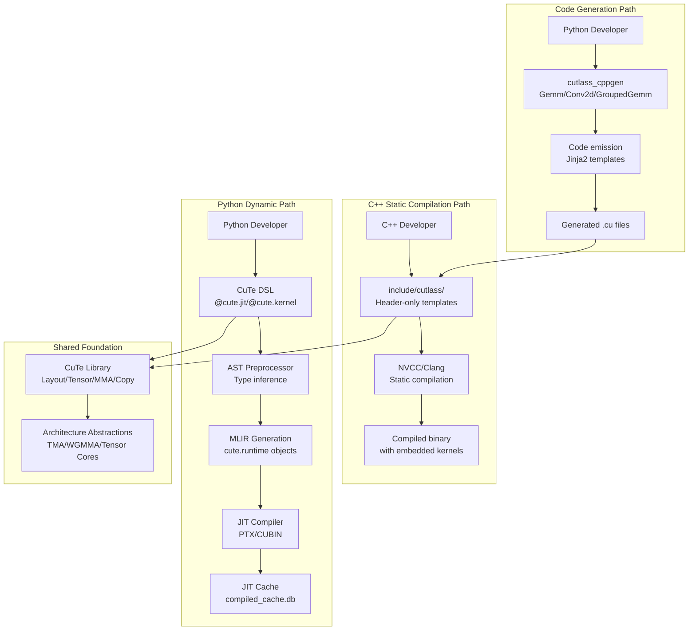
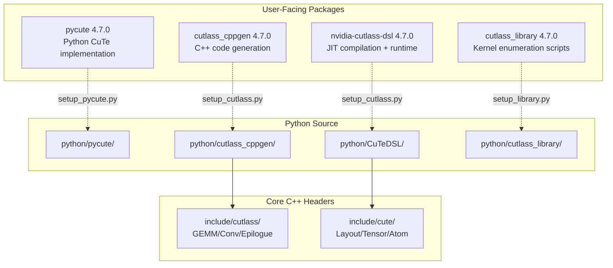
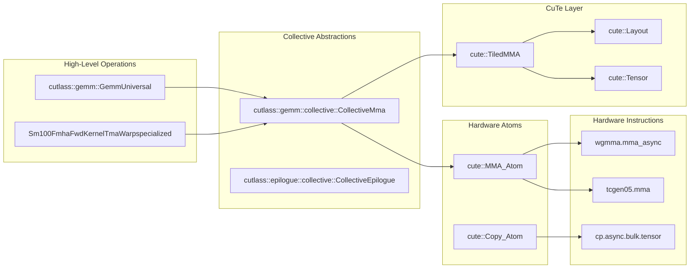

<!-- source: DeepWiki mcp.deepwiki.com · repo NVIDIA/cutlass · page 1 Overview · fetched 2026-10-26 -->

# Overview

Relevant source files

The following files were used as context for generating this wiki page:

- [CHANGELOG.md](CHANGELOG.md)
- [CUDA.cmake](CUDA.cmake)
- [Doxyfile](Doxyfile)
- [PUBLICATIONS.md](PUBLICATIONS.md)
- [README.md](README.md)
- [cmake/version_extended.h.in](cmake/version_extended.h.in)
- [examples/02_dump_reg_shmem/CMakeLists.txt](examples/02_dump_reg_shmem/CMakeLists.txt)
- [examples/56_hopper_ptr_array_batched_gemm/CMakeLists.txt](examples/56_hopper_ptr_array_batched_gemm/CMakeLists.txt)
- [include/cutlass/version.h](include/cutlass/version.h)
- [python/CuTeDSL/cutlass/base_dsl/env_manager.py](python/CuTeDSL/cutlass/base_dsl/env_manager.py)
- [python/CuTeDSL/cutlass/base_dsl/runtime/cuda.py](python/CuTeDSL/cutlass/base_dsl/runtime/cuda.py)
- [python/CuTeDSL/cutlass/cute/__init__.py](python/CuTeDSL/cutlass/cute/__init__.py)
- [python/CuTeDSL/cutlass/cute/arch/nvvm_wrappers.py](python/CuTeDSL/cutlass/cute/arch/nvvm_wrappers.py)
- [python/CuTeDSL/cutlass/cute/core.py](python/CuTeDSL/cutlass/cute/core.py)
- [python/CuTeDSL/cutlass/jax/primitive.py](python/CuTeDSL/cutlass/jax/primitive.py)
- [python/CuTeDSL/requirements-cu13.txt](python/CuTeDSL/requirements-cu13.txt)
- [python/CuTeDSL/requirements.txt](python/CuTeDSL/requirements.txt)
- [python/cutlass_cppgen/__init__.py](python/cutlass_cppgen/__init__.py)
- [python/setup_cutlass.py](python/setup_cutlass.py)
- [python/setup_library.py](python/setup_library.py)
- [python/setup_pycute.py](python/setup_pycute.py)

**Purpose**: This document provides a high-level introduction to CUTLASS, explaining its dual programming models (C++ template library and Python DSL), core capabilities, architectural organization, and key features. It serves as the entry point for understanding the CUTLASS codebase.

For detailed terminology definitions, see [Core Concepts and Terminology](#1.1). For information about repository structure and header organization, see [Library Organization and Header Structure](#1.2). For GPU architecture support details, see [GPU Architecture Support Matrix](#1.3). For version history, see [Version Information and Release Strategy](#1.4).

## What is CUTLASS

CUTLASS is a collection of CUDA C++ template abstractions and Python DSLs for implementing high-performance matrix-matrix multiplication (GEMM), convolution, and related linear algebra operations across NVIDIA GPU architectures (Volta through Blackwell). The library decomposes GPU computation into reusable, modular components operating at multiple levels of the parallelization hierarchy. [README.md:8-15]()

CUTLASS provides two primary programming interfaces:

1.  **C++ Template Library**: Header-only templates offering compile-time specialization and zero-overhead abstractions. [README.md:17-26]()
2.  **CuTe DSL**: Python-native interface for writing high-performance CUDA kernels based on core CUTLASS and CuTe concepts without performance compromises. [README.md:28-30]()

**Current Version**: 4.7.0 (August 2026) [include/cutlass/version.h:41-43](), [README.md:4-6]()

Sources: [README.md:4-30](), [include/cutlass/version.h:41-43]()

## Dual Programming Model Architecture

CUTLASS 4.x supports two distinct programming paradigms that share the same underlying abstractions but differ in compilation strategy and user interface:

### Kernel Development Flow

Sources: [README.md:28-44](), [python/cutlass_cppgen/__init__.py:84-146](), [python/cutlass_cppgen/__init__.py:138-142]()

### C++ Template Interface
The C++ interface provides zero runtime overhead by resolving abstractions at compile time. It is a header-only library located in `include/cutlass/` and `include/cute/`. It performs extensive template specialization for tiling sizes, data types, and algorithmic policies across SM70 through SM100+. [README.md:13-26]()

### Python DSL Interface
The Python interface (CuTe DSL) provides JIT compilation from Python code to PTX/CUBIN. It features native integration with DL frameworks (PyTorch, JAX) and intuitive metaprogramming. [README.md:28-30]() Version 4.7 introduces the **Primitives API**, providing a stable wrapper over NVVM operations for lower-level SIMT programming within the DSL. [README.md:49-52](), [CHANGELOG.md:9-11]()

## Repository Organization

### Package Hierarchy

Sources: [python/setup_cutlass.py:52-74](), [python/setup_pycute.py:37-42](), [python/setup_library.py:37-42](), [python/cutlass_cppgen/__init__.py:136-146]()

| Directory | Purpose | Key Contents |
|-----------|---------|--------------|
| `include/cutlass/` | C++ template library | `gemm/`, `conv/`, `epilogue/`, `arch/` |
| `include/cute/` | CuTe core library | `algorithm/`, `arch/`, `atom/`, layout types |
| `python/CuTeDSL/` | CuTe DSL implementation | `cutlass/cute/`, `cutlass/base_dsl/` |
| `python/cutlass_cppgen/` | C++ code generator | `op/`, `emit/`, `backend/` |
| `python/cutlass_library/` | Kernel enumeration | `library.py`, operation classes |
| `examples/` | Tutorial implementations | `77_blackwell_fmha`, `92_blackwell_moe_gemm`, `56_hopper_ptr_array_batched_gemm` |

## Key Components and Data Flow

### Architecture Abstraction Layers

Sources: [README.md:89-105](), [CHANGELOG.md:28-35]()

## Core Features

### Architecture Support
CUTLASS 4.7.0 supports NVIDIA GPU architectures from **Volta (SM70)** through **Blackwell (SM100/SM103/SM120)**. [README.md:26](), [CHANGELOG.md:69-72]()

| Architecture | Key Features |
|--------------|--------------|
| Hopper (SM90) | TMA, WGMMA, Thread Block Clusters [README.md:34]() |
| Blackwell (SM100) | Enhanced TMA, Blockwise Scaling, 2SM MMA [README.md:89-94]() |
| Blackwell (SM103) | 2-kernel FP8 FMHA backward optimization [CHANGELOG.md:28-30]() |
| SM70-SM100+ | Comprehensive numeric type support across generations [README.md:26]() |

### Data Type Support
CUTLASS supports an extensive numeric type system: [README.md:17-26]()
- **Floating Point**: FP64, FP32, TF32, FP16, BF16
- **8b Floating Point**: e5m2 and e4m3 (FP8) [CHANGELOG.md:32]()
- **4b Floating Point**: e2m1 (FP4) support in converters [CHANGELOG.md:73-74]()
- **Block Scaled**: NVIDIA NVFP4, OCP MXFP4, MXFP6, MXFP8 [README.md:23]()
- **Integer**: 4b and 8b signed/unsigned
- **Binary**: 1b data types

### CuTe Library Foundation
CuTe is the core library introduced in CUTLASS 3.0 to describe and manipulate tensors of threads and data. [README.md:30-34]()
- **Layout Algebra**: Hierarchically multidimensional layouts representing Shape and Stride. [README.md:30]()
- **Tensor Objects**: Packaging type, shape, memory space, and layout while handling mechanical indexing. [README.md:30]()

## Version and Build Information
Version information is synchronized across C++ headers and Python setup scripts.
- **C++ Header**: [include/cutlass/version.h:41-43]()
- **Python Version**: [python/setup_cutlass.py:54](), [python/cutlass_cppgen/__init__.py:136]()

**Minimum Requirements**:
- Architecture: Volta (compute capability 7.0) [README.md:26]()
- Compiler: C++17 support
- CUDA Toolkit: 11.8 (Recommended: 13.3 for optimal Blackwell code gen) [CHANGELOG.md:39](), [python/setup_cutlass.py:68]()

Sources: [include/cutlass/version.h:41-86](), [README.md:4-6](), [CHANGELOG.md:5-40]()

---

