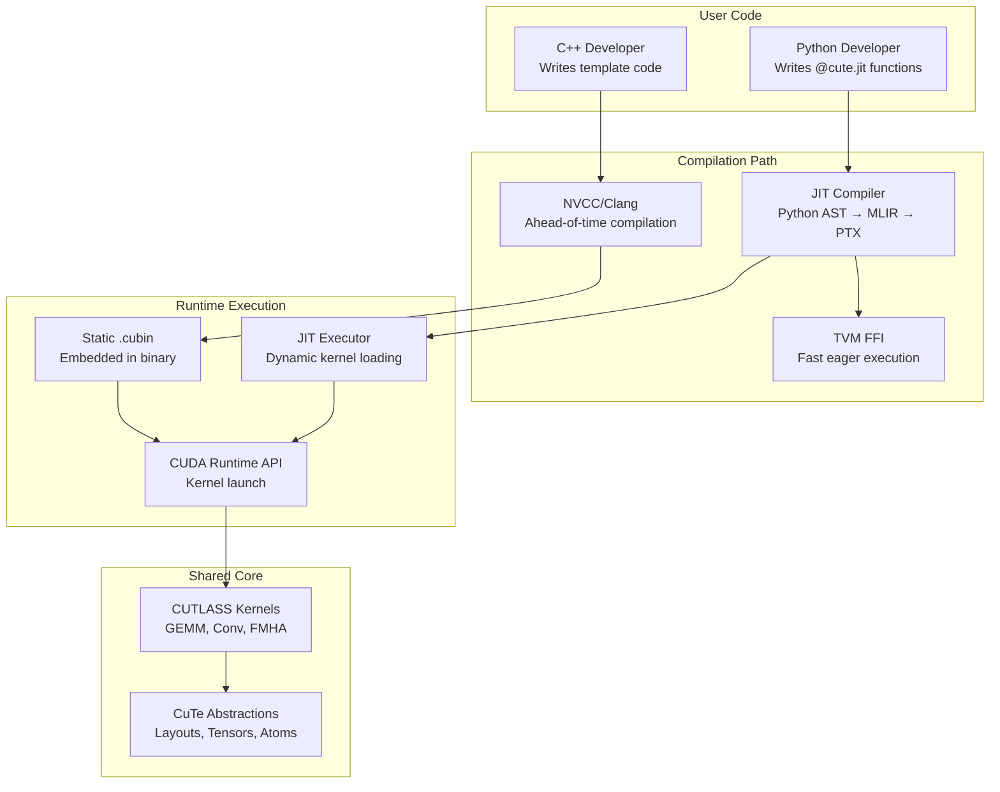
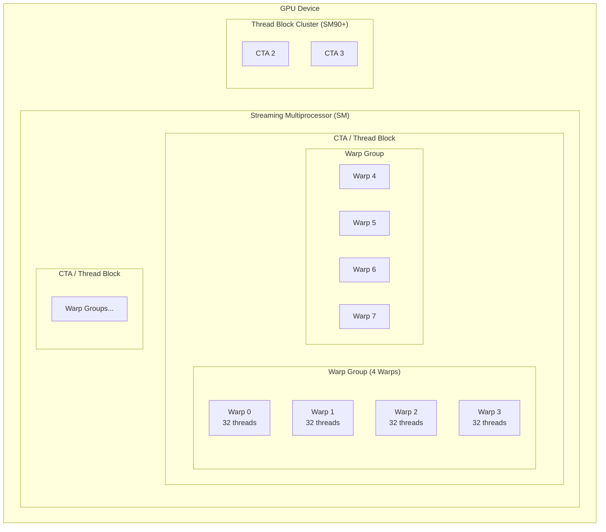
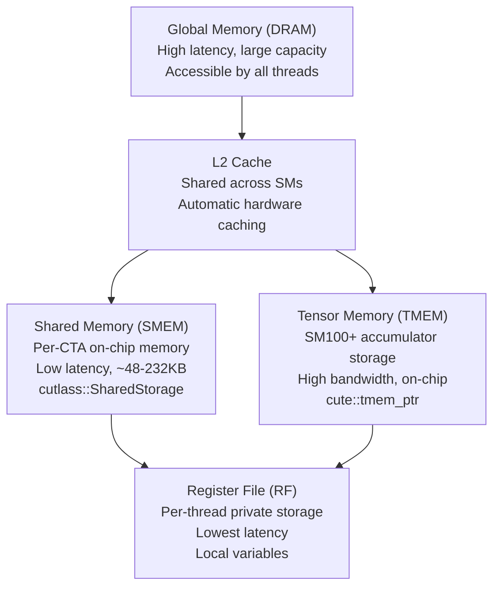
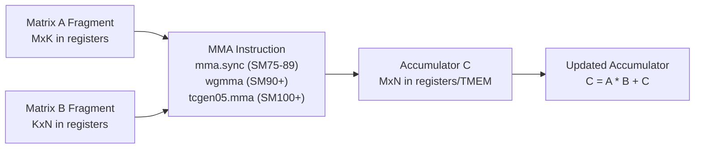
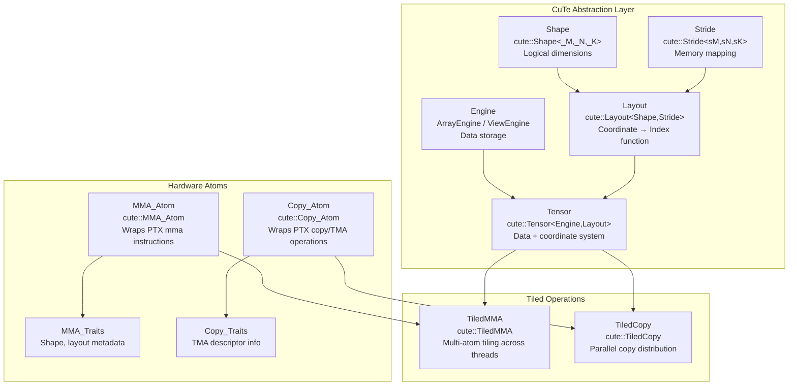
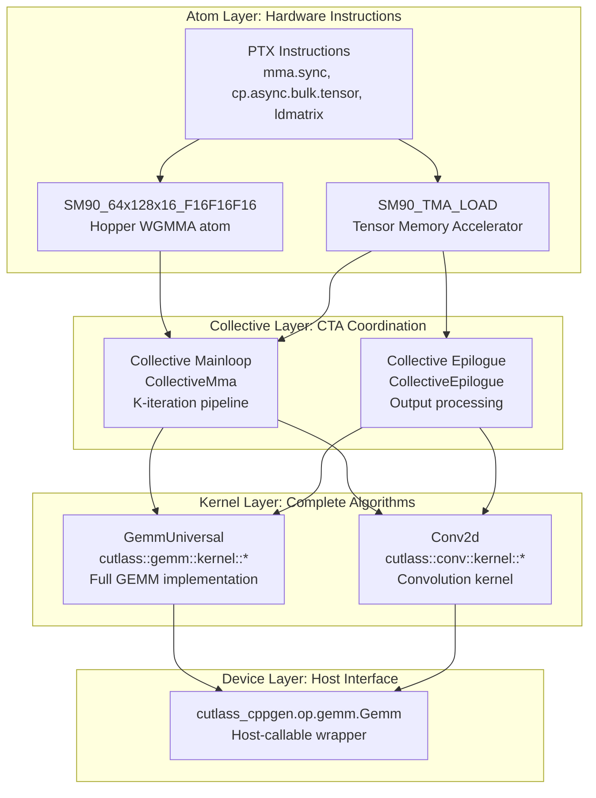
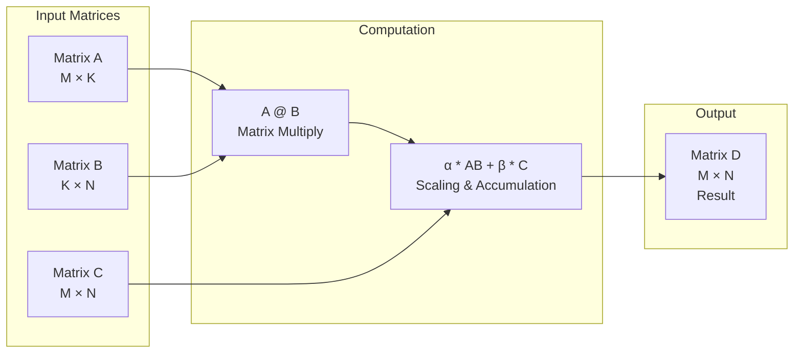

<!-- source: DeepWiki mcp.deepwiki.com · repo NVIDIA/cutlass · page 1.1 Core Concepts and Terminology · fetched 2026-10-26 -->

# Core Concepts and Terminology

<details>
<summary>Relevant source files</summary>

The following files were used as context for generating this wiki page:

- [CHANGELOG.md](CHANGELOG.md)
- [README.md](README.md)
- [include/cutlass/version.h](include/cutlass/version.h)
- [media/docs/cpp/cute/02_layout_algebra.md](media/docs/cpp/cute/02_layout_algebra.md)
- [media/docs/cpp/cute/03_tensor.md](media/docs/cpp/cute/03_tensor.md)
- [media/docs/cpp/cute/0t_mma_atom.md](media/docs/cpp/cute/0t_mma_atom.md)
- [media/docs/cpp/cute/0x_gemm_tutorial.md](media/docs/cpp/cute/0x_gemm_tutorial.md)
- [python/CuTeDSL/cutlass/base_dsl/env_manager.py](python/CuTeDSL/cutlass/base_dsl/env_manager.py)
- [python/CuTeDSL/cutlass/base_dsl/runtime/cuda.py](python/CuTeDSL/cutlass/base_dsl/runtime/cuda.py)
- [python/CuTeDSL/cutlass/cute/__init__.py](python/CuTeDSL/cutlass/cute/__init__.py)
- [python/CuTeDSL/cutlass/cute/arch/nvvm_wrappers.py](python/CuTeDSL/cutlass/cute/arch/nvvm_wrappers.py)
- [python/CuTeDSL/cutlass/cute/core.py](python/CuTeDSL/cutlass/cute/core.py)
- [python/CuTeDSL/cutlass/jax/primitive.py](python/CuTeDSL/cutlass/jax/primitive.py)
- [python/CuTeDSL/requirements-cu13.txt](python/CuTeDSL/requirements-cu13.txt)
- [python/CuTeDSL/requirements.txt](python/CuTeDSL/requirements.txt)
- [python/cutlass_cppgen/__init__.py](python/cutlass_cppgen/__init__.py)
- [python/setup_cutlass.py](python/setup_cutlass.py)
- [python/setup_library.py](python/setup_library.py)
- [python/setup_pycute.py](python/setup_pycute.py)
- [test/unit/layout/tensor.cu](test/unit/layout/tensor.cu)
- [test/unit/layout/tensor_nhwc.cu](test/unit/layout/tensor_nhwc.cu)

</details>


This page defines fundamental terminology and conceptual building blocks used throughout CUTLASS. Understanding these terms is essential for working with any CUTLASS component, whether using the **C++ template library** or the **CuTe DSL (Python interface)**.

CUTLASS provides two primary programming models:
- **C++ Template API**: Header-only library with compile-time specialization for maximum performance [README.md:17-27]().
- **CuTe DSL**: Python-based domain-specific language with JIT compilation for rapid prototyping and production deployment [README.md:28-44]().

---

## Programming Models

CUTLASS 4.x supports dual programming interfaces that share the same underlying abstractions:

**Programming Model and Execution Flow**

**Sources:** [README.md:1-44](), [python/setup_cutlass.py:52-74]()

| Concept | C++ API | Python DSL | Description |
|---------|---------|------------|-------------|
| **Kernel Definition** | Template class | `@cute.kernel` decorator | Device-side code |
| **Host Function** | Template function | `@cute.jit` decorator | Host-side orchestration |
| **Compilation** | Ahead-of-time (NVCC) | Just-in-time (MLIR) | Code generation strategy |
| **Dispatch** | `cudaLaunchKernel` | `JitExecutor` | Kernel invocation |
| **Optimization** | Template specialization | JIT caching | Performance strategy |

---

## GPU Hardware Terminology

CUTLASS exposes and optimizes for specific CUDA hardware primitives. These terms appear throughout the codebase and API:

### Thread Hierarchy

**Thread and Cluster Hierarchy**

**Sources:** [README.md:88-108](), [CHANGELOG.md:64-64]()

| Term | Abbreviation | Description | Code Representation |
|------|--------------|-------------|---------------------|
| **Thread** | - | Single CUDA execution unit | Single lane in SIMT execution |
| **Warp** | - | Group of 32 threads executing in lockstep | `WARP_SIZE` [python/CuTeDSL/cutlass/cute/arch/nvvm_wrappers.py:34]() |
| **Warp Group** | WG | 4 warps (128 threads) on SM90+, used by WGMMA | `cutlass::gemm::collective::CollectiveMma` |
| **Thread Block** | CTA | Cooperative Thread Array, shares SMEM | `cute::Shape`, kernel launch dimension |
| **Cluster** | - | Group of CTAs on SM90+ sharing distributed SMEM | `cudaLaunchAttributeLaunchCompletionEvent` [CHANGELOG.md:64-64]() |
| **Streaming Multiprocessor** | SM | Hardware execution unit containing cores and memory | Architecture version (SM90, SM100, etc.) |

### Memory Hierarchy

**Memory and Storage Abstractions**

**Sources:** [README.md:88-108](), [CHANGELOG.md:61-61](), [CHANGELOG.md:65-70]()

| Memory Type | Scope | Typical Size | CUTLASS Usage |
|-------------|-------|--------------|---------------|
| **Global Memory** | Device | GBs | Input/output tensors, resident in DRAM |
| **L2 Cache** | Device | MBs | Automatic caching layer |
| **Shared Memory (SMEM)** | CTA | 48-232 KB | Tile buffering, pipeline staging [CHANGELOG.md:84-84]() |
| **Tensor Memory (TMEM)** | Warp Group | SM100+: variable | High-bandwidth accumulator storage |
| **Registers (RF)** | Thread | ~64KB per SM | Fragment storage, compute operands |

### Tensor Core Operations

**Tensor Cores** are specialized hardware units for matrix multiply-accumulate operations, introduced in Volta (SM70) and enhanced in every subsequent architecture [README.md:17-26]().

**Tensor Core Compute Flow**

**Sources:** [README.md:81-87](), [CHANGELOG.md:9-13](), [media/docs/cpp/cute/0t_mma_atom.md:1-25]()

| Term | Full Name | Description | Example Instructions |
|------|-----------|-------------|---------------------|
| **MMA** | Matrix Multiply-Accumulate | Core tensor core operation: `D = A * B + C` | `mma.sync.aligned.m16n8k8.f32.f16.f16.f32` [media/docs/cpp/cute/0t_mma_atom.md:93-104]() |
| **WGMMA** | Warp Group MMA | SM90+ instruction operating on 128 threads | `wgmma.mma_async.sync.aligned.m64n128k16.f32.f16.f16` |
| **TCGen05** | 5th Generation Tensor Core | SM100/SM120 enhanced MMA instructions | `tcgen05.mma` Blackwell instruction set [python/CuTeDSL/cutlass/cute/arch/nvvm_wrappers.py:74-80]() |
| **SIMT** | Single Instruction Multiple Thread | Non-tensor-core FP32/FP64 operations | CUDA core arithmetic [CHANGELOG.md:9-10]() |

---

## CUTLASS-Specific Terminology

### Core Abstractions

CUTLASS 3.x and 4.x are built on the **CuTe** abstraction layer, which provides a mathematical framework for describing data layouts and operations [README.md:88-108]().

**CuTe Core Entities**

**Sources:** [media/docs/cpp/cute/02_layout_algebra.md:1-12](), [media/docs/cpp/cute/03_tensor.md:1-12](), [media/docs/cpp/cute/0t_mma_atom.md:26-49]()

| Concept | C++ Type | Purpose | Location |
|---------|----------|---------|----------|
| **Layout** | `cute::Layout<Shape, Stride>` | Maps logical coordinates to linear memory indices | `include/cute/layout.hpp` [media/docs/cpp/cute/02_layout_algebra.md:15-18]() |
| **Tensor** | `cute::Tensor<Engine, Layout>` | Data container with coordinate system | `include/cute/tensor.hpp` [media/docs/cpp/cute/03_tensor.md:3-12]() |
| **Atom** | `cute::MMA_Atom`, `cute::Copy_Atom` | Minimal hardware instruction wrapper | `include/cute/atom/` [media/docs/cpp/cute/0t_mma_atom.md:18-21]() |
| **TiledMMA** | `cute::TiledMMA` | Distributes MMA atoms across thread group | `include/cute/atom/mma_atom.hpp` [media/docs/cpp/cute/0t_mma_atom.md:23-25]() |
| **TiledCopy** | `cute::TiledCopy` | Distributes copy operations across threads | `include/cute/atom/copy_atom.hpp` |

### Operation Hierarchy

CUTLASS operations are composed hierarchically from atoms up to complete device functions:

**Operation Composition Hierarchy**

**Sources:** [python/cutlass_cppgen/__init__.py:140-142](), [media/docs/cpp/cute/0t_mma_atom.md:1-25]()

### Dispatch Policies

CUTLASS uses policy types to configure scheduling and specialization:

| Policy Type | Enum/Class | Purpose | Code Location |
|-------------|------------|---------|---------------|
| **KernelScheduleType** | `cutlass_library::KernelScheduleType` | Defines mainloop scheduling strategy | [python/cutlass_cppgen/__init__.py:89]() |
| **EpilogueScheduleType** | `cutlass_library::EpilogueScheduleType` | Defines epilogue scheduling strategy | [python/cutlass_cppgen/__init__.py:88]() |
| **TileSchedulerType** | `cutlass_library::TileSchedulerType` | Work decomposition across CTAs | [python/cutlass_cppgen/__init__.py:94]() |

---

## Architecture-Specific Features

CUTLASS supports multiple NVIDIA GPU architectures with varying capabilities. Architecture names follow the pattern `SM<compute_capability>`:

| Architecture | Compute Capability | Key Features | CUDA Version |
|--------------|-------------------|--------------|--------------|
| Volta | 7.0 | First Tensor Cores (FP16) [media/docs/cpp/cute/0t_mma_atom.md:89-90]() | 11.4+ |
| Ampere | 8.0 | TF32, BF16, Async Copy [README.md:20-21]() | 11.4+ |
| Hopper | 9.0 | TMA, WGMMA, FP8, Clusters [README.md:98-100]() | 11.8+ |
| Blackwell DC | 10.0 | TCGen05, TMEM, Green Context [README.md:92-94]() | 13.3+ [CHANGELOG.md:39-39]() |

### TMA (Tensor Memory Accelerator)

TMA is a hardware DMA engine introduced in Hopper (SM90) that performs asynchronous bulk tensor transfers:

| Feature | Description | Code Entity |
|---------|-------------|-------------|
| **Bulk Transfer** | Hardware-managed copy from GMEM to SMEM | `CopyBulkG2SOp` [CHANGELOG.md:78-78]() |
| **Descriptor** | Metadata object describing tensor layout | `TmaDescriptor` |
| **Multicast** | Load to multiple SMEM locations simultaneously | `CopyBulkG2SMulticastOp` [CHANGELOG.md:78-78]() |
| **Im2col** | Hardware-accelerated convolution transforms | `SM90_TMA_LOAD_IM2COL` |

**Sources:** [CHANGELOG.md:37-37](), [CHANGELOG.md:74-79]()

---

## Data Types and Numeric System

CUTLASS provides extensive support for specialized numeric types used in deep learning and HPC [README.md:17-27]():

| Type | Storage | Description | Header |
|------|---------|-------------|--------|
| **FP32** | 32 bits | IEEE 754 single precision | Standard |
| **FP16** | 16 bits | IEEE 754 half precision | `cutlass/numeric_types.h` |
| **BF16** | 16 bits | Brain Float 16 | `cutlass/numeric_types.h` |
| **FP8** | 8 bits | E4M3 and E5M2 formats [README.md:22]() | `cutlass/float8.h` |
| **FP4** | 4 bits | E2M1 format [CHANGELOG.md:32-33]() | `cutlass/numeric_types.h` |
| **MXFP4/6/8** | Variable | OCP Microscaling formats [README.md:23]() | `cutlass/numeric_types.h` |

**Sources:** [README.md:17-27](), [CHANGELOG.md:32-33]()

---

## Operation Terminology

### GEMM (General Matrix Multiply)

**GEMM** is the fundamental operation computing `D = α * (A @ B) + β * C` where `@` denotes matrix multiplication [README.md:8-11]().

**GEMM Data Flow**

**Sources:** [README.md:8-15](), [python/cutlass_cppgen/op/gemm.py:1-40]()

### StreamK Work Decomposition

**StreamK** (Stream K-splitting) is a dynamic load-balancing scheduler that splits work across CTAs to maximize utilization [README.md:104-108]():

| Concept | Description |
|---------|-------------|
| **SK Block** | Tile split across K-dimension for load balancing |
| **DP Block** | Tile with full K-iteration (Data Parallel) |
| **Reduction** | Combining partial SK results via atomics or separate kernels |

**Sources:** [CHANGELOG.md:35-35]()

---

## Warp Specialization

**Warp specialization** is a programming pattern where different warps within a CTA perform different roles to maximize hardware utilization:

| Role | Responsibility |
|------|----------------|
| **Producer** | Load data from GMEM to SMEM via TMA or Async Copy |
| **Consumer** | Perform matrix multiply-accumulate (MMA) using SMEM data |
| **Task Scheduling** | Framework for static analysis of warp-specialized execution [CHANGELOG.md:12-12]() |

**Sources:** [CHANGELOG.md:12-13](), [CHANGELOG.md:61-61]()

---

## Python DSL Terminology

The CuTe DSL provides Python-native interfaces for writing high-performance CUDA kernels [README.md:28-44]():

| Term | Description |
|------|-------------|
| **@cute.kernel** | Decorator marking device-side kernel functions |
| **@cute.jit** | Decorator marking host-side orchestration functions |
| **Primitives API** | Low-level abstraction for Tensor Core programming through SIMT [CHANGELOG.md:9-11]() |
| **IKET Profiler** | In-Kernel-Event-Tracing for instrumentation-based profiling [CHANGELOG.md:61-61]() |

**Sources:** [README.md:28-44](), [CHANGELOG.md:9-13](), [CHANGELOG.md:61-61]()

---

## Version Information

CUTLASS version is defined programmatically in the header system:

```cpp
// From include/cutlass/version.h
#define CUTLASS_MAJOR 4
#define CUTLASS_MINOR 7
#define CUTLASS_PATCH 0
```
**Sources:** [include/cutlass/version.h:41-43]()

The Python package versions are synchronized with the C++ library:
- `cutlass_cppgen.__version__`: `4.7.0` [python/cutlass_cppgen/__init__.py:136]()
- `pycute`: `4.7.0` [python/setup_pycute.py:39]()
- `cutlass_library`: `4.7.0` [python/setup_library.py:39]()
- `nvidia-cutlass-dsl`: `4.7.0` [python/CuTeDSL/requirements.txt:3]()

---

