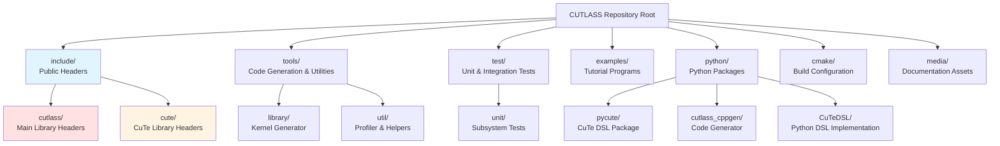
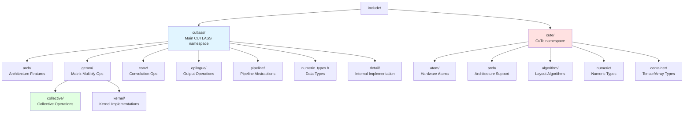
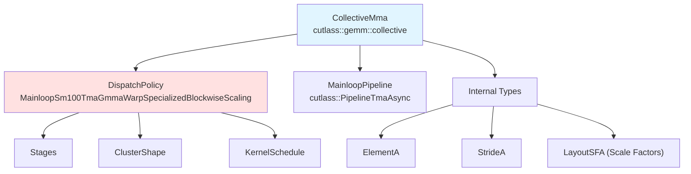
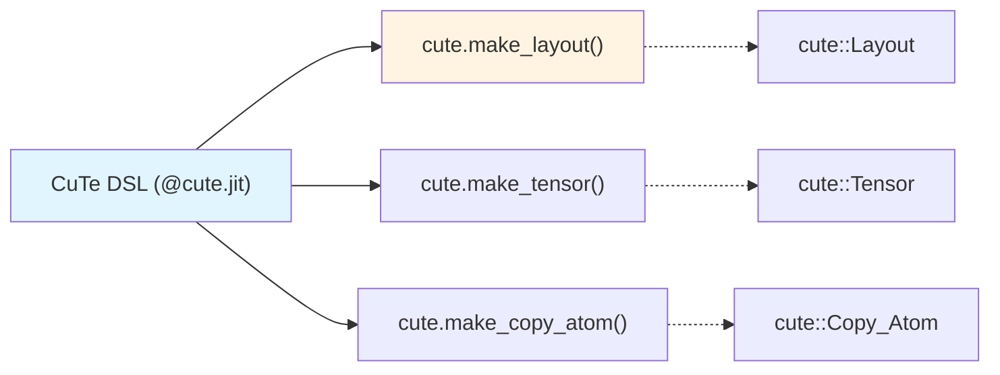

<!-- source: DeepWiki mcp.deepwiki.com · repo NVIDIA/cutlass · page 1.2 Library Organization and Header Structure · fetched 2026-10-26 -->

# Library Organization and Header Structure

<details>
<summary>Relevant source files</summary>

The following files were used as context for generating this wiki page:

- [CHANGELOG.md](CHANGELOG.md)
- [CMakeLists.txt](CMakeLists.txt)
- [README.md](README.md)
- [include/cute/atom/copy_traits_sm90_im2col.hpp](include/cute/atom/copy_traits_sm90_im2col.hpp)
- [include/cute/atom/copy_traits_sm90_tma.hpp](include/cute/atom/copy_traits_sm90_tma.hpp)
- [include/cutlass/arch/grid_dependency_control.h](include/cutlass/arch/grid_dependency_control.h)
- [include/cutlass/cuda_host_adapter.hpp](include/cutlass/cuda_host_adapter.hpp)
- [include/cutlass/gemm/collective/sm100_mma_warpspecialized_blockwise_scaling.hpp](include/cutlass/gemm/collective/sm100_mma_warpspecialized_blockwise_scaling.hpp)
- [include/cutlass/version.h](include/cutlass/version.h)
- [python/CuTeDSL/cutlass/base_dsl/env_manager.py](python/CuTeDSL/cutlass/base_dsl/env_manager.py)
- [python/CuTeDSL/cutlass/base_dsl/runtime/cuda.py](python/CuTeDSL/cutlass/base_dsl/runtime/cuda.py)
- [python/CuTeDSL/cutlass/cute/__init__.py](python/CuTeDSL/cutlass/cute/__init__.py)
- [python/CuTeDSL/cutlass/cute/arch/nvvm_wrappers.py](python/CuTeDSL/cutlass/cute/arch/nvvm_wrappers.py)
- [python/CuTeDSL/cutlass/cute/core.py](python/CuTeDSL/cutlass/cute/core.py)
- [python/CuTeDSL/cutlass/jax/primitive.py](python/CuTeDSL/cutlass/jax/primitive.py)
- [python/CuTeDSL/requirements-cu13.txt](python/CuTeDSL/requirements-cu13.txt)
- [python/CuTeDSL/requirements.txt](python/CuTeDSL/requirements.txt)
- [python/cutlass_cppgen/__init__.py](python/cutlass_cppgen/__init__.py)
- [python/setup_cutlass.py](python/setup_cutlass.py)
- [python/setup_library.py](python/setup_library.py)
- [python/setup_pycute.py](python/setup_pycute.py)
- [test/unit/CMakeLists.txt](test/unit/CMakeLists.txt)
- [test/unit/conv/device/conv2d_problems.h](test/unit/conv/device/conv2d_problems.h)

</details>


This page documents the directory structure, header file organization, and include path conventions used throughout the CUTLASS repository. It describes how the library is physically organized on disk and how users should include headers in their code.

For information about specific subsystems (GEMM, Convolution, FMHA, etc.), see their respective pages. For information about the Python package structure, see [Python Package Structure and Setup](#9.3). For information about the build system configuration, see [CMake Configuration and Architecture Flags](#9.1).

---

## Directory Structure Overview

CUTLASS follows a modular directory layout that separates public headers, implementation details, tests, tools, and examples:



**Sources:** [README.md:8-15](), [python/setup_cutlass.py:52-64](), [python/setup_pycute.py:37-42]()

---

## Include Directory Structure

The `include/` directory contains all public headers for CUTLASS and CuTe. The directory is organized by namespace and subsystem:



**Sources:** [include/cutlass/gemm/collective/sm100_mma_warpspecialized_blockwise_scaling.hpp:33-49](), [include/cutlass/version.h:37-50](), [include/cute/atom/copy_traits_sm90_tma.hpp:37-46]()

---

## Header Inclusion Patterns

CUTLASS uses consistent header naming and inclusion patterns. Users include headers relative to the `include/` directory:

### Basic Header Inclusion

```cpp
// Main CUTLASS header (core definitions)
#include "cutlass/cutlass.h"

// Core type definitions
#include "cutlass/numeric_types.h"

// Architecture-specific features (e.g., GDC for SM90+)
#include "cutlass/arch/grid_dependency_control.h"

// CuTe core abstractions
#include "cute/tensor.hpp"
#include "cute/atom/mma_atom.hpp"
```

### Architecture-Specific Headers

CUTLASS organizes hardware-specific code by SM architecture. Modern Blackwell (SM100) support is integrated into the collective mainloops:

| Pattern | Architecture | Description |
|---------|--------------|-------------|
| `*_sm70.*` | Volta | First Tensor Core generation [README.md:26-26]() |
| `*_sm80.*` | Ampere | FP64/TF32 Tensor Cores [README.md:26-26]() |
| `*_sm90.*` | Hopper | TMA/WGMMA/Thread Block Clusters [README.md:26-26]() |
| `*_sm100.*` | Blackwell | Enhanced TMA/UMMA and Blockwise Scaling [CHANGELOG.md:69-71]() |

**Sources:** [include/cutlass/arch/grid_dependency_control.h:1-20](), [include/cute/atom/copy_traits_sm90_tma.hpp:45-46](), [CHANGELOG.md:69-71]()

---

## Python Package Organization

With CUTLASS 4.x, the library includes a significant Python infrastructure located in the `python/` directory:

| Package | Purpose |
|---------|---------|
| `pycute` | Python implementation of CuTe layout algebra and tensors. [python/setup_pycute.py:38-41]() |
| `cutlass_library` | Kernel generation scripts and manifests for C++ kernels. [python/setup_library.py:38-41]() |
| `cutlass_cppgen` | High-level Pythonic interface for generating CUTLASS C++ code (Gemm, Conv2d). [python/setup_cutlass.py:53-64]() |
| `CuTeDSL` | The Python-native Domain Specific Language for JIT kernel authoring. [README.md:28-34]() |

**Sources:** [python/setup_cutlass.py:52-74](), [python/setup_pycute.py:36-42](), [python/setup_library.py:36-42](), [python/cutlass_cppgen/__init__.py:139-142]()

---

## Collective and Dispatch Policy Organization

Modern CUTLASS (3.x/4.x) organizes kernel components using "collective" abstractions. A key example is the SM100 mainloop for blockwise scaling:



**Sources:** [include/cutlass/gemm/collective/sm100_mma_warpspecialized_blockwise_scaling.hpp:50-100]()

### SM100 Blackwell Enhancements
The Blackwell architecture introduces UMMA and enhanced TMA. Headers for these features include specialized collective mainloops that handle blockwise scaling granularity (e.g., `ScaleGranularityM`, `ScaleGranularityK`).

**Sources:** [include/cutlass/gemm/collective/sm100_mma_warpspecialized_blockwise_scaling.hpp:50-120](), [CHANGELOG.md:69-71]()

---

## Versioning and Compatibility

The library version is defined in `include/cutlass/version.h` and parsed by CMake.

| Macro | Value | Description |
|-------|-------|-------------|
| `CUTLASS_MAJOR` | 4 | Major version [include/cutlass/version.h:41-41]() |
| `CUTLASS_MINOR` | 7 | Minor version [include/cutlass/version.h:42-42]() |
| `CUTLASS_PATCH` | 0 | Patch version [include/cutlass/version.h:43-43]() |
| `CUTLASS_VERSION` | 470 | Integer representation [include/cutlass/version.h:52-52]() |

**Sources:** [include/cutlass/version.h:41-52](), [CMakeLists.txt:46-54]()

### Minimum Requirements
- **Architecture:** Volta (SM70) or higher [README.md:26-26]().
- **Compiler:** C++17 support required [CMakeLists.txt:102-104]().
- **Toolkit:** CUDA 11.4 minimum, CUDA 11.8+ strongly recommended [CMakeLists.txt:86-90]().

---

## CuTe DSL Integration

The CuTe DSL provides a Python-native programming model that maps directly to the C++ abstractions.



**Sources:** [README.md:28-34](), [python/cutlass_cppgen/__init__.py:138-144](), [python/CuTeDSL/cutlass/cute/core.py:135-140]()

The DSL uses `tvm-ffi` or the `cutlass_cppgen` backend to bridge Python code to executable GPU kernels. The `_NvvmAutoConvertProxy` in `nvvm_wrappers.py` acts as a bridge for lower-level NVVM operations.

**Sources:** [README.md:57-61](), [python/cutlass_cppgen/__init__.py:138-144](), [python/CuTeDSL/cutlass/cute/arch/nvvm_wrappers.py:66-86]()

---

