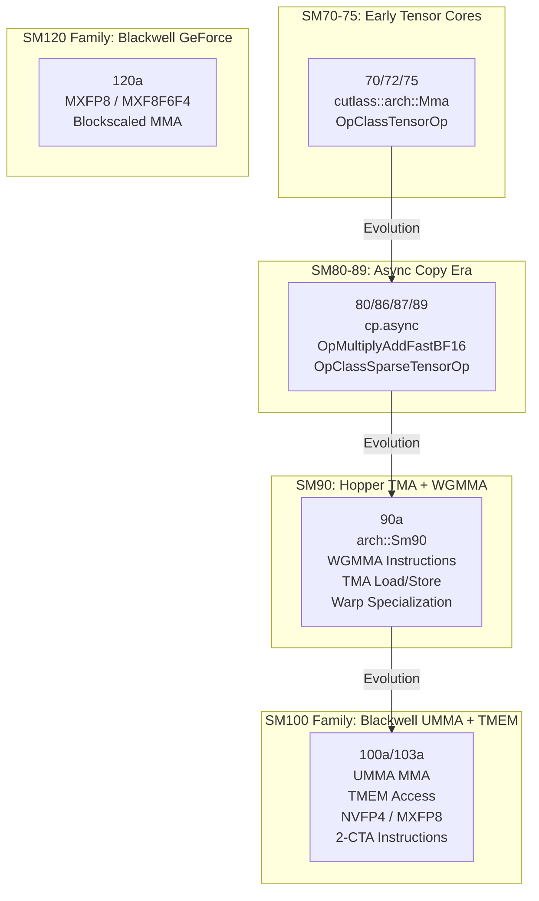
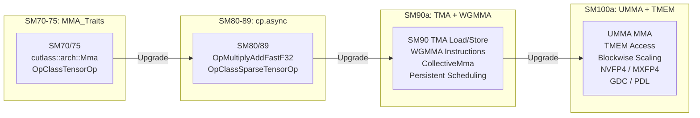

<!-- source: DeepWiki mcp.deepwiki.com · repo NVIDIA/cutlass · page 1.3 GPU Architecture Support Matrix · fetched 2026-10-26 -->

# GPU Architecture Support Matrix

Relevant source files

The following files were used as context for generating this wiki page:

- [CHANGELOG.md](CHANGELOG.md)
- [README.md](README.md)
- [include/cutlass/arch/mma.h](include/cutlass/arch/mma.h)
- [include/cutlass/arch/mma_sm50.h](include/cutlass/arch/mma_sm50.h)
- [include/cutlass/arch/mma_sm60.h](include/cutlass/arch/mma_sm60.h)
- [include/cutlass/arch/mma_sm61.h](include/cutlass/arch/mma_sm61.h)
- [include/cutlass/version.h](include/cutlass/version.h)
- [python/CuTeDSL/cutlass/base_dsl/env_manager.py](python/CuTeDSL/cutlass/base_dsl/env_manager.py)
- [python/CuTeDSL/cutlass/base_dsl/runtime/cuda.py](python/CuTeDSL/cutlass/base_dsl/runtime/cuda.py)
- [python/CuTeDSL/cutlass/cute/__init__.py](python/CuTeDSL/cutlass/cute/__init__.py)
- [python/CuTeDSL/cutlass/cute/arch/nvvm_wrappers.py](python/CuTeDSL/cutlass/cute/arch/nvvm_wrappers.py)
- [python/CuTeDSL/cutlass/cute/core.py](python/CuTeDSL/cutlass/cute/core.py)
- [python/CuTeDSL/cutlass/jax/primitive.py](python/CuTeDSL/cutlass/jax/primitive.py)
- [python/CuTeDSL/requirements-cu13.txt](python/CuTeDSL/requirements-cu13.txt)
- [python/CuTeDSL/requirements.txt](python/CuTeDSL/requirements.txt)
- [python/cutlass_cppgen/__init__.py](python/cutlass_cppgen/__init__.py)
- [python/setup_cutlass.py](python/setup_cutlass.py)
- [python/setup_library.py](python/setup_library.py)
- [python/setup_pycute.py](python/setup_pycute.py)

This page documents the NVIDIA GPU architectures supported by CUTLASS 4.7.0, providing a comprehensive matrix of compute capabilities, CUDA Toolkit requirements, and architecture-specific features. CUTLASS supports architectures from Volta (2017) through Blackwell (2024-2026), with specialized support for architecture-accelerated instructions on newer hardware.

**Related Pages:**
- Build configuration details: See Build System and CMake Configuration (page 9.1)
- Architecture-specific implementations: See SM90 Hopper Features (7.1), SM100/SM103 Blackwell Datacenter (7.2)
- Kernel selection and dispatch: See GEMM Operations (page 4) and Collective Components (page 5)

---

## Supported GPU Architectures

CUTLASS supports NVIDIA GPUs from Volta (2017) through Blackwell (2024-2026). Minimum compute capability: **7.0** (SM70). Architecture codes map directly to the `CUTLASS_NVCC_ARCHS` CMake variable.

### Architecture Support Matrix

| SM Arch | Compute Cap | CMake Code | Example Products | Min CUDA | Architecture Features | Code Macro |
|---------|-------------|------------|------------------|----------|----------------------|------------|
| **SM70** | 7.0 | `70` | V100, Titan V | 11.4 | Tensor Cores (FP16) | `__CUDA_ARCH__ >= 700` |
| **SM75** | 7.5 | `75` | T4, RTX 20x0 | 11.4 | Tensor Cores (INT8/INT4) | `__CUDA_ARCH__ >= 750` |
| **SM80** | 8.0 | `80` | A100 | 11.4 | Tensor Cores (BF16/TF32), cp.async | `__CUDA_ARCH__ >= 800` |
| **SM89** | 8.9 | `89` | RTX 40x0, L40 | 11.8 | Tensor Cores (FP8) | `__CUDA_ARCH__ >= 890` |
| **SM90** | 9.0 | `90` | H100, H200 | 11.8 | Forward compat only | `__CUDA_ARCH__ >= 900` |
| **SM90a** | 9.0a | `90a` | H100, H200 | 12.0 | TMA, WGMMA, GDC (opt-in) | `__CUDA_ARCH_FEAT_SM90_ALL` |
| **SM100** | 10.0 | `100` | B200 | 12.8 | Forward compat only | `__CUDA_ARCH__ >= 1000` |
| **SM100a** | 10.0a | `100a` | B200 | 12.8 | UMMA, TMEM (256KB), GDC | `__CUDA_ARCH_FEAT_SM100_ALL` |
| **SM103a** | 10.3a | `103a` | B300 (Ultra) | 13.1 | NVFP4 Ultra, Blockscaling | `__CUDA_ARCH__ == 1030` |
| **SM110** | 11.0 | `110` | DRIVE Thor | 13.0 | Forward compat only | `__CUDA_ARCH__ >= 1100` |
| **SM120a** | 12.0a | `120a` | RTX 50x0 | 12.8 | NVFP4, MXFP4/6/8 | `__CUDA_ARCH_FEAT_SM120_ALL` |

**Suffix Meanings:**
- **No suffix** (e.g., `90`): Forward-compatible PTX, limited features.
- **"a" suffix** (e.g., `90a`): Architecture-accelerated, no forward compatibility guarantee.

**Sources:** [README.md:17-26](), [CHANGELOG.md:121-129]()

---

## Architecture Code Hierarchy

Diagram: **CUTLASS Architecture Hierarchy and Instruction Sets**

**Key Code Entities by Architecture:**
- **SM70-75**: `cutlass::arch::OpClassSimt`, `cutlass::arch::OpClassTensorOp` [include/cutlass/arch/mma.h:116-121]().
- **SM80-89**: `cutlass::arch::OpMultiplyAddFastBF16`, `cutlass::arch::OpMultiplyAddFastF32` [include/cutlass/arch/mma.h:62-79]().
- **SM90a**: `cutlass::arch::Sm90`, `mma.sync.aligned.m16n8k16.f64` [include/cutlass/arch/mma_sm90.h:182-212]().
- **SM100/120**: `cutlass::arch::OpClassBlockScaledTensorOp`, `MXFP8MMAOP`, `MXF8F6F4MMAOP` [include/cutlass/arch/mma.h:134-137](), [CHANGELOG.md:33-34]().

**Sources:** [include/cutlass/arch/mma.h:52-137](), [include/cutlass/arch/mma_sm90.h:84-212](), [CHANGELOG.md:33-34]()

---

## Architecture-Accelerated vs Regular Compute Capabilities

CUDA 12.0 introduced **architecture-accelerated features** (suffixed with 'a') whose PTX does not have forward compatibility guarantees.

### Key Differences

| Aspect | Regular (e.g., `sm_90`) | Architecture-Accelerated (e.g., `sm_90a`) |
|--------|-------------------------|-------------------------------------------|
| **Forward Compatibility** | PTX is forward compatible | No forward compatibility guarantees |
| **Feature Access** | Limited to standard features | Access to TMA, WGMMA, UMMA, GDC |
| **Use Case** | General deployment | Maximum performance on specific architecture |

**Important:** Kernels compiled for Blackwell SM100 datacenter (`sm_100a`) are **NOT compatible** with RTX 50x0 GPUs (`sm_120a`) despite both being Blackwell architecture.

**Sources:** [CHANGELOG.md:42-50](), [CHANGELOG.md:121-129]()

---

## CUDA Toolkit Version Requirements

CUTLASS 4.7.0 is optimized for **CUDA 13.3 Toolkit**.

| Toolkit Version | Architecture Support / Feature Added |
|-----------------|---------------------------|
| **CUDA 11.4** | Minimum required version for SM70-SM87 |
| **CUDA 11.8** | SM89 (Ada) and SM90 (Hopper forward-compat) |
| **CUDA 12.0** | SM90a (Hopper architecture-accelerated) |
| **CUDA 12.6** | Structured bindings headers in NVRTC [CHANGELOG.md:31-31]() |
| **CUDA 12.8** | SM100a (Blackwell Datacenter) and SM120a (Blackwell GeForce) |
| **CUDA 13.1** | SM103a (Blackwell B300 Ultra) |
| **CUDA 13.3** | Optimal code generation for CUTLASS 4.7 [README.md:80-80]() |

**Sources:** [README.md:80-80](), [CHANGELOG.md:31-31](), [CHANGELOG.md:42-50]()

---

## Architecture-Specific Features

### Feature Evolution and Code Entities

Diagram: **Architecture Features to Code Mapping**

**Code Entity Mapping:**

| Feature | SM Arch | Key Types/Functions | Header File |
|---------|---------|---------------------|-------------|
| **Tensor Cores** | 70+ | `cutlass::arch::Mma` | `cutlass/arch/mma.h` |
| **Fast F32** | 80+ | `cutlass::arch::OpMultiplyAddFastF32` | `cutlass/arch/mma.h` |
| **TMA** | 90+ | `TmaDescriptor`, `cute::copy` | `cute/arch/copy_sm90.hpp` |
| **Block Scaling** | 100+ | `OpClassBlockScaledTensorOp` | `cutlass/arch/mma.h` |
| **GDC / PDL** | 90a+ | `cudaLaunchAttributeProgrammaticEvent` | `CHANGELOG.md:64-64` |
| **FP4 (E2M1)** | 100+ | `NumericArrayConverter`, `_e2m1_to_half_x2` | `CHANGELOG.md:73-74` |

**Sources:** [include/cutlass/arch/mma.h:52-137](), [CHANGELOG.md:32-34](), [CHANGELOG.md:64-64](), [CHANGELOG.md:73-74]()

---

## Versioning and Compatibility

CUTLASS uses a semantic versioning scheme. The current version is **4.7.0**.

### Version Macros
Defined in `include/cutlass/version.h`:
- `CUTLASS_MAJOR`: 4 [include/cutlass/version.h:41]()
- `CUTLASS_MINOR`: 7 [include/cutlass/version.h:42]()
- `CUTLASS_PATCH`: 0 [include/cutlass/version.h:43]()
- `CUTLASS_VERSION`: `(Major * 100 + Minor * 10 + Patch)` [include/cutlass/version.h:52]()

### Python DSL Compatibility
The CuTe DSL in CUTLASS 4.7.0 provides high-level access to hardware features:
- **Architecture Detection:** Handled by `cutlass.GPUArch` and `device_cc()` [python/cutlass_cppgen/__init__.py:123-133]().
- **Blackwell Support:** 2-kernel backward targeting FP8 in FMHA for Blackwell SM103 [CHANGELOG.md:28-30]().
- **Framework Integration:** Native integration with PyTorch and JAX via FFI [CHANGELOG.md:52-52](), [python/setup_cutlass.py:52-74]().
- **NVVM Wrappers:** `_NvvmAutoConvertProxy` allows direct use of `nvvm` operations like `tcgen05_mma_smem_desc` with DSL `Numeric` types [python/CuTeDSL/cutlass/cute/arch/nvvm_wrappers.py:66-86]().

**Sources:** [include/cutlass/version.h:41-52](), [CHANGELOG.md:28-30](), [python/cutlass_cppgen/__init__.py:123-133](), [python/CuTeDSL/cutlass/cute/arch/nvvm_wrappers.py:66-86]()

---

